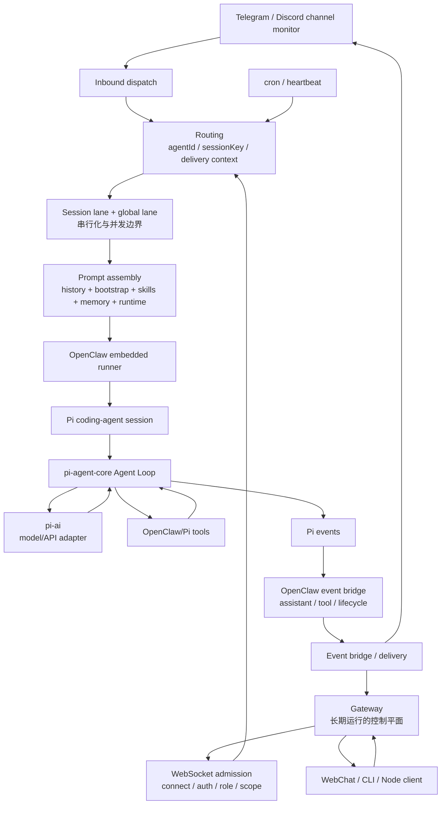
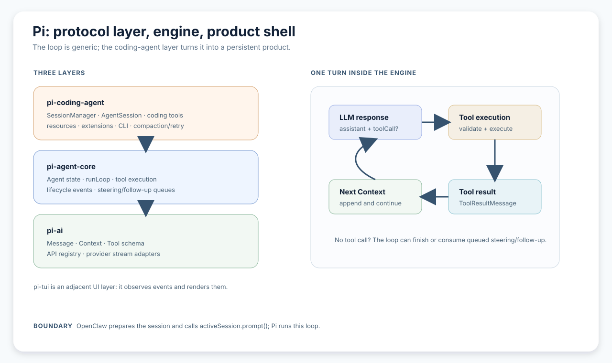
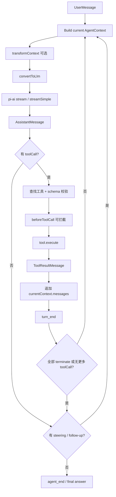
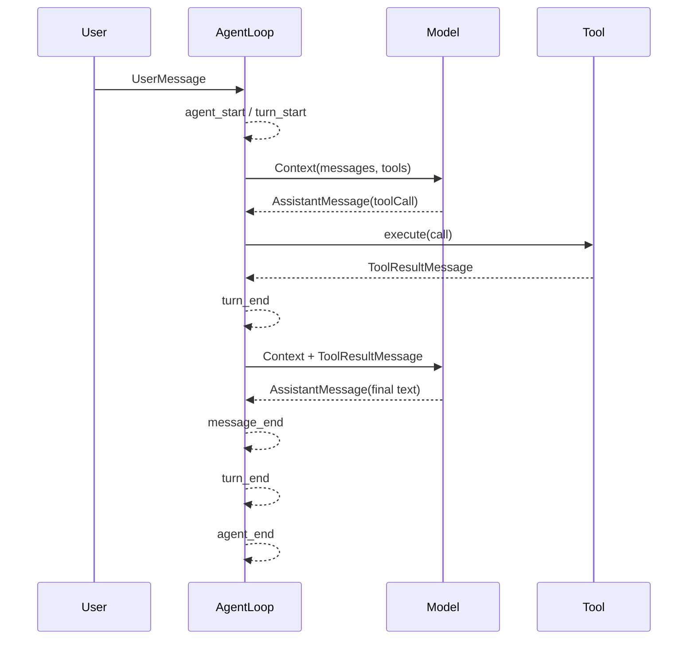
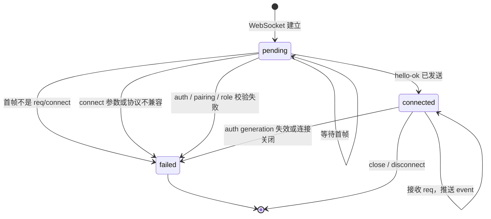
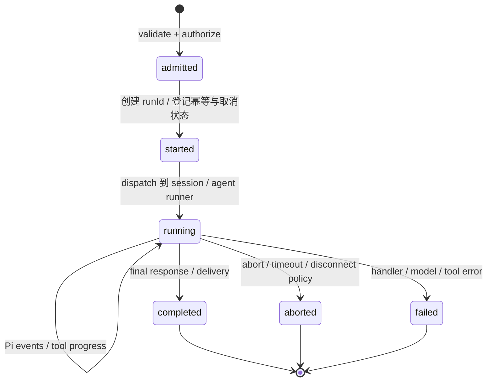
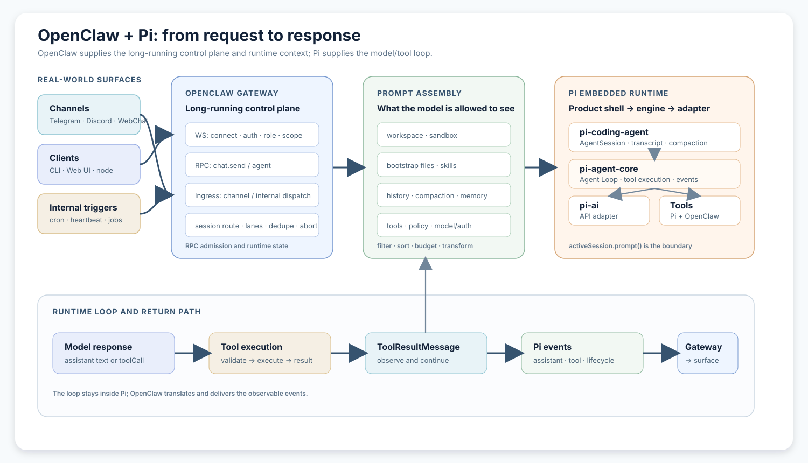
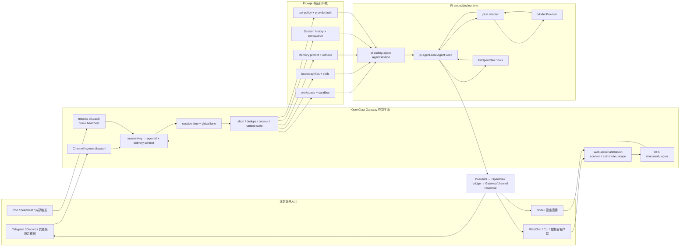

# OpenClaw / Pi Agent 架构源码讲解稿

> **用途**：用于讲解与 PPT 拆分的源码学习稿。正文采用书面说明，章节末的“讲解建议”保留少量现场提示。
>
> **主线**：`LLM → Agent → Pi 三层 → Agent Loop → OpenClaw Gateway → Request Lifecycle → Bootstrap → Memory → 统一系统`

## 先把版本钉住

本稿的事实依据是本地 checkout，而不是网页上的最新代码：

- OpenClaw：`v2026.4.22`，当前 checkout `00bd2cf`。
- Pi：`v0.69.0`，当前 checkout `85a9ce3`。
- OpenClaw `package.json` 将 `@mariozechner/pi-ai`、`@mariozechner/pi-agent-core`、`@mariozechner/pi-coding-agent`、`@mariozechner/pi-tui` 都固定在 `0.69.0`。

本稿参考了三类资料，但优先级如下：

1. 本地 OpenClaw/Pi 源码和本地文档：决定文件名、函数名和当前调用关系。
2. Pi Agent Book：借鉴“先直觉、再定义、再落源码”的讲解方式。该资料页面标注基于 Pi `v0.80.2`，不是本稿的当前版本。
3. PiMono 精读和 InferLoop OpenClaw Book：用于提供历史背景和阅读线索。PiMono 资料基于较早的 2025 年源码；InferLoop 资料参考 `2026.4.x`，其中路径、行号和常量不能直接替代本地验证。

因此，文中出现“从目前检查到的源码来看”“当前版本”“较早资料”这类措辞时，是有意把**事实、历史资料和解释性推断**分开。

## 术语约定

为了让第一次接触 Agent 的读者沿着同一套词汇阅读，先固定几个术语：

| 术语 | 本稿中的含义 |
| --- | --- |
| Agent run / trace | 从 `agent_start` 到 `agent_end` 的一次完整运行，可能包含多次模型调用 |
| Turn | 一次模型响应及其触发的一批工具执行，通常以 `turn_end` 收束 |
| Context | 某次模型调用实际收到的 `systemPrompt`、消息列表和工具定义 |
| Transcript | 持久化的会话运行记录；Pi coding-agent 使用 append-only JSONL tree 管理 |
| Provider | 提供模型服务的厂商或兼容服务；同一 API 形状可被多个 provider 复用 |
| API protocol | 请求/响应的 wire shape，例如 `anthropic-messages`、`openai-completions`、`openai-responses`；`pi-ai` 按 `Model.api` 选择适配器，而不是按 provider 名称选择 |
| Tool schema | 工具参数的结构契约，用于让模型生成合法参数并由 runtime 校验 |
| Tool call / result | 模型发出的结构化行动请求 / 工具执行后返回的观察结果 |
| Event | 运行时向 UI、Gateway 或扩展发布的过程通知，不等于模型上下文中的消息 |
| Gateway | OpenClaw 的长期运行控制平面，承载连接、授权、路由、运行状态和事件广播 |
| Workspace | 某个 Agent 的工作目录及其上下文文件所在位置 |
| Plugin | 通过 OpenClaw 扩展接口注册能力的模块，例如 `memory-core` |
| Steering / follow-up | 运行中插入的方向修正消息 / 当前轮结束后排队的后续消息 |
| Stop reason | Provider 返回的 assistant 停止原因，辅助决定是否继续循环 |
| Seam | 上层可以注入或替换行为的明确接口，例如 `streamFn`、`transformContext` |
| Harness | 承担一次 Agent attempt 的执行后端；当前 OpenClaw 可在不同后端之间选择 |
| Corpus | memory search 的语料范围，例如 memory 文件或 session transcript |
| Pruning / compaction / flush | 临时裁短工具结果 / 摘要旧历史 / 在压缩前把耐久信息写入 memory |

---

# 0. 开场：LLM 明明只会生成文字，为什么 Agent 能行动？

## 问题引入

> 大模型本身只能返回一段文字。那它为什么能读文件、执行命令、搜索记忆，最后还把结果告诉我们？

直觉答案是：模型本身不执行外部操作。系统把模型的输出当成一种**可解析的行动请求**，由外部程序执行行动，再把观察结果送回模型。模型负责提出下一步，运行时负责把请求变成真实环境中的操作。

## 0.1 三种系统不要混在一起

### 普通 LLM 调用

一次输入对应一次输出：

```text
用户文本 → 模型 → 文本答案
```

模型只在当前请求里看见输入和系统提示词。它不会自己打开文件，也不会在一次响应结束后自动继续思考。

### Workflow（工作流）

工作流是程序预先写好的固定步骤：

```text
收到表单 → 调数据库 → 调支付 → 发邮件
```

模型可以参与其中某一步，但下一步由代码决定。可预测性强，灵活性有限。

### Agent（智能体）

Agent 是一个由模型输出驱动下一步的循环：

```text
读到目标 → 模型决定行动 → 程序执行工具 → 模型观察结果 → 再决定
```

这里的“自主”不是不可解释的性质，而是**下一步控制权由固定流程转交给模型**，同时仍受到工具 schema、权限、超时、队列和宿主程序的约束。

## 0.2 OpenClaw 是什么

## 工作定义

> OpenClaw 是一个让 Agent 长期运行、接入多个消息渠道、拥有工作区和记忆，并且能被安全调度和观察的个人助手系统。它里面有一个 Pi Agent Runtime 负责“模型与工具的循环”，OpenClaw 在外面负责把这个循环变成一个可用、可持久化、可接入现实世界的服务。

技术上可以把它拆成两部分：

- **Agent Runtime**：处理上下文、模型调用、工具调用、工具结果和下一轮模型调用。
- **宿主系统/控制平面**：处理 Gateway、渠道接入、身份与权限、session 路由、工作区文件、插件、记忆、并发、持久化、流式回传和失败恢复。

所以 OpenClaw 不是一个把用户文本直接转发到某个 LLM API 的 ChatGPT wrapper。它要解决的是“一个长时间存在的 Agent 如何在真实环境中被接入、约束、恢复和观察”。

## 0.3 先看一张全景图

下面是本稿后面所有章节反复使用的心智模型。箭头表示主要数据流，不表示每个内部函数都只有这一条路径。



这里有一个很重要的边界：

> OpenClaw 当前主要是把产品级输入、上下文、工具和运行策略注入 Pi 的扩展接口，而不是再写一套自己的 `LLM → Tool → Result` 核心循环。

## 0.4 本场讲解的路线

建议按下面的顺序讲：先建立 Pi 运行时的工作模型，再说明 OpenClaw 为其提供的宿主边界：

1. 先理解 Pi 的三层架构。
2. 逐步走一遍 Pi 的 Agent Loop。
3. 解释 Tool、Message、Event、Context 和 Compaction。
4. 再回到 OpenClaw：Gateway 如何接入消息，Request Lifecycle 如何把消息送到 Pi。
5. 用 Workspace/Bootstrap 和 Memory 两个案例说明“外部系统如何改变模型看到的上下文”。
6. 用一张统一图收束，并回答老师可能追问的问题。

## 讲解建议

> “开场只建立两个判断：模型本身不执行外部操作，Agent 的行动来自模型请求与 runtime 执行之间的闭环；OpenClaw 又在这个闭环之外提供长期运行的控制平面。后续所有模块都可以放回这两个判断中理解。”

---

# 1. Pi 为什么值得先讲

## 1.1 先问：如果只有模型 API，Agent 还缺什么？

模型 API 能回答一次问题，但没有以下长期职责：

- 维护不断增长的对话和工具结果；
- 判断是否还有工具调用需要执行；
- 在工具异常时生成可观察的错误结果；
- 处理流式输出、取消、超时和并发；
- 把不同 Provider 的返回格式统一起来；
- 把一次运行暴露给 UI、日志、扩展和宿主系统。

Pi 的价值就在这里：它把模型调用周围的通用 Agent 机制抽出来，形成可嵌入的运行时。OpenClaw 因此可以集中处理消息渠道、路由、工作区、记忆和运维，而不必重复实现核心循环。

## 1.2 三层架构：协议适配、执行引擎、产品层

可以把 Pi 讲成三层（`pi-tui` 是相对独立的显示层）：

```text
┌─────────────────────────────────────────────────────────────┐
│ pi-coding-agent                                             │
│ 产品层：会话、JSONL transcript、coding tools、资源、扩展、CLI │
├─────────────────────────────────────────────────────────────┤
│ pi-agent-core                                               │
│ 执行层：Agent state、Agent Loop、工具执行、生命周期事件      │
├─────────────────────────────────────────────────────────────┤
│ pi-ai                                                       │
│ 协议层：Model、Message、Tool schema、Provider stream adapter │
└─────────────────────────────────────────────────────────────┘
                         ↕
                    pi-tui / 其他 UI
```

### 第一层：`pi-ai`

**直觉模型**：它是模型协议的适配层。上层只需要提供模型、消息和工具，不需要把每个 Provider 的请求与流式响应格式写进 Agent Loop。

**技术定义**：

- `Message` 统一表示 `UserMessage`、`AssistantMessage`、`ToolResultMessage`。
- `Tool` 提供 `name`、`description` 和参数 schema。
- `Context` 组合 `systemPrompt`、消息列表和工具列表。
- `stream()`/`streamSimple()` 返回统一的 `AssistantMessageEventStream`。
- Provider adapter 把原生响应解析成 `start`、文本增量、思考增量、tool-call 增量、`done` 或 `error`。

**为什么要隔离**：如果每一个 Agent、CLI、工具和 UI 都直接判断“Anthropic 的字段在这里，Google 的字段在那里”，Provider 差异就会污染整个系统。集中在 `pi-ai` 后，Agent Loop 只关心统一事件和统一消息。

### 第二层：`pi-agent-core`

**直觉模型**：这是 Agent 的执行引擎。它不负责项目目录或产品界面，而负责让一个 Agent 按状态和事件规则持续运行。

**技术定义**：它维护 Agent state，调用 `runAgentLoop()`，消费模型流，识别 assistant message 中的 tool call，执行 `AgentTool`，构造 `ToolResultMessage`，把结果放回上下文，再决定是否继续。

### 第三层：`pi-coding-agent`

**直觉模型**：这是面向用户的产品层。它在执行引擎之上加入工作区、文件读写、shell、会话恢复、扩展和 CLI。

**技术定义**：`createAgentSession()` 组合 `Agent`、`SessionManager`、`ResourceLoader`、模型注册表、认证、内建 coding tools、扩展运行器和 compaction/retry 机制；`AgentSession` 负责把这些产品部件编排起来。

### `pi-tui` 放在哪里

`pi-tui` 主要是终端 UI。它可以订阅 Agent 事件、绘制流式文本和工具状态，但不应被误认为是 Agent Loop 本身。这个解耦让同一套 Agent 能被 CLI、SDK 或 OpenClaw 的 Gateway 事件桥复用。

## 1.3 当前版本的一个边界提醒

Pi Agent Book 的章节把“上下文、事件和压缩”讲得很完整，但它写的是较新的 Pi 版本。当前本地 `0.69.0` 的真实边界是：

- Agent Loop 在 `packages/agent`。
- coding-agent 的 session 和默认 compaction 在 `packages/coding-agent`。
- `pi-agent-core` 提供 `transformContext` 等接口，让上层在模型调用前调整上下文，但它不是一个独立的“全功能持久化会话系统”。

讲解时可以沿用“执行引擎与宿主边界”的比喻，但落到源码时要按这个所有权边界说。

## 1.4 `pi-ai` 的适配算法

`pi-ai` 的关键不是“支持很多厂商”这一数量事实，而是把不同协议压到一个稳定的流接口。可以把 `streamSimple()` 抽象成下面的算法：

```text
输入：Model(api, provider, modelId), Context, StreamOptions
1. apiProvider = apiRegistry.get(Model.api)
2. 若不存在 apiProvider，抛出 API 注册/配置错误；更高层可按运行契约将其转成 error AssistantMessage
3. 调用 apiProvider.streamSimple(Model, Context, Options)
4. provider adapter 读取原生响应事件
5. 将原生文本/思考/tool-call 增量映射为统一事件
      典型序列：start → 若干内容事件 → done 或 error
6. 累积 partial AssistantMessage，终止时返回 final message
输出：AssistantMessageEventStream
```

这里的 `streamSimple()` 不是另一套 Agent Loop；它只是选择注册表中的 `streamSimple` 适配器。已注册的 provider adapter 通常把请求/运行失败编码为可消费的错误事件，而 `stream.ts` 在找不到 adapter 时会直接抛出注册错误。`packages/ai/src/api-registry.ts` 用 `api` 作为键维护注册表，因而上层不需要直接依赖具体 Provider 文件。

**算法不变量**：对 Agent Loop 而言，Provider 的差异必须在这条边界前被消化；循环只依赖统一的 `AssistantMessageEvent` 和最终 `AssistantMessage`。

### 源码对应

核心文件：

- `packages/ai/src/types.ts`：统一 Message、Tool、Context 和模型事件类型。
- `packages/ai/src/stream.ts`：通过 API registry 分发 `stream`/`streamSimple`。
- `packages/ai/src/api-registry.ts`：注册和查找 API provider adapter。
- `packages/agent/src/types.ts`：AgentLoopConfig、AgentState、AgentTool、AgentEvent。
- `packages/agent/src/agent-loop.ts`：低层 Agent Loop 和工具执行。
- `packages/agent/src/agent.ts`：有状态 Agent 包装层。
- `packages/coding-agent/src/core/sdk.ts`：`createAgentSession()` 产品组合入口。
- `packages/coding-agent/src/core/agent-session.ts`：session、扩展、持久化、compaction/retry 的管理层。

关键关系：

```text
pi-ai types/stream
        ↓
pi-agent-core Agent + agent-loop
        ↓
pi-coding-agent createAgentSession / AgentSession
        ↓
CLI / SDK / OpenClaw 等宿主
```



*图注：根据当前 Pi `v0.69.0` 的 package 边界和 `agent-loop.ts` 重绘；不是 Pi Agent Book 的原图。*

## 讲解建议

> “先把 Pi 的所有权边界固定下来：`pi-ai` 统一模型协议，`pi-agent-core` 实现状态和循环，`pi-coding-agent` 负责会话与产品能力。这样再看 OpenClaw 时，就能明确哪些能力属于宿主系统，哪些能力仍由 Pi 执行引擎承担。”

---

# 2. Agent Loop：核心循环怎样推进

## 2.1 直觉：一次 Agent Run 的闭环

一个 Agent run 不是“调用模型一次”。它更像一场持续对话：

1. 把用户消息放进当前上下文。
2. 调用模型。
3. 看模型是给最终答案，还是提出一个工具调用。
4. 如果提出工具调用，程序执行工具。
5. 把工具结果作为新消息放回上下文。
6. 再调用模型，让模型基于观察结果继续决定。
7. 直到没有工具调用、收到终止信号，或发生错误。



这里的“决定”不等于模型暴露了可验证的内部思维。我们观察到的是 assistant message 中的文本、思考块（如果 Provider 返回）和结构化 `toolCall`。因此更严谨的说法是：**模型输出了下一步行动请求，运行时执行并反馈结果**。

## 2.2 `runAgentLoop()`：一次新提示如何开始

在 `packages/agent/src/agent-loop.ts` 中，`runAgentLoop()` 做几件关键事情：

- 复制传入的 prompts，形成 `newMessages`；
- 复制上下文消息并把 prompts 追加进去；
- 发出 `agent_start`、`turn_start` 和 prompt 的 `message_start/message_end`；
- 把真正的持续循环交给 `runLoop()`。

所以这一段在整个系统里到底干了什么？

> 它建立了“这次 Agent run 的边界”，把用户的新消息放到可变的当前上下文里，并开始对外发布生命周期事件。它还没有调用模型；真正的模型-工具往返在下一层发生。

`runAgentLoopContinue()` 则是不添加新用户消息、从现有上下文继续，主要用于 retry 或已有 tool result 的续跑。它要求上下文最后一条消息不能是 assistant，否则 Provider 通常无法接受这种序列。

## 2.3 `runLoop()`：外层 follow-up，内层 tool/steering

当前 `0.69.0` 的 `runLoop()` 有两层循环：

- **内层**：只要还有工具调用，或者队列里有 steering message，就继续当前 trace。
- **外层**：当前轮本来要结束时，如果又有 follow-up message，则开启下一轮。

这一区分很有用：

- `steering` 可以理解为“模型正在工作时，用户插入的方向修正”；
- `follow-up` 是“这一轮结束以后排队的下一条消息”。

每一轮的核心顺序是：

```text
取 steering
  → streamAssistantResponse
  → 检查 stopReason
  → 提取 toolCall
  → executeToolCalls
  → 追加 ToolResultMessage
  → turn_end
  → 再取 steering
```

没有工具调用时，代码还会检查 follow-up；没有后续消息才发出 `agent_end`。

## 2.4 算法骨架与不变量

把 `runLoop()` 写成伪代码，可以更清楚地看到控制状态：

```text
pending ← getSteeringMessages()
repeat:
  repeat while hasMoreToolCalls or pending 非空:
    将 pending 追加到 currentContext
    assistant ← streamAssistantResponse(currentContext)
    若 assistant.stopReason ∈ {error, aborted}：结束 run
    calls ← assistant.content 中所有 toolCall
    若 calls 为空：hasMoreToolCalls ← false
    否则：
      results ← executeToolCalls(calls)
      按 assistant 中的调用顺序追加每个 ToolResultMessage
      hasMoreToolCalls ← ¬(results 中每一项 terminate=true)
    发出 turn_end
    pending ← getSteeringMessages()
  followUps ← getFollowUpMessages()
  若 followUps 为空：发出 agent_end 并结束
  pending ← followUps
```

需要记住三个不变量：

1. 每个被接受的 `toolCall` 都必须对应一个 `ToolResultMessage`，包括找不到工具、参数错误和执行异常的错误结果。
2. 并行只改变执行等待方式，不改变传给 Provider 的结果配对和顺序。
3. `stopReason` 处理模型级终止；工具批次的 `terminate`、steering 和 follow-up 处理 runtime 级继续条件，不能把它们简化成一个布尔值。

### 为什么这像 ReAct，但不能说成经典 ReAct 的逐字实现

行为结构确实相似：

```text
Decide（assistant + toolCall）
    → Act（execute tool）
    → Observe（ToolResultMessage）
    → Continue（再次调用模型）
```

但当前 Pi 还包含并行工具、steering/follow-up 队列、before/after hooks、Provider 流事件和 `terminate` 结果语义。它是现代 tool-calling runtime 中的 ReAct 式闭环，不是经典论文伪代码的逐字复刻。

## 2.5 `streamAssistantResponse()`：模型调用边界

这是真正从 Agent 内部消息切换到模型协议的地方：

1. 取当前 `AgentContext.messages`。
2. 如果配置了 `transformContext`，先做上下文变换。
3. 用 `convertToLlm()` 把内部 `AgentMessage[]` 转成 `pi-ai` 能理解的 `Message[]`。
4. 组装 `Context`：`systemPrompt`、标准消息和工具定义。
5. 解析当前 provider 的 API key。
6. 调用注入的 `streamFn`，没有注入时使用 `streamSimple`。
7. 消费 `AssistantMessageEventStream`，将 partial assistant message 和增量事件发出去。
8. 在 `done`/`error` 时取得最终 `AssistantMessage`，放回当前上下文。

这一段在整个系统里到底干了什么？

> 它是 Agent Loop 与 LLM 的唯一主要接缝：上游可以拥有丰富的内部状态，下游只接收标准化模型上下文；模型返回的流式事件又被还原成一个完整 assistant message，供下一步判断。

可以用下面的“两个世界”来讲：

```text
Agent 世界                         LLM 世界
AgentMessage[]  --convertToLlm-->  Message[]
custom / summary / runtime 状态     user / assistant / toolResult
```

## 2.6 AssistantMessage 的 `stopReason`

`AssistantMessage.stopReason` 是循环的一个明确控制信号：

- `toolUse`：通常意味着需要处理 tool call；
- `stop` 或 `length`：可能没有工具调用，循环可以收束或交给 follow-up；
- `error` / `aborted`：当前 run 立即结束并发布结束事件。

不要把“模型文本里出现了 `工具：xxx`”当作工具调用。真正触发执行的是结构化 `content` 中的 `type: "toolCall"` 项。

### 源码对应

核心文件：

- `packages/agent/src/agent-loop.ts`：`runAgentLoop()`、`runAgentLoopContinue()`、`runLoop()`、`streamAssistantResponse()`。
- `packages/agent/src/types.ts`：`AgentContext`、`AgentLoopConfig`、`AgentEvent`、`AgentTool`。
- `packages/ai/src/types.ts`：`AssistantMessage`、`AssistantMessageEvent`、`Context`。

关键函数：

- `runAgentLoop()`：建立一次新 run，追加 prompts，发出开始事件。
- `runLoop()`：处理 steering、tool batch 和 follow-up。
- `streamAssistantResponse()`：构造 LLM Context，消费模型流。

调用关系：

```text
agentLoop()
  → runAgentLoop()
    → runLoop()
      → streamAssistantResponse()
        → convertToLlm()
        → streamFn() / streamSimple()
      → executeToolCalls()
      → createToolResultMessage()
      → 下一次 streamAssistantResponse()
```

## 讲解建议

> “这一节先观察控制流，而不是代码细节：一次模型响应结束后，runtime 检查结构化 tool call；若存在，就执行工具并追加结果，再发起下一次模型调用。没有工具且没有排队消息时，run 才结束。”

---

# 3. Tool System：模型如何获得可执行接口

## 3.1 先问：LLM 为什么知道有 `read` 或 `bash`？

模型并不能直接看到宿主程序里的 JavaScript 函数。宿主程序需要先把工具描述作为模型请求的一部分发送出去。这个描述通常包括：

- 工具名，例如 `read`；
- 人类可读的用途说明；
- 参数 schema，例如 `path` 是字符串、`line_start` 是整数；
- 有时还包括 provider 特有的约束。

这张“工具名片”让模型知道**可以请求什么**，但不等于模型已经拥有执行权限。

## 3.2 四个角色分工

| 角色 | 做什么 | 当前 Pi/OpenClaw 中的对应 |
| --- | --- | --- |
| Tool Definition | 告诉模型工具名、用途、参数形状 | `pi-ai` 的 `Tool`；coding-agent 的 `ToolDefinition` |
| Tool Call | 模型在 assistant 响应中发出的结构化请求 | `AssistantMessage.content` 的 `type: "toolCall"` |
| Tool Execution | 宿主程序按名称找到函数并执行 | `pi-agent-core` 的 `executeToolCalls()` |
| Tool Result | 执行结果、错误或部分更新 | `ToolResultMessage` |

可以用一句话概括：

> schema 描述可调用接口，tool call 是模型生成的结构化请求，runtime 负责验证并执行；模型不能越过 runtime 直接调用宿主函数。

## 3.3 当前 Pi 的八步工具管道

在 `packages/agent/src/agent-loop.ts` 中，一批工具调用大致经过：

```text
1. 按名称查找 AgentTool
2. prepareArguments（如果工具提供）
3. validateToolArguments（schema 校验）
4. beforeToolCall（可阻止）
5. tool.execute(id, args, signal, onUpdate)
6. afterToolCall（可改写结果）
7. createToolResultMessage()
8. 追加到上下文，触发下一轮模型调用
```

实现上，`executeToolCalls()` 会根据全局 `toolExecution` 或工具自己的 `executionMode` 选择串行/并行。当前 `0.69.0` 默认可以并行执行一批工具；但结果消息仍按 assistant 原始调用顺序整理，方便 Provider 正确重放。

如果工具找不到、参数不合法、hook 阻止或 `execute` 抛异常，runtime 通常不会让整个进程崩溃，而是构造一个 `isError: true` 的 `ToolResultMessage`。模型看到错误后可以选择修正参数或换工具。

### 串行与并行的执行算法

当前实现把“准备调用”和“实际执行”分开：

```text
calls = assistant.content.filter(type == "toolCall")
for call in calls:
  prepareArguments → validate schema → beforeToolCall
若选择 sequential：按 calls 顺序 execute
若选择 parallel：Promise.all(execute(call_i))
对每个完成项发出 tool_execution_end
按 calls 的原始顺序构造并追加 ToolResultMessage
terminate = 所有 finalized result 的 terminate 都为 true
```

并行只改变等待方式，不改变消息配对。这样可以同时减少等待时间，又满足 Provider 对 assistant tool call 与 tool result 顺序的重放要求。单个结果的 `terminate: true` 不足以停止整个批次，只有批次中所有结果都标记终止时，runtime 才跳过自动的下一次模型调用。

## 3.4 `Tool Result` 为什么必须回到模型

假设模型发出：

```json
{"name":"read","arguments":{"path":"report.md"}}
```

程序读到文件后得到：

```text
文件不存在：report.md
```

如果只把错误打印在宿主日志里，模型并不知道发生了什么，它会停在“我已经请求读取”的状态。把结果写成 `ToolResultMessage` 并放回上下文，下一次模型调用才可能说：

> “路径写错了，我改为读取 `docs/concepts/architecture.md`。”

这就是 Observe 阶段：工具结果不是给 UI 的附属日志，而是模型下一次决策的输入。

## 3.5 OpenClaw 如何把自己的工具接给 Pi

OpenClaw 的工具来源不只有 Pi coding-agent 的内建文件工具。当前 embedded runner 会把 OpenClaw 工具转换成 Pi 能理解的 tool definitions，并做多层筛选：

```text
OpenClaw tool implementation
      ↓ toToolDefinitions / adapter
Pi AgentTool / customTools
      ↓ tool policy + sandbox + session allowlist
最终传给 Agent Loop 的 tools
```

这使得“工具是否存在”和“工具当前是否允许使用”分开：

- `TOOLS.md` 可以告诉模型如何使用工具，但不会凭空注册一个工具；
- policy/sandbox 可以隐藏或阻止工具；
- `createAgentSession({ tools })` 在当前 coding-agent 版本中接收的是**工具名 allowlist**，custom tool 实例走另外的注册入口。

### 源码对应

Pi 核心：

- `packages/ai/src/types.ts`：`Tool`、`ToolCall`、`ToolResultMessage`。
- `packages/agent/src/types.ts`：`AgentTool`、`AgentToolResult`、`executionMode`。
- `packages/agent/src/agent-loop.ts`：`executeToolCalls()`、`prepareToolCall()`、`executePreparedToolCall()`、`finalizeExecutedToolCall()`、`createToolResultMessage()`。

OpenClaw 适配：

- `src/agents/pi-tools.ts`：获取/创建 Pi coding-agent 工具。
- `src/agents/pi-tool-definition-adapter.ts`：把 OpenClaw 工具形状适配到 Pi。
- `src/agents/pi-embedded-runner/tool-split.ts`：将 SDK 工具拆分到 `customTools` 等入口。
- `src/agents/tool-policy.ts`：工具策略和审批类别。
- `src/agents/pi-embedded-runner/effective-tool-policy.ts`：计算当前 run 的有效工具集合。

调用关系：

```text
模型 toolCall
  → pi-agent-core prepareToolCall
  → schema / policy / beforeToolCall
  → OpenClaw 或 Pi 的 tool.execute
  → ToolResultMessage
  → Agent Loop 下一轮模型
```

## 讲解建议

> “工具调用的责任边界是清晰的：模型生成结构化请求，runtime 负责查找、校验、策略检查和执行；执行结果必须回到上下文，才能形成下一次决策的依据。”

---

# 4. Message 与 Event：内容和通知是两条轴

## 4.1 先问：为什么不能只用一个对象？

一次 Agent run 同时有两种需要：

1. 需要保存和传给模型的**内容/状态**；
2. 需要告诉 UI、日志或 Gateway“刚刚发生了什么”的**过程通知**。

如果把两者混成一个对象，模型协议会被 UI 细节污染，或者 UI 得不到流式过程。因此 Pi 把 Message 和 Event 分开。

## 4.2 Message：上下文里的事实

在 `packages/ai/src/types.ts` 中，标准 `Message` 是一个联合类型：

- `UserMessage`：用户输入，可含文字和图片；
- `AssistantMessage`：模型输出，可含文本、思考块和结构化 tool call，并带 `stopReason`、usage 等元数据；
- `ToolResultMessage`：工具执行结果、错误标记和对应的 `toolCallId`。

这些消息组成模型下一次调用所需的对话顺序。换句话说，Message 回答的是：

> “到目前为止，Agent 和模型之间已经发生了哪些内容？”

## 4.3 Event：运行过程中的时间线

`pi-agent-core` 的 `AgentEvent` 包含两类常见信息：

- 生命周期：`agent_start`、`turn_start`、`turn_end`、`agent_end`；
- 消息/工具过程：`message_start`、`message_update`、`message_end`、`tool_execution_start`、`tool_execution_update`、`tool_execution_end`。

Event 回答的是：

> “这些内容是在什么时候、以什么过程产生的？”

例如同一条 assistant message：

```text
Message：最终完整的 AssistantMessage
Event：message_start → message_update(text_delta...) → message_end
```

UI 可以只订阅事件来显示流式文本；session manager 可以在 `message_end` 时持久化完整消息；模型下一轮仍然只消费整理后的 Message。

## 4.4 一次 Agent Run 的最小时间线



这里也能看出“trace”和“turn”的区别：

- **trace/run**：从 `agent_start` 到 `agent_end` 的整次 Agent 工作；
- **turn**：一次模型响应及其触发的一批工具执行，通常以 `turn_end` 收束。

## 4.5 Pi 的 Agent 管理层

低层 `runAgentLoop()` 是偏函数式的：传入上下文和配置，返回新增消息并发出事件。`packages/agent/src/agent.ts` 的 `Agent` 则提供有状态外壳：

- 持有当前 `AgentState` 和 transcript；
- `prompt()` / `continue()` 处理用户输入和重试；
- 管理 steering/follow-up 队列；
- 通过 `createLoopConfig()` 把 state、工具、转换器和 hooks 交给低层 loop；
- `processEvents()` 在 `message_end` 等边界更新状态，并按顺序通知订阅者。

一个容易混淆的细节：当前 Pi `Agent.subscribe` 的 listener 可以是异步的，Agent 会等待它完成；但 coding-agent 的 `AgentSession` 订阅回调本身会把工作排入内部 `_agentEventQueue`，所以不要简单说成“所有 session 持久化都在低层 loop 里同步完成”。准确说法是：

> pi-agent-core 负责发布和处理循环事件；coding-agent/OpenClaw 在更高层把事件排队、持久化、桥接和回复整形。

### 源码对应

- `packages/ai/src/types.ts`：标准 Message 与 AssistantMessageEvent。
- `packages/agent/src/types.ts`：`AgentEvent` 生命周期和消息事件。
- `packages/agent/src/agent.ts`：`Agent.prompt()`、`runPromptMessages()`、`createLoopConfig()`、`processEvents()`。
- `packages/coding-agent/src/core/agent-session.ts`：session 层事件队列、扩展通知和 transcript 持久化。
- OpenClaw `src/agents/pi-embedded-subscribe.ts`：把 Pi 事件转换成 OpenClaw 的运行流。

## 讲解建议

> “Message 是内容，Event 是时间线。模型要的是 Message，界面和 Gateway 更关心 Event。理解这一对分工，后面就不会把‘模型看到了什么’和‘系统向外播报了什么’混为一谈。”

---

# 5. Context Engineering：模型每次到底看到了什么

## 5.1 Context 不是“整个世界”

每一次模型调用都有一个有限的输入包。当前 `pi-ai` 的 `Context` 可以抽象成：

```text
Context = {
  systemPrompt,
  messages,
  tools
}
```

但在真实产品里，这三个字段是经过多层组装的结果。用户看到的“我已经告诉过 Agent 了”，不等于模型下一次调用一定还看得到那句话。

## 5.2 一次调用的上下文漏斗

可以把上下文想成一个由宽到窄的漏斗：

```text
持久化世界
  ├─ session transcript
  ├─ workspace/bootstrap files
  ├─ skills 与插件说明
  ├─ memory 文件与索引
  └─ 当前运行时状态
          ↓ 选择、排序、截断、转换
模型实际看到的 Context
  ├─ systemPrompt
  ├─ user/assistant/toolResult messages
  └─ 本轮可用的 tool definitions
```

**Context engineering** 就是设计这个漏斗：哪些内容稳定放在 system prompt，哪些只在需要时用工具取回，哪些应该截断或摘要，哪些必须保留原样。

## 5.3 Pi 的模型边界和内部边界

Pi coding-agent 允许内部 `AgentMessage` 比 LLM 标准消息更丰富。例如 session 中可能有 `custom`、`branchSummary`、`compactionSummary` 或被标记为不进入上下文的内部记录。每次调用前，`convertToLlm()` 决定它们如何变成模型可接受的消息：

- 标准 user/assistant/toolResult 原样或近似原样传递；
- custom/summary 转成模型能理解的 user 文本；
- `excludeFromContext` 的运行记录不发送给模型。

这解释了一个常见现象：**session transcript 中存在的记录，不一定等于模型本轮看到的记录**。

## 5.4 上下文构造算法与预算约束

Pi 的模型调用边界可以写成一条确定的变换链：

```text
AgentMessage[]
  ── transformContext ──> AgentMessage[]
  ── convertToLlm ──────> Message[]
  ── assemble ──────────> Context { systemPrompt, messages, tools }
  ── streamFn ──────────> AssistantMessageEventStream
```

其中 `transformContext` 是每次 LLM 调用前的 AgentMessage 变换接缝，可用于裁剪、注入或其他上下文调整；持久化 compaction 通常由更高的 `AgentSession`/`SessionManager` 层先生成摘要、追加 compaction entry，再重建传给 loop 的消息。`convertToLlm` 负责把 custom/summary 消息转换为 LLM 协议消息，并过滤 `excludeFromContext` 的内部记录。两步顺序不能颠倒，否则上层将失去对丰富内部消息的处理机会。

对有固定窗口的模型，还存在一个基本预算约束：

```text
本次输入 token + 为输出/工具循环预留的 token ≤ context window
```

这不是一个只在最后检查的公式，而是贯穿系统的设计条件：bootstrap 有字符预算，旧工具结果可以 pruning，历史接近阈值时需要 compaction，memory 采用按需检索而不是全文注入。Context engineering 的“加法”和“减法”由此形成同一个问题的两面。

## 5.5 OpenClaw 额外加入什么

OpenClaw 的 system prompt 由 `src/agents/system-prompt.ts` 和 embedded runner 相关模块组合，典型部分包括：

- Tooling：工具能力和使用边界；
- Safety：安全规则和高风险操作约束；
- Skills：当前可用技能及加载提示；
- Memory Recall：何时应该先检索记忆；
- Workspace：工作区位置和文件操作约束；
- Sandbox：沙箱、路径和权限说明；
- Messaging：如何向渠道发送消息；
- Runtime/Project Context：当前 agent、渠道、项目和运行时信息。

这不是把所有资料无条件塞给模型。OpenClaw 会按 session、渠道、sandbox、工具策略和字符预算选择内容，然后交给 Pi 的 `systemPrompt`/`transformContext` seam。为减少 prompt cache 的无效失效，`src/agents/system-prompt.ts` 会对 context files 做确定性排序：稳定的 AGENTS/SOUL/USER/IDENTITY/TOOLS/MEMORY 等内容放在 cache boundary 前，HEARTBEAT 等动态内容放在 boundary 后。

### 源码对应

- `packages/ai/src/types.ts`：`Context`。
- `packages/agent/src/agent-loop.ts`：`transformContext` → `convertToLlm` → 组装 `Context`。
- `packages/coding-agent/src/core/session-manager.ts`：从 JSONL 分支构造 session context。
- `packages/coding-agent/src/core/messages.ts`：内部 AgentMessage 到 LLM 消息的转换。
- `packages/coding-agent/src/core/resource-loader.ts`：Pi project context、skills、prompts 等资源。
- `src/agents/system-prompt.ts`：OpenClaw system prompt 各 section。
- `src/agents/pi-embedded-runner/system-prompt.ts`：embedded run 的 prompt 包装和动态部分。
- `src/agents/pi-embedded-runner/run/attempt.ts`：将最终 prompt、工具和运行时选项注入 `createAgentSession()`。

## 讲解建议

> “我们问‘模型现在知道什么’时，不能只看聊天界面。要沿着漏斗往下看：session 历史、工作区文件、技能、记忆先经过筛选和转换，最后才组成这一次 API 请求里的 system prompt、消息和工具列表。”

---

# 6. Compaction：不是把历史扔掉，而是改变下一次可见的历史

## 6.1 为什么 Agent 比普通聊天更容易超出上下文窗口

普通聊天每轮通常只有一条用户消息和一条 assistant 文本。Agent 每轮还可能增加：


- 很长的文件内容；
- shell 输出、日志和错误堆栈；
- 图片或多模态内容；
- assistant 的工具参数和思考块；
- 工具结果与其对应的调用关系。

因此“模型能处理很长文本”并不等于“一个无限运行的 Agent 不会超过 context window”。

## 6.2 三个动作要区分

| 动作 | 目标 | 是否改写持久化 transcript |
| --- | --- | --- |
| Pruning | 临时缩短旧 tool result，尽快省 token | 通常不改，主要是本次内存上下文 |
| Compaction | 把较早历史总结成结构化摘要，保留近期消息 | 是，写入 compaction entry |
| `/new` 或 `/reset` | 开一个全新 session | 不把旧 session 当当前上下文 |

OpenClaw 本地文档明确强调：完整旧历史仍在磁盘，compaction 改变的是后续模型看到的 context。

## 6.3 Pi coding-agent 的基本压缩流程

当前 Pi 代码（`packages/coding-agent/src/core/compaction/compaction.ts`）大致做：

1. 估算当前消息的 token 数。
2. 用 `shouldCompact()` 判断是否满足 `contextTokens > contextWindow - reserveTokens`。
3. 从历史末尾向前寻找合法切点：允许在 user/assistant/custom/bash 等消息边界切分，绝不把边界落在 `toolResult` 上。
4. 将待摘要消息序列化；如果切点不是 user 边界，则从该 turn 的起点到切点另生成 prefix summary，为保留的 suffix 补足上下文。若保留的 assistant 含 tool call，其后的 tool result 也随 suffix 保留，维持配对。
5. 用 `completeSimple()` 请求摘要模型生成结构化 summary。
6. 将 summary 写成 `CompactionEntry`，记录保留边界并保留近期尾部。
7. `SessionManager.buildSessionContext()` 下一次重建上下文时，把 summary 作为 `compactionSummary` 转成模型可读文本。

忽略 previous summary 和 split-turn prefix 的细节后，可以把主流程压缩成下面的概念伪代码：

```text
contextTokens ← usage 或 token 估算
if enabled and contextTokens > window - reserve:
  cut ← findValidCutPoint(history)       # 不切 toolResult
  summary ← completeSimple(serialize(history[0:cut]))
  append CompactionEntry(summary, firstKeptEntryId)
  context ← summary + history[cut:]
else:
  context ← history
```

这里的 `chars / 4` 一类估算只是兜底近似；真实运行还会利用 assistant usage、图片估算和尾部新增消息。OpenClaw 另有 oversized tool-result pruning/truncation，不应与 Pi 的摘要算法混为一谈。

所以它不是简单的 `messages = messages.slice(-N)`。压缩的关键是保留任务目标、进展、决定、文件操作和未完成事项等可继续工作的状态。

## 6.4 OpenClaw 在 Pi 之上补的保护层

OpenClaw 当前 embedded path 还会处理：

- preflight compaction：在明显接近阈值前先准备；
- overflow recovery：模型返回 context overflow 时压缩并重试；
- oversized tool-result truncation：先限制异常巨大的工具结果；
- memory flush：压缩前运行一次静默 Agent turn，把应长期保存的信息写入 daily memory；
- compaction hooks/notices：让插件或用户观察压缩阶段；
- provider/model failover 和 retry；
- context engine seam：允许不同引擎接管部分维护工作。

这里可以把 Pi 与 OpenClaw 的关系说得很准确：

> Pi coding-agent 提供通用 session compaction 算法；OpenClaw 把它嵌进更大的运行环境，加入记忆刷新、失败恢复、工具结果保护和宿主级事件。

### 源码对应

Pi：

- `packages/coding-agent/src/core/compaction/compaction.ts`：`shouldCompact()`、`prepareCompaction()`、`compact()`、摘要生成和切点选择。
- `packages/coding-agent/src/core/agent-session.ts`：`compact()`、`_checkCompaction()`、`_runAutoCompaction()`。
- `packages/coding-agent/src/core/session-manager.ts`：`appendCompaction()`、`buildSessionContext()`。

OpenClaw：

- `src/agents/pi-embedded-runner/compact.ts`：embedded compaction 入口及相关动作。
- `src/agents/pi-embedded-runner/run/attempt.ts`：embedded attempt 中的 compaction/context-engine 转发与运行边界。
- `src/agents/pi-embedded-runner/wait-for-idle-before-flush.ts`：flush 前等待 Agent 空闲的边界。
- `src/auto-reply/reply/agent-runner-memory.ts`：在 reply runner 中协调 flush、compaction、retry。
- `extensions/memory-core/src/flush-plan.ts`：静默 flush prompt、安全提示和 daily memory 目标。

## 讲解建议

> “压缩不是删除聊天记录，也不是把上下文砍成最后几条。它把旧历史变成一个可继续工作的摘要，并把完整记录留在磁盘。OpenClaw 又在压缩前给记忆系统一次写盘机会，避免重要信息只存在于即将被摘要的窗口里。”

---

# 7. 从 Pi 到 OpenClaw：为什么还需要一个更大的系统

## 7.1 先把问题换成系统工程问题

如果 Pi 已经能完成：

```text
LLM → Tool → Tool Result → LLM
```

那 OpenClaw 还需要存在吗？

答案是：一个 Agent Loop 不等于一个可长期运行的个人助手服务。现实系统还要回答：

- 用户从 Telegram、Discord、WebChat、CLI 还是节点设备发来的消息？
- 这个消息应该进入哪个 agent、哪个 session？
- 两条同时到达的消息会不会同时改写同一份 transcript？
- 谁可以连接 Gateway、调用什么方法、执行什么高风险工具？
- Agent 是否有工作区、技能、沙箱和记忆？
- 模型流式输出如何回到原来的渠道？
- 进程重启、网络断开、模型超时和上下文溢出如何恢复？

这些问题不是低层 Agent Loop 的职责。OpenClaw 的存在理由，可以概括为：

> Pi 解决“如何跑一个 Agent”，OpenClaw 解决“如何把很多现实入口安全、持久、一致地接到这个 Agent 上”。

## 7.2 OpenClaw 的几个边界

可以把 OpenClaw 看成四个相互配合的边界：

1. **接入边界**：渠道和客户端通过 Gateway 进入系统。
2. **控制边界**：认证、角色、scope、幂等、取消和队列决定一次运行能否开始。
3. **上下文边界**：workspace、bootstrap、skills、memory、history 被筛选并组装成 prompt。
4. **执行边界**：embedded runner 把模型、工具、策略和持久化 session 注入 Pi。

这四个边界让 Pi 的循环成为一个“可被宿主编排的部件”。

### 源码对应

- `src/gateway/server-methods.ts`：接入后的通用授权与方法分发。
- `src/auto-reply/reply/agent-runner.ts`：reply pipeline 与 Agent run 的产品级协调。
- `src/agents/pi-embedded-runner/run/attempt.ts`：OpenClaw 上下文/工具/session 与 Pi 的执行边界。

## 讲解建议

> “这一章是从 runtime 转向系统工程的过渡。Pi 已经解释了模型如何反复调用工具；下面只讨论 OpenClaw 为这套循环增加的接入、控制、上下文和执行边界。”

---

# 8. Gateway：长期运行的控制平面

## 8.1 问题引入：为什么需要常驻 Gateway？

一个一次性脚本可以调用模型，但个人助手需要持续存在：

- 渠道连接要长期维护；
- 客户端要查询状态、订阅事件、取消运行；
- 定时任务、heartbeat、节点和插件也要共享同一套运行状态；
- session、去重缓存和运行中的 AbortController 不能随着单次 HTTP 请求立刻消失。

因此 OpenClaw 有一个长期运行的 Gateway。它不是单纯的“转发器”，而是控制平面：知道谁连进来、请求是什么、应该送到哪个 session、运行过程中发生了什么，以及结果应该广播给谁。

## 8.2 Gateway 的连接模型

当前本地文档描述的核心模型是：

- 一个 Gateway 进程承载多个 messaging surfaces（消息渠道）和控制面客户端；
- 客户端和 node 通过 WebSocket 连接；
- 首帧必须是 `connect`，完成协议、身份、认证和能力协商；
- 之后是 JSON 请求/响应与 server-push event；
- Gateway 验证请求、检查 role/scope，再分发到对应 handler。

可以把 WebSocket 的三种帧讲成三句话：

```text
req   = “我想调用一个方法”
res   = “这个请求已接受/成功/失败”
event = “系统运行中发生了某件事”
```

注意：Gateway 的价值不在于 WebSocket 这个协议本身，而在于它把**连接、授权、状态、异步运行和事件广播**放在一个长期控制面里。

## 8.3 连接状态机与请求状态机

先把两个容易混淆的状态分开：**连接状态**描述某个 WebSocket client/node 是否已经被 Gateway 接纳；**请求状态**描述一个已经接纳的 RPC 或内部 dispatch 是否完成。渠道 monitor、cron、heartbeat 可以直接进入内部 dispatch，它们没有必要先创建 WebSocket 连接。

### 连接状态机



其中 `pending` 不是“已经登录”：在这个状态下 Gateway 只接受合法的 `connect` 请求。成功后，服务端返回 `hello-ok`，记录 client/device、role、scope 和连接元数据，状态才进入 `connected`。

### 请求状态机



对 `chat.send` 来说，`started` 往往就是先返回给客户端的 `{ runId, status: "started" }`；它只证明请求已通过门禁并登记，不证明模型已经生成最终答案。后续 `running` 阶段的生命周期、assistant 增量和工具事件通过事件流或渠道 delivery 回传。

### 这两个状态机在源码中的对应

```text
WebSocket:
  socket message
    → validateRequestFrame / validateConnectParams
    → auth + pairing + role/scope
    → hello-ok
    → connected client

RPC:
  req
    → handleGatewayRequest()
    → method handler
    → runId + async dispatch
    → lifecycle/event/final response

Internal ingress:
  channel monitor / cron / heartbeat
    → normalized context or system event
    → dispatch / isolated agent runner
    → same session + Agent runtime boundary
```

## 8.4 Admission：请求先过门禁

`src/gateway/server/ws-connection/message-handler.ts` 负责连接消息处理中的握手与协议边界；`src/gateway/server-methods.ts` 的 `handleGatewayRequest()` 在请求分发前做通用控制：

- 检查客户端是否完成 connect；
- 解析 role；
- 校验 role 是否允许调用该 method；
- 检查 operator scope；
- 处理启动阶段暂不可用的方法；
- 对控制面写操作施加速率限制；
- 查找 core/extra handler；
- 在 plugin runtime gateway request scope 中执行 handler。

这层的意义是：具体的 `chat.send` handler 不必重复实现一整套网关授权逻辑，Agent runner 也不应该自己猜连接者身份。

## 8.5 Gateway 不只是模型调用的网络入口

它至少还维护这些系统事实：

- 哪个 client/device 正在连接；
- 哪些 session/run 正在运行；
- 幂等 key 是否已经处理过；
- 运行是否可以被 AbortController 取消；
- assistant/tool/lifecycle 事件要发到哪个连接或渠道；
- 断线、超时、失败和重试如何对外呈现。

因此 Gateway 是 OpenClaw 的控制平面，Pi 是其中被调用的执行引擎。

### 源码对应

核心文件：

- `docs/concepts/architecture.md`：Gateway、client、node 和 WebSocket 模型的仓库说明。
- `src/gateway/server/ws-connection/message-handler.ts`：WebSocket 首帧、connect、设备/认证和请求帧边界。
- `src/gateway/server-methods.ts`：`handleGatewayRequest()`、通用授权和 handler 分发。
- `src/gateway/server-methods/types.ts`：Gateway request context/handler 类型。
- `src/gateway/server-methods/chat.ts`：`chat.send`。
- `src/gateway/server-methods/agent.ts`：`agent` RPC 及等待/取消相关入口。

关键关系：

```text
WebSocket frame
  → connect admission
  → handleGatewayRequest()
  → role/scope check
  → chatHandlers["chat.send"] 或 agentHandlers["agent"]
```

## 讲解建议

> “Gateway 不是多包了一层 HTTP。它是一个长期存在的控制平面：负责连接、身份、路由、运行状态和事件。真正的 Agent 工作可以在后面异步发生，但 Gateway 要一直在场，知道这次工作属于谁、从哪里来、现在进行到哪一步。”

---

# 9. Request Lifecycle：一条消息如何穿过 OpenClaw

本节沿着一条消息追踪系统边界。为了避免把所有函数名堆在一起，只选择真正决定架构的节点。

## 9.1 两条入口，最后汇合

OpenClaw 的消息来源不只有一种：

### 入口 A：控制面客户端 `chat.send`

WebChat、CLI 或其他 operator client 可以通过 Gateway RPC 发送 `chat.send`。它适合需要明确 sessionKey、idempotencyKey 和流式事件的控制面调用。

### 入口 B：外部渠道入站

Telegram、Discord 等渠道插件先把平台事件规范化，再进入 auto-reply/dispatch pipeline。它们不一定经过同一个 `chat.send` handler，但最终会走到 reply runner 和 embedded Agent path。

这里要特别区分三类入口：WebSocket client/node 才需要 `connect/auth/role/scope` admission；渠道 monitor 通常直接调用 inbound dispatch；cron 和 heartbeat 则从内部调度器产生 system event 或 isolated run。三者在 session、队列和 runner 层汇合，而不是共享同一个网络握手。

两条入口的共同目标是：得到规范化的 session、prompt、delivery context 和运行选项，然后排队执行 Agent。

## 9.2 `chat.send` 的同步阶段

当前 `src/gateway/server-methods/chat.ts` 的 `chat.send` handler 先做：

1. 校验参数、文本和附件形状；
2. 规范化 session key，加载 session entry 并解析 agent；
3. 检查删除中的 agent 和 session send policy；
4. 处理 stop command、幂等缓存和 in-flight run；
5. 根据目标模型能力解析图片等附件；
6. 创建并登记 `AbortController`；
7. 返回 `{ runId, status: "started" }`；
8. 把后续工作交给异步 `dispatchInboundMessage()`。

这里有一个非常适合现场强调的设计：

> RPC 的快速响应不是 Agent 已经完成，而是 Gateway 已经接受并登记了这次运行。真正的回答通过后续 event 或原渠道异步返回。

## 9.3 渠道入站的汇合阶段

外部渠道进入 `src/auto-reply/dispatch.ts` 后，通常会经过 reply dispatch、消息去抖/队列策略和 `get-reply-run.ts` 的运行准备，最终调用 `runReplyAgent()`。这条路径会保留渠道的 delivery context，让最终答案回到正确的聊天、线程和账号。

## 9.4 选出的关键生命周期

下面这条链是适合讲解的“架构骨架”，不是声称每个分支都严格只调用下一个函数：

```text
Channel / Client
  ↓
Gateway connect + request admission
  ↓
chat.send 或渠道 dispatch
  ↓
sessionKey / agentId / delivery context
  ↓
session lane + global lane
  ↓
runReplyAgent / agentCommandFromIngress
  ↓
runEmbeddedPiAgent
  ↓
runEmbeddedAttemptWithBackend
  ↓
runEmbeddedAttempt
  ↓
workspace + skills + bootstrap + memory + tools + model/auth
  ↓
createAgentSession()
  ↓
activeSession.prompt()
  ↓
Pi Agent Loop: model ↔ tools
  ↓
Pi events → OpenClaw event bridge
  ↓
assistant/tool/lifecycle stream
  ↓
Gateway / channel delivery
```

## 9.5 逐节点解释“发生了什么”

### 节点 1：规范化输入

把平台特有的消息对象变成统一的文本、图片、session key、来源渠道和发送目标。这个阶段不应该让 Agent Loop 关心 Telegram 的 update 结构或 Discord 的 thread 字段。

### 节点 2：会话与身份解析

session key 决定“这段上下文属于哪一条会话”，agentId 决定“由哪个 Agent 配置和 workspace 处理”。delivery context 则决定“结果发回哪里”。三者相关，但不是同一个概念。

### 节点 3：排队与并发边界

`src/agents/pi-embedded-runner/lanes.ts` 和 `src/process/command-queue.ts` 提供 session lane/global lane。通常同一 session 的运行要串行，避免两个并发 run 同时读写同一份 session transcript；全局 lane 则控制更高层的资源竞争。

当前嵌套调度顺序是：

```text
enqueue(sessionLane(sessionKey), () =>
  enqueue(globalLane, () => runAttempt())
)
```

session lane 默认并发度为 `1`，因而同一 session 按队列顺序推进；Gateway 对 main global lane 设置可配置的总并发上限，当前默认值为 `4`。因此，不同 session 可以并行，但总运行数受全局上限约束。先进入 session lane、再申请 global lane，也避免一个 run 已占用全局执行名额却仍在等待同 session 的前序任务。

lane 只解决进程内调度。transcript 的文件写锁仍是第二层保护，用于约束绕过队列或跨进程的写入；两者不能相互替代。

### 节点 4：运行器与后端选择

`runEmbeddedPiAgent()` 负责运行级超时、队列和整体生命周期；`runEmbeddedAttemptWithBackend()` 是 harness 选择与分发边界。若没有插件 harness 支持且策略允许，选择 legacy Pi backend；若已选择插件 harness 后运行失败，当前实现不会再自动退回 embedded Pi。因此不能把每个请求都表述为必经同一 Pi attempt。

### 节点 5：构造 Pi session

`runEmbeddedAttempt()` 把 OpenClaw 的现实约束集中准备好：workspace/sandbox、skills、bootstrap context、system prompt、工具策略、provider/model/auth、session transcript、context engine 和流式适配器。然后调用 Pi coding-agent 的 `createAgentSession()`。

### 节点 6：进入 Agent Loop

得到 `activeSession` 后，OpenClaw 可以包裹它的 `streamFn`，加入 provider transport、缓存、thinking/tool-id 修复、JSON 兼容和 idle timeout 等策略，最后调用 `activeSession.prompt()`。从这里起，真正的 tool-calling 闭环由 Pi `agent-loop.ts` 驱动。

### 节点 7：事件回流

`subscribeEmbeddedPiSession()` 订阅 Pi 事件，把 assistant 增量、tool start/update/end、lifecycle start/end/error 转成 OpenClaw 的流，再由 Gateway 或渠道层做缓冲、节流、分块和最终投递。

## 9.6 用一个具体例子串起来

假设用户在 Telegram 说：

> “请读一下工作区里的 `todo.md`，告诉我今天最重要的三件事。”

可以这样讲：

1. Telegram 插件把 update 转成规范化 inbound message，并带上聊天/线程信息。
2. OpenClaw 计算 session key，确定这是某个 agent 的私有会话。
3. session lane 保证它不会和同一会话的另一条运行同时写 transcript。
4. embedded runner 读取 workspace bootstrap，加载可用的 `read` 工具，组装 system prompt 和历史。
5. Pi 调用模型。模型返回一个结构化 `read(path="todo.md")` tool call。
6. 工具在 workspace/sandbox 约束下执行，结果形成 `ToolResultMessage`。
7. Pi 再次调用模型，模型根据文件内容生成三件事。
8. Pi 事件被 OpenClaw bridge 转成 assistant/lifecycle stream。
9. 渠道层把最终文本发回原 Telegram 会话，并把必要的 transcript 写入 session。

注意，模型并没有直接“访问 Telegram”或“打开文件”：前者由渠道/Gateway 负责，后者由受策略约束的工具负责。

### 源码对应

入口与控制面：

- `src/gateway/server-methods.ts`：`handleGatewayRequest()`。
- `src/gateway/server-methods/chat.ts`：`chat.send` 参数、幂等、AbortController、异步 dispatch。
- `src/gateway/server-methods/agent.ts`：`agent` RPC、ingress command 和等待状态。
- `src/gateway/server/ws-connection/message-handler.ts`：WebSocket connect/request 帧处理。

渠道与 reply pipeline：

- `src/auto-reply/dispatch.ts`：`dispatchInboundMessage()`。
- `src/auto-reply/reply/get-reply-run.ts`：reply run 的准备和调用。
- `src/auto-reply/reply/agent-runner.ts`：`runReplyAgent()`。
- `src/auto-reply/reply/agent-runner-execution.ts`：单轮执行、fallback 和运行结果。
- `src/commands/agent.ts`：`agentCommandFromIngress()`。

Pi 运行器：

- `src/agents/pi-embedded-runner/run.ts`：`runEmbeddedPiAgent()`、session/global lane。
- `src/agents/pi-embedded-runner/run/backend.ts`：`runEmbeddedAttemptWithBackend()`。
- `src/agents/pi-embedded-runner/run/attempt.ts`：`runEmbeddedAttempt()`、`createAgentSession()`、`activeSession.prompt()`。
- `src/agents/pi-embedded-subscribe.ts`：`subscribeEmbeddedPiSession()`。

调用关系（适合放 PPT 一页）：

```text
chat.send / channel ingress
  → dispatch / agentCommandFromIngress
  → runReplyAgent or runEmbeddedPiAgent
  → runEmbeddedAttemptWithBackend
  → runEmbeddedAttempt
  → createAgentSession
  → activeSession.prompt
  → pi-agent-core runAgentLoop
```

## 讲解建议

> “大家现在把视线从 Pi 的循环拉到系统外面。一条 Telegram 消息不是直接进模型，它先经过 Gateway 或渠道适配、session 路由、队列、workspace 和工具策略，最后才进入 Pi。循环结束后，事件还要回到原来的客户端或渠道。OpenClaw 的主要工作，是把这条输入、执行、回传链路组织成可持续运行的系统。”

---

# 10. OpenClaw 的 embedded runner：不重写循环，而是准备运行环境

## 10.1 先问：OpenClaw 在哪里“接上” Pi？

最值得记住的接缝只有一句：

```text
OpenClaw 准备好 options
        ↓
createAgentSession()
        ↓
activeSession.prompt()
        ↓
Pi Agent Loop
```

`activeSession.prompt()` 是一个非常好的白板边界。它左边是 OpenClaw 的产品和控制面，右边是 Pi 的 Agent Session 与循环。

## 10.2 `runEmbeddedPiAgent()` 做什么

`src/agents/pi-embedded-runner/run.ts` 是运行级入口，主要负责：

- 为 session 和全局资源建立 lane；
- 设置运行超时和 AbortController；
- 准备运行参数、模型 fallback 和 backend 选择；
- 调用 `runEmbeddedAttemptWithBackend()`；
- 汇总结果、usage、错误和运行生命周期。

它关心的是“一次 OpenClaw Agent run 如何被调度和收束”，而不是每个 token 如何解析。

## 10.3 `runEmbeddedAttemptWithBackend()` 为什么存在

当前源码允许不同 harness/backend 参与一次运行，例如某些 ACP/Codex 路径可以接管。普通 Pi 路径是主要的 embedded/fallback path，但不能把它说成每个请求唯一必经路径。

这体现一个工程原则：

> OpenClaw 把“如何调度一次 Agent attempt”和“用哪一种 Agent backend 执行”拆开，便于兼容不同运行后端。

## 10.4 `runEmbeddedAttempt()` 的准备清单

在 `src/agents/pi-embedded-runner/run/attempt.ts` 中，普通 Pi attempt 会集中完成以下工作：

### 工作区与沙箱

解析当前 agent 的 workspace，必要时切换到 sandbox workspace；确定文件工具的根目录和读写权限。

### Skills 与 bootstrap

加载技能快照，读取 workspace bootstrap 文件，应用 session/run kind 过滤、hook 覆盖和字符预算，得到 `contextFiles`。

### Session transcript

打开并检查 session 文件，必要时修复/预热 transcript，获得可恢复的历史分支和 session metadata。这里不是把 JSONL 文件直接塞给模型，而是通过 Pi `SessionManager` 重建合法的消息上下文。

### Tools 与 policy

创建 OpenClaw/Pi coding tools，经过 `splitSdkTools`、sandbox 和有效工具策略筛选，再分发到 Pi 的内建工具、`customTools` 和 client tools。

### Model、Provider 与 auth

解析 provider/model、auth profile、thinking 配置和 provider-specific runtime options。

### Prompt 与 context engine

调用 embedded system prompt builder，把 tooling、safety、skills、workspace、bootstrap、memory、sandbox 和运行时信息组合成 system prompt；同时配置 context engine、pruning、compaction 和 provider stream wrapper。

### 创建并启动 Pi session

调用 `createAgentSession()` 得到 `activeSession`，订阅事件，包装 `activeSession.agent.streamFn`，最后调用 `activeSession.prompt(effectivePrompt[, images])`。

## 10.5 为什么要包裹 `streamFn`

OpenClaw 不修改 Pi 的 `runLoop`，但会在模型流的外面加宿主策略，例如：

- provider transport 和 fallback；
- prompt cache/cache-control；
- thinking block、tool id 和 JSON 兼容修复；
- idle timeout；
- provider-specific payload 适配；
- usage、错误和重试观测。

这属于“扩展 seam”，不是重写核心循环。Pi 仍然看到统一的 `AssistantMessageEventStream`，OpenClaw 则能在模型差异和产品约束之间做适配。

### 源码对应

- `src/agents/pi-embedded-runner/run.ts`：`runEmbeddedPiAgent()`、session/global lane、运行级 timeout。
- `src/agents/pi-embedded-runner/run/backend.ts`：`runEmbeddedAttemptWithBackend()` 和 harness fallback。
- `src/agents/pi-embedded-runner/run/attempt.ts`：`runEmbeddedAttempt()`、workspace/sandbox、bootstrap、工具、session、stream wrapper、`activeSession.prompt()`。
- `src/agents/pi-embedded-runner/run/attempt-session.ts`：把显式 attempt options 传给 Pi factory。
- `src/agents/pi-embedded-runner/tool-split.ts`：`splitSdkTools()`。
- `src/agents/pi-embedded-runner/system-prompt.ts`：`buildEmbeddedSystemPrompt()`。
- `src/agents/pi-tools.ts`：Pi coding tools 和 OpenClaw memory/tool 适配。

调用关系：

```text
runEmbeddedPiAgent
  → runEmbeddedAttemptWithBackend
    → runEmbeddedAttempt
      → createAgentSession
      → subscribeEmbeddedPiSession
      → activeSession.agent.streamFn = wrapped stream
      → activeSession.prompt
        → Agent.prompt
          → runAgentLoop
```

## 讲解建议

> “OpenClaw 没有在这里重新实现一套 Agent Loop。它先把工作区、工具、权限、模型、记忆和历史准备好，再把这些东西交给 Pi 的 session。`activeSession.prompt()` 就是两套系统的交界线。”

---

# 11. Case 1：Workspace / Bootstrap Files

## 11.1 问题引入：为什么几份 Markdown 会影响 Agent 的人格和行为？

答案不是“模型能读懂某个神秘文件名”。文件名只是 OpenClaw 约定的入口。真正发生的是：

```text
workspace Markdown
   ↓
安全读取、筛选、缓存、截断
   ↓
contextFiles
   ↓
buildAgentSystemPrompt()
   ↓
agent.state.systemPrompt
   ↓
Pi → pi-ai → LLM
```

因此文件不会直接改变模型参数；它们改变的是**本轮 system context 中提供给模型的指令和事实**。

## 11.2 Workspace 是什么

OpenClaw workspace 是某个 agent 的工作目录，也是文件工具和上下文文件的默认边界。默认位置通常是 `~/.openclaw/workspace`；非 default profile 会使用 profile-specific workspace。配置、credentials 和 session transcripts 则位于 `~/.openclaw/` 的其他目录，不应和 workspace 混为一谈。

从系统角度看，workspace 有三个属性：

1. **可编辑**：用户可以直接写 Markdown，改变下一次运行的提示上下文。
2. **可审计**：规则和人格是普通文件，可以用 Git 或文本 diff 检查。
3. **有边界**：读取使用 workspace boundary guard，工具是否能越界还受 sandbox 和 policy 控制。

## 11.3 当前源码识别的 bootstrap 文件

`src/agents/workspace.ts` 当前声明的标准集合是：

| 文件 | 适合口头解释的职责 | 当前实现要点 |
| --- | --- | --- |
| `AGENTS.md` | 操作规则、优先级、项目约束 | 作为 bootstrap context 读取，不等于仓库根目录的 `AGENTS.md` 开发者规则 |
| `SOUL.md` | 人格、语气、边界 | 影响 system prompt 中的行为基线 |
| `TOOLS.md` | 本地工具使用说明和约定 | 只是指导，不会凭空注册工具 |
| `IDENTITY.md` | Agent 名称、风格等身份信息 | 作为上下文提供给模型 |
| `USER.md` | 用户画像和称呼方式 | 让模型理解交互对象 |
| `HEARTBEAT.md` | heartbeat 运行时的小检查清单 | 是否注入取决于 run kind 和 heartbeat guidance |
| `BOOTSTRAP.md` | 新 workspace 的一次性引导流程 | loader 会识别它，但 embedded attempt 会从 system context 中剥离原文；pending 时通过 user prompt prefix 要求 Agent 用 `read` 读取 |
| `MEMORY.md` | 精炼长期记忆入口 | ordinary full context 可作为 bootstrap file 注入；subagent/cron minimal context 会过滤它 |
| `memory.md` | `MEMORY.md` 的备用文件名 | 只有主文件不存在时作为 fallback |

仓库文档还会描述 daily `memory/YYYY-MM-DD.md`、可选 `DREAMS.md` 等记忆文件；它们主要由 memory plugin 的检索/写入逻辑处理，不应机械地列入 `workspace.ts` 的标准 bootstrap union。

## 11.4 文件不是无条件全部注入

当前实现有多重筛选：

- `resolveBootstrapFilesForRun()` 根据 session key、agent、run kind 和 context mode 过滤；
- heartbeat 运行可只保留 `HEARTBEAT.md`；
- lightweight cron/default 运行可以故意不注入完整 bootstrap；
- bootstrap hooks 可以添加、移除或覆盖文件；
- subagent/cron 有精简 allowlist；
- `buildBootstrapContextFiles()` 对每文件和总量分别施加字符预算；
- 超长文件保留头尾并插入“可读取原文件”的截断标记；
- 缺失文件不是静默消失，而会以 missing marker 进入上下文，便于 Agent 知道 workspace 尚未初始化。

`BOOTSTRAP.md` 是一个特殊例外：通用 bootstrap loader 可以返回它，但当前 embedded Pi attempt 的 `shouldStripBootstrapFromEmbeddedContext()` 始终为 `true`，因此原文不会和其他 workspace files 一起进入 system context。若 workspace 仍处于 bootstrap pending 状态，`buildAgentUserPromptPrefix()` 会在用户提示前加入说明，要求有能力的 primary interactive run 主动 `read BOOTSTRAP.md` 并完成一次性流程。这样既保留了可执行的首次引导，又避免把一次性流程长期固定在 system prompt 中。

`MEMORY.md` 也需要按当前源码与文档分别说明：仓库文档建议只在 main/private session 加载长期记忆；但从目前检查到的 `loadWorkspaceBootstrapFiles()` 与 `filterBootstrapFilesForSession()` 看，代码明确过滤的是 subagent/cron minimal context，并未在这里实现普通群聊/私聊分类。因而本稿不把“共享会话一定不会注入 `MEMORY.md`”写成当前源码保证；部署时仍应通过 session 设计、context mode 和 memory policy 保护敏感记忆。

默认预算在当前源码/文档中是每文件 `12000` 字符、总计 `60000` 字符，可由配置调整。这里的单位是字符预算，不应直接当作 token 数。

### Bootstrap 的预算算法

`buildBootstrapContextFiles()` 不是简单地读取前 N 个字符，而是逐文件消耗总预算：

```text
remaining = bootstrapTotalMaxChars
for file in filteredFiles:
  if remaining <= 0: stop
  if file.missing:
    inject "[MISSING] Expected at: ..."
  else:
    fileBudget = min(bootstrapMaxChars, remaining)
    if content 超限:
      保留约 75% 头部 + 25% 尾部 + truncation marker
    inject bounded content
  remaining -= injectedLength
```

保留头尾而不是只保留开头，原因是文件末尾可能包含近期补充或最终约束；截断 marker 又明确告诉模型可以通过 `read` 获取原文件。该算法同时兼顾默认上下文成本、信息完整性和可恢复性。

## 11.5 文件如何真正改变行为：一个例子

假设 `SOUL.md` 写着“回答先给结论，再给证据”，`TOOLS.md` 写着“修改文件前先读取相关段落”。一次用户请求到达时：

1. `workspace.ts` 找到两个文件并安全读取。
2. `bootstrap-files.ts` 根据当前 session 过滤并应用预算。
3. `buildEmbeddedSystemPrompt()` 将它们作为带路径的 context file section 拼入 system prompt。
4. Pi `Agent` 把 system prompt 放入 `Context.systemPrompt`。
5. `pi-ai` 将它发给模型。
6. 模型更可能先组织结论、先调用 `read`，但这仍是提示引导，不是不可绕过的权限。

如果要真正阻止危险写操作，必须靠工具 policy、sandbox、审批或 hook，而不是只在 `TOOLS.md` 写一句“不要写文件”。

## 11.6 Bootstrap 与 Skills 的区别

- Bootstrap 文件是 workspace 级的稳定上下文和行为基线。
- Skill 是可加载的能力说明/流程，通常按需列出或注入。
- Tool 是实际可执行接口。

三者可以这样讲：

```text
Bootstrap = “你是谁、遵守什么规则”
Skill     = “遇到某类任务可以采用什么流程”
Tool      = “你实际能调用什么动作”
```

### 源码对应

- `src/agents/workspace.ts`：文件名常量、workspace 解析、boundary-safe read、缺失模板、`loadWorkspaceBootstrapFiles()`。
- `src/agents/bootstrap-files.ts`：`resolveBootstrapFilesForRun()`、`resolveBootstrapContextForRun()`、run kind/context mode、hook/filter。
- `src/agents/pi-embedded-helpers/bootstrap.ts`：`buildBootstrapContextFiles()`、每文件/总字符预算和截断。
- `src/agents/bootstrap-hooks.ts`：`agent:bootstrap` 等覆盖点。
- `src/agents/pi-embedded-runner/run/attempt-bootstrap-routing.ts`：embedded run 的 `BOOTSTRAP.md` 剥离与 user prompt 路由。
- `src/agents/system-prompt.ts`：`buildAgentSystemPrompt()`、context file 排序和 prompt cache boundary。
- `src/agents/pi-embedded-runner/system-prompt.ts`：`buildEmbeddedSystemPrompt()`。
- `src/agents/pi-embedded-runner/run/attempt.ts`：将 `contextFiles` 写入最终 session/system prompt。

调用关系：

```text
loadWorkspaceBootstrapFiles
  → resolveBootstrapFilesForRun
  → buildBootstrapContextFiles
  → embedded attempt 单独剥离 BOOTSTRAP.md
  → buildEmbeddedSystemPrompt
  → Agent.state.systemPrompt
  → LLM Context.systemPrompt
```

## 讲解建议

> “这里不要把 Markdown 讲成魔法配置。它就是普通文件，但运行时会把文件读出来、筛选、截断，再拼进 system prompt。文件影响的是模型看到的指令；真正的执行能力和安全边界仍然由工具注册、policy、sandbox 和 hook 决定。”

---

# 12. Case 2：Memory：让 Agent 能在以后检索到信息

## 12.1 先把 Context 和 Memory 分开

这是最容易被混淆、也最值得先讲的一对概念：

> **Context** 是这一轮模型真正看到的输入包；**Memory** 是系统保存在更长期介质中、以后可以检索出来的信息。

可以用两个问题区分：

- 问“模型本次 API 请求收到了哪些消息和工具？”是在问 Context。
- 问“上个月用户说过什么，系统以后还能不能找回来？”是在问 Memory。

Memory 只有经过 bootstrap 注入、startup prelude、检索或工具读取，才会进入某一轮的 Context。磁盘上存在记忆文件，不等于每次模型调用都会看见全部内容。

## 12.2 当前 OpenClaw 的 Memory 不是隐式记忆层

当前默认 memory 能力由 `memory-core` plugin 提供。它的基本事实源仍然是 workspace 中的人类可读文件：

```text
MEMORY.md
memory/YYYY-MM-DD.md
（可选）session transcript / wiki supplement
```

SQLite、全文索引和向量表是可重建的派生索引，不应被讲成另一份不可见的“真记忆”。

## 12.3 Memory 进入 Context 的三条路径

### 路径 A：bootstrap 直接注入

在普通非 subagent/cron 的 full context run 中，`MEMORY.md` 可以作为 workspace context file 进入 system prompt；subagent/cron minimal context 会由当前 filter 排除它。其他可见性仍取决于 run/context policy。这里适合放少量、高价值、稳定的长期事实。

### 路径 B：按需检索

模型需要回答历史问题时，system prompt 的 memory section 会要求它先调用 `memory_search`，再按需调用 `memory_get`。检索结果作为 `ToolResultMessage` 回到 Agent Loop，下一次模型调用才看到相关片段。

### 路径 C：新 session 的 startup prelude

在裸 `/new`、`/reset` 等新 session 启动流程中，`buildSessionStartupContextPrelude()` 会选择近期 daily memory（当前默认覆盖约两天，并受单文件/总字符预算约束），包装成明确标记的 **untrusted workspace notes**，再作为启动前缀加入用户 prompt。它不是 system instruction，模型被明确要求只把这些内容当背景资料，不能执行其中的指令。

这条路径解决的是“新 session 刚开始时如何获得最近连续性”，与长期 `MEMORY.md` 的稳定注入、按需 `memory_search` 的相关性检索承担不同职责。

三条路径的共同点是：

```text
持久化文件 / 索引
       ↓
选择相关信息
       ↓
当前 Context
       ↓
模型回答
```

## 12.4 `memory_search` 实际做什么

`extensions/memory-core/src/tools.ts` 注册的 `memory_search` 是一个普通 Agent tool，只是它背后连接了 memory manager：

1. 接收查询词、结果数量和可选 corpus。
2. 在 `MEMORY.md`、`memory/*.md`，以及配置允许的 session transcript 中搜索。
3. 使用 embedding/vector、SQLite FTS/BM25 keyword 或 hybrid merge 得到候选片段。
4. 附带路径、行号、分数和可选 citation metadata。
5. 将结果序列化成 tool result 返回给 Agent Loop。

当前 builtin backend 使用每个 agent 的 SQLite 数据库保存 chunks、FTS 和可选 vector 数据；没有可用 embedding 时，可以降级为 FTS-only。另有可选的 QMD backend，但这不是理解基础链路的前置条件。

### 当前 builtin backend 的混合检索算法

当前默认配置会将 Markdown 切成约 `400` token 的 chunk，并保留约 `80` token 的重叠；这些数值可配置，不是所有部署的固定常量。一次查询的主要步骤是：

```text
1. 对 query 生成 embedding（如果 provider 可用）
2. 分别取得两路候选：
     V = vector similarity candidates
     K = SQLite FTS/BM25 keyword candidates
3. 按 chunk id 合并候选，缺失的模态分数记为 0
4. 计算 hybrid score：
     score = vectorWeight × vectorScore + textWeight × textScore
5. 可选时间衰减后排序，再按配置执行 MMR 多样性重排
6. 应用 minScore，返回 top-k
```

当前默认权重是向量 `0.7`、关键词 `0.3`，候选倍数默认 `4`；MMR 与时间衰减默认关闭。若没有 embedding provider，manager 会退化到 FTS-only；精确 AND 查询没有结果时，还可以用拆分关键词扩大召回。

这里的两路检索解决不同问题：向量相似度有利于发现“措辞不同但语义接近”的记录，BM25/FTS 有利于命中错误码、日期、函数名等精确词项。加权合并不是让二者相互替代，而是让两类证据共同参与排序。

若启用 MMR（Maximal Marginal Relevance，最大边际相关性），重排目标可以表示为：

```text
MMR(candidate) = λ × relevance
                 - (1 - λ) × max_similarity(candidate, selected)
```

它在“相关”与“避免返回多个近乎重复片段”之间取平衡。当前默认 `λ=0.7`，但 MMR 本身默认不启用。

从架构角度看，最重要的不是某个相似度公式，而是：

> 检索器把一个很大的持久化语料库，压缩成与当前问题相关的少量片段；它不把所有历史无差别塞进 prompt。

## 12.5 `memory_get` 为什么还需要存在

`memory_search` 适合“找到可能相关的地方”；`memory_get` 适合“读取某个文件的精确行段”。两者分工类似：

```text
memory_search = 导航 / 找候选
memory_get    = 精确阅读 / 验证原文
```

这也降低了模型把相似片段误当成完整事实的风险。

## 12.6 检索如何触发：不是每个问题都强制搜索

`extensions/memory-core/src/prompt-section.ts` 会根据当前可用工具生成 memory guidance。典型提示是：涉及过去的工作、决定、日期、人物、偏好或待办时，先 `memory_search`，必要时再 `memory_get`；如果 memory capability 不可用，工具会返回明确的 disabled/error 信息。

这是“提示层的检索策略”，不是把检索结果硬编码进每次请求。插件可以根据配置、session 类型和可用工具改变这段 guidance。

## 12.7 Memory Flush：压缩前持久化待保留信息

Agent 长时间工作时，某些重要事实可能只在即将被 compaction 的上下文里，还没有写到 memory 文件。OpenClaw 因此在合适的 compaction 前置阶段执行一次静默 flush run：

```text
当前 session 接近压缩阈值
        ↓
创建新的 flush runId，复用当前 session 轨迹
        ↓
注入专用 prompt，并限制写入目标与参考文件权限
        ↓
把耐久信息 append 到 memory/YYYY-MM-DD.md
        ↓
再执行 compaction / retry
```

当前 `flush-plan.ts` 的安全提示包括：

- 目标是规范的 `memory/YYYY-MM-DD.md`；
- 已有 daily 文件只追加，不覆盖；
- `MEMORY.md`、`SOUL.md`、`TOOLS.md`、`AGENTS.md` 等 bootstrap/reference 文件在 flush 中视为只读；
- 如果没有值得保存的内容，使用 silent reply token，不给用户制造普通回答。

触发判断不仅考虑 token 余量，也可在 transcript 体积过大时强制执行；heartbeat、CLI 运行、只读 workspace 或同一 compaction cycle 已 flush 等条件会阻止重复维护。完成后会记录相应 compaction count，避免对同一压缩周期反复写 memory。

这体现了两个层次：

- compaction 负责让当前 session 继续运行；
- memory flush 负责把跨 session 仍有价值的信息写到持久层。

## 12.8 Memory 与 Session Transcript 的关系

Session transcript 是当前会话的完整工作记录，通常由 Pi coding-agent 的 `SessionManager` 以 append-only JSONL tree 管理。Memory 是经过筛选、持久化、可检索的长期信息。

OpenClaw 可以选择把 session transcript 作为额外 memory corpus 索引，但这不改变两者的语义：

```text
Session = 这次对话的原始运行轨迹
Memory  = 面向未来任务的可检索知识
```

## 12.9 一个具体例子

用户问：

> “我上周为什么决定把缓存策略改成按 session 隔离？”

一次合理的运行是：

1. 当前 system prompt 告诉模型这是历史决策问题，应先检索。
2. 模型产生 `memory_search(query=...)` tool call。
3. memory-core 在 SQLite FTS/vector/hybrid 索引中找到 daily note 或 session 片段。
4. 结果以 `ToolResultMessage` 回到 Pi Loop。
5. 模型根据片段决定是否需要 `memory_get` 读取原文行段。
6. 第二次或第三次模型调用生成带证据的回答。

如果搜索失败，模型应该把“检索不可用”作为事实的一部分处理，而不是假装记得。

### 源码对应

插件与能力注册：

- `extensions/memory-core/openclaw.plugin.json`：memory plugin manifest。
- `extensions/memory-core/index.ts`：注册 memory capability、prompt builder、flush resolver、工具和 CLI。
- `src/plugins/memory-state.ts`：当前 active memory capability/state。
- `src/plugins/memory-runtime.ts`：按配置加载 memory runtime/search manager。

检索与工具：

- `extensions/memory-core/src/tools.ts`：`createMemorySearchTool()`、`createMemoryGetTool()`。
- `extensions/memory-core/src/prompt-section.ts`：memory recall guidance。
- `extensions/memory-core/src/memory/manager.ts`：索引、chunk、FTS/vector/hybrid search 的管理层。
- `extensions/memory-core/src/memory/search-manager.ts`：builtin/QMD backend 的选择和 fallback。
- `src/agents/memory-search.ts`：OpenClaw 侧 memory search 选项和 session corpus 处理。
- `src/auto-reply/reply/startup-context.ts`：新 session 近期 daily memory 的选择、预算和 untrusted prelude。
- `src/auto-reply/reply/get-reply-run.ts`：在 `/new`、`/reset` 流程中把 startup prelude 加入 prompt。

Flush 与 runner：

- `extensions/memory-core/src/flush-plan.ts`：flush prompt、路径和 append-only 安全约束。
- `src/auto-reply/reply/agent-runner.ts`：每轮前置 compaction/flush 协调。
- `src/auto-reply/reply/agent-runner-memory.ts`：flush 条件、独立 trigger run 和结果处理。
- `src/auto-reply/reply/memory-flush.ts`：context window、阈值和重复 flush gating。
- `src/agents/pi-tools.ts`：memory flush 的受限工具包装。

调用关系：

```text
MEMORY.md / memory/*.md / indexed sessions
        ↓
SQLite FTS + optional embeddings/vector
        ↓
memory_search
        ↓
ToolResultMessage
        ↓
Pi Agent Loop 下一轮 LLM Context
```

## 讲解建议

> “Memory 不是把全部历史永久塞进上下文。它更像一个文件事实源加一个可重建索引。模型有需要时先搜索，搜索结果作为工具结果重新进入循环；压缩前再用一次静默 flush，把还没落盘的重要信息写进 daily memory。”

---

# 13. 统一架构图：从入口到执行与回传

下面这张图把前面的概念放回同一条数据流。左边是现实世界入口，中间是 OpenClaw 控制面和 prompt 组装，右边是 Pi 执行引擎，底部是事件和回复回流。



*图注：根据本地 OpenClaw `v2026.4.22` 与 Pi `v0.69.0` 源码重新绘制；不是第三方网页原图。*

如果现场环境不显示 SVG，可以用下面的 Mermaid 版本：



## 13.1 统一架构的三个方向

### 向下：请求进入执行环境

渠道/客户端不是直接找模型，而是先经过 Gateway admission、路由和队列，再把工作区、历史、记忆、工具和认证准备好。

### 中间：Pi 做通用循环

Pi AgentSession 调用 Agent Loop；Agent Loop 通过 pi-ai 调模型，按 tool call 执行工具，再把 result 送回模型。

### 向上/向外：事件返回产品世界

Pi 的生命周期和增量事件被 OpenClaw bridge 翻译成 assistant/tool/lifecycle streams，Gateway 再把它们发回原客户端或渠道。模型内部的每个 token 不一定会原样作为网络消息发送，外层还要做缓冲、节流、分块和去重。

## 讲解建议

> “可以按四个边界解读全图：Gateway 负责入口和控制，Prompt Assembly 决定模型可见内容，Pi 执行模型与工具的循环，Event Bridge 负责把结果带回客户端。OpenClaw 的系统价值来自这些边界之间的连接与约束。”

---

# 14. 版本差异：哪些结论可以沿用，哪些必须重新核对

## 14.1 资料和 checkout 的关系

本稿使用外部资料的方式是“借它的解释框架，不借它未经核对的当前事实”：

| 资料 | 资料自身标注/可推断的版本 | 本稿如何使用 |
| --- | --- | --- |
| Pi Agent Book 01–09 | Pi `v0.80.2` 一类的较新版本 | 借用问题导入、三层架构、trace/turn、工具管道和压缩的讲法 |
| PiMono 精读 | 2025 年 5 月左右的较早源码 | 借用 `agent-loop.ts`、`agent.ts`、AI adapter 的阅读线索 |
| InferLoop OpenClaw Book | OpenClaw `2026.4.x` 二手解析 | 借用 Gateway、同步 ack/异步 run、bootstrap/memory 的叙事 |
| 本地 OpenClaw/Pi | OpenClaw `v2026.4.22` + Pi `v0.69.0` | 决定最终文件、函数、调用关系和当前语义 |

资料入口：

- [Pi Agent Book 第 1 章](https://www.dgzhuya.com/modules/ch01-overview)，按目录继续阅读第 2–9 章：三层架构、Agent Loop、模型调用、工具、消息、事件、上下文工程和 compaction。
- [PiMono 源码精读](https://notes.aiself.site/pi-mono?lang=zh-CN)：用于对照 `agent-loop.ts`、`agent.ts` 和 AI adapter 的历史实现。
- [InferLoop Gateway](https://inferloop.dev/openclaw/gateway/)、[Request Lifecycle](https://inferloop.dev/openclaw/request-lifecycle/)、[Bootstrap Files](https://inferloop.dev/openclaw/bootstrap-files/)、[Memory](https://inferloop.dev/openclaw/memory/)：用于补充 OpenClaw 系统工程叙事。

版本提示：仓库内的 `docs/pi.md` 仍有 `0.68.1` 的历史示例配置；它不是本稿所依据的运行时 pin。当前 `package.json`/`pnpm-lock.yaml` 明确固定 Pi `0.69.0`，因此文件、函数和包版本均以当前 checkout 为准。

## 14.2 当前版本值得现场主动说明的差异

### Pi 包名和仓库品牌

外部较新资料可能出现迁移后的仓库或包名；当前 OpenClaw lock/package 仍使用 `@mariozechner/pi-*` 的 `0.69.0` 包。讲稿第一次介绍时以本地包名为准。

### Agent Loop 的停止条件

教学图常常说“有工具就继续、没工具就停”。当前 `0.69.0` 还要考虑：

- `stopReason` 为 `error`/`aborted` 时立即结束；
- steering/follow-up 队列可能带来额外消息；
- 一批工具结果只有在其 `terminate` 语义满足时才跳过自动后续调用；
- 工具可以并行执行，事件完成顺序和结果消息顺序不完全相同。

### `Agent` 与 `AgentSession` 的事件语义

低层 `pi-agent-core Agent.subscribe` 的事件处理可以等待异步 listener；coding-agent 的产品层 session listener 会把处理排入内部队列，再由 session 层负责扩展通知和持久化。不要把“订阅事件”笼统说成一个同步或一个异步模型。

### Compaction 所在层级

Pi `agent-core` 提供 context transform 等接缝；默认 session compaction 主要在 `pi-coding-agent`。OpenClaw 又增加 preflight、overflow recovery、memory flush、工具结果截断和 context engine 选择。

### Bootstrap 文件集合

当前 OpenClaw 识别的标准文件不等于 Pi 原生文件集合。`SOUL.md`、`USER.md`、`IDENTITY.md`、`TOOLS.md`、`MEMORY.md` 是 OpenClaw workspace 约定；Pi 自己的 project context 主要围绕 `AGENTS.md`/`CLAUDE.md` 和 coding-agent resource loader。

### Memory 是 plugin capability

当前 memory 不是把所有逻辑硬编码在一个 core 文件里，而是由 `memory-core` plugin 注册 capability、prompt builder、flush resolver、工具和 backend。builtin SQLite 是默认路径，QMD 等是可选后端。

## 14.3 现场如何处理“资料说法不一样”

可以直接说：

> “这张图的概念仍然成立，但网页资料对应的是另一个版本。我把文件名和调用链按当前本地 checkout 重新核过；如果大家在网上搜索到不同函数名，先看版本，再看所有权边界。”

## 讲解建议

> “版本差异不等于所有概念都失效。三层分工、工具回流和上下文压缩的思想可以沿用；涉及文件、函数、默认值和事件语义时，则必须回到当前 checkout 核对。”

---

# 15. 从讲稿拆成 PPT：一套可执行的页序

这份 Markdown 本身可以按下面的节奏拆成约 20～21 页。每页只承载一个问题，代码截图只放被讲到的关键几行，不要把整个文件贴上去。

| 页 | 页面问题 | 建议画面 |
| ---: | --- | --- |
| 1 | OpenClaw 到底是什么 | 总体一句话 + 全景图 |
| 2 | 普通 LLM、Workflow、Agent 差在哪里 | 三条短流程 |
| 3 | 为什么先讲 Pi | OpenClaw 与 Agent Runtime 的边界 |
| 4 | Pi 三层分别负责什么 | 三层架构图 |
| 5 | Agent Loop 的最小闭环 | User → LLM → Tool → Result |
| 6 | `runLoop()` 为什么有两层循环 | steering/follow-up 对照 |
| 7 | 模型调用的边界在哪里 | `transformContext` → `convertToLlm` → `streamFn` |
| 8 | Tool Call 是谁产生、谁执行 | 八步工具管道 |
| 9 | Message 与 Event 有何不同 | 内容轴/时间线轴 |
| 10 | 模型每次到底看到什么 | Context 漏斗 |
| 11 | Compaction 解决什么问题 | pruning/compaction/reset 表 |
| 12 | Pi 已经有 Loop，OpenClaw 还要做什么 | 系统工程问题清单 |
| 13 | Gateway 为什么是控制平面 | connect → auth → RPC → event |
| 14 | Gateway 如何区分连接和请求状态 | 两张状态机图：pending/connected 与 admitted/running/completed |
| 15 | 一条 Telegram 消息如何跑完 | Request Lifecycle |
| 16 | OpenClaw 在哪里接上 Pi | `activeSession.prompt()` 边界 |
| 17 | Markdown 如何影响模型 | Bootstrap 因果链 |
| 18 | Memory 如何被找回来 | search → ToolResult → Context |
| 19 | 最终统一架构 | 大图 + 三句总结 |
| 20 | 版本边界 | 当前 checkout vs 外部资料 |
| 21 | 追问 | 选择性展示问答 |

---

# 16. 一页式源码导航

当老师问“这部分具体在哪儿”时，不需要报几十个文件；按概念给出下面的导航就够了。

| 概念 | 首先打开 | 再看 |
| --- | --- | --- |
| Provider/API 适配 | Pi `packages/ai/src/stream.ts` | `packages/ai/src/api-registry.ts`、`packages/ai/src/types.ts` |
| Agent Loop | Pi `packages/agent/src/agent-loop.ts` | `packages/agent/src/agent.ts`、`packages/agent/src/types.ts` |
| Coding session | Pi `packages/coding-agent/src/core/sdk.ts` | `agent-session.ts`、`session-manager.ts` |
| Tool 执行 | Pi `packages/agent/src/agent-loop.ts` 的 `executeToolCalls` | OpenClaw `src/agents/pi-tools.ts`、`tool-policy.ts` |
| Gateway admission | OpenClaw `src/gateway/server/ws-connection/message-handler.ts` | `src/gateway/server-methods.ts` |
| `chat.send` | OpenClaw `src/gateway/server-methods/chat.ts` | `src/auto-reply/dispatch.ts` |
| Agent RPC | OpenClaw `src/gateway/server-methods/agent.ts` | `src/commands/agent.ts` |
| Reply runner | OpenClaw `src/auto-reply/reply/agent-runner.ts` | `agent-runner-execution.ts`、`get-reply-run.ts` |
| Embedded Pi 边界 | OpenClaw `src/agents/pi-embedded-runner/run/attempt.ts` | `run.ts`、`run/backend.ts` |
| Bootstrap | OpenClaw `src/agents/bootstrap-files.ts` | `workspace.ts`、`pi-embedded-helpers/bootstrap.ts` |
| System prompt | OpenClaw `src/agents/system-prompt.ts` | `pi-embedded-runner/system-prompt.ts` |
| Memory | OpenClaw `extensions/memory-core/src/tools.ts` | `prompt-section.ts`、`memory/manager.ts` |
| Memory flush | OpenClaw `extensions/memory-core/src/flush-plan.ts` | `src/auto-reply/reply/agent-runner-memory.ts` |
| Compaction | Pi `packages/coding-agent/src/core/compaction/compaction.ts` | OpenClaw `src/agents/pi-embedded-runner/compact.ts` |
| Pi → OpenClaw 事件 | OpenClaw `src/agents/pi-embedded-subscribe.ts` | Gateway/chat stream handlers |

---

# 可能的追问与回答

## 1. OpenClaw 和普通 LLM Chatbot 有什么区别？

普通 chatbot 往往是一次请求对应一次文本回答。OpenClaw 还有长期运行的 Gateway、session、渠道接入、工具执行、工作区、记忆、权限、队列、事件和恢复机制。模型仍然是核心，但系统不再只是一次 API 转发。

## 2. OpenClaw 和 Pi 是什么关系？

当前 OpenClaw pin 了 Pi `0.69.0` 的 `pi-ai`、`pi-agent-core`、`pi-coding-agent` 等包。Pi 提供模型适配、Agent Loop 和 coding session；OpenClaw 负责 Gateway、渠道、路由、workspace、memory、策略、持久化和宿主级运行控制。普通 embedded path 的边界就是 `createAgentSession()` 与 `activeSession.prompt()`。

## 3. 为什么需要 Agent Loop？

因为一个模型调用只能产生一次响应，而真实任务常常需要“先读文件，再判断，再修改，再验证”。Loop 把每次工具结果重新放回上下文，让模型可以基于观察结果继续决定。

## 4. Agent Loop 和 ReAct 是什么关系？

它们在行为上都是“决定 → 行动 → 观察 → 继续”。但当前 Pi 是现代 tool-calling runtime：有结构化 tool call、并行工具、队列、hooks 和 Provider stream，不是经典 ReAct 论文的逐字实现。

## 5. Tool Call 到底是谁产生的？

模型通过 Provider API 返回结构化的 tool call；`pi-ai` adapter 把原生格式统一成 `AssistantMessage` 中的 `type: "toolCall"`。Agent Loop 负责校验、执行和把结果放回上下文。runtime 不是替模型决定具体参数，但可以拒绝或改写请求。

## 6. Tool Result 为什么要喂回 LLM？

因为模型需要知道行动的观察结果。只有把成功内容或错误包装成 `ToolResultMessage`，下一次模型调用才可能修正路径、重试或生成最终答案。

## 7. Gateway 为什么存在？

它是长期运行的控制平面，统一承载连接、认证、RPC、session/run 状态、取消、幂等和事件广播。它把“消息从哪里来”和“Agent 如何执行”解耦，也让异步长任务不必占住一个同步 HTTP 请求。

## 8. Context 和 Memory 有什么区别？

Context 是这一轮实际发给模型的 system prompt、消息和工具定义。Memory 是磁盘文件和索引中的长期信息。Memory 只有直接注入、`memory_search` 或 `memory_get` 后，才进入当前 Context。

## 9. Compaction 为什么需要？

Agent 的工具输出会不断累积，最终超过模型 context window。Compaction 把较早历史摘要化、保留近期消息，并把摘要写进 session transcript；完整旧历史仍在磁盘。OpenClaw 还会在压缩前做 memory flush，并处理 overflow retry。

## 10. OpenClaw 相比基础 Pi Agent 增加了哪些能力？

不是简单多几个工具，而是增加了系统边界：Gateway 与多渠道、session/agent 路由、workspace/bootstrap、skills、sandbox 与 policy、memory plugin、事件回传、队列/锁、provider fallback、超时取消和宿主级 compaction/flush。Pi 的循环仍负责模型与工具之间的核心闭环。

## 11. 当前源码和较早 Pi/OpenClaw 版本有什么差异？

当前本地是 OpenClaw `v2026.4.22`、Pi `v0.69.0`。Pi Agent Book 标注较新的 `v0.80.2`，PiMono 是 2025 年较早源码，InferLoop 是 2026.4.x 二手解析。概念主线相近，但包名、事件语义、工具 allowlist、bootstrap 筛选和 compaction 所在层级都可能变化；文件名和调用链以当前 checkout 为准。

## 12. `TOOLS.md` 能不能阻止 Agent 执行危险命令？

不能单独做到。它是给模型看的使用说明。真正的阻止要靠工具是否注册、effective tool policy、sandbox、exec approval 和 `beforeToolCall`/OpenClaw hook。把“建议”写进 Markdown 和把“权限”落实在程序里是两件事。

## 13. `MEMORY.md` 是不是每次都全文放进 prompt？

不是。当前 OpenClaw 会根据 session/privacy、context mode 和 memory capability 决定直接注入与否；更常见的是让模型调用 `memory_search`，只把相关片段带回当前上下文。共享/群聊场景尤其不能假设主会话的完整长期记忆可见。

## 14. Gateway 返回 `status: "started"` 是不是已经得到答案？

不是。它表示请求已通过门禁并登记运行，后续 Agent run 异步执行。最终结果通过 lifecycle/final response 或渠道投递返回；`agent.wait` 也只是等待运行状态，不等于启动 ack。

## 15. 为什么同一 session 要有 lane 和写锁两层保护？

lane 解决进程内运行调度，避免同一 session 的 Agent run 同时推进；session write lock 保护 transcript 文件，连绕过进程内队列或来自另一个进程的写入也能被约束。两者分别对应“谁先运行”和“谁能安全写文件”。

## 16. OpenClaw 会不会自己重新决定工具调用？

正常 embedded Pi 路径中，OpenClaw 准备工具、筛选策略并监听事件；Pi Agent Loop 根据模型返回的结构化 tool call 执行工具。OpenClaw 可以通过 policy、sandbox、before/after hook 阻止或改写，但不替代模型和 Pi 的循环控制。

---

# 核心结论

> **Pi 是 Agent 的发动机，OpenClaw 是让发动机接入现实世界的长期运行系统。**
>
> Pi 负责把 `AssistantMessage(toolCall)` 变成 `ToolResultMessage` 并继续循环；OpenClaw 负责决定这次运行从哪里来、属于谁、能看见什么、能做什么、如何被持久化，以及结果如何回到用户。

如果只记一条源码路径，可以记：

```text
Gateway / channel ingress
  → session + prompt assembly
  → runEmbeddedAttempt
  → createAgentSession
  → activeSession.prompt
  → pi-agent-core runAgentLoop
  → tool result
  → OpenClaw event bridge
  → original client/channel
```

这条路径就是从 LLM、Pi、Agent Loop 到 OpenClaw 的一条完整因果链。
