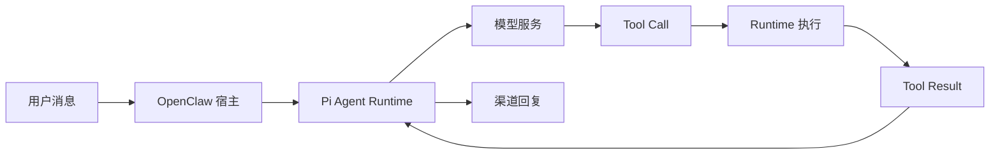

# M01：OpenClaw 是什么

> [总目录](../index.md) · [下一页：M02 总体架构](M02.md)

## 问题引入

大模型只返回文字，为什么 OpenClaw 能读文件、执行命令、搜索记忆，再把结果发回 Telegram？要回答这个问题，先把普通 LLM、Workflow 和 Agent 分开。

## 直觉解释

普通 LLM 像一次函数调用：输入进去，输出回来。Workflow 像一张固定的流水线图：第一个函数完成后，代码明确决定调用第二个函数。Agent 则把“下一步做什么”交给模型提出，但把“能做哪些事、怎样执行、何时停止”交给运行时约束。

因此，Agent 的行动不是模型突然获得了操作系统权限，而是下面这个闭环：

```text
用户目标
  → 模型提出结构化行动
  → Runtime 验证并执行工具
  → 工具结果成为下一条消息
  → 模型根据观察继续或结束
```

## 技术定义

OpenClaw 是一个长期运行的 Agent 宿主系统。它在一个 Pi Agent Runtime 外部增加了：

1. 多渠道接入和 Gateway 控制面；
2. agent/session 路由、队列、锁和取消；
3. Workspace、Bootstrap 文件、Skills 和 System Prompt 组装；
4. 工具聚合、权限策略、沙箱和消息投递；
5. Memory 插件、Transcript 持久化、事件桥和失败恢复。

“OpenClaw 是 Pi 的外壳”这个说法只在说明依赖关系时有用，技术上更精确的表达是：OpenClaw 选择并配置一个 harness；普通 embedded reply 路径通常使用 Pi coding-agent，但系统保留其它 harness 和 fallback 路径。Pi 负责通用循环，OpenClaw 负责把循环放入真实的消息、文件、权限和运行环境。

## 必要算法

以下为教学伪代码，用来表达控制流程，不是源码原文。

```text
function agentRun(userInput):
    route = resolveAgentAndSession(userInput)
    runtimeContext = assembleWorkspaceBootstrapSkillsMemory(route)
    tools = buildAllowedTools(route.policy, route.sandbox)
    while true:
        assistant = model(runtimeContext)
        if assistant has no tool call:
            return assistant.text
        results = executeTools(assistant.toolCalls, tools)
        runtimeContext.messages.append(assistant)
        runtimeContext.messages.extend(results)
```

真正的实现还包含流式事件、`stopReason`、steering、follow-up、compaction、failover 和取消；这个伪代码只保留因果骨架。

## 源码对应

核心文件：

- `src/agents/pi-embedded-runner/run/attempt.ts`：一次 embedded attempt 的工作区、工具、Prompt、Pi Session 和订阅组装。
- `packages/agent/src/agent-loop.ts`：通用模型-工具循环。
- `packages/coding-agent/src/core/agent-session.ts`：把 Agent Loop、资源加载、Transcript 和编码工具组成可用会话。
- `src/gateway/server-methods/chat.ts`：Gateway 的 `chat.send` 入口。
- `src/auto-reply/dispatch.ts`：把已规范化的 inbound context 交给 reply pipeline。

关键调用关系：

```text
用户输入 → OpenClaw 路由/上下文 → Pi AgentSession → pi-agent-core Loop
        → pi-ai Provider → 工具执行 → Tool Result → 下一次模型调用
```

## 具体例子或流程图



## 讲解建议

先让听众记住两句话：模型不直接执行外部操作；OpenClaw 不等于一次模型 API 转发，而是 Agent Loop 的长期运行宿主。后面每个模块都回答“它为这个闭环增加了什么边界”。

## 源码深读：从“会聊天”到“能工作的系统”

网页教程在这里通常用一个最小 Agent 作为起点。把这个起点放到 OpenClaw，就会看到三个必须同时成立的契约。

### 契约一：模型只负责提出下一步

`pi-ai` 的 `AssistantMessage` 把模型输出限制成三种可处理的内容块：文本、思考块和 `toolCall`。这意味着模型能够表达“我想读取 `todo.md`”，但没有任何字段直接等于“已经读取了文件”。真正的读操作发生在 `AgentTool.execute()`，并且由宿主提供的函数决定读哪个根目录。

如果模型返回一段普通文本，Loop 可以结束当前 turn；如果返回一个 `toolCall`，Loop 必须把调用转交给工具系统；如果 Provider 返回 `error` 或 `aborted`，Loop 必须把失败编码成一个带 `stopReason` 的 AssistantMessage。这个协议让“模型的语言”和“程序的动作”保持清晰分离。

### 契约二：宿主必须给出可定位的现场

“读取 todo.md”在不同 agent、不同 session、不同沙箱下可能指向不同文件。OpenClaw 在 `runEmbeddedPiAgent()` 中解析 `sessionKey`、`agentId` 和 Workspace，再在 `runEmbeddedAttempt()` 中把 `effectiveWorkspace`、sandbox context、channel hints、sender metadata 和 `runId` 传给工具工厂。

因此，同名的 `read` 工具不是全局单例。它是一次 run 的配置产物：工具名称和 schema 由 Pi 识别，实际路径、安全边界和消息上下文由 OpenClaw 注入。这个差异解释了为什么“Pi 有 read 工具”不能推出“OpenClaw 的 read 行为和 Pi CLI 完全相同”。

### 契约三：用户要看到的是事件，不是内部对象

模型生成 token、工具开始执行、工具输出分块、模型完成一轮，这些过程都需要即时反馈。OpenClaw 通过 `subscribeEmbeddedPiSession()` 观察 Pi 的事件，再转换成 block、tool、final 和 lifecycle delivery。用户界面通常不会直接看到 `ToolResultMessage` 的 TypeScript 对象，而是看到事件桥格式化后的文本或附件。

这形成两条并行的因果链：

```text
Context / Message 链：
AssistantMessage(toolCall) → ToolResultMessage → 下一次模型调用

Event / Delivery 链：
tool_execution_start → tool_execution_update → tool_execution_end
→ message_end → turn_end → agent_end → final delivery
```

第一条链决定模型下一步；第二条链决定人什么时候看到进展。两条链共享一次运行，但不共享语义。

## 把三种系统放进同一张判别表

| 观察问题 | 普通 LLM | Workflow | OpenClaw Agent |
| --- | --- | --- | --- |
| 下一步由谁决定 | 调用方代码或用户 | 预先编排的代码 | 模型输出与宿主策略共同决定 |
| 是否能执行外部动作 | 没有 | 固定函数可以 | 通过经过 schema、policy、sandbox 的工具 |
| 上下文是否持续增长 | 一次请求内 | 由流程显式保存 | Session transcript + Context 重建 |
| 是否能从中途恢复 | 由应用另行实现 | 由工作流引擎实现 | Gateway store、Pi SessionManager、retry/repair |
| 如何连接现实渠道 | API 调用方自己接 | 每条流程自己接 | Gateway、channel monitor、delivery bridge |
| 如何处理模型差异 | 调用方自己适配 | 每个节点自己适配 | `pi-ai` registry 按 `Model.api` 适配 |

这张表的重点不是把 Agent 说得神秘，而是指出它多了一个“运行时”。这个运行时维护状态、调用工具、处理错误、控制并发，并且把模型返回的结构转换成真实环境中的动作。

## OpenClaw 的“控制面”和“数据面”

OpenClaw 的控制面包含 Gateway 连接、认证、role、scope、方法表、session 元数据和运行状态。数据面包含 inbound message、prompt、assistant stream、tool result 和 delivery payload。WebSocket 的 `connect` 属于控制面 admission；`chat.send` 把一个控制面请求变成数据面运行；channel monitor 的入站消息则可以在进程内部直接创建数据面 ingress。

这也是判断一张架构图是否正确的办法：如果图上所有箭头都经过 WebSocket connect/auth，图把内部 ingress 画错了；如果图上没有 session/agent 路由，图无法解释同一 Gateway 如何服务多个 Agent；如果图上没有事件桥，图无法解释模型已经完成而渠道还在分块发送的情况。

## 读源码时的四个固定问题

每打开一个新文件，都可以用下面四问避免递归式阅读：

1. 这个文件接收的输入是什么，输出交给谁？
2. 它修改的是 Context、Transcript、Runtime state，还是 Delivery？
3. 它是否拥有真正的执行权限，还是只转换数据？
4. 它的失败由谁重试、谁观察、谁最终向用户解释？

例如 `src/agents/pi-embedded-subscribe.ts` 主要是事件观察和翻译，不拥有“下一次调模型”的调度权；`packages/agent/src/agent-loop.ts` 拥有继续/结束的调度权，但不知道 Telegram；`src/agents/pi-tools.ts` 创建工具执行边界，却不定义 Pi 的通用 Loop。

## 一个最小但完整的运行事实表

| 时间点 | 事实对象 | 归属层 | 对模型是否可见 |
| --- | --- | --- | --- |
| t0 | `chat.send` 参数和 idempotency key | Gateway | 否 |
| t1 | `MsgContext`、`sessionKey`、delivery target | OpenClaw routing | 通过 prompt 间接影响 |
| t2 | `systemPrompt`、history、tools | Context assembly | 是 |
| t3 | `AssistantMessage(toolCall)` | Pi Agent Loop | 是，作为下一轮历史的一部分 |
| t4 | 工具文件读取的真实结果 | Tool execution | 先成为 Tool Result，再可见 |
| t5 | `tool_execution_end` | Event bridge | 否，除非被转换为消息 |
| t6 | `AssistantMessage(stop)` | Pi Agent Loop | 是 |
| t7 | `final` delivery payload | Channel/Gateway | 用户可见 |

这个时间表可以直接作为后面所有章节的索引。M02 解释 t0/t1 的全局架构，M06 解释 t3/t4/t6，M09 解释 Message/Event 的分叉，M10/M11 解释 t2 如何被裁剪和重建，M12/M13 解释哪些外部资料在 t2 进入。

## 版本与资料的正确用法

Pi Agent Book 的章节组织适合回答“先学什么”；PiMono 的早期源码说明适合解释“为什么 Agent 和 Loop 分开”；InferLoop 的 OpenClaw 页面适合提供 Gateway 和请求生命周期的叙事顺序。真正涉及 `runEmbeddedAttempt()`、`buildEmbeddedSystemPrompt()`、Memory backend 或当前默认工具时，必须回到本地 commit。版本说明不是形式上的免责声明，而是为了防止把网页中的旧文件名当作当前调用链。

## 本页收束

OpenClaw 可以用一句更精确的话定义：它是一个把“模型决定下一步”的通用 Agent Loop 安装进消息渠道、持久会话、工作区、权限系统和事件基础设施的宿主。这个定义同时解释了它为什么需要 Pi，也解释了为什么单看 Pi 的 `while` 循环无法得到完整的 OpenClaw。

## 再做一次边界推导：为什么它不是 ChatGPT Wrapper

### 问题引入

如果把 OpenClaw 简化成“收到文本，调用模型，返回文本”，下面这些需求无法落地：同一用户在 Telegram 和 WebChat 中是否共享 session？两个请求同时到达时谁先执行？模型要求读取文件时路径如何绑定到 Workspace？模型已经发出 `started` 后进程退出，客户端如何知道需要重试？

### 直觉解释

Wrapper 关心一次 HTTP 请求的输入和输出；宿主关心一个长期存在的运行对象。这个运行对象有身份、历史、资源、权限、排队位置和生命周期。OpenClaw 的每个模块都在维护其中一种状态，而不是简单地把字符串换个 API 传过去。

### 技术定义

可以把一次 OpenClaw run 写成一个带状态的函数：

```text
run = F(ingress, session, workspace, policy, model, tools, history)
```

它的输出不只有一段文本，还包括 transcript entries、AgentEvent、usage、stop reason、delivery 状态和失败原因。相同的用户文本，在不同 `sessionKey`、Workspace 或 policy 下，输入状态不同，因而模型可见 Context 和可执行工具也不同。

### 必要算法：从目标到受控动作

以下为教学伪代码，用来表达系统边界，不是源码原文。

```text
accept ingress
  → authenticate/identify source when needed
  → resolve agent + session
  → serialize competing runs
  → assemble context and allowed tools
  → run Pi loop
  → persist messages and bridge events
  → deliver final or failure state
```

其中每个箭头都可能改变数据的形态：Gateway frame 变成 `MsgContext`，`MsgContext` 变成 AgentSession 参数，模型 stream 变成 `AssistantMessage`，工具结果变成 `ToolResultMessage`，事件又变成渠道可见的 block/final。一个只会转发字符串的 Wrapper 没有这些转换，也无法在转换点施加策略。

### 真实工程中的四个可观察问题

1. **身份问题**：这条消息来自哪个 channel、account、thread 和 sender？答案影响 `sessionKey`、工具能力和 delivery target。
2. **状态问题**：此前的 assistant/tool result 是否已写入 transcript？答案影响重试时能否从 leaf 重建 Context。
3. **权限问题**：模型请求的工具是否在 allowlist、sandbox 和 hook 允许范围内？答案决定动作是否实际执行。
4. **交付问题**：客户端收到的是进度、最终答案还是错误？答案由 Event bridge 和 delivery 层决定，不能从模型文本本身推断。

### 具体例子：同一句话，两个不同的 Agent

Agent A 的 Workspace 包含 `todo.md`，允许 `read` 工具；Agent B 使用只读沙箱，没有该文件，也不允许读取上级目录。两者收到同一句“总结今天的待办”，Prompt 里携带的 Bootstrap、工具 schema 和路径约束不同。A 可能调用 `read(todo.md)` 并返回三项摘要；B 会得到文件不存在或工具被阻止的 Tool Result，再向用户说明可访问范围。

这不是模型“性格不同”，而是宿主为同一个通用 Loop 提供了不同的运行现场。把现场配置、循环执行和用户交付分开，才有可能同时支持多渠道、多 Agent 和多 Workspace。

## 本页最终结论

普通 LLM 是一次推理，Workflow 是代码编排，Agent 是模型驱动的受控循环，OpenClaw 则是承载这个循环的长期宿主。它的核心增量不是“多了一个聊天窗口”，而是把身份、状态、资源、权限、并发和交付都纳入同一条可恢复的运行链。后续章节中的 Gateway、Pi Loop、Bootstrap、Memory 和 Compaction，都是这条定义的不同侧面。

---
