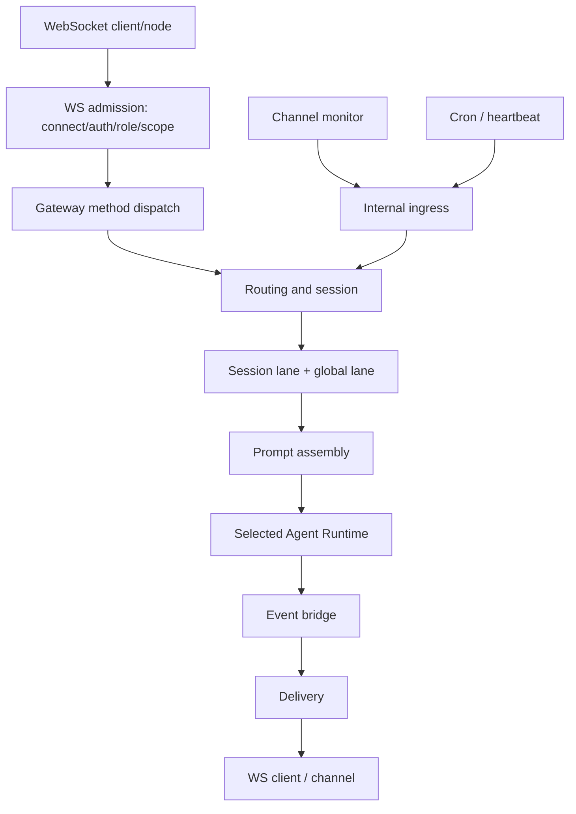
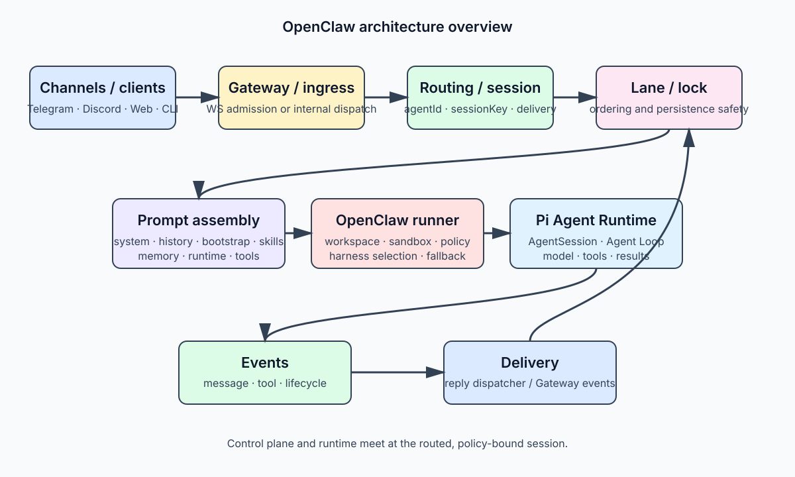

# M02：OpenClaw 总体架构

> [上一页：M01](M01.md) · [总目录](../index.md) · [下一页：M03 请求生命周期](M03.md)

## 问题引入

Telegram、Discord、WebChat、CLI 和 cron 都能触发 Agent。它们是否都先连到同一个 WebSocket，再进入同一段代码？答案需要区分 Gateway 的控制面和内部 ingress。

## 直觉解释

把 OpenClaw 看成两条入口、一个汇合点：

- WebSocket client/node 是控制面连接，先经过 connect/auth/role/scope 的 admission；
- channel monitor、cron、heartbeat 是宿主内部已经拥有运行权限的 ingress，可以直接进入 inbound dispatch 或内部运行命令；
- 二者在 session/agent 路由和 reply runner 附近汇合，不要求每条内部消息重新走 WebSocket 握手。

## 技术定义

架构中的主要边界如下：

| 层 | 负责的问题 | 典型对象 |
| --- | --- | --- |
| Channel / Client | 消息从哪里来、回复送到哪里 | Telegram、Discord、WebChat、CLI、Node |
| Gateway | 长期运行、连接、授权、方法分发、事件广播 | WebSocket handler、server methods |
| Routing | 选择 agent、session、delivery target | `sessionKey`、agent id、channel context |
| Session | 保存 transcript、当前 leaf、模型和运行状态 | Gateway session store、Pi SessionManager |
| Queue / Lane | 同一 session 的并发和顺序 | session lane、global lane、write lock |
| Prompt Assembly | 把规则、历史、工具和外部信息拼成 Context | system prompt、bootstrap、skills、memory |
| Agent Runtime | 执行模型-工具循环 | Pi `Agent`、`AgentSession` |
| Tool | 读取、写入、执行、消息、memory 等动作 | `AgentTool`、OpenClaw wrappers |
| Event | 传播流式和生命周期状态 | `message_end`、`turn_end`、`agent_end` |
| Delivery | 把最终或分块回复交给客户端/渠道 | reply dispatcher、Gateway event bridge |

## 必要算法

以下为教学伪代码，用来表达控制流程，不是源码原文。

```text
if ingress is websocket:
    parse frame
    if first frame:
        validate connect params
        authenticate
        authorize role and scopes
    dispatch gateway method
else:
    normalize channel/cron/heartbeat context
    dispatch inbound message internally

route = resolve(sessionKey, agentId, deliveryContext)
enqueue on session lane and global lane
run prompt assembly and selected harness
bridge events to delivery target
```

两类入口的共同汇合点是“规范化后的运行请求”，不是“所有入口都经过 Gateway WebSocket connect”。

## 源码对应

核心文件：

- `src/gateway/server/ws-connection/message-handler.ts`：解析 WebSocket 帧；处理 connect 握手、认证、role/scope、心跳和请求分发。
- `src/gateway/server-methods.ts`：聚合方法表并执行通用授权与请求上下文包装。
- `src/gateway/server-methods/chat.ts`：`chat.send` 的参数校验、session 更新、delivery 计划和 inbound dispatch。
- `src/gateway/server-methods/agent.ts`：`agent` 方法族和 `agentCommandFromIngress` 的内部运行路径。
- `src/auto-reply/dispatch.ts`：`dispatchInboundMessage()` 将 `MsgContext` 规范化后交给 `dispatchReplyFromConfig()`。
- `src/agents/pi-embedded-runner/run.ts`：按 session lane/global lane 排队，并选择 attempt backend。

关键函数：

- `attachGatewayWsMessageHandler()`：挂载 WebSocket `message` 监听器。
- `handleGatewayRequest()`：从已认证连接调用 Gateway method handler。
- `dispatchInboundMessage()`：进入统一 reply pipeline。
- `runEmbeddedPiAgent()`：解析 workspace、lane、provider/model 和 attempt。

调用关系：

```text
WebSocket message
  → attachGatewayWsMessageHandler
  → connect/auth 或 handleGatewayRequest
  → chat.send / agent method
  → dispatchInboundMessage 或 agentCommandFromIngress

Channel monitor / cron / heartbeat
  → internal ingress / dispatch
  → 同一个 reply runner 或 selected harness
```

## 具体例子或流程图





## 讲解建议

讲图时用“入口不同、汇合点相同”作为主句。特别指出：WebSocket admission 是连接控制面；channel monitor 和 cron/heartbeat 可以绕过 WebSocket，在内部直接创建运行上下文。

## 源码深读：为什么总图必须分成九个区域

### 1. Channel / Client：来源与目的地不是同一件事

入站消息带有来源渠道、账号、会话、线程和发送者信息；出站回复还要解析目标地址、thread 和消息能力。一个 WebChat client 可以发到一个 OpenClaw session，但这不意味着该 session 的最终回复只能发回 WebChat；Gateway 的 delivery plan 会根据 session entry、显式 target 和 channel capability 决定目的地。因此总图要把 Channel/Client 放在入口和出口两处，而不是画成单个“聊天层”。

### 2. Gateway：把连接控制和运行请求分开

`attachGatewayWsMessageHandler()` 安装 WebSocket `message` 监听器。第一帧通常需要通过 `validateConnectParams()` 解析 client metadata、role、scopes、device 和 auth；认证成功后，后续 request frame 才交给 `handleGatewayRequest()`。这个过程是 admission，不是 Agent Loop。

Gateway method handler 再把 `chat.send` 或 `agent` 请求转换为运行命令。`server-methods.ts` 聚合 method table，同时执行角色和 scope 的通用检查。把 method handler 直接画成“调用模型”会丢掉幂等、去重、session store、delivery plan 和 started response 的语义。

### 3. Routing / Session：同一条消息先确定“在哪个世界运行”

`sessionKey` 是路由主键之一。它连接 agent id、channel、账号和对话边界，决定哪一个 transcript、Workspace、权限上下文和 delivery target 被使用。`server-methods/chat.ts` 在 `chat.send` 中规范化 session，更新 session store，并注册 run context；`server-methods/agent.ts` 的 ingress 路径也会把 sessionKey 作为 child session 或任务追踪的归属。

### 4. Queue / Lane：顺序约束是架构的一部分

`runEmbeddedPiAgent()` 为 session 和全局任务解析两个 lane。session lane 保障同一个对话的消息不会交叉推进，global lane 约束全局资源并发。它们和 SessionManager 的 transcript write lock 不是一回事：lane 决定任务何时开始，write lock 决定 entry 何时安全写入。

### 5. Prompt Assembly：把“系统事实”转成模型输入

Prompt assembly 不只是拼一段 system prompt。它要合并：

- system prompt 基础模板；
- Workspace 与 Bootstrap 文件；
- Skills 描述和工具指南；
- channel capabilities、时间、模型信息和 sandbox 状态；
- Memory 检索或 startup prelude；
- SessionManager 重建的消息；
- 当前 run 的用户输入和附件。

其中一部分是 system prompt，一部分是 message，一部分是 tools。M10 会解释为什么不能把它们都叫作“上下文字符串”。

### 6. Agent Runtime：可能有多个 harness

`runEmbeddedAttemptWithBackend()` 把具体尝试委托给 harness selection。普通 embedded reply 常使用 Pi coding-agent，但 OpenClaw 的抽象允许其它后端和 fallback。总图应该写“Selected Agent Runtime”而不是把 OpenClaw 永久绑定为单一 Pi 实现。

### 7. Tool：定义、执行、观察三件事

工具定义进入模型请求，工具执行发生在宿主进程，工具观察通过 Tool Result 回到 Loop。OpenClaw 的 `createOpenClawCodingTools()` 为 Pi 工具补上 Workspace、sandbox、sender、channel、policy 和 `afterToolCall` 等产品上下文。工具系统不能只画一个“Tools”方框，至少要标出“schema/allowlist”和“真实 execute”两个边界。

### 8. Event：同一事实的第二种投影

Pi Agent Loop 会发出 message、tool 和 lifecycle events；OpenClaw 的订阅器把它们投影到 Gateway event、reply dispatcher、日志和扩展 hooks。Event 不会自动进入下一次模型 Context，除非某个转换器显式把它变成 AgentMessage 或 ToolResult。

### 9. Response Delivery：最终答案不是唯一的输出

OpenClaw 可能发送 typing、block、tool、final、error 或 silent 结果。`runReplyAgent()` 还会处理 block streaming、follow-up、媒体 payload 和失败恢复。一个“Agent 运行完成”的事实和一个“用户已经看到最终文本”的事实之间，至少隔着事件桥和渠道发送。

## 依赖漏斗：从多入口汇成一个小内核

```text
多渠道、多客户端、多种内部触发
              ↓
规范化 ingress / session / delivery context
              ↓
lane、锁、超时、取消、fallback
              ↓
Workspace / Bootstrap / Skills / Memory / Tools
              ↓
Pi AgentSession
              ↓
pi-agent-core Agent Loop
              ↓
pi-ai API adapter
```

漏斗上宽下窄并不表示上层不重要，而是表示产品变化主要被吸收在宿主层；通用 Loop 可以保持稳定。新增 Discord 账号通常不应修改 `runAgentLoop()`；新增 Provider 通常不应修改 `chat.send`；新增 Memory backend 通常只应改变 memory plugin 的 manager/adapter。

## 两个经常画错的箭头

### 错箭头一：所有入口 → WebSocket connect

控制面客户端确实需要 WebSocket admission，但 channel monitor、cron 和 heartbeat 可以在同一进程内生成 inbound context。它们在 `dispatchInboundMessage()` 或 `agentCommandFromIngress()` 一带汇合。把内部 ingress 强行画成 WebSocket 客户端会误导读者，以为每次 heartbeat 都要重新认证。

### 错箭头二：Pi events → 模型下一轮

只有 Message 或经过 `convertToLlm()` 的 AgentMessage 会进入模型 Context。`tool_execution_update`、Gateway event 和 UI notification 默认只是观察数据。下一轮是否继续由 `runLoop()` 看工具调用、steering、follow-up 和 stopReason 决定。

## 本页的架构不变量

1. **入口不变量**：控制面 admission 与内部 ingress 分开，但都能汇入统一运行命令。
2. **所有权不变量**：OpenClaw 拥有路由、环境、策略和 delivery；Pi 拥有通用 Loop、消息协议和工具执行管道。
3. **数据不变量**：Message 影响模型，Event 影响观察者，Transcript 影响恢复，Context 影响当前调用。
4. **顺序不变量**：同一 session 的运行和 transcript 写入必须可序列化。
5. **替换不变量**：Provider、harness、channel 和 memory backend 通过 seam 接入，而不是污染 Loop 内核。

## 本页收束

全局图不是组件名清单，而是回答“一个事实在系统中经过哪些投影”。消息先成为 ingress，再成为 session-scoped prompt，接着成为 Pi Message/Tool Result，最后成为 Event 和 delivery。沿着这条投影链读源码，比按目录顺序打开文件更快。

---
