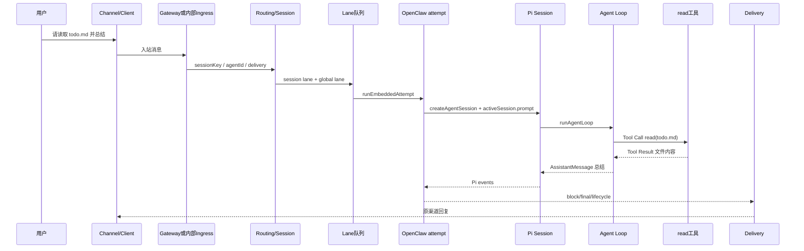

# M03：一条请求的完整生命周期

> [上一页：M02](M02.md) · [总目录](../index.md) · [下一页：M04 为什么需要 Pi](M04.md)

## 问题引入

用户发出“请读取 workspace 中的 `todo.md`，并总结今天最重要的三件事”。从消息到回复，中间到底发生了多少次状态转换？最容易混淆的是 `chat.send` 的“已接受”、Agent run 的“已启动”和任务的“已完成”。

## 直觉解释

请求像一张带地址的包裹：先标出来源和目的 session，再排队进入唯一的运行通道；运行时拆包，组装模型看到的内容；模型提出读文件，工具执行并回填结果；最终文本经过事件桥和 delivery 适配，回到原渠道。

## 技术定义

典型普通 reply 路径是：

```text
用户输入
→ Channel / Client
→ Gateway 或内部 dispatch
→ sessionKey / agentId 路由
→ session lane + global lane
→ prompt assembly
→ runReplyAgent
→ runAgentTurnWithFallback
→ runEmbeddedPiAgent
→ runEmbeddedAttemptWithBackend
→ runEmbeddedAttempt
→ createAgentSession
→ activeSession.prompt
→ Pi runAgentLoop
→ Tool Call / Tool Result
→ Final AssistantMessage
→ subscribeEmbeddedPiSession 事件桥
→ Reply Dispatcher / Gateway delivery
→ 原始客户端或渠道
```

`agent` Gateway 方法可以走 `agentCommandFromIngress`，它和 `chat.send` 的响应语义不同。`chat.send` 会先返回接受运行的响应，最终结果通过事件或后续响应传播；看到 `status: "started"` 只说明 run 已进入执行，不代表模型已经完成任务。

## 必要算法

以下为教学伪代码，用来表达控制流程，不是源码原文。

```text
receive(request):
    validate and deduplicate(request)
    session = resolveSession(request.sessionKey, request.agentId)
    delivery = resolveDelivery(request, session)

    return enqueue(session.lane, async () =>
        return enqueue(global.lane, async () =>
            context = assemblePrompt(session, request)
            result = await runSelectedHarness(context)
            publishLifecycleAndReply(result, delivery)
        )
    )
```

三种触发源在这里汇合：

1. WebSocket `chat.send`：先经过 admission，再到 method handler；
2. Channel monitor：把平台消息变成 `MsgContext`，调用 `dispatchInboundMessage()`；
3. Cron/heartbeat：内部生成 prompt 和 session context，再进入同一类 runner。

## 源码对应

核心文件：

- `src/gateway/server-methods/chat.ts`：`"chat.send"` 处理参数、幂等键、session 记录、delivery 计划，并异步调用 `dispatchInboundMessage()`。
- `src/gateway/server-methods/agent.ts`：`dispatchAgentRunFromGateway()` 将 `agent` 命令交给 `agentCommandFromIngress()`，并记录 started/completed/error 状态。
- `src/auto-reply/dispatch.ts`：`dispatchInboundMessage()` 调用 `finalizeInboundContext()` 和 `dispatchReplyFromConfig()`。
- `src/auto-reply/reply/agent-runner.ts`：`runReplyAgent()` 维护 typing、block/final reply、follow-up 和 run outcome。
- `src/auto-reply/reply/agent-runner-execution.ts`：`runAgentTurnWithFallback()` 调用 embedded runner，并处理 provider/model fallback。
- `src/agents/pi-embedded-runner/run.ts`：`runEmbeddedPiAgent()` 解析 session/global lane，构建 attempt 参数。
- `src/agents/pi-embedded-runner/run/backend.ts`：`runEmbeddedAttemptWithBackend()` 委托给 harness selection。
- `src/agents/pi-embedded-runner/run/attempt.ts`：创建 SessionManager、Prompt、工具和 Pi Session，最后调用 `activeSession.prompt()`。
- `src/agents/pi-embedded-subscribe.ts`：把 Pi session 事件翻译成 OpenClaw 的回复、工具输出和生命周期通知。

关键调用关系：

```text
runReplyAgent
  → runAgentTurnWithFallback
  → runEmbeddedPiAgent
  → runEmbeddedAttemptWithBackend
  → runEmbeddedAttempt
  → createAgentSession
  → activeSession.prompt
```

## 具体例子或流程图



## 讲解建议

把状态词说精确：`started` 是控制面确认，`agent_end` 才是 Pi run 的终止事件，delivery 的 `final` 是用户可见回复。三者属于不同层，不要用一个状态代替另一个状态。

## 源码深读：把一条请求拆成十个时刻

下面这十个时刻不是为了制造更多名词，而是为了回答“在哪一层发生了什么”。同一条消息在不同时间点拥有不同类型；混淆类型就会误判生命周期。

### t0：入口形成

Telegram/Discord monitor 将平台事件整理成 OpenClaw 的 `MsgContext`。WebChat/CLI/Node client 通常通过 Gateway WebSocket 发送 request frame。cron/heartbeat 则在进程内部创建自己的触发上下文。此时数据还不是 Pi `UserMessage`，只是带有来源、目标、附件和策略字段的宿主输入。

### t1：Admission 或内部 ingress

WebSocket 连接的首个 `connect` frame 经过协议验证、auth、device pairing、role 和 scopes。成功之后，`chat.send` 才能进入 method handler。内部 ingress 不重新走这段 handshake，但必须通过相应的内部命令接口获得规范化的 session 和 delivery 信息。两者的共同结果是“允许创建运行”，而不是“已经运行”。

### t2：参数验证和幂等

`chat.send` 先用 `validateChatSendParams()` 校验 `sessionKey`、`message`、`idempotencyKey`、thinking、附件和 delivery 字段。重复的幂等键可以命中 Gateway dedupe，避免同一用户操作重复创建 run。验证失败在 Gateway 层结束，不会进入模型。

### t3：session 与 delivery 解析

handler 根据请求和 session store 确定 canonical session key、agent id、session id、channel、account、thread 和目标地址。`resolveAgentDeliveryPlan()` 把“从哪里来”和“发到哪里去”拆开。这个阶段还会决定 WebChat 是否需要 eager transcript update，以及哪些连接要接收 tool events。

### t4：排队

`runEmbeddedPiAgent()` 把任务包装进 session lane 和 global lane。session lane 防止同一会话并发交叉；global lane 让系统控制整体资源。Abort signal 在排队前就可以生效，所以被取消的请求可能还没有创建 Pi Session。

### t5：attempt 准备

`runEmbeddedAttempt()` 解析 workspace 和 sandbox，加载 skills snapshot，获取 bootstrap context，构建 OpenClaw coding tools，解析 provider/model/auth，准备 SessionManager 和 compaction guard。这个阶段消耗的是宿主时间，模型尚未看到用户输入。

### t6：Prompt Assembly

`buildEmbeddedSystemPrompt()` 接收工具名、runtimeInfo、sandboxInfo、skillsPrompt、contextFiles、Memory 段和 provider contribution，生成 system prompt。随后 Pi SessionManager 从 transcript branch 重建消息。两者合起来才是模型真正收到的 Context。

### t7：Pi prompt 边界

OpenClaw 订阅 `subscribeEmbeddedPiSession()`，然后调用 `activeSession.prompt(effectivePrompt, ...)`。这句调用把控制交给 Pi coding-agent；它经过 `AgentSession.prompt()`、`Agent.prompt()` 和 `runAgentLoop()`，开始模型-工具循环。OpenClaw 不在这里手动执行每一个 tool call。

### t8：模型与工具循环

Pi 使用 `streamFn`/`streamSimple` 调 Provider。模型返回 AssistantMessage；如果含 `toolCall`，Pi 执行工具，生成 ToolResultMessage，再调用模型。OpenClaw 的工具 wrapper 负责实际 workspace、sandbox、消息或 Memory 行为。

### t9：事件回流和持久化

Pi 发出 `message_end`、`tool_execution_end`、`turn_end`、`agent_end`。`AgentSession._processAgentEvent()` 在 `message_end` 时用 `SessionManager.appendMessage()` 写入 parentId entry；OpenClaw 订阅器同时把事件翻译成 block/tool/final delivery。因而“写入 transcript”和“发送到客户端”是两个并行副作用。

## `chat.send` 与 `agent` 方法的语义差异

### `chat.send`

`chat.send` 面向对话消息。它需要处理 origin channel、reply target、附件、WebChat transcript 和 block streaming。Gateway 通常先响应请求被接受，随后 run 异步推进；客户端通过事件或后续查询获得进展和结果。

### `agent` 方法

`server-methods/agent.ts` 的 `dispatchAgentRunFromGateway()` 通过 `agentCommandFromIngress()` 启动命令型运行，并把完成结果写进 dedupe entry，再发送带 `runId` 的响应。它更像控制面任务接口，不能与 `chat.send` 的用户回复语义混为一谈。

## 生命周期状态机

```text
received
  → validated
  → admitted or internal-ingress
  → routed
  → queued
  → started
  → attempt-prepared
  → prompting
  → tool-looping
  → agent_end
  → delivery-final / delivery-error
```

任何箭头都可能被取消、超时、去重或失败打断。尤其是：

- `started` 不是 `agent_end`；
- `agent_end` 不是客户端已渲染 `final`；
- `message_end` 是一条消息完成，不代表整个 run 完成；
- compaction 可能在一个长 run 内发生，不等于 run 结束。

## 失败分支如何回到用户

### WebSocket admission 失败

连接在 handshake 阶段返回 error frame 并关闭，模型和 session runner 都不会启动。

### 参数或权限失败

Gateway method 直接返回 `INVALID_REQUEST` 或授权错误。它不是 AssistantMessage，因为失败发生在 Agent 运行前。

### Provider 失败

Pi AI adapter 将错误编码成 AssistantMessage `stopReason: "error"`；AgentSession 可以识别 retryable error，OpenClaw 外层还可以切换 fallback provider/model。

### 工具失败

Pi 将异常变成 `ToolResultMessage.isError = true`，模型获得错误观察，有机会修正参数。只有 policy block、`terminate`、abort 或循环终止条件会阻止继续。

### Delivery 失败

Agent 可能已经完成，但渠道发送失败。此时 transcript 仍可能拥有最终 AssistantMessage，OpenClaw 需要在 delivery 层记录失败，而不是重新解释为“模型没有运行”。

## 观察一个具体的 `todo.md` 请求

用户从 WebChat 发出请求后，`chat.send` 生成 `clientRunId`，先将 user transcript update 广播给订阅者，再调用 `dispatchInboundMessage()`。reply runner 进入 `runAgentTurnWithFallback()`，embedded runner 根据 session key 取得 workspace。attempt 构建带 `read` 工具的 Pi Session；模型提出 `read({path: "todo.md"})`。

Pi 验证参数，OpenClaw read wrapper 确认路径位于 effective workspace，读取文件并返回文本。模型下一轮看到 assistant tool call 和 tool result，生成三条总结。Pi 发出 `agent_end`；订阅器将最终文本交给 reply dispatcher；WebChat 收到 final payload。此时 Gateway 的 started response 只是最早的控制面确认，不能代替最后的 final payload。

## 本页收束

完整生命周期的关键不是记十个时间点，而是记住一个转换：宿主输入先变成 session-scoped run，再变成 Pi Context，模型输出再分裂成 Message 链和 Event 链。连接、路由、排队、Prompt、Loop 和 delivery 每层都只承担自己的状态。

---
