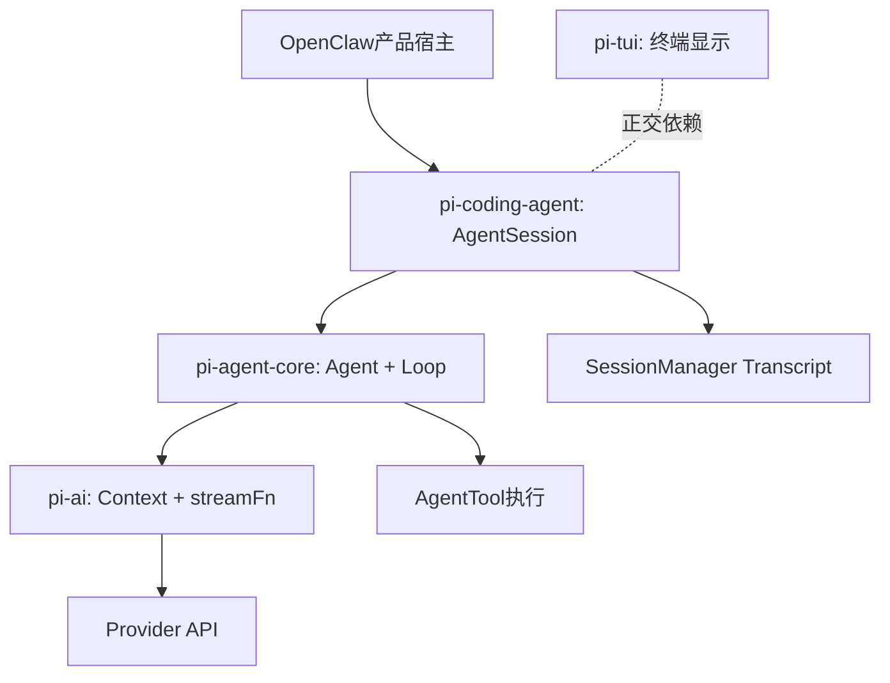

# M04：为什么需要 Pi Agent Runtime

> [上一页：M03](M03.md) · [总目录](../index.md) · [下一页：M05 Pi 三层架构](M05.md)

## 问题引入

OpenClaw 已经有 Gateway、工具、队列和渠道，为什么不直接在 OpenClaw 里写一个 `while` 循环调用模型？

## 直觉解释

OpenClaw 解决的是“把 Agent 放进世界”：谁发消息、用哪个 session、能访问哪个目录、结果发往哪里。Pi 解决的是“Agent 如何思考并行动”：消息如何进入上下文、模型如何流式返回工具调用、工具结果怎样保持协议顺序、什么时候继续或结束。

把这两类问题混在一个产品层循环里，会让每个渠道和每个 provider 都重复处理同一套低层协议。分开后，OpenClaw 只需把产品策略注入 Pi 的几个 seam：`streamFn`、`transformContext`、`convertToLlm`、`beforeToolCall`、`afterToolCall` 和事件订阅。

## 技术定义

Pi 在 OpenClaw 中提供四类能力：

1. `pi-ai`：统一 `Model`、`Message`、`Context`、工具调用块和 Provider stream。
2. `pi-agent-core`：通用 `Agent` state、Agent Loop、工具准备/执行/结果消息和 lifecycle events。
3. `pi-coding-agent`：`AgentSession`、SessionManager、coding tools、资源加载、Transcript 和 compaction。
4. `pi-tui`：终端 UI 库，和 Agent Loop 正交；OpenClaw embedded 路径不依赖它来显示消息。

OpenClaw 仍然控制产品级差异：workspace/sandbox、工具包装和 allowlist、Memory plugin、渠道消息工具、provider 兼容包装、lane、锁、超时、取消、事件 delivery、fallback 和宿主级 compaction/flush。

## 必要算法

以下为教学伪代码，用来表达控制流程，不是源码原文。

```text
OpenClaw:
    decide model, workspace, tools, policy, delivery
    create Pi AgentSession with adapters and hooks
    prompt Pi
    observe events and persist results

Pi:
    normalize prompt
    append prompt to context
    loop model → tool calls → tool results
    emit lifecycle events
```

这个边界的价值是“可替换”：OpenClaw 可以在 harness selection 中选择不同后端；Pi 的通用循环不需要知道 Telegram、Discord 或 OpenClaw 的 session store。

## 源码对应

核心文件：

- `packages/agent/src/agent.ts`：持有 state、队列、hooks、`streamFn`，通过 `prompt()` 启动低层 Loop。
- `packages/agent/src/agent-loop.ts`：实现 `runAgentLoop()`、`runLoop()`、`streamAssistantResponse()` 和工具执行。
- `packages/coding-agent/src/core/sdk.ts`：`createAgentSession()` 组装资源、模型、Agent 和 SessionManager。
- `src/agents/pi-embedded-runner/run/attempt.ts`：把 OpenClaw 策略注入 `createAgentSession()` 和 `activeSession.prompt()`。

关键调用关系：

```text
OpenClaw product boundary
  → createAgentSession({ tools, customTools, resourceLoader, sessionManager })
  → AgentSession.prompt
  → Agent.prompt
  → runAgentLoop
```

## 具体例子或流程图



## 讲解建议

用“OpenClaw 负责边界，Pi 负责循环”作为 M04 的结论。不要把 `pi-ai` 说成 Agent；它提供模型和消息协议，但不创建或调度 Agent。

## 源码深读：重写 Loop 的成本在哪里

假设 OpenClaw 自己实现一套循环，第一步看起来只需要调用一次模型，第二步在响应中找工具名，第三步执行函数。但生产运行很快会遇到一组相互耦合的问题：

1. Provider 返回的是流而不是单个 JSON；文本、思考块和工具参数会分段到达。
2. 工具参数可能需要兼容性预处理和 schema 验证。
3. 多个工具调用需要选择串行或并行，还要保证结果消息顺序。
4. 工具失败必须变成模型可理解的观察，而不是让整个进程崩溃。
5. 用户可能在运行中 steering，系统还可能在当前 run 结束后追加 follow-up。
6. 上下文会超窗，需要 pruning、compaction 和 flush。
7. 运行过程需要 message、tool、turn、agent 生命周期事件。

这些问题与 Telegram、Discord 或 OpenClaw Workspace 没有本质关系。它们属于通用 Agent Runtime。把它们放在 Pi 后，OpenClaw 只通过 typed seam 提供差异化行为。

## Seam 是怎样把两个项目接起来的

### `streamFn`

Agent Loop 不直接导入某个 provider。`Agent` 将 `streamFn` 作为实例字段；默认值是 `streamSimple`，OpenClaw/Pi coding-agent 可以注入带认证、header、payload hook、WebSocket transport 和 provider fallback 的包装器。

### `convertToLlm`

Loop 内部可以保留自定义 AgentMessage，但 Provider 只认识三类基础 Message。OpenClaw 和 coding-agent 可以在这里过滤 UI-only message、替换图片、转换扩展消息。

### `transformContext`

这是消息仍处于 AgentMessage 层时的处理点，适合做裁剪、外部上下文注入、图像清理和 compaction 前维护。它在每次模型调用前执行，因此不是一次性启动配置。

### `beforeToolCall` / `afterToolCall`

这两个 hook 让宿主在 schema 已验证后阻止或修改工具执行结果。权限判断放在 before hook 或工具 wrapper，结果格式化和 early termination 可以放在 after hook。

### Event subscription

OpenClaw 通过 `subscribeEmbeddedPiSession()` 观察 Pi events，获取流式回复和工具状态。观察者不需要知道 Loop 内部如何选择下一次模型调用，也不应在订阅器中偷偷复制调度逻辑。

## 分层后的可测试性

Pi 可以独立测试：给定一个假的 `streamFn`，验证 Loop 是否在 tool result 后再次调用模型；给定假的 AgentTool，验证 schema 错误是否成为 ToolResultMessage；给定队列，验证 steering/follow-up 的时机。OpenClaw 可以独立测试：给定一个假的 Pi Session，验证 workspace、policy、delivery 和 session store 是否正确装配。

如果所有逻辑写进 OpenClaw 的一个大函数，测试就必须启动 Gateway、渠道和真实文件系统才能证明一个 stopReason 分支，导入成本和故障面都会扩大。

## Pi 不知道的事情，正是 OpenClaw 的产品空间

Pi Loop 不知道：

- `sessionKey` 如何由渠道、账号、线程组成；
- workspace 是否来自 canonical path 或 sandbox copy；
- `MEMORY.md` 是否可见；
- 某个工具是否允许发消息到外部频道；
- Gateway 是否需要把 tool events 广播给某个连接；
- 同一个 session 是否还有另一个 run 在排队。

OpenClaw 因此不是 Pi 的“巨大配置文件”，而是一个拥有额外状态和策略的宿主层。它在调用 `activeSession.prompt()` 之前准备环境，在之后桥接事件和持久化；Pi 负责中间的循环不变量。

## 本页收束

需要 Pi 的理由可以压缩成一句工程判断：模型-工具循环是一种跨产品复用的执行协议，而 Gateway、Workspace、渠道和权限是 OpenClaw 的产品边界。拆开后，两个系统都能更小、更可观察，也更容易替换。

## 选择边界：哪些逻辑必须留在宿主

### 问题引入

如果 Pi 已经能执行工具，OpenClaw 是否只需要把 Gateway 收到的字符串传给 `Agent.prompt()`？这个想法遗漏了“同一个 Loop 在不同现实环境中必须得到不同工具和规则”这一事实。

### 直觉解释

Pi 像通用的运行协议，OpenClaw 像一次具体部署的装配线。装配线决定这次运行的工作目录、可用工具、发送者身份、渠道能力和超时；协议只保证消息按正确顺序循环。换一个 Workspace 或 sender，仍可复用同一台 Pi 发动机，但装配参数必须重新计算。

### 技术定义

OpenClaw 在 Pi seam 上注入六类宿主信息：

1. `streamFn`：认证、provider 包装、cache 参数和 fallback；
2. `transformContext` / `convertToLlm`：过滤、裁剪和消息转换；
3. `beforeToolCall` / `afterToolCall`：策略拦截、结果修饰和终止提示；
4. `AgentSession` 资源：Workspace、skills、bootstrap、session manager；
5. Event subscription：将 Pi events 转成渠道 delivery；
6. 外层运行控制：lane、锁、超时、取消、重试和宿主 compaction/flush。

### 必要算法：宿主与循环的责任分配

以下为教学伪代码，用来表达边界，不是源码原文。

```text
hostRequest = normalizeIngress(input)
hostState = resolveSessionWorkspacePolicy(hostRequest)
piSession = createAgentSession(hostState)
subscribe(piSession, hostDeliveryBridge)
await piSession.prompt(hostRequest.userMessage)

Pi Loop:
    append prompt
    call model
    execute prepared tools
    append tool results
    continue or stop
```

判断一段逻辑属于哪一层，可以问“没有 Telegram/Workspace 时它仍然成立吗？”如果答案是肯定的，它多半属于 Pi；如果必须知道 session key、沙箱路径或投递目标，它属于 OpenClaw 宿主。

### 失败恢复为什么是宿主职责

Pi Loop 能把 provider error、tool error 和 aborted 编码成消息，但它不知道应该切换哪个账号、是否重试另一个模型、是否向用户发送 fallback 文本，也不知道 Gateway 是否已经给客户端发送了 `started`。这些决策依赖 OpenClaw 的 attempt、delivery 和 session 状态。

因此，`runAgentTurnWithFallback()` 在 attempt 外层聚合失败上下文；`runEmbeddedPiAgent()` 控制 session/global lane 和取消；`pi-embedded-subscribe.ts` 负责把最终状态转换成渠道可见的 delivery。Pi 只提供稳定的终态和事件顺序，宿主再决定产品行为。

### 为什么不能把 Workspace 写进 Pi Core

Workspace 路径、bootstrap 文件和 sandbox 不是所有 Agent 都需要。客服 Agent 可能只有数据库工具，测试 Agent 可能使用临时目录，OpenClaw 的每个 profile 还可能有不同 Workspace。若 Pi Core 直接读取 `AGENTS.md`，它就会被某一种产品的文件布局绑死，无法作为通用库嵌入。

Pi 只接受已经组装好的 `systemPrompt`、消息和工具；OpenClaw 通过 `buildEmbeddedSystemPrompt()` 提供产品上下文。这样既能复用 Pi，又能让同一 Loop 在 headless 服务、CLI 和多渠道宿主中保持一致。

### 本页收束

Pi 的价值不是替 OpenClaw 做所有事，而是把最容易被重复实现且最需要协议正确性的循环固定下来。OpenClaw 的价值在于把这个循环放进真实世界：为它选择现场、授予受控能力、保存状态、承接失败，并把事件交付给用户。

---
