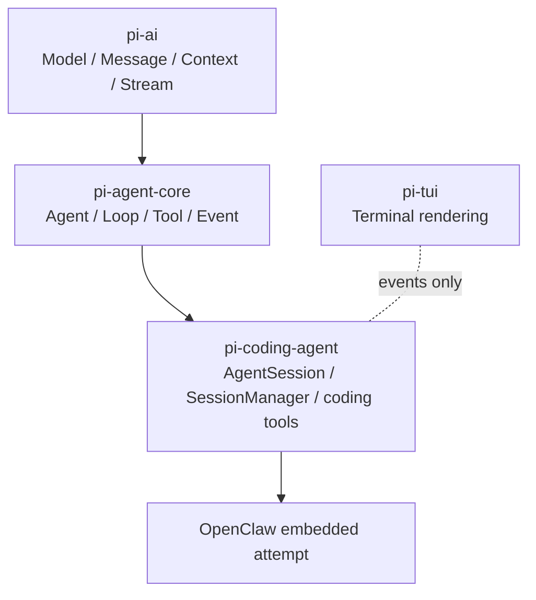
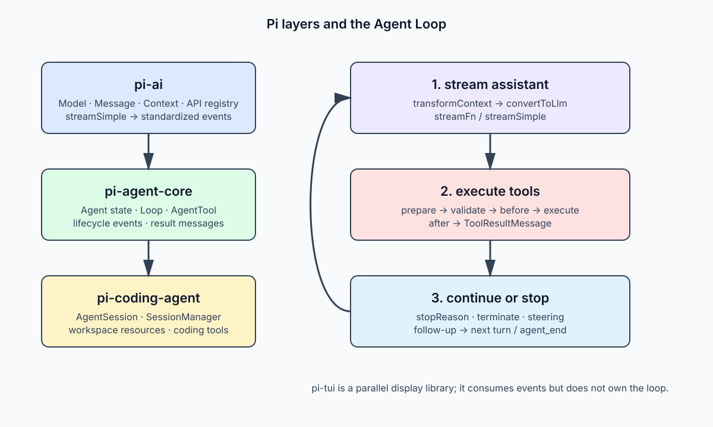

# M05：Pi 三层架构

> [上一页：M04](M04.md) · [总目录](../index.md) · [下一页：M06 Agent Loop](M06.md)

## 问题引入

为什么 Pi 不把“调模型、跑循环、读写文件、显示终端”写在同一个包里？答案不在目录名字，而在依赖方向和数据类型的逐层收窄。

## 直觉解释

把 Pi 看成一条从“协议”到“产品”的流水线：底层只知道模型消息，中层只知道 Agent 如何循环，顶层才知道编码工作区和会话文件。`pi-tui` 负责显示，是一条平行支路。

## 技术定义

### `pi-ai`：模型与协议层

它定义 `Model`、`Context`、`Message`、`Tool`、`AssistantMessageEvent` 等跨 Provider 的公共类型，并把每个 API protocol 的差异藏在 provider adapter 后面。输入是统一 `Context`，输出是 `AssistantMessageEventStream`。

### `pi-agent-core`：循环与执行层

它定义 `AgentContext`、`AgentTool`、`AgentEvent`，保存 transcript 状态，调用 `streamFn`，识别 `toolCall`，执行工具，产生 `ToolResultMessage`，再决定继续还是结束。它不需要知道工作区路径或终端 UI。

### `pi-coding-agent`：可用的编码 Agent 层

它实现 `AgentSession` 和 `SessionManager`，加载 skills、context files、system prompt，提供 read/write/edit/bash 等工具，并把消息以带 `parentId` 的 JSONL entry 持久化。`createAgentSession()` 是产品和 SDK 的装配入口。

### `pi-tui`：正交显示层

它渲染终端组件、Markdown 和差分更新。Agent Loop 只发事件，不直接依赖 TUI；同一个 `pi-agent-core` 可以被无头服务或其它 UI 使用。

## 必要算法

以下为教学伪代码，用来表达分层约束，不是源码原文。

```text
pi-ai:
    Context -> provider-specific request -> standardized event stream

pi-agent-core:
    AgentMessage[] + AgentTool[] + streamFn -> loop events + result messages

pi-coding-agent:
    workspace/resources/session entries -> AgentContext + AgentSession

pi-tui:
    AgentEvent -> terminal rendering
```

分层的硬规则是依赖只能向下：`pi-coding-agent` 可以依赖 `pi-agent-core` 和 `pi-ai`；`pi-agent-core` 可以依赖 `pi-ai`；`pi-ai` 不知道上层存在。

## 源码对应

核心文件：

- `packages/ai/src/types.ts`：`KnownApi`、`KnownProvider`、`Model`、`Message`、`Context`、`AssistantMessageEvent`。
- `packages/ai/src/stream.ts`：`stream()`、`complete()`、`streamSimple()`、`completeSimple()` 的统一入口。
- `packages/ai/src/api-registry.ts`：`registerApiProvider()`、`getApiProvider()` 和按 API key 的 registry。
- `packages/agent/src/types.ts`：`AgentContext`、`AgentMessage`、`AgentTool`、`AgentEvent`、`AgentLoopConfig`。
- `packages/agent/src/agent.ts`：有状态的 `Agent`、队列和 lifecycle。
- `packages/agent/src/agent-loop.ts`：无产品上下文的通用循环。
- `packages/coding-agent/src/core/sdk.ts`：`createAgentSession()` 和 `CreateAgentSessionOptions`。
- `packages/coding-agent/src/core/agent-session.ts`：资源、Prompt、事件和持久化的组合层。
- `packages/coding-agent/src/core/session-manager.ts`：Session entry 树、leaf、分支和 Context 重建。

关键函数：

- `createAgentSession()`：创建或恢复 SessionManager、ResourceLoader、Agent 和工具。
- `Agent.prompt()`：拒绝并发 prompt，进入 `runPromptMessages()`。
- `runAgentLoop()`：把初始 prompt 追加到 Context 并启动循环。
- `buildSessionContext()`：沿 `parentId` 从 leaf 走到 root，重建模型可见消息。

调用关系：

```text
pi-ai types/stream
  → pi-agent-core Agent/Loop
  → pi-coding-agent AgentSession/SessionManager
  → OpenClaw embedded attempt
```

## 具体例子或流程图





## 讲解建议

强调“每层都能单独使用”：只用 `pi-ai` 可以做一次模型调用；加入 `pi-agent-core` 才得到通用 Agent；加入 `pi-coding-agent` 才得到带工作区和会话的编码产品；`pi-tui` 只是显示。

## 源码深读：类型如何逐层变厚

Pi 的分层不是把文件平均分组，而是让同一个任务对象在每一层增加一种责任。可以把它看成“原子 → 分子 → 材料”的类型递进。

### 第一层：`pi-ai` 的原子

`packages/ai/src/types.ts` 首先定义 `Api`、`Provider`、`Model` 和 `Message`。`Model` 记录模型 id、协议 api、provider、baseUrl、reasoning、输入能力、上下文窗口和最大输出；`Context` 只是可选 systemPrompt、消息数组和工具名片。

这层有意不出现 `Agent`、`Session` 或 `Workspace`。`stream()` 接收一个完整 Context，返回 `AssistantMessageEventStream`；它只关心如何把统一数据交给协议 adapter，以及如何把返回流规范化。

`AssistantMessageEvent` 的事件包括 start、文本/思考/工具增量、done 和 error。Provider 差异被压在这一层，上一层不需要知道 Anthropic 的 SSE event 名或 OpenAI 的 response item。

### 第二层：`pi-agent-core` 的分子

`packages/agent/src/types.ts` 在 `Message` 之上加入 `AgentMessage`、`AgentContext`、`AgentTool`、`AgentEvent` 和 `AgentLoopConfig`。这里出现了“执行能力”：工具有 `execute()`，Agent 有 `steer()`、`followUp()` 和 `abort()`，Loop 有 `beforeToolCall`、`afterToolCall`、`transformContext` 和 `convertToLlm`。

`AgentContext` 仍然只含 systemPrompt、messages 和 tools；它没有 session file。这样，`pi-agent-core` 可以用于客服、数据分析、测试或自动化 Agent，而不仅是 coding-agent。

### 第三层：`pi-coding-agent` 的材料

`CreateAgentSessionOptions` 增加 cwd、agentDir、AuthStorage、ModelRegistry、ResourceLoader、SessionManager、tools allowlist 和 customTools。`createAgentSession()` 负责：

1. 创建或恢复 auth/model/settings/resource loader；
2. 用 `SessionManager.buildSessionContext()` 恢复历史；
3. 选择模型和 thinking level；
4. 建立 `Agent` 并注入 `streamFn`、`convertToLlm`、extension hooks；
5. 创建默认 coding tools 或 custom tools；
6. 用 `AgentSession` 连接 Prompt、扩展、持久化和 compaction。

这一层才知道 `read`、`write`、`edit`、`bash` 是什么，也才知道 session entry 如何以 JSONL tree 保存。

### `pi-tui` 的正交性

`pi-tui` 不是三层堆栈中的第四个 Agent 层。它消费事件或其它 UI 数据，负责终端组件、Markdown、差分渲染和输入。OpenClaw embedded runner 可以不启动 TUI，仍然使用 Pi 的 AgentSession 和事件协议。

## 为什么“依赖向下”比“文件夹分层”更重要

如果 `pi-ai` 反过来导入 Agent 类型，模型协议层就会被产品循环绑住；如果 `pi-agent-core` 直接读取 session JSONL，通用循环就会被编码产品绑住；如果 TUI 负责执行工具，显示层就拥有了不该拥有的权限。依赖方向把这些错误挡在设计阶段。

可以用三个独立使用测试验证分层：

| 测试 | 应该能否通过 |
| --- | --- |
| 只导入 `pi-ai`，调用一个 Provider | 可以 |
| 只导入 `pi-agent-core`，注入假的 `streamFn` 和 `AgentTool` | 可以 |
| 只导入 `pi-coding-agent`，创建内存 SessionManager | 可以 |
| 不启动 TUI，运行 headless AgentSession | 可以 |

## 类型映射表

| 低层类型 | 上层增加的含义 |
| --- | --- |
| `Message` | LLM 能理解的 user/assistant/toolResult |
| `AgentMessage` | 可扩展的应用消息，之后由 `convertToLlm` 转换 |
| `Tool` | 模型可见的名字、描述、参数 schema |
| `AgentTool` | 加入 label、execute、prepareArguments、executionMode |
| `Context` | 一次 Provider 调用的输入 |
| `AgentContext` | Loop 的可变消息和工具现场 |
| `SessionEntry` | 带 id/parentId 的持久化历史节点 |
| `SessionContext` | 从当前 leaf 重建出的模型消息和设置 |

## 本页收束

三层架构真正稳定的地方，是每一层都可以回答一个独立问题：`pi-ai` “如何与模型通信”，`pi-agent-core` “如何持续思考和行动”，`pi-coding-agent` “如何成为一个可恢复的编码会话”。M06 会在第二层内部展开循环，而不是把所有产品细节混进去。

## 用一次请求观察三层如何协作

### 问题引入

“请读取 `todo.md`”只有一句话，为什么会同时经过 `Context`、`AgentContext`、`SessionEntry` 和 `AssistantMessage`？因为同一个任务在不同层承担不同的生命周期。

### 直觉解释

底层 `pi-ai` 只关心“这次请求如何符合某个模型协议”；中层 `pi-agent-core` 关心“拿到模型输出后是否执行工具并继续”；顶层 `pi-coding-agent` 关心“这次运行属于哪个 session、历史如何保存、资源从哪里加载”。同一段用户文本在三层有三种身份，但它们通过明确转换连接。

### 技术定义：四种上下文对象

- `Context`：发送给 provider 的最小对象，含 `systemPrompt`、`Message[]`、`Tool[]`。
- `AgentContext`：Loop 的可变现场，含 `AgentMessage[]`、`AgentTool[]` 和转换函数。
- `SessionEntry`：SessionManager 持久化的树节点，含 id、parentId、时间和 entry-specific 数据。
- `SessionContext`：从当前 leaf 沿 parentId 重建出的消息、设置和 compaction 状态。

`pi-ai` 不知道 `SessionEntry`；`pi-agent-core` 不读取 JSONL；`pi-coding-agent` 负责在它们之间做装配。这种对象分层使得“重放一段 transcript”“运行无头 Agent”“替换 provider”可以分别测试。

### 必要算法：从磁盘 entry 到模型请求

以下为教学伪代码，用来表达对象转换，不是源码原文。

```text
entries = SessionManager.load(sessionFile)
leaf = SessionManager.getLeaf(entries)
sessionContext = buildSessionContext(entries, leaf)
agentContext = {
    systemPrompt: resourceLoader.buildPrompt(),
    messages: sessionContext.messages,
    tools: createTools(options)
}
llmContext = convertToLlm(transformContext(agentContext.messages))
piAi.stream(model, {systemPrompt, messages: llmContext, tools})
```

模型完成后，反向路径把 `AssistantMessage` 与 `ToolResultMessage` 追加为新的 SessionEntry；新的 leaf 再成为下一轮的重建起点。中间的 `AgentEvent` 只通知订阅者，不替代 entry。

### 依赖方向带来的替换能力

只替换 `pi-ai` adapter，可以保留同一 Loop 和 SessionManager；只替换 `pi-tui`，可以把终端显示换成 WebSocket delivery；只替换 `SessionManager`，可以让同一 Agent 使用内存 transcript 或数据库持久化。若所有层共享同一个巨大状态对象，这些替换都会牵动工具和模型协议。

### 与 OpenClaw 的接合点

OpenClaw 的 `runEmbeddedAttempt()` 不直接修改 `pi-ai` 类型，而是在创建 AgentSession 时注入资源和工具：

```text
OpenClaw workspace/sandbox/policy
  → ResourceLoader + OpenClaw tools
  → createAgentSession()
  → AgentSession.prompt()
  → Agent.prompt()
  → runAgentLoop()
```

因此，阅读 OpenClaw 时可以先在 `attempt.ts` 找“装配了哪些依赖”，再跳到 Pi 的 `agent-loop.ts` 看“这些依赖如何被消费”。不需要沿着每个工具的实现递归追踪整个仓库。

### 本页收束

Pi 三层的核心不是目录好看，而是对象和依赖逐层收窄：协议层不拥有循环，循环层不拥有文件系统，会话层不拥有 provider wire 细节。M06 解释中层 Loop，M07 解释底层 adapter，M10–M11 再回到会话层的 Context 与 Compaction。

---
