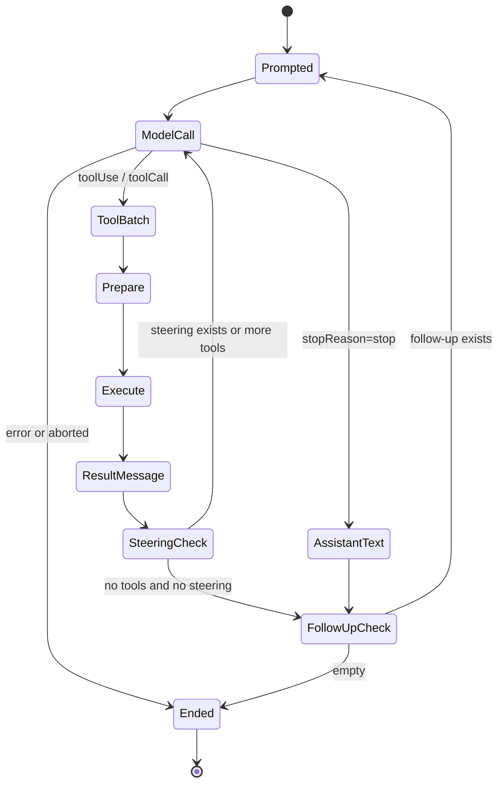
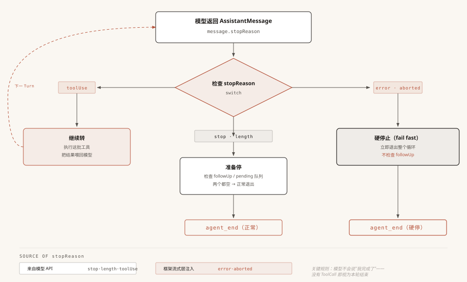
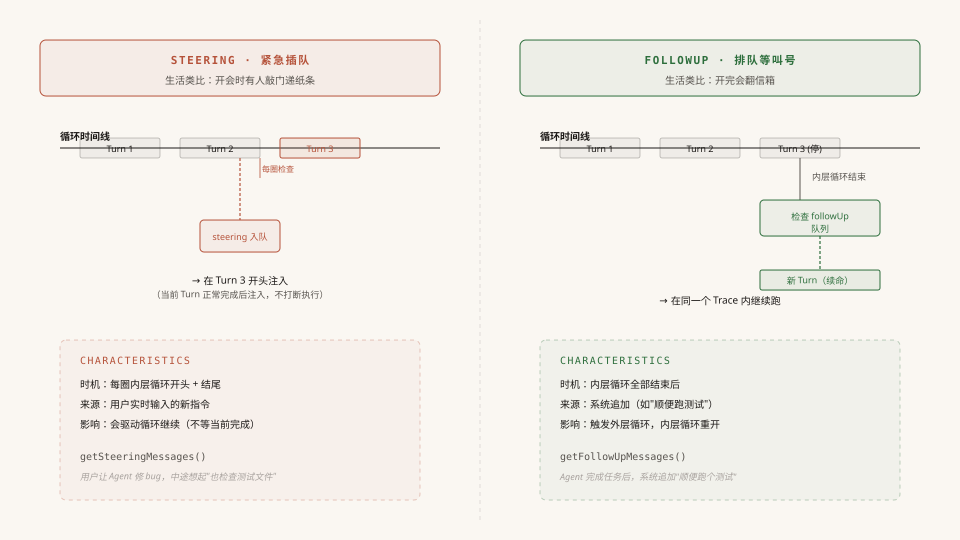

# M06：Agent Loop

> [上一页：M05](M05.md) · [总目录](../index.md) · [下一页：M07 API Adapter](M07.md)

## 问题引入

Agent Loop 不是“多调用几次模型”这么简单。一次用户消息如何进入循环？`AssistantMessage` 何时写入 Context？工具执行失败后如何继续？`stopReason`、`terminate`、steering 和 follow-up 分别控制什么？

## 直觉解释

模型每次只做一个决定：回答，或者请求一个或多个工具。Runtime 把这个决定执行完，产生观察结果，再把观察结果放回对话。所谓“自主”，就是模型在每个观察点重新决定下一步；所谓“可控”，就是 Runtime 在每一步验证、授权、取消和限流。

## 技术定义

### 从用户消息到第一轮

`runAgentLoop(prompts, context, config, emit, signal, streamFn)` 先复制 prompt，构造 `currentContext.messages = context.messages + prompts`，发出 `agent_start`、`turn_start` 和 prompt 的 `message_start/message_end`，然后进入 `runLoop()`。

### 内层循环和外层循环

- **内层循环**：只要上一条 assistant 有工具调用，或有 steering 消息，就继续产生下一次 assistant 响应。
- **外层循环**：内层本来要停止时，检查 `getFollowUpMessages()`；有 follow-up 就重新进入内层，没有才发出 `agent_end`。

### `stopReason`

Pi AI 的 `StopReason` 是 `stop`、`length`、`toolUse`、`error`、`aborted`。`error` 和 `aborted` 直接结束当前 run；普通 `stop`/`length` 仍要检查工具调用、steering 和 follow-up。`toolUse` 表示 assistant 响应中有工具调用，随后由 Loop 执行。

### `terminate`

工具结果可带 `terminate: true`，但一个批次只有在所有 finalized tool result 都是 `true` 时才提前结束。它是工具批次的早停提示，不是模型的 `stopReason`。

### Steering 与 Follow-up

`steer()` 把消息排入 steering queue，当前 assistant 的工具批次完成后、下一次模型调用前注入；`followUp()` 排入 follow-up queue，只有 Agent 本来要结束时才注入。前者是“改方向”，后者是“等这一轮完成再做”。

### ReAct 关系

Loop 的运行形状是 `Reason/Decide → Act → Observe → Continue`，因此具有 ReAct 式结构；它不是经典 ReAct 论文的逐字实现。Pi 的具体实现增加了流式事件、工具并行、队列、错误消息、上下文转换和生命周期。

## 必要算法

以下为教学伪代码，用来表达控制流程，不是源码原文。

```text
pending = getSteeringMessages()
firstTurn = true

while true:                                  # outer loop: follow-up
    hasMoreToolCalls = true
    while hasMoreToolCalls or pending not empty:
        emit turn_start unless first turn
        append pending messages to context
        assistant = streamAssistantResponse(context)
        append assistant to context

        if assistant.stopReason in {error, aborted}:
            emit turn_end, agent_end
            return

        toolCalls = assistant.content where type == toolCall
        if toolCalls:
            batch = executeToolCalls(toolCalls)
            append batch ToolResultMessage in assistant source order
            hasMoreToolCalls = not batch.terminate
        else:
            hasMoreToolCalls = false

        emit turn_end
        pending = getSteeringMessages()

    pending = getFollowUpMessages()
    if pending empty: break

emit agent_end
```

`streamAssistantResponse()` 在每次模型调用前先执行 `transformContext`，再执行 `convertToLlm`，构造 `pi-ai Context`，选择 `streamFn || streamSimple`，消费事件流，最终把 AssistantMessage 写回 Context。

## 源码对应

核心文件：

- `packages/agent/src/agent-loop.ts`：`runAgentLoop()`、`runAgentLoopContinue()`、`runLoop()`、`streamAssistantResponse()`、`executeToolCalls()`。
- `packages/agent/src/agent.ts`：`Agent.prompt()`、`runWithLifecycle()`、`createLoopConfig()`、`steer()`、`followUp()`、`abort()`。
- `packages/agent/src/types.ts`：`AgentLoopConfig` 的 `transformContext`、`convertToLlm`、`getSteeringMessages`、`getFollowUpMessages` 和工具 hooks。
- `packages/coding-agent/src/core/agent-session.ts`：将 Session API 的 `prompt()`、`steer()`、`followUp()` 映射到 Agent，并在 `message_end` 时持久化。

关键函数：

- `runLoop()`：实现内外两层循环。
- `streamAssistantResponse()`：组装 LLM Context，处理流式 AssistantMessage。
- `executeToolCalls()`：按 config 或工具声明选择串行/并行。
- `runWithLifecycle()`：设置 `AbortController`、`isStreaming`，在失败时构造 error/aborted AssistantMessage。

调用关系：

```text
Agent.prompt
  → runAgentLoop
  → runLoop
  → streamAssistantResponse
  → streamFn / streamSimple
  → AssistantMessage
  → executeToolCalls
  → ToolResultMessage
  → runLoop 再次调用模型
```

## 具体例子或流程图



## 讲解建议

先用一轮“读取文件”的例子讲清 `AssistantMessage(toolCall)` 和 `ToolResultMessage` 的相邻关系，再补充队列和错误分支。听众只要能回答“下一次模型调用看到的新增消息是什么”，就已经掌握 Loop 的核心。

## 源码深读：`runAgentLoop()` 的每一处状态变化

### 初始 Context 不是原地修改的参数

`runAgentLoop()` 先把 `prompts` 复制到 `newMessages`，再创建 `currentContext = { ...context, messages: [...context.messages, ...prompts] }`。这样返回值可以只表示本次新增消息，而 Context 则是本次运行的可变副本。它随后发出 `agent_start`、`turn_start` 和每个 prompt 的 `message_start/message_end`。

`runAgentLoopContinue()` 则要求 Context 非空，且最后一条消息不能是 assistant；它适用于从 user 或 tool result 继续，而不是重复提交一个已经完成的 assistant。

### `runLoop()` 的内外两层

源码把 `pendingMessages` 初始化为 `getSteeringMessages()`。外层 `while (true)` 负责 follow-up；内层 `while (hasMoreToolCalls || pendingMessages.length > 0)` 负责当前运行的工具与 steering。

每次进入内层，先把 pending 消息发出并追加到 Context，再调用 `streamAssistantResponse()`。assistant 完成后，源码先检查 `stopReason` 是否为 error/aborted；只有这两个原因直接终止。其它原因继续检查 content 中的 toolCall。

如果没有工具调用，`hasMoreToolCalls` 变为 false，内层在 steering 检查后结束。随后外层读取 follow-up；若有消息，把它放回 pending，开启另一个 turn；没有才发出 `agent_end`。

### 流式 AssistantMessage 的“空壳 → 原地替换”

`streamAssistantResponse()` 在每次调用前运行 `transformContext`，再运行 `convertToLlm`，构造 `Context` 并调用 `streamFn`。当收到 stream 的 `start` 事件，它把 partial message 放入 Context，并发出 `message_start`；后续文本、thinking、toolcall 事件会用新的 partial 替换 Context 最后一条 assistant message，并发出 `message_update`。

收到 done/error 后，源码调用 `response.result()` 得到 final AssistantMessage，替换 partial 或追加新消息，然后发出 `message_end`。因此模型流事件和 Agent message lifecycle 是两套不同粒度的时间线。

### 工具批次的终止不由单个工具决定

`executeToolCalls()` 检查全局 `config.toolExecution` 和每个工具的 `executionMode`。串行模式按 assistant content 顺序逐个准备、执行、finalize、发 result；并行模式先按顺序准备所有调用，再允许准备成功的工具并发执行，最后用 `Promise.all` 的输入顺序创建 ToolResultMessage。

`shouldTerminateToolBatch()` 要求 finalized calls 非空且每个 result 的 `terminate === true`。这是一条很容易被忽略的安全不变量：一个工具想终止，不能覆盖同批次另一个工具没有终止的事实。

### Steering、Follow-up 和“当前轮不能跳过”

源码注释明确说明 steering 在当前 assistant turn 的工具执行完成后注入，不会跳过当前 assistant 已经请求的工具。也就是说，用户中途输入“停下来改做 B”，当前批次已经发出的工具调用仍会收束，随后 steering 消息才进入下一次模型调用。

Follow-up 的时机更晚：内层确认没有更多工具和 steering 后，外层才拉取 follow-up。这适合系统追加“任务完成后再检查测试”的消息，不会打断当前任务。

### 失败状态是消息，不是未处理异常

`Agent.runWithLifecycle()` 创建 `AbortController` 并设置 `isStreaming`。如果执行器抛错，`handleRunFailure()` 构造空文本的 AssistantMessage，填入当前 model 的 api/provider/id、空 usage 和 `stopReason: aborted | error`，追加到 state，并发出 `agent_end`。这使调用方仍能观察到完整终止事件。

低层 Loop 的 `StreamFn` 契约也要求 Provider/request/runtime 失败编码到返回的 event stream，而不是在调用后抛出 reject。这样错误可以沿同一条 Message/Event/Delivery 管道传播。

## Loop 的四个不变量

1. **消息不丢失**：assistant final 和 ToolResultMessage 先写入 Context，再决定下一轮。
2. **工具结果配对**：每条结果带原始 `toolCallId` 和 `toolName`。
3. **控制点单一**：继续/结束由 `runLoop()` 的 stopReason、tool calls、steering、follow-up 和 terminate 共同决定。
4. **事件可观察**：每个模型消息和工具执行都有 start/update/end 边界。

## 具体执行表

| 阶段 | Context 新增 | Event 重点 | 下一步 |
| --- | --- | --- | --- |
| prompt | user message | `message_start/end` | 调模型 |
| stream start | partial assistant | `message_start` | 接收增量 |
| stream delta | 更新 assistant | `message_update` | 继续收流 |
| stream done | final assistant | `message_end` | 查 toolCall |
| tool batch | tool results | tool events + message end | 再调模型或结束 |
| inner stop | 无 | `turn_end` | 查 steering/follow-up |
| outer stop | 无 | `agent_end` | run settlement |

## 本页收束

Agent Loop 的核心不是“while 语句”，而是对消息、工具批次、队列和生命周期的严格排序。M07 会说明 `streamFn` 里面如何把统一 Context 交给不同 API；M08 会把工具管道的每一个保护点拆开。

## 图解参考：停止原因与队列时机

Pi Agent Book 的两张参考图很适合放在讲解时对照：一张把 `stopReason` 画成循环分叉，另一张把 steering 与 follow-up 放在不同时间点。本地提取素材位于：





图中的视觉标注用于学习顺序；当前版本的停止条件和函数名以本地 `packages/agent/src/agent-loop.ts` 为准。

---
