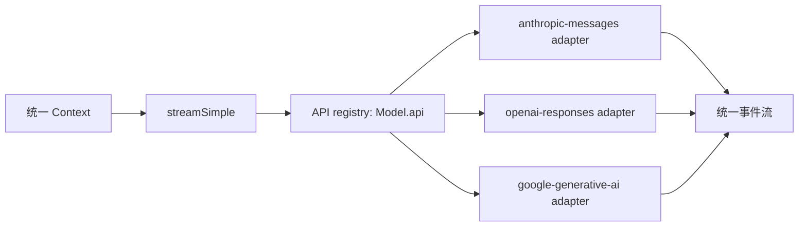

# M07：模型调用与 API Adapter

> [上一页：M06 Agent Loop](M06.md) · [总目录](../index.md) · [下一页：M08 Tool System](M08.md)

## 问题引入

为什么 Agent Loop 可以调用 Anthropic、OpenAI、Google 和兼容服务，却不在循环里写一堆 `if provider === ...`？因为 Provider 和 API protocol 是两个不同的维度。

## 直觉解释

Provider 像“哪家公司提供服务”，API protocol 像“服务窗口使用哪种表格”。两家公司可以使用同一种表格；同一家公司也可以提供多种表格。`Model.api` 决定选择哪种 protocol adapter，`Model.provider` 主要用于身份、认证、计费和路由。

## 技术定义

`packages/ai/src/types.ts` 中：

- `KnownApi` 包含 `openai-completions`、`openai-responses`、`anthropic-messages`、`google-generative-ai` 等协议标识；`Api` 允许扩展字符串。
- `KnownProvider` 列出厂商标识；`Provider` 同样允许扩展。
- `Model` 携带 `id`、`api`、`provider`、`baseUrl`、上下文窗口、最大输出和能力字段。
- `Context` 携带 `systemPrompt`、统一 `Message[]` 和可选 `Tool[]`。

`packages/ai/src/api-registry.ts` 维护 `Map<string, RegisteredApiProvider>`。注册项同时提供 `stream` 和 `streamSimple`，并保存可选 `sourceId` 以便卸载。

## 必要算法

以下为教学伪代码，用来表达 Adapter 选择，不是源码原文。

```text
stream(model, context, options):
    adapter = apiProviderRegistry.get(model.api)
    if adapter missing: throw "No API provider registered"
    return adapter.stream(model, context, options)

registerApiProvider(provider, sourceId):
    registry[provider.api] = {
        stream: wrapperChecksModelApi(provider.api, provider.stream),
        streamSimple: wrapperChecksModelApi(provider.api, provider.streamSimple),
        sourceId
    }
```

`streamSimple()` 把统一的 reasoning、thinking budget、cache retention 等选项交给协议 adapter；adapter 负责把它们翻译成 provider payload，并把 SSE/WebSocket 的增量事件映射为统一事件：`start`、`text_delta`、`thinking_delta`、`toolcall_delta`、`done` 或 `error`。

Agent Loop 并不等待一个“自然结束的迭代器”来判断成功。`AssistantMessageEventStream.result()` 等待终态 `done/error`，并要求错误也编码为 `AssistantMessage(stopReason = error | aborted)`。

## 源码对应

核心文件：

- `packages/ai/src/types.ts`：协议、Provider、`StreamOptions`、`Context` 和统一事件类型。
- `packages/ai/src/stream.ts`：`stream()`、`streamSimple()`、`complete()`、`completeSimple()`。
- `packages/ai/src/api-registry.ts`：`ApiProvider`、`registerApiProvider()`、`getApiProvider()`。
- `packages/ai/src/providers/register-builtins.ts`：内置协议的延迟注册入口。
- `packages/agent/src/agent-loop.ts`：把 `streamFn` 当成可注入的模型调用 seam。
- `packages/coding-agent/src/core/sdk.ts`：用 `modelRegistry.getApiKeyAndHeaders()` 取得认证，再调用 `streamSimple()`。

关键函数：

- `resolveApiProvider()`：按 `model.api` 从 registry 取 adapter，缺失直接抛错。
- `streamSimple()`：按 `model.api` 选择 `streamSimple` adapter。
- `registerApiProvider()`：包住 adapter，先检查 `model.api` 是否匹配。
- `Agent.streamFn`：Agent Loop 使用的可替换 stream 函数。

调用关系：

```text
Agent.streamFn
  → pi-ai streamSimple
  → getApiProvider(model.api)
  → protocol adapter
  → AssistantMessageEventStream
  → Agent Loop
```

## 具体例子或流程图



## 讲解建议

用一句话区分两个名词：“Provider 说谁在提供服务，API 说用什么线协议；Pi 按 `Model.api` 选 adapter。”然后再解释 `streamSimple()` 如何让 Agent Loop 不必认识 SSE 字段名。

## 从一次调用拆开 Provider 与 API

### 问题引入

同一个厂商的模型为什么会有不同的调用入口？反过来，为什么一个“兼容 OpenAI”的服务可以被多个厂商名称使用？如果把厂商名称当成协议名称，认证、模型目录和请求格式会被耦合，新增兼容服务就只能复制一整套 Loop。

### 直觉解释

可以把 `Model` 看成一张“配送单”。`provider` 是配送公司，`api` 是这家公司使用的运单格式，`baseUrl` 是目的地，`id` 是具体商品。配送公司负责取件和计费，但仓库只需要根据运单格式选择扫描器。Pi 的 registry 就是这个扫描器目录。

### 技术定义

在 `pi-ai` 中，`Provider` 不是一个包含全部行为的类，而是模型身份字段的类型别名；真正可调用的协议实现是 `ApiProvider`。`ApiProvider` 必须声明一个 `api`，并实现两种入口：

- `stream(model, context, options)`：暴露完整的 `StreamOptions`，适合需要 provider 特有参数的调用；
- `streamSimple(model, context, options)`：接受跨 provider 的简化选项，由 adapter 自己填充协议细节。

`Model<TApi>` 的泛型让 TypeScript 在编译期把模型和 API 关联起来，但运行时仍会在 registry wrapper 中再次检查 `model.api`。这个检查很重要：如果插件错误地把 OpenAI 模型交给 Anthropic adapter，错误会在入口处暴露，而不是等到远端返回难读的 400。

### 必要算法：从 Model 到事件流

以下为教学伪代码，用来表达适配流程，不是源码原文。

```text
request(model, context, simpleOptions):
    protocol = registry.get(model.api)
    assert protocol exists
    assert model.api equals protocol.api
    wireRequest = protocol.encode(model, context, simpleOptions)
    rawStream = httpOrSdkCall(wireRequest)
    for providerEvent in rawStream:
        yield normalize(providerEvent)
```

`normalize()` 的目标不是抹平所有差异，而是把 Loop 需要的最小事件集合固定下来。文本增量要能拼成 `AssistantMessage.content`，思考增量要能记录 usage 前的状态，工具调用增量要能逐步拼出工具名称、调用 id 和 JSON 参数；终态要明确区分正常停止、工具使用、错误和中止。

### `stream()` 与 `streamSimple()` 的边界

`stream()` 和 `streamSimple()` 都返回 `AssistantMessageEventStream`，但调用者的责任不同。完整入口允许应用传入协议专属字段，例如某些服务的缓存控制、额外请求头或原始 payload hook；简化入口只要求调用者提供通用的 reasoning、温度、最大输出等设置。OpenClaw 在 embedded runner 中通常先完成 provider/model 选择和认证，再把包装后的 stream 函数传给 Pi Agent。

这解释了一个常见误读：`streamSimple()` 不是“非流式调用”。它的名字表示“简单选项”，返回值仍然是事件流。若需要一次性结果，`completeSimple()` 才会在内部等待 `s.result()`。

### API registry 的生命周期

内置 provider 在 `packages/ai/src/providers/register-builtins.ts` 中注册。registry 不是静态对象常量，而是可以注册、枚举和按 `sourceId` 卸载的 Map。这为扩展包提供了两个能力：插件可以在启动时添加协议，卸载时不会误删其它插件；测试可以清空 registry，避免一个测试注册的 adapter 泄漏到另一个测试。

注册时的 wrapper 还承担类型边界的运行时防护：它把泛型 `ApiProvider<TApi>` 转成通用内部函数，但每次调用都会检查 `model.api`。因此 registry 是“按协议分派”，不是“按 provider 字符串猜实现”。

### 认证、模型目录与协议分开在哪里

认证通常由上层的 `ModelRegistry` 或 OpenClaw 的 auth/profile 逻辑完成。它根据 `model.provider` 和当前 profile 找 API key、headers 或 OAuth token；得到凭据后，调用 `streamSimple()` 时通过 options 或 wrapper 传入。模型目录也由 provider/profile 层维护，包含模型 id、上下文窗口、能力和价格。`pi-ai` 只消费已经解析好的 `Model`，不负责决定用户使用哪个账号。

所以一条真实调用可以被拆成四步：

```text
profile/auth → 找到 provider 凭据
model registry → 解析 Model(id, provider, api, limits)
api registry → 按 Model.api 选择 ApiProvider
adapter → 编码请求并把远端事件规范化
```

任何一步失败，都不应伪装成“模型正常停止”。缺少认证是配置错误，缺少 adapter 是注册错误，远端返回错误是 provider error；这些错误最终由 Loop 编码为 `AssistantMessage` 的错误 stop reason，供 OpenClaw 的 fallback 和 delivery 层判断。

### 具体例子：同一 Loop 换两个协议

假设 `Model A` 的 `api` 是 `anthropic-messages`，`Model B` 的 `api` 是 `openai-responses`。两次调用的 `Context` 可以完全相同：同一 system prompt、同一消息历史、同一工具 schema。差异只在 adapter：

1. Anthropic adapter 把系统提示、消息块和工具定义编码成其消息格式；
2. OpenAI adapter 把同一语义编码成 response input/items；
3. 两者都把远端增量转成 `text_delta` 和 `toolcall_delta`；
4. `runLoop()` 只读取统一的 `AssistantMessage`，继续执行工具，不知道 wire payload 长什么样。

这就是“协议差异向下收敛”的实际效果。新增一个兼容服务时，优先增加或复用 API adapter；不需要在 `agent-loop.ts` 里增加 provider 分支。

## 本页收束

`Model.provider` 帮助上层确定身份和凭据，`Model.api` 决定 `pi-ai` 采用哪套线协议。registry 负责可插拔的选择，adapter 负责编码与事件规范化，Agent Loop 只消费统一的 `AssistantMessageEventStream`。这个边界让 OpenClaw 可以做 provider fallback，而不会把 fallback 逻辑散落在每一个工具或 turn 分支中。

---
