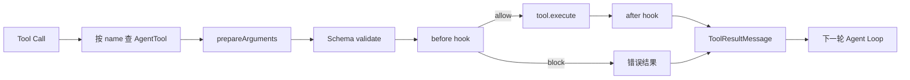

# M08：Tool System

> [上一页：M07 API Adapter](M07.md) · [总目录](../index.md) · [下一页：M09 Message 与 Event](M09.md)

## 问题引入

模型发出的工具调用只是 JSON。怎样保证参数合法、权限可阻止、执行异常可恢复，而且多个工具并行时仍能把结果按原始调用顺序喂回模型？

## 直觉解释

工具调用像一张“执行申请单”：模型填写名称和参数，Runtime 先查名片和 schema，再经过 before hook，才交给执行函数；执行结果还要经过 after hook，最后包装成模型认识的 `ToolResultMessage`。schema 只验证参数形状，不授予文件系统或操作系统权限。

## 技术定义

### 三个层次

- `Tool`（`pi-ai`）：`name`、`description`、`parameters`，是模型可见的名片。
- `AgentTool`（`pi-agent-core`）：增加 `label`、`execute()`、可选 `prepareArguments`、`executionMode`。
- `ToolDefinition`（`pi-coding-agent`）：产品层可以附加 prompt snippet、guidelines、延迟加载信息，再适配成 AgentTool。

### 八步管道

1. AssistantMessage 中出现 `toolCall`。
2. 按名字查找当前 `AgentContext.tools`。
3. `prepareArguments` 兼容原始参数。
4. `validateToolArguments` 按 TypeBox schema 验证。
5. `beforeToolCall` 可以返回 `{ block: true }`，产生错误 Tool Result 而不执行。
6. `tool.execute()` 执行真实动作，并可发出 `tool_execution_update`。
7. `afterToolCall` 可替换 content、details、isError、terminate。
8. `createToolResultMessage()` 生成 `role: "toolResult"`，回到 Context。

## 必要算法

以下为教学伪代码，用来表达工具管道，不是源码原文。

```text
for call in assistant.toolCalls:
    tool = findByName(call.name)
    if missing:
        result = error("Tool not found")
    else:
        args = tool.prepareArguments(call.arguments) or call.arguments
        try:
            args = validateToolArguments(tool, args)
            if beforeToolCall blocks:
                result = error(block reason)
            else:
                result = await tool.execute(call.id, args, signal, onUpdate)
                result = afterToolCall(result) or result
        catch error:
            result = error(error.message)
    finalized.append(result)

if toolExecution == sequential or any tool.executionMode == sequential:
    execute one by one
else:
    prepare in assistant order
    execute allowed tools concurrently
    await all in assistant order

emit ToolResultMessage in assistant source order
```

并行模式下，`tool_execution_end` 事件按完成顺序发出，便于实时显示；Tool Result 消息则用 `Promise.all` 的输入顺序生成，保持与 assistant 原始调用块一一对应。这样既获得并行延迟，又保持 provider 所需的调用/result 配对。

`terminate` 只有在批次中每个 finalized result 都为 `true` 时才成立；一个工具要求终止而另一个没有要求，Loop 继续。

## 源码对应

核心文件：

- `packages/agent/src/types.ts`：`AgentTool`、`BeforeToolCallResult`、`AfterToolCallResult`、`ToolExecutionMode`。
- `packages/agent/src/agent-loop.ts`：`executeToolCallsSequential()`、`executeToolCallsParallel()`、`prepareToolCall()`、`executePreparedToolCall()`、`finalizeExecutedToolCall()`。
- `packages/coding-agent/src/core/sdk.ts`：`tools` 名称 allowlist、`customTools` 注册和默认 coding tools。
- OpenClaw `src/agents/pi-tools.ts`：`createOpenClawCodingTools()` 生成带 workspace、sandbox、channel 和 policy 的工具集合。
- OpenClaw `src/agents/pi-embedded-runner/run/attempt.ts`：把最终工具、allowlist 和执行上下文交给 `createAgentSession()`。

关键函数：

- `prepareToolCall()`：查找、参数预处理、schema 验证和 before hook。
- `executePreparedToolCall()`：调用 `tool.execute()`，把异常变成错误结果。
- `finalizeExecutedToolCall()`：应用 after hook。
- `createToolResultMessage()`：创建下一轮模型可见的 Tool Result。
- `createOpenClawCodingTools()`：OpenClaw 的工具包装、策略和环境桥。

调用关系：

```text
AssistantMessage.toolCall
  → prepareToolCall
  → validate / beforeToolCall
  → tool.execute
  → afterToolCall
  → createToolResultMessage
  → next LLM Context
```

## 具体例子或流程图



## 讲解建议

先强调“schema 不是权限系统”。再用 `read(todo.md)` 走完八步；最后补充并行工具的两个顺序：实时事件按完成顺序，模型消息按 assistant 源顺序。

## 一次 Tool Call 的完整判定链

### 问题引入

模型可以生成任意 JSON。为什么 OpenClaw 不直接把这段 JSON 交给 shell？因为“字段长得像参数”不等于“这个动作被允许”，而且工具执行是有状态、有副作用的程序边界。

### 直觉解释

把工具系统想成机场安检：模型先提交航班申请（tool call），柜台确认航班存在（按名称查找），安检机检查行李形状（schema），工作人员根据规则决定是否放行（before hook/policy），地勤真正装卸（execute），最后把登机状态写回系统（after hook + ToolResultMessage）。任何一步失败，都要产生可解释的结果，不能让控制循环失去配对关系。

### 技术定义：三种“工具对象”

`pi-ai` 的 `Tool` 只有模型可见的静态契约：名称、描述和参数 schema。它可以被序列化进 provider 请求，但没有执行方法。`pi-agent-core` 的 `AgentTool` 在此基础上增加 `execute()`、`label`、可选 `prepareArguments` 和 `executionMode`；它才是 Loop 能运行的对象。`pi-coding-agent` 的 `ToolDefinition` 是产品装配格式，可附带 prompt 指南、延迟加载和扩展元数据，最终适配成 `AgentTool`。

这三种类型的分离防止了一个危险误区：把“模型能看见的工具”当成“进程一定能执行的权限”。OpenClaw 还会根据 Workspace、sandbox、channel、sender 和 tool policy 创建包装后的工具实例，所以同名工具在不同 run 中可以拥有不同的实际边界。

### 必要算法：准备、执行、收束

以下为教学伪代码，用来表达控制流程，不是源码原文。

```text
for call in assistant.toolCalls:
    tool = findTool(call.name)
    if tool is missing:
        finalized = error("unknown tool")
        continue

    prepared = prepareArguments(tool, call)
    validateToolArguments(tool.parameters, prepared.arguments)
    before = await beforeToolCall(prepared)
    if before.block:
        finalized = error(before.reason)
    else:
        executed = await tool.execute(call.id, prepared.arguments, signal, onUpdate)
        finalized = await afterToolCall(executed) ?? executed

    emit tool_execution_end(finalized)
    resultMessages.push(createToolResultMessage(finalized))
```

真实代码把上述步骤拆成 `prepareToolCall()`、`executePreparedToolCall()` 和 `finalizeExecutedToolCall()`。拆开后，每个阶段都可以单独测试，也能清晰区分“参数不合法”“策略阻止”“工具自身报错”和“after hook 修改结果”。

### 参数预处理为什么存在

模型输出的参数来自流式 JSON，可能缺少可选字段、使用旧字段名、把数字写成字符串，或者在 provider 的容错模式下带有多余文本。`prepareArguments` 只做约定内的兼容修复；修复后仍必须经过 `validateToolArguments`。因此，预处理不是绕过 schema 的捷径，而是把历史格式归一化到当前 schema，再让同一个验证器做最终判断。

OpenClaw 在 embedded runner 还会做 tool-call argument normalization 和结果截断，这些属于宿主适配，不改变 Pi Loop 的基本契约：最终交给 `AgentTool.execute()` 的参数必须是已验证的对象。

### before hook、policy 与 sandbox 的关系

`beforeToolCall` 是运行时最后一个通用拦截点。它可以依据工具名、调用参数、session、sender 或外部策略返回 block。OpenClaw 的 tool policy 和 sandbox 通常在更早的工具构造阶段确定 allowlist、实际路径和命令包装；before hook 则可以在每一次调用时做动态判断。

三者职责不同：

- schema 验证“参数形状对不对”；
- policy/hook 判断“当前 run 是否允许这个动作”；
- sandbox/OS 权限限制“即使代码想做，实际能触及哪些资源”。

例如 `read({path:"../secret"})` 可能通过字符串 schema，但 boundary-safe path 检查或 sandbox 会拒绝；这不是 schema 的失败，而是执行边界的失败。

### 错误为何也要变成 Tool Result

Loop 需要把工具调用和结果一一配对。若 `execute()` 抛异常就直接退出，模型只能看到一个没有闭合的 tool call，下一次重试也无法构造合法上下文。Pi 因此捕获执行异常，把错误文本、`isError: true` 和 `toolCallId` 包进 `ToolResultMessage`。模型下一轮可以根据错误选择改参数、换工具或向用户解释，而 OpenClaw 可以在事件桥中显示失败状态。

这也是“错误是观察”的含义：工具失败不是控制流外的噪声，而是环境对模型的一次明确反馈。只有不可恢复的 Loop 级错误（例如 provider adapter 丢失）才会以 Agent 的 error stop reason 结束整个 run。

### 并行与串行：两个顺序同时存在

`ToolExecutionMode` 有 `sequential` 和 `parallel`。串行模式按照 assistant message 中的调用顺序依次执行；并行模式先按相同顺序准备和验证，再启动允许并行的调用。代码会等待所有 Promise 完成，并按原始数组顺序生成 Tool Result 消息。

为什么不能按完成顺序写回？因为 provider 需要通过 `toolCallId` 保持调用/result 配对，部分协议还要求消息块顺序与 assistant 原文一致。事件和消息因此采用不同顺序：

```text
tool_execution_end：哪个先完成就先通知，便于 UI 实时显示
ToolResultMessage：按 assistant.toolCalls 原始顺序，保证上下文合法
```

`shouldTerminateToolBatch()` 也在批次层判断：只有每个已完成调用都返回 `terminate: true`，这一批才要求 Loop 提前结束。单个工具的终止提示不会悄悄吞掉同批其它工具的结果。

### 具体例子：read 与 memory_search 同时发生

模型返回两个调用：`read(todo.md)` 和 `memory_search("今天的优先事项")`。Pi 先为两个调用查找工具、预处理参数并验证 schema。若配置允许并行，它们同时执行；文件读取可能先完成，memory 索引随后完成。事件订阅器先收到 `read` 的 `tool_execution_end`，但 Loop 等待两者都结束后，仍按 assistant 原顺序创建两个 Tool Result。下一次模型调用看到的顺序稳定，且能同时利用当前文件和长期记忆证据。

若 memory 工具被 policy 禁止，结果仍占据第二个调用的位置，只是 `isError: true`。模型得到“memory_search 被阻止”的观察，不会把第一个结果误认为两个调用都成功。

## 本页收束

Tool System 的核心不是“让模型调用函数”，而是把一段不可信的结构化请求转换成有 schema、有策略、有沙箱、有错误语义、可持久化的环境观察。Pi 负责通用八步管道，OpenClaw 负责把每次 run 的工具集合和真实权限注入其中。

---
