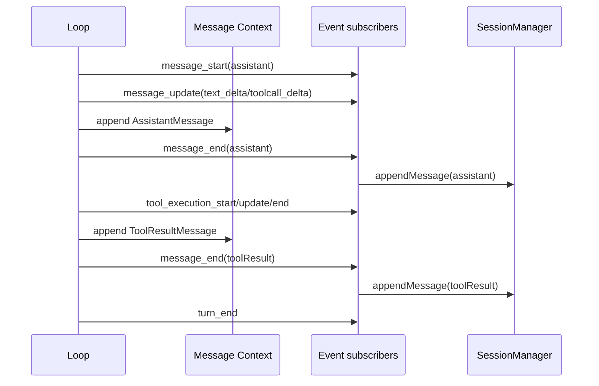
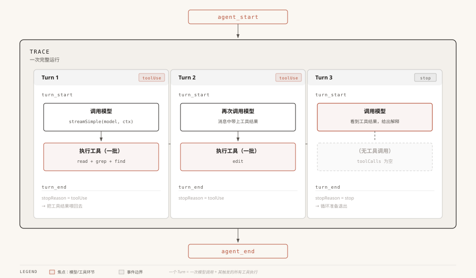
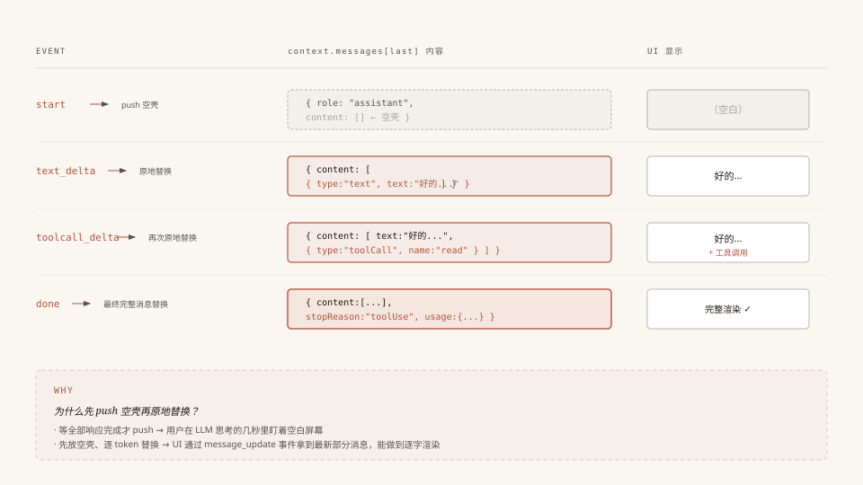

# M09：Message 与 Event

> [上一页：M08 Tool System](M08.md) · [总目录](../index.md) · [下一页：M10 Context Engineering](M10.md)

## 问题引入

为什么同一个“工具结果”既出现在对话历史里，又会有 `tool_execution_end`、`message_end` 和 `turn_end` 事件？因为 Message 和 Event 解决的是不同问题。

## 直觉解释

Message 是可以放进“给模型看的对话本”里的数据；Event 是运行过程的时间线通知。Message 回答“下一次模型调用能看到什么”，Event 回答“刚刚发生了什么、UI 和 Gateway 现在该做什么”。

## 技术定义

`pi-ai` 的基础 `Message` 只有三类：

- `UserMessage`：用户输入，内容可以是文本或图片。
- `AssistantMessage`：模型输出，content 可以包含文本、thinking 和 `toolCall`；带 `api`、`provider`、`model`、usage 和 `stopReason`。
- `ToolResultMessage`：工具执行结果，带 `toolCallId`、`toolName`、文本/图片 content、details 和 `isError`。

`pi-agent-core` 的 `AgentMessage` 在这三类基础上允许应用通过 `CustomAgentMessages` 扩展。`convertToLlm()` 决定自定义消息如何被转换或过滤。

`AgentEvent` 主要包括：

- `agent_start` / `agent_end`：一次完整 run 的边界；
- `turn_start` / `turn_end`：一个模型响应和其工具批次的边界；
- `message_start` / `message_update` / `message_end`：消息从开始、流式增量到完成；
- `tool_execution_start` / `tool_execution_update` / `tool_execution_end`：工具运行时间线。

Pi 的 `AssistantMessageEventStream` 还提供 `text_delta`、`thinking_delta`、`toolcall_delta` 等 provider 流事件。它们最终被 `Agent` 消费成 AgentEvent。

## 必要算法

以下为教学伪代码，用来表达 Message/Event 双管道，不是源码原文。

```text
model stream emits text_delta/toolcall_delta
    → runtime updates partial AssistantMessage
    → emit message_update for observers
    → on done, append final AssistantMessage to context
    → emit message_end

tool.execute emits partial updates
    → emit tool_execution_update
    → finalize result
    → append ToolResultMessage to context
    → emit message_start/message_end
    → emit turn_end
```

`message_end` 是持久化的重要切点；`turn_end` 表示本轮模型和工具批次完成；`agent_end` 才表示 run 结束。订阅者可以只观察事件，不改变 Context；扩展 hook 则可以在受支持的边界干预。

## 源码对应

核心文件：

- `packages/ai/src/types.ts`：`Message`、`AssistantMessage`、`ToolResultMessage`、`AssistantMessageEvent`。
- `packages/agent/src/types.ts`：`AgentMessage`、`AgentEvent`、`AgentContext`。
- `packages/agent/src/agent-loop.ts`：在 `streamAssistantResponse()` 中把 provider event 转成 message lifecycle，在工具函数中发出工具事件。
- `packages/agent/src/agent.ts`：`subscribe()`、`processEvents()` 和运行状态 `isStreaming`。
- `packages/coding-agent/src/core/agent-session.ts`：在 `_processAgentEvent()` 中先通知扩展和 listeners，再在 `message_end` 调用 `sessionManager.appendMessage()`。
- `src/agents/pi-embedded-subscribe.ts`：OpenClaw 对 Pi events 做回复块、工具可见性和生命周期桥接。

关键函数：

- `streamAssistantResponse()`：更新 partial/final AssistantMessage。
- `createToolResultMessage()`：将工具结果转成 Message。
- `Agent.subscribe()`：注册按顺序等待的事件监听器。
- `_processAgentEvent()`：持久化消息、处理 retry 和 compaction 检查。

调用关系：

```text
Provider event → AssistantMessage partial/final → AgentEvent → SessionManager / Delivery
Tool execution → ToolResultMessage → AgentEvent → SessionManager / Delivery
```

## 具体例子或流程图



## 讲解建议

让听众用两个问题检查理解：下一次模型调用读取的是 Message；WebChat 是否显示一段增量文本读取的是 Event。两者可由同一个运行产生，但不能互相替代。

## 从一条消息看见两条管道

### 问题引入

当模型正在输出一段长答案时，WebChat 可以实时显示文字；但如果进程在 `message_update` 后崩溃，重启后又必须知道哪些完整消息已经写入 transcript。为什么“正在发生的通知”和“可恢复的记录”需要两套对象？

### 直觉解释

Message 像账本上的一行，只有在内容完整、可以被下一次模型请求消费时才落账。Event 像广播中的播报，允许在一行账本写完之前不断报告进度。广播可以丢弃或重放，账本必须保持顺序和结构。

### 技术定义：Message 的三种角色

`UserMessage` 是输入事实，可以是文本或图片。`AssistantMessage` 是模型输出，content 中可以混合文本、thinking 和带 id 的 `toolCall`；它还记录 provider、model、usage 和 `stopReason`。`ToolResultMessage` 是环境观察，必须带 `toolCallId` 与 `toolName`，可以包含文本、图片、details 和 `isError`。

这些 Message 会进入 `AgentContext.messages`，经过 `transformContext` 与 `convertToLlm` 后成为下一次 provider 请求的一部分。Message 的核心问题是“下一次调用应看到什么”，而不是“界面现在显示什么”。

### 技术定义：Event 的时间线

Pi 的 `AgentEvent` 描述运行边界和增量过程：

- `agent_start` / `agent_end`：一次 run 的开始与最后事件；
- `turn_start` / `turn_end`：一次模型响应及其工具批次；
- `message_start` / `message_update` / `message_end`：消息从开始、增量到完成；
- `tool_execution_start` / `tool_execution_update` / `tool_execution_end`：工具执行时间线。

底层 `AssistantMessageEventStream` 还会产生 `text_delta`、`thinking_delta`、`toolcall_delta`。`streamAssistantResponse()` 将这些 provider 事件拼接成 partial assistant message，同时发出 AgentEvent；只有终态消息才被追加到 Context 和 SessionManager。

### 必要算法：消息完成前后的状态机

以下为教学伪代码，用来表达状态转换，不是源码原文。

```text
emit message_start(assistant)
for delta in provider stream:
    update partial assistant
    emit message_update(delta)
final = stream.result()
append final to AgentContext.messages
emit message_end(final)

for tool call in final:
    emit tool_execution_start(call)
    execute and emit tool_execution_update
    emit tool_execution_end(result)
    append ToolResultMessage(result)
    emit message_end(result)

emit turn_end(final, toolResults)
if loop has no continuation:
    emit agent_end(newMessages)
```

`message_end` 是编码层写入 transcript 的切点；`turn_end` 表示本轮已经完成，不保证整个 run 没有 follow-up；`agent_end` 表示 Pi Loop 不再发出新的 AgentEvent，但 `Agent.subscribe()` 仍会等待 listener 完成后才把 Agent 标记为空闲。

### SessionManager 如何消费事件

`packages/coding-agent/src/core/agent-session.ts` 中，`_handleAgentEvent()` 将事件串行排队给 `_processAgentEvent()`。处理 `message_end` 时，SessionManager 通过 `appendMessage()` 写入带 `id/parentId` 的 JSONL entry；这保证 assistant 和 tool result 在 transcript 中形成可重建的链。事件订阅、扩展通知和持久化按同一消息顺序执行，避免 UI 先看到结果而磁盘记录缺失。

在 `agent_end`，AgentSession 还会检查最后一个 assistant message，触发 retry 或 auto-compaction 相关逻辑。也就是说，`agent_end` 是运行边界，不是“已经发到 Telegram”的交付确认；OpenClaw 的 `pi-embedded-subscribe.ts` 还要把事件翻译成 block/final delivery。

### 为什么事件不能反过来当上下文

事件包含 UI 所需的瞬时状态，例如工具进度、耗时和中间文本。把这些对象直接塞进下一次模型请求，会引入 provider 不认识的字段，并让同一条消息因为每个增量重复出现。`convertToLlm()` 只保留可转换的 user、assistant 和 toolResult 消息；事件则留在观察者链路。

反过来，如果只保存 Message 而没有 Event，用户只能在模型完成整个 run 后看到一次性结果，无法显示长工具调用进度，也无法区分“模型正在思考”“工具正在执行”和“运行已经结束”。因此，Message 与 Event 是互补而不是重复。

### 具体例子：一次失败的 read

模型先产生 `AssistantMessage(toolCall read#1)`，事件桥立即收到 `message_end`。`read` 工具因为路径越界返回 `ToolResultMessage(isError=true)`，同时发出 `tool_execution_end`。Loop 将错误结果回填 Context，模型下一轮改用绝对路径再次调用。用户界面可能显示一次失败工具和一次成功工具，但 transcript 保存的是两个完整的 assistant/tool-result 配对；重启后 SessionManager 可以从 leaf 重建这条历史。

### 观察者、扩展与交付的边界

`Agent.subscribe()` 的 listener 是观察和持久化入口，按事件顺序等待异步处理。OpenClaw 的 embedded subscriber 可以把文本增量聚合为预览块，把工具事件映射为状态提示，并在 `agent_end` 生成最终 delivery。它不应该在 subscriber 中复制 Loop 的“是否继续”决策；继续/结束属于 `runLoop()`，交付属于 OpenClaw。

## 本页收束

Message 保证模型上下文和 transcript 的语义完整，Event 保证运行过程可观察、可流式显示和可桥接。理解两条管道后，`message_end`、`turn_end`、`agent_end` 的层级就不会再被误认为同一个“完成事件”。

## 图解参考：Trace、Turn 与流式更新

为了把生命周期层级讲清楚，可以对照两张提取的 Pi Agent Book 参考图：一张展示 Trace 与 Turn 的嵌套，另一张展示流式响应如何在同一条消息上持续更新。





参考图的视觉标注服务于解释；当前版本的事件类型和持久化切点仍以 `packages/agent/src/agent-loop.ts` 与 `packages/coding-agent/src/core/agent-session.ts` 为准。

---
