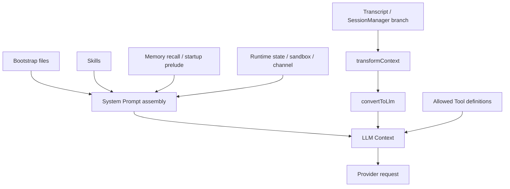

# M10：Context Engineering

> [上一页：M09 Message 与 Event](M09.md) · [总目录](../index.md) · [下一页：M11 Compaction](M11.md)

## 问题引入

模型每一次调用究竟看到了什么？Session transcript 里存在的每一条 entry，是否都会原样送进模型？答案是否定的。

## 直觉解释

Transcript 是仓库，Context 是本次出门要带的背包。仓库可以保存所有历史、分支、标签和扩展状态；背包只装当前模型调用需要且预算允许的内容。

## 技术定义

一次 Pi AI 调用的 Context 由三部分组成：

1. `systemPrompt`：运行时规则、工具说明、workspace/bootstrap/skills、产品策略和安全边界。
2. `messages`：经过 `transformContext` 和 `convertToLlm` 的消息数组。
3. `tools`：当前允许模型调用的工具定义。

OpenClaw 的 Prompt Assembly 还会注入：

- workspace 路径和运行环境；
- Bootstrap 文件筛选后的内容；
- Skills 的按需说明；
- Memory 检索结果或 startup context prelude；
- 当前 channel 能力、时间、模型别名和 sandbox 信息；
- 当前 run 的 runtime state、session key 和 delivery hints。

这里有两道转换：

- `transformContext(messages)`：仍在 `AgentMessage[]` 层，可做裁剪、注入、清洗和上下文工程。
- `convertToLlm(messages)`：把应用自定义消息转换为 `Message[]`，或者过滤掉只给 UI/日志使用的消息。

默认 `Agent` 的 `convertToLlm` 只保留 `user`、`assistant` 和 `toolResult`；自定义消息若没有转换逻辑，不会进入模型请求。

## 必要算法

以下为教学伪代码，用来表达 Context 形成过程，不是源码原文。

```text
messages = session transcript messages
messages = await transformContext(messages)       # prune/inject at AgentMessage level
llmMessages = await convertToLlm(messages)        # filter/convert custom messages

llmContext = {
    systemPrompt: current system prompt,
    messages: llmMessages,
    tools: current allowed AgentTools
}
streamFn(model, llmContext, options)
```

OpenClaw 的 `runEmbeddedAttempt()` 在 Pi Session 前构建 `contextFiles`、`skillsPrompt`、`builtAppendPrompt` 和最终 tools；`buildEmbeddedSystemPrompt()` 再调用 `buildAgentSystemPrompt()`，把工具名、运行时信息、sandbox、时间、Memory 段和文件内容组装进 system prompt。

Context window budget 不是简单的 transcript 字符数。它还要预留模型输出、thinking、工具 schema 和 provider 的 envelope；因此 OpenClaw/Pi 需要在工具结果截断、pruning、compaction 和 preflight 之间分层处理。

## 源码对应

核心文件：

- `packages/agent/src/agent-loop.ts`：每次模型调用前执行 `transformContext`、`convertToLlm`，再创建 `llmContext`。
- `packages/agent/src/types.ts`：定义两个转换 seam 及其“不抛异常”的契约。
- `packages/coding-agent/src/core/sdk.ts`：ResourceLoader 的 skills/context files、`convertToLlmWithBlockImages` 和 Agent 初始化。
- `packages/coding-agent/src/core/agent-session.ts`：加载资源并重建基础 system prompt。
- `src/agents/pi-embedded-runner/run/attempt.ts`：OpenClaw 的 workspace、sandbox、tools、bootstrap、skills、provider prompt 和 Session 组装。
- `src/agents/pi-embedded-runner/system-prompt.ts`：`buildEmbeddedSystemPrompt()` 将 OpenClaw 参数委托给 `buildAgentSystemPrompt()`。
- `src/agents/system-prompt.ts`：产品级 system prompt 的实际模板和段落拼接。
- `src/auto-reply/reply/startup-context.ts`：新 session 的 daily memory prelude。

关键函数：

- `buildEmbeddedSystemPrompt()`：构造 OpenClaw system prompt。
- `buildAgentSystemPrompt()`：拼接工具、运行时、workspace、context files 等段落。
- `transformContext()` / `convertToLlm()`：在 Agent Loop 与 provider 之间过滤和转换消息。
- `buildSessionStartupContextPrelude()`：读取近期 daily memory 并按字符预算注入新 session。

调用关系：

```text
workspace/bootstrap/skills/memory/runtime
  → buildEmbeddedSystemPrompt
  → AgentContext.systemPrompt + messages + tools
  → transformContext
  → convertToLlm
  → pi-ai stream
```

## 具体例子或流程图



## 讲解建议

反复区分两个容器：“transcript 负责可恢复性，Context 负责本次推理”。当有人说“`MEMORY.md` 每次都在 prompt 里”时，纠正为：它在符合条件时作为 eligible bootstrap 或工具检索结果进入；是否全文进入由 run kind、session、预算和 Prompt Assembly 决定。

---
