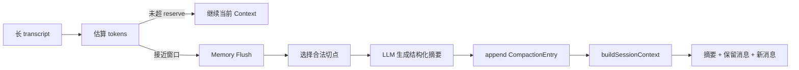

# M11：Compaction

> [上一页：M10 Context Engineering](M10.md) · [总目录](../index.md) · [下一页：M12 Workspace 与 Bootstrap](M12.md)

## 问题引入

Agent 比普通聊天更容易超过 Context Window，因为每次工具调用都会增加 assistant tool call 和 tool result；长任务还会累积 thinking、文件摘要和多轮修正。删掉旧消息会丢失任务状态，保留全部消息又无法请求模型，因此需要 Compaction。

## 直觉解释

Compaction 不是删除 transcript，而是为模型制作一张“阶段性工作报告”：旧历史继续保存在 SessionManager；当前 Context 以摘要、合法切点之后的消息和新消息组成。

## 技术定义

要区分三件事：

- **Pruning**：裁短单个工具结果或临时消息，保留最近的可用细节，通常不产生新的摘要 entry。
- **Compaction**：在合法切点把一段旧历史摘要成 `CompactionEntry`，随后重建较短 Context。
- **Memory Flush**：在压缩前把值得长期保存的信息写入 workspace memory 文件；它解决持久化，不替代摘要。

Pi 的 `CompactionEntry` 包含 `summary`、`firstKeptEntryId`、`tokensBefore`、`parentId` 和可选 `details/fromHook`。`buildSessionContext()` 遇到它时先加入摘要消息，再加入从 `firstKeptEntryId` 到 compaction 之前的保留消息，最后加入 compaction 之后的消息。

## 必要算法

以下为教学伪代码，用来表达 Pi compaction 的控制思路，不是源码原文。

```text
estimate = count recent provider usage + estimate trailing messages
if compaction disabled or estimate <= contextWindow - reserve:
    keep current context
else:
    validCuts = user/assistant/custom/bash message boundaries
    never cut at toolResult alone
    choose cut by walking from newest toward oldest
    summarize entries before cut with structured summary prompt
    append CompactionEntry(summary, firstKeptEntryId, tokensBefore)
    rebuild context:
        [CompactionSummaryMessage]
        + messages from firstKeptEntryId onward
```

`estimateTokens()` 在 Pi 当前实现中按消息内容做保守估算：文本、thinking、tool call 参数、工具结果和图片分别估算，图片使用固定字符近似。`shouldCompact()` 的核心条件是 `contextTokens > contextWindow - reserveTokens`。

Turn 切点必须保持 provider 消息合法性。工具结果不能脱离它对应的 assistant tool call；如果切点落在 assistant tool call 上，相关结果需要一起保留。极端情况下会使用 split-turn prefix，让被切断的 turn 在摘要和保留区之间仍有明确语义。

SessionManager 的 append-only tree 保持完整 transcript。`parentId` 把 entry 连成 DAG；`branch()` 只移动 leaf，不删除旧分支。压缩是新增 entry，而不是覆写历史。

## 源码对应

核心文件：

- `packages/coding-agent/src/core/compaction/compaction.ts`：token 估算、`shouldCompact()`、合法切点和摘要准备。
- `packages/coding-agent/src/core/compaction/utils.ts`：文件操作追踪、工具结果截断和摘要序列化。
- `packages/coding-agent/src/core/session-manager.ts`：`CompactionEntry`、`appendCompaction()`、`buildSessionContext()` 和 parentId 树。
- `packages/coding-agent/src/core/agent-session.ts`：`_checkCompaction()`、压缩事件、重试和运行中维护。
- `src/agents/pi-embedded-runner/run/attempt.ts`：OpenClaw 的 preflight overflow、compaction retry、Session guard 和宿主级维护。
- `src/auto-reply/reply/memory-flush.ts`：flush 门槛、reserve floor、重复 flush 去重。
- `extensions/memory-core/src/flush-plan.ts`：flush prompt、日期路径和 append-only 约束。

关键函数：

- `estimateTokens()`：估算 AgentMessage token 数。
- `shouldCompact()`：依据窗口和 reserve 判断压缩。
- `appendCompaction()`：把摘要写成新的 Session entry。
- `buildSessionContext()`：从当前 leaf 重建模型可见消息。
- `shouldRunMemoryFlush()`：在当前 compaction cycle 尚未 flush 且达到门槛时触发 flush。

调用关系：

```text
AgentSession agent_end
  → _checkCompaction
  → estimate/shouldCompact
  → memory flush (OpenClaw, optional)
  → generate summary
  → SessionManager.appendCompaction
  → buildSessionContext
  → next Agent Loop turn
```

## 具体例子或流程图



## 讲解建议

用三层类比帮助区分：pruning 是把一页太长的工具输出裁短；compaction 是写一份阶段报告；flush 是把未来还要用的事实写入长期文件。最后指出：完整 transcript 和模型可见 Context 永远不是同一个集合。

---
