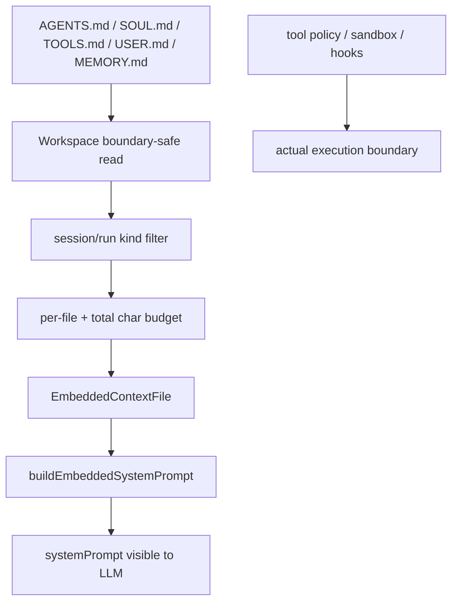

# M12：Workspace 与 Bootstrap Files

> [上一页：M11 Compaction](M11.md) · [总目录](../index.md) · [下一页：M13 Memory、Embedding 与 RAG](M13.md)

## 问题引入

为什么几个普通 Markdown 文件能够改变 Agent 的行为？文件没有执行权限，也不是 TypeScript 配置；它们究竟通过哪条路径进入模型？

## 直觉解释

Workspace 是 Agent 的现场。Bootstrap 文件不是“后台魔法”，而是运行时在每次 attempt 组装 Prompt 时读取的一组受预算和 session 条件约束的文本。文件内容改变的是模型可见的规则和背景；真正的执行约束仍由 tool policy、sandbox、hook 和宿主代码执行。

## 技术定义

OpenClaw `src/agents/workspace.ts` 定义了默认 Workspace 和文件名：

- `AGENTS.md`：项目和目录级协作规则；
- `SOUL.md`：人格和行为基线；
- `TOOLS.md`：工具使用说明；
- `USER.md`：用户背景；
- `IDENTITY.md`：Agent 身份元数据；
- `HEARTBEAT.md`：心跳运行需要的指引；
- `BOOTSTRAP.md`：初始引导内容；
- `MEMORY.md` / `memory.md`：长期记忆入口或兼容文件名。

当前默认 Workspace 是 `~/.openclaw/workspace`；带 profile 时会使用 `~/.openclaw/workspace-<profile>`。每个文件通过 boundary-safe read 读取，限制在 Workspace 根目录，并以文件 identity 缓存。

`resolveBootstrapFilesForRun()` 根据 `contextMode`、`runKind`、session、agent、heartbeat 条件和 hook override 筛选文件。`resolveBootstrapContextForRun()` 再调用 `buildBootstrapContextFiles()` 生成带路径和内容的 `EmbeddedContextFile[]`。

默认预算来自 `src/agents/pi-embedded-helpers/bootstrap.ts`：单文件 `12_000` 字符，总计 `60_000` 字符；超长内容保留头部和尾部，插入截断标记，并且总预算继续生效。配置可以覆盖这两个值。

`BOOTSTRAP.md` 有特殊路由：在需要首次引导的 embedded run 中，`src/agents/pi-embedded-runner/run/attempt-bootstrap-routing.ts` 计算 `bootstrapMode` 和 `userPromptPrefixText`；文件从 system context 中剥离，改由用户 prompt 前缀引导 Agent 处理，避免把初始化流程误当成普通背景。

## 必要算法

以下为教学伪代码，用来表达 Bootstrap 组装，不是源码原文。

```text
files = loadWorkspaceBootstrapFiles(workspace)
files = filterForSession(files, sessionKey, runKind, contextMode)
files = applyBootstrapHookOverrides(files)
files = sanitizePaths(files)

for file in files:
    content = boundarySafeRead(file.path)
    content = trimToPerFileBudget(content, 12000)
    if total + content.length > 60000:
        stop and mark remaining content truncated
    contextFiles.append({name, path, content})

systemPrompt = buildAgentSystemPrompt({contextFiles, tools, runtime, ...})
```

因果链是：

```text
文件 → boundary-safe read → session/run 筛选 → 字符预算/截断
     → contextFiles → buildEmbeddedSystemPrompt
     → AgentContext.systemPrompt → LLM 行为
```

Markdown 只能表达提示。`TOOLS.md` 写“不要运行某命令”不会替代 `beforeToolCall`、tool policy、sandbox 或操作系统权限；执行限制必须在代码边界中落地。

## 源码对应

核心文件：

- `src/agents/workspace.ts`：Workspace 路径、默认文件名、边界安全读取和文件缓存。
- `src/agents/bootstrap-files.ts`：`resolveBootstrapFilesForRun()`、context mode/run kind 筛选、hook override 和 warning。
- `src/agents/pi-embedded-helpers/bootstrap.ts`：`buildBootstrapContextFiles()`、单文件/总字符预算和截断策略。
- `src/agents/pi-embedded-runner/run/attempt-bootstrap-routing.ts`：`resolveAttemptBootstrapRouting()`、bootstrap mode、剥离和 user prompt prefix。
- `src/agents/pi-embedded-runner/run/attempt.ts`：读取 bootstrap/context files，并传入 `buildEmbeddedSystemPrompt()`。
- `src/agents/pi-embedded-runner/system-prompt.ts`：`buildEmbeddedSystemPrompt()`。
- `src/agents/system-prompt.ts`：`buildAgentSystemPrompt()` 的产品级段落拼接。

关键函数：

- `resolveBootstrapContextForRun()`：返回经过筛选的文件和注入内容。
- `buildBootstrapContextFiles()`：执行 per-file/total budget 和截断。
- `resolveAttemptBootstrapRouting()`：决定 Bootstrap 是 system context 还是 user prompt 路由。
- `buildEmbeddedSystemPrompt()`：把 context files、tools、sandbox 和 runtime 变成 system prompt。

调用关系：

```text
resolveBootstrapContextForRun
  → buildBootstrapContextFiles
  → buildEmbeddedSystemPrompt
  → buildAgentSystemPrompt
  → AgentSession.agent.state.systemPrompt
```

## 具体例子或流程图



## 讲解建议

先演示同一条 `read` 工具在不同 Workspace 得到不同规则，再提醒“提示不是权限”。这能让听众理解为什么 Workspace 属于 OpenClaw 宿主，而不是 Pi Agent Loop 的硬编码。

---
