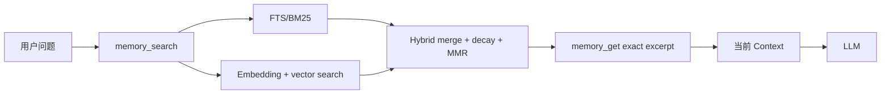

# M13：Memory、Embedding 与 RAG

> [上一页：M12 Workspace 与 Bootstrap](M12.md) · [总目录](../index.md) · [下一页：M14 OpenClaw 如何扩展 Pi](M14.md)

## 问题引入

“记忆”是不是把 `MEMORY.md` 永久塞进每次 prompt？Embedding 是不是另一种数据库？RAG 又在什么时候发生？这些概念必须从 Context 的边界开始解释。

## 直觉解释

- Context 是模型这一轮正在桌面上看的材料；
- Memory 是可以长期保存、以后按问题找回的材料；
- Embedding 把一段文本映射成向量，让“意思相近”可计算；
- Vector Search 按向量相似度找候选；
- FTS/BM25 按关键词匹配找候选；
- RAG 是先检索，再把少量结果放进当前 Context。

所以 Memory 不等于 Context。`MEMORY.md` 不是每次都全文注入；它可以作为合资格 Bootstrap 文件进入 system prompt，也可以由 `memory_search` 按需取回，是否进入取决于 run、session、配置和字符预算。

## 技术定义

当前 memory-core 插件提供两个主要工具：

- `memory_search`：对 `MEMORY.md`、`memory/*.md`，以及按配置启用的 session transcript corpus 做检索；可选 `corpus=wiki/all` 搜索扩展语料。
- `memory_get`：对 memory 文件做安全的精确片段读取，支持 `from`/`lines`，默认返回有界 excerpt。

`MemoryIndexManager.search()` 的 builtin backend 先确保索引存在，再根据设置选择：

1. **FTS-only**：无 embedding provider 时执行关键词检索，必要时把查询拆成关键词扩大召回，按最高分去重并做 temporal decay。
2. **Vector-only**：有 embedding provider 但 FTS 不可用时，向量化 query，执行向量搜索。
3. **Hybrid**：同时执行 FTS 和向量搜索，使用权重合并，再做 temporal decay 和可选 MMR 重排。

`extensions/memory-core/src/memory/hybrid.ts` 的核心分数是 `vectorWeight * vectorScore + textWeight * textScore`。BM25 rank 先转换为有界分数；相同 chunk 通过 id 合并。MMR 的作用是避免 top-k 全部来自相邻重复片段，temporal decay 则让近期记忆获得时间权重。

Memory 的语料还包括 session transcript corpus，但检索结果只是一段带 path/line/score 的证据，不能自动等价于完整历史。`memory_get` 再读取确切片段，模型才得到需要的原文。

## 必要算法

以下为教学伪代码，用来表达 RAG 与 hybrid search，不是源码原文。

```text
memory_search(query):
    ensure index is synchronized
    if embedding provider unavailable:
        keyword = FTS(query)
        return dedupe + temporalDecay(keyword)

    vector = embed(query)
    vectorHits = vectorSearch(vector)
    keywordHits = FTS(query) when FTS is available
    merged = weight(vectorHits, keywordHits)
    merged = temporalDecay(merged)
    merged = MMR(merged) when enabled
    return topK(score >= minScore)

RAG:
    hits = memory_search(userQuestion)
    excerpts = memory_get(hits.path, hits.lineRange)
    context.messages.append(userMessage + excerpts)
    model(context)
```

### Memory Flush 与 startup context

`buildMemoryFlushPlan()` 在接近 compaction 时生成写入 `memory/YYYY-MM-DD.md` 的 prompt，要求 append-only、不要创建时间戳变体文件，并允许用静默标记避免用户看到内部 flush 回复。`shouldRunMemoryFlush()` 用 `contextWindow - reserveTokensFloor - softThresholdTokens` 计算门槛，并以 `compactionCount` 防止同一周期重复 flush。

新 session 可以调用 `buildSessionStartupContextPrelude()`：读取今天及最近若干天的 daily memory，限制每文件 bytes/chars 和总 chars，把内容包在 `BEGIN_QUOTED_NOTES` 中，并明确标记为不可信 workspace notes。它只加载近期 daily memory，不等于把全部 `MEMORY.md` 放入 prompt。

## 源码对应

核心文件：

- `extensions/memory-core/src/tools.ts`：`createMemorySearchTool()`、`createMemoryGetTool()`、corpus 选择、引用装饰和结果字符限制。
- `extensions/memory-core/src/memory/manager.ts`：`MemoryIndexManager.search()`、索引同步、provider fallback、FTS/vector/hybrid 分支。
- `extensions/memory-core/src/memory/hybrid.ts`：`buildFtsQuery()`、`bm25RankToScore()`、`mergeHybridResults()`。
- `extensions/memory-core/src/flush-plan.ts`：`buildMemoryFlushPlan()`、日期路径、append-only 和 flush prompt。
- `src/auto-reply/reply/memory-flush.ts`：`shouldRunMemoryFlush()`、`shouldRunPreflightCompaction()`、`computeContextHash()`。
- `src/auto-reply/reply/startup-context.ts`：`buildSessionStartupContextPrelude()`、daily memory 日期窗口和总字符预算。
- `src/agents/system-prompt.ts` / `src/agents/pi-embedded-runner/run/attempt.ts`：Memory 段和检索结果何时进入 Prompt Assembly。

关键函数：

- `createMemorySearchTool()`：把检索能力暴露成 AgentTool。
- `MemoryIndexManager.search()`：执行 FTS/vector/hybrid 检索和降级。
- `mergeHybridResults()`：按权重合并、时间衰减和 MMR。
- `buildMemoryFlushPlan()`：在压缩前生成持久化计划。
- `buildSessionStartupContextPrelude()`：新 session 预加载 daily memory。

调用关系：

```text
Agent tool call memory_search
  → createMemorySearchTool
  → MemoryIndexManager.search
  → FTS/vector/hybrid backend
  → scored snippets
  → model context
```

```text
near compaction
  → shouldRunMemoryFlush
  → buildMemoryFlushPlan
  → Agent append memory/YYYY-MM-DD.md
  → compaction
```

## 具体例子或流程图



## 讲解建议

用“图书馆”讲 Memory：索引是目录，search 找书架位置，get 取具体页，Context 是当前桌面。强调检索结果是证据片段，不是把全部历史恢复到模型窗口。

---
