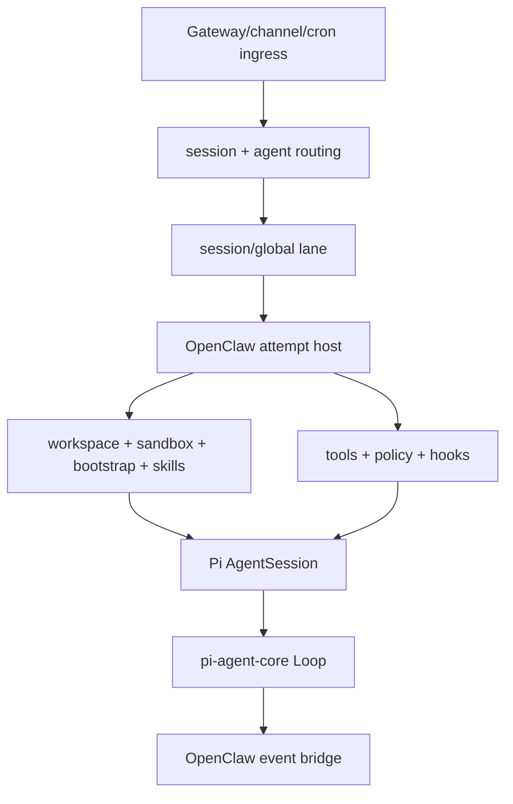

# M14：OpenClaw 如何扩展 Pi

> [上一页：M13 Memory、Embedding 与 RAG](M13.md) · [总目录](../index.md) · [下一页：M15 统一架构图与完整例子](M15.md)

## 问题引入

Pi 已经有 Agent Loop，OpenClaw 为什么还需要存在？如果只把 OpenClaw 说成“多加了几个工具”，就解释不了 Gateway、session lane、sandbox、Memory 和失败恢复。

## 直觉解释

Pi 提供一台可嵌入的发动机；OpenClaw 负责整车的道路、钥匙、货物、乘客和维修制度。发动机仍按统一循环工作，但每一次启动前后都受到宿主策略约束。

## 技术定义

OpenClaw 在 Pi 之上增加的系统工程能力包括：

| OpenClaw 能力 | 对 Pi 的扩展点 |
| --- | --- |
| Gateway 与多渠道 | 生成规范化 ingress、delivery context 和事件订阅者 |
| Session/Agent 路由 | 解析 `sessionKey`、agent id、channel、thread 和 account |
| Workspace/Bootstrap | 生成 `systemPrompt` 的 context files 和运行时段落 |
| Skills | 把按需能力描述加入 Prompt，并将工具加入 allowlist |
| Sandbox | 改写工作区和子 Agent 的实际路径，限制执行边界 |
| Tool Policy | 包装 Pi coding tools，增加 channel、sender、policy 和 hook 信息 |
| Memory Plugin | 注册 `memory_search`/`memory_get`，管理索引和 flush |
| Event Bridge | 将 Pi AgentEvent 翻译为 block/final/tool/lifecycle delivery |
| 队列与锁 | session lane、global lane、transcript write lock |
| 超时与取消 | `AbortController`、idle timeout、compaction abort、run cleanup |
| Provider fallback | 在 attempt 外层切换 provider/model/profile，保留运行状态 |
| 宿主级 compaction/flush | 在 Pi Session 生命周期前后做 preflight、flush、重试和恢复 |
| 持久化与失败恢复 | Gateway store、Pi JSONL tree、repair、retry、dedupe |

OpenClaw 不把 Pi harness 写成唯一后端；`runEmbeddedAttemptWithBackend()` 委托给 harness selection。普通 reply 的 Pi 路径是默认/常用路径，系统同时保留其它后端。

## 必要算法

以下为教学伪代码，用来表达 OpenClaw 宿主如何配置 Pi，不是源码原文。

```text
params = normalizeIngress(channelOrGatewayRequest)
workspace = resolveRunWorkspace(params)
sandbox = resolveSandboxContext(workspace, sessionKey)
skills = resolveSkills(workspace, config)
bootstrap = resolveBootstrapContextForRun(workspace, session/run kind)
tools = createOpenClawCodingTools(policy, sandbox, channel, sender, session)
prompt = buildEmbeddedSystemPrompt(bootstrap, skills, tools, runtime)

session = createAgentSession({
    sessionManager: guarded SessionManager,
    resourceLoader,
    tools: allowlist,
    customTools: adapted OpenClaw tools
})
apply system prompt and compaction settings
subscribeEmbeddedPiSession(session)
await session.prompt(userPrompt)
bridge events and persist transcript
```

### 两个并发边界

`runEmbeddedPiAgent()` 先排 session lane，再排 global lane；这样同一 session 的 turns 不会互相覆盖，同时全局资源仍有并发上限。Transcript 写入另有 write lock；SessionManager 的 entry 必须通过 `appendMessage()` 保持 `parentId` 链，不能用原始 JSONL 追加破坏 compaction/history。

## 源码对应

核心文件：

- `src/agents/pi-embedded-runner/run.ts`：`runEmbeddedPiAgent()`、session/global lane、harness attempt、fallback 和取消。
- `src/agents/pi-embedded-runner/run/backend.ts`：`runEmbeddedAttemptWithBackend()`。
- `src/agents/pi-embedded-runner/run/attempt.ts`：sandbox、skills、tools、bootstrap、system prompt、SessionManager、Pi Session 和 prompt。
- `src/agents/pi-embedded-runner/run/attempt-bootstrap-routing.ts`：Bootstrap 路由。
- `src/agents/pi-embedded-subscribe.ts`：Pi events 到 OpenClaw delivery 的桥。
- `src/agents/pi-tools.ts`：`createOpenClawCodingTools()` 和 wrapper/policy。
- `src/agents/system-prompt.ts`：产品 system prompt。
- `extensions/memory-core/src/tools.ts`：Memory plugin tools。
- `src/auto-reply/reply/agent-runner-execution.ts`：fallback、run outcome、retry。
- `src/auto-reply/reply/memory-flush.ts`：宿主 flush gate。

关键函数：

- `runEmbeddedPiAgent()`：宿主级排队和 attempt 选择。
- `runEmbeddedAttempt()`：具体 Pi session 组装。
- `createEmbeddedAgentSessionWithResourceLoader()`：带资源的 Session 创建辅助。
- `subscribeEmbeddedPiSession()`：事件观察和回复翻译，不负责重新调度 Pi 工具。
- `createOpenClawCodingTools()`：生成当前 run 的 OpenClaw 工具集合。

调用关系：

```text
OpenClaw ingress
  → runEmbeddedPiAgent
  → runEmbeddedAttemptWithBackend
  → runEmbeddedAttempt
  → createAgentSession
  → subscribeEmbeddedPiSession + activeSession.prompt
  → Pi Agent Loop
```

## 具体例子或流程图



## 讲解建议

逐项回答“如果只有 Pi 会缺什么”：没有多渠道，没有 session 路由，没有宿主权限，没有 Workspace 预算，没有 Memory plugin，也没有 Gateway 事件投递。这样可以把 OpenClaw 的存在理由落在工程边界上。

---
