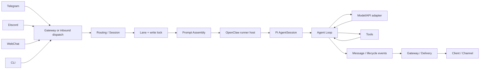
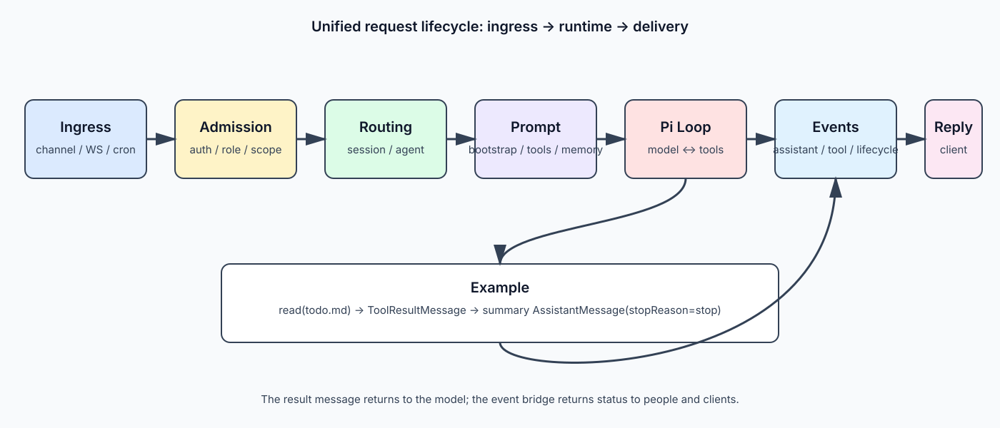

# M15：统一架构图与完整例子

> [上一页：M14 OpenClaw 如何扩展 Pi](M14.md) · [总目录](../index.md) · [下一页：M16 老师会追问什么](M16.md)

## 问题引入

把所有模块放回同一条链后，用户的一句“请读取 `todo.md`”到底经过哪些对象？统一图必须同时显示消息入口、Prompt、Pi Loop、工具和事件回程。

## 直觉解释

请求有两条入口，但只有一条主运行脊柱：规范化 ingress → session/agent 路由 → Prompt Assembly → selected Agent Runtime → Model/Tools → Events → Delivery。

## 技术定义

最终统一边界：

```text
Telegram / Discord / Web / CLI
  → Gateway 或 Inbound Dispatch
  → Routing / Session
  → Session lane / Global lane
  → Prompt Assembly
  → OpenClaw Agent Runtime host
  → Pi AgentSession
  → pi-agent-core Agent Loop
  → pi-ai Model/API adapter
  → Tool Call
  → OpenClaw/Pi Tool Execution
  → Tool Result Message
  → 下一轮 Loop 或 Final AssistantMessage
  → Pi/OpenClaw Events
  → Gateway / Delivery
  → Client / Channel
```

## 必要算法

以下为教学伪代码，用来表达完整例子，不是源码原文。

```text
input = "请读取 workspace 中的 todo.md，并总结今天最重要的三件事"

ctx = finalizeInboundContext(input, origin=webchat)
session = resolveSession(ctx.sessionKey)
enqueue(session.lane, global.lane, async () => {
    workspace = resolveRunWorkspace(session)
    bootstrap = resolveBootstrapContextForRun(workspace)
    tools = createOpenClawCodingTools({workspaceDir, sandbox, messageProvider})
    system = buildEmbeddedSystemPrompt({contextFiles: bootstrap, tools, runtimeInfo})
    pi = createAgentSession({sessionManager, tools: ["read", ...], customTools: tools})
    pi.agent.state.systemPrompt = system

    await pi.prompt(input)
})
```

Pi 内层随后执行：

```text
AssistantMessage(content=[toolCall read({path:"todo.md"})], stopReason="toolUse")
  → prepare/validate/before
  → read tool.execute
  → ToolResultMessage(content=[file text])
  → next model call
  → AssistantMessage(content=[summary], stopReason="stop")
```

这里没有假设模型一定只发一个工具调用；如果它同时请求 `read` 和 `memory_search`，Pi 会按配置选择并行/串行，最终按 assistant 源顺序生成 Tool Result 消息。

## 源码对应

以 `chat.send` 的 inbound reply 路径为主，完整调用关系是：

```text
chat.send (server-methods/chat.ts)
  → dispatchInboundMessage (auto-reply/dispatch.ts)
  → runReplyAgent (auto-reply/reply/agent-runner.ts)
  → runAgentTurnWithFallback (agent-runner-execution.ts)
  → runEmbeddedPiAgent (pi-embedded-runner/run.ts)
  → runEmbeddedAttempt (pi-embedded-runner/run/attempt.ts)
  → createAgentSession (pi-coding-agent/core/sdk.ts)
  → activeSession.prompt
  → Agent.prompt
  → runAgentLoop
  → streamSimple / API registry
  → executeToolCalls
  → ToolResultMessage
  → subscribeEmbeddedPiSession
  → reply dispatcher / Gateway delivery
```

## 具体例子或流程图





## 讲解建议

先沿图从左到右说一次，再沿工具结果从右回到 Loop 说一次。第一遍解释系统集成，第二遍解释 Agent 因果闭环，听众就能把 Gateway 和 Pi 放在同一张图中而不混淆。

---
