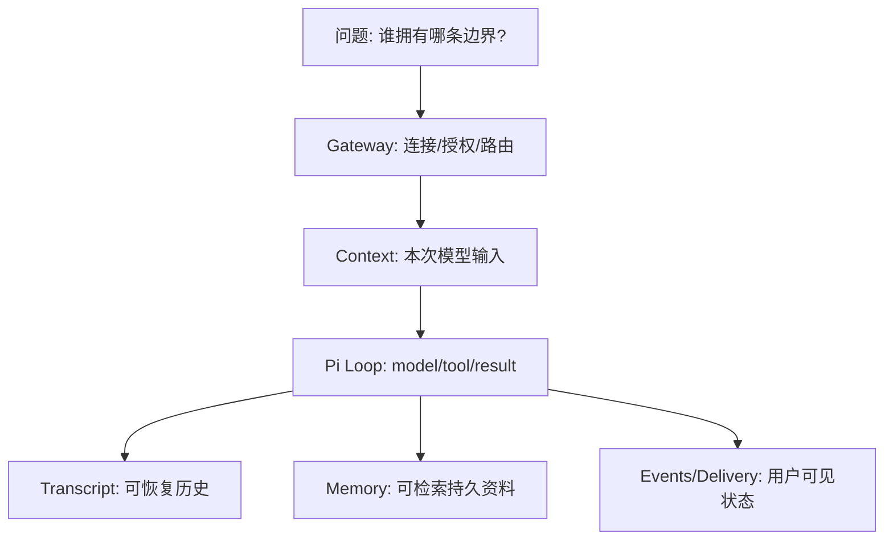

# M16：老师会追问什么

> [上一页：M15 统一架构图与完整例子](M15.md) · [总目录](../index.md)

## 问题引入

下面的问题集中检查边界，而不是记忆文件名。每个回答都回到本地源码中的对象和状态。

## 直觉解释

把回答分成三组：OpenClaw 的宿主边界、Pi 的 Loop 边界、Context/Memory/Transcript 的数据边界。

## 技术定义

### 1. OpenClaw 和普通 Chatbot 有什么区别？

普通 Chatbot 通常是一次输入对应一次输出。OpenClaw 维护 session、Workspace、工具、队列、权限、Memory、事件和失败恢复，让模型循环可以在真实渠道和文件环境中长期运行。

### 2. OpenClaw 和 Pi 是什么关系？

Pi 提供 `pi-ai`、`pi-agent-core`、`pi-coding-agent` 的模型协议、通用 Loop 和会话产品层。OpenClaw 选择并配置 harness，把 Gateway、渠道、Workspace、策略、Memory、并发和 delivery 接到 Pi 的 seam 上。

### 3. 为什么需要 Agent Loop？

一次模型调用不能读取工具结果后再决定下一步。Loop 把 `AssistantMessage(toolCall)`、工具执行和 `ToolResultMessage` 串起来，直到 `stopReason`、错误、取消或队列规则要求结束。

### 4. Agent Loop 和 ReAct 是什么关系？

运行形状相同，都是 `Reason/Decide → Act → Observe → Continue`；Pi 还加入流式事件、并行工具、队列、hooks、消息转换和持久化，因此不能说它是经典 ReAct 论文的逐字实现。

### 5. Tool Call 到底是谁产生的？

模型在 `AssistantMessage.content` 中产生结构化 `toolCall`。Runtime 不替模型决定具体参数，只负责查找工具、预处理、schema 验证、policy hook 和执行。

### 6. Tool Result 为什么要喂回 LLM？

工具执行结果是环境观察。没有它，模型不知道文件内容、命令输出或错误原因，无法形成下一步决定。Pi 用 `ToolResultMessage` 保持 `toolCallId`/`toolName` 配对。

### 7. Gateway 为什么存在？

Gateway 是长期运行的控制平面，负责 WebSocket admission、认证、role/scope、方法分发、事件广播、去重和连接生命周期。channel monitor、cron、heartbeat 也可以通过内部 ingress 汇入运行链，不需要伪装成 WebSocket 客户端。

### 8. Context 和 Memory 有什么区别？

Context 是本次模型调用的即时输入；Memory 是持久化并可检索的资料。Memory 只有被 Bootstrap、startup prelude 或 memory tool 选中后才进入 Context。

### 9. Embedding 和 RAG 是什么？

Embedding 把文本变成向量；向量搜索按语义相似度召回；RAG 是先搜索，再把召回片段放进 Context。OpenClaw 还可用 FTS/BM25，并在 hybrid backend 中合并、时间衰减和 MMR 重排。

### 10. Compaction 为什么需要？

工具结果和多轮交互会增长 Context，超过窗口就无法调用模型。Compaction 用合法切点和结构化摘要缩短模型可见 Context，同时保留完整 transcript entry。

### 11. OpenClaw 比基础 Pi Agent 增加了什么？

Gateway、多渠道、session/agent 路由、Workspace/Bootstrap、Skills、sandbox、tool policy、Memory plugin、事件桥、lane/锁、超时取消、provider fallback、宿主 compaction/flush、持久化和恢复。

### 12. Gateway 的 `status: "started"` 是否代表任务完成？

不代表。它表示 Gateway 接受并启动了 run。任务是否完成要看 Agent/attempt 的生命周期和最终 delivery；Pi 的终止边界是 `agent_end`，用户可见回复通常是 delivery 的 `final`。

### 13. `MEMORY.md` 是否每次都进入 prompt？

它在符合条件时作为合资格 Bootstrap 文件被注入，也可以只在 `memory_search`/`memory_get` 后按需出现；session/run 条件、配置和预算都会影响结果。

### 14. Markdown 指令能否替代权限控制？

不能。Markdown 是 prompt context。真正的执行约束来自 OpenClaw tool policy、`beforeToolCall`、sandbox、hooks、boundary-safe filesystem read 和操作系统权限。

### 15. 为什么需要 session lane 和 transcript write lock？

lane 防止同一 session 的多个 run 同时推进造成消息交叉；write lock 防止并发写坏 JSONL tree。Pi SessionManager 的 `parentId` 链、compaction 和 branch reconstruction 依赖完整 entry 关系。

## 必要算法

以下为教学伪代码，用来表达回答这些追问时的判断顺序，不是源码原文。

```text
if question asks "who decides next action": model emits Tool Call
if question asks "who executes": runtime + tool policy + OS
if question asks "what model sees": current Context after transforms
if question asks "what is persisted": SessionManager transcript entries
if question asks "when finished": agent_end/final delivery, not started
if question asks "why safe": hooks/policy/sandbox/locks, not Markdown alone
```

## 源码对应

复习入口：

- Pi Loop：`packages/agent/src/agent-loop.ts`、`packages/agent/src/agent.ts`。
- Pi Adapter：`packages/ai/src/types.ts`、`packages/ai/src/stream.ts`、`packages/ai/src/api-registry.ts`。
- Pi Session/Compaction：`packages/coding-agent/src/core/agent-session.ts`、`packages/coding-agent/src/core/session-manager.ts`、`packages/coding-agent/src/core/compaction/*`。
- OpenClaw Gateway：`src/gateway/server/ws-connection/message-handler.ts`、`src/gateway/server-methods.ts`、`src/gateway/server-methods/chat.ts`、`src/gateway/server-methods/agent.ts`。
- OpenClaw runner：`src/auto-reply/dispatch.ts`、`src/auto-reply/reply/agent-runner.ts`、`src/agents/pi-embedded-runner/run.ts`、`src/agents/pi-embedded-runner/run/attempt.ts`。
- Context/Bootstrap：`src/agents/workspace.ts`、`src/agents/bootstrap-files.ts`、`src/agents/system-prompt.ts`、`src/agents/pi-embedded-helpers/bootstrap.ts`。
- Memory：`extensions/memory-core/src/tools.ts`、`extensions/memory-core/src/memory/manager.ts`、`extensions/memory-core/src/flush-plan.ts`、`src/auto-reply/reply/startup-context.ts`、`src/auto-reply/reply/memory-flush.ts`。

## 具体例子或流程图



## 讲解建议

回答追问时先说对象，再说状态，再说源码文件。例如“`started` 是 Gateway response 的状态；`agent_end` 是 Pi Agent Loop 的生命周期；`final` 是 delivery 语义”。这种回答方式比背一句“任务完成”更不容易混淆层级。

---

## 结语：把架构压缩成五个问题

当需要重新定位一段源码时，只问五个问题：

1. 这条数据是从哪个 ingress 进入的？
2. 它属于 Gateway、OpenClaw runner、Pi Session 还是 Pi Loop？
3. 它是 Message、Event、Transcript entry 还是 Context 字段？
4. 它改变的是模型决定、工具执行还是用户 delivery？
5. 它的边界由 schema、hook、sandbox、lane、lock 还是 provider adapter 保证？

这五问可以把任意新功能放回 M01–M16 的地图中，而不必把整个仓库一次性读完。

## 本稿引用的外部资料

- Pi Agent Book 第 1–9 章目录与章节页面：<https://www.dgzhuya.com/modules/ch01-overview>，以及同目录的 `ch02-three-layer-arch` 至 `ch09-compaction`。
- PiMono Agent Framework 源码精读：<https://notes.aiself.site/pi-mono?lang=zh-CN>。
- InferLoop Gateway：<https://inferloop.dev/openclaw/gateway/>。
- InferLoop Request Lifecycle：<https://inferloop.dev/openclaw/request-lifecycle/>。
- InferLoop Bootstrap Files：<https://inferloop.dev/openclaw/bootstrap-files/>。
- InferLoop Memory：<https://inferloop.dev/openclaw/memory/>。

外部资料在本稿中只用于组织和解释；本地 OpenClaw `v2026.4.22` 与 Pi `v0.69.0` checkout 决定正文的文件、函数、调用关系和默认行为。
