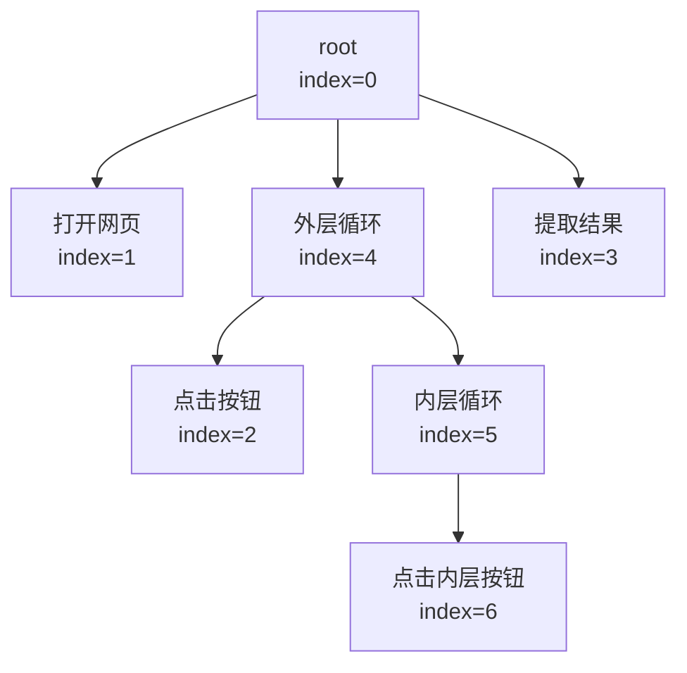

# 18.流程图核心数据结构：稳定下标与界面编号

第 15 篇已经把双层循环存进 nodeList。开始讨论数据结构之前，先明确两件事：

1. **每次新增节点，无论它在流程中的位置和先后顺序如何，都必须加入 nodeList。** 当前实现统一把新对象追加到数组末尾：插到流程开头、插到两个动作之间、加到循环内部，都是如此。nodeList 负责存放所有节点对象；节点属于谁、在同级节点中排第几，则由父节点的 sequence 记录。因此，nodeList 的数组顺序不代表流程顺序，也不保证是渲染顺序。
2. **画图时，必须先渲染父节点的容器，再渲染它的子节点。** 子节点的 HTML 要追加到父容器内部，如果父容器还没生成，就无法插入。因此，需要先从 root 出发，沿 sequence 中的父子关系，排出一个“父先于子”的渲染次序，不能直接照 nodeList 的数组顺序画。可以用深度优先搜索（DFS，先序遍历，先访问父节点再访问孩子），也可以用广度优先搜索（BFS，逐层访问）得到这样的次序。

当前源码选择 BFS，把遍历得到的节点下标依次记录到 actionSequence，再按这份清单渲染；nodeList 中对象的位置保持不变。本篇接下来就从“按存储下标直接画会出什么问题”出发，逐步说明这份清单怎样生成，以及它怎样关联稳定下标与界面编号。

> 全篇使用同一份七节点数据；保留稳定 index 与删除标记的基础说明。下一篇再逐步展示生成的 HTML。

---

## 第一部分：同一张双层循环图，先讲清稳定下标与删除标记

### 1. 先复习：nodeList 追加对象，sequence 定义层级与顺序

**每新建一个节点，就把它追加到 nodeList 末尾。** 即使在画布中间插入动作，或者在循环内部添加动作，新对象仍然放在数组最后。追加进去以后，它在 nodeList 中的位置和 index 就保持不变；后续新增、移动、刷新和删除，都不会把已有对象重新排列。

**流程中的层级关系和执行顺序，通过各容器的 sequence 来定义。** sequence 保存的是直接孩子的 nodeList 下标：

- 想调整同一个父节点内的先后顺序，就调整该父节点 sequence 中数字的顺序。
- 想改变节点的归属，例如把动作移进循环，就从原父节点的 sequence 摘掉它的下标，再放进循环的 sequence。

因此，读流程时要从 root 的 sequence 开始，逐层查看每个容器的孩子。对于循环，sequence 定义一轮内孩子的先后，重复次数由循环参数决定；对于判断，sequence 列出候选分支，执行时再按条件选择。

### 2. 全篇只使用这份七节点数据

本篇固定使用第 15 篇的七节点双层循环图。下图连线只表示直接父子关系，框内暂时只标稳定的 index；同一父亲的孩子按从左到右的顺序处理。编号和绘图都从这套 sequence 关系出发：

| nodeList 下标 | 节点 | sequence |
| --- | --- | --- |
| 0 | root | [1,4,3] |
| 1 | 打开网页 | [] |
| 2 | 点击按钮 | [] |
| 3 | 提取结果 | [] |
| 4 | 外层循环 | [2,5] |
| 5 | 内层循环 | [6] |
| 6 | 点击内层按钮 | [] |

下面直接给出这份七节点输入。只列结构与渲染字段，省略 parameters 等配置，不是完整可导入任务；初始 id 全为 0，下面的遍历将为可达孩子重新编号：

~~~js
let nodeList = [
  {index:0, id:0, type:-1, title:"root",         option:0, sequence:[1,4,3], isInLoop:false},
  {index:1, id:0, type:0,  title:"打开网页",     option:1, sequence:[],      isInLoop:false},
  {index:2, id:0, type:0,  title:"点击按钮",     option:2, sequence:[],      isInLoop:false},
  {index:3, id:0, type:0,  title:"提取结果",     option:3, sequence:[],      isInLoop:false},
  {index:4, id:0, type:1,  title:"外层循环",     option:8, sequence:[2,5],   isInLoop:false},
  {index:5, id:0, type:1,  title:"内层循环",     option:8, sequence:[6],     isInLoop:false},
  {index:6, id:0, type:0,  title:"点击内层按钮", option:2, sequence:[],      isInLoop:false}
];
~~~

### 3. index 为什么必须稳定，删除为什么保留槽位

sequence 中保存的是 nodeList 的数组下标。例如本例 root.sequence=[1,4,3] 中的 4，要一直指向外层循环；外层的 [2,5] 中，5 要一直指向内层循环。

如果直接从数组中间删掉一个对象，后面的对象会整体前移，已有引用就会指错。下面这句是错误做法的演示，不要拿它作为本项目的删除实现：

~~~js
nodeList.splice(2, 1); // 从对象数组中直接移除点击对象
~~~

执行它会导致：

~~~text
原来的 nodeList[4] 外层循环 → 前移到 nodeList[3]
原来的 nodeList[5] 内层循环 → 前移到 nodeList[4]
但 root.sequence 仍是 [1,4,3]
其中的 4 现在会读到内层循环，3 则会读到外层循环。
~~~

对象自己的 index 字段也不会因为数组被 splice 就自动修改。此时数组位置、index 字段、sequence 引用三者已经不一致。

因此当前实现的删除分为两件事：**从父节点的 sequence 摘掉引用；保留 nodeList 中的原对象位置，并给被删除节点及其后代标记 id=-1。** 这样其他节点的存储下标仍然有效。

### 4. 到底哪个字段等于 -1：是删除标记 id，index 不变

这里要明确：**删除节点时设为 -1 的是 id，不是 index。** index 仍然表示它在 nodeList 中的原数组位置。

以本篇同一张双层循环图为例，假设删除内层循环 5，它的孩子 6 也一起删除。先从外层循环的孩子列表中摘掉 5：

~~~js
// 教学写法：已知父亲的稳定下标是 4，目标是它的第 1 个孩子。
const removed = nodeList[4].sequence.splice(1, 1);
// removed=[5]；外层循环的 sequence 从 [2,5] 变成 [2]。
~~~

接着沿被摘掉节点的 sequence 标记整个子树。下面对应源码 deleteElement 中的标记逻辑，教学变量名改为 pending，避免与后面 refresh 的工作队列混淆：

~~~js
const pending = [removed[0]]; // [5]
while (pending.length > 0) {
  const index = pending.shift();
  nodeList[index]["id"] = -1;
  for (const childIndex of nodeList[index].sequence) {
    pending.push(childIndex);
  }
}
~~~

第一轮取出 5，给 nodeList[5].id 设为 -1，再把它的孩子 6 放进队列；第二轮取出 6，给 nodeList[6].id 也设为 -1。结果是：

~~~text
nodeList.length 仍然是 7，所有对象位置不变。

nodeList[4].sequence = [2]   外层循环已不再引用内层循环
nodeList[5].index = 5       内层循环的存储下标不变
nodeList[5].id = -1         标记内层循环已删除
nodeList[5].sequence = [6]  原子树信息仍保留在对象中
nodeList[6].index = 6       内层点击的存储下标不变
nodeList[6].id = -1         内层点击也标记为已删除
~~~

源码在 [FlowChart.js](/source/?file=48b61e5e4ebaa6ccf2.js) 的 deleteElement 中写作：

~~~js
let index = queue.shift();
nodeList[index]["id"] = -1; // 赋值目标是该对象的 id 字段
~~~

第一行的局部变量 index 只是从队列中取出的稳定下标，比如 5。第二行按这个下标找到对象，再把对象的 id 字段改为 -1；它没有给 index 变量或对象的 index 字段赋 -1。

**仅设置 id=-1 还不够，必须断开父 sequence 的引用。** refresh 从 root 沿 sequence 访问可达节点，并覆盖它们的 id。如果 5 仍留在外层的孩子列表中，下次刷新仍会发现 5、6，重新给它们编号。真正让子树退出画布的是断开父引用，id=-1 是保留槽位上的删除标记。

同一个文件还会出现其他 -1，必须结合字段读：

| 写法 | 含义 | 会不会改变存储下标 |
| --- | --- | --- |
| node.id=-1 | 标记这个节点已被删除 | 不会，node.index 保持原值 |
| root.type=-1 | root 的特殊类型，与普通动作、循环、判断模板区分 | 不会，root.index=0 |
| arrow.position=-1 | 插入箭头位于父容器第一个孩子之前，新增时位置为 position+1=0 | 不会，它是插入地址 |
| node.index | 节点在 nodeList 中的稳定位置，本例为 0～6 | 删除时不改成 -1 |

上面只是对同一张图解释删除机制。**后面的 actionSequence 推演仍从第 2 节完整的七节点输入开始，不累加这次删除演示**；保持 root=[1,4,3]、外层=[2,5]、内层=[6]。

---

## 第二部分：现在要把图画出来，先画谁、后画谁

### 5. 先试最直接的办法：按 nodeList 下标逐个画

回到第 2 节完整的七节点图，画布目前只有 root 对应的外层容器。我们要画出的效果是：外层点击在外层框内，内层循环也在外层框内，内层点击再进入内层框。

第一反应可能是：“对象不都在 nodeList 里吗？从第 1 项开始，一个个取出来画就好了。”取对象的代码会是：

~~~js
for (let index = 1; index < nodeList.length; index++) {
  const node = nodeList[index];
  // 依次取出对象，准备生成它的 HTML。
}
~~~

但它取出的是创建时的存储次序，过程会遇到下面的问题：

| 准备画谁 | 应该放到哪里 | 此时父容器存在吗 |
| --- | --- | --- |
| 1 打开网页 | root 里面 | 存在，可以放 |
| 2 点击按钮 | 外层循环 4 里面 | 不存在，外层循环还没轮到画 |
| 3 提取结果 | root 里面 | 存在 |
| 4 外层循环 | root 里面 | 到这里才建立外层框，但刚才已经先遇到了它的点击孩子 |
| 5 内层循环 | 外层循环 4 里面 | 外层框此时才可用 |
| 6 点击内层按钮 | 内层循环 5 里面 | 内层框此时可用 |

**问题出在第二个动作：要把点击放进外层框，外层框却还不存在。** 如果为了继续画而把点击也追加到 root，它就成了循环外的动作，画出的层次与数据不同。

用一小段 HTML 看这个问题。这里只截取同一张图里的“外层循环（4）包含点击按钮（2）”这对父子关系，暂时不画其他节点。为便于识别，教学示例把父元素命名为 loop-4、子元素命名为 click-2；后面再讲源码实际使用的界面 id。

**第一步：画布上目前只有 root 容器。**

~~~html

~~~

**第二步：按存储下标先遇到点击按钮（2），想把它插进外层循环（4）。**

~~~js
$("#loop-4").append('
点击按钮
');
~~~

这句话的意思是：“先找到父元素 loop-4，再把点击按钮的 HTML 放进它内部。”但此时父元素根本不存在，jQuery 找到的是空集合，这次 append 不会插入任何内容：

~~~html

~~~

**第三步：后来才遇到外层循环（4），把父容器画出来。**

~~~js
$("#root-demo").append('

外层循环

');
~~~

执行后，HTML 变成：

~~~html

  

    
外层循环

  

~~~

父容器现在有了，但刚才没有插进去的点击按钮不会自动补进来。

**第四步：父容器已经存在，再执行插入子元素。**

~~~js
$("#loop-4").append('
点击按钮
');
~~~

这次才能得到想要的父子结构：

~~~html

  

    
外层循环

    
点击按钮

  

~~~

**所以，在这种“找到父元素，再 append 子元素”的写法中，需要先建立父容器，再处理孩子。** 正常绘图时，应当先做上面的第三步，再做第四步，避免第二步插入失败；BFS 提供的父先子后次序正好满足这个要求。

所以我们需要先从这份数据中找出一个绘图次序：**轮到画孩子时，它所属的父容器必须已经建立。** nodeList 的存储次序并不保证这一点。

### 6. 已经有 sequence 了，直接用里面的编号呢

**sequence 的编号本身没有问题，它已经把层次存对了；问题是还需要沿这些引用安排一次完整的访问。** 它的数字是 nodeList 下标，不是“数字小的先画”，也不是已经排好的一张全图清单。

~~~js
nodeList[0].sequence; // [1,4,3]：root 的直接孩子
nodeList[4].sequence; // [2,5]：外层循环的直接孩子
nodeList[5].sequence; // [6]：内层循环的直接孩子
~~~

按 root.sequence=[1,4,3]，确实可以先画打开、外层框和提取。但这只处理了 root 的一层，框里的 2、5、6 还需要继续访问。

接下来要继续读外层的 [2,5]，再读内层的 [6]。不能因为点击编号 2 比循环编号 4 小，就把 2 提到 4 前面；2 的含义是“去 nodeList[2] 找对象”，不是“第二个绘制”。

因此我们需要的不是修改 sequence 的编号，而是**从 root 出发，沿每个容器的 sequence，把整棵树访问一遍，并安排父先于孩子的处理次序。** 当前源码用广度优先遍历（BFS）完成这一步。

### 7. BFS 的具体作用：按层列出节点，让父框先于孩子出现

BFS 从 root 开始，先看完这一层的直接孩子，再展开下一层：

~~~text
第 0 层：root 0
            ↓ 先发现 root 的全部孩子
第 1 层：打开 1、外层循环 4、提取 3
            ↓ 再发现外层循环的孩子
第 2 层：点击 2、内层循环 5
            ↓ 最后发现内层循环的孩子
第 3 层：内层点击 6
~~~

把按层发现的顺序记录下来，就是：

~~~text
[0,1,4,3,2,5,6]
~~~

随后按这个次序画，刚才的问题就解决了：

| 处理到哪一层 | 本层要画的操作节点 | 为什么能放进正确容器 |
| --- | --- | --- |
| root | 已有最外层容器 | 作为入口 |
| 第 1 层 | 打开网页（1）、外层循环（4）、提取结果（3） | 它们都放进已有的 root |
| 第 2 层 | 点击按钮（2）、内层循环（5），均属于第 1 层的外层循环（4） | 父节点“外层循环（4）”的容器已在上一层创建 |
| 第 3 层 | 点击内层按钮（6），属于第 2 层的内层循环（5） | 父节点“内层循环（5）”的容器已在上一层创建 |

**BFS 在这里的作用，是把层次关系整理成父先于孩子的发现次序，供后面的绘图循环使用。** 它本身还没有创建 HTML，也没有执行网页点击或循环业务。

还要把这个结果留下来：nodeList 的对象位置不能重排，否则第一部分讲过的 sequence 引用就会指错。因此，源码保留原 nodeList，把本次按层发现的存储下标追加到一个辅助数组中，名字就叫 actionSequence。

~~~text
nodeList：对象仍按原来的 0、1、2、3、4、5、6 存放
actionSequence：这次发现的次序 [0,1,4,3,2,5,6]
~~~

先理解它是一张本次绘图会用到的清单。下面再跟踪这张清单怎样生成，以及源码怎样顺便为节点分配界面 id。

---

## 第三部分：把 BFS 的发现次序保存下来，并分配界面编号

### 8. 用 queue 逐层展开，把发现的下标记入 actionSequence

现在把刚才说的逐层访问写成代码。queue 决定下一个展开谁，actionSequence 保留已经发现的存储下标。先执行与原 refresh 相同的初始化：

~~~js
let queue = [];
let actionSequence = [];
let idd = 1;
queue.push(0);
actionSequence.push(0);
~~~

此时 queue=[0]，actionSequence=[0]。注意 root 是入口，id 已经是 0；后续孩子才从 id=1 开始分配。每一轮先从队首取出父亲，再依次发现它的孩子。完整的教学遍历代码如下，等价拆解了 refresh 中的编号部分：

~~~js
while (queue.length > 0) {
  const nd = queue.shift();
  for (let i = 0; i < nodeList[nd].sequence.length; i++) {
    const childIndex = nodeList[nd].sequence[i];
    const child = nodeList[childIndex];
    child.parentId = nodeList[nd].id;
    child.position = i;
    child.id = idd++;
    child.isInLoop = nodeList[nd].option == 8 || nodeList[nd].isInLoop;
    queue.push(childIndex);
    actionSequence.push(childIndex);
  }
}
~~~

写进 actionSequence 的是 childIndex。因为 id 从 1 连续递增，追加位置恰好等于刚发出的 id，因此形成 `actionSequence[child.id]=child.index` 的对应关系。**这里的 id 和 parentId 都是 actionSequence 中的索引，不是 nodeList 中的位置；通过 actionSequence[id] 或 actionSequence[parentId]，才能得到当前节点或父节点在 nodeList 中的存储下标。**

下面一次 while 迭代只取出一个父节点。表内 queue 和 actionSequence 的数字全部是存储下标；“发 id”列另写界面编号：

| 轮次 | 队首取出 nd | 本轮发现孩子、发 id | 本轮结束的 queue | 本轮结束的 actionSequence |
| --- | --- | --- | --- | --- |
| 初始 | 尚未取出 | root 已对应 id=0 | [0] | [0] |
| 1 | 0 root | 1→id=1；4→id=2；3→id=3 | [1,4,3] | [0,1,4,3] |
| 2 | 1 打开网页 | 没有孩子 | [4,3] | [0,1,4,3] |
| 3 | 4 外层循环 | 2→id=4；5→id=5 | [3,2,5] | [0,1,4,3,2,5] |
| 4 | 3 提取结果 | 没有孩子 | [2,5] | [0,1,4,3,2,5] |
| 5 | 2 点击按钮 | 没有孩子 | [5] | [0,1,4,3,2,5] |
| 6 | 5 内层循环 | 6→id=6 | [6] | [0,1,4,3,2,5,6] |
| 7 | 6 点击内层按钮 | 没有孩子 | [] | [0,1,4,3,2,5,6] |

把第 3 轮放慢：先 shift 取出 4，队列还剩 [3]；发现点击 2 后 push，变成 [3,2]；再发现内层循环 5，变成 [3,2,5]。下一轮先取出原本就在前面的提取 3，并不会立刻钻进内层循环。先进先出使浅层节点先处理，这就是这里“广度优先”的具体含义。

也可以按层把最终结果画成一条编号带。方括号中的数字仍是稳定存储下标：

~~~text
深度 0：root                         [0]
深度 1：打开网页、外层循环、提取结果  [1,4,3]
深度 2：点击按钮、内层循环            [2,5]
深度 3：点击内层按钮                  [6]
                                      ↓ 按层依次记入
界面 id：        0  1  2  3  4  5  6
                 ↓  ↓  ↓  ↓  ↓  ↓  ↓
actionSequence：[0, 1, 4, 3, 2, 5, 6]
~~~

以上初始化和七轮 BFS 只改 JavaScript 数据，还没有创建业务节点的 HTML。这里先理解编号与映射，下一讲再逐次观察 append 后的 HTML。

### 9. 按发现次序编号，数组位置就成了界面 id

现在已经有绘图清单 [0,1,4,3,2,5,6]。原实现顺着这个发现次序给节点发出界面 id：第 0 个是 id=0，第 1 个是 id=1，依次递增。于是数组位置就是界面 id，保存的值仍是 nodeList 下标。完整对应关系如下：

| 界面 id，也就是 actionSequence 的数组位置 | 保存的存储下标 | 对象 | parentId：父的界面 id |
| --- | --- | --- | --- |
| 0 | 0 | root | 0（入口约定） |
| 1 | 1 | 打开网页 | 0 |
| 2 | 4 | 外层循环 | 0 |
| 3 | 3 | 提取结果 | 0 |
| 4 | 2 | 点击按钮 | 2 |
| 5 | 5 | 内层循环 | 2 |
| 6 | 6 | 点击内层按钮 | 5 |

界面 id=2 时，先读 actionSequence[2]=4，再读 nodeList[4]；反过来，已知存储下标 4，直接读 nodeList[4].id 得到界面 id=2。

### 10. 清单已经生成，为什么还要保留两个数组

[FlowChart.js](/source/?file=48b61e5e4ebaa6ccf2.js) 保留稳定的存储下标 index，同时沿刚才的发现次序给可达节点分配当前界面 id：

| 编号 | 回答的问题 | 本例 |
| --- | --- | --- |
| index | 对象在 nodeList 的哪一项 | 外层循环始终在 nodeList[4] |
| id | 本次界面用哪个编号定位它 | 刚才给外层循环分配了 id=2 |

原页面的 DOM 使用界面 id。用户点中界面编号 2，程序需要知道它对应 nodeList[4]，因此记录：

~~~js
actionSequence[2] = 4;
// 数组位置 2 是界面 id；保存的值 4 是存储下标。
~~~

**nodeList 存完整对象，actionSequence 只存对象的下标，不是两份完整节点。**

~~~text
nodeList[4]                         外层循环对象本身
actionSequence[2] = 4               指向这个对象的存储位置
nodeList[actionSequence[2]]         仍然得到原来的外层循环对象
~~~

例如 nodeList[actionSequence[2]].title 和 nodeList[4].title 访问同一个字段，改动落在同一个对象上。

这张表还保留本次发现节点的次序，所以当前代码用它完成两件事：**按发现顺序取节点绘图，以及从界面 id 反查存储下标。** 原节点对象继续保存在稳定的位置。

---

## 第四部分：按清单画出图，再用编号找到对象

### 11. 用途一：按父先于孩子的顺序创建画布元素

现在绘图次序和父界面编号都已准备好，才开始真正生成 HTML。按 actionSequence 取对象，而不是按 nodeList 的物理顺序取；每次把新片段追加到它的父容器内部：

~~~js
for (let i = 1; i < actionSequence.length; i++) {
  const node = nodeList[actionSequence[i]];
  $("#" + node.parentId).append(newNode(node)); // ⭐️⭐️⭐️找到父容器，把当前节点的 HTML 插入父元素内部的末尾
}
~~~

| 界面 id | 通过 actionSequence 取哪个对象 | 把 HTML 放到哪里 |
| --- | --- | --- |
| 1 | nodeList[1]：打开网页 | root 容器 #0 |
| 2 | nodeList[4]：外层循环 | root 容器 #0，同时建立循环框 #2 |
| 3 | nodeList[3]：提取结果 | root 容器 #0 |
| 4 | nodeList[2]：点击按钮 | 已经建好的外层循环框 #2 |
| 5 | nodeList[5]：内层循环 | 外层框 #2，同时建立内层框 #5 |
| 6 | nodeList[6]：点击内层按钮 | 已经建好的内层框 #5 |

root 的外层容器已经存在，所以这里从界面 id=1 开始画普通节点。提取的 HTML 虽然先于内部点击创建，点击最终放在循环框里面，提取放在循环框外面；最终层次仍符合原来的 sequence。

### 12. 用途二：点击方块后，找到应该编辑的对象

[FlowChart.js](/source/?file=48b61e5e4ebaa6ccf2.js) 的 `newNode()` 用节点的 `id` 生成 HTML。对本例“点击按钮”来说，相关属性可以简化为：

~~~html
<!-- 省略样式和内部标签，保留方块及其下方箭头的定位信息 -->

  
点击按钮

  
↓

~~~

**方块的 data 和 id 数值相同，都来自 node.id；另外保留 data，是因为方块下方的箭头也要携带所属节点的编号。** 本例方块和后置箭头都带 data="4"，表示它们关联同一个界面节点。

但不能也给这根箭头写 id="4"：HTML 的 id 应在整张页面中唯一，重复会让 `$("#4")` 无法明确定位想要的元素。data 是代码读取的自定义属性，可以在多个相关元素上保存相同的编号：

| 元素 | id | data | 含义 |
| --- | --- | --- | --- |
| 点击按钮方块 | 4 | 4 | id 用于定位这个 DOM 元素；data 供事件处理读取节点编号 |
| 方块下方的后置箭头 | 无 | 4 | 同样携带该节点编号，但不占用重复的 DOM id |

这里的箭头实际插入定位主要依靠 pId="2"、position="0"，表示在父循环第 0 个孩子后面插入；data 保存关联节点的编号。不能把箭头的插入地址与它携带的节点编号混为一谈。

这里 `data="4"` 保存的是当前界面 id。用户点中这个方块后，程序读取 data，先查 actionSequence，再查 nodeList：

~~~text
用户点中“点击按钮”方块
    ↓ 读取 HTML 的 data 属性
界面 id = 4
    ↓ actionSequence[4]
存储下标 = 2
    ↓ nodeList[2]
点击按钮对象
    ↓ 读取或修改它的 parameters
右侧面板编辑这个动作的配置
~~~

实际点击处理函数 `operationChange()` 中有这一行：

~~~js
vueData.nowNodeIndex = actionSequence[theNode.getAttribute("data")];
~~~

代入这个例子，就是 `actionSequence["4"]` 得到 2，把 `nowNodeIndex` 设为 2，再由 `handleElement()` 让面板指向对应对象。DOM 属性读出来是字符串 `"4"`，这里仍能作为数组下标访问。

如果把 HTML 的 data 直接当作存储下标，写成 `nodeList[4]`，拿到的就会是循环对象；用户点的是点击动作，面板却读到了循环配置。actionSequence 正是在这个位置完成编号转换。

### 13. 用途三：从孩子找到父容器，再定位它在父列表中的位置

移动、删除动作时，不仅要找到动作本身，还要修改它所属容器的 sequence。先看点击对象的相关字段：

~~~js
// nodeList[2] 的结构与界面定位字段，省略其他字段
{
  index: 2,
  title: "点击按钮",
  sequence: [],
  id: 4,
  parentId: 2,
  position: 0
}
~~~

这里 `index=2` 与 `parentId=2` 数值恰好相同，但含义完全不同：index 是点击自己的存储下标；parentId 是父循环的界面 id。

| 字段 | 本例的值 | 怎样解释 |
| --- | --- | --- |
| index | 2 | 点击对象在 nodeList[2] |
| id | 4 | 点击方块当前用界面编号 4 定位 |
| parentId | 2 | 父容器的界面编号是 2 |
| position | 0 | 点击是父容器 sequence 中的第 0 项 |

下面逐步找到父循环：

~~~js
const child = nodeList[2];                    // 点击对象
const parentUiId = child.parentId;            // 2：父的界面 id
const parentIndex = actionSequence[parentUiId]; // 4：父的存储下标
const parent = nodeList[parentIndex];         // nodeList[4]：循环对象

parent.sequence;                             // [2,5]
parent.sequence[child.position];             // [2,5][0]，得到点击的存储下标 2
~~~

沿这条路径看，几种数字各有自己的位置：

~~~text
点击的 parentId=2
    ↓ actionSequence[2]
父循环的存储下标 4
    ↓ nodeList[4]
父循环对象，sequence=[2,5]
    ↓ sequence[position=0]
点击的存储下标 2
~~~

直接写 `nodeList[child.parentId]` 会得到 `nodeList[2]`，读回点击自己，找错父节点。源码里的 `nodeList[actionSequence[...parentId...]]` 虽然看起来绕，就是在完成“父界面编号 → 父存储下标 → 父对象”这三步。

### 14. 后续优化方向：让 id、parentId 直接使用 nodeList 下标

**可以把节点的 id、parentId 统一为 nodeList 的稳定下标，省去“界面编号 → 存储下标”的转换。** 这是以后重构时可考虑的方向。前文讲解的仍是仓库当前实现；本节比较另一种设计，项目源码尚未采用这一方案。

#### 14.1 先统一编号，不必马上取消 BFS

前面给孩子分配字段时，当前实现写的是：

~~~js
child.parentId = nodeList[nd].id;
child.position = i;
child.id = idd++;
~~~

如果直接使用 nodeList 下标，可以改成：

~~~js
child.parentId = nd;        // 父节点在 nodeList 中的下标
child.position = i;         // 仍是父节点 sequence 中的位置
child.id = childIndex;      // 当前节点在 nodeList 中的下标
~~~

这里 nd、childIndex 本来就是存储下标。**id、parentId 改用稳定下标，position 仍表示在父节点孩子列表中排第几，两者不能混为一谈。** 这样无需重新发出连续的界面 id，root 的 id 仍为 0。

为了与配套 HTML 演示保持一致，下面暂用五节点基准图：从本篇七节点图中省去内层循环 5 和内层点击 6，外层循环只保留点击 2，并将标题简写为“循环”。两个例子不累加修改。

~~~text
nodeList 下标：0 root、1 打开网页、2 点击按钮、3 提取结果、4 循环
root.sequence = [1,4,3]
循环.sequence = [2]
~~~

| 节点 | 存储下标 index | 当前 id / parentId | 优化后的 id / parentId | position |
| --- | --- | --- | --- | --- |
| 打开网页 | 1 | 1 / 0 | 1 / 0 | 0 |
| 循环 | 4 | 2 / 0 | 4 / 0 | 1 |
| 点击按钮 | 2 | 4 / 2 | 2 / 4 | 0 |
| 提取结果 | 3 | 3 / 0 | 3 / 0 | 2 |

如果继续用 BFS，actionSequence 仍可记录 `[0,1,4,3,2]`，供绘制时逐个取对象。**此时 actionSequence 只负责记录遍历顺序，不再负责 id 到 index 的转换，也不再满足 actionSequence[child.id]=child.index。** 例如点击按钮的 id=2，但 actionSequence[2]=4，不能再用它转换编号。

#### 14.2 生成的 HTML 会是什么样

**图形外观和父子嵌套保持相同，变化的是标签上的编号。** 循环容器变成 id="4"，内部点击变成 id="2"、pId="4"。下面省去样式、包装层及部分箭头，只保留关键结构：

~~~html

  <!-- nodeList[1]：打开网页 -->
  

    打开网页
  

  <!-- nodeList[4]：循环，父节点是 root -->
  

    
循环

    <!-- 往 nodeList[4].sequence 的开头插入 -->
    
↓

    <!-- nodeList[2]：点击按钮，父节点是循环 4 -->
    

      点击按钮
    

    
↓

  

  <!-- nodeList[3]：提取结果 -->
  

    提取结果
  

  <!-- 默认箭头仍在全局最后面 -->
  
↓

~~~

可打开[稳定下标 HTML 演示](/resources/easyspider/%E7%A4%BA%E4%BE%8B-Flowchart/%E7%A8%B3%E5%AE%9A%E4%B8%8B%E6%A0%87-HTML%E6%BC%94%E7%A4%BA.html)：左侧显示五节点图，右侧显示实际 DOM；点击方块或箭头，可查看它怎样直接定位 nodeList。浏览器把 HTML 属性名 pId 显示成小写 pid，不影响这里的含义。

#### 14.3 哪些读法会简化，哪些地方要一起改

点击方块时，DOM 的 data 已经是稳定下标，可以直接写：

~~~js
vueData.nowNodeIndex = Number(theNode.getAttribute("data"));
const node = nodeList[vueData.nowNodeIndex];
~~~

查当前对象、父节点，以及向箭头处插入孩子，也能去掉编号转换：

~~~js
// 当前实现：id、parentId 是 actionSequence 的索引
const node = nodeList[actionSequence[id]];
const parent = nodeList[actionSequence[parentId]];
nodeList[actionSequence[pId]].sequence.splice(position + 1, 0, newIndex);

// 优化方案：id、parentId、pId 直接使用 nodeList 下标
const node = nodeList[id];
const parent = nodeList[parentId];
nodeList[pId].sequence.splice(position + 1, 0, newIndex);
~~~

上面是两种写法的对照，应分别理解，不是在同一作用域内重复声明 const。渲染时仍可按遍历清单取节点，再将其追加到父容器：

~~~js
const node = nodeList[actionSequence[i]]; // i 是遍历清单的位置
document.getElementById(String(node.parentId)).append(/* 当前节点的 DOM */);
~~~

**这是一组需要同步完成的修改，不能只改分配 id 的三行。** 点击、锚点插入、新增分支、复制、移动、删除、祖先查找和试运行中的父节点查询，都要改成同一套下标含义。DOM 的 id、data、pId 也要与数据字段一致。节点删除时仍需保留槽位与现有 id=-1 标记的语义，避免让稳定下标失效。

保存时仍可使用 graph: nodeList，sequence 仍保存孩子的稳定下标。加载后也要按新方案重建这些辅助字段，不能把旧文件中的界面 id、parentId 直接当成稳定下标使用。

#### 14.4 进一步选择：沿 sequence 递归绘制

统一编号以后，还可以从 root 沿 sequence 先画父亲、后画孩子，不再保留 actionSequence 作为绘制清单。**统一编号与改用递归是两个可以分开实施的选择；使用稳定下标不要求必须取消 BFS。**

这里回到本篇原来的七节点图。下面用最简单的 div 展示递归访问和嵌套，作为进一步优化的教学代码：

~~~js
function renderChildren(parentIndex, parentElement) {
  for (const childIndex of nodeList[parentIndex].sequence) {
    const node = nodeList[childIndex];
    const element = document.createElement("div");
    element.dataset.index = String(childIndex);

    const label = document.createElement("p");
    label.textContent = node.title;
    element.append(label);
    parentElement.append(element);       // 先建立当前节点的 DOM
    renderChildren(childIndex, element); // 再进入它的孩子
  }
}

const canvas = document.getElementById("0");
canvas.replaceChildren();
renderChildren(0, canvas);
~~~

这是深度优先的先序访问，依次处理 1、4、2、5、6、3。它和 BFS 的次序不同，但父容器也先于孩子建立，最终包含关系相同。

这种设计中，外层循环元素带 data-index="4"，点击动作带 data-index="2"。点击查找只需：

~~~js
const index = Number(theNode.dataset.index);
const node = nodeList[index];
~~~

因此，可以先保留 BFS，只统一 id 与 index；也可以进一步用递归绘制替代遍历清单。两种方案都能让 DOM 直接定位 nodeList，前提是所有读取编号的入口采用一致的含义。

### 15. 为什么不干脆把 nodeList 排成画图顺序

因为 sequence 中的数字就是 nodeList 下标。root 的 4 指向外层循环，外层的 2 指向点击，内层的 6 指向内层点击。重排 nodeList 后，这些数字可能指向别的对象，必须同步改写所有相关引用。

第一部分已经说明删除也保留槽位：nodeList 可以包含 id=-1 的旧对象，index 仍保持原值。actionSequence 则只记录本次从 root 可达的对象。

因此 nodeList 保存稳定的对象位置，actionSequence 记录当前画布的访问次序。结构修改后，refresh 根据新的 sequence 重建映射，不需要搬动旧对象。

### 16. 画图顺序、执行顺序和保存内容分别看哪里

假设本例参数规定外层两轮、每轮内层三轮，真正的业务动作是：

~~~text
打开网页 1
外层第 1 轮：点击 2 → 内层点击 6、6、6
外层第 2 轮：点击 2 → 内层点击 6、6、6
提取结果 3
~~~

actionSequence=[0,1,4,3,2,5,6] 中，每个可达节点只出现一次，提取 3 还排在内部点击前。这份次序用于界面编号和绘图；执行器仍按各容器的 sequence、option 和 parameters 递归处理，等循环结束后才提取。

| 名称 | 保存什么 | 本例 | 用途 |
| --- | --- | --- | --- |
| nodeList | 完整节点对象 | 七个对象，外层循环在第 4 项 | 存储、编辑、保存、加载 |
| 每个节点的 sequence | 直接孩子的稳定下标 | root=[1,4,3]；外层=[2,5]；内层=[6] | 表达层级与局部顺序 |
| actionSequence | 按本次发现次序排列的存储下标 | [0,1,4,3,2,5,6] | 界面 id 到 index 的映射、绘图取对象 |
| queue | 待展开节点的存储下标 | 从 [0] 开始，遍历结束为空 | BFS 的临时工作队列 |

任务保存时 graph 使用 nodeList，节点的 sequence 也在其中。actionSequence 和 queue 不作为独立字段保存；加载到设计器后可以重新生成。任务的完整结构信息由 nodeList 及其 sequence 提供。

下一讲先用第 15 篇的五节点基准图逐步观察 HTML，再展示本篇双层循环图的全部追加结果；完整房源图的进阶推演使用第 15 篇的教学模型。

---

返回目录：[README.md](/easyspider/directory) ｜ 上一篇：[17.Selenium：从 Python 基本操作到 EasySpider 浏览器执行](/easyspider/chapter-17) ｜ 下一篇：[19.流程图怎样画出来：逐步执行 refresh、生成 DOM 与 CSS 外观](/easyspider/chapter-19)
