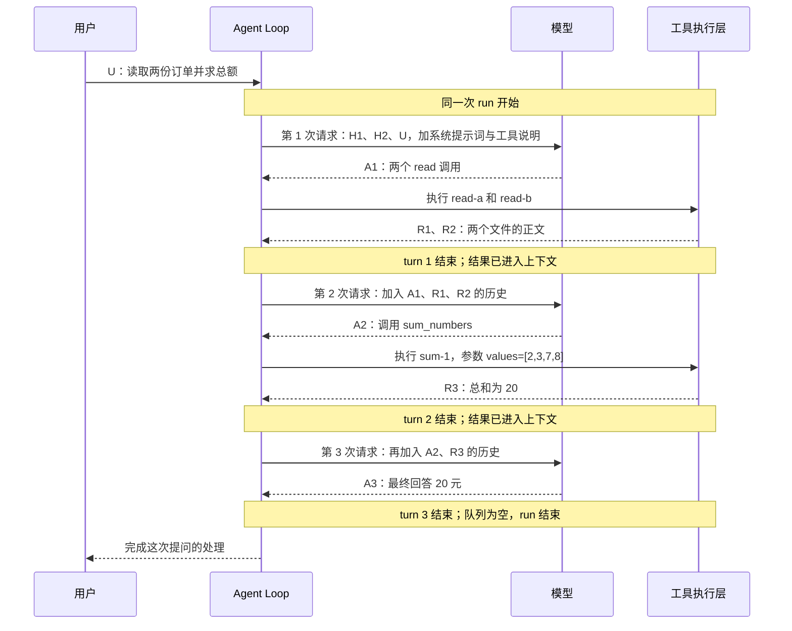
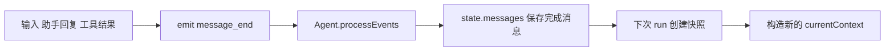

# 06 Pi Agent Loop 源码解析：从 prompt 到任务结束

[第 05 章](/openclaw/chapter-05) 追清了一次模型请求。本章继续看 Agent 怎样组织模型与工具的往返，先把工具执行作为一个可返回结果的步骤；工具定义、调用块来源和具体执行函数将在[第 07 章](/openclaw/chapter-07) 沿源码展开。本章要回答的是：**用户问一次以后，Agent 怎样反复调用模型、执行工具、积累上下文，直到这次任务结束。**

先不看源码，先完整走一遍任务，区分模型调用、工具执行与循环推进，再看上下文怎样支撑这个过程。随后按第 05 章的方式，从 `agent.prompt(...)` 沿调用关系进入源码，追清任务启动、模型与工具往返、steering/follow-up 调度，以及结束收尾。**上下文的保存与积累，是完整 Agent Loop 中的一个环节。**

## 先走完整例子：用户只问一次，模型调用三次

假设工作目录中有两份订单文件：

| 文件 | 文件正文 |
| --- | --- |
| `orders-a.txt` | `订单 A：2 元、3 元` |
| `orders-b.txt` | `订单 B：7 元、8 元` |

应用已经给 Agent 提供两个工具：第 07 章的 `sum_numbers` 和 coding-agent 提供的 `read`。前者计算数字总和，后者读取文件。工具列表由应用准备；普通 `new Agent()` 默认没有这些工具。

再假设这是已有对话，Agent 已保存两条历史消息：

```text
H1 用户：本次订单金额都按人民币元计算。
H2 助手：好的，我会按人民币元汇总。
```

现在用户只提交一次新问题，记为 U：

> 读取 orders-a.txt 和 orders-b.txt，使用求和工具计算两份订单的总金额，再告诉我结果。

下面是一条给定的正常执行轨迹：没有中途追加消息、没有错误或取消，工具不要求 `terminate`，没有上下文裁剪，模型按这里的顺序选择工具。模型可能有其他合法选择，因此这些输出是教学推演，不是请求日志。

### 第一步：第一次模型调用，先决定读取哪些文件

Agent 发起本次运行。第一次请求模型时，提供系统提示词、工具说明和消息 `[H1, H2, U]`。

模型尚未读到文件正文，所以这一次先返回助手消息 A1。A1 可以包含“我先读取两份订单”的说明，以及两个工具调用：

| 所在助手消息 | 调用 ID | 工具名称 | 参数 |
| --- | --- | --- | --- |
| A1 | `read-a` | `read` | `path="orders-a.txt"` |
| A1 | `read-b` | `read` | `path="orders-b.txt"` |

**一次模型调用可以提出多个工具调用。** 这里有一条助手消息 A1，里面有两个 ToolCall；它们没有使模型调用次数变成两次。

### 第二步：程序执行两个 read，模型此时没有再次被调用

程序按名称找到 `read`，分别检查参数、调用它的执行函数，拿到文件正文，再产生两条结果消息：

| 消息简称 | 角色 | 关联调用 | 模型可读内容 |
| --- | --- | --- | --- |
| R1 | `toolResult` | `toolCallId="read-a"` | `订单 A：2 元、3 元` |
| R2 | `toolResult` | `toolCallId="read-b"` | `订单 B：7 元、8 元` |

两项 read 属于同一个工具批次。默认允许并行，实际执行可交错；批次返回的消息按 A1 中的调用顺序排列。只有这批结果已经交回循环，后面的模型调用才开始。

现在用于继续工作的历史增长为 `[H1, H2, U, A1, R1, R2]`。这里既保留“模型要求读什么”，也保留“程序实际读到了什么”。只保留结果、丢掉对应的助手调用，会破坏工具调用与结果的配对关系。

### 第三步：第二次模型调用，读到结果后提出求和

Agent 再次请求模型，消息使用刚刚增长后的历史。模型现在可以从 R1、R2 读出四个金额，所以这次返回助手消息 A2，提出一个新工具调用：

```text
A2：ToolCall
    id        = "sum-1"
    name      = "sum_numbers"
    arguments = { values: [2, 3, 7, 8] }
```

这一步是第二次模型调用。它依据上一步的新事实决定后续动作；Agent Loop 本身没有写死“读完文件以后必须求和”。循环负责交给模型、处理模型提出的调用、把结果留下来。

### 第四步：程序执行求和，产生第三条工具结果

程序找到第 07 章定义的 `sumNumbersTool`，将校验后的 `values=[2,3,7,8]` 交给它的 execute，得到正文“总和为 20”和详情 `{count:4,total:20}`。

执行层再创建工具结果消息 R3：

```text
R3：role="toolResult"
    toolCallId="sum-1"
    toolName="sum_numbers"
    content=[文字“总和为 20”]
```

历史成为 `[H1, H2, U, A1, R1, R2, A2, R3]`。正文 content 会进入后续模型输入；details 供应用使用，Provider 不会自动把它补成模型正文。

### 第五步：第三次模型调用，给出最终回答

Agent 将增长后的历史再次交给模型。模型返回助手消息 A3：

> 两份订单的总金额是 20 元：订单 A 为 5 元，订单 B 为 15 元。

A3 没有工具调用。这时 Agent 检查是否有需要注入的 steering 或排队的 follow-up。按本例条件，两者都为空，所以循环结束，发出运行结束事件，再完成 Agent 的收尾。

**最终回答也是一次模型调用的输出。** 工具返回“总和为 20”时，Agent 并没有自动把它当作最终回答结束。

### 把次数和边界对齐：一次 run 可以包含多个 turn

本章说的“一次 Agent Loop”是从一次启动到结束的完整运行，源码里可称为一次 **run**。对普通 `prompt` 主线，可以先按“用户问一次，Agent 将这次任务处理完”理解。它内部会反复经过循环体；**一次 run 不等于一次模型调用，也不等于 while 循环体只执行一次。**

源码的一个正常 **turn** 包括“一次模型响应，以及这条助手消息提出的整批工具调用与结果”。把结果再交给模型，属于下一个 turn：

| 本次运行 | turn | 模型输出 | 本 turn 内的工具执行 | turn 结束后新增的完整消息 |
| --- | --- | --- | --- | --- |
| 同一次 run | 1 | A1：读两份订单 | `read-a`、`read-b` | A1、R1、R2 |
| 同一次 run | 2 | A2：对四个金额求和 | `sum-1` | A2、R3 |
| 同一次 run | 3 | A3：汇总回答 | 无 | A3 |

本例总计：**用户新提问 1 次、Agent run 1 次、turn 3 个、模型调用 3 次、工具调用与执行各 3 次。** 第一个 turn 中有两个 read；第三个 turn 没有工具。



“一个用户问题对应一次 run”适用于这里的普通入口。后文的 `continue()` 可以没有新用户问题而启动运行，steering/follow-up 也可以把补充输入带进当前 run，因此不要把这句话当成所有入口的严格定义。

## 再回答上下文放哪里：先认清四个消息数组

先给出核心答案：**Agent 实例持续保存的历史在 `agent.state.messages`，内部是 `this._state.messages`；本次 Loop 连续请求模型时读取并更新的是 `currentContext.messages`。每一次模型请求还会经过转换，得到 `llmMessages`。另外，`newMessages` 只收集本次运行新增的消息。**

| 名称 | 谁管理、生命周期 | 里面放什么 | 订单例子中最终包含什么 |
| --- | --- | --- | --- |
| `agent.state.messages` / `this._state.messages` | Agent 实例；跨本实例多次 prompt 保留 | 已完成的对话消息，由消息结束事件推进 | `[H1,H2,U,A1,R1,R2,A2,R3,A3]` |
| `currentContext.messages` | 本次 `runAgentLoop` 创建并由循环更新 | 本次连续调用模型可使用的历史；流式期间也会暂存当前助手消息 | 正常结束时同样是上面 9 条 |
| `newMessages` | 本次运行创建 | 仅这次新产生、接收的消息，用于低层返回值与 `agent_end.messages` | `[U,A1,R1,R2,A2,R3,A3]`，不含 H1、H2 |
| `llmMessages` / `llmContext.messages` | 每次 `streamAssistantResponse` 为模型调用取得 | transform 后再 convert 得到的模型兼容消息 | 随本次请求变化；本例三次请求如下表 |

`state.messages` 和 `currentContext.messages` 的外层数组不同。它们可能保存相同消息对象的引用，但追加位置和职责独立。**循环不是每个 turn 都重新从 `state.messages` 建一个历史快照；它持续使用本次的 `currentContext`。**

### 三次请求，分别看到了哪些消息

本例使用默认消息转换，没有裁剪、摘要或自定义角色。H1/H2/U/A/R 都是标准消息，因此请求材料与循环当时的消息顺序一致：

| 发起模型请求的时刻 | 此时的 `currentContext.messages`，也是本例转换后的消息序列 | 这次模型新知道什么 |
| --- | --- | --- |
| 第 1 次请求前 | `[H1,H2,U]` | 用户要求读文件，还没有文件正文 |
| 第 2 次请求前 | `[H1,H2,U,A1,R1,R2]` | 两份文件正文，以及它们对应的读取调用 |
| 第 3 次请求前 | `[H1,H2,U,A1,R1,R2,A2,R3]` | 求和调用与总和 20 |

模型不需要依赖上一次请求在服务端留下隐含记忆。**下一次请求能使用工具结果，是因为程序把对应消息明确追加到历史，并再次把这些材料交给模型。** Provider 还会把 Pi 消息转换为协议格式；例如 Pi 的 `toolResult` 转为 OpenAI Completions 的 `role:"tool"`。

### 哪些位置负责增长历史

现在先记行为，后面的源码会逐条对上这些写入位置：

| 阶段 | 本次循环上下文怎样改变 | Agent 的持久历史怎样改变 |
| --- | --- | --- |
| 接收 U | 入口把旧历史与本次 prompts 合成新数组 | U 的 `message_end` 交给 `processEvents` 后追加 U |
| 接收 A1 的流式内容 | `start` 暂放一条助手消息，delta 替换末尾，终态换成完整 A1 | 增量更新 `streamingMessage`；到 A1 的 `message_end` 才追加完整消息 |
| read 批次结束 | 批次返回后，由 `runLoop` 依次追加 R1、R2 | 执行层发出各结果的 `message_end` 时已经分别追加 |
| 接收 A2、执行求和 | 与上述助手、工具流程相同 | 与上述消息结束流程相同 |
| 接收 A3 | 保存最终助手消息 | A3 的 `message_end` 追加完整回答 |

**事件通知并不替代循环数组的追加。** 例如 `tool_execution_end` 用于报告工具处理结束；结果进入 Agent 历史靠后续 `message_end`，进入循环上下文则靠 `runLoop` 中明确的 push。三个动作的时刻不同。

### 把本例的三个主要数组并排观察

下表在每个检查点的相关追加和事件处理都已完成以后观察；“刚建立循环数组”一行特意放在 U 的消息事件之前。

| 检查点 | `agent.state.messages` | `currentContext.messages` | `newMessages` |
| --- | --- | --- | --- |
| 刚建立循环数组，尚未发出 U 的消息事件 | `[H1,H2]` | `[H1,H2,U]` | `[U]` |
| U 的 message_end 处理完毕 | `[H1,H2,U]` | `[H1,H2,U]` | `[U]` |
| turn 1 的结果已追加 | `[H1,H2,U,A1,R1,R2]` | `[H1,H2,U,A1,R1,R2]` | `[U,A1,R1,R2]` |
| turn 2 的结果已追加 | `[H1,H2,U,A1,R1,R2,A2,R3]` | `[H1,H2,U,A1,R1,R2,A2,R3]` | `[U,A1,R1,R2,A2,R3]` |
| turn 3 的最终消息已处理 | `[H1,H2,U,A1,R1,R2,A2,R3,A3]` | `[H1,H2,U,A1,R1,R2,A2,R3,A3]` | `[U,A1,R1,R2,A2,R3,A3]` |

下次用户再问一个问题，Agent 会从当前 state.messages 取新快照，开启新的 run；本次的 `newMessages` 则不会被当成完整历史重新使用。

### 上下文还包括什么，和后面几章怎样衔接

`AgentContext` 不只有消息，还包含 `systemPrompt` 和 `tools`：系统提示词说明任务约束，工具数组提供本次能力，messages 保存往返过程。三者一起构成每次模型请求的材料。系统提示词和工具定义不是作为普通 user 消息逐个塞进这个数组。

```text
Agent 实例
  state.systemPrompt、state.tools、state.messages
        ↓ 开始运行时取浅快照
本次 currentContext
  systemPrompt、tools、messages ← 每个 turn 的助手消息和工具结果继续进入这里
        ↓ 每次请求：可选 transformContext，再 convertToLlm
本次 llmContext
  systemPrompt、tools、messages=llmMessages
        ↓ Provider 转协议格式
模型请求
```

`transformContext` 可以为单次调用选择、重排或裁剪材料；`convertToLlm` 负责转成模型兼容的消息。它们的返回值不会被这段循环自动赋回 `currentContext.messages` 或 `state.messages`，但自定义函数若主动修改传入的对象仍会有副作用。默认转换通过 filter 创建新的外层数组，并不深拷贝各消息对象。

这里的“Agent 持续保存”指内存中的 Agent 实例。会话文件、SessionTree 的持久化与恢复由上层管理，见选读《Pi 会话系统源码解析》；上下文压缩见第 08 章。先把本章的内存数组与写入路径认清，再进入那些机制。

## 带着订单例子进入源码：每次跳转都对上参数和返回值

到这里才开始读代码。接下来沿这条主线展开：

```text
agent.prompt(U 的文字)
  → normalizePromptInput → [U]
  → runPromptMessages
      → runWithLifecycle：建立本次运行和取消信号
      → createContextSnapshot：取出 H1、H2 与可用工具
      → createLoopConfig：准备模型、转换与队列读取函数
      → runAgentLoop：建立 currentContext.messages、newMessages
          → runLoop
              → streamAssistantResponse → 完整 A1
              → executeToolCalls → R1、R2
              → 追加结果，下一 turn 再调用模型
              → A2 → R3 → 下一 turn → A3
          → agent_end
      → finishRun
  → await prompt(...) 完成
```

**最小 Agent Loop 心智模型**

下面的图展示模型正常返回、工具没有要求提前终止时的基本过程；错误、取消与 `terminate` 的分支将在源码中展开。

```text
用户消息
   ↓
调用 LLM
   ↓
AssistantMessage
   │
   ├── 没有 ToolCall
   │        ↓
   │    检查 steering / follow-up
   │        ├── 有新消息 → 加入消息 → 再调用 LLM
   │        └── 没有新消息 → 结束
   │
   └── 有 ToolCall
            ↓
        执行工具
            ↓
        ToolResult
            ↓
      加入 messages
            ↓
    本轮结束，检查 steering
      （有消息则在下一轮加入）
            ↓
        再调用 LLM
```

这里的 LLM 是大语言模型，`AssistantMessage` 是一次模型输出的消息，`ToolCall` 是其中要求程序执行的调用块。图中的 `ToolResult` 简写“工具结果”，进入对话时实际是 `ToolResultMessage`。

## 1. 从调用点发现 createContextSnapshot

### 1.1 停在 runPromptMessages

打开 [agent.ts:396](/source/?file=3688aa044ebb960834.ts#L396)。上一章已将输入规范化为消息数组，这里直接看它怎样交给循环：

```ts
private async runPromptMessages(
  messages: AgentMessage[],
  options: { skipInitialSteeringPoll?: boolean } = {},
): Promise<void> {
  await this.runWithLifecycle(async (signal) => {
    await runAgentLoop(
      messages,
      this.createContextSnapshot(),
      this.createLoopConfig(options),
      (event) => this.processEvents(event),
      signal,
      this.streamFn,
    );
  });
}
```

先圈出第二个实参 `this.createContextSnapshot()`：这里是**当场调用函数，把返回值交给 runAgentLoop**。第一个实参 messages 是本次新输入，旧历史则要去第二个实参中找。第四个实参是事件返回路线：循环调用 emit 时，就会通过这个函数回到 Agent 的 processEvents。

### 1.2 跳进去看 context 是什么

打开 [agent.ts:425](/source/?file=3688aa044ebb960834.ts#L425)：

```ts
private createContextSnapshot(): AgentContext {
  return {
    systemPrompt: this._state.systemPrompt,
    messages: this._state.messages.slice(),
    tools: this._state.tools.slice(),
  };
}
```

**context 是包含 systemPrompt、messages、tools 的普通对象。** messages 是复数属性名，值是消息对象数组，不是一段已经拼接好的字符串。系统提示词、工具定义各有属性，不需要伪装成普通 user 消息塞进 messages。

返回类型可以跳到 [types.ts:333](/source/?file=d51aa2ef0fa6575e26.ts#L333)：

```ts
export interface AgentContext {
  systemPrompt: string;
  messages: AgentMessage[];
  tools?: AgentTool<any>[];
}
```

类型中 tools 可选，Agent 这条快照路径会提供数组；没有工具时通常为空数组。

### 1.3 slice 是浅复制

重点看 `this._state.messages.slice()`。不带参数的 slice 创建一个新外层数组，按原顺序放入所有元素，原数组不会被这次操作修改；**对象元素仍是原来的对象引用**。tools 的 slice 同理。

用独立 JavaScript 例子观察两层关系；这里只演示数组语义，省略真实消息的 timestamp 等字段：

```ts
const oldMessage = { role: "user", content: "原来的内容" };
const stateMessages = [oldMessage];
const snapshotMessages = stateMessages.slice();

console.log(snapshotMessages === stateMessages);       // false
console.log(snapshotMessages[0] === stateMessages[0]); // true

snapshotMessages.push({ role: "user", content: "新问题" });
console.log(stateMessages.length);                    // 1

snapshotMessages[0].content = "修改了共享的消息对象";
console.log(stateMessages[0].content);                 // 修改了共享的消息对象
```

所以给快照数组追加消息，不会自动给状态数组追加；修改共享对象内部内容则可能影响两边。快照不是深复制，也没有冻结消息。

这就留下了下一步要查的问题：循环使用独立数组时，Agent 自己保存的 `_state.messages` 怎样增长？先跳事件接收处，再继续读循环。

## 2. 立即回查 processEvents 看历史怎样保存

### 2.1 找到 message_end

打开 [processEvents:520](/source/?file=3688aa044ebb960834.ts#L520)，先只看 [518 行](/source/?file=3688aa044ebb960834.ts#L530)：

```ts
case "message_end":
  this._state.streamingMessage = undefined;
  this._state.messages.push(event.message);
  break;
```

正常消息路径中，**每处理一次 message_end，就把这条完成的消息追加到 Agent 历史**。用户输入、助手回复和工具结果都可以走这条消息生命周期，历史就随运行积累。

这里要说准确：不是所有 message 事件都 push。message_start、message_update 主要更新 streamingMessage，表示当前正在处理或生成的消息；message_end 清掉临时字段，保存整条完成消息。否则每段流式文字都会变成一条新历史。

```text
message_start(A 的初始内容) → 设置 streamingMessage
message_update(A 的累计内容) → 更新 streamingMessage
message_update(A 的更多内容) → 再更新 streamingMessage
message_end(A 的最终内容) → state.messages 追加一条 A
```

### 2.2 对上最初传入的事件回调

```text
runPromptMessages 传入 (event) => this.processEvents(event)
       ↓ 对上 runAgentLoop 的形参 emit
循环 await emit({ type: "message_end", message: ... })
       ↓
Agent.processEvents(event)
       ↓
this._state.messages.push(event.message)
```

processEvents 先更新自己的状态，再逐个调用并等待已订阅的 listener。Agent 的历史维护通过这个传入回调发生，不依赖应用先订阅一个打印函数。

这里的历史是**当前 Agent 实例内存中保留的对话**。reset、替换消息、上层压缩都可能改变它，不是磁盘上永不删除的原始记录。会话持久化见选读《Pi 会话系统源码解析》，压缩见第 08 章。外壳异常还有直接追加失败消息的分支，见本章 9.4。

## 3. 返回 runAgentLoop 分清三种名字

### 3.1 context currentContext 和 newMessages

打开 [agent-loop.ts:96](/source/?file=6adbf9ab77a3572a2f.ts#L96)。以下省去源码注释，保留函数中的实际语句：

```ts
export async function runAgentLoop(
  prompts: AgentMessage[],
  context: AgentContext,
  config: AgentLoopConfig,
  emit: AgentEventSink,
  signal?: AbortSignal,
  streamFn?: StreamFn,
): Promise<AgentMessage[]> {
  const newMessages: AgentMessage[] = [...prompts];
  const currentContext: AgentContext = {
    ...context,
    messages: [...context.messages, ...prompts],
  };

  await emit({ type: "agent_start" });
  await emit({ type: "turn_start" });
  for (const prompt of prompts) {
    await emit({ type: "message_start", message: prompt });
    await emit({ type: "message_end", message: prompt });
  }

  await runLoop(currentContext, newMessages, config, signal, emit, streamFn);
  return newMessages;
}
```

上一层的 messages 在这里叫 prompts；快照返回值在这里叫 context。函数内部又创建 currentContext 和 newMessages，职责不相同。

假设旧历史是 H1、H2，本次输入是 U：

| 名称 | 刚创建时的消息 | 作用 |
| --- | --- | --- |
| `this._state.messages` | `[H1,H2]` | Agent 跨多次运行保存的历史 |
| `context.messages` | `[H1,H2]` | 从状态取出的浅快照数组 |
| `currentContext.messages` | `[H1,H2,U]` | 本次循环实际推进的历史 |
| `newMessages` | `[U]` | 仅本次运行新增的消息 |

`...context` 在对象中展开属性，先复制 systemPrompt、messages、tools；后写的 messages 覆盖同名属性。`[...context.messages, ...prompts]` 则展开两组数组元素，构成“旧历史 + 本次输入”。

普通 prompt 路径中，currentContext 与 context 是不同对象，三份历史数组也各自独立；已有的 H1/H2 消息对象仍共享引用。currentContext.tools 沿用 context.tools；这一处没有再复制工具数组。**对象展开和数组展开都不是深复制。**

### 3.2 初始输入也要发 message_end

刚建立 currentContext 时，它已包含 U，而状态历史还是 `[H1,H2]`。入口对 U 发 message_start/message_end，后者回到第 2 节的 push，状态历史才成为 `[H1,H2,U]`。旧历史不在 prompts 中，不会在这里重复发事件、重复入库。

newMessages 后面还会收集助手消息、工具结果与注入的排队消息，交给低层返回值和 agent_end.messages。Agent 路径依靠事件更新状态，不会拿这个返回数组再整批追加一次；Agent.prompt 自身返回 Promise<void>。

## 4. 进入 runLoop 先圈出 pendingMessages

打开 [agent-loop.ts:201](/source/?file=6adbf9ab77a3572a2f.ts#L201)。先只看控制结构，模型、工具暂时只记名字；注释处省略的代码后面再展开：

```ts
let firstTurn = true;
let pendingMessages: AgentMessage[] = (await config.getSteeringMessages?.()) || [];

while (true) {
  let hasMoreToolCalls = true;
  while (hasMoreToolCalls || pendingMessages.length > 0) {
    // turn 开始，注入 pendingMessages。
    // 调模型；若有工具调用，执行本批工具并追加结果。
    // 发出 turn_end。
    pendingMessages = (await config.getSteeringMessages?.()) || [];
  }

  const followUpMessages = (await config.getFollowUpMessages?.()) || [];
  if (followUpMessages.length > 0) {
    pendingMessages = followUpMessages;
    continue;
  }
  break;
}
```

**pendingMessages 是本次准备注入的消息批次**，可以接住 steering，也可以接住 follow-up。真正读队列的是 config 中两个函数。`?.()` 表示没有配置函数就跳过调用，`|| []` 兜底为空数组；await 等函数返回当前可取的消息，并不是停在这里等用户以后输入。

现在沿 `config.getSteeringMessages` 回查：它在哪里定义类型，又是谁把实际函数放进 config？

## 5. 沿 config 追到 steer 和 followUp

### 5.1 先看 AgentLoopConfig 再看 createLoopConfig

从 config 跳到 [types.ts:103](/source/?file=d51aa2ef0fa6575e26.ts#L103) 的 AgentLoopConfig，找到 [177 行](/source/?file=d51aa2ef0fa6575e26.ts#L177) 和 [190 行](/source/?file=d51aa2ef0fa6575e26.ts#L190)：

```ts
getSteeringMessages?: () => Promise<AgentMessage[]>;
getFollowUpMessages?: () => Promise<AgentMessage[]>;
```

这里是函数的类型约束，没有真正读取队列。再回最初调用的 `this.createLoopConfig(options)`，打开 [agent.ts:434](/source/?file=3688aa044ebb960834.ts#L434)，看当前 Agent 提供的实现。以下省去其他配置字段：

```ts
private createLoopConfig(options: { skipInitialSteeringPoll?: boolean } = {}): AgentLoopConfig {
  let skipInitialSteeringPoll = options.skipInitialSteeringPoll === true;
  return {
    // model、转换函数、工具策略等字段省略。
    getSteeringMessages: async () => {
      if (skipInitialSteeringPoll) {
        skipInitialSteeringPoll = false;
        return [];
      }
      return this.steeringQueue.drain();
    },
    getFollowUpMessages: async () => this.followUpQueue.drain(),
  };
}
```

创建 config 时只保存两个函数；runLoop 调用它们时才执行 drain，所以运行期间后来入队的消息也可以在后续轮询被取到。

普通 prompt 不设置 skipInitialSteeringPoll，首次就读 steeringQueue。continue 的特殊入口可能已先取出一批 steering，于是用这个开关让紧接着的一次轮询返回空数组，避免提前再取下一批；本章主线按默认 false 阅读。

### 5.2 找队列字段和入队方法

回到 [agent.ts:177](/source/?file=3688aa044ebb960834.ts#L177)：

```ts
private readonly steeringQueue: PendingMessageQueue;
private readonly followUpQueue: PendingMessageQueue;
```

再找 [agent.ts:270](/source/?file=3688aa044ebb960834.ts#L270)：

```ts
steer(message: AgentMessage): void {
  this.steeringQueue.enqueue(message);
}

followUp(message: AgentMessage): void {
  this.followUpQueue.enqueue(message);
}
```

所以 steer、followUp 当下只是入队，没有在这里直接调用模型，也没有向状态历史 push。消息要等循环取出并注入后才参与模型输入。

### 5.3 有时间再看 PendingMessageQueue

打开 [agent.ts:128](/source/?file=3688aa044ebb960834.ts#L128)。以下保留入队与取出的实现，省去查询和清空方法：

```ts
class PendingMessageQueue {
  private messages: AgentMessage[] = [];
  constructor(public mode: QueueMode) {}

  enqueue(message: AgentMessage): void {
    this.messages.push(message);
  }

  drain(): AgentMessage[] {
    if (this.mode === "all") {
      const drained = this.messages.slice();
      this.messages = [];
      return drained;
    }
    const first = this.messages[0];
    if (!first) {
      return [];
    }
    this.messages = this.messages.slice(1);
    return [first];
  }
}
```

本质上是数组队列：push 入队，按 mode 取出。**“drain 取出所有元素并清空”只对应 all 分支。** 构造函数 [agent.ts:217](/source/?file=3688aa044ebb960834.ts#L217) 的默认配置是：

```ts
this.steeringQueue = new PendingMessageQueue(options.steeringMode ?? "one-at-a-time");
this.followUpQueue = new PendingMessageQueue(options.followUpMode ?? "one-at-a-time");
```

| drain 前的队列 | 模式 | 返回值 | 剩余队列 |
| --- | --- | --- | --- |
| `[S1,S2]` | `all` | `[S1,S2]` | `[]` |
| `[S1,S2]` | 默认 `one-at-a-time` | `[S1]` | `[S2]` |
| `[]` | 任一模式 | `[]` | `[]` |

设置 steeringMode、followUpMode 为 all，可以一次注入多条；未设置时则每次只取一条。slice(1) 生成从第二项到结尾的新数组，不会修改被取出的消息对象。

### 5.4 返回 runLoop 比较检查位置

重点对比 [agent-loop.ts:263](/source/?file=6adbf9ab77a3572a2f.ts#L263) 和 [266 行](/source/?file=6adbf9ab77a3572a2f.ts#L269)：

```ts
// 内层每个 turn 结束：本条助手消息及其工具批次都已完成。
await emit({ type: "turn_end", message, toolResults });
pendingMessages = (await config.getSteeringMessages?.()) || [];

// 内层已经退出，当前运行本来准备停下：
const followUpMessages = (await config.getFollowUpMessages?.()) || [];
if (followUpMessages.length > 0) {
  pendingMessages = followUpMessages;
  continue;
}
```

两者最终都交给 pendingMessages，**区别在于取出的位置**：

| 类型 | 检查位置 | 典型意图 |
| --- | --- | --- |
| steering | runLoop 起始，以及每个正常 turn 结束后 | 接下来只看 src，并改用中文 |
| follow-up | 内层不再因工具或 pending 消息继续，本来准备停止时 | 当前任务做完后，再补一份总结 |

说 steer 在“一次模型调用后检查”时，要补全边界：本实现会先做完该助手消息提出的工具批次，再发 turn_end 和检查 steering。它不会在生成半句话时插入，也不会跳过本轮已提出的工具调用。

follow-up 是在**整个 run 真正结束之前**检查，不是 agent_end 之后。有消息就复用上下文继续后续 turn，仍在同一次 run；无消息才跳出外层，发 agent_end。模型 error/aborted 的直接结束支路不走这段常规队列检查。

### 5.5 pending 消息真正进入上下文的位置

回到内层开头 [agent-loop.ts:226](/source/?file=6adbf9ab77a3572a2f.ts#L226)：

```ts
if (pendingMessages.length > 0) {
  for (const message of pendingMessages) {
    await emit({ type: "message_start", message });
    await emit({ type: "message_end", message });
    currentContext.messages.push(message);
    newMessages.push(message);
  }
  pendingMessages = [];
}
```

消息事件让 Agent 的状态历史保存它；两个 push 又分别更新本次循环历史和新增消息集合。之后才请求模型，所以补充输入会参与下一次请求。**入队、取出、注入是三个时刻。** 清空本地 pendingMessages 不代表另一队列也被清空，单条模式下队列还可能留有后续输入。

### 5.6 谁调用 steer 和 followUp

通常是用户在界面追加输入，再由应用代码调用 API；应用或扩展也可以主动排队，不要求必须由人直接调用。它们不是大模型自动执行的同名工具。

下面是 Agent API 的教学片段，假设 agent 已有可用模型和凭据，后两次输入发生在第一个任务仍运行时：

```ts
// 保存 Promise，让界面还能处理用户的新输入。
const running = agent.prompt("分析这个项目的启动流程");

// 用户在运行中选择调整当前任务。
agent.steer({
  role: "user",
  content: "接下来只看 src 目录，并用中文回答。",
  timestamp: Date.now(),
});

// 用户在运行中选择做完后继续。
agent.followUp({
  role: "user",
  content: "完成分析后，再列出三个课堂讨论题。",
  timestamp: Date.now(),
});

await running;
```

真实界面中各次调用来自不同时刻的输入事件。若代码连续执行，消息会很早入队，steering 可能被初始轮询取走、在首次模型请求前注入。若先 await prompt 到结束再入队，队列不会自行启动新 run，要由后续 prompt 或合适的 continue 入口消费。

也可以到 IDE 打开的 agent-session.ts 看实际上层入口：

```text
AgentSession.prompt(..., { streamingBehavior: "steer" / "followUp" })
  → 运行中分支选择 _queueSteer / _queueFollowUp
  → 封装 role="user"、content、timestamp
  → this.agent.steer(...) / this.agent.followUp(...)
```

对应 [agent-session.ts:1018](/source/?file=24209413646c397dc9.ts#L1018)、[_queueSteer:1247](/source/?file=24209413646c397dc9.ts#L1247)、[_queueFollowUp:1265](/source/?file=24209413646c397dc9.ts#L1265)。上层还提供字符串形式的 [session.steer:1209](/source/?file=24209413646c397dc9.ts#L1209)、[session.followUp:1230](/source/?file=24209413646c397dc9.ts#L1230)。本讲确认调用来源即可，会话的其他职责留到选读《Pi 会话系统源码解析》。

## 6. 进入 streamAssistantResponse 把上下文交给模型

### 6.1 先对上 currentContext 与形参 context

回到 [agent-loop.ts:237](/source/?file=6adbf9ab77a3572a2f.ts#L237)：

```ts
const message = await streamAssistantResponse(currentContext, config, signal, emit, streamFn);
newMessages.push(message);
```

跳入 [streamAssistantResponse:288](/source/?file=6adbf9ab77a3572a2f.ts#L288)。它第一个形参也叫 context，但这里接住的就是本次 currentContext 对象，没有再复制，不能与 runAgentLoop 最初的快照变量混淆。

这一层的核心是：**从 currentContext 取得请求材料，整理为 llmContext，再调用模型流函数处理它。**

### 6.2 遇到转换函数 先回 Agent 构造函数查默认值

先看 [agent-loop.ts:314](/source/?file=6adbf9ab77a3572a2f.ts#L314)：

```ts
let messages = context.messages;
if (config.transformContext) {
  messages = await config.transformContext(messages, signal);
}
const llmMessages = await config.convertToLlm(messages);
```

沿 createLoopConfig 的赋值回到 [Agent constructor:207](/source/?file=3688aa044ebb960834.ts#L207)：

```ts
constructor(options: AgentOptions = {}) {
  this._state = createMutableAgentState(options.initialState);
  this.convertToLlm = options.convertToLlm ?? defaultConvertToLlm;
  this.transformContext = options.transformContext;
  this.streamFn = options.streamFn ?? streamSimple;
  // 其他初始化省略。
}
```

核心规则是：**先看 new Agent({...}) 有没有传这个选项，再看构造函数如何处理未提供的值。** 默认值可能是 undefined，也可能是一个已有实现。

| 未提供的选项 | Agent 中保存什么 | 本次模型调用怎样处理 |
| --- | --- | --- |
| transformContext | undefined | 跳过 if，不运行转换 |
| convertToLlm | defaultConvertToLlm | 使用默认转换实现 |
| streamFn | streamSimple | 走第 05 章的统一模型流入口 |

所以“transformContext 默认空”准确说是没有配置这个函数，不是函数默认返回空消息。若应用创建 Agent 时传了自定义函数，就继续追该函数；裸 Agent 的默认行为不能直接套到所有上层应用。

### 6.3 再看 defaultConvertToLlm

打开 [agent.ts:40](/source/?file=3688aa044ebb960834.ts#L40)，省略行末注释：

```ts
function defaultConvertToLlm(messages: AgentMessage[]): Message[] {
  return messages.filter(
    (message) => message.role === "user" || message.role === "assistant" || message.role === "toolResult",
  );
}
```

默认保留 user、assistant、toolResult 三种模型兼容消息，过滤应用扩展的其他角色。它保留整条消息及其 role，不是删除 role，也不是拼成字符串。filter 生成新外层数组，保留的消息对象仍共享引用；全是标准消息时，顺序与内容不变。具体协议格式还由 Provider 转换，回看第 05 章。

transformContext 可以在此之前选择、裁剪或补充本次请求材料。二者的返回数组没有在这里自动赋回 state.messages 或 currentContext.messages；但自定义函数若主动改传入数组或共享对象，仍可能有副作用。完整压缩机制留到第 08 章。

### 6.4 构造 llmContext 调用 streamFunction

继续读 [agent-loop.ts:324](/source/?file=6adbf9ab77a3572a2f.ts#L324)：

```ts
const llmContext: Context = {
  systemPrompt: context.systemPrompt,
  messages: llmMessages,
  tools: context.tools,
};

const streamFunction = streamFn || streamSimple;
const resolvedApiKey =
  (config.getApiKey ? await config.getApiKey(config.model.provider) : undefined) || config.apiKey;

const response = await streamFunction(config.model, llmContext, {
  ...config,
  apiKey: resolvedApiKey,
  signal,
});
```

这就是“把当前上下文交给模型”的调用位置：模型配置、整理后的上下文和调用选项一起进入 streamFunction。Agent 路径通常已传入构造函数选定的 streamFn，低层函数又用 `|| streamSimple` 做缺省处理。

response 是可异步迭代的事件流，不是已生成完的回答字符串。这个 await 只等流对象可用，接下来还要读流。HTTP 请求与 chunk 解析已经在第 05 章追过。

### 6.5 for await 处理 response 最后发 message_end

打开 [agent-loop.ts:350](/source/?file=6adbf9ab77a3572a2f.ts#L350)。下面只保留 text_delta 作为内容事件代表；真实源码的 text_*、thinking_*、toolcall_* 共用相同更新分支：

```ts
for await (const event of response) {
  switch (event.type) {
    case "start":
      partialMessage = event.partial;
      context.messages.push(partialMessage);
      addedPartial = true;
      await emit({ type: "message_start", message: { ...partialMessage } });
      break;

    case "text_delta":
      if (partialMessage) {
        partialMessage = event.partial;
        context.messages[context.messages.length - 1] = partialMessage;
        await emit({
          type: "message_update",
          assistantMessageEvent: event,
          message: { ...partialMessage },
        });
      }
      break;

    case "done":
    case "error": {
      const finalMessage = await response.result();
      if (addedPartial) {
        context.messages[context.messages.length - 1] = finalMessage;
      } else {
        context.messages.push(finalMessage);
      }
      if (!addedPartial) {
        await emit({ type: "message_start", message: { ...finalMessage } });
      }
      await emit({ type: "message_end", message: finalMessage });
      return finalMessage;
    }
  }
}
```

partialMessage 是本条回复到当前的累计内容，可含文字、思考、工具调用；不是全部历史，也不是一小段 delta。start 为本条回复占一个数组位置，后续更新替换末尾，终态再换成完整消息，避免一次流式回答被存成许多条历史。

重点再看 `await emit({ type: "message_end", message: finalMessage })`：当前循环历史已经保存完整回复，事件又使 processEvents 把它追加进 Agent 状态。函数返回后 runLoop 将它记入 newMessages。**三个数组分别由明确语句更新，不是一次 push 自动同步三处。**

for-await 退出后源码还有一次 result 兜底，同样按 addedPartial 替换或追加、补齐消息事件并返回；第一遍抓住上面的终态路径即可。完整消息事件协议见选读 x 讲义。

## 7. 返回 runLoop 看工具边界 细节留到第七讲

打开 [agent-loop.ts:247](/source/?file=6adbf9ab77a3572a2f.ts#L247)。这里在助手响应返回并排除 error/aborted 之后：

```ts
const toolCalls = message.content.filter((c) => c.type === "toolCall");

const toolResults: ToolResultMessage[] = [];
hasMoreToolCalls = false;
if (toolCalls.length > 0) {
  const executedToolBatch = await executeToolCalls(currentContext, message, config, signal, emit);
  toolResults.push(...executedToolBatch.messages);
  hasMoreToolCalls = !executedToolBatch.terminate;

  for (const result of toolResults) {
    currentContext.messages.push(result);
    newMessages.push(result);
  }
}
```

filter 从完整助手消息中筛出 toolCall，判断**模型有没有要求执行工具**。一个助手消息可以提出多个调用，也可以只有文字；调用意图不等于已经执行。

有调用才执行批次，取得工具结果消息和 terminate 控制值。结果进 currentContext，下一次请求才能读取；同时进入 newMessages。执行层的结果 message_end 则已让 Agent 状态保存这些结果。无调用时 hasMoreToolCalls 为 false；有调用且批次不要求 terminate 时，通常再开一个 turn，让模型基于结果回答。

本讲只记输入输出边界：`currentContext + 助手消息 + 配置 → 工具执行批次 → 结果消息`。executeToolCalls 内部既有顺序执行，也有并行执行；默认 parallel，配置或工具声明可使整批串行，不能把它笼统说成总是顺序执行。

**现在停在 executeToolCalls 调用处，不进入内部。** 第 07 章从这里追 ToolCall 来源、工具定义、按名称查找、参数校验、execute、进度、后置处理与结果回传，再补两种执行策略。

## 8. 再回 message_end 闭合上下文路径

### 8.1 历史留下来以后 下次怎样使用

再次打开 [agent.ts:530](/source/?file=3688aa044ebb960834.ts#L530)：

```ts
case "message_end":
  this._state.streamingMessage = undefined;
  this._state.messages.push(event.message);
  break;
```

现在找齐了消息来源：最初输入、完整助手回复、工具结果，以及注入的 steering/follow-up。正常路径中完成消息不断经这个位置写入状态历史。

但“下次”有两个层次，必须区分：

| 下次发生什么 | 历史来源 |
| --- | --- |
| 同一 run 内因工具或排队输入再次调模型 | 复用并更新当前 currentContext，不重取状态快照 |
| 当前 run 结束后再启动一次普通 prompt | 从此时 `_state.messages` 创建新快照，再构造新 currentContext |

所以“下次 currentContext 从状态重新构造”指下一次启动 run，不是 while 每转一圈都重建。这也是为什么循环本身还必须 push 工具结果，不能只依赖 Agent 状态更新。

### 8.2 用读文件任务对照数组

假设已有 H1/H2，用户 U 要求读 README 并总结，模型 A1 提出 read，工具返回 R1，模型 A2 给出总结。所有步骤正常、队列为空、批次不要求 terminate：

| 检查点 | `_state.messages` | `currentContext.messages` | `newMessages` |
| --- | --- | --- | --- |
| 刚创建循环数组，未发 U 事件 | `[H1,H2]` | `[H1,H2,U]` | `[U]` |
| U 的 message_end 处理后 | `[H1,H2,U]` | `[H1,H2,U]` | `[U]` |
| A1 已返回并记入新增数组 | `[H1,H2,U,A1]` | `[H1,H2,U,A1]` | `[U,A1]` |
| R1 的事件与批次追加完成后 | `[H1,H2,U,A1,R1]` | `[H1,H2,U,A1,R1]` | `[U,A1,R1]` |
| A2 已返回，准备正常结束 | `[H1,H2,U,A1,R1,A2]` | `[H1,H2,U,A1,R1,A2]` | `[U,A1,R1,A2]` |

工具事件通知与循环追加有先后，上表在二者都完成后观察。模型第 1 次看到 `[H1,H2,U]`，第 2 次看到 `[H1,H2,U,A1,R1]`。能总结文件，是因为程序明确把文件结果带入下一次请求材料。

下次用户问 U2，新的状态快照已有 A1/R1/A2，新 currentContext 再接 U2。旧 run 的 newMessages 不会被当成完整历史重新使用。

## 9. 上下文讲完以后 再过一遍完整 Agent Loop

### 9.1 先分清 run 和 turn

一次 run 是从启动到结束的整次运行；一个 turn 包含一次模型响应及其工具批次。上述读文件任务是一次用户提问、一次 run、两个 turn、两次模型调用、一次工具执行。

工具执行本身不是模型调用；等结果返回，下一 turn 才再次请求模型。最终文字回答也来自一次模型调用，工具结果不会自动成为助手最终回答。steering/follow-up 能在同一 run 中带来更多 turn。

### 9.2 按执行顺序重新串起来

1. prompt 规范化输入，runWithLifecycle 建立活动运行和取消信号。
2. createContextSnapshot 取状态历史，createLoopConfig 提供模型、转换、队列读取等配置。
3. runAgentLoop 建 currentContext/newMessages，发运行、turn 和初始输入消息事件。
4. runLoop 首次读取 steering，内层注入 pending。hasMoreToolCalls 初始 true，保证这批输入至少调一次模型。
5. streamAssistantResponse 可选 transform，再 convert，构造 llmContext、调流函数、消费事件，保存完整助手消息并发 message_end。
6. runLoop 把助手消息记入 newMessages；error/aborted 直接发 turn_end、agent_end 并返回。
7. 正常时筛工具调用，有则执行批次、追加结果，更新 hasMoreToolCalls。
8. 发 turn_end，读取 steering；工具续跑条件或 pending 非空就继续内层。
9. 内层停下才读 follow-up，有则放入 pending 再继续；无则退出外层并发 agent_end。
10. Agent 等结束事件监听器完成，finally 中 finishRun 清理活动状态，prompt 才完成收尾。

### 9.3 将开头的完整流程图与消息保存对齐

回看开头完整例子中的流程图，沿“内层继续 → steering → 内层退出 → follow-up → 外层继续或结束”重走一次，再用下面的数据路径对应图中的 message_end：



开头的图解释继续和停止，这张图解释已完成对话怎样带入下一次 run。本次 run 内则使用同一个 currentContext 持续积累，供后续模型调用读取。

### 9.4 正常结束和错误收尾的边界

正常 agent_end.messages 是本次 newMessages，不是旧历史加新历史。[processEvents](/source/?file=3688aa044ebb960834.ts#L520) 先更新状态再等待 listeners；[runWithLifecycle](/source/?file=3688aa044ebb960834.ts#L463) 在 finally 中调用 [finishRun:505](/source/?file=3688aa044ebb960834.ts#L505)。所以 agent_end 是最后通知，但它的异步监听器仍是本次收尾的一部分。

模型返回 stopReason 为 error/aborted 时，runLoop 发 turn_end、agent_end 并直接结束，不走普通队列检查。工具结果中的 isError 则是另一层错误，通常还可交回模型处理，见第 07 章。

若异常抛出了低层循环，Agent 外壳进入 [handleRunFailure:488](/source/?file=3688aa044ebb960834.ts#L488)，直接向状态历史追加助手失败消息、更新 errorMessage，再处理 agent_end，不补齐正常的消息及 turn 事件。因此 message_end 是正常消息路径的历史写入处，不是所有支路唯一的写入点。失败处理的监听器若再抛错，prompt 仍可能拒绝，finally 仍负责清理。

`agent.abort()` 发送取消信号，`await agent.waitForIdle()` 等实际收尾；取消不会撤销已经完成的工具操作，也不自动清空所有排队消息。消息事件的完整交接机制留到选读 x 讲义。

## 10. 授课时按这个顺序跳源码

下列路径相对于 `pi-master/packages/`，“讲义”指本章。此大纲同步放入“第五次课程讲的内容”Word 的 Agent-Loop 项下。

从 `runPromptMessages` 中的 `await runAgentLoop(...)` 开始，说明本章追踪“上下文从哪里来、怎样积累，以及怎样支撑下一次模型调用”。【讲义 1.1；源码 agent/src/agent.ts:396、401】

↓ 发现 `this.createContextSnapshot()`，跳进去看 systemPrompt、messages、tools，说明 context 是一个对象。【讲义 1.2；源码 agent/src/agent.ts:425；agent/src/types.ts:333】

↓ 停在 `this._state.messages.slice()`，用数组和元素引用说明浅复制只复制外层数组。【讲义 1.3；源码 agent/src/agent.ts:428—429】

↓ 先跳 processEvents 的 message_end：完成消息怎样 push 到状态历史，再对上调用处的事件回调。【讲义 2；源码 agent/src/agent.ts:405、520、530—532】

↓ 返回 runAgentLoop，区分 context、currentContext 与 newMessages：“旧历史加新输入”和“仅本次新增”用途不同。【讲义 3.1；源码 agent/src/agent-loop.ts:96、104、134—137】

↓ 看初始输入的 message_start/message_end：U 已在循环数组中，事件还要让 Agent 历史保存它。【讲义 3.2；源码 agent/src/agent-loop.ts:139—161】

↓ 进入 runLoop，圈出 pendingMessages 和两处赋值，说明它接住待注入的 steering 或 follow-up。【讲义 4；源码 agent/src/agent-loop.ts:201、211、265、272】

↓ 从 config.getSteeringMessages 跳 AgentLoopConfig 的类型，再回 createLoopConfig 找实际函数，发现两个队列的 drain。【讲义 5.1；源码 agent/src/types.ts:103、177、190；agent/src/agent.ts:434、451—458】

↓ 找队列字段，再看 steer/followUp 怎样 enqueue，说明调用当下只是入队。【讲义 5.2；源码 agent/src/agent.ts:177—178、270—276】

↓ 有时间再进 PendingMessageQueue：all 取全部并清空，默认 one-at-a-time 只取一条。【讲义 5.3；源码 agent/src/agent.ts:128、141—153、217—218】

↓ 返回 runLoop 比较位置：steering 在起始及每个 turn 结束后读取，follow-up 在内层准备停下时读取、发生在 agent_end 之前。【讲义 5.4；源码 agent/src/agent-loop.ts:211、263—280】

↓ 看 pending 消息真正注入处：发事件，追加 currentContext/newMessages，再开始模型调用。【讲义 5.5；源码 agent/src/agent-loop.ts:226—237】

↓ 给运行中追加输入的例子，到 AgentSession 看 streamingBehavior 和两个 _queue 方法：通常由用户经应用调用，也可由程序主动调用。【讲义 5.6；源码 coding-agent/src/core/agent-session.ts:1003、1186、1206、1222、1239】

↓ 返回 streamAssistantResponse，先对上形参 context：它收到的就是本次 currentContext，任务是把当前材料交给模型。【讲义 6.1；源码 agent/src/agent-loop.ts:237、288】

↓ 遇到 transformContext/convertToLlm，先回 Agent 构造函数：未传时前者为 undefined，后者用 defaultConvertToLlm，streamFn 用 streamSimple。【讲义 6.2；源码 agent/src/agent.ts:207—211、448—449；agent/src/agent-loop.ts:314—320】

↓ 看 defaultConvertToLlm：保留 user、assistant、toolResult，filter 新建数组但共享消息对象。【讲义 6.3；源码 agent/src/agent.ts:40—43】

↓ 回模型调用处：构造 llmContext，调用 streamFunction 得 response；强调此时拿到事件流，底层请求回看第五讲。【讲义 6.4；源码 agent/src/agent-loop.ts:324—340】

↓ 沿 for-await 看 start、内容更新与终态，最终 emit message_end，返回完整助手消息。【讲义 6.5；源码 agent/src/agent-loop.ts:350—391、396—417】

↓ 返回 runLoop 看筛 toolCall 和 executeToolCalls，只讲批次输入输出、结果入上下文；顺序和并行执行细节留到第七讲。【讲义 7；源码 agent/src/agent-loop.ts:247—260、424】

↓ 再回 processEvents 的 message_end 闭合历史更新：同一 run 复用 currentContext，下次 run 才从状态取新快照。【讲义 8.1；源码 agent/src/agent.ts:425、530；agent/src/agent-loop.ts:134、258】

↓ 用 U、A1、R1、A2 对照三份数组，核对两次模型请求分别看到的消息。【讲义 8.2；源码 agent/src/agent-loop.ts:104、136、237、258—259】

↓ 上下文讲完后，回看开头的完整流程图，重走模型流、工具批次、steering、follow-up 和结束收尾，明确一次 run 可以有多个 turn。【讲义：开头完整例子、9；源码 agent/src/agent-loop.ts:201—280；agent/src/agent.ts:463、505】
