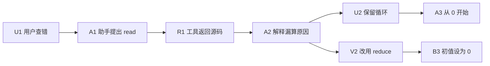
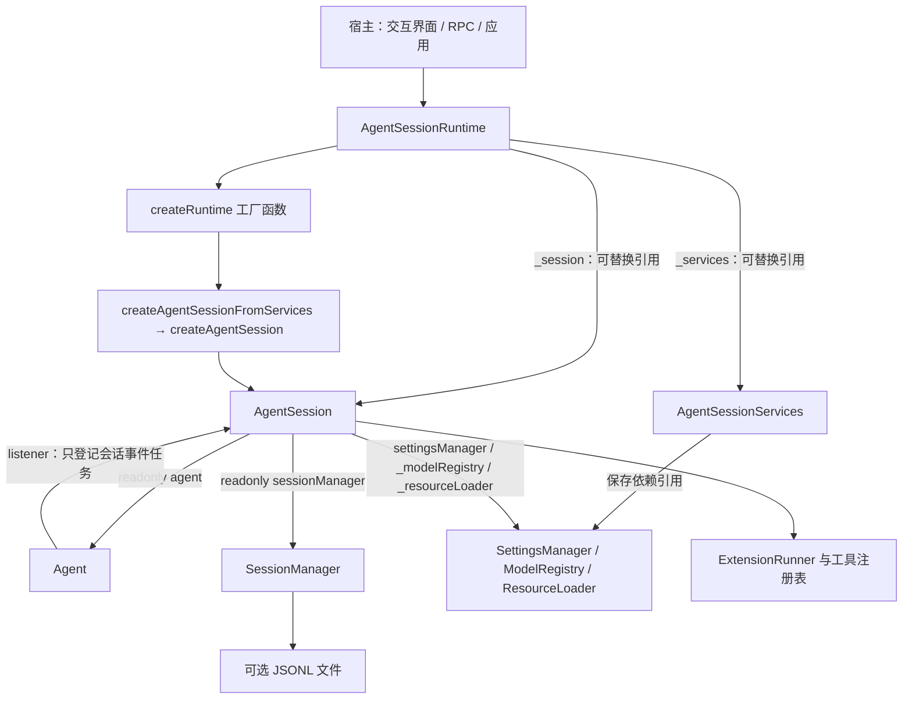
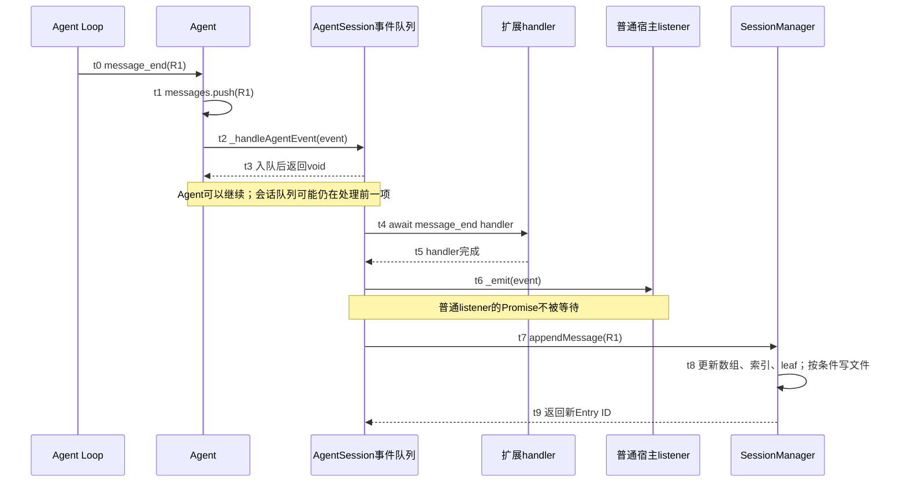
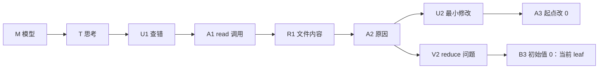
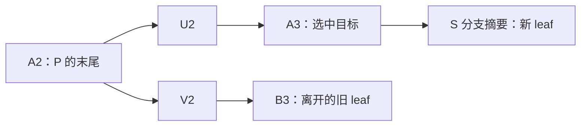
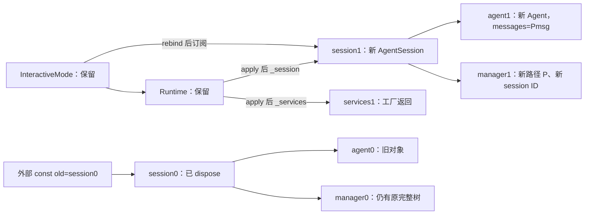

# x. Pi 会话系统源码解析：AgentSession 与 Session Tree

**选读材料，不计入主线编号。对应主线：[14 Agent Session 执行原理](/openclaw/chapter-14)。**

## 从一次查错开始：为什么聊天历史还需要一棵树

用户把下面的 `sum.ts` 交给 Pi，问：“为什么 `sum([1, 2, 3])` 得到 5？”

```ts
export function sum(xs: number[]): number {
  let total = 0;
  for (let i = 1; i < xs.length; i++) total += xs[i];
  return total;
}
```

循环从下标 1 开始，所以累加的是 2 和 3，漏掉了第一个元素。对这一次问题，Agent 可以先读取文件，再回答原因。

以下用一组示例消息记录这次查错过程。

### 一次回答里的四条消息

| 顺序 | 本章简称 | 消息内容与角色 | 什么时候产生 |
| --- | --- | --- | --- |
| 1 | U1 | user：“检查 sum.ts，解释为什么 [1,2,3] 得到 5。” | Session.prompt 整理用户输入时 |
| 2 | A1 | assistant：“先读取实现。”，并包含 `read({path:"sum.ts"})` 的 ToolCall | 第一次模型响应结束时得到完整助手消息 |
| 3 | R1 | toolResult：返回上面的源文件正文，toolCallId 指向 A1 中的调用 | 工具执行完成并被循环包装时 |
| 4 | A2 | assistant：“循环从 1 开始，漏掉 xs[0]；应从 0 开始。” | 第二次模型响应结束时 |

A1 是一条带工具调用的助手消息，ToolCall 是它的内容块。R1 则是另一条消息，用调用 ID 与 A1 内的 ToolCall 配对。

这一轮结束后，Agent 保存的活动消息可以写成：

```text
Agent.state.messages = [U1, A1, R1, A2]
```

仅从“下一次模型要读什么”看，这个数组很合适。模型能看到问题、工具调用、返回结果和诊断。可是用户接下来有两个新需求。

**第一个需求：退出后再继续。** 数组属于正在运行的进程，进程退出以后需要有文件把材料留下来。于是出现 SessionManager：它接收已经完成的消息，保存为带位置信息的记录，再按条件写入 JSONL。

**第二个需求：保留两种讨论方向。** 用户先问：“保留循环，最小修改是什么？”得到“将起点改成 0”的回答。后来又想回到这条问题，改问：“如果改成 reduce，怎样让空数组也返回 0？”

两组后续消息分别记作：

```text
U2 → A3：保留循环，讨论起点改为 0
V2 → B3：改用 reduce，讨论初值为 0
```

如果把当前聊天数组简单截短再覆盖，Agent 能沿新方向继续，但原来的 U2/A3 还需要另一个位置保存。文件既要保留两条路线，又要让这次请求只沿其中一条继续。只靠数组顺序，表达不了这两个要求。

### 消息外面为什么多了一层 Entry

同一条 U2 消息需要两类信息：正文告诉模型“问了什么”；位置告诉会话系统“接在谁后面”。SessionManager 将后者放在消息外层：

```ts
// 结构示意；时间和 ID 暂用有含义的占位名，完整合法 JSONL 在第 5.5 节。
{
  type: "message",
  id: "U2的记录ID",
  parentId: "A2的记录ID",
  timestamp: "记录创建的ISO时间",
  message: {
    role: "user",
    content: "保留循环，最小修改是什么？",
    timestamp: 1000,
  },
}
```

这个外层对象叫 SessionEntry。它让会话系统可以用稳定 ID 指向一条记录，而不用依赖“当前数组第几项”。将来压缩会改变活动消息数组，数组下标会变化；原记录 ID 仍能定位同一个历史节点。

当 V2 也接到 A2 后面时，两条路线就都有了明确父节点：



箭头在这里表示 Entry.parentId 形成的父子关系，不表示图中每个节点此刻都要重新执行。磁盘中的创建顺序仍可以是 U1、A1、R1、A2、U2、A3、V2、B3；V2 虽然后写入，却通过 parentId 指回较早的 A2。

现在需要另一个值说明“眼下选哪条路线”：`leafId`。选 B3 时，沿父指针回去得到 U1→A1→R1→A2→V2→B3；选 A3 时得到另一条路径。两条路线的全部节点仍保存在同一文件。

Session Tree 因而不是 Agent.state.messages 的另一个名字。它保存所有分支和非消息记录；Agent.state.messages 则保存当前供运行使用的消息。恢复时需要把“选中的记录路径”转成“可交给 Agent 的消息数组”，`buildSessionContext()` 负责的正是这一步。模型、思考等级、标签等记录不会直接成为聊天消息；摘要记录还需要重新包装成对应 AgentMessage。

### 这段对话将依次经历什么

| 阶段 | 用户操作 | 需要追踪的问题 | 正文位置 |
| --- | --- | --- | --- |
| 创建 | 启动 Pi，尚未提问 | 谁创建 Manager、Agent、Session；header/M/T 何时出现 | 1—2 |
| 运行 | 提交 U1，经历 A1/R1/A2；再提交 U2，得到 A3 | 三份消息数组与 JSONL 何时更新 | 3—5 |
| 另开路线 | `/tree` 选 U2，改成 V2，得到 B3 | 为什么退到 A2；旧 U2/A3 为什么还在 | 6—8 |
| 带摘要返回 | 从 B3 导航到 A3，要求摘要 | 总结哪条路线；S 挂在哪里；模型读到什么 | 8 |
| 独立会话 | `/fork` 或 `/clone` | 复制哪部分树；何时换文件与运行对象 | 11 |
| 退出再打开 | `/quit`，再选择主会话 JSONL | 文件怎样恢复为记录、路径和活动消息；什么不会重跑 | 11.12 |

从第 2 节开始还会出现 H、M、T：H 是整份会话的 header，M/T 是初始模型和思考等级记录。为避免在长表中反复抄公共前缀，约定：

```text
P    = [M, T, U1, A1, R1, A2]   公共记录路径，不含 header
Pmsg = [U1, A1, R1, A2]         公共路径投影后的活动消息
```

这些简称在后面的树和状态表中始终指同一批数据。少量独立的最小反例会另外标明，不改变这条查错案例。

[第 06 章](/openclaw/chapter-06) 展开 Agent Loop，[第 07 章](/openclaw/chapter-07) 展开工具执行，[选读：Pi 消息与事件](/openclaw/messages-events#x-messages-01) 展开消息转换和事件协议，[第 08 章](/openclaw/chapter-08) 用具体例子、算法与简化代码展开上下文压缩。

## 阅读路线与数据约定

```text
运行主线
应用 → createAgentSession / createAgentSessionFromServices
     → Agent + AgentSession + SessionManager
     → session.prompt(新输入)
     → agent.prompt(本次新消息) → Agent Loop
     → Agent.processEvents 更新 Agent.state
     → AgentSession 事件队列 → 扩展 → 普通订阅者 → 追加记录

历史主线
全部 SessionEntry → leafId → 沿 parentId 取得当前路径
     → buildSessionContext → messages / thinkingLevel / model
     → 调用方按需要应用 → Agent 下一次运行读取状态快照

替换支线
稳定的 AgentSessionRuntime
     → 打开、新建或派生 SessionManager
     → 旧会话 shutdown / dispose
     → 工厂创建新 AgentSession 和服务 → apply → 宿主重新绑定
```

第一次阅读可依次走第 1—8 节，再读第 11—13 节中的替换与使用示例。第 9—10 节及标有“深入”的小节用于第二遍检查配置变化、重试、取消、异常与不完全清理。第 14 节给出 IDE 跳转与返回路线，第 15 节提供函数检索表。

源码摘录省略注释与空行，保留所标范围内的执行语句。U1/A1/R1 等在记录语境下指 Entry，在 messages 语境下指其消息，完整 ID 对照见第 5.5 节。独立最小例子另用 A/B/C 等临时简称。图中的 header 不属于树节点。

源码链接打开文件，标签和正文中的行号用于 IDE“转到行”。相对路径以本章所在目录为起点；状态表展示根据代码推导的结果。

## 章节索引

| 章节与跳转 |
| --- |
| [1. 从这段对话看，五个对象分别解决什么](#x-session-01) |
| [2. 创建一段会话：依赖、历史、回调和绑定](#x-session-02) |
| [3. 一次 prompt：把新输入放到既有历史之后](#x-session-03) |
| [4. 从事件回传到记录追加：运行状态怎样落到树上](#x-session-04) |
| [5. 记录与持久化：从数据类型读到文件行为](#x-session-05) |
| [6. Session Tree：全部记录、当前 leaf 和当前 branch](#x-session-06) |
| [7. buildSessionContext：把当前路径投影成消息与配置](#x-session-07) |
| [8. navigateTree：从选中节点到实际续写位置](#x-session-08) |
| [9. 配置和资源变化：哪些会写记录，哪些只改变运行环境](#x-session-09) |
| [10. 深入：重试、压缩、取消与清理的完成边界](#x-session-10) |
| [11. 新建、切换、fork 与导入：什么时候换整个对象](#x-session-11) |
| [12. 深入：特殊消息、导出与查询如何接入会话](#x-session-12) |
| [13. 公开 API 使用示例](#x-session-13) |
| [14. IDE 源码阅读导航](#x-session-14) |
| [15. 函数检索与源码版本](#x-session-15) |

<a id="x-session-01"></a>

## 1. 从这段对话看，五个对象分别解决什么

### 1.1 从读取文件到恢复旧分支，各由谁接手

只处理 U1→A1→R1→A2 时，Agent 已经能够请求模型和执行工具。它没有 fileEntries、parentId 或会话文件路径；如果让它顺便负责磁盘树、斜杠命令、扩展通知与编辑器回填，运行循环就会混入这些应用规则。

SessionManager 解决持久化与路径组织，却不认识 Agent 的 activeRun，不请求模型，也不会在 branch 以后自动替换 Agent.state.messages。两者之间需要把输入、运行事件和保存接起来的对象，这就是 AgentSession。它收到 U1 后准备输入，将 Agent 的 message_end 交给 Manager；导航后再把 Manager 计算出的消息赋回 Agent。

只有在“打开另一份会话”时，才需要进一步考虑旧扩展、资源目录和订阅怎样交接。AgentSessionRuntime 保存可以更换的 session 引用，并让宿主重新绑定新会话。Services 则是工厂传递设置、注册表、资源加载器等依赖的普通容器。

对象关系由此可以画成：



图中的 `AgentSessionServices` 是普通对象，里面保存服务引用，没有运行循环。Session 分别持有其中的设置、注册表和加载器，并不持有整个 services 容器；图中的连线表示这些成员引用的对应关系。`createAgentSession()` 也可以独立使用，不要求先有 Runtime 或 services。Runtime 的价值在于让宿主持有一个稳定入口，而其中的 `session` 和服务集合可以更换。

| 对象 | 真正保存的关键状态 | 谁写入、谁读取 |
| --- | --- | --- |
| `Agent` | `_state` 中的 messages、model、thinkingLevel、tools、systemPrompt；`activeRun`；两条待发消息队列；Agent listeners | 会话设置运行材料；循环事件更新运行状态；下次 run 创建快照 |
| `AgentSession` | 对 Agent、Manager、Settings 的引用；事件处理 Promise 链；显示用待发文字；nextTurn/Bash 暂存；重试状态与摘要控制器；扩展 runner、工具表和基础提示词 | `prompt`、事件处理、配置、压缩、导航等入口改变；宿主与扩展查询 |
| `SessionManager` | `fileEntries`、`byId`、`leafId`、标签索引、session ID、路径、cwd、persist/flushed | append 更新；树查询和上下文重建读取；磁盘读入后重建索引 |
| `AgentSessionRuntime` | `_session`、`_services`、创建工厂、宿主 `rebindSession` 回调、诊断信息 | new/switch/fork/import 更换引用；宿主每次通过 getter 取得新会话 |
| SDK 与 services | SDK 负责组装；services 保存 cwd、agentDir、authStorage、settingsManager、modelRegistry、resourceLoader、diagnostics | 默认创建或接收外部依赖；工厂决定替换时复用哪些依赖 |

字段定义见 [agent.ts:174](/source/?file=3688aa044ebb960834.ts#L174)、[agent-session.ts:242](/source/?file=24209413646c397dc9.ts#L242)、[session-manager.ts:680](/source/?file=043f6d188e65e3207b.ts#L680)、[agent-session-runtime.ts:67](/source/?file=70034fc47cc255a0a5.ts#L67)、[agent-session-services.ts:66](/source/?file=39808a3defe33903af.ts#L66)。

`AgentSession._buildRuntime()` 是构建本会话的扩展 runner、工具表和提示词的私有方法。它与 `AgentSessionRuntime` 类有不同职责：前者不更换 AgentSession，后者可以更换整份 AgentSession。

### 1.2 `readonly`、getter 与浅复制

`readonly agent` 表示不能通过类型允许的赋值重新设置 `session.agent` 属性，Agent 对象本身仍有可变状态。`session.state`、`session.messages`、`session.model` 都直接转发 Agent 的状态；它们不是会话另存的一份历史。

底层数组的读写还有一层差别：

源码摘录：[agent.ts:78](/source/?file=3688aa044ebb960834.ts#L78)，第 78—105 行。

```ts
function createMutableAgentState(
  initialState?: Partial<Omit<AgentState, "pendingToolCalls" | "isStreaming" | "streamingMessage" | "errorMessage">>,
): MutableAgentState {
  let tools = initialState?.tools?.slice() ?? [];
  let messages = initialState?.messages?.slice() ?? [];
  return {
    systemPrompt: initialState?.systemPrompt ?? "",
    model: initialState?.model ?? DEFAULT_MODEL,
    thinkingLevel: initialState?.thinkingLevel ?? "off",
    get tools() {
      return tools;
    },
    set tools(nextTools: AgentTool<any>[]) {
      tools = nextTools.slice();
    },
    get messages() {
      return messages;
    },
    set messages(nextMessages: AgentMessage[]) {
      messages = nextMessages.slice();
    },
    isStreaming: false,
    streamingMessage: undefined,
    pendingToolCalls: new Set<string>(),
    errorMessage: undefined,
  };
}
```

读取 `agent.state.messages` 得到内部数组；给它赋另一个数组时，setter 执行 `slice()`。所以：

```ts
// 局部引用示例，aMessage 是已有消息对象。
const restored = [aMessage];
agent.state.messages = restored;
// 顶层数组不同；数组元素仍是同一个消息对象。
// agent.state.messages !== restored
// agent.state.messages[0] === restored[0]
```

`getEntries()`、`getBranch()`、`getChildren()` 都新建结果数组，但元素是原 Entry 引用；`getEntry()` 与 `getHeader()` 直接返回保存的对象。`getTree()` 新建节点壳及 children 数组，`node.entry` 仍指原 Entry。普通消息恢复时也复用 `entry.message`；摘要与 custom_message 恢复时会构造新的消息壳。

`ReadonlySessionManager` 是 `Pick<SessionManager, ...>` 形成的类型视图，见 [session-manager.ts:187](/source/?file=043f6d188e65e3207b.ts#L187)。它只暴露选定查询方法，不做深冻结，甚至没有包含全部查询方法，例如 `getChildren()` 与 `buildSessionContext()` 不在这个 Pick 中。扩展收到受限类型，并不意味着读取到的对象已复制。

类似地，`scopedModels`、`promptTemplates`、`getSteeringMessages()` 的只读返回类型也不创建运行时副本。是否复制、复制到哪一层，取决于实现中的 `map/filter/slice/[...]` 或对象构造。

### 1.3 配置的生效时间分三种

一类是创建 Agent 时读入的设置，如 transport、thinkingBudgets、maxRetryDelayMs；SDK 把值交给 Agent，后面单独 reload 设置不自动重新赋这些字段。第二类是按操作读取的设置，如每次重试的开关与退避参数、每次压缩的阈值、每次消息转换的 blockImages。第三类有专用更新入口，如模型、思考等级、活跃工具和队列模式。

设置变更通过各自的读取或更新入口生效。具体写入位置见第 9 节，替换会话时重建的服务见第 11 节。

<a id="x-session-02"></a>

## 2. 创建一段会话：依赖、历史、回调和绑定

创建入口要把已存记录变成 Agent 的起点，再装上会话层能力。这里尚未提交新用户消息。沿 [sdk.ts:176](/source/?file=07502145bf1ffa712b.ts#L176) 的 `createAgentSession()` 读，可以分成四段，段与段之间传递的是同一组局部变量。

### 2.1 确定工作目录，取得依赖，加载资源

源码摘录：[sdk.ts:176](/source/?file=07502145bf1ffa712b.ts#L176)，第 176—199 行。

```ts
export async function createAgentSession(options: CreateAgentSessionOptions = {}): Promise<CreateAgentSessionResult> {
  const cwd = options.cwd ?? options.sessionManager?.getCwd() ?? process.cwd();
  const agentDir = options.agentDir ?? getDefaultAgentDir();
  let resourceLoader = options.resourceLoader;
  const authPath = options.agentDir ? join(agentDir, "auth.json") : undefined;
  const modelsPath = options.agentDir ? join(agentDir, "models.json") : undefined;
  const authStorage = options.authStorage ?? AuthStorage.create(authPath);
  const modelRegistry = options.modelRegistry ?? ModelRegistry.create(authStorage, modelsPath);
  const settingsManager = options.settingsManager ?? SettingsManager.create(cwd, agentDir);
  const sessionManager = options.sessionManager ?? SessionManager.create(cwd, getDefaultSessionDir(cwd, agentDir));
  if (!resourceLoader) {
    resourceLoader = new DefaultResourceLoader({ cwd, agentDir, settingsManager });
    await resourceLoader.reload();
    time("resourceLoader.reload");
  }
```

`cwd` 的优先级是显式 options.cwd、传入 Manager 的 cwd、进程 cwd。显式 cwd 与 Manager 的 cwd 可以不同；SDK 没有在这里强制两者一致。后面系统提示词与默认工具用 `_cwd`，独立 Bash 入口又读 Manager 的 cwd，两处使用的目录可能不同。

authStorage、modelRegistry、settingsManager、sessionManager 都优先使用外部对象，否则创建默认对象。默认 `SessionManager.create()` 建立 header、session ID 和候选会话文件路径；目录不存在时先创建目录，但会话 JSONL 是否已经写出，要看第 5 节的持久化条件。默认会话目录在 agentDir 下按 cwd 编码分组，而非项目目录中的 `.pi/sessions`。

resourceLoader 的处理略有不同：**SDK 只对自己创建的 DefaultResourceLoader 调用并等待 reload；外部传入的 loader 被当作已经准备好**。这一次 await 等的是资源扫描和加载，不是 Agent 对话，也不是 `session_start` 扩展通知。

services 入口在 [agent-session-services.ts:131](/source/?file=39808a3defe33903af.ts#L131)。`createAgentSessionServices()` 创建或接收认证、设置、模型注册表，创建 loader 并 await reload，应用待登记 provider 与扩展 flags，返回服务对象和 diagnostics。`createAgentSessionFromServices()` 第 182—200 行把这些引用原样传给 SDK，不复制服务对象内部资源。

### 2.2 从 Manager 取得上下文，再选择模型与思考等级

源码摘录：[sdk.ts:203](/source/?file=07502145bf1ffa712b.ts#L203)，第 203—262 行。

```ts
const existingSession = sessionManager.buildSessionContext();
const hasExistingSession = existingSession.messages.length > 0;
const hasThinkingEntry = sessionManager.getBranch().some((entry) => entry.type === "thinking_level_change");
let model = options.model;
let modelFallbackMessage: string | undefined;
if (!model && hasExistingSession && existingSession.model) {
  const restoredModel = modelRegistry.find(existingSession.model.provider, existingSession.model.modelId);
  if (restoredModel && modelRegistry.hasConfiguredAuth(restoredModel)) {
    model = restoredModel;
  }
  if (!model) {
    modelFallbackMessage = `Could not restore model ${existingSession.model.provider}/${existingSession.model.modelId}`;
  }
}
if (!model) {
  const result = await findInitialModel({
    scopedModels: [],
    isContinuing: hasExistingSession,
    defaultProvider: settingsManager.getDefaultProvider(),
    defaultModelId: settingsManager.getDefaultModel(),
    defaultThinkingLevel: settingsManager.getDefaultThinkingLevel(),
    modelRegistry,
  });
  model = result.model;
  if (!model) {
    modelFallbackMessage = `No models available. Use /login or set an API key environment variable. See ${join(getDocsPath(), "providers.md")}. Then use /model to select a model.`;
  } else if (modelFallbackMessage) {
    modelFallbackMessage += `. Using ${model.provider}/${model.id}`;
  }
}
let thinkingLevel = options.thinkingLevel;
if (thinkingLevel === undefined && hasExistingSession) {
  thinkingLevel = hasThinkingEntry
    ? (existingSession.thinkingLevel as ThinkingLevel)
    : (settingsManager.getDefaultThinkingLevel() ?? DEFAULT_THINKING_LEVEL);
}
if (thinkingLevel === undefined) {
  thinkingLevel = settingsManager.getDefaultThinkingLevel() ?? DEFAULT_THINKING_LEVEL;
}
if (!model || !model.reasoning) {
  thinkingLevel = "off";
}
const defaultActiveToolNames: ToolName[] = ["read", "bash", "edit", "write"];
const initialActiveToolNames: string[] = options.tools ? [...options.tools] : defaultActiveToolNames;
```

`existingSession` 是 `SessionContext`，不是 JSONL 原文。其 messages 怎样产生在第 7 节展开。这里先看调用方如何使用结果：

1. `hasExistingSession` 只判断恢复的 messages 是否非空。只有 model_change 或 thinking_level_change 的树，仍可能被当作没有已有对话。
2. 显式 `options.model` 优先。否则在“已有消息且路径提供 model”时查 registry，并检查凭据配置；恢复失败保留提示文字，再调用 `findInitialModel()` 选择初始模型。
3. thinkingLevel 优先显式值。已有消息时，若路径中有 thinking_level_change，就使用恢复值；没有该记录时使用设置默认值。没有推理能力的模型将等级设成 off。
4. `options.tools` 复制成初始活跃名称数组，随后又作为 allowedToolNames 传入 Session。未提供时默认基础活跃工具是 read/bash/edit/write。

这里给 findInitialModel 的 scopedModels 固定为空数组；SDK options.scopedModels 随后保存到 Session，供循环选择模型使用，不在这一步自动取第一项。CLI 对限定模型列表的初始选择在 main 的 buildSessionOptions 阶段处理。

SDK 的模型选择可以没有结果，返回 `modelFallbackMessage`。继续跟进 [agent.ts:55](/source/?file=3688aa044ebb960834.ts#L55) 与第 86 行会发现，Agent 对缺失模型使用 `unknown` 的 `DEFAULT_MODEL` 占位对象。所以 SDK 未找到模型时，`session.model` 仍可能是这个占位对象；实际请求需要有效模型和凭据。

### 2.3 创建 Agent 并安装会话回调

SDK 在第 855 行建立 `extensionRunnerRef = {}`，第 875 行开始创建 Agent。回调较长，下面按它们在真实调用中的作用对应位置：

| Agent 选项 | SDK 位置 | 以后何时执行，读取什么 |
| --- | --- | --- |
| `convertToLlm` | 751—832、885 | 每次准备模型消息时调用 `convertToLlm`，再按当时的 blockImages 设置替换图片块；不修改记录树 |
| `streamFn` | 921—958 | 请求模型前 await registry 的 key/headers，合并请求头，返回 `streamSimple` 的流；创建时不执行 |
| `onPayload` | 992—1024 | 组装 Provider 请求时读 `extensionRunnerRef.current`，允许 before_provider_request 改写 payload |
| `onResponse` | 1050—1062 | 收到 Provider 响应后，等待 after_provider_response handler |
| `transformContext` | 1108—1112 | 模型请求前取得当前 runner，调用 context 钩子；返回转换用消息，不负责追加会话记录 |
| `sessionId` | 1064 | 把 Manager 的 session ID 放入 Agent 请求配置；不是 Entry ID |
| 模式、传输、预算 | 1134—1138 | 创建时从 settings 读值，保存到 Agent；后续 run 再快照到 config |

其中 onPayload、onResponse、transformContext 通过 `extensionRunnerRef.current` 间接取得 runner，是因为 runner 要等 AgentSession 构造时才建立，而且 reload 后可以更换。闭包保存这个小对象，后面改变 `current`，回调就能访问新 runner。

Agent 创建后恢复消息并补初始配置记录：

源码摘录：[sdk.ts:364](/source/?file=07502145bf1ffa712b.ts#L364)，第 364—375 行。

```ts
if (hasExistingSession) {
  agent.state.messages = existingSession.messages;
  if (!hasThinkingEntry) {
    sessionManager.appendThinkingLevelChange(thinkingLevel);
  }
} else {
  if (model) {
    sessionManager.appendModelChange(model.provider, model.id);
  }
  sessionManager.appendThinkingLevelChange(thinkingLevel);
}
```

已有消息时，setter 对 restored messages 做浅复制；缺少 thinking 记录才补一条。没有已有消息时，存在 model 就追加 model_change，再追加 thinking_level_change。历史恢复时显式 options.model 可以覆盖 Agent 模型，但这个分支不会自动追加相应 model_change，与 `session.setModel()` 会写入模型记录的行为不同。

此时 Manager 可能已经多了配置记录，Agent 可能已经有历史消息，但还没有这次新输入。也尚未发出 `agent_start`。

### 2.4 AgentSession 构造保存引用并建立运行环境

SDK 第 379—394 行把前面得到的实例交给构造函数。核心代码是连续的：

源码摘录：[agent-session.ts:313](/source/?file=24209413646c397dc9.ts#L313)，第 313—338 行。

```ts
constructor(config: AgentSessionConfig) {
  this.agent = config.agent;
  this.sessionManager = config.sessionManager;
  this.settingsManager = config.settingsManager;
  this._scopedModels = config.scopedModels ?? [];
  this._resourceLoader = config.resourceLoader;
  this._customTools = config.customTools ?? [];
  this._cwd = config.cwd;
  this._modelRegistry = config.modelRegistry;
  this._extensionRunnerRef = config.extensionRunnerRef;
  this._initialActiveToolNames = config.initialActiveToolNames;
  this._allowedToolNames = config.allowedToolNames ? new Set(config.allowedToolNames) : undefined;
  this._baseToolsOverride = config.baseToolsOverride;
  this._sessionStartEvent = config.sessionStartEvent ?? { type: "session_start", reason: "startup" };
  this._unsubscribeAgent = this.agent.subscribe(this._handleAgentEvent);
  this._installAgentToolHooks();
  this._buildRuntime({
    activeToolNames: this._initialActiveToolNames,
    includeAllExtensionTools: true,
  });
}
```

这段同步执行三个动作：保存引用；登记 Agent listener 并保存退订函数；安装工具钩子，再建立扩展与工具环境。`_scopedModels`、`_customTools` 等数组通常保存传入引用；allowedToolNames 则新建 Set。

`_installAgentToolHooks()` 第 382 行设置 beforeToolCall/afterToolCall。前者有 tool_call handler 时会先 `await _agentEventQueue`，确保前面生命周期事件处理到位，再调用扩展拦截。工具结果钩子的字段改写见第 07 章，这两个闭包每次读取 Session 当前的 runner。

`_buildRuntime()` 第 2390—2442 行按设置或 baseToolsOverride 建立基础 ToolDefinition Map，取 loader 中已加载的扩展，创建 `ExtensionRunner`，把它写进 `_extensionRunnerRef.current`，绑定扩展可调用的会话操作，再刷新工具表。最后 `setActiveToolsByName()` 同时设置 Agent.state.tools 和基础系统提示词。

SDK 在 [sdk.ts:393](/source/?file=07502145bf1ffa712b.ts#L393) 返回 `{ session, extensionsResult, modelFallbackMessage }`。`new AgentSession(...)` 本身同步返回对象；`await createAgentSession(...)` 则等待 SDK 中的资源加载与选择等异步阶段完成。两者的完成范围不同。

还有一项由宿主完成：

源码摘录：[agent-session.ts:2088](/source/?file=24209413646c397dc9.ts#L2088)，第 2088—2105 行。

```ts
async bindExtensions(bindings: ExtensionBindings): Promise<void> {
  if (bindings.uiContext !== undefined) {
    this._extensionUIContext = bindings.uiContext;
  }
  if (bindings.commandContextActions !== undefined) {
    this._extensionCommandContextActions = bindings.commandContextActions;
  }
  if (bindings.shutdownHandler !== undefined) {
    this._extensionShutdownHandler = bindings.shutdownHandler;
  }
  if (bindings.onError !== undefined) {
    this._extensionErrorListener = bindings.onError;
  }
  this._applyExtensionBindings(this._extensionRunner);
  await this._extensionRunner.emit(this._sessionStartEvent);
  await this.extendResourcesFromExtensions(this._sessionStartEvent.reason === "reload" ? "reload" : "startup");
}
```

`bindExtensions()` 保存 UI、命令动作、关闭与错误回调，应用绑定，等待 session_start，再等待资源发现。`extendResourcesFromExtensions()` 第 2108—2131 行收集 skills/prompts/themes 路径，合并资源并重建系统提示词。createAgentSession 没有自动调用 bindExtensions；宿主需要这个启动通知时，应显式等待它。

创建完成时，Agent、Session、Manager 已关联，历史、初始配置、工具与提示词已准备，Agent→Session 订阅也已登记。模型对话要等新输入才开始；普通宿主订阅由宿主安装，扩展 session_start 则在宿主调用并等待 bindExtensions 后完成。

### 2.5 创建返回时，把实例和初始数据逐项对上

对 `sum.ts` 的这份新会话，设应用显式选择模型 openai/gpt-5.4、thinkingLevel=medium，资源已正常加载，扩展不追加记录、不改变模型和思考等级，也不主动启动对话。各层的返回值不是同一个东西：

```text
SessionManager.create(cwd, sessionDir)
  → 返回 manager0
  → manager0 已有 H；尚无消息；leaf=null

createAgentSession({ sessionManager: manager0, model, thinkingLevel:"medium", ... })
  → buildSessionContext() 得 {messages:[], model:null, thinkingLevel:"off"}
  → 显式 model/thinking 作为本次实际选择
  → new Agent(...) 得 agent0，messages=[]
  → appendModelChange 得 M.id；appendThinkingLevelChange 得 T.id
  → new AgentSession({agent:agent0, sessionManager:manager0, ...}) 得 session0
  → 构造内建 runner、工具表和基础提示词
  → SDK Promise 完成，交回 {session:session0, extensionsResult, ...}

宿主 await session0.bindExtensions(bindings)
  → 等 session_start；再等资源发现；必要时重建提示词
  → 然后安装/保持宿主订阅，准备接收用户输入
```

构造函数先创建 runner 与基础工具环境，bindExtensions 再接上宿主动作并派发启动事件。

此时的数据很小，可以把字段全部列出来：

| 对象/位置 | 内容 |
| --- | --- |
| `session0.agent === agent0` | true，同一个 Agent 引用 |
| `session0.sessionManager === manager0` | true，同一个 Manager 引用 |
| `agent0.state.messages` | `[]` |
| `manager0.fileEntries` 的等价查询视图 | `[H, M, T]` |
| `manager0.byId` | `{M.id → M, T.id → T}` |
| `manager0.leafId` | `T.id` |
| `manager0.flushed` | false，没有 assistant 记录 |
| 会话文件 | 名字已分配；这条新建路径尚未写出 JSONL |

这里 fileEntries/byId/flushed 是用于源码观察的私有字段，不是应用可以直接读取的公开 API。应用可用 getHeader/getEntries/getEntry/getLeafId 构造对应观察结果。

H/M/T 还没有任何聊天正文，但 U1 后来追加时会用 `T.id` 作 parentId。初始化留下的配置记录，正是第一条消息的挂接起点。

<a id="x-session-03"></a>

## 3. 一次 prompt：把新输入放到既有历史之后

`AgentSession.prompt(text, options)` 接收的是本次输入，返回 `Promise<void>`。它可以处理命令、被扩展接管、把输入排队，也可以启动新的 Agent 运行。返回时完成了哪一步，取决于进入的分支。

### 3.0 普通输入怎样从编辑器回到 `run()`

用户在界面按回车时，入口并不直接是 AgentSession.prompt。先读 [editor.ts:1176](/source/?file=f642ce33afd6e2b945.ts#L1176) 的 submitValue：编辑器取出文本、清空自己的输入状态，再调用 onSubmit(result)。这里没有 await 回调。

宿主在 [interactive-mode.ts:2376](/source/?file=ee2e68c0d7b9d97a7f.ts#L2376) 安装 async onSubmit。它先识别 `/tree`、`/fork`、`/new` 等内置命令；它们直接进入界面或 Runtime 操作，不会作为 U1 送给模型。普通空闲输入走第 2549 行的 onInputCallback。

源码摘录：[interactive-mode.ts:3114](/source/?file=ee2e68c0d7b9d97a7f.ts#L3114)，第 3114—3121 行。

```ts
async getUserInput(): Promise<string> {
  return new Promise((resolve) => {
    this.onInputCallback = (text: string) => {
      this.onInputCallback = undefined;
      resolve(text);
    };
  });
}
```

这个 Promise 是“等下一次用户输入”，resolver 保存在 `onInputCallback`。输入回调拿到 U1 的文字后，先清掉自身，再 resolve(text)。`run()` 中等待该 Promise 的代码才能继续：

源码摘录：[interactive-mode.ts:714](/source/?file=ee2e68c0d7b9d97a7f.ts#L714)，第 714—722 行。

```ts
while (true) {
  const userInput = await this.getUserInput();
  try {
    await this.session.prompt(userInput);
  } catch (error: unknown) {
    const errorMessage = error instanceof Error ? error.message : "Unknown error occurred";
    this.showError(errorMessage);
  }
}
```

于是参数沿一条连续路径交接：编辑器文本 → onSubmit(text) → onInputCallback(text) → getUserInput 的 Promise 得到字符串 → run 中的 userInput → Session.prompt(userInput)。run 等这次 prompt Promise 完成后，才进入下一轮 getUserInput。

运行中输入另走 onSubmit 的 isStreaming 分支，直接调用 `session.prompt(text,{streamingBehavior:"steer"})`；isCompacting 时先交给宿主的压缩期间队列。编辑器可输入、用户输入 Promise 已 resolve、prompt 已完成，是三个不同时间点。

### 3.1 参数控制哪一个阶段

参数定义见 [agent-session.ts:181](/source/?file=24209413646c397dc9.ts#L181)。

| option | 默认与作用 |
| --- | --- |
| `expandPromptTemplates` | 默认 true；同时控制扩展斜杠命令尝试、skill 展开和模板展开；不关闭 input 钩子 |
| `images` | 与本次文本一起形成 user content；input transform 可以提供替代图片 |
| `streamingBehavior` | 运行中必须指定 steer 或 followUp 才能排队；空闲时不会因为这个选项而改成排队 |
| `source` | 传给 input handler，默认 interactive；`sendUserMessage` 使用 extension |
| `preflightResult` | 普通回调，报告输入准备成功或失败；不代表模型运行成功，返回值不被等待 |

### 3.2 命令、input 和展开按什么次序发生

源码摘录：[agent-session.ts:968](/source/?file=24209413646c397dc9.ts#L968)，第 968—1031 行。

```ts
async prompt(text: string, options?: PromptOptions): Promise<void> {
  const expandPromptTemplates = options?.expandPromptTemplates ?? true;
  const preflightResult = options?.preflightResult;
  let messages: AgentMessage[] | undefined;
  try {
    if (expandPromptTemplates && text.startsWith("/")) {
      const handled = await this._tryExecuteExtensionCommand(text);
      if (handled) {
        preflightResult?.(true);
        return;
      }
    }
    let currentText = text;
    let currentImages = options?.images;
    if (this._extensionRunner.hasHandlers("input")) {
      const inputResult = await this._extensionRunner.emitInput(
        currentText,
        currentImages,
        options?.source ?? "interactive",
      );
      if (inputResult.action === "handled") {
        preflightResult?.(true);
        return;
      }
      if (inputResult.action === "transform") {
        currentText = inputResult.text;
        currentImages = inputResult.images ?? currentImages;
      }
    }
    let expandedText = currentText;
    if (expandPromptTemplates) {
      expandedText = this._expandSkillCommand(expandedText);
      expandedText = expandPromptTemplate(expandedText, [...this.promptTemplates]);
    }
    if (this.isStreaming) {
      if (!options?.streamingBehavior) {
        throw new Error(
          "Agent is already processing. Specify streamingBehavior ('steer' or 'followUp') to queue the message.",
        );
      }
      if (options.streamingBehavior === "followUp") {
        await this._queueFollowUp(expandedText, currentImages);
      } else {
        await this._queueSteer(expandedText, currentImages);
      }
      preflightResult?.(true);
      return;
    }
```

这一段先执行扩展命令，再让 input handler 处理输入，再展开 skill 和模板，最后检查 Agent 是否正在运行。

`_tryExecuteExtensionCommand()` 第 1140—1164 行以第一个空格切分 commandName 和 args，在 runner 中查命令，await handler。未找到返回 false；找到命令后，即使 handler 抛错，通常也会经 emitError 报告并返回 true。因此“handled”表示这次输入被命令路径处理，不保证命令业务成功。prompt 调用 preflightResult(true) 后提前返回，后面的 input、排队、Agent.prompt 都不发生。

input handler 返回 handled 时同样提前返回；返回 transform 时更新 currentText，并用 `inputResult.images ?? currentImages` 选择图片。空数组可以清空图片；undefined 沿用原图片。输入变换的多 handler 顺序与返回规则见[选读《Pi 技能与扩展源码解析》第 8.3 节](/openclaw/skills-extensions#x-skills-input)；变换结果随后进入 expandedText。

`_expandSkillCommand()` 第 1174—1198 行只识别开头的 `/skill:`，查已加载技能，读取文件、去 frontmatter，把正文及位置放进 `<skill>` 块，尾随参数接在后面。找不到技能或读取失败时保留原文，失败另报扩展错误。然后 `expandPromptTemplate()` 对结果做模板展开。模板展开出的 `/skill:` 不会反过来再执行一遍前面的 skill 阶段。

因为运行中判断排在这些处理之后，流式期间提交的命令仍可能直接执行，普通输入也会先经过 input 与展开，然后才进队列。

### 3.3 运行中排队：返回的是接受完成

`_queueSteer()` 第 1247 行与 `_queueFollowUp()` 第 1265 行先把文本放入会话显示数组并发 queue_update，再构造包含文本、图片和时间的 user 消息交给 `agent.steer/followUp`。它们是 async 方法，但主体没有 await；成功返回只说明这些同步入队步骤已经执行。

```text
prompt("补充条件", { streamingBehavior: "steer" })
  → _steeringMessages = ["补充条件"]       会话显示用
  → Agent.steeringQueue 内部项：[UserMessage]  循环消费用
  → preflightResult(true)
  → prompt Promise 完成
  ……随后循环在检查点 drain 队列……
  → message_start / message_end
  → Agent 历史追加、会话显示文字移除、Manager 追加记录
```

第 06 章已讲循环的消费位置：steer 在循环起始和各 turn 结束后检查；followUp 在当前工具与 steering 链路告一段落后检查。会话层的显示数组只保存字符串，图片和自定义消息保存在 Agent 的消息队列中。`pendingMessageCount` 也只数两份显示文字数组。

直接 `session.steer()` 或 `session.followUp()` 会展开 skill/template，并拒绝把扩展命令当普通队列消息；它们不经过 prompt 的 input 钩子、凭据检查和 before_agent_start，也不自行启动空闲 Agent。源码位置为第 1209—1277 行。

### 3.4 空闲路径先检查历史，再构造局部消息

源码摘录：[agent-session.ts:1035](/source/?file=24209413646c397dc9.ts#L1035)，第 1035—1133 行。

```ts
    this._flushPendingBashMessages();
    if (!this.model) {
      throw new Error(
        "No model selected.\n\n" +
          `Use /login or set an API key environment variable. See ${join(getDocsPath(), "providers.md")}\n\n` +
          "Then use /model to select a model.",
      );
    }
    if (!this._modelRegistry.hasConfiguredAuth(this.model)) {
      const isOAuth = this._modelRegistry.isUsingOAuth(this.model);
      if (isOAuth) {
        throw new Error(
          `Authentication failed for "${this.model.provider}". ` +
            `Credentials may have expired or network is unavailable. ` +
            `Run '/login ${this.model.provider}' to re-authenticate.`,
        );
      }
      throw new Error(
        `No API key found for ${this.model.provider}.\n\n` +
          `Use /login or set an API key environment variable. See ${join(getDocsPath(), "providers.md")}`,
      );
    }
    const lastAssistant = this._findLastAssistantMessage();
    if (lastAssistant) {
      await this._checkCompaction(lastAssistant, false);
    }
    messages = [];
    const userContent: (TextContent | ImageContent)[] = [{ type: "text", text: expandedText }];
    if (currentImages) {
      userContent.push(...currentImages);
    }
    messages.push({
      role: "user",
      content: userContent,
      timestamp: Date.now(),
    });
    for (const msg of this._pendingNextTurnMessages) {
      messages.push(msg);
    }
    this._pendingNextTurnMessages = [];
    const result = await this._extensionRunner.emitBeforeAgentStart(
      expandedText,
      currentImages,
      this._baseSystemPrompt,
      this._baseSystemPromptOptions,
    );
    if (result?.messages) {
      for (const msg of result.messages) {
        messages.push({
          role: "custom",
          customType: msg.customType,
          content: msg.content,
          display: msg.display,
          details: msg.details,
          timestamp: Date.now(),
        });
      }
    }
    if (result?.systemPrompt) {
      this.agent.state.systemPrompt = result.systemPrompt;
    } else {
      this.agent.state.systemPrompt = this._baseSystemPrompt;
    }
  } catch (error) {
    preflightResult?.(false);
    throw error;
  }
  if (!messages) {
    return;
  }
  preflightResult?.(true);
  await this.agent.prompt(messages);
  await this.waitForRetry();
}
```

下面沿局部数组 `messages` 看输入的组装顺序。

`_flushPendingBashMessages()` 先把流式期间完成的独立 Bash 结果放入 Agent 与 Manager。随后检查模型和已配置凭据。因而预检失败也可能已经写入 Bash 记录；这里没有事务回滚。

`_findLastAssistantMessage()` 找 Agent 历史中的最后助手消息。若存在，就等待 `_checkCompaction(lastAssistant, false)`，第二个参数允许在这个入口检查 aborted 消息。这个 await 等当前压缩检查及其内部调用；检查内部若安排定时器继续运行，定时器代表的运行并不随这个 await 一并完成。

接下来才创建本次局部 `messages = []`。顺序是：

```text
本次 user 消息
→ _pendingNextTurnMessages 中的 custom 消息，按暂存顺序
→ before_agent_start handler 返回的 custom 消息，按返回顺序
```

待发 nextTurn 数组在调用 before_agent_start 前就清空了。若后面的钩子链或 preflight 回调异常，本次局部 messages 还没有提交给 Agent，暂存队列却已经清空。

before_agent_start 接收 expandedText、currentImages、基础系统提示词及基础构建选项；它可以带回额外消息和 systemPrompt。提供 truthy systemPrompt 时使用它，否则恢复 `_baseSystemPrompt`。因此单次扩展改写不会在下一次 prompt 中自动作为基础提示词累积。

设已有历史为 `[U0, A0]`，当前有图片 `I`，nextTurn 暂存 `[C1]`，钩子返回 `[C2]`。准备完成时：

| 位置 | 内容 |
| --- | --- |
| 原 Agent 历史 | `[U0, A0]`，可能在前面的压缩检查中已经被替换 |
| 本次局部 `messages` | `[U1(text + I), C1, C2]` |
| `_pendingNextTurnMessages` | `[]` |
| Agent.state.systemPrompt | 本次钩子结果或 `_baseSystemPrompt` |
| Manager | 尚未因为 U1/C1/C2 追加记录 |

`agent.prompt(messages)` 收到的仅是本次新消息。旧历史由 Agent 另行读取，没有在本次局部数组中重复传一遍。

### 3.5 Agent 怎样合并，以及 prompt 的 await 到哪里结束

源码摘录：[agent.ts:396](/source/?file=3688aa044ebb960834.ts#L396)，第 396—431 行。

```ts
private async runPromptMessages(
  messages: AgentMessage[],
  options: { skipInitialSteeringPoll?: boolean } = {},
): Promise<void> {
  await this.runWithLifecycle(async (signal) => {
    await runAgentLoop(
      messages,
      this.createContextSnapshot(),
      this.createLoopConfig(options),
      (event) => this.processEvents(event),
      signal,
      this.streamFn,
    );
  });
}
private async runContinuation(): Promise<void> {
  await this.runWithLifecycle(async (signal) => {
    await runAgentLoopContinue(
      this.createContextSnapshot(),
      this.createLoopConfig(),
      (event) => this.processEvents(event),
      signal,
      this.streamFn,
    );
  });
}
private createContextSnapshot(): AgentContext {
  return {
    systemPrompt: this._state.systemPrompt,
    messages: this._state.messages.slice(),
    tools: this._state.tools.slice(),
  };
}
```

Agent 开始 run 时建立当前状态的浅快照。`runAgentLoop()` 在 [agent-loop.ts:96](/source/?file=6adbf9ab77a3572a2f.ts#L96) 构造：

源码摘录：[agent-loop.ts:104](/source/?file=6adbf9ab77a3572a2f.ts#L104)，第 104—161 行。

```ts
const newMessages: AgentMessage[] = [...prompts];
const currentContext: AgentContext = {
  ...context,
  messages: [...context.messages, ...prompts],
};
await emit({ type: "agent_start" });
await emit({ type: "turn_start" });
for (const prompt of prompts) {
  await emit({ type: "message_start", message: prompt });
  await emit({ type: "message_end", message: prompt });
}
await runLoop(currentContext, newMessages, config, signal, emit, streamFn);
return newMessages;
```

`currentContext.messages` 用于这次循环；`newMessages` 保存本次新增消息。用户消息的 message_end 事件又让 Agent 将这些新消息追加到 `_state.messages`。三份数组的元素可以共享对象，数组用途不同。

`await agent.prompt(messages)` 等 runWithLifecycle 的 executor、失败处理以及 finally 收尾，正常收尾会清 activeRun、流式消息和待执行工具集合。随后 Session 等 `waitForRetry()`：仅当 `_retryPromise` 已存在时，先等重试完成信号，再等 Agent 的当前 idle Promise。

**这两次 await 没有统一等待 `_agentEventQueue`，也没有统一等待自动压缩及其后续定时器。** 普通 Session listener 内启动的后台任务更不属于它们。命令/handled/排队分支则根本不会走到这两行。第 4、10 节解释为什么这些完成边界会影响记录、导航与替换。

### 3.6 把 U1、A1、R1、A2 逐条放进三份数组

固定无重试、无压缩、无扩展额外消息的正常路径。下表在每个明确的语句点观察，星号表示正在流式生成的助手。Manager 的事件队列可以较晚完成，所以先只看循环与 Agent 的三份数组，第 4 节再接记录。

| 执行到哪里 | `currentContext.messages` | 本次 `newMessages` | `Agent.state.messages` |
| --- | --- | --- | --- |
| Session 已构造 `[U1]`，尚未进 Agent | 未创建 | 未创建 | `[]` |
| loop 第 104—137 行建数组 | `[U1]` | `[U1]` | `[]` |
| U1.message_end 进入 Agent | `[U1]` | `[U1]` | `[U1]` |
| Provider 报 A1.start | `[U1,A1*]` | `[U1]` | `[U1]` |
| A1.message_end 已处理，响应函数尚未返回 | `[U1,A1]` | `[U1]` | `[U1,A1]` |
| 响应函数把 A1 返回 runLoop | `[U1,A1]` | `[U1,A1]` | `[U1,A1]` |
| R1.message_end 已处理，工具批次尚未返回 | `[U1,A1]` | `[U1,A1]` | `[U1,A1,R1]` |
| 工具批次返回，runLoop 追加 R1 | `[U1,A1,R1]` | `[U1,A1,R1]` | `[U1,A1,R1]` |
| A2 正在输出 | `[U1,A1,R1,A2*]` | `[U1,A1,R1]` | `[U1,A1,R1]` |
| A2.message_end 后、响应函数返回前 | `[U1,A1,R1,A2]` | `[U1,A1,R1]` | `[U1,A1,R1,A2]` |
| A2 返回 runLoop，运行结束 | `[U1,A1,R1,A2]` | `[U1,A1,R1,A2]` | `[U1,A1,R1,A2]` |

为什么 A1 已经进 Agent，却还没进 newMessages？因为 streamAssistantResponse 内部先发 message_end，再 return A1；外层 runLoop 在接到返回值后才 push。这分别发生在 [agent-loop.ts:390](/source/?file=6adbf9ab77a3572a2f.ts#L390) 和第 238 行。

R1 又略有不同：工具执行器先把结果包装成 ToolResultMessage，再通过 emitToolResultMessage 发消息事件，Agent 此时已 push；工具批次把 messages 返回以后，外层 runLoop 才追加到循环上下文和 newMessages。返回处的真实代码是：

源码摘录：[agent-loop.ts:251](/source/?file=6adbf9ab77a3572a2f.ts#L251)，第 251—261 行。

```ts
if (toolCalls.length > 0) {
  const executedToolBatch = await executeToolCalls(currentContext, message, config, signal, emit);
  toolResults.push(...executedToolBatch.messages);
  hasMoreToolCalls = !executedToolBatch.terminate;
  for (const result of toolResults) {
    currentContext.messages.push(result);
    newMessages.push(result);
  }
}
```

`executedToolBatch.messages` 在本例就是 `[R1]`。循环必须把 R1 放进 currentContext，第二次请求才能看到 `sum.ts` 正文；单独发 tool_execution_end 只是通知工具完成，还不等于向这个数组追加 R1。

接下来的第二次用户输入 U2，沿用同一个 Agent，却开启一个新的 run：

```text
Agent 原历史 = Pmsg = [U1,A1,R1,A2]
Session.prompt 本次 messages = [U2]
新 run 的 currentContext.messages = [U1,A1,R1,A2,U2]
新 run 的 newMessages = [U2]
A3 完成后 Agent 历史 = [U1,A1,R1,A2,U2,A3]
```

newMessages 不跨 run 累加；Agent 活动历史跨 run 保留；Manager 为每条完成消息再包一层 Entry。三份数据各自保存，由不同语句更新。

### 3.7 activeRun 保存的 Promise 到底代表什么

U1 进入 Agent 前，还要建立一个运行生命周期。这个状态同时解决两个问题：阻止第二个直接 Agent.prompt 与第一轮重叠，以及让取消方能够等待这一轮清理。入口由前面 `runPromptMessages()` 调用：

源码摘录：[agent.ts:463](/source/?file=3688aa044ebb960834.ts#L463)，第 463—486 行。

```ts
private async runWithLifecycle(executor: (signal: AbortSignal) => Promise<void>): Promise<void> {
  if (this.activeRun) {
    throw new Error("Agent is already processing.");
  }
  const abortController = new AbortController();
  let resolvePromise = () => {};
  const promise = new Promise<void>((resolve) => {
    resolvePromise = resolve;
  });
  this.activeRun = { promise, resolve: resolvePromise, abortController };
  this._state.isStreaming = true;
  this._state.streamingMessage = undefined;
  this._state.errorMessage = undefined;
  try {
    await executor(abortController.signal);
  } catch (error) {
    await this.handleRunFailure(error, abortController.signal.aborted);
  } finally {
    this.finishRun();
  }
}
```

`executor` 是第 3.5 节那个启动 runAgentLoop 的 async 函数。第 468 行创建的 controller 通过它的 signal 传入循环和模型/工具执行；第 470 行的 `promise` 则是单独创建的“等待空闲”Promise。它不等于 executor 返回的 Promise，也不等于 Session.prompt 返回的 Promise。`resolvePromise` 初始空函数随后在 Promise 构造器中立即被赋为 resolve，保存到 activeRun.resolve，供 finishRun 统一触发。

以第一轮为例，进入前 activeRun=undefined；建立后 activeRun 同时持有 promise、resolve、abortController，isStreaming=true。U1/A1/R1/A2 的多个 turn 共用这次 run。模型调用、工具批次及其 await 结束以后，executor 才完成；越过循环事件协议的异常进入 handleRunFailure：它直接把兜底失败消息加入 Agent.state.messages，再通过 agent_end.messages 通知 Session；这条消息没有对应的 message_end，记录追加边界见第 4.3 节。无论哪条路径，finally 都执行：

源码摘录：[agent.ts:505](/source/?file=3688aa044ebb960834.ts#L505)，第 505—511 行。

```ts
private finishRun(): void {
  this._state.isStreaming = false;
  this._state.streamingMessage = undefined;
  this._state.pendingToolCalls = new Set<string>();
  this.activeRun?.resolve();
  this.activeRun = undefined;
}
```

isStreaming、streamingMessage 和 pendingToolCalls 先重置，然后 resolve idle Promise，清空 activeRun 引用。`waitForIdle()` 第 315—317 行只返回当前 activeRun.promise；没有活动 run 时返回已完成 Promise。因此 `await agent.waitForIdle()` 等待的是这次 Agent 收尾，不包括 Session 的 `_agentEventQueue`、UI 的异步渲染、独立 Bash 或尚未启动的自动压缩后续运行。

假设 A2 的 message_end 已让 Agent.state.messages 变成 `[U1,A1,R1,A2]`，Session 正在等待一个较慢的扩展 handler。Agent 可以走到 finishRun，idle 已完成，但 Manager 尚未 append A2。反过来，自动重试会在 agent_end 入会话队列时预先登记 `_retryPromise`；Session.prompt 在 Agent 返回后还能发现并等待它。第 4 节会说明这个登记时机。

<a id="x-session-04"></a>

## 4. 从事件回传到记录追加：运行状态怎样落到树上

Manager 按事件顺序取得完成消息，使后续记录的 parentId 接到正确位置。扩展可能异步处理事件，因此会话层需要一条串行队列，而 Agent 可以继续处理流式事件。事件的创建与传递过程见[选读《Pi 消息与事件》第 2、6 节](/openclaw/messages-events#x-messages-02)。

### 4.1 Agent 先更新自己的状态，Session 再排队处理

[agent.ts:520](/source/?file=3688aa044ebb960834.ts#L520) 的 `processEvents()` 在 message_end 时先向 `_state.messages` push 消息，然后第 564—566 行逐个 await Agent listener。会话订阅的 listener 是下面这个返回 void 的函数：

源码摘录：[agent-session.ts:459](/source/?file=24209413646c397dc9.ts#L459)，第 459—495 行。

```ts
private _handleAgentEvent = (event: AgentEvent): void => {
  this._createRetryPromiseForAgentEnd(event);
  this._agentEventQueue = this._agentEventQueue.then(
    () => this._processAgentEvent(event),
    () => this._processAgentEvent(event),
  );
  this._agentEventQueue.catch(() => {});
};
private _createRetryPromiseForAgentEnd(event: AgentEvent): void {
  if (event.type !== "agent_end" || this._retryPromise) {
    return;
  }
  const settings = this.settingsManager.getRetrySettings();
  if (!settings.enabled) {
    return;
  }
  const lastAssistant = this._findLastAssistantInMessages(event.messages);
  if (!lastAssistant || !this._isRetryableError(lastAssistant)) {
    return;
  }
  this._retryPromise = new Promise((resolve) => {
    this._retryResolve = resolve;
  });
}
```

`_agentEventQueue` 保存的是“截至这一项的整条 Promise 链”，不是事件对象数组。`then(onFulfilled, onRejected)` 在上一项成功或失败后都调用本项处理函数，因而单项失败不会使后续所有事件跳过。最后的空 catch 接收拒绝，不会把失败步骤自动重做。

Agent 等待 `_handleAgentEvent` 的返回值，但回调只把工作接到字段中，没有返回 `_agentEventQueue`。因此 Agent 可继续处理后续流式事件，会话队列仍在等较慢的扩展。

重试是一个特例：agent_end 入队前，`_createRetryPromiseForAgentEnd()` 同步检查最后助手消息，必要时先创建 `_retryPromise`。否则底层 Agent 已结束，Session.prompt 可能先运行到 waitForRetry，而事件队列尚未处理 agent_end，导致漏等重试。这个 Promise 只是完成信号，真正重试由第 10 节的处理逻辑启动。

### 4.2 会话处理顺序决定订阅者看到什么

下面保留 `_processAgentEvent()` 的完整执行主干：

源码摘录：[agent-session.ts:508](/source/?file=24209413646c397dc9.ts#L508)，第 508—595 行。

```ts
private async _processAgentEvent(event: AgentEvent): Promise<void> {
  if (event.type === "message_start" && event.message.role === "user") {
    this._overflowRecoveryAttempted = false;
    const messageText = this._getUserMessageText(event.message);
    if (messageText) {
      const steeringIndex = this._steeringMessages.indexOf(messageText);
      if (steeringIndex !== -1) {
        this._steeringMessages.splice(steeringIndex, 1);
        this._emitQueueUpdate();
      } else {
        const followUpIndex = this._followUpMessages.indexOf(messageText);
        if (followUpIndex !== -1) {
          this._followUpMessages.splice(followUpIndex, 1);
          this._emitQueueUpdate();
        }
      }
    }
  }
  await this._emitExtensionEvent(event);
  this._emit(event);
  if (event.type === "message_end") {
    if (event.message.role === "custom") {
      this.sessionManager.appendCustomMessageEntry(
        event.message.customType,
        event.message.content,
        event.message.display,
        event.message.details,
      );
    } else if (
      event.message.role === "user" ||
      event.message.role === "assistant" ||
      event.message.role === "toolResult"
    ) {
    this.sessionManager.appendMessage(event.message);
    }
    if (event.message.role === "assistant") {
      this._lastAssistantMessage = event.message;
      const assistantMsg = event.message as AssistantMessage;
      if (assistantMsg.stopReason !== "error") {
        this._overflowRecoveryAttempted = false;
      }
      if (assistantMsg.stopReason !== "error" && this._retryAttempt > 0) {
        this._emit({
          type: "auto_retry_end",
          success: true,
          attempt: this._retryAttempt,
        });
        this._retryAttempt = 0;
      }
    }
  }
  if (event.type === "agent_end" && this._lastAssistantMessage) {
    const msg = this._lastAssistantMessage;
    this._lastAssistantMessage = undefined;
    if (this._isRetryableError(msg)) {
      const didRetry = await this._handleRetryableError(msg);
      if (didRetry) return;
    }
    this._resolveRetry();
    await this._checkCompaction(msg);
  }
}
```

收到 user message_start 时，先重置 overflow 恢复标记，再按文本在 `_steeringMessages` 中找第一个匹配；没有才查 `_followUpMessages`。删除后发 queue_update。它用文字匹配，不用消息 ID；相同文字可能对应多个排队项，每次只移除一个。只有图片而文本为空的输入，不满足这里的移除条件。

接下来依次等待扩展生命周期通知、调用普通 Session listener、追加完成消息记录。普通 `_emit` 只执行 `l(event)`，没有 await。于是，同一个 message_end 在三个位置的可见性如下：

```text
t0 Agent.processEvents：Agent.state.messages.push(M)
t1 AgentSession listener：将事件接入 Promise 链，立即返回
t2 会话队列处理：await 扩展 message_end handlers
t3 session.subscribe listener 收到事件
   此时 Agent 已有 M，本次 Manager 记录还没由该分支追加
t4 SessionManager.appendMessage(M)
   先改 fileEntries/byId/leaf，再按条件写文件
t5 本项事件任务结束；下一项排队任务可以继续
```

user、assistant、toolResult 走 appendMessage；custom 走 appendCustomMessageEntry。Bash、压缩摘要和分支摘要由各自入口记录，此处分支不重复追加。

assistant message_end 还更新 `_lastAssistantMessage`；`agent_end` 取走它，检查重试、释放重试等待，再做自动压缩检查。lastAssistant 属于会话处理状态，`event.messages` 属于本次 Agent 运行输出，Agent.state.messages 属于累计当前历史。

扩展转发还维护本次 run 的轮次信息。`_emitExtensionEvent()` 在第 630 行处理 agent_start 时把 `_turnIndex` 置 0；turn_start 带上该索引与 Date.now；turn_end 先等待扩展处理，再递增索引。message 与 tool 事件按对应字段构造通知外层，内部 message/result 等仍可共享原引用。普通生命周期 handler 的返回值不用于替换随后记录的消息；要改工具结果或模型上下文，应走各自专门钩子，而不是给 message_end 返回一个新消息。

### 4.3 事件队列与 Agent 运行的完成边界

工具 beforeToolCall 有对应扩展 handler 时，第 389 行 `await this._agentEventQueue`。它需要前面的生命周期通知处理完，才让 tool_call 扩展检查工具调用。这是有明确目的的同步点。

prompt 尾部、abort、navigateTree 和 Runtime.teardownCurrent 都不会统一等待会话事件队列，公共 API 也未提供单独等待该队列的方法。因此 Agent 空闲与 Session 记录完成追加可能发生在不同时间，宿主需要结合扩展任务和操作时序安排导航或切换。

普通 listener 如果返回 Promise，后台任务不会被 `_emit` 等待；如果它同步抛错，后面的 listener 以及本项记录追加可能被跳过。扩展 runner 的 emit 会逐个 await handler，并通常把 handler 异常转成扩展错误通知后继续；错误通知的 listener 再抛异常时仍可能向外传播。见 [extensions/runner.ts:682](/source/?file=1a64f1a2d3fca70128.ts#L682)。

还要留意 Agent 自身的异常路径：[agent.ts:488](/source/?file=3688aa044ebb960834.ts#L488) 的 `handleRunFailure()` 直接把失败助手消息放进 Agent.state，再发 agent_end，没有为这条兜底消息补 message_end。Session 的普通记录追加依赖 message_end，这条兜底消息不会经普通追加分支写入记录；这一兜底路径的 `_lastAssistantMessage` 和重试交接也不同于正常 Provider 返回 error 消息的路径。

### 4.4 R1 怎样从一次通知变成可恢复的记录

以 read 的 R1 为例，Agent 在接到 message_end 时已将它放入自己的历史。会话层收到同一个事件后，只接到队尾。其后才发生：



t4 必须等前一项事件的处理结束，才能轮到 R1。否则如果 A1 的扩展通知较慢，R1 先拿旧 leaf 创建记录，就可能失去正常的 A1→R1 父链顺序。Promise 队列约束的是会话事件处理；它没有将整个 Agent Loop 锁在每个慢扩展后面。

把 t7 的参数展开，`R1.toolCallId="call_read_sum"` 用于工具配对，`leafId=A1.id` 用于历史挂接：

```text
appendMessage(R1)
  → 创建 E_R1 = {
      type:"message", id:新ID, parentId:A1.id,
      timestamp:本次追加时间, message:R1
    }
  → fileEntries.push(E_R1)
  → byId.set(E_R1.id,E_R1)
  → leafId=E_R1.id
  → _persist(E_R1)
  → 返回 E_R1.id
```

Session 的 `_processAgentEvent()` 没有接住这个返回 ID，它继续更新其他会话状态。查询者后来通过 Manager.byId 或 getEntries 找到 E_R1。`E_R1.message === R1`，R1 自身不会因为保存而突然多出 Entry.id/parentId。

在**会话队列已处理完对应 message_end**后观察，记录变化如下。这个观察点晚于上节主循环更新 Agent 历史的时刻：

| 已处理事件 | fileEntries 的末尾变化 | 新 parentId | 当前 leaf | 本次保存 |
| --- | --- | --- | --- | --- |
| 尚未提交输入 | `[H,M,T]` | — | T | 无 assistant，不写 |
| U1.message_end | 加 U1 | T | U1 | 仍不写 |
| A1.message_end | 加 A1 | U1 | A1 | 首次写出 `[H,M,T,U1,A1]` |
| tool_execution_end | 不加普通消息记录 | — | 维持当时位置 | 不因这个事件写消息 |
| R1.message_end | 加 R1 | A1 | R1 | 追加 R1 一行 |
| A2.message_end | 加 A2 | R1 | A2 | 追加 A2 一行 |
| 下一次 U2/A3.message_end | 依次加 U2、A3 | A2、U2 | 最后 A3 | 各追加一行 |

**首次写入的助手是 A1。** 它带 ToolCall、stopReason=toolUse，仍满足 `_persist()` 的 role===assistant 条件。首次保存不需要等待工具返回，也不需要等最终诊断 A2。

<a id="x-session-05"></a>

## 5. 记录与持久化：从数据类型读到文件行为

### 5.1 header、树节点和恢复结果各是什么

源码摘录：[session-manager.ts:28](/source/?file=043f6d188e65e3207b.ts#L28)，第 28—51 行。

```ts
export const CURRENT_SESSION_VERSION = 3;
export interface SessionHeader {
  type: "session";
  version?: number;
  id: string;
  timestamp: string;
  cwd: string;
  parentSession?: string;
}
export interface NewSessionOptions {
  id?: string;
  parentSession?: string;
}
export interface SessionEntryBase {
  type: string;
  id: string;
  parentId: string | null;
  timestamp: string;
}
```

header 描述整份会话，没有 parentId。普通 Entry 的 id/parentId 描述树上的位置。`FileEntry` 把两者放进同一个文件数组，其中只有普通 Entry 参加父链。

重要记录的字段与用途可以连成完整生产—消费关系：

| 记录 | 谁创建、保存哪些内容 | 谁读取；是否变成模型消息 |
| --- | --- | --- |
| `SessionHeader` | newSession/派生会话创建；version、session ID、timestamp、cwd、parentSession | 打开文件及列表读取；不进入 byId 或消息 |
| `SessionMessageEntry` | 事件处理或 Bash 入口调用 appendMessage；保存 `message` 原引用 | buildSessionContext 取出原消息；之后仍须经过 convertToLlm |
| `ThinkingLevelChangeEntry` | SDK 初始化、setThinkingLevel；thinkingLevel 字符串 | 路径扫描更新返回配置；不产生消息 |
| `ModelChangeEntry` | SDK 初始化、模型切换；provider/modelId | 路径扫描更新返回配置；不产生消息 |
| `CompactionEntry` | 会话压缩成功后 appendCompaction；summary、firstKeptEntryId、tokensBefore、details、fromHook | 最近压缩记录决定摘要与保留范围；重建 compactionSummary |
| `BranchSummaryEntry` | branchWithSummary；summary、fromId、details、fromHook | 路径上的非空摘要重建 branchSummary |
| `CustomEntry` | 扩展 appendEntry → appendCustomEntry；customType/data | 扩展查询自己的数据；不转模型消息 |
| `CustomMessageEntry` | sendCustomMessage 或事件处理；customType/content/display/details | 重建 custom 消息；display=false 仍会进入模型转换 |
| `LabelEntry` | appendLabelChange；targetId 与可选 label | 重放标签索引；自身是树节点，但不生成消息 |
| `SessionInfoEntry` | setSessionName → appendSessionInfo；trim 后的 name | 从全部记录找最新名称；不生成消息 |

类型位置为 [session-manager.ts:53](/source/?file=043f6d188e65e3207b.ts#L53) 第 53—149 行。摘要、特殊数据与普通消息有不同结构，例如：

源码摘录：[session-manager.ts:69](/source/?file=043f6d188e65e3207b.ts#L69)，第 69—137 行。

```ts
export interface CompactionEntry<T = unknown> extends SessionEntryBase {
  type: "compaction";
  summary: string;
  firstKeptEntryId: string;
  tokensBefore: number;
  details?: T;
  fromHook?: boolean;
}
export interface BranchSummaryEntry<T = unknown> extends SessionEntryBase {
  type: "branch_summary";
  fromId: string;
  summary: string;
  details?: T;
  fromHook?: boolean;
}
export interface CustomEntry<T = unknown> extends SessionEntryBase {
  type: "custom";
  customType: string;
  data?: T;
}
export interface LabelEntry extends SessionEntryBase {
  type: "label";
  targetId: string;
  label: string | undefined;
}
export interface SessionInfoEntry extends SessionEntryBase {
  type: "session_info";
  name?: string;
}
export interface CustomMessageEntry<T = unknown> extends SessionEntryBase {
  type: "custom_message";
  customType: string;
  content: string | (TextContent | ImageContent)[];
  details?: T;
  display: boolean;
}
```

`fromHook` 是记录字段名称，AgentSession 在调用时传的是局部 `fromExtension`。摘要 details 可保存文件列表或扩展数据；恢复成 branchSummary/compactionSummary 消息时，不把整个 details 对象自动发送给模型。

源码摘录：[session-manager.ts:152](/source/?file=043f6d188e65e3207b.ts#L152)，第 152—169 行。

```ts
export type FileEntry = SessionHeader | SessionEntry;
export interface SessionTreeNode {
  entry: SessionEntry;
  children: SessionTreeNode[];
  label?: string;
  labelTimestamp?: string;
}
export interface SessionContext {
  messages: AgentMessage[];
  thinkingLevel: string;
  model: { provider: string; modelId: string } | null;
}
```

`SessionTreeNode` 是查询时构造的树形包装，不是 JSONL 中又存一遍的对象。`SessionContext` 是选中路径的计算结果；里面 model 只有 provider/modelId，SDK 还要到 ModelRegistry 查完整 Model。

### 5.2 会话 ID、记录 ID 与路径的区别

| 名称 | 示例形状与作用 | 连接哪一种关系 |
| --- | --- | --- |
| session ID | header.id，通常 UUID v7 | 整份会话身份；Agent 请求可使用它 |
| entry ID | 通常随机 UUID 前 8 字符，碰撞时重试 | Manager.byId 的键 |
| parentId | 某 Entry 的 id 或 null | 同文件树节点的父边 |
| leafId | 某 Entry 的 id 或 null | 当前选择及下一条追加位置；可以指树的内部节点 |
| ToolCall ID | assistant 内容块中的 id、toolResult.toolCallId | 一次工具请求与结果的配对 |
| sessionFile | 某个 `.jsonl` 路径或 undefined | 磁盘载体；已分配路径未必已有文件 |
| cwd | 工作目录字符串 | 工具、资源、默认会话分组的环境；与文件存放目录不同 |

`parentSession` 又是 header 中可选的来源会话路径，用于表示新会话从哪份文件派生；它不是跨文件的 parentId。entry ID 生成逻辑见第 211—215 行：通常取八字符并查重，尝试 100 次后返回完整随机 UUID。

### 5.3 append 先改变内存，再尝试保存

记录的创建和追加分两层：具体 append 方法决定 payload，`_appendEntry` 决定它进入内存的位置。

源码摘录：[session-manager.ts:860](/source/?file=043f6d188e65e3207b.ts#L860)，第 860—870 行。

```ts
appendMessage(message: Message | CustomMessage | BashExecutionMessage): string {
  const entry: SessionMessageEntry = {
    type: "message",
    id: generateId(this.byId),
    parentId: this.leafId,
    timestamp: new Date().toISOString(),
    message,
  };
  this._appendEntry(entry);
  return entry.id;
}
```

源码摘录：[session-manager.ts:846](/source/?file=043f6d188e65e3207b.ts#L846)，第 846—851 行。

```ts
private _appendEntry(entry: SessionEntry): void {
  this.fileEntries.push(entry);
  this.byId.set(entry.id, entry);
  this.leafId = entry.id;
  this._persist(entry);
}
```

appendMessage 的 timestamp 是 Entry 创建时的 ISO 字符串；message.timestamp 则是消息自身的毫秒时间。两者可能不同。外层 Entry 新建，内部 message 没有深复制。

假设原状态如下，字母是简写：

```text
fileEntries = [H, A, B]
byId        = { A → entryA, B → entryB }
leafId      = B
```

追加消息 M 并得到新 ID C 以后：

```text
C = { type:"message", id:C, parentId:B, timestamp:记录时间, message:M }
fileEntries = [H, A, B, C]
byId        = { A → entryA, B → entryB, C → entryC }
leafId      = C
```

然后才调用 `_persist(C)`。如果写文件抛错，前面三个内存变化已经发生，appendMessage 不会正常返回 ID，但也不会撤销 C。这一点直接影响重试写入与异常后检查。

<a id="x-session-persist"></a>

### 5.4 首次写入为何要等 assistant

源码摘录：[session-manager.ts:825](/source/?file=043f6d188e65e3207b.ts#L825)，第 825—843 行。

```ts
_persist(entry: SessionEntry): void {
  if (!this.persist || !this.sessionFile) return;
  const hasAssistant = this.fileEntries.some((e) => e.type === "message" && e.message.role === "assistant");
  if (!hasAssistant) {
    this.flushed = false;
    return;
  }
  if (!this.flushed) {
    for (const e of this.fileEntries) {
      appendFileSync(this.sessionFile, `${JSON.stringify(e)}\n`);
    }
    this.flushed = true;
  } else {
    appendFileSync(this.sessionFile, `${JSON.stringify(entry)}\n`);
  }
}
```

先看 persist 和 sessionFile；再在**全部 fileEntries** 中找 assistant 消息，包含非当前分支的记录，也不要求 assistant 成功。若尚无 assistant，就把 flushed 设为 false 并返回。

在普通新建路径上，变化如下：

| 动作 | 内存 | 文件 |
| --- | --- | --- |
| create/newSession | `[header]`，分配 ID/路径 | 可能只创建目录，尚无会话文件 |
| 初始模型、思考记录 | 配置节点已进入树 | 无 assistant，暂不写 |
| user message_end | user 记录已追加 | 仍暂不写 |
| 第一条 assistant message_end | assistant 记录已追加 | 逐行 appendFileSync 整个 fileEntries，包含 header |
| 后续 toolResult/配置/消息记录 | 内存继续追加 | flushed=true 时通常只追加本条 |

第一次落盘是对数组逐行 append，不是先把文件截断再整体覆盖；全部写完才将 flushed 置 true。`isPersisted()` 只返回 persist 开关；文件是否存在、行是否完整、写入是否成功，还取决于实际写入结果。

`inMemory()` 使用 persist=false，其他树和上下文行为仍然成立。它不需要模拟文件写入才能构造历史；普通创建出来的 inMemory Manager 没有 sessionFile，append 返回的 entry ID 仍有效。

### 5.5 JSONL、重写与部分失败

正常会话文件每行一个 JSON 对象：第一行 header，其余行是普通 Entry。文件顺序表示创建/追加顺序；父子顺序由 parentId 另行表达。

下面是两轮原始对话和新分支对应的 **JSONL 教学样本**，按源码类型保留必需字段。第 13.1 节的程序通过公开 API 生成同样的记录结构，header、ID、parentId 和记录时间由 Manager 产生。

图中简称与本段示例 ID 对应：M=`00000001`、T=`00000002`、U1=`00000003`、A1=`00000004`、R1=`00000005`、A2=`00000006`、U2=`00000007`、A3=`00000008`、V2=`00000009`、B3=`0000000a`。session UUID、工作目录和时间为假设值；assistant.usage 的完整计数及费用字段都用 0 占位，不代表真实用量。省略的只有可选 responseId、签名和 details 等字段。

```jsonl
{"type":"session","version":3,"id":"019b76da-a800-7000-8000-000000000000","timestamp":"2026-01-01T00:00:00.000Z","cwd":"/study/demo"}
{"type":"model_change","id":"00000001","parentId":null,"timestamp":"2026-01-01T00:00:01.000Z","provider":"openai","modelId":"gpt-5.4"}
{"type":"thinking_level_change","id":"00000002","parentId":"00000001","timestamp":"2026-01-01T00:00:02.000Z","thinkingLevel":"medium"}
{"type":"message","id":"00000003","parentId":"00000002","timestamp":"2026-01-01T00:00:03.000Z","message":{"role":"user","content":"检查 sum.ts：为什么 sum([1,2,3]) 得到 5？","timestamp":1767225603000}}
{"type":"message","id":"00000004","parentId":"00000003","timestamp":"2026-01-01T00:00:04.000Z","message":{"role":"assistant","content":[{"type":"text","text":"我先读取实现。"},{"type":"toolCall","id":"call_read_sum","name":"read","arguments":{"path":"sum.ts"}}],"api":"openai-responses","provider":"openai","model":"gpt-5.4","usage":{"input":0,"output":0,"cacheRead":0,"cacheWrite":0,"totalTokens":0,"cost":{"input":0,"output":0,"cacheRead":0,"cacheWrite":0,"total":0}},"stopReason":"toolUse","timestamp":1767225604000}}
{"type":"message","id":"00000005","parentId":"00000004","timestamp":"2026-01-01T00:00:05.000Z","message":{"role":"toolResult","toolCallId":"call_read_sum","toolName":"read","content":[{"type":"text","text":"export function sum(xs: number[]): number {\n  let total = 0;\n  for (let i = 1; i < xs.length; i++) total += xs[i];\n  return total;\n}"}],"isError":false,"timestamp":1767225605000}}
{"type":"message","id":"00000006","parentId":"00000005","timestamp":"2026-01-01T00:00:06.000Z","message":{"role":"assistant","content":[{"type":"text","text":"循环从 i=1 开始，跳过 xs[0]；应从 i=0 开始。"}],"api":"openai-responses","provider":"openai","model":"gpt-5.4","usage":{"input":0,"output":0,"cacheRead":0,"cacheWrite":0,"totalTokens":0,"cost":{"input":0,"output":0,"cacheRead":0,"cacheWrite":0,"total":0}},"stopReason":"stop","timestamp":1767225606000}}
{"type":"message","id":"00000007","parentId":"00000006","timestamp":"2026-01-01T00:00:07.000Z","message":{"role":"user","content":"保留循环，最小修改是什么？","timestamp":1767225607000}}
{"type":"message","id":"00000008","parentId":"00000007","timestamp":"2026-01-01T00:00:08.000Z","message":{"role":"assistant","content":[{"type":"text","text":"只把循环起点由 1 改成 0。"}],"api":"openai-responses","provider":"openai","model":"gpt-5.4","usage":{"input":0,"output":0,"cacheRead":0,"cacheWrite":0,"totalTokens":0,"cost":{"input":0,"output":0,"cacheRead":0,"cacheWrite":0,"total":0}},"stopReason":"stop","timestamp":1767225608000}}
{"type":"message","id":"00000009","parentId":"00000006","timestamp":"2026-01-01T00:00:09.000Z","message":{"role":"user","content":"如果改成 reduce，怎样让空数组也返回 0？","timestamp":1767225609000}}
{"type":"message","id":"0000000a","parentId":"00000009","timestamp":"2026-01-01T00:00:10.000Z","message":{"role":"assistant","content":[{"type":"text","text":"使用 xs.reduce((total, x) => total + x, 0)，初始值 0 同时覆盖空数组。"}],"api":"openai-responses","provider":"openai","model":"gpt-5.4","usage":{"input":0,"output":0,"cacheRead":0,"cacheWrite":0,"totalTokens":0,"cost":{"input":0,"output":0,"cacheRead":0,"cacheWrite":0,"total":0}},"stopReason":"stop","timestamp":1767225610000}}
```

逐行读有三个关键点。H 的 type 是 session，没有 parentId，也不进入 byId；M 的 parentId=null 才表示树根。A1 把 ToolCall 放在 assistant.content 中，没有另建一种 tool-call Entry；R1 的 toolCallId 指向 A1.content 内的 `call_read_sum`，它的 parentId 却指向 A1 的 Entry ID。最后，V2 出现在 A3 后面，但 parentId=A2：**文件追加在尾部，树的连接挂在选中的父节点**。因此同一文件可以同时保留 U2/A3 与 V2/B3。

Entry.timestamp 是记录创建的 ISO 字符串，message.timestamp 是消息自己的毫秒数；真实执行中它们由不同位置产生，事件队列还可能让二者有明显间隔。JSON 序列化会省略 undefined 属性，类型有某个可选字段不代表文本中一定存在。

源码摘录：[session-manager.ts:794](/source/?file=043f6d188e65e3207b.ts#L794)，第 794—798 行。

```ts
private _rewriteFile(): void {
  if (!this.persist || !this.sessionFile) return;
  const content = `${this.fileEntries.map((e) => JSON.stringify(e)).join("\n")}\n`;
  writeFileSync(this.sessionFile, content);
}
```

`_rewriteFile()` 覆盖写整个数组，不检查 assistant，也不自行设置 flushed。它用于打开时的版本迁移、无效文件重建，以及具备 assistant 的 createBranchedSession 新文件写入。

**深入：写入不是一个可回滚事务。** 首次逐行 append 中途失败，可以留下部分行；内存已有完整新增记录，flushed 尚未变 true。再次走首次写入分支可能重复追加已写行。另一个边界是打开只有 header 的文件后，新增 user 会使 flushed 变 false；再新增 assistant 时会向已有文件追加整个数组，包含 header。实现没有在此分支去重或截断。因此这类文件可能出现重复行或重复 header。

### 5.6 打开文件：解析、迁移、索引重建

静态 `SessionManager.open(path, sessionDir?, cwdOverride?)` 第 1325 行先读 header 决定 cwd，再构造 Manager；构造中的 setSessionFile 会再次读取文件。cwd 优先 override，其次 header.cwd，最后进程 cwd；sessionDir 默认目标文件所在目录。

源码摘录：[session-manager.ts:713](/source/?file=043f6d188e65e3207b.ts#L713)，第 713—743 行。

```ts
setSessionFile(sessionFile: string): void {
  this.sessionFile = resolve(sessionFile);
  if (existsSync(this.sessionFile)) {
    this.fileEntries = loadEntriesFromFile(this.sessionFile);
    if (this.fileEntries.length === 0) {
      const explicitPath = this.sessionFile;
      this.newSession();
      this.sessionFile = explicitPath;
      this._rewriteFile();
      this.flushed = true;
      return;
    }
    const header = this.fileEntries.find((e) => e.type === "session") as SessionHeader | undefined;
    this.sessionId = header?.id ?? createSessionId();
    if (migrateToCurrentVersion(this.fileEntries)) {
      this._rewriteFile();
    }
    this._buildIndex();
    this.flushed = true;
  } else {
    const explicitPath = this.sessionFile;
    this.newSession();
    this.sessionFile = explicitPath;
  }
}
```

这段有三条实质不同的路径：

- 文件存在且可加载记录非空：读取 session ID，必要时原地迁移并重写，然后建索引，置 flushed=true。
- 文件存在但加载结果空：创建新 header，恢复显式文件路径并覆盖写入。打开动作在这条路径会改文件。
- 文件不存在：创建新 header，但恢复用户指定的路径，等待后续持久化。这条路径不会因文件缺失而抛错。

实例 `setSessionFile()` 只更换该 Manager 的记录与文件位置，不创建新 Agent，也不更新其原有 cwd/sessionDir。静态 open 是新 Manager，Runtime.switchSession 则进一步替换 AgentSession，这三层应分别看待。

解析函数 [session-manager.ts:448](/source/?file=043f6d188e65e3207b.ts#L448) 跳过空行和 JSON 语法错误行，检查第一条解析结果是带字符串 id 的 session header。它没有对每个对象做完整 schema 校验；合法 JSON `null`、缺少 message 的记录、错误 parentId 等仍可能在后面报错或造成不完整路径。读取权限错误也不会由逐行 parse 的 catch 吞掉。公开 `parseSessionEntries()` 第 289 行连 header 检查都不做，只负责逐行解析；它不迁移、不写文件。

迁移在第 218—282 行：缺失 version 按 v1；v1→v2 给普通记录按文件顺序补 id/parentId，把 firstKeptEntryIndex 转成 firstKeptEntryId；v2→v3 把旧 message.role 的 hookMessage 改成 custom。迁移直接修改传入对象，公开 migrateSessionEntries 不负责保存；setSessionFile 才在迁移后重写。version 大于等于 3 时不会迁移，代码也没有检查未来版本的结构兼容性。

源码摘录：[session-manager.ts:773](/source/?file=043f6d188e65e3207b.ts#L773)，第 773—792 行。

```ts
private _buildIndex(): void {
  this.byId.clear();
  this.labelsById.clear();
  this.labelTimestampsById.clear();
  this.leafId = null;
  for (const entry of this.fileEntries) {
    if (entry.type === "session") continue;
    this.byId.set(entry.id, entry);
    this.leafId = entry.id;
    if (entry.type === "label") {
      if (entry.label) {
        this.labelsById.set(entry.targetId, entry.label);
        this.labelTimestampsById.set(entry.targetId, entry.timestamp);
      } else {
        this.labelsById.delete(entry.targetId);
        this.labelTimestampsById.delete(entry.targetId);
      }
    }
  }
}
```

索引重建跳过 header，对普通记录设置 byId，并不断覆盖 leafId。**重新打开时的 leaf 是文件最后一条非 header 记录，文件里没有另一条专门保存“上次只导航选择”的游标记录。** 重复 ID 会覆盖 Map 值；标签则按文件顺序重放最新值。只跳过损坏 JSON 行不会自动触发重写清理。

### 5.7 新建、最近会话与列表的读取范围

`SessionManager.create()` 新建；`inMemory()` 新建内存树；`continueRecent()` 从目录选文件再构造，找不到才新建，见第 1312—1354 行。实例 `newSession()` 第 747 行在原对象上重置 header、byId、labels、leaf 和 flushed，返回候选路径；它不创建 AgentSession。该方法没有清 labelTimestampsById，索引完全重建则会清两张标签表。

`findMostRecentSession()` 第 491 行按文件 mtime 选最近有效候选；快速有效性检查只读开头 512 字节中的首行。`list/listAll()` 第 1412、1423 行立即返回 `Promise<SessionInfo[]>`；调用方 await 完成后才取得信息数组，用于选择会话，不会得到运行中的 AgentSession 对象。其 modified 优先采用 user/assistant 的最近消息时间，再回退 header 时间或文件 mtime，所以排序依据与 continueRecent 不完全相同。

列表统计读全文件，包含所有分支；messageCount 数普通 message 记录，搜索文字只取 user/assistant；名称取全文件最新 session_info。listAll 扫默认 sessions 总目录的下一层项目目录，不等于搜索任意自定义保存目录。异步进度回调用于通知，返回的后台 Promise 不被等待。目录权限、无效文件等失败会被列表辅助函数按实现跳过或返回空结果，与直接 open 的失败传播不同。

### 5.8 对这份 JSONL 逐次判断 flushed

在案例中，SessionManager.create 建目录并生成文件路径后，`fileEntries=[H]`、`flushed=false`。SDK 追加 M/T，再记录 U1；每次 `_persist` 都扫描现有 fileEntries，找不到 assistant，于是保持 false 并返回。此时“知道文件将叫什么”和“已经有文件”是两种状态。

A1 完成时，`_appendEntry` 先将它放入数组，扫描随后才能找到它；`!flushed` 为真，循环对 H、M、T、U1、A1 各 append 一行，最后置 true。R1 到来时，扫描仍能找到 A1，flushed 已为 true，所以只写 R1。

用同一组记录改变一个条件，就能看懂 inMemory：数组、byId、leaf 的每一步仍相同，但 `_persist` 第一行因 persist=false 返回。不会产生 JSONL；buildSessionContext 却照样能恢复 Pmsg，因为它读的是内存记录。

再考虑一个独立失败变体：首次写到 U1 时文件系统抛错。A1 在进入 `_persist` 前已经在内存；文件可能只有 `[H,M,T]` 或其他已完成前缀；`flushed=true` 尚未执行。此时需要分别查看三项状态：

```text
内存数组是否已有 A1？有。
磁盘是否已有完整 [H,M,T,U1,A1]？不保证。
flushed 是否为 true？首次循环未全部完成时仍为 false。
```

重开读取的是磁盘真正留下的行，读不到只存在于旧进程内存的 A1。`_rewriteFile` 则是另一条覆盖写路径：例如旧格式迁移完成以后，将迁移后的 fileEntries 一次序列化成文本再覆盖目标文件。迁移改变记录格式，_buildIndex 重建查找关系，这是 open 中前后相接的两个步骤。

<a id="x-session-06"></a>

## 6. Session Tree：全部记录、当前 leaf 和当前 branch

### 6.1 树从 parentId 产生，文件仍按追加顺序排列

继续第 5.5 节的十条普通 Entry。第一轮到 A2，第二轮到 A3；通过第 8 节的无摘要导航退回 A2 后，再提交 V2，得到 B3。此时完整集合和有效路径是：

| 文件中的顺序 | Entry 简称 | parentId 简称 | 消息或配置 |
| --- | --- | --- | --- |
| 0 | H | 无 | session header，不在树中 |
| 1—6 | M → T → U1 → A1 → R1 → A2 | M 为 null，其后各指上一项 | 初始配置和完整第一轮 |
| 7 | U2 | A2 | user：最小修改问题 |
| 8 | A3 | U2 | assistant：起点改为 0 |
| 9 | V2 | A2 | user：reduce 与空数组问题 |
| 10 | B3 | V2 | assistant：reduce 初始值 0 |



```text
P            = [M,T,U1,A1,R1,A2]
fileEntries  = [H,...P,U2,A3,V2,B3]
byId.keys()  = [M,T,U1,A1,R1,A2,U2,A3,V2,B3]  // Map 插入顺序
leafId       = B3
getEntries() = [...P,U2,A3,V2,B3]              // 没有 H
getBranch()  = [...P,V2,B3]
buildSessionContext().messages = [U1,A1,R1,A2,V2,B3] 的 message
```

在 A3 后调用 branch(A2) 时，内存数组没有截断。它只把 leaf=A3 改为 A2。下一次 appendMessage(V2) 读取此刻 leaf，令新 Entry.parentId=A2；随后 leaf=V2，append B3 又令 B3.parentId=V2。旧 U2.parentId=A2、A3.parentId=U2 都没被改，所以两条路径同时成立。

```text
branch(A2) 前：leaf=A3；fileEntries=[H,...P,U2,A3]
branch(A2) 后：leaf=A2；fileEntries/byId 不变
append V2 后：leaf=V2；fileEntries=[H,...P,U2,A3,V2]；byId 增加 V2
append B3 后：leaf=B3；fileEntries=[H,...P,U2,A3,V2,B3]；byId 增加 B3
```

leaf 是当前选择，允许指向仍有孩子的 A2。Manager.branch 不知道 Agent 对象；若应用只调用 branch(A2)，旧 Agent.state.messages 仍可能停在 U2/A3。主例通过 AgentSession.navigateTree 显式 build 和赋值，提交 V2 前 Agent 历史才变成 Pmsg。第 13.1 节的纯 Manager 示例只检查恢复结果，不涉及 Agent 同步。

### 6.2 点、孩子、路径、森林是四种查询

源码摘录：[session-manager.ts:1000](/source/?file=043f6d188e65e3207b.ts#L1000)，第 1000—1031 行。

```ts
getLeafId(): string | null {
  return this.leafId;
}
getLeafEntry(): SessionEntry | undefined {
  return this.leafId ? this.byId.get(this.leafId) : undefined;
}
getEntry(id: string): SessionEntry | undefined {
  return this.byId.get(id);
}
getChildren(parentId: string): SessionEntry[] {
  const children: SessionEntry[] = [];
  for (const entry of this.byId.values()) {
    if (entry.parentId === parentId) {
      children.push(entry);
    }
  }
  return children;
}
getLabel(id: string): string | undefined {
  return this.labelsById.get(id);
}
```

getEntry/getLeafEntry 返回 Entry 对象或 undefined；getChildren 返回直接孩子的平面数组。它遍历 byId 的 Map 顺序，没有按时间排序，也不会返回孙节点。getChildren 的参数类型是 string；查询根节点集合使用 getTree。

源码摘录：[session-manager.ts:1068](/source/?file=043f6d188e65e3207b.ts#L1068)，第 1068—1077 行。

```ts
getBranch(fromId?: string): SessionEntry[] {
  const path: SessionEntry[] = [];
  const startId = fromId ?? this.leafId;
  let current = startId ? this.byId.get(startId) : undefined;
  while (current) {
    path.unshift(current);
    current = current.parentId ? this.byId.get(current.parentId) : undefined;
  }
  return path;
}
```

getBranch 从指定 ID 或当前 leaf 开始，沿 parentId 向上找，通过 unshift 把结果变成根→起点。不存在的起点返回空数组；父节点缺失时停在已能找到的片段，不会修复它。null leaf 对应空路径。遍历没有完整的 visited 检测，环形父链可能使循环无法结束。

源码摘录：[session-manager.ts:1112](/source/?file=043f6d188e65e3207b.ts#L1112)，第 1112—1150 行。

```ts
getTree(): SessionTreeNode[] {
  const entries = this.getEntries();
  const nodeMap = new Map<string, SessionTreeNode>();
  const roots: SessionTreeNode[] = [];
  for (const entry of entries) {
    const label = this.labelsById.get(entry.id);
    const labelTimestamp = this.labelTimestampsById.get(entry.id);
    nodeMap.set(entry.id, { entry, children: [], label, labelTimestamp });
  }
  for (const entry of entries) {
    const node = nodeMap.get(entry.id)!;
    if (entry.parentId === null || entry.parentId === entry.id) {
      roots.push(node);
    } else {
      const parent = nodeMap.get(entry.parentId);
      if (parent) {
        parent.children.push(node);
      } else {
        roots.push(node);
      }
    }
  }
  const stack: SessionTreeNode[] = [...roots];
  while (stack.length > 0) {
    const node = stack.pop()!;
    node.children.sort((a, b) => new Date(a.entry.timestamp).getTime() - new Date(b.entry.timestamp).getTime());
    stack.push(...node.children);
  }
  return roots;
}
```

getTree 分两遍：第一遍为全部记录建 wrapper；第二遍按 parentId 挂孩子。parentId=null、自指向或父节点缺失时成为 roots。最后从 roots 用 stack 遍历，分别把每个节点的 children 按 timestamp 升序排列；roots 本身不另排序。缺失父节点在树视图中变成根，与 getBranch 从断点停止是两种不同输出策略。

对上图，参数中的 A2/B3 指实际 ID 字符串：

```text
getEntry(A2)     → entryA2
getChildren(A2)  → [entryU2, entryV2]
getBranch(B3)    → [entryM, entryT, entryU1, entryA1, entryR1, entryA2, entryV2, entryB3]
getTree()         → [{entry:M, children:[{entry:T, children:[...]}]}]
```

getTree 的完整 children 关系可在下面逐项对照。表内写 Entry 简称，实际每个元素都是 `{entry,children,label,labelTimestamp}` 形状的 SessionTreeNode：

| 节点的 entry | children 中节点的 entry，按时间顺序 |
| --- | --- |
| M | [T] |
| T | [U1] |
| U1 | [A1] |
| A1 | [R1] |
| R1 | [A2] |
| A2 | [U2,V2] |
| U2 | [A3] |
| A3 | [] |
| V2 | [B3] |
| B3 | [] |

返回的 roots 数组只有 M 对应 wrapper；H 不在其中，当前 leaf 也不是这个树对象的一个额外节点。getBranch(B3) 从这棵完整树取一条父链，buildSessionContext 再把该链上的 M/T 转成配置、其余消息取出。上述查询返回的新数组和 wrapper 都保留 Entry 原引用，便于界面显示，不形成另一套持久化数据。

### 6.3 标签和名称也会成为节点

[session-manager.ts:1038](/source/?file=043f6d188e65e3207b.ts#L1038) 的 appendLabelChange 同时涉及两条关系。单独从主例 leaf=B3 的状态出发，添加标签 L：

```text
当前 leaf=B3，要给另一分支的 A3 加标签“保留”
新增 L：parentId=B3，targetId=A3，label="保留"
树路径：V2 → B3 → L；当前 leaf=L
标签索引：labelsById[A3]="保留"
```

标签记录挂在“操作发生的位置”，targetId 指“标签附着的对象”。两者可以不同。`_appendEntry` 在前、标签 Map 更新在后，所以磁盘写入抛错时，L 与 leaf 已改变，标签 Map 却可能还没有更新。

这个标签变体不并入后续无标签的主例。标签文字按 truthy 判断：undefined/空串清除，空白字符串没有 trim。getTree 用全局标签索引给节点附 label/labelTimestamp；导航到旧路径不会把标签状态一起倒回那一刻。

会话名称也是全文件元信息：appendSessionInfo 把 trim 后名称记成新节点，getSessionName 从所有记录倒序找最新 session_info。名称与标签不进入模型消息，却会改变下一条 Entry 挂接的位置。

### 6.4 改变 leaf 与追加分支摘要

源码摘录：[session-manager.ts:1163](/source/?file=043f6d188e65e3207b.ts#L1163)，第 1163—1178 行。

```ts
branch(branchFromId: string): void {
  if (!this.byId.has(branchFromId)) {
    throw new Error(`Entry ${branchFromId} not found`);
  }
  this.leafId = branchFromId;
}
resetLeaf(): void {
  this.leafId = null;
}
```

branch 先校验 ID，随后只赋 leaf；resetLeaf 设 null。它们不删记录、不写文件，也不重建 Agent 消息。resetLeaf 后再 append 会出现新的根节点，完整结构因此可能是一片森林。

源码摘录：[session-manager.ts:1186](/source/?file=043f6d188e65e3207b.ts#L1186)，第 1186—1203 行。

```ts
branchWithSummary(branchFromId: string | null, summary: string, details?: unknown, fromHook?: boolean): string {
  if (branchFromId !== null && !this.byId.has(branchFromId)) {
    throw new Error(`Entry ${branchFromId} not found`);
  }
  this.leafId = branchFromId;
  const entry: BranchSummaryEntry = {
    type: "branch_summary",
    id: generateId(this.byId),
    parentId: branchFromId,
    timestamp: new Date().toISOString(),
    fromId: branchFromId ?? "root",
    summary,
    details,
    fromHook,
  };
  this._appendEntry(entry);
  return entry.id;
}
```

branchWithSummary 先把 leaf 移到 branchFromId，再新建摘要 Entry。传 null 时，摘要成为根，fromId 使用字符串 `"root"`；否则 parentId 和 fromId 都是 branchFromId。然后 `_appendEntry` 让 leaf 移到新摘要。

这个方法只接收已经生成的 summary 字符串，没有模型调用。真正生成摘要的是第 8 节的 generateBranchSummary。`fromId` 的实际赋值也不是“离开分支的旧 leaf”；需要追到调用方传来的 newLeafId 才能理解它。

单纯 branch/resetLeaf 的选择只活在内存中；随后追加记录，新的 parentId 才把选择结果反映到文件。若只 branch 到 A 就退出，重开仍按全文件最后记录设 leaf，而不是自动回 A。

<a id="x-session-07"></a>

## 7. buildSessionContext：把当前路径投影成消息与配置

`buildSessionContext()` 接收 Entry 数组、可选 leafId 和可选 byId，沿选定路径计算 messages、model 与 thinkingLevel，返回 `SessionContext`。它只计算结果，不读取文件、不发模型请求，也不直接修改 Agent。压缩摘要与保留消息的组合见 [第 08 讲第 23、25、80 节及文末源码回顾](/openclaw/chapter-08)。类方法把 Manager 内部数据交给独立函数：

源码摘录：[session-manager.ts:1085](/source/?file=043f6d188e65e3207b.ts#L1085)，第 1085—1087 行。

```ts
buildSessionContext(): SessionContext {
  return buildSessionContext(this.getEntries(), this.leafId, this.byId);
}
```

### 7.1 选择路径，再扫描配置和最新压缩记录

源码摘录：[session-manager.ts:322](/source/?file=043f6d188e65e3207b.ts#L322)，第 322—396 行。

```ts
export function buildSessionContext(
  entries: SessionEntry[],
  leafId?: string | null,
  byId?: Map<string, SessionEntry>,
): SessionContext {
  if (!byId) {
    byId = new Map<string, SessionEntry>();
    for (const entry of entries) {
      byId.set(entry.id, entry);
    }
  }
  let leaf: SessionEntry | undefined;
  if (leafId === null) {
    return { messages: [], thinkingLevel: "off", model: null };
  }
  if (leafId) {
    leaf = byId.get(leafId);
  }
  if (!leaf) {
    leaf = entries[entries.length - 1];
  }
  if (!leaf) {
    return { messages: [], thinkingLevel: "off", model: null };
  }
  const path: SessionEntry[] = [];
  let current: SessionEntry | undefined = leaf;
  while (current) {
    path.unshift(current);
    current = current.parentId ? byId.get(current.parentId) : undefined;
  }
  let thinkingLevel = "off";
  let model: { provider: string; modelId: string } | null = null;
  let compaction: CompactionEntry | null = null;
  for (const entry of path) {
    if (entry.type === "thinking_level_change") {
      thinkingLevel = entry.thinkingLevel;
    } else if (entry.type === "model_change") {
      model = { provider: entry.provider, modelId: entry.modelId };
    } else if (entry.type === "message" && entry.message.role === "assistant") {
      model = { provider: entry.message.provider, modelId: entry.message.model };
    } else if (entry.type === "compaction") {
      compaction = entry;
    }
  }
  const messages: AgentMessage[] = [];
  const appendMessage = (entry: SessionEntry) => {
    if (entry.type === "message") {
      messages.push(entry.message);
    } else if (entry.type === "custom_message") {
      messages.push(
        createCustomMessage(entry.customType, entry.content, entry.display, entry.details, entry.timestamp),
      );
    } else if (entry.type === "branch_summary" && entry.summary) {
      messages.push(createBranchSummaryMessage(entry.summary, entry.fromId, entry.timestamp));
    }
  };
```

先明确三个 leaf 输入的差异：

- `leafId === null`：明确要求空上下文，直接返回 messages=[]、thinkingLevel=off、model=null。
- 提供有效 ID：从 byId 找到该节点。
- 未提供、空串或找不到所给 ID：回退 entries 最后一项；数组也空才返回空上下文。

这个回退与 getBranch 的“无效 ID 得空路径”不同。Manager 类方法会传自己的 leaf 和 byId，正常数据下两者一致；独立函数允许其他调用者自行传数组与索引。

路径 `path` 仍通过 parentId 向上构造，根→leaf。第一遍扫描整条路径：遇 thinking 记录更新等级；遇 model_change 更新 provider/modelId；遇 assistant 消息也用该回复的 provider/model 更新模型；遇 compaction 则记住最近的一条。

最终模型取路径中最后一处模型信息，来源可以是 model_change，也可以是 assistant 消息。例如 `model_change(P1) → assistant(P2)` 会返回 P2；再接 `model_change(P3)` 则返回 P3。后面压缩可能删除这些消息在模型输入中的原文，配置扫描仍先看完整路径。

接着创建局部 appendMessage 函数，决定记录如何投影：普通 message 放入原消息引用；custom_message 构造 custom 消息；非空 branch_summary 构造 branchSummary。其他记录没有对应消息。`display` 控制界面呈现，不能用来判断 custom 是否进模型上下文。

函数此时还没有返回。path、compaction、messages 和局部 appendMessage 已经准备好，下一段仍在同一个函数作用域内，继续决定哪些记录进入结果。

### 7.2 有压缩时，三段消息怎样组合

以下接续上段 appendMessage 定义之后的执行语句。

源码摘录：[session-manager.ts:398](/source/?file=043f6d188e65e3207b.ts#L398)，第 398—430 行。

```ts
  if (compaction) {
    messages.push(createCompactionSummaryMessage(compaction.summary, compaction.tokensBefore, compaction.timestamp));
    const compactionIdx = path.findIndex((e) => e.type === "compaction" && e.id === compaction.id);
    let foundFirstKept = false;
    for (let i = 0; i < compactionIdx; i++) {
      const entry = path[i];
      if (entry.id === compaction.firstKeptEntryId) {
        foundFirstKept = true;
      }
      if (foundFirstKept) {
        appendMessage(entry);
      }
    }
    for (let i = compactionIdx + 1; i < path.length; i++) {
      const entry = path[i];
      appendMessage(entry);
    }
  } else {
    for (const entry of path) {
      appendMessage(entry);
    }
  }
  return { messages, thinkingLevel, model };
}
```

没有 compaction 时，按路径逐条投影即可。有 compaction 时，输出固定由三段组成：

1. 用最近 compaction 的 summary/tokensBefore/timestamp 新建一条 compactionSummary 消息。
2. 在压缩记录之前，找到 firstKeptEntryId 后开始保留，直到 compaction 之前为止；每条仍经过局部 appendMessage，所以配置、标签等不会变成消息。
3. 压缩记录之后的路径记录继续投影。

`firstKeptEntryId` 是 Entry ID，不是消息数组下标。找不到它时，第二段为空，函数仍返回摘要与后续消息。更早的 compaction 不会经 appendMessage 变成又一条摘要；最新 compaction 是本次重建的入口。

把第 8 节的带摘要导航结果拿来做一个恢复计算：S 已挂在 A3 下，旁枝 V2/B3 仍在。随后追加压缩记录 K 和 user 消息 E，假设 K 的 firstKeptEntryId=U2：

```text
...P 的末尾 A2 ┬→ U2 → A3 → S → K → E  ← leaf
              └→ V2 → B3

K = compaction(summary="第一轮查错结论", firstKeptEntryId=U2, tokensBefore=12000)
E = message(user,"继续检查边界")
有效路径 = [...P,U2,A3,S,K,E]
```

| 过程 | messages 的变化 |
| --- | --- |
| 新建压缩摘要 | `[CompactionSummary(K)]` |
| 扫 K 之前的 M/T/U1/A1/R1/A2 | 尚未遇 U2，不追加这些消息 |
| 遇 U2，打开 foundFirstKept | `[CompactionSummary(K), U2.message]` |
| 继续遇 A3、S | `[CompactionSummary(K), U2.message, A3.message, BranchSummary(S)]` |
| K 本身 | 已用于首条摘要，不再重复追加 |
| 扫 K 之后的 E | 再追加 E.message |

第一轮原文由 K 的摘要替代，V2/B3 原本就不在有效路径；S 位于 firstKeptEntryId 之后，所以仍作为分支摘要保留。完整树没有删除任何旧记录。返回配置 medium 和 openai/gpt-5.4 来自此前整条路径的配置扫描；消息保留切点不影响这次配置扫描。

这里的 K/E 是独立压缩变体；第 8、11 节继续使用尚未添加 K/E 的主例。第 13.1 节也明确把压缩验证放在另一个 Manager 上，避免示例状态互相混入。

### 7.3 谁使用返回结果，为什么导航与打开恢复不同

| 调用方 | 接收 SessionContext 后做什么 |
| --- | --- |
| SDK `createAgentSession`，532、584、673、1176 | 用 messages 判断是否有已有对话；按参数、配置与凭据恢复/选择 model、thinking；赋 Agent.state.messages |
| 手动 compact，2455—2456 | 只赋 messages |
| 自动压缩，2762—2763 | 只赋 messages |
| navigateTree，4080—4081 | 只赋 messages |
| Runtime.newSession 的 setup 之后，462 | 只赋 messages |

**计算得到一项配置与调用方应用它是两件事。** navigateTree 没有应用 context.model/thinkingLevel，Agent 仍保留导航前的模型与等级。重新打开文件再通过 SDK 创建会话，则会经过模型选择与思考等级恢复。两处调用的差别在于怎样使用返回值。

再下一次 Agent.prompt/continue 会从 Agent.state.messages 浅复制快照；运行中不会自动重新读取 SessionManager。之后 transformContext、convertToLlm 再把消息准备成 Provider 输入。

### 7.4 摘要消息怎样真正进入模型

[messages.ts:100](/source/?file=2d4c32a97bc465b1f2.ts#L100) 的 createBranchSummaryMessage，以及第 109、123 行的压缩/custom 创建函数，把 Entry 的 ISO 时间转为毫秒时间。外层消息对象新建，custom content/details 仍可能复用原引用。

[messages.ts:148](/source/?file=2d4c32a97bc465b1f2.ts#L148) 的 convertToLlm 随后把 branchSummary、compactionSummary 和 custom 转为标准 user 消息；两类摘要包裹说明文字及 summary 标签，fromId 与 tokensBefore 不直接当对话正文传入。bashExecution 在 excludeFromContext 为真时过滤，否则转成说明执行结果的 user 文本。普通 user/assistant/toolResult 原样通过。

因此，从记录到模型还隔着两层明确转换：

```text
SessionEntry[] 的某条父链
  → buildSessionContext：选择、摘要替换、恢复 AgentMessage[]
  → Agent 状态赋值与下一次运行快照
  → transformContext / convertToLlm：供模型使用的 Message[]
  → Provider 格式转换与请求
```

消息转换后的具体形状见[选读《Pi 消息与事件》第 5 节](/openclaw/messages-events#x-messages-05)。

### 7.5 对同一棵树选两次 leaf，为什么得到两份模型历史

把压缩暂时关闭，假设两条路线都已经记录完，完整 Entry 集合为 `[H,...P,U2,A3,V2,B3]`。从树上选 A3 与 B3，输入文件相同，只有 leaf 改变：

| buildSessionContext 的阶段 | leaf=A3 | leaf=B3 |
| --- | --- | --- |
| byId 找终点 | A3 Entry | B3 Entry |
| parentId 向上回溯、unshift | `[...P,U2,A3]` | `[...P,V2,B3]` |
| 配置扫描 | M/T；路径中的助手继续更新 model | 同一 M/T；新分支助手继续更新 model |
| message 投影 | `[...Pmsg,U2,A3]` | `[...Pmsg,V2,B3]` |
| 函数返回 | `{messages:左列数组,thinkingLevel:"medium",model:{...}}` | `{messages:右列数组,thinkingLevel:"medium",model:{...}}` |

假设这些助手都来自 openai/gpt-5.4，model 结果相同。如果 B3 来自另一个模型，B3 的 provider/model 就会成为右列扫描结果；这展示了为何函数还要检查 assistant，而不只读取 M。

计算完成时 Agent 仍没有自动改变。只有调用方执行 `agent.state.messages=context.messages`，setter 才生成新活动数组。navigateTree 做这项赋值；SDK 创建还会另外使用 model/thinking；单独调用 Manager.buildSessionContext 只把结果交给调用者。

若从 B3 带摘要返回 A3，新 S 接在 A3 后，恢复结果为 `[...Pmsg,U2,A3,BranchSummary(S)]`。V2/B3 原文不在当前路径，模型通过 S 读到“另一条路线讨论了 reduce 和初值 0”的摘要；文件中 V2/B3 原记录仍完整保留。这正是完整树、选中父链和模型消息三者各自承担的工作。

<a id="x-session-08"></a>

## 8. navigateTree：从选中节点到实际续写位置

SessionManager 的 branch 只改变记录位置。AgentSession.navigateTree 进一步决定是否总结离开的分支、选中节点是否退回编辑器、在哪里追加摘要，以及怎样替换 Agent 当前消息。

### 8.0 从 `/tree` 选择器追到导航结果的使用者

第一轮和“最小修改”这一轮都已结束，当前 leaf=A3。用户在编辑器输入 `/tree`，希望改写 U2。入口位于 [interactive-mode.ts:2447](/source/?file=ee2e68c0d7b9d97a7f.ts#L2447)：`defaultEditor.onSubmit` 识别命令，打开 `showTreeSelector()`，清空命令文字后返回。这条输入没有交给 `run()` 中等待普通问题的 Promise，也没有发送给模型。

`showTreeSelector()` 第 4065—4089 行先取得 `getTree()` 和 `getLeafId()`，把完整树与打开选择器时的 leaf 交给 `TreeSelectorComponent`。组件最终把选中节点的 **Entry ID** 交回 `onSelect`，并不传递聊天数组下标。可在 [tree-selector.ts:927](/source/?file=286ebe67b63cfe1484.ts#L927) 看到确认按键先检查回调存在，再调用 `this.onSelect(selected.node.entry.id)`；该调用自身不等待异步回调。真正串联导航的是宿主提供的 async 回调。

宿主先比较所选 ID 与打开选择器时捕获的 `realLeafId`。相同则关闭选择器、显示未改变状态；不同则 `done()` 返回编辑器区域，再询问是否生成摘要。摘要设置可跳过询问，普通路径的 `wantsSummary` 初值为 false。选择“带自定义指令摘要”时继续等待输入框；取消摘要选项会回到树；取消自定义指令输入会回到摘要选项菜单，两者都尚未调用 navigateTree。

摘要选项确定后，宿主调用 navigateTree 并处理结果。前面第 4129—4142 行安装摘要加载提示和临时 Escape 处理器；Escape 调用 `session.abortBranchSummary()`。接下来进入 try/finally：

源码摘录：[interactive-mode.ts:4144](/source/?file=ee2e68c0d7b9d97a7f.ts#L4144)，第 4144—4177 行。

```ts
try {
  const result = await this.session.navigateTree(entryId, {
    summarize: wantsSummary,
    customInstructions,
  });
  if (result.aborted) {
    this.showStatus("Branch summarization cancelled");
    this.showTreeSelector(entryId);
    return;
  }
  if (result.cancelled) {
    this.showStatus("Navigation cancelled");
    return;
  }
  this.chatContainer.clear();
  this.renderInitialMessages();
  if (result.editorText && !this.editor.getText().trim()) {
    this.editor.setText(result.editorText);
  }
  this.showStatus("Navigated to selected point");
  void this.flushCompactionQueue({ willRetry: false });
} catch (error) {
  this.showError(error instanceof Error ? error.message : String(error));
} finally {
  if (summaryLoader) {
    summaryLoader.stop();
    this.statusContainer.clear();
  }
  this.defaultEditor.onEscape = originalOnEscape;
}
```

`await this.session.navigateTree(...)` 等待树导航方法自己的 Promise。它完成后，宿主按以下顺序处理：

1. `aborted` 表示摘要中止，显示状态并重新打开树；`cancelled` 表示扩展取消，显示状态后返回。
2. 成功时清空聊天展示，再调用 `renderInitialMessages()`。该方法第 3097—3100 行重新向 Manager 要 `buildSessionContext()`，把其 messages 交给 `renderSessionContext()`。Session 已在 navigateTree 内替换 Agent 消息；UI 此处独立读取同一条历史来重画。
3. 有 `editorText` 且编辑器当前为空时，才填入旧问题。导航期间已经键入的新草稿会被保留。
4. 最后登记 `flushCompactionQueue({willRetry:false})`，清理加载提示及恢复 Escape。这里用了 `void`，不会等待被冲洗队列中新一轮 prompt 的完成。

回到主例：选择 U2、不生成摘要，Session 返回 `editorText="保留循环，最小修改是什么？"`。UI 显示到 A2 为止，编辑器出现 U2 文字；用户把它改成 V2 的 reduce 问题并提交，才发生新的 Agent.prompt。U2/A3 始终留在原树里。

```text
界面选 U2 → onSelect(U2) → navigateTree(U2, {summarize:false})
                              ↓ newLeafId=A2
                   Manager.branch(A2) → build → Agent.state.messages=Pmsg
                              ↓ return editorText=U2.text
界面重画 Pmsg，编辑器回填 U2 → 改写为 V2 → 新的 prompt → V2/B3 挂在 A2
```

为什么旧的 read 工具不会再跑一次？[interactive-mode.ts:3029](/source/?file=ee2e68c0d7b9d97a7f.ts#L3029) 的 `renderSessionContext()` 只遍历恢复消息：A1 中的 ToolCall 创建显示组件，R1 按 `toolCallId` 更新该组件的结果。这里没有调用工具 execute，UI 的 `pendingTools` 是显示组件索引，与 Agent 的待执行工具状态不是同一个 Map/Set。

**输入恢复的边界。** `done()` 在导航前就把焦点交回编辑器，见同文件第 3655—3665 行。此时用户就可以继续输入，导航 Promise 仍可能未完成。生成摘要期间，Session 的分支摘要控制器让 `isCompacting` 为 true，普通文字在 onSubmit 第 2523 行进入 UI 的 `compactionQueuedMessages`。导航成功后调用的 flush 会取走队列，启动第一条 prompt 并把余项送入运行队列；其内部第 3617—3632 行也没有 await 那个 promptPromise。键盘可输入、队列已冲洗、下一轮模型已完成，是三个时间点。命令匹配在这项 isCompacting/isStreaming 检查之前，所以这些命令不会统一经过这项空闲检查。

### 8.1 入口校验与导航材料

源码摘录：[agent-session.ts:2747](/source/?file=24209413646c397dc9.ts#L2747)，第 2747—2794 行。

```ts
async navigateTree(
  targetId: string,
  options: { summarize?: boolean; customInstructions?: string; replaceInstructions?: boolean; label?: string } = {},
): Promise<{ editorText?: string; cancelled: boolean; aborted?: boolean; summaryEntry?: BranchSummaryEntry }> {
  const oldLeafId = this.sessionManager.getLeafId();
  if (targetId === oldLeafId) {
    return { cancelled: false };
  }
  if (options.summarize && !this.model) {
    throw new Error("No model available for summarization");
  }
  const targetEntry = this.sessionManager.getEntry(targetId);
  if (!targetEntry) {
    throw new Error(`Entry ${targetId} not found`);
  }
  const { entries: entriesToSummarize, commonAncestorId } = collectEntriesForBranchSummary(
    this.sessionManager,
    oldLeafId,
    targetId,
  );
  let customInstructions = options.customInstructions;
  let replaceInstructions = options.replaceInstructions;
  let label = options.label;
  const preparation: TreePreparation = {
    targetId,
    oldLeafId,
    commonAncestorId,
    entriesToSummarize,
    userWantsSummary: options.summarize ?? false,
    customInstructions,
    replaceInstructions,
    label,
  };
  this._branchSummaryAbortController = new AbortController();
  let extensionSummary: { summary: string; details?: unknown } | undefined;
  let fromExtension = false;
```

输入 targetId 指树节点；options 可以要求摘要、设置摘要指令或标签。返回对象中的 editorText 用于宿主编辑器，cancelled/aborted 用于区分取消状态，summaryEntry 用于取得本次新增摘要。

同一 leaf 的快速返回发生最早。即使选中的是 user 节点且要求摘要或标签，只要 targetId 等于 oldLeafId，就直接返回 cancelled=false，其余步骤不执行。随后是摘要所需模型检查，再检查目标存在性。

`collectEntriesForBranchSummary()` 接收的是原始 targetId，还没有按节点类型计算真正续写位置。`preparation` 保存 oldLeaf、target、共同祖先、离开路径的材料和用户选项，交给扩展检查。

### 8.2 共同祖先为什么从目标路径末尾找

源码摘录：[branch-summarization.ts:98](/source/?file=7387824d657d0a4fea.ts#L98)，第 98—136 行。

```ts
export function collectEntriesForBranchSummary(
  session: ReadonlySessionManager,
  oldLeafId: string | null,
  targetId: string,
): CollectEntriesResult {
  if (!oldLeafId) {
    return { entries: [], commonAncestorId: null };
  }
  const oldPath = new Set(session.getBranch(oldLeafId).map((e) => e.id));
  const targetPath = session.getBranch(targetId);
  let commonAncestorId: string | null = null;
  for (let i = targetPath.length - 1; i >= 0; i--) {
    if (oldPath.has(targetPath[i].id)) {
      commonAncestorId = targetPath[i].id;
      break;
    }
  }
  const entries: SessionEntry[] = [];
  let current: string | null = oldLeafId;
  while (current && current !== commonAncestorId) {
    const entry = session.getEntry(current);
    if (!entry) break;
    entries.push(entry);
    current = entry.parentId;
  }
  entries.reverse();
  return { entries, commonAncestorId };
}
```

`oldPath` 是旧根→leaf 的 ID Set，便于判断某节点是否属于旧路径；targetPath 是新根→target 的有序数组。从 targetPath 末尾倒着找，第一次同时出现在 oldPath 的节点，就是两条路径最深的共同祖先。

之后 `current` 从 oldLeaf 开始向上走，收集到共同祖先之前停止，再 reverse。结果只包含离开路径中共同祖先之后的记录，按旧→新顺序排列，不包含共同祖先，也不包含目标分支自身。

```text
...P 的末尾 A2 ┬→ U2 → A3  ← target
              └→ V2 → B3  ← oldLeaf

oldPath      = {M,T,U1,A1,R1,A2,V2,B3}
targetPath   = [M,T,U1,A1,R1,A2,U2,A3]
逆扫 target  = A3 ×，U2 ×，A2 ✓
commonAncestorId = A2
向上收集旧路 = [B3,V2]，reverse 后 entriesToSummarize=[V2,B3]
```

没有旧 leaf 时材料为空；目标若是旧 leaf 的后代，共同祖先就是 oldLeaf，离开材料也为空。不同根之间没有共同祖先时，收集旧 leaf 能追到的整条父链。遇到 compaction 记录不会就此停止，它也会进入后面的摘要材料选择；缺失节点则停止，父链遍历也没有完整的环检测。

### 8.3 前置扩展能改变什么

回到 navigateTree 第 3970 行：

源码摘录：[agent-session.ts:2797](/source/?file=24209413646c397dc9.ts#L2797)，第 2797—2856 行。

```ts
if (this._extensionRunner.hasHandlers("session_before_tree")) {
  const result = (await this._extensionRunner.emit({
    type: "session_before_tree",
    preparation,
    signal: this._branchSummaryAbortController.signal,
  })) as SessionBeforeTreeResult | undefined;
  if (result?.cancel) {
    return { cancelled: true };
  }
  if (result?.summary && options.summarize) {
    extensionSummary = result.summary;
    fromExtension = true;
  }
  if (result?.customInstructions !== undefined) {
    customInstructions = result.customInstructions;
  }
  if (result?.replaceInstructions !== undefined) {
    replaceInstructions = result.replaceInstructions;
  }
  if (result?.label !== undefined) {
    label = result.label;
  }
}
let summaryText: string | undefined;
let summaryDetails: unknown;
if (options.summarize && entriesToSummarize.length > 0 && !extensionSummary) {
  const model = this.model!;
  const { apiKey, headers } = await this._getRequiredRequestAuth(model);
  const branchSummarySettings = this.settingsManager.getBranchSummarySettings();
  const result = await generateBranchSummary(entriesToSummarize, {
    model,
    apiKey,
    headers,
    signal: this._branchSummaryAbortController.signal,
    customInstructions,
    replaceInstructions,
    reserveTokens: branchSummarySettings.reserveTokens,
  });
  this._branchSummaryAbortController = undefined;
  if (result.aborted) {
    return { cancelled: true, aborted: true };
  }
  if (result.error) {
    throw new Error(result.error);
  }
  summaryText = result.summary;
  summaryDetails = {
    readFiles: result.readFiles || [],
    modifiedFiles: result.modifiedFiles || [],
  };
} else if (extensionSummary) {
  summaryText = extensionSummary.summary;
  summaryDetails = extensionSummary.details;
}
```

`session_before_tree` 收到 preparation 与 AbortSignal。扩展可以取消、返回摘要、调整 customInstructions/replaceInstructions/label。返回契约没有目标节点替换项，也没有把 summarize 从 false 改成 true 的字段。只有调用者原本要求 summarize，返回的扩展摘要才被采用。

runner.emit 逐个等待 handler。对这些 session_before_* 事件，它保存最后一个 truthy handlerResult，后者整体覆盖先前结果，**不是逐字段合并**；cancel 会立即返回。若一位 handler 返回摘要，后面另一位只返回 label，那么最终对象可能只剩 label。对应 [extensions/runner.ts:682](/source/?file=1a64f1a2d3fca70128.ts#L682) 第 694—697 行。

未采用扩展摘要且需要摘要、材料非空时，等待凭据，再等待 generateBranchSummary。返回后先清控制器，再处理 aborted/error；成功时保存 summary 和文件列表。材料为空时跳过默认生成，但扩展仍可提供摘要。`summaryText` 后面按 truthy 判断，空串最终不会创建 branch_summary。

这里每个 await 的对象都不同：runner.emit 等扩展 handler；_getRequiredRequestAuth 等凭据查询；generateBranchSummary 等材料转换和摘要模型结果。三个 await 都还没有修改 Manager.leaf 或 Agent 历史。

### 8.4 分支摘要的材料选择与模型请求

分支摘要先按预算选择材料，再发起独立的摘要请求。本节继续沿 navigateTree 说明分支摘要的选材、预算与请求结构；序列化和文件清单见第 8.1—8.2、8.6 节。它们在 navigateTree 中按以下顺序衔接。

`prepareBranchEntries()` 处理第 8.2 节收集的 Entry，见 [branch-summarization.ts:146](/source/?file=7387824d657d0a4fea.ts#L146)。普通 toolResult 被跳过；普通其他 message 保留；custom_message、branch_summary、compaction 各转成相应消息；模型、思考、custom 数据、标签、名称不参与摘要文本。

源码摘录：[branch-summarization.ts:185](/source/?file=7387824d657d0a4fea.ts#L185)，第 185—237 行。

```ts
export function prepareBranchEntries(entries: SessionEntry[], tokenBudget: number = 0): BranchPreparation {
  const messages: AgentMessage[] = [];
  const fileOps = createFileOps();
  let totalTokens = 0;
  for (const entry of entries) {
    if (entry.type === "branch_summary" && !entry.fromHook && entry.details) {
      const details = entry.details as BranchSummaryDetails;
      if (Array.isArray(details.readFiles)) {
        for (const f of details.readFiles) fileOps.read.add(f);
      }
      if (Array.isArray(details.modifiedFiles)) {
        for (const f of details.modifiedFiles) {
          fileOps.edited.add(f);
        }
      }
    }
  }
  for (let i = entries.length - 1; i >= 0; i--) {
    const entry = entries[i];
    const message = getMessageFromEntry(entry);
    if (!message) continue;
    extractFileOpsFromMessage(message, fileOps);
    const tokens = estimateTokens(message);
    if (tokenBudget > 0 && totalTokens + tokens > tokenBudget) {
      if (entry.type === "compaction" || entry.type === "branch_summary") {
        if (totalTokens < tokenBudget * 0.9) {
          messages.unshift(message);
          totalTokens += tokens;
        }
      }
      break;
    }
    messages.unshift(message);
    totalTokens += tokens;
  }
  return { messages, fileOps, totalTokens };
}
```

第一遍从已有非扩展 branch_summary.details 继承文件信息。第二遍由新到旧检查消息，使用 unshift 保持最终时序。tokenBudget>0 才启用限额；普通消息超出预算就停止向旧处继续。遇压缩或分支摘要超预算时，如果已经累计的 tokens 还不到预算 90%，仍可把这条摘要纳入，然后停止。因此这里的预算策略允许该特殊分支超过预算。

还要看提取文件信息的准确位置：`extractFileOpsFromMessage()` 在预算检查之前。第一条因超预算被舍弃的候选消息也可能贡献文件列表，文件列表与被选中消息集合并非严格一一对应。

真正的摘要请求在下面这段发生：

源码摘录：[branch-summarization.ts:283](/source/?file=7387824d657d0a4fea.ts#L283)，第 283—355 行。

```ts
export async function generateBranchSummary(
  entries: SessionEntry[],
  options: GenerateBranchSummaryOptions,
): Promise<BranchSummaryResult> {
  const { model, apiKey, headers, signal, customInstructions, replaceInstructions, reserveTokens = 16384 } = options;
  const contextWindow = model.contextWindow || 128000;
  const tokenBudget = contextWindow - reserveTokens;
  const { messages, fileOps } = prepareBranchEntries(entries, tokenBudget);
  if (messages.length === 0) {
    return { summary: "No content to summarize" };
  }
  const llmMessages = convertToLlm(messages);
  const conversationText = serializeConversation(llmMessages);
  let instructions: string;
  if (replaceInstructions && customInstructions) {
    instructions = customInstructions;
  } else if (customInstructions) {
    instructions = `${BRANCH_SUMMARY_PROMPT}\n\nAdditional focus: ${customInstructions}`;
  } else {
    instructions = BRANCH_SUMMARY_PROMPT;
  }
  const promptText = `<conversation>\n${conversationText}\n</conversation>\n\n${instructions}`;
  const summarizationMessages = [
    {
      role: "user" as const,
      content: [{ type: "text" as const, text: promptText }],
      timestamp: Date.now(),
    },
  ];
  const response = await completeSimple(
    model,
    { systemPrompt: SUMMARIZATION_SYSTEM_PROMPT, messages: summarizationMessages },
    { apiKey, headers, signal, maxTokens: 2048 },
  );
  if (response.stopReason === "aborted") {
    return { aborted: true };
  }
  if (response.stopReason === "error") {
    return { error: response.errorMessage || "Summarization failed" };
  }
  let summary = response.content
    .filter((c): c is { type: "text"; text: string } => c.type === "text")
    .map((c) => c.text)
    .join("\n");
  summary = BRANCH_SUMMARY_PREAMBLE + summary;
  const { readFiles, modifiedFiles } = computeFileLists(fileOps);
  summary += formatFileOperations(readFiles, modifiedFiles);
  return {
    summary: summary || "No summary generated",
    readFiles,
    modifiedFiles,
  };
}
```

默认 reserveTokens=16384，模型窗口为 0 等 falsy 值时使用 128000，材料预算是两者之差。消息为空就返回固定说明，不调用模型。非空时先转 Message，再序列化成 conversation 文本，放进一条 user 消息，用摘要专用 systemPrompt 请求 completeSimple，输出上限为 2048。

replaceInstructions 与 customInstructions 都为 truthy 才完全替代默认结构；仅有自定义指令则追加到默认结构。模型返回 aborted/error 时函数返回相应结果；成功时拼接 text 块，添加分支说明和文件清单，返回 summary/readFiles/modifiedFiles。底层直接抛出的异常并没有在这里全部转成 `{error}`。

这里没有追加 SessionEntry。摘要模型调用使用独立的摘要上下文，不把一整个摘要对话回合混入普通 Agent 历史。生成完成后返回 navigateTree，由它决定树上的记录位置。

### 8.5 用户选中的节点与续写位置可能不同

继续 navigateTree 的后半段：

源码摘录：[agent-session.ts:2859](/source/?file=24209413646c397dc9.ts#L2859)，第 2859—2926 行。

```ts
  let newLeafId: string | null;
  let editorText: string | undefined;
  if (targetEntry.type === "message" && targetEntry.message.role === "user") {
    newLeafId = targetEntry.parentId;
    editorText = this._extractUserMessageText(targetEntry.message.content);
  } else if (targetEntry.type === "custom_message") {
    newLeafId = targetEntry.parentId;
    editorText =
      typeof targetEntry.content === "string"
        ? targetEntry.content
        : targetEntry.content
            .filter((c): c is { type: "text"; text: string } => c.type === "text")
            .map((c) => c.text)
            .join("");
  } else {
    newLeafId = targetId;
  }
  let summaryEntry: BranchSummaryEntry | undefined;
  if (summaryText) {
    const summaryId = this.sessionManager.branchWithSummary(newLeafId, summaryText, summaryDetails, fromExtension);
    summaryEntry = this.sessionManager.getEntry(summaryId) as BranchSummaryEntry;
    if (label) {
      this.sessionManager.appendLabelChange(summaryId, label);
    }
  } else if (newLeafId === null) {
    this.sessionManager.resetLeaf();
  } else {
    this.sessionManager.branch(newLeafId);
  }
  if (label && !summaryText) {
    this.sessionManager.appendLabelChange(targetId, label);
  }
  const sessionContext = this.sessionManager.buildSessionContext();
  this.agent.state.messages = sessionContext.messages;
  await this._extensionRunner.emit({
    type: "session_tree",
    newLeafId: this.sessionManager.getLeafId(),
    oldLeafId,
    summaryEntry,
    fromExtension: summaryText ? fromExtension : undefined,
  });
  this._branchSummaryAbortController = undefined;
  return { editorText, cancelled: false, summaryEntry };
}
```

普通 user 消息与 custom_message 都退到 target.parentId，并提取文字返回 editorText；目标节点本身留在旧树中，暂不属于续写路径。图片不会以 editorText 返回。其他类型，包括 assistant、toolResult、配置、标签、摘要，则直接把 targetId 作为续写位置。

主例中的两次操作，分别得到下面的共同祖先、续写位置和返回结果：

| 变量或结果 | 第一次：从 A3 选 U2，不摘要 | 第二次：从 B3 选 A3，要求摘要 |
| --- | --- | --- |
| targetId / oldLeafId | U2 / A3 | A3 / B3 |
| targetPath | P/U2 | P/U2/A3 |
| commonAncestorId | U2 | A2 |
| entriesToSummarize | [A3]，此时只是材料 | [V2,B3] |
| targetEntry 类型 | message/user | message/assistant |
| newLeafId | U2.parentId=A2 | A3 |
| editorText | U2 的文字 | undefined |
| 是否追加摘要 | 否；branch(A2) | 有非空 summaryText 才 branchWithSummary(A3,...) |
| 最终 Manager.leaf | A2 | S |
| summaryEntry | undefined | 新的 S |
| Agent.state.messages | Pmsg | Pmsg/U2/A3/BranchSummary(S) |

第一次收集的 A3 没有被默认生成器使用，因为 summarize=false；但 preparation 仍可交给扩展。表中假设没有扩展改写或取消。UI 把 U2 文字交回编辑器，用户改写为 V2 后形成新分支。

第二次中，生成器拿到 [V2,B3]，按预算整理材料并请求摘要。假设模型返回正文“已考虑 reduce 写法；显式初始值 0 可处理空数组”，generateBranchSummary 还会加固定分支前言、按需加文件清单，得到 summaryText；示例图只缩写其内容。只有生成完成后才进入挂接阶段：



```text
生成前：leaf=B3；摘要材料=[V2,B3]；文件最后=B3
生成后、挂接前：只有 summaryText；树尚未变
branchWithSummary(A3, text) 后：
  S.parentId=A3，S.fromId=A3     // 此实现把传入续写位置同时写入 fromId
  fileEntries=[H,...P,U2,A3,V2,B3,S]
  getBranch()=[...P,U2,A3,S]
build 后赋值：Agent.state.messages=[...Pmsg,U2.message,A3.message,BranchSummary(S)]
返回：{editorText:undefined,cancelled:false,summaryEntry:S}
```

V2/B3 原文保存在旁枝中；模型当前数组用 S 携带离开分支的结论。S.fromId 保存挂接点 A3，而非离开的 oldLeafId=B3。另从第一次操作前的 leaf=A3 独立出发，若改为选 U2 并同时摘要，则共同祖先仍按原 U2 算出 U2，材料是 [A3]，实际挂接点却退到 A2。这又是另一种“材料边界和续写位置不同”的情况。

导航没有重放历史模型或工具，sum.ts 的外部文件内容也不会被回滚。它改的是内存选择，按需追加摘要，再重建消息；代码修改属于工具的外部副作用。

### 8.6 标签、恢复、通知及返回

有摘要时先 branchWithSummary，再可选给摘要加标签；无摘要时先 branch/resetLeaf，再可选给原 targetId 加标签。标签是新节点，所以实际 leaf 可能是标签记录，而不是 newLeafId 或 summaryEntry.id。

例如无摘要导航到 user C 的父 B，再给 C 加 label：新 L.parentId=B、L.targetId=C，当前路径以 L 结束；Agent 消息仍只有 `[A,B]`，因为 L 不转消息。`session_tree.newLeafId` 报告 L 的 ID。

第 2910 行构造 SessionContext，第 2911 行只应用 messages。模型与思考等级没有在导航中恢复。随后 await runner.emit(session_tree)，扩展能看到已更新的树与 Agent 历史；该通知没有通过 Session._emit 转发，普通 session.subscribe 不会收到同名 session_tree 事件。

`fromExtension` 在这里表示采用的摘要来自扩展：默认生成摘要时 false，扩展摘要时 true，无摘要时 undefined。它不由“谁发起了 navigateTree”决定。

最后返回 editorText/cancelled/summaryEntry，宿主据此刷新显示或填回输入框。真实交互调用见 [interactive-mode.ts:4145](/source/?file=ee2e68c0d7b9d97a7f.ts#L4145)：先区分 aborted/cancelled，成功后重画当前消息，编辑器为空时放回 editorText。函数返回时，树变化、消息赋值和扩展通知已经完成；选中的历史节点没有重新执行。

### 8.7 深入：取消和失败停在哪一步

navigateTree 自身没有先 abort Agent，没有 idle 检查，也没有等待 `_agentEventQueue`。因此应在宿主保证相关运行与导航时序合适的条件下使用；直接与流式事件并发调用时，后续事件仍可能向刚改变的 leaf 追加记录。

| 停点 | 树与 Agent 已发生什么 | 控制器状态 |
| --- | --- | --- |
| target 等于 oldLeaf | 无变化，立即成功返回 | 没创建 |
| 前置 handler cancel | 尚未改变树或 Agent | 创建过，提前 return 未统一清理 |
| 凭据或默认摘要直接抛错 | 通常尚未改树 | 没有 finally，可能残留 |
| 默认摘要返回 aborted | 尚未改树；返回 cancelled+aborted | 已在检查结果前清空 |
| 默认摘要返回 error | 尚未改树；抛 Error | 已清空 |
| 分支追加时写盘抛错 | Manager 内存可能已变，Agent 替换尚未执行 | 取决于生成路径 |
| 后置 session_tree 通知向外抛错 | leaf 与 Agent.state.messages 已更新 | 扩展摘要路径可能尚未清理 |

`abortBranchSummary()` 只给当前控制器发信号；默认摘要收到信号并返回 aborted 才进入相应退出路径。扩展摘要路径没有统一的 signal.aborted 检查，扩展需要自行配合。isCompacting 只看几个 controller 是否存在，因此前置取消残留控制器可能使它继续为 true。这些是该方法没有统一 finally 的实际结果。

<a id="x-session-09"></a>

## 9. 配置和资源变化：哪些会写记录，哪些只改变运行环境

模型、思考等级与工具修改都能影响下一次请求，但它们的持久化方式不同。理解它们需要把“Agent 当前值”“设置默认值”“SessionEntry”分开。

### 9.1 模型切换连续修改三处状态

源码摘录：[agent-session.ts:1448](/source/?file=24209413646c397dc9.ts#L1448)，第 1448—1463 行。

```ts
async setModel(model: Model<any>): Promise<void> {
  if (!this._modelRegistry.hasConfiguredAuth(model)) {
    throw new Error(`No API key for ${model.provider}/${model.id}`);
  }
  const previousModel = this.model;
  const thinkingLevel = this._getThinkingLevelForModelSwitch();
  this.agent.state.model = model;
  this.sessionManager.appendModelChange(model.provider, model.id);
  this.settingsManager.setDefaultModelAndProvider(model.provider, model.id);
  this.setThinkingLevel(thinkingLevel);
  await this._emitModelSelect(model, previousModel, "set");
}
```

先查 configured auth，不进行实际模型试调用。然后根据旧模型与用户偏好计算需要保留的 thinking，写 Agent.state.model，追加 model_change，更新 settings 默认模型，按新模型能力设置 thinking，最后等待 model_select 扩展通知。

如果同 provider/id 的模型被重新设置，记录仍可追加；`_emitModelSelect()` 第 1429 行才按 modelsAreEqual 决定是否略过通知。后一步失败不撤销前面的字段或记录。例如 appendModelChange 写盘失败时，Agent.state.model 已改，默认设置与思考处理可能尚未执行。

cycleModel 先选 scoped 模型列表或所有 available 模型，过滤无已配置凭据的 scoped 候选；候选少于两个返回 undefined。当前模型不在列表时，代码先把 index 设 0，再计算前后位置。完成状态修改和 model_select 后返回 `{model, thinkingLevel, isScoped}`，见第 1471—1531 行。setScopedModels 只保存列表引用，不立即切模型。

设置文件还有自己的异步边界。[settings-manager.ts:509](/source/?file=a7b1c7acc6cf6a0b83.ts#L509) 的 save 先更新合并后的内存设置，再经第 457 行 enqueueWrite 把保存任务接到 writeQueue。Session.setModel 只等待最后的扩展事件，没有调用 SettingsManager.flush。因此 await setModel 成功，不承诺默认设置已经成功写入磁盘；写入错误记录到 errors，可由 drainErrors 取出。flush 第 541 行等待设置写队列结束，但队列会捕获错误，所以等待完成仍需与错误检查区分。这条设置队列也不同于 SessionManager 的同步 JSONL 写入和 AgentSession 的事件队列。

### 9.2 思考等级与模式设置

源码摘录：[agent-session.ts:1541](/source/?file=24209413646c397dc9.ts#L1541)，第 1541—1556 行。

```ts
setThinkingLevel(level: ThinkingLevel): void {
  const availableLevels = this.getAvailableThinkingLevels();
  const effectiveLevel = availableLevels.includes(level) ? level : this._clampThinkingLevel(level, availableLevels);
  const isChanging = effectiveLevel !== this.agent.state.thinkingLevel;
  this.agent.state.thinkingLevel = effectiveLevel;
  if (isChanging) {
    this.sessionManager.appendThinkingLevelChange(effectiveLevel);
    if (this.supportsThinking() || effectiveLevel !== "off") {
      this.settingsManager.setDefaultThinkingLevel(effectiveLevel);
    }
  }
}
```

有效等级先依据 reasoning/xhigh 能力钳制。只有有效等级改变才追加 thinking_level_change；不支持思考而被迫 off 时，通常保留原来的用户思考偏好，不把默认偏好覆盖成 off。

`_clampThinkingLevel()` 第 1607 行在固定有序等级中先向上找可用项，再向下找。cycleThinkingLevel 对不支持 reasoning 的模型返回 undefined，否则循环并调用同一个 setter。

| 操作 | Agent 变化 | Manager 记录 | 其他动作 |
| --- | --- | --- | --- |
| setModel/cycleModel | model，可能还有 thinking | model_change；有效 thinking 改变时另记 | 设置默认值，await model_select |
| setThinkingLevel/cycleThinkingLevel | thinkingLevel | 按有效变化追加 | 条件性保存默认等级 |
| setSteeringMode/setFollowUpMode | 对应 PendingMessageQueue.mode | 无 | 保存 settings 偏好 |
| setAutoRetryEnabled | 无直接 Agent 改动 | 无 | 写 retry 设置，不等于取消当前退避 |
| setAutoCompactionEnabled | 无直接消息替换 | 无 | 写压缩设置，后续检查读取 |
| setSessionName | 不增加模型消息 | session_info | 名称查询立即读取最新记录 |

### 9.3 活跃工具和系统提示词一起更新

源码摘录：[agent-session.ts:819](/source/?file=24209413646c397dc9.ts#L819)，第 819—834 行。

```ts
setActiveToolsByName(toolNames: string[]): void {
  const tools: AgentTool[] = [];
  const validToolNames: string[] = [];
  for (const name of toolNames) {
    const tool = this._toolRegistry.get(name);
    if (tool) {
      tools.push(tool);
      validToolNames.push(name);
    }
  }
  this.agent.state.tools = tools;
  this._baseSystemPrompt = this._rebuildSystemPrompt(validToolNames);
  this.agent.state.systemPrompt = this._baseSystemPrompt;
}
```

名称逐个查 registry，未知名略过；找到的 AgentTool 进入新数组，Agent setter 又浅复制它。直接调用此方法不会自动按名称去重，工具表刷新路径则会先用 Set 去重再调用它。

`_rebuildSystemPrompt()` 第 916—950 行从活跃工具的 snippets/guidelines、loader 的自定义及追加系统提示、skills 和 AGENTS 文件构造新的 `_baseSystemPromptOptions`，再调用 buildSystemPrompt。系统提示词的组装可直接查看 [system-prompt.ts:31](/source/?file=16fcd113d065a4c54a.ts#L31)，资源字段由 [resource-loader.ts:291](/source/?file=9d3a691c82fb128e60.ts#L291) 等入口提供。它不写 SessionEntry。系统提示词的恢复来源因此主要是资源和运行环境，而不是逐条日志回放。

工具刷新 `_refreshToolRegistry()` 第 2233—2322 行重建定义 Map、提示片段 Map、指南 Map、可执行工具 Map。基础定义先加入，扩展和 SDK custom 随后加入，同名后者覆盖；allowedToolNames 约束注册和启用范围。初始化或 reload 的 includeAllExtensionTools 会加入允许范围内的扩展/SDK 工具，普通 refresh 保留原活跃项并加入新出现工具。包装与执行细节见第 07 章，刷新替换这些 Map 和 Agent.state.tools，会话树保持原样。

provider 注册/注销经 `_bindExtensionCore()` 第 2221—2227 行更新 ModelRegistry，再按当前 provider/id 查询新描述；`_refreshCurrentModelFromRegistry()` 第 2112 行只替换 Agent.state.model 引用，不追加 model_change，也不发 model_select。

### 9.4 哪些改动影响已经开始的运行

[agent.ts:425](/source/?file=3688aa044ebb960834.ts#L425) 的 createContextSnapshot 在 run 开始复制 messages/tools，保存 systemPrompt；第 434 行的 createLoopConfig 读取 model/reasoning/transport 等。因此运行中更换 Agent.state.tools、model 或 systemPrompt，不会回头改写已经构造的 context/config，后续新 prompt/continue 才重新读取。

同时，SDK 的 context/payload/response 回调会在真正执行时读 runnerRef，凭据和 blockImages 也在各自执行点读取。这些动态配置的生效时间由各自的读取位置决定。

### 9.5 reload 保留会话对象，重建扩展和工具

源码摘录：[agent-session.ts:2444](/source/?file=24209413646c397dc9.ts#L2444)，第 2444—2465 行。

```ts
async reload(): Promise<void> {
  const previousFlagValues = this._extensionRunner.getFlagValues();
  await emitSessionShutdownEvent(this._extensionRunner, { type: "session_shutdown", reason: "reload" });
  await this.settingsManager.reload();
  resetApiProviders();
  await this._resourceLoader.reload();
  this._buildRuntime({
    activeToolNames: this.getActiveToolNames(),
    flagValues: previousFlagValues,
    includeAllExtensionTools: true,
  });
  const hasBindings =
    this._extensionUIContext ||
    this._extensionCommandContextActions ||
    this._extensionShutdownHandler ||
    this._extensionErrorListener;
  if (hasBindings) {
    await this._extensionRunner.emit({ type: "session_start", reason: "reload" });
    await this.extendResourcesFromExtensions("reload");
  }
}
```

顺序是保存 flags，等待旧扩展 shutdown，等待设置 reload，重置 API providers，等待资源 reload，再 `_buildRuntime`。这会建立新 runner 与工具表，更新 runnerRef.current，重新应用 UI/命令绑定；`_applyExtensionBindings()` 第 2162 行先调用旧错误退订函数，再订阅新 runner 的错误通知。

只有存在 UI/命令动作/关闭/错误回调中的任一 binding，reload 末尾才发 session_start(reason=reload) 并再次发现扩展资源。保留活跃名称是刷新输入，最终工具仍受新 registry、白名单和 includeAllExtensionTools 影响。

这里保留 AgentSession、Agent、SessionManager 和消息，不等于 Runtime 替换；也没有自动重新赋 transport、预算、模型、队列模式等所有 Agent 属性。方法本身不 abort、不等会话队列，失败不回滚已完成的设置或资源步骤。这条路径也没有像 dispose 那样显式对旧 runner 调用 invalidate。

### 9.6 在主例上修改配置，再回到旧节点

假设当前 leaf=S，模型仍是 gpt-5.4。otherModel 与原模型不同，凭据可用，支持现有 medium 等级；扩展不追加记录。本次切换不会改变思考等级。调用 `await session.setModel(otherModel)` 成功后，Agent 的 model 已改，Manager 追加模型记录 X，X.parentId=S、leaf=X；设置默认值也已更新，model_select 扩展通知按第 9.1 节的 await 完成。X 不进入 messages，但 `buildSessionContext()` 返回 model=otherModel 的 provider/modelId。

现在无摘要导航到 assistant A3：Manager.branch(A3)，路径回到 P/U2/A3，buildSessionContext 扫描 M 和各助手的模型字段，计算出的 model 又是 gpt-5.4。然而 navigateTree 只把 context.messages 赋给 Agent，不使用 context.model 或 thinkingLevel；正在使用的 Agent.state.model 仍是 otherModel。接下来的请求会用 otherModel 读取恢复后的旧消息。若退出并从该路径派生的新文件重新创建，SDK 才会把恢复配置纳入模型选择流程，并受显式参数、可用模型与授权条件影响。

若 otherModel 不支持现有思考等级，setModel 内部调用的 setThinkingLevel 还会归一化并追加记录 Y，路径就成为 S→X→Y，最终 leaf=Y。思考等级的独立设置同理：setThinkingLevel 先按当前模型能力归一化，再修改 Agent/设置并记录；导航回旧记录不会自动把 Agent.state.thinkingLevel 改回去。活跃工具则不写一种 tools_change Entry；`setActiveToolsByName()` 从 registry 选择工具、重建系统提示词并交给 Agent。历史中的 read ToolCall 会保留；当前是否启用 read 由活跃工具列表决定。

`reload()` 则保留 agent/session/manager 三个对象和历史，更新资源，重建 runner、工具包装及系统提示词，刷新 SDK 回调读取的 `_extensionRunnerRef.current`。SDK 回调此后通过 ref 取得新 runner；外部保留的旧 context 仍绑定原 runner，这条 reload 路径没有执行与 dispose 相同的 invalidate 保护。普通 Session 订阅仍属于同一个 Session；它与第 11 节替换 session0→session1 不同。运行中已经构造的 context/systemPrompt/tools 快照保持原样，后续回调则在执行时通过可变引用读取扩展环境。

<a id="x-session-10"></a>

## 10. 深入：重试、压缩、取消与清理的完成边界

一次 agent_end 只说明本次 Agent run 进入结束通知。会话队列处理这个事件时，还可能退避重试或压缩；压缩成功后又可能安排继续运行。这些后续工作各有对应的 Promise、控制器或计时器。

### 10.1 普通错误重试从哪里触发

`_isRetryableError()` 在 [agent-session.ts:2476](/source/?file=24209413646c397dc9.ts#L2476)：要求 stopReason=error 且有 errorMessage，排除 context overflow，再用正则匹配 overload、rate limit、436、若干 5xx、network/connection/timeout 等错误文字。这里判断的是消息文本，没有再次读取真实 HTTP 响应码。

入队时同步创建 `_retryPromise`，串行处理 agent_end 时调用 `_handleRetryableError()`，完整主体如下：

源码摘录：[agent-session.ts:2495](/source/?file=24209413646c397dc9.ts#L2495)，第 2495—2570 行。

```ts
private async _handleRetryableError(message: AssistantMessage): Promise<boolean> {
  const settings = this.settingsManager.getRetrySettings();
  if (!settings.enabled) {
    this._resolveRetry();
    return false;
  }
  if (!this._retryPromise) {
    this._retryPromise = new Promise((resolve) => {
      this._retryResolve = resolve;
    });
  }
  this._retryAttempt++;
  if (this._retryAttempt > settings.maxRetries) {
    this._emit({
      type: "auto_retry_end",
      success: false,
      attempt: this._retryAttempt - 1,
      finalError: message.errorMessage,
    });
    this._retryAttempt = 0;
    this._resolveRetry();
    return false;
  }
  const delayMs = settings.baseDelayMs * 2 ** (this._retryAttempt - 1);
  this._emit({
    type: "auto_retry_start",
    attempt: this._retryAttempt,
    maxAttempts: settings.maxRetries,
    delayMs,
    errorMessage: message.errorMessage || "Unknown error",
  });
  const messages = this.agent.state.messages;
  if (messages.length > 0 && messages[messages.length - 1].role === "assistant") {
    this.agent.state.messages = messages.slice(0, -1);
  }
  this._retryAbortController = new AbortController();
  try {
    await sleep(delayMs, this._retryAbortController.signal);
  } catch {
    const attempt = this._retryAttempt;
    this._retryAttempt = 0;
    this._retryAbortController = undefined;
    this._emit({
      type: "auto_retry_end",
      success: false,
      attempt,
      finalError: "Retry cancelled",
    });
    this._resolveRetry();
    return false;
  }
  this._retryAbortController = undefined;
  setTimeout(() => {
    this.agent.continue().catch(() => {
    });
  }, 0);
  return true;
}
```

_retryAttempt 在每次处理错误时加一。超过 maxRetries 才报告结束，所以第一次进入值为 1，对应第一次重试；超限通知的 attempt 使用计数减一。delayMs 为 baseDelayMs 乘二的幂，这段代码没有用 maxDelayMs 截断退避；SDK 把 maxDelayMs 交给 Agent.maxRetryDelayMs，是另一层请求配置。

准备重试时从 Agent.state.messages 尾部去掉一条 assistant。普通错误消息此前已通过 message_end 追加到 Manager，所以这一步不会删除树中的错误记录。短时间内可以出现：

```text
Manager 当前路径：U → A_error
Agent.state.messages： [U]             正准备继续请求
```

sleep 接受 `_retryAbortController.signal`。正常等待结束后清 controller，用 setTimeout(...,0) 安排 `agent.continue()`，返回 true。这里的 true 表示已安排继续，尚未表示重试请求成功。定时器让当前结束流程有机会完成，再以新 run 的状态快照继续。

重试成功/结束的信号来自后续事件：assistant message_end 的 stopReason **非 error**且 retryAttempt>0 时发 auto_retry_end(success=true) 并清计数，这个条件也包含 aborted；后续 agent_end 不再安排重试时 `_resolveRetry()`，再进入压缩检查。源码以非 error 定义这条成功通知，调用者仍应看真正的助手停止原因。

源码摘录：[agent-session.ts:2575](/source/?file=24209413646c397dc9.ts#L2575)，第 2575—2599 行。

```ts
abortRetry(): void {
  this._retryAbortController?.abort();
  this._resolveRetry();
}
private async waitForRetry(): Promise<void> {
  if (!this._retryPromise) {
    return;
  }
  await this._retryPromise;
  await this.agent.waitForIdle();
}
get isRetrying(): boolean {
  return this._retryPromise !== undefined;
}
```

waitForRetry 等 `_retryPromise`，再等 Agent 当时的 idle Promise。它没有等待普通 listener 的后台任务，也没有等待压缩后安排的所有新 run。

### 10.2 用时间线读重试状态

假设 maxRetries=2、baseDelayMs=500，以下为代码推导：

```text
第一次错误的 agent_end 入队：建立 retry Promise
会话队列处理错误：attempt=1，删 Agent 尾部 assistant，sleep 500ms
sleep 完成：安排 continue，处理函数返回 true
第二次运行仍报可重试错误：attempt=2，sleep 1000ms，再安排 continue
第三次运行仍报错：attempt=3 > maxRetries
  → auto_retry_end(success=false, attempt=2)
  → attempt=0，resolve retry Promise
  → 后续按错误情况检查压缩
```

退避期间 abortRetry 会给 sleep 发信号并立即 resolve 等待闸门；sleep 的 catch 随后清计数/controller，报告 Retry cancelled。Agent 是否空闲由另一份 activeRun Promise 决定。

**深入：异常路径中的重试交接。** 同步入队检查使用 event.messages 找最后助手，串行处理却依赖 `_lastAssistantMessage`，它通常由 message_end 更新。第 4.3 节的 Agent.handleRunFailure 兜底仅发 agent_end；某次 message_end 处理也可能在保存该字段前抛错。这两条路径都可能使 retry Promise 已建立，而串行 agent_end 没有对应的 lastAssistant 可处理，留下尚未 resolve 的 Promise。

### 10.3 手动压缩：暂停事件接入、生成、记录、重建

手动 `session.compact(customInstructions?)` 返回 `Promise<CompactionResult>`。会话层负责停止当前运行、准备材料、调用摘要算法，再保存结果并替换活动历史。材料切分、摘要与重建思路见 [第 08 讲第 13、25、44、67、76、80 节及文末源码回顾](/openclaw/chapter-08)；扩展接管的位置继续沿下面的会话层实现查看：

源码摘录：[agent-session.ts:1657](/source/?file=24209413646c397dc9.ts#L1657)，第 1657—1787 行。

```ts
async compact(customInstructions?: string): Promise<CompactionResult> {
  this._disconnectFromAgent();
  await this.abort();
  this._compactionAbortController = new AbortController();
  this._emit({ type: "compaction_start", reason: "manual" });
  try {
    if (!this.model) {
      throw new Error("No model selected");
    }
    const { apiKey, headers } = await this._getRequiredRequestAuth(this.model);
    const pathEntries = this.sessionManager.getBranch();
    const settings = this.settingsManager.getCompactionSettings();
    const preparation = prepareCompaction(pathEntries, settings);
    if (!preparation) {
      const lastEntry = pathEntries[pathEntries.length - 1];
      if (lastEntry?.type === "compaction") {
        throw new Error("Already compacted");
      }
      throw new Error("Nothing to compact (session too small)");
    }
    let extensionCompaction: CompactionResult | undefined;
    let fromExtension = false;
    if (this._extensionRunner.hasHandlers("session_before_compact")) {
      const result = (await this._extensionRunner.emit({
        type: "session_before_compact",
        preparation,
        branchEntries: pathEntries,
        customInstructions,
        signal: this._compactionAbortController.signal,
      })) as SessionBeforeCompactResult | undefined;
      if (result?.cancel) {
        throw new Error("Compaction cancelled");
      }
      if (result?.compaction) {
        extensionCompaction = result.compaction;
        fromExtension = true;
      }
    }
    let summary: string;
    let firstKeptEntryId: string;
    let tokensBefore: number;
    let details: unknown;
    if (extensionCompaction) {
      summary = extensionCompaction.summary;
      firstKeptEntryId = extensionCompaction.firstKeptEntryId;
      tokensBefore = extensionCompaction.tokensBefore;
      details = extensionCompaction.details;
    } else {
      const result = await compact(
        preparation,
        this.model,
        apiKey,
        headers,
        customInstructions,
        this._compactionAbortController.signal,
        this.thinkingLevel,
      );
      summary = result.summary;
      firstKeptEntryId = result.firstKeptEntryId;
      tokensBefore = result.tokensBefore;
      details = result.details;
    }
    if (this._compactionAbortController.signal.aborted) {
      throw new Error("Compaction cancelled");
    }
    this.sessionManager.appendCompaction(summary, firstKeptEntryId, tokensBefore, details, fromExtension);
    const newEntries = this.sessionManager.getEntries();
    const sessionContext = this.sessionManager.buildSessionContext();
    this.agent.state.messages = sessionContext.messages;
    const savedCompactionEntry = newEntries.find((e) => e.type === "compaction" && e.summary === summary) as
      | CompactionEntry
      | undefined;
    if (this._extensionRunner && savedCompactionEntry) {
      await this._extensionRunner.emit({
        type: "session_compact",
        compactionEntry: savedCompactionEntry,
        fromExtension,
      });
    }
    const compactionResult = {
      summary,
      firstKeptEntryId,
      tokensBefore,
      details,
    };
    this._emit({
      type: "compaction_end",
      reason: "manual",
      result: compactionResult,
      aborted: false,
      willRetry: false,
    });
    return compactionResult;
  } catch (error) {
    const message = error instanceof Error ? error.message : String(error);
    const aborted = message === "Compaction cancelled" || (error instanceof Error && error.name === "AbortError");
    this._emit({
      type: "compaction_end",
      reason: "manual",
      result: undefined,
      aborted,
      willRetry: false,
      errorMessage: aborted ? undefined : `Compaction failed: ${message}`,
    });
    throw error;
  } finally {
    this._compactionAbortController = undefined;
    this._reconnectToAgent();
  }
}
```

函数开头先退订 Agent，再 await abort。退订只阻止新事件接入，已入队任务不会因此取消；abort 也不 drain `_agentEventQueue`。因此 Agent 停止后，已入队的会话任务仍可能继续处理。

try 内先取得摘要请求凭据，再取当前 getBranch 和压缩设置，调用 prepareCompaction。即使后面扩展能提供现成摘要，这里仍先检查了凭据和 preparation。没有可压缩材料时按分支报 Already compacted 或 Nothing to compact。

session_before_compact 收到 preparation、branchEntries、customInstructions、signal。扩展可取消或返回完整 CompactionResult；否则 await 算法层 compact。返回后检查 signal.aborted，再依次执行：

```text
appendCompaction(summary, firstKeptEntryId, tokensBefore, details, fromExtension)
→ buildSessionContext
→ Agent.state.messages 替换
→ await session_compact 扩展通知
→ compaction_end 普通会话通知
→ 返回 CompactionResult
```

**原记录留在树中，摘要改变后续恢复视图。** 摘要、保留原文和后续消息按第 7 节的规则重新组合。

catch 报 compaction_end，取消按错误文字或 AbortError 分类，再抛原异常；finally 清手动 controller 并重新订阅 Agent。断开、await abort、建立 controller、compaction_start 通知都在 try 之前；这些步骤若抛错，不会进入后面的 finally 重连。

追加后用 `newEntries.find(type===compaction && summary===summary)` 查要交给扩展的记录，没有使用 appendCompaction 返回的 ID。如果历史里有同文本摘要，find 可能取到较早条目。此时追加和消息重建已完成，但 session_compact.compactionEntry 可能指向那条较早的记录。

### 10.4 压缩从哪里读取上下文，结果又怎样返回 AgentSession

先带着一个具体问题读：**压缩时，拿的是 Agent.state.messages、当前运行的 currentContext，还是磁盘上的会话文件？** 内置压缩路径从 SessionManager 当前分支的内存记录取得材料，先准备需要摘要的消息，再通过参数交给 compaction.ts；摘要生成以后，才重建并替换 Agent 的活动消息列表。

```text
SessionManager 的内存记录与当前 leaf
  → getBranch() 取得当前父链 pathEntries
  → prepareCompaction(pathEntries, settings) 选择材料与保留边界
  → compact(preparation, ...) 生成摘要
  → appendCompaction(...) 保存压缩记录
  → buildSessionContext() 得到“摘要 + 保留消息”
  → agent.state.messages = sessionContext.messages
  → 下次运行从这份状态创建新的 currentContext
```

#### 10.4.1 先找调用处：getBranch 读取的是 Manager 的内存树

回到 [agent-session.ts:1670](/source/?file=24209413646c397dc9.ts#L1670)，手动压缩先取得当前分支和设置：

```ts
const pathEntries = this.sessionManager.getBranch();
const settings = this.settingsManager.getCompactionSettings();

const preparation = prepareCompaction(pathEntries, settings);
```

这里没有直接读取 `this.agent.state.messages`，也没有拿正在运行的 `currentContext`。对 getBranch 跳转到 [session-manager.ts:1068](/source/?file=043f6d188e65e3207b.ts#L1068)：

```ts
getBranch(fromId?: string): SessionEntry[] {
  const path: SessionEntry[] = [];
  const startId = fromId ?? this.leafId;
  let current = startId ? this.byId.get(startId) : undefined;
  while (current) {
    path.unshift(current);
    current = current.parentId ? this.byId.get(current.parentId) : undefined;
  }
  return path;
}
```

没有传 fromId 时，从当前 leaf 开始，通过 byId 查节点，再沿 parentId 向前找。unshift 把找到的祖先放到数组前面，最终返回从早到晚排列的当前分支记录。旁边其他分支不会因此全部进入压缩材料。

**这一刻读的是内存中的 byId 索引。** 打开已有会话时，setSessionFile 先从 JSONL 读入 fileEntries，再建立索引；运行中 `_appendEntry` 继续更新 fileEntries、byId 和 leafId。压缩通过这些内存结构查询历史，不需要每次重新打开会话文件。文件加载与追加的具体过程见第 5.3—5.6 节。

pathEntries 的元素是 SessionEntry，可能包含普通消息、旧压缩、模型切换和标签等记录；它还不是直接发给摘要模型的 Message[]。

#### 10.4.2 再进 prepareCompaction：从记录中抽取需要摘要的消息

进入 [compaction.ts:614](/source/?file=c222b56719854f1590.ts#L614)。它接收 pathEntries 与 settings，寻找最近压缩记录，确定 boundaryStart 和 previousSummary，再调用 findCutPoint 按 keepRecentTokens 选择保留起点。

找到切点以后，第 454—458 行抽取需要摘要的历史：

```ts
const messagesToSummarize: AgentMessage[] = [];
for (let i = boundaryStart; i < historyEnd; i++) {
  const msg = getMessageFromEntryForCompaction(pathEntries[i]);
  if (msg) messagesToSummarize.push(msg);
}
```

`getMessageFromEntryForCompaction` 定义在 [compaction.ts:95](/source/?file=c222b56719854f1590.ts#L95)。普通 message 取出 entry.message；部分特殊记录转换为消息；模型配置、标签等不会成为待摘要的聊天消息。旧 compaction 条目在这里被跳过，其摘要另由 previousSummary 传递。

下面是无旧摘要、没有切在一轮任务中间的教学例子。e1—e6 表示记录 ID，括号中是各记录保存的消息：

```text
pathEntries = [e1(U1), e2(A1), e3(U2), e4(A2), e5(U3), e6(A3)]

假设切点选择从 e5 开始保留原文：
  messagesToSummarize = [U1, A1, U2, A2]
  firstKeptEntryId    = "e5"
  后面恢复时保留原文  = [U3, A3]
```

保留原文由 firstKeptEntryId 定位，preparation 中不需要再保存一份 keptMessages。若切点在某轮任务中间，还会单独整理 turnPrefixMessages，以便摘要已被切掉的任务前缀。

返回的 preparation 包含 messagesToSummarize、turnPrefixMessages、isSplitTurn、tokensBefore、previousSummary、firstKeptEntryId、fileOps 和 settings。已压缩过的历史会通过 previousSummary 延续信息，再结合本次选中的材料更新摘要。

#### 10.4.3 再进 compact 和 generateSummary：上下文通过实参传入

AgentSession 在 [agent-session.ts:1718](/source/?file=24209413646c397dc9.ts#L1718) 调用算法层 compact，第一个实参就是刚准备的 preparation。进入 [compaction.ts:717](/source/?file=c222b56719854f1590.ts#L717)，它从形参取出这些字段，再将 messagesToSummarize 交给 generateSummary。

所以要分清两个同名入口：`AgentSession.compact()` 负责查会话记录、协调流程和保存；`compaction.ts` 导出的 `compact(preparation, ...)` 通过参数取得材料，负责生成 CompactionResult。

继续进入 [generateSummary:530](/source/?file=c222b56719854f1590.ts#L530)。它的 currentMessages 就是调用方传下来的待摘要消息，随后执行：

```ts
const llmMessages = convertToLlm(currentMessages);
const conversationText = serializeConversation(llmMessages);
```

先将编码会话消息转成模型兼容消息，再整理成对话文本。serializeConversation 在 [utils.ts:109](/source/?file=66de78b9f76c0def03.ts#L109) 为用户、助手、工具调用和工具结果添加标签。摘要请求中的材料形状类似下面这样，具体文字是教学示例：

```text
<conversation>
[User]: 读取 README.md
[Assistant tool calls]: read(path="README.md")
[Tool result]: 文件正文……
[Assistant]: 文件主要介绍……
</conversation>

<previous-summary>
如果已经压缩过，这里提供上一次摘要。
</previous-summary>

接着是生成或更新摘要的指令。
```

没有 previousSummary 时不会加入对应标签。generateSummary 将整理后的文本放入一条 user 消息，在 [compaction.ts:574](/source/?file=c222b56719854f1590.ts#L574) 用摘要专用 systemPrompt 调用 completeSimple。模型此次收到的是“请概括这段历史”的材料，而不是直接继续执行历史中的工具调用。

切点落在任务中间且 turnPrefixMessages 非空时，算法用 Promise.all 等待历史摘要与 turn 前缀摘要；否则生成普通历史摘要。拼入文件列表后返回 `{summary, firstKeptEntryId, tokensBefore, details}`。算法函数没有操作 SessionManager，也没有替换 Agent.state.messages。这里的 isSplitTurn 对应压缩算法划定的用户任务历史段，不等同于 Agent Loop 的“一次模型输出及工具执行”轮次；压缩切入 Turn 的例子见[第 08 讲第 11—13、65—66 节](/openclaw/chapter-08)。

#### 10.4.4 返回会话层：摘要保存在哪里，哪份上下文被替换

compact 返回后，AgentSession 检查取消信号，再在 [agent-session.ts:1738](/source/?file=24209413646c397dc9.ts#L1738) 保存结果并应用新的上下文：

```ts
this.sessionManager.appendCompaction(summary, firstKeptEntryId, tokensBefore, details, fromExtension);
const newEntries = this.sessionManager.getEntries();
const sessionContext = this.sessionManager.buildSessionContext();
this.agent.state.messages = sessionContext.messages;
```

appendCompaction 创建 `type:"compaction"` 的记录，保存 summary、firstKeptEntryId、tokensBefore 等字段，再走 `_appendEntry → _persist`。启用持久化时，摘要记录追加到当前同一份 JSONL 会话文件；inMemory 模式只更新内存记录。

Pi 默认会话文件位于 `~/.pi/agent/sessions/<工作目录编码>/<时间戳>_<会话ID>.jsonl`，目录可由配置改变；实际路径通过 `sessionManager.getSessionFile()` 查询。文件路径和首次落盘条件分别见第 5.2、5.4 节。

**压缩改变当前有效上下文，旧消息记录仍保存在会话树与已有文件中。** 对上面的 e1—e6 例子，结果可以并排看：

| 观察位置 | 压缩成功后的内容 |
| --- | --- |
| Manager 的记录；开启持久化时也写入会话文件 | 保留 e1—e6，再追加压缩记录 K，K 指定从 e5 保留原文 |
| buildSessionContext().messages | `[CompactionSummary(K), U3, A3]` |
| agent.state.messages | 被赋值为这份重建后的活动消息列表 |
| 下一次运行的 currentContext.messages | 从压缩后的 Agent 状态取快照，再接上本次新输入 |

因此，压缩读取材料时从 Manager 的当前分支记录出发；压缩完成后，用摘要记录重建 Agent 之后使用的消息。重新打开会话时，也能根据记录中的摘要与保留边界恢复这份有效上下文。

本节先串清读取、传参、保存和应用的位置。token 估算见[第 08 讲第 4—6、62 节](/openclaw/chapter-08)，切点与重复压缩见[第 7—13、26—44 节](/openclaw/chapter-08)，历史摘要与 Turn Prefix 摘要见[第 17—22、70—76 节](/openclaw/chapter-08)。

### 10.5 自动压缩：阈值触发和溢出恢复

`_checkCompaction()` 有两个调用点：prompt 提交前的最后助手检查，以及会话队列处理 agent_end 时的检查。本节沿下面的 `_checkCompaction()` 实现说明阈值、溢出判定和会话层执行顺序：

源码摘录：[agent-session.ts:1816](/source/?file=24209413646c397dc9.ts#L1816)，第 1816—1894 行。

```ts
private async _checkCompaction(assistantMessage: AssistantMessage, skipAbortedCheck = true): Promise<void> {
  const settings = this.settingsManager.getCompactionSettings();
  if (!settings.enabled) return;
  if (skipAbortedCheck && assistantMessage.stopReason === "aborted") return;
  const contextWindow = this.model?.contextWindow ?? 0;
  const sameModel =
    this.model && assistantMessage.provider === this.model.provider && assistantMessage.model === this.model.id;
  const compactionEntry = getLatestCompactionEntry(this.sessionManager.getBranch());
  const assistantIsFromBeforeCompaction =
    compactionEntry !== null && assistantMessage.timestamp <= new Date(compactionEntry.timestamp).getTime();
  if (assistantIsFromBeforeCompaction) {
    return;
  }
  if (sameModel && isContextOverflow(assistantMessage, contextWindow)) {
    if (this._overflowRecoveryAttempted) {
      this._emit({
        type: "compaction_end",
        reason: "overflow",
        result: undefined,
        aborted: false,
        willRetry: false,
        errorMessage:
          "Context overflow recovery failed after one compact-and-retry attempt. Try reducing context or switching to a larger-context model.",
      });
      return;
    }
    this._overflowRecoveryAttempted = true;
    const messages = this.agent.state.messages;
    if (messages.length > 0 && messages[messages.length - 1].role === "assistant") {
      this.agent.state.messages = messages.slice(0, -1);
    }
    await this._runAutoCompaction("overflow", true);
    return;
  }
  let contextTokens: number;
  if (assistantMessage.stopReason === "error") {
    const messages = this.agent.state.messages;
    const estimate = estimateContextTokens(messages);
    if (estimate.lastUsageIndex === null) return;
    const usageMsg = messages[estimate.lastUsageIndex];
    if (
      compactionEntry &&
      usageMsg.role === "assistant" &&
      (usageMsg as AssistantMessage).timestamp <= new Date(compactionEntry.timestamp).getTime()
    ) {
      return;
    }
    contextTokens = estimate.tokens;
  } else {
    contextTokens = calculateContextTokens(assistantMessage.usage);
  }
  if (shouldCompact(contextTokens, contextWindow, settings)) {
    await this._runAutoCompaction("threshold", false);
  }
}
```

先检查开关与 aborted；默认跳过 aborted，但 prompt 调用传 false。若最近压缩记录时间不早于该 assistant，则跳过旧助手的检查，防止压缩后的新上下文继续依据压缩前用量重复判断。

同模型的 context overflow 走一次恢复：标记 `_overflowRecoveryAttempted`，移除 Agent 末尾 assistant，再 await `_runAutoCompaction("overflow", true)`。标记已存在则报告失败结束，避免连续溢出无限压缩。新 user message_start 或非 error assistant message_end 会重置该标记。

阈值路径对正常回复使用 usage；错误回复则基于已有有效 usage 和尾部消息估计，缺少有效用量或用量来自压缩前就返回。`shouldCompact()` 在 [compaction.ts:219](/source/?file=c222b56719854f1590.ts#L219) 比较 `contextTokens > contextWindow - reserveTokens`。

`_runAutoCompaction()` 第 2647—2822 行执行认证、preparation、前置 hook、摘要、追加、重建与通知，与手动流程共享算法，但失败处理和续跑不同：

| 条件 | 自动流程怎样结束 |
| --- | --- |
| 无模型、凭据不可用、无 preparation | 发 compaction_end(result=undefined, aborted=false, willRetry=false)，返回 |
| 扩展 cancel 或生成后 signal 已 aborted | 发 aborted=true 的结束通知，返回 |
| 成功 | 追加 compaction、重建 Agent 消息、await session_compact、发成功结束通知 |
| 捕获异常 | 发失败结束通知，通常不重新抛；这里 aborted 固定 false，没有手动路径的 AbortError 分类 |
| finally | 清自动 controller |

以下从 `_runAutoCompaction()` 的 try 内成功通知处接续到 catch/finally。第 2647—2783 行的认证、准备、生成与记录步骤省略：

源码摘录：[agent-session.ts:2038](/source/?file=24209413646c397dc9.ts#L2038)，第 2038—2073 行。

```ts
    this._emit({ type: "compaction_end", reason, result, aborted: false, willRetry });
    if (willRetry) {
      const messages = this.agent.state.messages;
      const lastMsg = messages[messages.length - 1];
      if (lastMsg?.role === "assistant" && (lastMsg as AssistantMessage).stopReason === "error") {
        this.agent.state.messages = messages.slice(0, -1);
      }
      setTimeout(() => {
        this.agent.continue().catch(() => {});
      }, 100);
    } else if (this.agent.hasQueuedMessages()) {
      setTimeout(() => {
        this.agent.continue().catch(() => {});
      }, 100);
    }
  } catch (error) {
    const errorMessage = error instanceof Error ? error.message : "compaction failed";
    this._emit({
      type: "compaction_end",
      reason,
      result: undefined,
      aborted: false,
      willRetry: false,
      errorMessage:
        reason === "overflow"
          ? `Context overflow recovery failed: ${errorMessage}`
          : `Auto-compaction failed: ${errorMessage}`,
    });
  } finally {
    this._autoCompactionAbortController = undefined;
  }
}
```

overflow 的 willRetry=true 会在恢复后再移除尾部 error assistant，100ms 后调用 continue。阈值压缩即使 willRetry=false，只要 Agent 还有排队消息，也会安排 continue。所以 willRetry=false 时，排队消息仍可能触发后续运行。

这个函数等待了摘要与扩展通知，但没有等待定时器或新的 Agent run；普通 Session.prompt 的重试等待也没有把这条续跑统一纳入。会话普通 listener 收到 compaction_end 时，仍需按事件字段和后续事件理解运行状态。

### 10.6 分支摘要与压缩摘要如何分工

| 维度 | 分支摘要 | 压缩摘要 |
| --- | --- | --- |
| 触发目的 | 导航到另一位置时携带离开路径的要点 | 缩短当前路径将来使用的模型上下文 |
| 主要入口 | navigateTree({summarize:true}) | compact / _checkCompaction |
| 材料边界 | oldLeaf 到共同祖先之间；再按摘要预算筛选 | 当前路径上最近压缩边界后的历史、可能还有 turn 前缀 |
| 生成函数 | generateBranchSummary | compact → generateSummary 等 |
| 保存方法 | branchWithSummary | appendCompaction |
| Entry | branch_summary，含 fromId | compaction，含 firstKeptEntryId、tokensBefore |
| 恢复规则 | 处在有效恢复区间的非空 branch_summary 各转一条消息 | 最新 compaction 先输出摘要，再保留指定原文和后续消息 |
| 原记录 | 离开分支仍在 | 被压缩原文仍在 |
| 自动续跑 | navigateTree 不自动 prompt | overflow 或已有队列时可安排 continue |

branchWithSummary 的名字描述“在该位置添加摘要分支”，模型生成发生在调用它之前。appendCompaction 同样只保存结果；压缩记录没有把旧 Entry 从文件中删掉。

### 10.7 取消、结束、清理是不同动作

| 入口/状态 | 对应任务 | 立即做什么；等待到哪里 |
| --- | --- | --- |
| Agent.abort | 当前 activeRun | 发 AbortSignal，同步返回；请求与工具随后响应 |
| Agent.waitForIdle | 当前 activeRun.promise | 等 finishRun resolve；没有 run 时立即完成 |
| Session.abort | 重试及当前 Agent | abortRetry、Agent.abort，再 await idle；不取消所有摘要/Bash |
| abortRetry | 退避 sleep/重试完成信号 | 发 sleep signal，resolve retry Promise；不清已安排 continue timer |
| abortCompaction | 手动/自动摘要 | 给两个 controller 发 signal；不等待函数收尾 |
| abortBranchSummary | 分支摘要 | 给当前 controller 发 signal；结果取决于生成器/扩展是否配合 |
| abortBash | 独立 Bash | 发 signal；executeBash 的 finally 以后清字段 |
| `_disconnectFromAgent` | Agent→Session 订阅 | 退订新事件；已排队任务继续 |
| Session.dispose | 会话监听与扩展实例 | invalidate runner、退订 Agent、清普通 listeners；同步返回 |
| Runtime.dispose | 当前会话的退出通知 | await session_shutdown，再 Session.dispose；不统一 abort/drain |

AgentSession.dispose 的完整实现很短：

源码摘录：[agent-session.ts:744](/source/?file=24209413646c397dc9.ts#L744)，第 744—750 行。

```ts
dispose(): void {
  this._extensionRunner.invalidate(
    "This extension instance is stale after session replacement or reload. Use the provided replacement-session context instead.",
  );
  this._disconnectFromAgent();
  this._eventListeners = [];
}
```

它不清 messages、Manager 记录、nextTurn/Bash 队列，不取消所有 controller，不等待 `_agentEventQueue`，也没有显式调用 `_extensionErrorUnsubscriber` 或清 runnerRef.current。已安排的 retry/auto-compaction timer 没有保存 handle，因而这些取消方法不能 clearTimeout 它们。

sleep 自身在 [utils/sleep.ts:4](/source/?file=84dcce3ddf08f589a5.ts#L4) 通过 abort listener 清等待计时器并拒绝 Promise；正常到时 resolve 后没有显式移除该 listener。

### 10.8 用同一轮对话比较重试、压缩和取消

把正常 A2 改成一个返回 error 的助手 A2err，假设错误文字匹配普通重试条件。会话事件队列先按 message_end 记录它，然后 agent_end 才处理重试：

```text
记录路径 = [M,T,U1,A1,R1,A2err]
Agent消息 = [U1,A1,R1,A2err]

_handleRetryableError 删除活动数组末项以后：
记录路径仍 = [M,T,U1,A1,R1,A2err]
Agent消息   = [U1,A1,R1]
```

continue 根据后一个数组创建新快照，重新请求最后的解释。假设得到 A2ok，Agent 活动历史变成 `[U1,A1,R1,A2ok]`；Manager 仍以 A2err 为当时 leaf，记录可延伸为 `...R1→A2err→A2ok`。这不是在树中删除错误消息；以后从记录重建，还会按恢复规则读取这些已保留记录。

压缩是另一种改变。对已经带 S 的原路线，假设追加 K，firstKeptEntryId=U2.id，则：

```text
原路径 = [...P,U2,A3,S]
追加后 = [...P,U2,A3,S,K]
Agent  = [CompactionSummary(K),U2,A3,BranchSummary(S)]
```

K 保存早期材料摘要，U1/A1/R1/A2 仍在 P 的旧记录里；生成摘要与历史替换之间还隔着 appendCompaction 和 buildSessionContext。自动路径即使已经发 compaction_end，后面的 continue timer 也可能尚未启动。

取消同样要代入发生位置。退避 sleep 中 abortRetry，可以打断等待；摘要生成时 abortBranchSummary 给摘要 signal 发信号；仅调用 Session.dispose 则使扩展和订阅失效，没有替这些 controller 逐一发 abort。

<a id="x-session-11"></a>

## 11. 新建、切换、fork 与导入：什么时候换整个对象

同一树内导航保留 AgentSession；会话替换需要把新 Manager、Agent、资源与宿主绑定一起接好。入口首先要按所属对象区分：

| 操作 | 实际所属对象 | 主要效果 |
| --- | --- | --- |
| branch/resetLeaf/branchWithSummary | SessionManager 实例 | 同树改变选择，或添加摘要 |
| navigateTree | AgentSession | 同会话导航，并重建 Agent 消息 |
| newSession/setSessionFile | SessionManager 实例 | 重置或装载该记录容器，不自动更换 Agent |
| create/open/continueRecent/inMemory | SessionManager 静态方法 | 返回新的 Manager |
| createBranchedSession | SessionManager 实例 | 将该 Manager 改成仅含指定路径的新会话 |
| forkFrom | SessionManager 静态方法 | 从磁盘复制全部分支，返回新 Manager |
| newSession/switchSession/fork/importFromJsonl | AgentSessionRuntime | 组织会话对象替换与宿主重绑 |

会话替换入口 newSession、switchSession、fork、importFromJsonl 属于 AgentSessionRuntime。扩展命令上下文中的相应动作也由宿主绑定到 Runtime；AgentSession 负责同一会话中的运行与导航。

### 11.1 Runtime 的稳定部分是工厂与宿主入口

源码摘录：[agent-session-runtime.ts:70](/source/?file=70034fc47cc255a0a5.ts#L70)，第 70—96 行。

```ts
constructor(
  private _session: AgentSession,
  private _services: AgentSessionServices,
  private readonly createRuntime: CreateAgentSessionRuntimeFactory,
  private _diagnostics: AgentSessionRuntimeDiagnostic[] = [],
  private _modelFallbackMessage?: string,
) {}
get services(): AgentSessionServices {
  return this._services;
}
get session(): AgentSession {
  return this._session;
}
get cwd(): string {
  return this._services.cwd;
}
get diagnostics(): readonly AgentSessionRuntimeDiagnostic[] {
  return this._diagnostics;
}
get modelFallbackMessage(): string | undefined {
  return this._modelFallbackMessage;
}
```

初次 `createAgentSessionRuntime()` 第 367—385 行先校验 Manager 的 cwd，再 await 外部工厂，最后同步构造 Runtime。cwd 校验的 fallbackCwd 只用于报错说明，不自动把缺失目录改为 fallback，见 [session-cwd.ts:54](/source/?file=acddd6d18df2e1a979.ts#L54)。

Runtime 不直接规定所有服务必须新建；工厂返回怎样的 services 就采用怎样的结果。CLI 的真实工厂在 [main.ts:515](/source/?file=002a2df68f4d143a34.ts#L515)：AuthStorage 在工厂外建立并复用，每次内部创建 cwd 对应的 settings、registry、loader，解析模型和工具选项，再调用 createAgentSessionFromServices 创建新 Agent、AgentSession、runner 和工具环境。

因此，切换工作目录时，CLI 工厂还会为目标目录重建相应的服务、提示词和工具环境。

### 11.2 替换共有的三步：结束旧绑定、接管新对象、通知宿主

源码摘录：[agent-session-runtime.ts:136](/source/?file=70034fc47cc255a0a5.ts#L136)，第 136—159 行。

```ts
private async teardownCurrent(reason: SessionShutdownEvent["reason"], targetSessionFile?: string): Promise<void> {
  await emitSessionShutdownEvent(this.session.extensionRunner, {
    type: "session_shutdown",
    reason,
    targetSessionFile,
  });
  this.session.dispose();
}
private apply(result: CreateAgentSessionRuntimeResult): void {
  this._session = result.session;
  this._services = result.services;
  this._diagnostics = result.diagnostics;
  this._modelFallbackMessage = result.modelFallbackMessage;
}
private async finishSessionReplacement(withSession?: (ctx: ReplacedSessionContext) => Promise<void>): Promise<void> {
  if (this.rebindSession) {
    await this.rebindSession(this.session);
  }
  if (withSession) {
    await withSession(this.session.createReplacedSessionContext());
  }
}
```

teardownCurrent 构造 session_shutdown 事件，交 emitSessionShutdownEvent 等旧 runner 的 handler，然后 dispose 旧 Session。辅助函数返回“是否存在并调用了 handler”的 boolean，Runtime 没有使用该返回值。此处完成的是扩展通知和监听清理，不包含统一的 abort、idle 或事件队列等待；宿主需要据此安排替换时机。

apply 只替换四个引用；finishSessionReplacement 先 await rebindSession，再 await withSession。setRebindSession 只是保存函数，不立即为第一份 session 执行绑定。

```text
替换前
runtime._session  → session0 → agent0 + manager0 + runner0
runtime._services → services0
宿主订阅          → session0.listeners

teardown → createRuntime → apply → rebind 后
同一个 runtime
runtime._session  → session1 → agent1 + manager1 + runner1
runtime._services → services1
宿主订阅          → session1.listeners
外部旧变量 oldS   → session0       不会自动改指 session1
```

内存 fork 是 Manager 复用的例外，后面单独解释。其他依赖是否复用则由工厂决定。

### 11.3 switchSession：打开目标文件再替换

源码摘录：[agent-session-runtime.ts:161](/source/?file=70034fc47cc255a0a5.ts#L161)，第 161—184 行。

```ts
async switchSession(
  sessionPath: string,
  options?: { cwdOverride?: string; withSession?: (ctx: ReplacedSessionContext) => Promise<void> },
): Promise<{ cancelled: boolean }> {
  const beforeResult = await this.emitBeforeSwitch("resume", sessionPath);
  if (beforeResult.cancelled) {
    return beforeResult;
  }
  const previousSessionFile = this.session.sessionFile;
  const sessionManager = SessionManager.open(sessionPath, undefined, options?.cwdOverride);
  assertSessionCwdExists(sessionManager, this.cwd);
  await this.teardownCurrent("resume", sessionManager.getSessionFile());
  this.apply(
    await this.createRuntime({
      cwd: sessionManager.getCwd(),
      agentDir: this.services.agentDir,
      sessionManager,
      sessionStartEvent: { type: "session_start", reason: "resume", previousSessionFile },
    }),
  );
  await this.finishSessionReplacement(options?.withSession);
  return { cancelled: false };
}
```

先让旧扩展处理 session_before_switch(reason=resume)，取消就返回。通过后保存 previousSessionFile，open 目标 Manager，校验目标 cwd；直到这一步成功才 shutdown/dispose 旧会话。

工厂接收目标 Manager 的 cwd、旧 services.agentDir、目标 Manager 与 session_start(reason=resume, previousSessionFile)。它内部走 SDK 的历史、模型和 thinking 恢复，不是只做 messages 赋值。工厂完成后 apply，再等待宿主重绑及可选 withSession。

返回 cancelled=false 时，工厂创建、apply、宿主重绑及可选 withSession 均已完成；旧 Session 中外部启动的后台任务仍可能运行。open 还可能迁移或重写文件，路径缺失时也可能新建 header。

### 11.4 newSession：空记录创建与 setup 的准确位置

源码摘录：[agent-session-runtime.ts:186](/source/?file=70034fc47cc255a0a5.ts#L186)，第 186—218 行。

```ts
async newSession(options?: {
  parentSession?: string;
  setup?: (sessionManager: SessionManager) => Promise<void>;
  withSession?: (ctx: ReplacedSessionContext) => Promise<void>;
}): Promise<{ cancelled: boolean }> {
  const beforeResult = await this.emitBeforeSwitch("new");
  if (beforeResult.cancelled) {
    return beforeResult;
  }
  const previousSessionFile = this.session.sessionFile;
  const sessionDir = this.session.sessionManager.getSessionDir();
  const sessionManager = SessionManager.create(this.cwd, sessionDir);
  if (options?.parentSession) {
    sessionManager.newSession({ parentSession: options.parentSession });
  }
  await this.teardownCurrent("new", sessionManager.getSessionFile());
  this.apply(
    await this.createRuntime({
      cwd: this.cwd,
      agentDir: this.services.agentDir,
      sessionManager,
      sessionStartEvent: { type: "session_start", reason: "new", previousSessionFile },
    }),
  );
  if (options?.setup) {
    await options.setup(this.session.sessionManager);
    this.session.agent.state.messages = this.session.sessionManager.buildSessionContext().messages;
  }
  await this.finishSessionReplacement(options?.withSession);
  return { cancelled: false };
}
```

新 Manager 使用当前 runtime.cwd 与旧 sessionDir；有 parentSession 时再生成带来源字段的新 header。随后 teardown、create、apply。**setup 在新 AgentSession 已创建并被 Runtime 接管之后执行**，不是创建前的初始化钩子。

setup 可向新 Manager 添加记录；完成后第 214 行重新构建并赋 messages。但如果 setup 追加 model_change 或 thinking_level_change，代码不会再次将这两个返回字段应用到 Agent。改变正在使用的模型，需要调用会话配置入口。

即使旧会话是 inMemory，这个 Runtime.newSession 仍直接调用 `SessionManager.create()`；它没有自动继承 persist=false。它会新建持久化 Manager，而记录容器的 newSession 只重置原对象。

### 11.5 createBranchedSession：抽取一条路径，并改变调用它的 Manager

入口 [session-manager.ts:1211](/source/?file=043f6d188e65e3207b.ts#L1211) 先 getBranch(leafId)，找不到抛错；过滤原路径的 label Entry，生成新 session ID、header 和文件名。从全局 labelsById 取仍指向保留节点的有效标签，重新建立标签记录，串接到保留路径尾部。

下面连续保留路径提取、标签重建和新状态安装的实现：

源码摘录：[session-manager.ts:1211](/source/?file=043f6d188e65e3207b.ts#L1211)，第 1211—1303 行。

```ts
createBranchedSession(leafId: string): string | undefined {
  const previousSessionFile = this.sessionFile;
  const path = this.getBranch(leafId);
  if (path.length === 0) {
    throw new Error(`Entry ${leafId} not found`);
  }
  const pathWithoutLabels = path.filter((e) => e.type !== "label");
  const newSessionId = createSessionId();
  const timestamp = new Date().toISOString();
  const fileTimestamp = timestamp.replace(/[:.]/g, "-");
  const newSessionFile = join(this.getSessionDir(), `${fileTimestamp}_${newSessionId}.jsonl`);
  const header: SessionHeader = {
    type: "session",
    version: CURRENT_SESSION_VERSION,
    id: newSessionId,
    timestamp,
    cwd: this.cwd,
    parentSession: this.persist ? previousSessionFile : undefined,
  };
  const pathEntryIds = new Set(pathWithoutLabels.map((e) => e.id));
  const labelsToWrite: Array<{ targetId: string; label: string; timestamp: string }> = [];
  for (const [targetId, label] of this.labelsById) {
    if (pathEntryIds.has(targetId)) {
      labelsToWrite.push({ targetId, label, timestamp: this.labelTimestampsById.get(targetId)! });
    }
  }
  if (this.persist) {
    const lastEntryId = pathWithoutLabels[pathWithoutLabels.length - 1]?.id || null;
    let parentId = lastEntryId;
    const labelEntries: LabelEntry[] = [];
    for (const { targetId, label, timestamp: labelTimestamp } of labelsToWrite) {
      const labelEntry: LabelEntry = {
        type: "label",
        id: generateId(new Set(pathEntryIds)),
        parentId,
        timestamp: labelTimestamp,
        targetId,
        label,
      };
      pathEntryIds.add(labelEntry.id);
      labelEntries.push(labelEntry);
      parentId = labelEntry.id;
    }
    this.fileEntries = [header, ...pathWithoutLabels, ...labelEntries];
    this.sessionId = newSessionId;
    this.sessionFile = newSessionFile;
    this._buildIndex();
    const hasAssistant = this.fileEntries.some((e) => e.type === "message" && e.message.role === "assistant");
    if (hasAssistant) {
      this._rewriteFile();
      this.flushed = true;
    } else {
      this.flushed = false;
    }
    return newSessionFile;
  }
  const labelEntries: LabelEntry[] = [];
  let parentId = pathWithoutLabels[pathWithoutLabels.length - 1]?.id || null;
  for (const { targetId, label, timestamp: labelTimestamp } of labelsToWrite) {
    const labelEntry: LabelEntry = {
      type: "label",
      id: generateId(new Set([...pathEntryIds, ...labelEntries.map((e) => e.id)])),
      parentId,
      timestamp: labelTimestamp,
      targetId,
      label,
    };
    labelEntries.push(labelEntry);
    parentId = labelEntry.id;
  }
  this.fileEntries = [header, ...pathWithoutLabels, ...labelEntries];
  this.sessionId = newSessionId;
  this._buildIndex();
  return undefined;
}
```

持久化模式替换这个 Manager 的 fileEntries/sessionId/sessionFile，重建索引；有 assistant 才覆盖写新文件，否则只返回候选路径。内存模式替换数组、ID、索引，不写文件，返回 undefined。非 label Entry 沿用原对象和 ID，标签 Entry 是新对象、新 ID，但保留有效标签的时间。

假设原树 `A → B` 与 `A → C`，调用 createBranchedSession(C) 后，这个 Manager 只保留 A/C 路径及相关有效标签，session ID 改变；原持久化文件仍在旧路径，Manager 则指向新路径。内存模式没有自动替旧树保留另一份 Manager。

**深入的结构边界：** 代码过滤 label 后没有重连剩余记录的 parentId。若原路径为 `A → L(label) → C`，过滤后保留 A/C，但 C.parentId 仍指 L；新索引中没有旧 L，getBranch(C) 就在此断开。前面的常规 fork 图假设保留路径中没有这种夹在中间的 label。

### 11.6 forkFrom：复制全部分支，创建新 Manager

源码摘录：[session-manager.ts:1363](/source/?file=043f6d188e65e3207b.ts#L1363)，第 1363—1404 行。

```ts
static forkFrom(sourcePath: string, targetCwd: string, sessionDir?: string): SessionManager {
  const sourceEntries = loadEntriesFromFile(sourcePath);
  if (sourceEntries.length === 0) {
    throw new Error(`Cannot fork: source session file is empty or invalid: ${sourcePath}`);
  }
  const sourceHeader = sourceEntries.find((e) => e.type === "session") as SessionHeader | undefined;
  if (!sourceHeader) {
    throw new Error(`Cannot fork: source session has no header: ${sourcePath}`);
  }
  const dir = sessionDir ?? getDefaultSessionDir(targetCwd);
  if (!existsSync(dir)) {
    mkdirSync(dir, { recursive: true });
  }
  const newSessionId = createSessionId();
  const timestamp = new Date().toISOString();
  const fileTimestamp = timestamp.replace(/[:.]/g, "-");
  const newSessionFile = join(dir, `${fileTimestamp}_${newSessionId}.jsonl`);
  const newHeader: SessionHeader = {
    type: "session",
    version: CURRENT_SESSION_VERSION,
    id: newSessionId,
    timestamp,
    cwd: targetCwd,
    parentSession: sourcePath,
  };
  appendFileSync(newSessionFile, `${JSON.stringify(newHeader)}\n`);
  for (const entry of sourceEntries) {
    if (entry.type !== "session") {
      appendFileSync(newSessionFile, `${JSON.stringify(entry)}\n`);
    }
  }
  return new SessionManager(targetCwd, dir, newSessionFile, true);
}
```

这个静态方法没有 leaf 参数。它读取源文件全部记录，新 header 使用新 session ID、targetCwd 和来源路径，然后把全部非 header 记录逐行写入新文件。它绕过普通 `_persist` 的 assistant 条件，写完再打开新 Manager。

同样的树放在两种调用中：

```text
源文件： A ┬→ B
           └→ C → D   （文件最后记录 D）

createBranchedSession(B)：新会话只保存 A → B 及保留路径有效标签
forkFrom(sourcePath, targetCwd)：新会话保存 A/B/C/D 全部树，重开 leaf=D
```

普通 Entry ID/parentId 保留，session ID 改变。forkFrom 读取磁盘中已有的记录，另一个 Manager 尚未写盘的数据不在复制范围内。它在写入新 version=3 header 之前也没有迁移旧源记录，因此从旧格式文件复制时，可能保留尚未迁移的记录结构。

### 11.7 Runtime.fork：先选择 before/at，再派生并替换

源码摘录：[agent-session-runtime.ts:220](/source/?file=70034fc47cc255a0a5.ts#L220)，第 220—248 行。

```ts
async fork(
  entryId: string,
  options?: { position?: "before" | "at"; withSession?: (ctx: ReplacedSessionContext) => Promise<void> },
): Promise<{ cancelled: boolean; selectedText?: string }> {
  const position = options?.position ?? "before";
  const beforeResult = await this.emitBeforeFork(entryId, { position });
  if (beforeResult.cancelled) {
    return { cancelled: true };
  }
  let targetLeafId: string | null;
  let selectedText: string | undefined;
  const selectedEntry = this.session.sessionManager.getEntry(entryId);
  if (!selectedEntry) {
    throw new Error("Invalid entry ID for forking");
  }
  if (position === "at") {
    targetLeafId = selectedEntry.id;
  } else {
    if (selectedEntry.type !== "message" || selectedEntry.message.role !== "user") {
      throw new Error("Invalid entry ID for forking");
    }
    targetLeafId = selectedEntry.parentId;
    selectedText = extractUserMessageText(selectedEntry.message.content);
  }
  const previousSessionFile = this.session.sessionFile;
  if (this.session.sessionManager.isPersisted()) {
```

先发 session_before_fork，随后才查 entry。默认 before 只允许普通 user 消息，续写终点是它的 parentId，并返回 selectedText；at 允许任意已有记录，终点是该记录自身。selectedText 只拼接文本块，不恢复图片。

持久化与内存两条分支连续如下：

源码摘录：[agent-session-runtime.ts:249](/source/?file=70034fc47cc255a0a5.ts#L249)，第 249—306 行。

```ts
    const currentSessionFile = this.session.sessionFile;
    if (!currentSessionFile) {
      throw new Error("Persisted session is missing a session file");
    }
    const sessionDir = this.session.sessionManager.getSessionDir();
    if (!targetLeafId) {
      const sessionManager = SessionManager.create(this.cwd, sessionDir);
      sessionManager.newSession({ parentSession: currentSessionFile });
      await this.teardownCurrent("fork", sessionManager.getSessionFile());
      this.apply(
        await this.createRuntime({
          cwd: this.cwd,
          agentDir: this.services.agentDir,
          sessionManager,
          sessionStartEvent: { type: "session_start", reason: "fork", previousSessionFile },
        }),
      );
      await this.finishSessionReplacement(options?.withSession);
      return { cancelled: false, selectedText };
    }
    const sourceManager = SessionManager.open(currentSessionFile, sessionDir);
    const forkedSessionPath = sourceManager.createBranchedSession(targetLeafId);
    if (!forkedSessionPath) {
      throw new Error("Failed to create forked session");
    }
    const sessionManager = SessionManager.open(forkedSessionPath, sessionDir);
    await this.teardownCurrent("fork", sessionManager.getSessionFile());
    this.apply(
      await this.createRuntime({
        cwd: sessionManager.getCwd(),
        agentDir: this.services.agentDir,
        sessionManager,
        sessionStartEvent: { type: "session_start", reason: "fork", previousSessionFile },
      }),
    );
    await this.finishSessionReplacement(options?.withSession);
    return { cancelled: false, selectedText };
  }
  const sessionManager = this.session.sessionManager;
  if (!targetLeafId) {
    sessionManager.newSession({ parentSession: this.session.sessionFile });
  } else {
    sessionManager.createBranchedSession(targetLeafId);
  }
  await this.teardownCurrent("fork", sessionManager.getSessionFile());
  this.apply(
    await this.createRuntime({
      cwd: this.cwd,
      agentDir: this.services.agentDir,
      sessionManager,
      sessionStartEvent: { type: "session_start", reason: "fork", previousSessionFile },
    }),
  );
  await this.finishSessionReplacement(options?.withSession);
  return { cancelled: false, selectedText };
}
```

持久化且 targetLeaf=null 时，新建带 parentSession 的空 Manager，走替换链。非 null 时则重新 open 当前磁盘文件，取得临时 sourceManager，对它调用 createBranchedSession，再 open 新路径作为目标 Manager；原活动 Manager 本身没有被裁剪。

这条路径要求源文件已有目标 entry。派生路径若没有 assistant，createBranchedSession 可能只返回候选文件名；随后 open 会因文件不存在而新建 header，刚抽取的记录也就没有从磁盘恢复。`isPersisted()` 只表示 persist 开关已开启。

内存分支直接拿旧 Session 的 Manager，先 newSession 或 createBranchedSession 改它，再 teardown 旧 Session，再把同一个 Manager 交给新工厂。于是旧 shutdown handler 看到的 Manager 已可能是新路径；新 AgentSession/Agent 会重建，Manager 引用则相同。

交互 `/clone` 和 `/fork` 都调用 Runtime.fork：前者传当前 leaf 与 position=at，后者使用 before。替换完成后，调用方从 runtime.session 取得新会话。

### 11.8 importFromJsonl：复制文件，再按 resume 替换

源码摘录：[agent-session-runtime.ts:315](/source/?file=70034fc47cc255a0a5.ts#L315)，第 315—350 行。

```ts
async importFromJsonl(inputPath: string, cwdOverride?: string): Promise<{ cancelled: boolean }> {
  const resolvedPath = resolve(inputPath);
  if (!existsSync(resolvedPath)) {
    throw new SessionImportFileNotFoundError(resolvedPath);
  }
  const sessionDir = this.session.sessionManager.getSessionDir();
  if (!existsSync(sessionDir)) {
    mkdirSync(sessionDir, { recursive: true });
  }
  const destinationPath = join(sessionDir, basename(resolvedPath));
  const beforeResult = await this.emitBeforeSwitch("resume", destinationPath);
  if (beforeResult.cancelled) {
    return beforeResult;
  }
  const previousSessionFile = this.session.sessionFile;
  if (resolve(destinationPath) !== resolvedPath) {
    copyFileSync(resolvedPath, destinationPath);
  }
  const sessionManager = SessionManager.open(destinationPath, sessionDir, cwdOverride);
  assertSessionCwdExists(sessionManager, this.cwd);
  await this.teardownCurrent("resume", sessionManager.getSessionFile());
  this.apply(
    await this.createRuntime({
      cwd: sessionManager.getCwd(),
      agentDir: this.services.agentDir,
      sessionManager,
      sessionStartEvent: { type: "session_start", reason: "resume", previousSessionFile },
    }),
  );
  await this.finishSessionReplacement();
  return { cancelled: false };
}
```

inputPath 先按进程 cwd resolve，缺失抛 SessionImportFileNotFoundError。目标目录使用当前 Manager.sessionDir，文件名沿用源 basename；mkdir 在前置钩子之前可能已经执行。

钩子通过以后，如果源与目标路径不同则 copyFileSync，没有重名避让或重新生成 ID。已有同名目标可被覆盖；源 header.id 等记录随文件保留。之后 open、cwd 校验、teardown、工厂、apply、rebind，reason 使用 resume。这个方法没有 withSession 选项。

与 forkFrom 对比：import 是把完整文件复制到目标目录并恢复，保留会话 ID；forkFrom 创建新 header 和 ID，保留普通记录。与 switch 对比：switch 直接打开路径，不先复制文件。

### 11.9 宿主怎样重新绑定，旧引用为何失效

真实最小宿主可看 [print-mode.ts:67](/source/?file=9eac0ee7d05f2bf65c.ts#L67) 第 67—107 行：保存 rebindSession 回调；执行时从 runtimeHost.session 取得新对象，bindExtensions 将 new/fork/switch 动作接到 Runtime，将 navigateTree/reload 接到 Session，再取消旧订阅、登记新订阅。

交互模式用 getter 动态取得 runtimeHost.session，并在 [interactive-mode.ts:1531](/source/?file=ee2e68c0d7b9d97a7f.ts#L1531) 重新绑定扩展、订阅和显示。Runtime 不会把旧 `_eventListeners` 自动迁移到新会话。

旧 Session.dispose 调用 runner.invalidate。runner 在 [extensions/runner.ts:469](/source/?file=1a64f1a2d3fca70128.ts#L469) 标记 stale，并使共享扩展 runtime 失效；旧扩展 context 的查询/动作经过 assertActive 时会抛错。外部旧 AgentSession 变量仍指向旧对象，不会自动改指新 Session；旧 Session 的各方法也没有统一的 stale guard。

`finishSessionReplacement(withSession)` 提供新 context。`createReplacedSessionContext()` 在 [agent-session.ts:3148](/source/?file=24209413646c397dc9.ts#L3148) 用 property descriptors 复制新 runner 的命令 context，保留 getter，另绑定返回 Promise 的 sendMessage/sendUserMessage。调用者可以在 withSession 中使用这份新上下文；返回 Promise 被 Runtime 等待，但这些发送入口自身的完成范围仍要按第 3、12 节判断。

把持久化 Runtime.fork(U2) 成功后的对象画出来。图中使用 agent0/session0/manager0，避免与对话消息 A1/S 的简称混淆：



Runtime.apply 的赋值不能修改 Cache 中的旧引用。InteractiveMode 在 [interactive-mode.ts:296](/source/?file=ee2e68c0d7b9d97a7f.ts#L296) 用 getter 每次读取 runtimeHost.session，构造器第 314—316 行登记 rebind 回调，所以替换后方法自然读到 session1。重新绑定的实际顺序如下：

源码摘录：[interactive-mode.ts:1531](/source/?file=ee2e68c0d7b9d97a7f.ts#L1531)，第 1531—1541 行。

```ts
private async rebindCurrentSession(): Promise<void> {
  this.resetExtensionUI();
  this.unsubscribe?.();
  this.unsubscribe = undefined;
  this.applyRuntimeSettings();
  await this.bindCurrentSessionExtensions();
  this.subscribeToAgent();
  await this.updateAvailableProviderCount();
  this.updateEditorBorderColor();
  this.updateTerminalTitle();
}
```

`resetExtensionUI()` 先清旧扩展界面，`unsubscribe?.()` 调用旧订阅的解除函数并丢弃引用。`applyRuntimeSettings()` 将 footer 等组件接到新 Session，并应用新 cwd 对应的界面设置。`bindCurrentSessionExtensions()` 第 1431 行 await 新 Session.bindExtensions；其中保存宿主 UI/动作绑定，等待新 runner 的 session_start 与扩展资源加载。然后 `subscribeToAgent()` 安装新普通 listener，再等待可用 provider 数量更新，刷新边框和标题。

新 Session 的 Agent→Session 内部订阅已在构造器安装；这里重绑的是 Session→宿主。宿主普通订阅在 bindExtensions 之后安装，因此可能错过此前初始化期间的消息通知。后面的历史重画会重新向 Manager 取上下文。

Runtime 等这条 rebind Promise 完成，再执行可选 withSession。`/fork` 调用方取得结果以后才执行 `renderCurrentSessionState()` 第 1551—1559 行，清除旧显示队列、流式组件、pendingTools 并重画。重绑订阅和重画历史是两步。`subscribeToAgent()` 第 2556 行登记的 async listener 虽然会 await UI.handleEvent，Session._emit 仍不使用该 listener 的返回 Promise。

焦点也不只在选择器最终 done 时变化。resetExtensionUI 会恢复默认编辑器，相关 setter 可以提前把焦点交回输入区域；运行对象的替换 Promise 尚未完成时，界面动作可能已经发生。宿主应在 await Runtime 方法后读取 runtimeHost.session，再更新自己的派生状态。

### 11.10 深入：替换不是事务，失败位置决定剩余状态

| 失败点 | Runtime 与资源的实际位置 |
| --- | --- |
| before hook cancel | 旧会话未 teardown；import 目录可能已建 |
| open/cwd 检查失败 | 旧会话仍有效；open 的迁移或 import 的复制可能已发生 |
| shutdown 通知向外拒绝 | dispose 尚未执行；通常 handler 异常会被 runner 内部报告后继续，不能一概推断拒绝 |
| createRuntime 拒绝 | 旧 Session 已 dispose；apply 尚未执行，Runtime 仍指向旧对象 |
| newSession.setup 拒绝 | 新 session 已 apply，宿主 rebind 尚未完成 |
| rebind 拒绝 | Runtime 已是新 session，withSession 尚未执行 |
| withSession 拒绝 | 新 session 和宿主重绑已完成，回调部分失败 |

替换过程中没有统一恢复旧会话的代码。异常发生在哪个 await，决定了 runtime.session 仍指向旧对象，还是已经指向新对象。

### 11.11 `/fork`、`/clone`、`/resume` 和 `/new` 怎样返回界面

主例此时已有两条分支和 S，完整记录是 `[H,...P,U2,A3,V2,B3,S]`，S.parentId=A3，当前 leaf=S。以下比较都从这一状态独立开始，互不叠加。

| 操作 | 传入目标及读到的范围 | 操作后树与 leaf | 身份、文件与运行对象 |
| --- | --- | --- | --- |
| `manager.branch(A3)` | 内存索引中的 A3 | 完整树不变，leaf=A3；当前路径 P/U2/A3 | 同 session ID、同路径、同 Manager；Agent 不自动变 |
| `manager.createBranchedSession(A3)` | 这个 Manager 的 getBranch(A3) | 新内容只有 P/U2/A3；原分叉 V2/B3 和 S 不在抽取路径 | 调用的 Manager 被改成新 ID/新 header/新文件路径；持久化旧文件仍在；不创建 Agent |
| `SessionManager.forkFrom(sourcePath,cwd)` | 磁盘源文件全部 Entry | P 下两枝与 S 全保留；打开后 leaf 为文件最后的 S | 新 Manager、新 session ID/文件，parentSession=源路径；没有 Agent |
| `runtime.fork(U2)` | 默认 before，目标叶为 U2.parentId=A2 | 新会话只有 P，leaf=A2；selectedText=U2.text | 持久化路径创建新 Manager/Agent/Session，Runtime 更新引用 |
| `runtime.fork(A3,{position:"at"})` | 路径末端包括 A3 | 新会话只有 P/U2/A3，leaf=A3；无 selectedText | 同上；包含 A3，不包含旁枝或其后 S |
| `runtime.fork(S,{position:"at"})` | 路径末端包括 S | 新会话只有 P/U2/A3/S，leaf=S | 即使界面称为 clone，也没有复制 V2/B3 旁枝 |

表内按没有标签、文件已完整保存、工厂按本章 SDK 创建的条件推导。路径派生的普通 Entry ID 保留，Session ID 重新生成；标签重建规则见第 11.5 节。有标签时 leaf 可以是新追加的标签记录。Runtime 的内存分支则复用原 Manager，见第 11.7 节。

**`/fork` 选择的是什么。** [interactive-mode.ts:2437](/source/?file=ee2e68c0d7b9d97a7f.ts#L2437) 打开 `showUserMessageSelector()`；第 4002 行用 `session.getUserMessagesForForking()` 获得候选项。这个方法扫描全部 Entry 中有非空文字的 user 消息，所以另一分支的 V2 也能出现。它不局限于 getBranch()。选择器把 Entry ID 返回给宿主后，执行下面的成功路径：

源码摘录：[interactive-mode.ts:4015](/source/?file=ee2e68c0d7b9d97a7f.ts#L4015)，第 4015—4032 行。

```ts
async (entryId) => {
  try {
    const result = await this.runtimeHost.fork(entryId);
    if (result.cancelled) {
      done();
      this.ui.requestRender();
      return;
    }
    this.renderCurrentSessionState();
    this.editor.setText(result.selectedText ?? "");
    done();
    this.showStatus("Forked to new session");
  } catch (error: unknown) {
    done();
    this.showError(error instanceof Error ? error.message : String(error));
  }
},
```

选择 U2 时，`await runtime.fork(U2)` 已包括前置钩子、派生、旧会话 shutdown/dispose、工厂创建、apply 和宿主重新绑定。返回后 `renderCurrentSessionState()` 再清理旧聊天组件、UI 队列与工具显示，并显示新会话的 Pmsg；`selectedText` 被直接放进编辑器。这里的 setText 没有 `/tree` 的“仅编辑器为空才填入”条件。用户修改问题后，下一次输入通过 getter 取得新 Session。

**`/clone` 的范围。** 第 4043—4063 行 `handleCloneCommand()` 取得当前 leaf，执行 `runtime.fork(leafId,{position:"at"})`；成功后重画并清空编辑器。因此在主例 leaf=S 时只得到 P/U2/A3/S。需要复制全部分支时，低层入口是 forkFrom。

**`/resume` 如何取得另一个路径。** 第 2493 行打开 `showSessionSelector()`，第 4194—4223 行用 `SessionManager.list(cwd,sessionDir)` 和 `listAll()` 为选择器提供候选文件。组件确认后返回 `SessionInfo.path`。宿主的 callback 先 `done()` 关闭选择器，再进入 `handleResumeSession(path)` 第 4229 行：停止旧加载提示、清状态，await `runtime.switchSession(path,{withSession})`；成功才 `renderCurrentSessionState()`。若抛 `MissingSessionCwdError`，界面询问工作目录处理方式，得到覆盖目录后再调用 switchSession，前置钩子也会再次执行。open 实际抛错、cwd 检查未通过且用户不接受目录覆盖，会阻止替换完成；扩展取消也会提前返回。路径不存在或文件内容无效时，open 还可能重建记录容器，让替换继续进行。

**`/new` 从空 Manager 开始。** 第 2462 行分流到 `handleClearCommand()` 第 4960 行。它 await `runtime.newSession()`，取消则返回；成功后重画。无 setup 的正常 SDK 创建仍会产生初始模型/思考记录，Agent.state.messages 为空。调用方获得“新建成功”时，Runtime 已指向新对象；文件是否存在仍由首次持久化条件决定。

**`/import` 多一层 UI 确认。** `handleImportCommand()` 第 4578—4626 行先取得路径并询问是否替换当前会话，接受后 await `runtime.importFromJsonl(path)`。确认发生在交互宿主，Runtime 本身只执行第 11.8 节的路径、钩子、复制和替换流程。成功后重画；缺失 cwd 可以询问后重试，文件不存在则显示错误。import 复制文件内容，forkFrom 则创建新的 session header，两者的身份语义也不同。

关闭选择器、替换 Runtime 引用、完成扩展启动和重画聊天区，是先后发生的界面与会话操作。用户界面的 async 回调可以 await Runtime，但选择器组件触发回调的按键处理没有因此变成一条全局串行任务队列。Runtime 也没有统一调用 abort、waitForIdle 或等待 `_agentEventQueue` 的前置步骤；主例在上一轮完成后操作；并发发起这些操作时，没有覆盖整条替换链的事务保护。

### 11.12 退出再打开：恢复的是记录，内存中的 leaf 选择不会单独保存

继续同一份主会话。S 已追加到 A3 下，因此源文件最后一条普通记录是 S。现在调用 `await session.navigateTree(B3,{summarize:false})`，假设扩展不取消，也不提供摘要或标签。内部执行 branch(B3) 并重建 Agent 消息，**不追加记录**：

```text
退出前：
fileEntries = [H,...P,U2,A3,V2,B3,S]   文件最后仍是 S
leafId      = B3                     只存在于 Manager 内存
getBranch() = [...P,V2,B3]
Agent.state.messages = [...Pmsg,V2.message,B3.message]  // 由高层导航完成替换
```

若单独调用 manager.branch(B3)，Manager 的 leaf 和路径相同，但 Agent.state.messages 不会自动更新。以上快照使用高层导航后的完整状态。

`/quit` 在 [interactive-mode.ts:2498](/source/?file=ee2e68c0d7b9d97a7f.ts#L2498) 进入 shutdown；双击 Ctrl+C、空编辑器 Ctrl+D 和信号也有相应入口。下面保留正常关闭主干：

源码摘录：[interactive-mode.ts:3154](/source/?file=ee2e68c0d7b9d97a7f.ts#L3154)，第 3154—3170 行。

```ts
private async shutdown(): Promise<void> {
  if (this.isShuttingDown) return;
  this.isShuttingDown = true;
  this.unregisterSignalHandlers();
  await this.runtimeHost.dispose();
  await new Promise((resolve) => process.nextTick(resolve));
  await this.ui.terminal.drainInput(1000);
  this.stop();
  process.exit(0);
}
```

`runtime.dispose()` 等待旧会话的 shutdown 扩展并执行 Session.dispose；`process.nextTick` 等待下一次 Node 回调，`terminal.drainInput(1000)` 排出终端输入。它们都不是 SessionManager 的最终保存动作。随后 `stop()` 第 5146—5163 行清除界面订阅、输入监听和组件，再退出进程。这里没有把 leaf=B3 写入一个“当前节点”字段，也没有最终 `_persist()` 调用。主例假定每条记录此前已写成功；仍在进行的 Agent 运行和会话队列没有在这里统一等待结束。

下次用已存在的文件绝对路径启动 `pi --session <主会话.jsonl>`，恢复链从 [main.ts:213](/source/?file=002a2df68f4d143a34.ts#L213) 的 `createSessionManager()` 开始。第 238—246 行解析这个明确路径后 `SessionManager.open(...)`；open 第 2007 行读取 header 中 cwd，再进入构造器与 setSessionFile。此时没有旧 Runtime 需要 teardown。

关键计算可以沿同一组 ID 手算：

| 位置 | 读到的数据与写入状态 |
| --- | --- |
| `setSessionFile` 1145 | 装载 JSONL；取得 H.id、迁移记录；fileEntries 恢复为磁盘顺序 |
| `_buildIndex` 1227 | 重建 byId、labelsById；遍历到每个普通 Entry 都更新 leafId，最终停在文件末尾 S |
| SDK `existingSession` 532 | Manager.buildSessionContext 从 S 沿 parentId 得 `[...P,U2,A3,S]` |
| SDK 模型/思考选择 | 选中路径同时扫描 model_change 和各 assistant 的模型字段；本例均为 gpt-5.4，T 为 medium。没有显式覆盖且模型可用等条件下恢复该组合，回退沿第 2 节处理 |
| SDK `agent.state.messages` 1176 | setter 浅复制 `[...Pmsg,U2.message,A3.message,BranchSummary(S)]` |
| SDK new AgentSession 1607 | 新订阅、新工具钩子、新扩展环境；对象身份都来自这次进程创建 |
| Runtime/InteractiveMode | 保存新 session，绑定扩展和宿主订阅；UI 按同一 leaf 再次 buildSessionContext，取得新的显示用 context，重画后等待下一次输入 |

打开后的 leaf=S，而退出前纯选择是 B3，原因在于**文件保存了追加记录和 parentId，没有保存纯 branch 操作**。若导航后追加了一条消息、标签或摘要，这条新记录处于文件末尾，重开时的选择才会随之改变。它仍然不是专门持久化 leaf，而是 `_buildIndex()` 的最后记录规则。

完整的入口与返回位置如下：

```text
cli.ts:17 main(argv)
 → main.ts:213 createSessionManager → SessionManager.open
 → setSessionFile → loadEntriesFromFile → 迁移 → _buildIndex
 → main.ts:496—508 校验 cwd；本例目录存在，直接继续
 → main.ts:516 工厂 / 609 createAgentSessionRuntime
 → services → createAgentSessionFromServices → SDK createAgentSession
 → buildSessionContext → 创建 Agent → 设置 messages → 创建 AgentSession
 → Runtime 保存第一份对象
 → main.ts:691 InteractiveMode / 715 run
 → InteractiveMode.init:608 start，612 rebind，615 renderInitialMessages
 → run:715 await getUserInput → 新输入进入本章第 3 节
```

UI 重画 A1/R1 只恢复工具显示，下一轮模型快照读取重建后的 Agent.state.messages；恢复不会重做旧工具造成的文件读写，也不会重新生成已经保存的模型回复。若改用 `--continue`，Manager 按最近文件选择；若使用全局 session ID 前缀而非明确路径，CLI 还可能询问是否 fork 到当前目录，见 main 第 246—257 行。为了单独观察重开规则，应使用上面的明确文件路径。

<a id="x-session-12"></a>

## 12. 深入：特殊消息、导出与查询如何接入会话

主线中普通消息靠 Agent 事件记录；还有几条公开入口直接改变队列、历史或元信息。如果忽略它们，就无法解释“没有调用 prompt，为什么 leaf 已经变化”或“Bash 已执行，为什么记录里暂时没有”。

### 12.1 sendCustomMessage 的四条路径

源码摘录：[agent-session.ts:1306](/source/?file=24209413646c397dc9.ts#L1306)，第 1306—1339 行。

```ts
async sendCustomMessage<T = unknown>(
  message: Pick<CustomMessage<T>, "customType" | "content" | "display" | "details">,
  options?: { triggerTurn?: boolean; deliverAs?: "steer" | "followUp" | "nextTurn" },
): Promise<void> {
  const appMessage = {
    role: "custom" as const,
    customType: message.customType,
    content: message.content,
    display: message.display,
    details: message.details,
    timestamp: Date.now(),
  } satisfies CustomMessage<T>;
  if (options?.deliverAs === "nextTurn") {
    this._pendingNextTurnMessages.push(appMessage);
  } else if (this.isStreaming) {
    if (options?.deliverAs === "followUp") {
      this.agent.followUp(appMessage);
    } else {
      this.agent.steer(appMessage);
    }
  } else if (options?.triggerTurn) {
    await this.agent.prompt(appMessage);
  } else {
    this.agent.state.messages.push(appMessage);
    this.sessionManager.appendCustomMessageEntry(
      message.customType,
      message.content,
      message.display,
      message.details,
    );
    this._emit({ type: "message_start", message: appMessage });
    this._emit({ type: "message_end", message: appMessage });
  }
}
```

| 条件，按源码优先级 | 数据去向 | 完成边界 |
| --- | --- | --- |
| deliverAs=nextTurn | `_pendingNextTurnMessages` | 已暂存；没有 Agent/Manager 消息；等下次 Session.prompt 组装 |
| Agent 正运行 | Agent steer/followUp 队列 | 已排队；不进入显示文字数组 |
| 空闲且 triggerTurn=true | 直接 agent.prompt(appMessage) | 等 Agent run；绕过 Session.prompt 预处理及 waitForRetry |
| 空闲且不触发 turn | Agent.state.messages.push，再 appendCustomMessageEntry，再普通 start/end 通知 | 同步状态及通知已执行；listener 后台工作未等 |

最后一条的通知顺序与第 4 节普通 Agent 事件相反：先记录再调用普通 listener，而且不经过 `_emitExtensionEvent`。此前事件队列路径的准确结论是：订阅者收到 message_end 时，本次记录尚未由该处理分支追加。直接发送 custom 的这条路径中，记录追加已经在通知前执行；是否写文件仍看持久化条件。

`sendUserMessage()` 第 1348—1379 行将多个 text 块用换行连接、图片单独收集，然后调用 Session.prompt，传 expandPromptTemplates=false、source=extension 和对应 streamingBehavior。input 钩子仍可处理输入，扩展命令/skill/template 展开被关闭。

clearQueue 第 1386 行复制并返回显示文字数组，然后清两份显示数组及 Agent 的全部 steer/followUp 队列，发 queue_update。它不清 nextTurn 或 pending Bash。被清掉的 Agent custom 排队消息也不会出现在返回的字符串数组中，因为该数组仅保存通过会话文字队列入口加入的项。

在查错对话里加入一条应用提示“这次只分析，不修改文件”，观察不同参数下的消息去向：

```ts
await session.sendCustomMessage({
  customType: "analysis-rule",
  content: "这次只分析，不修改文件。",
  display: false,
}, { deliverAs: "nextTurn" });
```

若当前 Agent.state.messages=Pmsg、leaf=A2，这次返回以后二者都不变，新增的只是 `_pendingNextTurnMessages`。下次 Session.prompt(U2.text) 先建立 U2，再取出并清空 nextTurn 数组，所以交给 Agent 的本次消息是 `[U2, custom]`，before_agent_start 的消息还可以接在后面。custom 的 message_end 经事件队列才创建 custom_message Entry；display=false 控制显示，不等于从模型上下文排除。

若去掉 deliverAs 且在空闲时发送，调用直接 push custom 到 Agent.state.messages，并立即 appendCustomMessageEntry，叶子变成该记录；普通 listener 此时看到的记录已经存在。若在 A1 正生成时发送，默认进入 Agent.steer，只有被消费并发出消息事件后才成为历史；调用返回时还没有 Manager Entry。若指定 triggerTurn=true 且空闲，则直接启动 Agent.prompt(custom)，并不执行 Session.prompt 的模板、历史预检查、nextTurn 合并与 waitForRetry。相同文字经过不同入口，完成边界和记录时机都不同。

<a id="x-session-bash"></a>

### 12.2 独立 Bash 的执行结果为什么可能稍后才入历史

[agent-session.ts:2625](/source/?file=24209413646c397dc9.ts#L2625) 的 executeBash 与模型触发的 bash 工具调用不是同一个入口。它每次建立 `_bashAbortController`，读取 shell prefix/path，以 Manager.cwd 调执行器，await 结果后调用 recordBashResult，最后返回同一个 BashResult；finally 清 controller。

源码摘录：[agent-session.ts:2659](/source/?file=24209413646c397dc9.ts#L2659)，第 2659—2718 行。

```ts
recordBashResult(command: string, result: BashResult, options?: { excludeFromContext?: boolean }): void {
  const bashMessage: BashExecutionMessage = {
    role: "bashExecution",
    command,
    output: result.output,
    exitCode: result.exitCode,
    cancelled: result.cancelled,
    truncated: result.truncated,
    fullOutputPath: result.fullOutputPath,
    timestamp: Date.now(),
    excludeFromContext: options?.excludeFromContext,
  };
  if (this.isStreaming) {
    this._pendingBashMessages.push(bashMessage);
  } else {
    this.agent.state.messages.push(bashMessage);
    this.sessionManager.appendMessage(bashMessage);
  }
}
abortBash(): void {
  this._bashAbortController?.abort();
}
get isBashRunning(): boolean {
  return this._bashAbortController !== undefined;
}
get hasPendingBashMessages(): boolean {
  return this._pendingBashMessages.length > 0;
}
private _flushPendingBashMessages(): void {
  if (this._pendingBashMessages.length === 0) return;
  for (const bashMessage of this._pendingBashMessages) {
    this.agent.state.messages.push(bashMessage);
    this.sessionManager.appendMessage(bashMessage);
  }
  this._pendingBashMessages = [];
}
```

空闲时立即向 Agent 和 Manager 加 bashExecution；流式期间只保存到 `_pendingBashMessages`。下一次非流式 Session.prompt 才 flush，agent_end 不自动做这一步。

```text
流式中 executeBash 完成
  → BashResult 已交回调用者
  → pendingBash=[B1]
  → Agent.state.messages / Manager 暂无 B1
Agent run 结束
  → pendingBash 仍为 [B1]
下次非流式 prompt 的准备阶段
  → Agent.state.messages.push(B1)
  → Manager.appendMessage(B1)
  → pendingBash=[]
```

记录保存原输入 command，实际执行可加 prefix。excludeFromContext=true 仍保存记录，后面 convertToLlm 才过滤。recordBashResult/flush 不自行发普通 Session message 事件；执行中进度由 onChunk 接收。若 flush 中写盘抛错，已有 push/append 不回滚，最后清空数组可能尚未执行。

扩展的 appendEntry、setSessionName、setLabel 也是直接写 Manager 的入口，分别绑定到 appendCustomEntry、appendSessionInfo、appendLabelChange，见第 2182—2194 行。它们可改变 leaf 而不增加 Agent.state.messages；后续普通消息就接在这些元信息节点后面。

### 12.3 导出是路径投影，查询也各有统计范围

`exportToJsonl()` 实际只导出当前 branch：

源码摘录：[agent-session.ts:3081](/source/?file=24209413646c397dc9.ts#L3081)，第 3081—3109 行。

```ts
exportToJsonl(outputPath?: string): string {
  const filePath = resolve(outputPath ?? `session-${new Date().toISOString().replace(/[:.]/g, "-")}.jsonl`);
  const dir = dirname(filePath);
  if (!existsSync(dir)) {
    mkdirSync(dir, { recursive: true });
  }
  const header: SessionHeader = {
    type: "session",
    version: CURRENT_SESSION_VERSION,
    id: this.sessionManager.getSessionId(),
    timestamp: new Date().toISOString(),
    cwd: this.sessionManager.getCwd(),
  };
  const branchEntries = this.sessionManager.getBranch();
  const lines = [JSON.stringify(header)];
  let prevId: string | null = null;
  for (const entry of branchEntries) {
    const linear = { ...entry, parentId: prevId };
    lines.push(JSON.stringify(linear));
    prevId = entry.id;
  }
  writeFileSync(filePath, `${lines.join("\n")}\n`);
  return filePath;
}
```

它新建导出 header，保留 session ID，使用导出时间与 Manager.cwd；对当前路径每个 Entry 做浅复制，把 parentId 重排成线性前后关系，保留 Entry ID，然后同步写文件。原 Manager 和树不改变；其他分支不会进入这个文件。再次导入时，恢复的也只有这条路径。

| 查询/导出 | 实际读取范围与结果 |
| --- | --- |
| getUserMessagesForForking，第 2931 行 | 扫全部 getEntries，取普通 user 的非空文本和 Entry ID；不局限当前 branch，不含 custom_message，纯图片没有文本项 |
| getSessionStats，第 2962 行 | 统计当前 Agent.state.messages 中的消息、工具调用、usage 和 cost；不是全文件各分支累计账单 |
| getContextUsage，第 3007 行 | 基于当前消息估计；无有效窗口返回 undefined；最近压缩后尚无新的有效 assistant usage 时返回 tokens/percent=null，表示未知；具体查询见 [agent-session.ts:3007](/source/?file=24209413646c397dc9.ts#L3007) |
| getLastAssistantText，第 3120 行 | 从当前消息逆序找助手，跳过 aborted 且 content 为空的条目，拼 text 后 trim；可返回 undefined |
| exportToHtml，第 3058 行 | 把 Manager、Agent state、主题和工具 renderer 交给 HTML 导出器，Promise 返回路径；页面排版实现不在本章展开 |

这些查询读取的数据范围不同，不需要重新执行历史模型或工具。因此统计数字可以与全文件记录数不同。

### 12.4 扩展调用会话功能时，还隔着一层返回值适配

`_bindExtensionCore()` 在 [agent-session.ts:2188](/source/?file=24209413646c397dc9.ts#L2188) 把会话能力传给 runner.bindCore。直接调用 Session 方法与扩展调用同名能力，未必拥有同样的等待方式。

| 绑定能力 | 实际交接与返回 |
| --- | --- |
| 扩展 sendMessage / sendUserMessage | 调 Session 的 Promise 方法并安装 catch 报错，但外层绑定函数没有 return 该 Promise；扩展得到调用接受，不得到整次运行完成 |
| 扩展 setModel | 先查 configured auth，不满足返回 false；否则 await Session.setModel 后返回 true |
| 扩展 compact | 启动 async 函数，内部 await Session.compact，再调用 onComplete/onError；外层使用 void，不返回压缩 Promise |
| 扩展 abort | 返回 Session.abort 的 Promise；完成范围仍是重试信号与 Agent idle |
| isIdle / getSignal | 分别读取 !isStreaming 与 Agent.signal；isIdle 不表示所有会话摘要、Bash、事件队列都已结束 |
| hasPendingMessages | 读取 pendingMessageCount，只覆盖显示文字的两条队列 |
| shutdown | 调宿主提供的 shutdownHandler；该绑定不直接执行 Runtime.dispose，也不等待其后台工作 |
| getCommands | 新建扩展命令、提示模板、技能命令的信息数组；返回查询结果，不执行命令 |

摘要、消息发送的异步错误由各自绑定捕获后交给错误通知或回调；普通通知回调本身的后台 Promise 仍不因此被等待。会话替换后的 withSession 使用 `createReplacedSessionContext()` 另行提供返回 Promise 的 sendMessage/sendUserMessage，因此它与这里的扩展 core 发送包装也有区别。

newSession/switchSession/fork 等命令动作通过宿主的 commandContextActions 绑定，而非在这张 core 能力表中直接创建 Runtime。这些动作最终调用哪个对象由宿主决定，会话替换后也需要重新绑定。

<a id="x-session-13"></a>

## 13. 公开 API 使用示例

第一组示例使用内存和临时文件中的记录容器；第二组建立可创建、导航和替换会话的宿主。两组均仅做静态核对，未运行或编译。示例不直接发起普通 prompt 或默认模型摘要；第二组的资源加载和生命周期 handler 仍会执行扩展逻辑。

### 13.1 用公开 SessionManager API 生成同一段对话

下面的程序只构造消息与记录，不连接模型、不运行 read 工具。它分别检查内存模式和一个临时目录中的持久化模式，再从同一源文件比较路径派生与全树复制。与第 5.5 节手写的 JSONL 不同，这里由 SessionManager 生成真实 UUID、Entry ID、记录时间、parentId 和文件名；消息正文、usage 与消息时间仍是程序提供的教学数据。

公开导出见 [index.ts:190](/source/?file=1dd4e389f3f09bbf80.ts#L190)，消息类型见 [types.ts:195](/source/?file=a8f4ce943bcfc7dd27.ts#L195)。这里使用 Node 内置 assert 的严格断言，断言失败会中断程序。在具备这份 Pi 源码对应的依赖与包导出的开发环境中，保存为 `session-tree-example.ts`，通过该环境已有的 TypeScript 执行方式运行。

```ts
import assert from "node:assert/strict";
import { existsSync, mkdtempSync, readFileSync } from "node:fs";
import { tmpdir } from "node:os";
import { join } from "node:path";
import type { AssistantMessage, ToolResultMessage, UserMessage } from "@mariozechner/pi-ai";
import { SessionManager } from "@mariozechner/pi-coding-agent";

const source = [
  "export function sum(xs: number[]): number {",
  "  let total = 0;",
  "  for (let i = 1; i < xs.length; i++) total += xs[i];",
  "  return total;",
  "}",
].join("\n");
const baseTime = Date.parse("2026-01-01T00:00:00.000Z");
const callId = "call_read_sum";

function user(text: string, second: number): UserMessage {
  return { role: "user", content: text, timestamp: baseTime + second * 1000 };
}

function assistant(
  content: AssistantMessage["content"],
  stopReason: AssistantMessage["stopReason"],
  second: number,
): AssistantMessage {
  return {
    role: "assistant", content, stopReason,
    api: "openai-responses", provider: "openai", model: "gpt-5.4",
    usage: {
      input: 0, output: 0, cacheRead: 0, cacheWrite: 0, totalTokens: 0,
      cost: { input: 0, output: 0, cacheRead: 0, cacheWrite: 0, total: 0 },
    },
    timestamp: baseTime + second * 1000,
  };
}

// 每调用一次就创建一批消息，Manager 不会替调用方生成这些正文。
function populate(manager: SessionManager) {
  const m = manager.appendModelChange("openai", "gpt-5.4");
  const t = manager.appendThinkingLevelChange("medium");
  const u1 = manager.appendMessage(user("检查 sum.ts：为什么 sum([1,2,3]) 得到 5？", 3));
  const file = manager.getSessionFile();
  if (file) assert.equal(existsSync(file), false); // 尚无 assistant

  const a1 = manager.appendMessage(assistant([
    { type: "text", text: "我先读取实现。" },
    { type: "toolCall", id: callId, name: "read", arguments: { path: "sum.ts" } },
  ], "toolUse", 4));
  if (file) {
    assert.equal(existsSync(file), true);
    assert.equal(readFileSync(file, "utf8").trim().split("\n").length, 5);
    // H/M/T/U1/A1；第一条带 ToolCall 的 assistant 已触发首次写入。
  }
  const result: ToolResultMessage = {
    role: "toolResult", toolCallId: callId, toolName: "read",
    content: [{ type: "text", text: source }], isError: false,
    timestamp: baseTime + 5000,
  };
  const r1 = manager.appendMessage(result);
  const a2 = manager.appendMessage(assistant([
    { type: "text", text: "循环从 i=1 开始，跳过 xs[0]；应从 i=0 开始。" },
  ], "stop", 6));
  const u2 = manager.appendMessage(user("保留循环，最小修改是什么？", 7));
  const a3 = manager.appendMessage(assistant([
    { type: "text", text: "只把循环起点由 1 改成 0。" },
  ], "stop", 8));

  manager.branch(a2); // 对应高层选择 U2 后算出的续写位置；这里不创建 Agent。
  const v2 = manager.appendMessage(user("如果改成 reduce，怎样让空数组也返回 0？", 9));
  const b3 = manager.appendMessage(assistant([
    { type: "text", text: "使用 xs.reduce((total, x) => total + x, 0)，初始值 0 同时覆盖空数组。" },
  ], "stop", 10));
  const prefix = [m, t, u1, a1, r1, a2];
  const allIds = [...prefix, u2, a3, v2, b3];
  assert.deepEqual(manager.getEntries().map(e => e.id), allIds);
  assert.deepEqual(manager.getBranch().map(e => e.id), [...prefix, v2, b3]);
  assert.deepEqual(manager.getChildren(a2).map(e => e.id), [u2, v2]);
  assert.equal(manager.getTree().length, 1);
  assert.equal(manager.getTree()[0].entry.id, m);
  assert.equal(manager.getLeafId(), b3);

  const context = manager.buildSessionContext();
  assert.deepEqual(context.messages.map(msg => msg.role),
    ["user", "assistant", "toolResult", "assistant", "user", "assistant"]);
  assert.deepEqual(context.model, { provider: "openai", modelId: "gpt-5.4" });
  assert.equal(context.thinkingLevel, "medium");
  assert.equal(context.messages[4].role, "user");
  assert.deepEqual(context.messages[4],
    user("如果改成 reduce，怎样让空数组也返回 0？", 9));

  // 固定摘要文字；这一步没有调用 generateBranchSummary 或模型。
  const s = manager.branchWithSummary(a3, "已考虑 reduce 写法；显式初始值 0 可处理空数组。");
  const summary = manager.getEntry(s);
  assert.ok(summary?.type === "branch_summary");
  assert.equal(summary.parentId, a3);
  assert.equal(summary.fromId, a3);
  assert.deepEqual(manager.getBranch().map(e => e.id), [...prefix, u2, a3, s]);
  assert.equal(manager.buildSessionContext().messages.at(-1)?.role, "branchSummary");
  assert.equal(manager.getEntry(b3)?.parentId, v2); // 旁枝仍在
  return { prefix, allIds, u2, a3, v2, b3, s };
}

// 1. 内存容器：没有 JSONL 路径，查询/分支/恢复仍然可用。
const memory = SessionManager.inMemory(process.cwd());
const memoryIds = populate(memory);
assert.equal(memory.getSessionFile(), undefined);
assert.equal(memory.isPersisted(), false);
console.log("内存树", JSON.stringify(memory.getTree(), null, 2));

// 独立压缩变体，不改变下面持久化例子的状态。
const k = memory.appendCompaction("第一轮查错结论。", memoryIds.u2, 12000);
const e = memory.appendMessage(user("继续检查边界。", 11));
assert.deepEqual(memory.getBranch().map(entry => entry.id),
  [...memoryIds.prefix, memoryIds.u2, memoryIds.a3, memoryIds.s, k, e]);
assert.deepEqual(memory.buildSessionContext().messages.map(msg => msg.role),
  ["compactionSummary", "user", "assistant", "branchSummary", "user"]);
assert.ok(memory.getEntry(memoryIds.b3));

// 2. 持久化容器：只向本次新建的临时目录写入，保留文件供查看。
const dir = mkdtempSync(join(tmpdir(), "pi-session-tree-"));
const disk = SessionManager.create(process.cwd(), dir);
const diskIds = populate(disk);
const originalId = disk.getSessionId();
const originalPath = disk.getSessionFile();
assert.ok(originalPath);
const jsonl = readFileSync(originalPath, "utf8");
const rows: unknown[] = jsonl.trim().split("\n").map(line => JSON.parse(line) as unknown);
assert.equal(rows.length, 12); // H + 十个原始 Entry + S
console.log("源会话文件", originalPath);
console.log(jsonl); // 实际输出的 Entry ID/记录时间与第 5.5 节不同。

// 3. 纯选择不写入；重开时 _buildIndex 选文件最后的 S。
disk.branch(diskIds.b3);
assert.equal(disk.getLeafId(), diskIds.b3);
assert.equal(readFileSync(originalPath, "utf8"), jsonl);
const reopened = SessionManager.open(originalPath, dir);
assert.equal(reopened.getSessionId(), originalId);
assert.equal(reopened.getLeafId(), diskIds.s);
assert.equal(reopened.buildSessionContext().messages.at(-1)?.role, "branchSummary");

// 4. 路径派生：改变 reopened 本身；只保留到 A3 的路径。
const branchedPath = reopened.createBranchedSession(diskIds.a3);
assert.ok(branchedPath);
assert.notEqual(reopened.getSessionId(), originalId);
assert.equal(reopened.getSessionFile(), branchedPath);
assert.equal(reopened.getHeader()?.parentSession, originalPath);
assert.deepEqual(reopened.getEntries().map(entry => entry.id),
  [...diskIds.prefix, diskIds.u2, diskIds.a3]);
assert.equal(reopened.getEntry(diskIds.v2), undefined);
assert.equal(reopened.getLeafId(), diskIds.a3);
assert.equal(readFileSync(originalPath, "utf8"), jsonl); // 源文件保留

// 5. 全树复制：重新读源文件，返回另一 Manager，旁枝和 S 都保留。
const copied = SessionManager.forkFrom(originalPath, process.cwd(), dir);
assert.notEqual(copied.getSessionId(), originalId);
assert.deepEqual(copied.getEntries().map(entry => entry.id), [...diskIds.allIds, diskIds.s]);
assert.equal(copied.getLeafId(), diskIds.s);
assert.equal(copied.getHeader()?.parentSession, originalPath);
console.log("路径派生文件", branchedPath);
console.log("全树复制文件", copied.getSessionFile());
console.log("教学文件目录（检查完可自行删除）", dir);
```

程序调用 `manager.branch(a2)` 改变记录路径。高层导航则由 AgentSession 提供：用 U2 的实际 Entry ID 调用 `session.navigateTree(u2,{summarize:false})`，即可取得 editorText 并更新 session.messages。下面的宿主示例展示这层对象关系。

生成器中的 branchWithSummary 和 appendCompaction 接受现成摘要，用于观察摘要记录怎样恢复，不调用摘要模型。调用 createBranchedSession 后 reopened 的身份改变，disk 仍是原 Manager；forkFrom 返回 copied，与前两者又是不同对象。这些差异可直接用文件内容和查询结果观察。

<a id="x-session-host"></a>

### 13.2 一个打开会话、重绑订阅的应用宿主

类型与函数导出见 [index.ts:163](/source/?file=1dd4e389f3f09bbf80.ts#L163)。sessionPath 由应用提供；工作目录应存在。这个宿主仅建立所需绑定，不模拟完整 CLI 界面。

```ts
import {
  type AgentSession,
  type CreateAgentSessionRuntimeFactory,
  createAgentSessionFromServices,
  createAgentSessionRuntime,
  createAgentSessionServices,
  getAgentDir,
  SessionManager,
} from "@mariozechner/pi-coding-agent";

async function openSessionHost(sessionPath: string) {
  const manager = SessionManager.open(sessionPath);

  const createRuntime: CreateAgentSessionRuntimeFactory = async ({
    cwd,
    agentDir,
    sessionManager,
    sessionStartEvent,
  }) => {
    const services = await createAgentSessionServices({ cwd, agentDir });
    const created = await createAgentSessionFromServices({
      services,
      sessionManager,
      sessionStartEvent,
    });
    return { ...created, services, diagnostics: services.diagnostics };
  };

  const runtime = await createAgentSessionRuntime(createRuntime, {
    cwd: manager.getCwd(),
    agentDir: getAgentDir(),
    sessionManager: manager,
  });

  let unsubscribe: (() => void) | undefined;
  const rebind = async (session: AgentSession): Promise<void> => {
    unsubscribe?.();
    await session.bindExtensions({});
    unsubscribe = session.subscribe(event => {
      if (event.type === "message_end") {
        console.log(event.message.role);
      }
    });
  };

  runtime.setRebindSession(rebind);
  await rebind(runtime.session);

  return {
    runtime,
    async close(): Promise<void> {
      unsubscribe?.();
      await runtime.dispose();
    },
  };
}
```

setRebindSession 只登记，所以首次仍需 `await rebind(runtime.session)`。这个示例的工厂每次新建 services；与 CLI 共享 AuthStorage 的做法不同，但符合注入工厂契约。bindExtensions({}) 会通知 session_start，却没有给扩展安装 new/fork/switch 等命令动作；若需要，应参照 print-mode 的 commandContextActions 显式连接。

下面函数的三个字符串参数都由应用提供。targetId 必须属于第一份文件；调用前由宿主保证没有要并发完成的 Agent、事件处理或摘要操作。

```ts
async function inspectAndSwitch(
  sessionPath: string,
  targetId: string,
  otherSessionPath: string,
): Promise<void> {
  const host = await openSessionHost(sessionPath);
  try {
    const original = host.runtime.session;
    const navigation = await original.navigateTree(targetId, { summarize: false });
    if (navigation.cancelled) return;

    console.log(navigation.editorText);
    console.assert(original === host.runtime.session);
    console.log(original.sessionManager.getLeafId());
    console.log(original.messages.map(message => message.role));

    const result = await host.runtime.switchSession(otherSessionPath);
    if (!result.cancelled) {
      console.assert(original !== host.runtime.session);
      console.log(host.runtime.session.sessionId);
      // 后续操作每次读取 host.runtime.session。
    }
  } finally {
    await host.close();
  }
}
```

navigateTree 保留原 Session 对象，switchSession 成功后 Runtime 指新 Session。close 等退出扩展通知和监听清理；宿主另行启动的运行仍需分别等待或取消。

### 13.3 对一次 prompt 做源码断点观察

在已有可请求模型的环境中，可以设置以下断点，观察一次 prompt 的数据变化：

1. 在 [Session.prompt 创建局部消息数组（agent-session.ts:1071）](/source/?file=24209413646c397dc9.ts#L1071) 停住，对照已有的 `agent.state.messages`；再到 [nextTurn 暂存清空（agent-session.ts:1090）](/source/?file=24209413646c397dc9.ts#L1090)，确认待发消息已移入本次数组。
2. 从 [Session 调用 Agent.prompt（agent-session.ts:1131）](/source/?file=24209413646c397dc9.ts#L1131) 进入 [runPromptMessages（agent.ts:396）](/source/?file=3688aa044ebb960834.ts#L396)，再到 [createContextSnapshot（agent.ts:425）](/source/?file=3688aa044ebb960834.ts#L425)，比较快照数组与 Agent 历史数组的引用。
3. 在 [Agent 保存完成消息（agent.ts:532）](/source/?file=3688aa044ebb960834.ts#L532) 看历史追加，再到 [_handleAgentEvent（agent-session.ts:459）](/source/?file=24209413646c397dc9.ts#L459)，观察事件进入异步队列。
4. 从 [_processAgentEvent（agent-session.ts:508）](/source/?file=24209413646c397dc9.ts#L508) 继续到 [appendMessage 调用（agent-session.ts:555）](/source/?file=24209413646c397dc9.ts#L555)，观察 Manager 的 leaf 从旧节点变成新 ID。
5. 在 [_persist（session-manager.ts:825）](/source/?file=043f6d188e65e3207b.ts#L825) 分别观察“只有 user”和“已有 assistant”的分支，核对首次是否已经写文件。
6. 自动重试时进入 [_handleRetryableError（agent-session.ts:2495）](/source/?file=24209413646c397dc9.ts#L2495)，观察失败消息移除、等待和 `agent.continue()`；Manager 中的旧错误记录仍保留。

普通 Session listener 返回的 Promise 不会被 `_emit` 等待。观察文件时，也要区分候选路径生成、内存追加和同步写入成功三个时刻。

<a id="x-session-14"></a>

## 14. IDE 源码阅读导航

**以下位置以当前本地源码为准，链接同时标明文件、函数和行号。** 沿函数调用跳转，读完返回调用者；表中的 A、B、C、D 编号表示阅读步骤，不是源码行号。

### 路线 A：从创建到一次运行、记录与结束

| 步骤 | 打开位置与跳转 | 返回点与观察内容 |
| --- | --- | --- |
| A1 创建入口 | [createAgentSession（sdk.ts:176）](/source/?file=07502145bf1ffa712b.ts#L176) → [open（session-manager.ts:1325）](/source/?file=043f6d188e65e3207b.ts#L1325) / [create（session-manager.ts:1312）](/source/?file=043f6d188e65e3207b.ts#L1312) | 确认 cwd、header、leaf 与持久化条件，回 SDK 看默认加载器的准备。 |
| A2 读取已有历史 | [SDK 恢复已有历史（sdk.ts:203）](/source/?file=07502145bf1ffa712b.ts#L203) → [buildSessionContext（session-manager.ts:322）](/source/?file=043f6d188e65e3207b.ts#L322) | 纯函数返回消息与配置；恢复算法继续路线 B，读完回 SDK 的模型选择。 |
| A3 安装 Agent 回调 | [Runner 引用（sdk.ts:305）](/source/?file=07502145bf1ffa712b.ts#L305) → [constructor（agent.ts:207）](/source/?file=3688aa044ebb960834.ts#L207) | 观察回调怎样读取当前 Runner，以及初始状态的数组复制；Provider 内部暂不下钻。 |
| A4 Session 构造 | [constructor（agent-session.ts:313）](/source/?file=24209413646c397dc9.ts#L313) → [_installAgentToolHooks（agent-session.ts:382）](/source/?file=24209413646c397dc9.ts#L382) → [_buildRuntime（agent-session.ts:2390）](/source/?file=24209413646c397dc9.ts#L2390) | 跟到 [_refreshToolRegistry（agent-session.ts:2297）](/source/?file=24209413646c397dc9.ts#L2297) 与 [setActiveToolsByName（agent-session.ts:819）](/source/?file=24209413646c397dc9.ts#L819)，工具执行细节转第 07 讲。 |
| A5 交互宿主绑定 | [bindCurrentSessionExtensions（interactive-mode.ts:1431）](/source/?file=ee2e68c0d7b9d97a7f.ts#L1431) → [bindExtensions（agent-session.ts:2088）](/source/?file=24209413646c397dc9.ts#L2088) | 看启动事件与资源发现的 await，再回宿主的 Session 订阅。 |
| A5a 普通文字提交 | [编辑器提交（editor.ts:1189）](/source/?file=f642ce33afd6e2b945.ts#L1189) → [getUserInput（interactive-mode.ts:3114）](/source/?file=ee2e68c0d7b9d97a7f.ts#L3114) / [run（interactive-mode.ts:650）](/source/?file=ee2e68c0d7b9d97a7f.ts#L650) | 在宿主中区分命令、压缩队列、流式输入；普通输入进入 A6。 |
| A6 输入预处理 | [prompt（agent-session.ts:968）](/source/?file=24209413646c397dc9.ts#L968) → [_tryExecuteExtensionCommand（agent-session.ts:1140）](/source/?file=24209413646c397dc9.ts#L1140) / [_expandSkillCommand（agent-session.ts:1174）](/source/?file=24209413646c397dc9.ts#L1174) | 看各提前返回点；运行中输入进入 [_queueSteer（agent-session.ts:1247）](/source/?file=24209413646c397dc9.ts#L1247) 或 [_queueFollowUp（agent-session.ts:1265）](/source/?file=24209413646c397dc9.ts#L1265)。 |
| A7 本次消息组装 | [本次消息数组（agent-session.ts:1071）](/source/?file=24209413646c397dc9.ts#L1071) → [before_agent_start（agent-session.ts:1094）](/source/?file=24209413646c397dc9.ts#L1094) | 核对 user、nextTurn、自定义消息与系统提示；回 prompt 的 Agent 调用。 |
| A8 进入 Agent | [prompt（agent.ts:335）](/source/?file=3688aa044ebb960834.ts#L335) → [runPromptMessages（agent.ts:396）](/source/?file=3688aa044ebb960834.ts#L396) → [runWithLifecycle（agent.ts:463）](/source/?file=3688aa044ebb960834.ts#L463) → [runAgentLoop（agent-loop.ts:96）](/source/?file=6adbf9ab77a3572a2f.ts#L96) | 对照 [createContextSnapshot（agent.ts:425）](/source/?file=3688aa044ebb960834.ts#L425) 与 [createLoopConfig（agent.ts:434）](/source/?file=3688aa044ebb960834.ts#L434)；循环细节回第 06 讲。 |
| A9 事件回传 | [processEvents（agent.ts:520）](/source/?file=3688aa044ebb960834.ts#L520) → [_handleAgentEvent（agent-session.ts:459）](/source/?file=24209413646c397dc9.ts#L459) → [_processAgentEvent（agent-session.ts:508）](/source/?file=24209413646c397dc9.ts#L508) | 比较 Agent listener 的 await、Session 返回 void 与内部 Promise 队列。 |
| A10 记录追加 | [Session 保存普通消息（agent-session.ts:555）](/source/?file=24209413646c397dc9.ts#L555) → [appendMessage（session-manager.ts:860）](/source/?file=043f6d188e65e3207b.ts#L860) → [_appendEntry（session-manager.ts:846）](/source/?file=043f6d188e65e3207b.ts#L846) → [_persist（session-manager.ts:825）](/source/?file=043f6d188e65e3207b.ts#L825) | 确认内存先变、首次写入与后续追加条件，再回 Session 的 lastAssistant 更新。 |
| A11 结束或重试 | [_createRetryPromiseForAgentEnd（agent-session.ts:477）](/source/?file=24209413646c397dc9.ts#L477) → [_handleRetryableError（agent-session.ts:2495）](/source/?file=24209413646c397dc9.ts#L2495) → [waitForRetry（agent-session.ts:2587）](/source/?file=24209413646c397dc9.ts#L2587) | 观察重试等待何时建立，何时 sleep、continue 或 resolve；模型错误与上下文溢出分开检查。 |
| A12 取消与收尾 | [abort（agent-session.ts:1419）](/source/?file=24209413646c397dc9.ts#L1419) → [abort（agent.ts:306）](/source/?file=3688aa044ebb960834.ts#L306) / [waitForIdle（agent.ts:315）](/source/?file=3688aa044ebb960834.ts#L315) → [finishRun（agent.ts:505）](/source/?file=3688aa044ebb960834.ts#L505) | 分清取消信号、idle Promise 和 [dispose（agent-session.ts:744）](/source/?file=24209413646c397dc9.ts#L744) 的监听清理。 |

### 路线 B：从记录树到导航、摘要、恢复和下一次运行

| 步骤 | 打开位置与跳转 | 返回点与观察内容 |
| --- | --- | --- |
| B1 数据类型 | [SessionHeader（session-manager.ts:31）](/source/?file=043f6d188e65e3207b.ts#L31) → [CompactionEntry（session-manager.ts:69）](/source/?file=043f6d188e65e3207b.ts#L69) → [FileEntry（session-manager.ts:152）](/source/?file=043f6d188e65e3207b.ts#L152) | 对应 message、summary、config；消息创建与转换看 [convertToLlm（messages.ts:148）](/source/?file=2d4c32a97bc465b1f2.ts#L148)。 |
| B2 内存记录组织 | [_appendEntry（session-manager.ts:846）](/source/?file=043f6d188e65e3207b.ts#L846) → [_persist（session-manager.ts:825）](/source/?file=043f6d188e65e3207b.ts#L825) | 重开文件则跟 [setSessionFile（session-manager.ts:713）](/source/?file=043f6d188e65e3207b.ts#L713) → [_buildIndex（session-manager.ts:773）](/source/?file=043f6d188e65e3207b.ts#L773)；区分文件顺序与父链。 |
| B3 查询形状 | [getEntry（session-manager.ts:1009）](/source/?file=043f6d188e65e3207b.ts#L1009) / [getChildren（session-manager.ts:1016）](/source/?file=043f6d188e65e3207b.ts#L1016) / [getBranch（session-manager.ts:1068）](/source/?file=043f6d188e65e3207b.ts#L1068) / [getTree（session-manager.ts:1112）](/source/?file=043f6d188e65e3207b.ts#L1112) | 用同一棵树比较单节点、直接子节点、当前分支和全树，返回当前 leaf。 |
| B4 低层位置变化 | [branch（session-manager.ts:1163）](/source/?file=043f6d188e65e3207b.ts#L1163) / [branchWithSummary（session-manager.ts:1186）](/source/?file=043f6d188e65e3207b.ts#L1186) | 看 leaf 变化，以及摘要 Entry 的追加；这里没有模型调用。 |
| B4a 界面传入目标 | [showTreeSelector（interactive-mode.ts:4065）](/source/?file=ee2e68c0d7b9d97a7f.ts#L4065) → [选择器提交 Entry ID（tree-selector.ts:930）](/source/?file=286ebe67b63cfe1484.ts#L930) | 确认传递的是 Entry ID，再回 showTreeSelector 的异步导航回调。 |
| B5 高层导航入口 | [navigateTree（agent-session.ts:2747）](/source/?file=24209413646c397dc9.ts#L2747) → [collectEntriesForBranchSummary（branch-summarization.ts:98）](/source/?file=7387824d657d0a4fea.ts#L98) | 观察 oldLeaf、target、共同祖先、离开路径与 controller。 |
| B6 前置钩子 | [session_before_tree（agent-session.ts:2797）](/source/?file=24209413646c397dc9.ts#L2797) → [emit（runner.ts:682）](/source/?file=1a64f1a2d3fca70128.ts#L682) | 看逐个 await、结果覆盖和 cancel 短路，返回 navigateTree 接收摘要与选项。 |
| B7 生成摘要 | [generateBranchSummary（branch-summarization.ts:283）](/source/?file=7387824d657d0a4fea.ts#L283) | 跟消息筛选、序列化和模型调用；Provider 内部停止下钻，返回 navigateTree。 |
| B8 续写位置与记录 | [目标 leaf 选择（agent-session.ts:2859）](/source/?file=24209413646c397dc9.ts#L2859) → [branchWithSummary（session-manager.ts:1186）](/source/?file=043f6d188e65e3207b.ts#L1186) / [branch（session-manager.ts:1163）](/source/?file=043f6d188e65e3207b.ts#L1163) | 核对 user/custom_message 退父节点、摘要 fromId 与标签影响。 |
| B9 上下文恢复 | [导航后构建上下文（agent-session.ts:2910）](/source/?file=24209413646c397dc9.ts#L2910) → [buildSessionContext（session-manager.ts:322）](/source/?file=043f6d188e65e3207b.ts#L322) | 在纯函数中沿父链恢复配置，处理最近压缩及保留边界；回导航只应用 messages 的语句。 |
| B10 应用与后续请求 | [导航后替换消息（agent-session.ts:2911）](/source/?file=24209413646c397dc9.ts#L2911) → [createContextSnapshot（agent.ts:425）](/source/?file=3688aa044ebb960834.ts#L425) | 会话树通知后返回 editorText；下一次 prompt 才建新快照，不重新执行历史工具。 |
| B10a 返回界面与下一输入 | [renderInitialMessages（interactive-mode.ts:3097）](/source/?file=ee2e68c0d7b9d97a7f.ts#L3097) / [flushCompactionQueue（interactive-mode.ts:3561）](/source/?file=ee2e68c0d7b9d97a7f.ts#L3561) → [run（interactive-mode.ts:650）](/source/?file=ee2e68c0d7b9d97a7f.ts#L650) | 历史工具只重画；区分登记 prompt 与等待 prompt，无排队时等待下一次输入。 |
| B11 压缩支线 | [compact（agent-session.ts:1657）](/source/?file=24209413646c397dc9.ts#L1657) → [getBranch（session-manager.ts:1068）](/source/?file=043f6d188e65e3207b.ts#L1068) → [prepareCompaction（compaction.ts:614）](/source/?file=c222b56719854f1590.ts#L614) → [compact（compaction.ts:717）](/source/?file=c222b56719854f1590.ts#L717) | 摘要生成后 [appendCompaction（session-manager.ts:905）](/source/?file=043f6d188e65e3207b.ts#L905)，再重建上下文；预算算法回第 08 讲。 |

### 路线 C：会话替换、不同 fork 与导入

| 步骤 | 打开位置与跳转 | 返回点与观察内容 |
| --- | --- | --- |
| C0 命令选哪个对象 | [showTreeSelector（interactive-mode.ts:4065）](/source/?file=ee2e68c0d7b9d97a7f.ts#L4065) / [showSessionSelector（interactive-mode.ts:4194）](/source/?file=ee2e68c0d7b9d97a7f.ts#L4194) / [handleImportCommand（interactive-mode.ts:4578）](/source/?file=ee2e68c0d7b9d97a7f.ts#L4578) | 先确定操作是树导航、选文件切换还是导入；记录传入的 Entry ID 或文件路径。 |
| C1 工厂与服务 | [createAgentSessionServices（agent-session-services.ts:131）](/source/?file=39808a3defe33903af.ts#L131) → [createAgentSessionFromServices（agent-session-services.ts:182）](/source/?file=39808a3defe33903af.ts#L182) | 认证、资源、Provider 与 flags 准备后，工厂接路线 A。 |
| C2 稳定 Runtime | [createAgentSessionRuntime（agent-session-runtime.ts:367）](/source/?file=70034fc47cc255a0a5.ts#L367) → [constructor（agent-session-runtime.ts:70）](/source/?file=70034fc47cc255a0a5.ts#L70) → [setRebindSession（agent-session-runtime.ts:98）](/source/?file=70034fc47cc255a0a5.ts#L98) | 工厂 Promise 完成后才保存 Session；setter 只登记后续重绑动作。 |
| C3 切换 | [switchSession（agent-session-runtime.ts:161）](/source/?file=70034fc47cc255a0a5.ts#L161) → [open（session-manager.ts:1325）](/source/?file=043f6d188e65e3207b.ts#L1325) | 检查 cwd，再跟 Runtime 中的 teardown、apply 和 [finishSessionReplacement（agent-session-runtime.ts:152）](/source/?file=70034fc47cc255a0a5.ts#L152)；工厂内部复用路线 A。 |
| C4 空会话 | [newSession（agent-session-runtime.ts:186）](/source/?file=70034fc47cc255a0a5.ts#L186) → [create（session-manager.ts:1312）](/source/?file=043f6d188e65e3207b.ts#L1312) / [newSession（session-manager.ts:747）](/source/?file=043f6d188e65e3207b.ts#L747) | 观察 setup 在新对象应用之后运行，随后重建消息并等待宿主重绑。 |
| C5 Runtime fork | [fork（agent-session-runtime.ts:220）](/source/?file=70034fc47cc255a0a5.ts#L220) → [createBranchedSession（session-manager.ts:1211）](/source/?file=043f6d188e65e3207b.ts#L1211) | 分别跟持久化分支文件与内存分支；观察旧 Session 清理和新 Session 应用的顺序。 |
| C6 全树复制 | [forkFrom（session-manager.ts:1363）](/source/?file=043f6d188e65e3207b.ts#L1363) | 比较读取全文件记录与 getBranch；新 header 与全部节点写入后返回新 Manager。 |
| C7 导入 | [importFromJsonl（agent-session-runtime.ts:315）](/source/?file=70034fc47cc255a0a5.ts#L315) | 沿路径解析、复制、open、cwd、teardown、apply、rebind；这是另一条替换入口。 |
| C8 新旧引用 | [finishSessionReplacement（agent-session-runtime.ts:152）](/source/?file=70034fc47cc255a0a5.ts#L152) → [bindCurrentSessionExtensions（interactive-mode.ts:1431）](/source/?file=ee2e68c0d7b9d97a7f.ts#L1431) → [createReplacedSessionContext（agent-session.ts:3148）](/source/?file=24209413646c397dc9.ts#L3148) | 观察新订阅与旧订阅解除；返回 withSession 时读取新的会话引用。 |

### 路线 D：正常退出，再从明确文件路径恢复

| 步骤 | 打开位置与跳转 | 返回点与观察内容 |
| --- | --- | --- |
| D1 退出请求 | [shutdown（interactive-mode.ts:3154）](/source/?file=ee2e68c0d7b9d97a7f.ts#L3154) → [dispose（agent-session-runtime.ts:352）](/source/?file=70034fc47cc255a0a5.ts#L352) → [dispose（agent-session.ts:744）](/source/?file=24209413646c397dc9.ts#L744) | 区分扩展关闭、nextTick、终端输入排空与 Agent/Session 队列。 |
| D2 界面清理 | [stop（interactive-mode.ts:5146）](/source/?file=ee2e68c0d7b9d97a7f.ts#L5146) | 看订阅解除、输入监听和组件清理，回 shutdown 的进程退出；没有额外追加 leaf 记录。 |
| D3 文件校验 | [open（session-manager.ts:1325）](/source/?file=043f6d188e65e3207b.ts#L1325) → [setSessionFile（session-manager.ts:713）](/source/?file=043f6d188e65e3207b.ts#L713) → [_buildIndex（session-manager.ts:773）](/source/?file=043f6d188e65e3207b.ts#L773) | 选择明确文件后读 header、迁移并建索引，沿路线 B 确认当前 leaf。 |
| D4 对象重建 | [createAgentSessionRuntime（agent-session-runtime.ts:367）](/source/?file=70034fc47cc255a0a5.ts#L367) → [createAgentSessionFromServices（agent-session-services.ts:182）](/source/?file=39808a3defe33903af.ts#L182) → [createAgentSession（sdk.ts:176）](/source/?file=07502145bf1ffa712b.ts#L176) | 工厂 await 完成后保存新对象；核对恢复消息与模型选择。 |
| D5 重画与等待输入 | [init（interactive-mode.ts:517）](/source/?file=ee2e68c0d7b9d97a7f.ts#L517) → [renderInitialMessages（interactive-mode.ts:3097）](/source/?file=ee2e68c0d7b9d97a7f.ts#L3097) → [run（interactive-mode.ts:650）](/source/?file=ee2e68c0d7b9d97a7f.ts#L650) | 历史组件重画，旧工具不重执行；下一次输入回到路线 A。 |

### 关键变量定位表

下表直接定位变量的建立或更新语句；读取位置通过函数名与前面的路线对照。

| 状态 | 定义或建立位置 | 主要写入者 → 主要读取者 |
| --- | --- | --- |
| Agent `_state.messages` | [初始消息（agent.ts:82）](/source/?file=3688aa044ebb960834.ts#L82) | message_end/会话赋值 → createContextSnapshot、统计与显示 |
| 循环 `currentContext.messages` | [循环上下文（agent-loop.ts:134）](/source/?file=6adbf9ab77a3572a2f.ts#L134) | prompt 合并、模型/工具/队列消息 → 后续模型请求 |
| Session.prompt 局部 `messages` | [局部消息变量（agent-session.ts:972）](/source/?file=24209413646c397dc9.ts#L972) | 本次 user/nextTurn/hook → Agent.prompt |
| `fileEntries` / `byId` | [fileEntries（session-manager.ts:687）](/source/?file=043f6d188e65e3207b.ts#L687)、[byId（session-manager.ts:688）](/source/?file=043f6d188e65e3207b.ts#L688) | append/load/buildIndex → 保存、查询、恢复 |
| `leafId` | [leafId（session-manager.ts:691）](/source/?file=043f6d188e65e3207b.ts#L691) | append/branch/reset/buildIndex → parentId、getBranch/build |
| 标签映射 | [labelsById（session-manager.ts:689）](/source/?file=043f6d188e65e3207b.ts#L689)、[labelTimestampsById（session-manager.ts:690）](/source/?file=043f6d188e65e3207b.ts#L690) | appendLabelChange/buildIndex → getLabel/getTree/路径派生 |
| `persist` / `flushed` | [persist（session-manager.ts:685）](/source/?file=043f6d188e65e3207b.ts#L685)、[flushed（session-manager.ts:686）](/source/?file=043f6d188e65e3207b.ts#L686) | 构造、首次写入、open/newSession → _persist 分支 |
| 恢复投影状态 | [buildSessionContext（session-manager.ts:322）](/source/?file=043f6d188e65e3207b.ts#L322) | path、compaction、foundFirstKept → 决定消息投影范围 |
| _agentEventQueue | [事件队列（agent-session.ts:252）](/source/?file=24209413646c397dc9.ts#L252) | _handleAgentEvent 接 Promise → _processAgentEvent、beforeToolCall 等待 |
| 显示文字队列 | [steering（agent-session.ts:255）](/source/?file=24209413646c397dc9.ts#L255)、[followUp（agent-session.ts:257）](/source/?file=24209413646c397dc9.ts#L257) | queue/message_start/clearQueue → UI、pendingMessageCount |
| `_pendingNextTurnMessages` | [nextTurn 暂存（agent-session.ts:259）](/source/?file=24209413646c397dc9.ts#L259) | sendCustomMessage → prompt 取出并清空 |
| `_pendingBashMessages` | [Bash 暂存（agent-session.ts:277）](/source/?file=24209413646c397dc9.ts#L277) | recordBashResult → prompt 的 flush |
| `_lastAssistantMessage` / `_turnIndex` | [最后助手消息（agent-session.ts:455）](/source/?file=24209413646c397dc9.ts#L455)、[轮次（agent-session.ts:281）](/source/?file=24209413646c397dc9.ts#L281) | message_end、运行事件 → 重试压缩与扩展通知 |
| 重试等待状态 | [retryPromise（agent-session.ts:272）](/source/?file=24209413646c397dc9.ts#L272)、[retryResolve（agent-session.ts:273）](/source/?file=24209413646c397dc9.ts#L273)、[retryAttempt（agent-session.ts:271）](/source/?file=24209413646c397dc9.ts#L271) | 入队检查与重试、resolve → waitForRetry/isRetrying |
| 重试取消控制器 | [retryAbortController（agent-session.ts:270）](/source/?file=24209413646c397dc9.ts#L270) | 重试建立/清理 → sleep、abortRetry |
| 压缩控制器 | [手动压缩（agent-session.ts:262）](/source/?file=24209413646c397dc9.ts#L262)、[自动压缩（agent-session.ts:263）](/source/?file=24209413646c397dc9.ts#L263) | compact/_runAutoCompaction → 生成器、取消、isCompacting |
| 分支摘要控制器 | [branchSummaryAbortController（agent-session.ts:267）](/source/?file=24209413646c397dc9.ts#L267) | navigateTree → 摘要/扩展、取消与状态 |
| Bash 控制器 | [bashAbortController（agent-session.ts:276）](/source/?file=24209413646c397dc9.ts#L276) | executeBash/finally → 执行器、取消与状态 |
| Agent `activeRun` | [activeRun（agent.ts:194）](/source/?file=3688aa044ebb960834.ts#L194) | runWithLifecycle/finishRun → abort、waitForIdle、signal |
| 工具注册表与定义 | [toolRegistry（agent-session.ts:302）](/source/?file=24209413646c397dc9.ts#L302)、[toolDefinitions（agent-session.ts:303）](/source/?file=24209413646c397dc9.ts#L303) | refreshToolRegistry → 活跃工具和定义查询 |
| 基础系统提示 | [baseSystemPrompt（agent-session.ts:308）](/source/?file=24209413646c397dc9.ts#L308)、[baseSystemPromptOptions（agent-session.ts:309）](/source/?file=24209413646c397dc9.ts#L309) | 工具/资源重建 → before_agent_start、Agent.state.systemPrompt |
| `_extensionRunnerRef.current` | [SDK Runner 引用（sdk.ts:305）](/source/?file=07502145bf1ffa712b.ts#L305)、[Session 更新 Runner（agent-session.ts:2429）](/source/?file=24209413646c397dc9.ts#L2429) | 构造/reload → SDK 动态回调 |
| Runtime 当前对象 | [constructor（agent-session-runtime.ts:70）](/source/?file=70034fc47cc255a0a5.ts#L70) | constructor/apply → 宿主 getter、下一次替换 |
| Agent 退订与普通监听 | [Agent 退订（agent-session.ts:250）](/source/?file=24209413646c397dc9.ts#L250)、[普通监听器（agent-session.ts:251）](/source/?file=24209413646c397dc9.ts#L251) | subscribe/disconnect/dispose → 事件接入与普通通知 |
| UI `onInputCallback` | [输入回调（interactive-mode.ts:206）](/source/?file=ee2e68c0d7b9d97a7f.ts#L206)、[getUserInput（interactive-mode.ts:3114）](/source/?file=ee2e68c0d7b9d97a7f.ts#L3114) | 保存 resolver 包装 → onSubmit 调用并清空 |
| UI 压缩期间队列 | [compactionQueuedMessages（interactive-mode.ts:266）](/source/?file=ee2e68c0d7b9d97a7f.ts#L266)、[flushCompactionQueue（interactive-mode.ts:3561）](/source/?file=ee2e68c0d7b9d97a7f.ts#L3561) | 压缩/摘要期间输入 → 启动下一 prompt/队列 |
| UI `pendingTools` | [pendingTools（interactive-mode.ts:229）](/source/?file=ee2e68c0d7b9d97a7f.ts#L229) | 运行事件/历史重画 → 按 ToolCall ID 更新和移除 |
| UI Runtime 与订阅 | [runtimeHost（interactive-mode.ts:189）](/source/?file=ee2e68c0d7b9d97a7f.ts#L189)、[unsubscribe（interactive-mode.ts:244）](/source/?file=ee2e68c0d7b9d97a7f.ts#L244) | constructor/rebind → 读取新 Session、解除旧普通订阅 |
| Runtime `rebindSession` | [rebindSession（agent-session-runtime.ts:68）](/source/?file=70034fc47cc255a0a5.ts#L68) | 宿主 setter → finishSessionReplacement await |

<a id="x-session-15"></a>

## 15. 函数检索与源码版本

按对象和操作查找正文位置：

| 对象与机制 | 正文位置 | 关键实现 |
| --- | --- | --- |
| 贯穿实例：完整消息、JSONL、两条分支、带摘要返回、退出重开 | 开篇、3.6、5.5、6.1、7.2、8.5、11.11—11.12 | 同一 P/U2/A3/V2/B3/S 数据；13.1 用公开 API 生成 |
| SDK/Services 的依赖、默认值、模型恢复、初始化记录、动态回调 | 1—2 | sdk.createAgentSession；createAgentSessionServices/FromServices |
| AgentSession 构造、订阅、工具 hooks、扩展 runtime、首次绑定 | 2.4、4、9.3 | constructor、_installAgentToolHooks、_buildRuntime、bindExtensions、extendResourcesFromExtensions |
| prompt 的命令/input/skill/template/运行中分流/附加消息/返回 | 3 | prompt、_tryExecuteExtensionCommand、_expandSkillCommand、_queueSteer/_queueFollowUp |
| Agent 与会话队列的交接、扩展及普通监听、记录、重试预登记 | 4、10.1—10.2 | _handleAgentEvent、_createRetryPromiseForAgentEnd、_processAgentEvent、_emitExtensionEvent、_emit、_resolveRetry |
| 原对象、浅复制、只读类型视图 | 1.2、6.2、7 | Agent setter；getEntries/Branch/Tree；ReadonlySessionManager |
| Manager 类型与身份 | 5.1—5.2 | SessionHeader/EntryBase/九种 Entry/FileEntry/TreeNode/Context/SessionInfo |
| 追加、初次持久化、重写、加载、解析、迁移、索引 | 5.3—5.6 | append*、_appendEntry、_persist、_rewriteFile、setSessionFile、loadEntriesFromFile、migrate*、_buildIndex |
| create/open/continueRecent/inMemory/newSession/list/listAll | 5.7、11 | Manager 的创建与列表入口；Runtime 同名入口另读 11.4 |
| 树查询、标签、名称、leaf 操作 | 6 | getEntry/Children/Branch/Tree/Leaf*、getLabel、appendLabelChange、getSessionName、branch/resetLeaf/branchWithSummary |
| 历史重建与消费者 | 7 | buildSessionContext；messages 的特殊消息创建和 convertToLlm |
| 导航、共同祖先、离开路径、摘要生成、挂接与恢复 | 8 | navigateTree、collectEntriesForBranchSummary、prepareBranchEntries、generateBranchSummary |
| 模型、思考、队列模式、工具、提示词、资源 reload | 9 | set/cycleModel、set/cycleThinkingLevel、mode setters、_refreshToolRegistry、_rebuildSystemPrompt、reload |
| 重试/压缩/取消/清理 | 10 | _isRetryableError、_handleRetryableError、waitForRetry、compact、_checkCompaction、_runAutoCompaction、abort*、dispose |
| Runtime 替换与生命周期 | 11.1—11.4、11.9—11.12 | before hooks、teardownCurrent、apply、finishSessionReplacement、switchSession/newSession、createReplacedSessionContext |
| 三种 fork 与导入 | 11.5—11.8、11.11 | createBranchedSession、forkFrom、Runtime.fork、importFromJsonl |
| 交互输入、树选择、返回编辑器、换会话和退出恢复 | 3.0、8.0、11.9、11.11—11.12、路线 D | onSubmit/getUserInput/run、showTreeSelector、renderSessionContext、rebindCurrentSession、shutdown、main.createSessionManager |
| 自定义消息/用户发送/队列清空/Bash/元信息及扩展适配 | 12.1—12.2、12.4 | sendCustomMessage/sendUserMessage、clearQueue、executeBash、recordBashResult、_flushPendingBashMessages、扩展 core actions |
| 查询和导出 | 12.3 | getUserMessagesForForking、getSessionStats、getContextUsage、getLastAssistantText、exportToHtml/Jsonl |
| 公开 API 应用与源码观察 | 13 | 完整消息生成器、内存/JSONL/重开/两种派生、Runtime 宿主、断点步骤 |

### 源码版本与示例说明

Pi 仓库 HEAD 为 `85a9ce30241adf7ef62e7f4ad8bbfe2580a387e0`；coding-agent、agent、ai 包版本均为 `0.69.0`，根包版本为 `0.0.3`。源码行号按包含已有修改的工作树标注。

JSONL、树和数组均为教学示例。源码、接口与数据经过静态核对，示例程序未运行或编译，也未发起模型请求。
