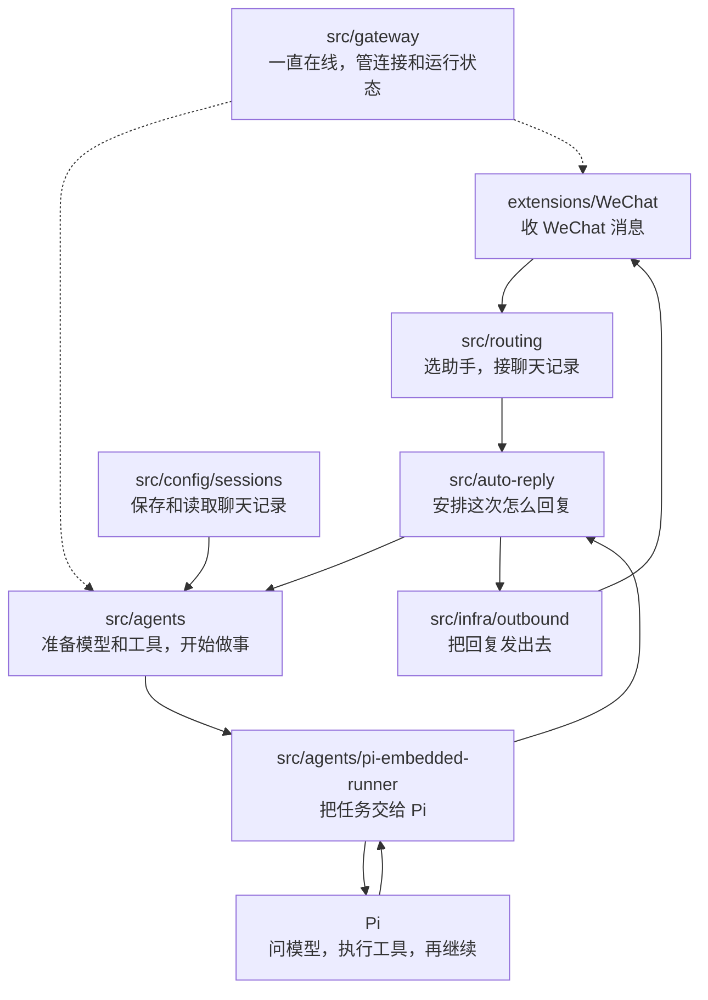

# 02 OpenClaw 源码目录与代码规模分析

> 这一讲就认目录：每个文件夹放什么，主要负责干啥，想看某个功能时先翻哪里。

## 1. 根目录：先认清这几块

打开 OpenClaw 源码，先看这些文件夹：

- **`src/`**：主程序。接消息、找助手、准备工具，再把任务跑起来。
- **`extensions/`**：插件。接 WeChat、Slack、模型服务，也能加记忆、浏览器等功能。
- **`packages/`**：给插件用的接口包。告诉插件能调用主程序的哪些功能、怎么调用。
- **`apps/`**：安卓、iPhone 和 Mac 上的应用。
- **`ui/`**：浏览器里看到的控制界面，聊天、改设置、看状态都在这里。
- **`scripts/`**：开发时用的脚本，比如编译、打包和做检查。
- **`test/`、`qa/`**：用来检查代码和整个功能跑得对不对。
- **`docs/`**：教你怎么安装、怎么用，以及怎么改代码。
- **`skills/`**：给助手看的做事方法，有些还带配套脚本。
- **其他目录**：放图标、第三方代码、补丁和开发工具设置，后面逐项看。

下面把原有统计列出来。最后一栏直接写这个目录干什么。

| 目录 | 非测试源码行 | 测试代码行 | 源码文件 | 测试文件 | Markdown | 主要工作 |
| --- | ---: | ---: | ---: | ---: | ---: | --- |
| `src/` | 707,406 | 715,415 | 3,844 | 3,028 | 24 | 主程序：接消息、找助手、准备工具，再把任务跑起来 |
| `extensions/` | 404,809 | 411,144 | 2,715 | 1,785 | 62 | 各种插件：接聊天软件、接模型，也能增加工具和记忆等功能 |
| `packages/` | 3,907 | 2,304 | 73 | 18 | 0 | 给插件用的接口包，告诉插件怎么和主程序配合 |
| `apps/` | 118,877 | 22,458 | 528 | 223 | 9 | 安卓、iPhone 和 Mac 上的应用，以及它们共用的代码 |
| `ui/` | 76,100 | 21,400 | 215 | 89 | 2 | 你在浏览器里看到的聊天页、设置页和状态页 |
| `Swabble/` | 1,470 | 105 | 25 | 2 | 3 | 一个独立的小项目：用语音唤醒，再把说话内容转成文字 |
| `scripts/` | 59,174 | 22,579 | 302 | 88 | 3 | 开发时用的脚本：编译、打包、检查、安装和部署 |
| `test/` | 0 | 33,542 | 0 | 364 | 4 | 把几部分连起来一起测，以及测试时共用的工具和假环境 |
| `test-fixtures/` | 0 | 0 | 0 | 1 | 0 | 测试时要读的样本文件 |
| `qa/` | 0 | 1,182 | 0 | 74 | 66 | 按实际用法检查程序，放测试计划和测试账号凭据服务 |
| `docs/` | 284 | 0 | 2 | 0 | 440 | 教你怎么安装、怎么用，以及代码怎么改 |
| `skills/` | 1,631 | 0 | 11 | 0 | 58 | 给助手看的做事方法，以及配套脚本 |
| `vendor/` | 13,081 | 1,376 | 113 | 2 | 9 | 一起带进来的 A2UI 外部代码和格式说明 |
| `assets/` | 0 | 0 | 0 | 0 | 0 | 项目图标，以及浏览器插件要用的文件 |
| `patches/` | 0 | 0 | 0 | 0 | 0 | 给第三方依赖打补丁 |
| `.agents/` | 1,350 | 0 | 2 | 0 | 13 | 告诉开发助手怎么检查、修复和维护这个项目 |
| `.pi/` | 549 | 0 | 5 | 0 | 2 | 开发这个项目时，给 Pi 加的小功能和提示词 |
| `.vscode/` | 0 | 0 | 0 | 0 | 0 | 建议 VS Code 使用的设置 |
| `.github/` | 0 | 0 | 0 | 0 | 2 | 提问题和提代码用的模板，以及自动检查和发布的设置 |
| `git-hooks/` | 0 | 0 | 0 | 0 | 0 | 在本地提交代码时自动做检查 |
| 根部文件 | 2,632 | 0 | 9 | 8 | 9 | 启动程序的文件、项目设置和说明文档 |
| **合计** | **1,391,270** | **1,231,505** | **7,844** | **5,682** | **706** | **14,976 个项目文件** |

这份统计加起来约有 **262.3 万行程序文件**：非测试源码约 **139.1 万行**，测试代码约 **123.2 万行**。

数字里也算了手机应用、开发脚本、生成代码和第三方代码，不能全当成 Agent 自己的核心代码。

**表里的数字怎么看？**

- **非测试源码**：真正提供功能的程序，也包括开发脚本等。
- **测试代码**：用来检查功能对不对的程序，也包含测试辅助和样本。
- **Markdown**：有多少篇 Markdown 文档。
- **行数**：这里保留了空行和注释。
- **共多少文件**：还算了配置、图片等文件，所以不只是源码文件加测试文件。

## 2. 发一条消息，会用到哪些目录

接着上一讲的例子：你从 WeChat 发消息，让助手读一下 `todo.md`。

1. **`extensions/WeChat/`**：先把 WeChat 消息接进来。
2. **`src/routing/`**：看该交给哪个助手、接哪段聊天记录。
3. **`src/auto-reply/`**：安排这次怎么处理、怎么回复。
4. **`src/agents/`**：准备模型、工具和工作目录，调用 Pi 开始做事。
5. **Pi**：调用模型，需要读文件时就执行工具，再把内容交回模型。
6. **`src/infra/outbound/` 和 WeChat 插件**：把整理好的待办发回 WeChat。



这张图用来找目录。真正读代码时，有些步骤还会调用其他文件，也可能来回多次。

### 2.1 `src/`：主程序里的文件夹，各负责什么

`src/` 有 **61 个直接子目录、6,899 个文件**。

下面一个文件夹一行。先记它干什么，需要看具体代码时再往里翻。

| 文件夹 | 主要负责干啥 |
| --- | --- |
| `src/acp/` | 通过 ACP 连接其他 Agent，给它们发任务、接结果 |
| `src/agents/` | 准备好模型、工具和工作目录，再用 Pi 把任务跑起来 |
| `src/auto-reply/` | 收到消息后安排助手处理，再整理这次要回什么 |
| `src/bindings/` | 记住平台上的哪个聊天，接着程序里的哪段会话 |
| `src/bootstrap/` | 程序启动前，先把运行条件准备好 |
| `src/canvas-host/` | 把 Canvas 页面和 A2UI 界面内容提供给客户端显示 |
| `src/channels/` | 多个聊天渠道共用的代码：谁能发消息、消息怎么整理和发送 |
| `src/chat/` | 处理聊天里的 Canvas 内容和工具消息 |
| `src/cli/` | 接住命令行输入，看你敲了什么，再交给对应代码 |
| `src/commands/` | 真正执行命令行里选中的操作 |
| `src/compat/` | 让以前的名称和接法还能继续用 |
| `src/config/` | 读设置、检查设置有没有问题，也管聊天记录的保存 |
| `src/context-engine/` | 决定用哪套办法整理本次要交给模型的材料 |
| `src/cron/` | 记住定时任务，到点执行，再处理结果怎么发 |
| `src/daemon/` | 把服务装到后台，负责启动、停止和查看状态 |
| `src/docs/` | 检查文档写的做法，和程序实际表现对不对得上 |
| `src/flows/` | 一步步带用户改设置、查问题和选模型 |
| `src/gateway/` | 一直在线的服务：管连接、查凭据、接请求、通知状态 |
| `src/hooks/` | 某件事发生后，顺便执行配置好的动作 |
| `src/i18n/` | 检查各种语言的资料有没有正确登记 |
| `src/image-generation/` | 把生成图片的请求交给相应插件 |
| `src/infra/` | 各处共用的代码：排任务、连网络、管设备、发消息 |
| `src/interactive/` | 处理按钮等可交互消息里共用的内容 |
| `src/link-understanding/` | 从链接里取出内容，供后面阅读和处理 |
| `src/logging/` | 把运行中发生的事记下来，方便查问题 |
| `src/markdown/` | 读懂 Markdown，把长内容拆开或转成需要的格式 |
| `src/mcp/` | 通过 MCP 接外部服务，让工具和消息渠道用得上它们 |
| `src/media/` | 处理图片、音频和附件，检查文件类型和大小 |
| `src/media-generation/` | 处理生成图片、音频等任务中共用的部分 |
| `src/media-understanding/` | 安排图片、音频等内容交给什么能力来理解 |
| `src/memory-host-sdk/` | 让记忆插件能调用主程序提供的功能 |
| `src/music-generation/` | 把生成音乐的请求交给对应实现 |
| `src/node-host/` | 在设备上接任务、执行工具，并检查能不能执行 |
| `src/pairing/` | 记住哪些设备或用户已经配对、允许接入 |
| `src/plugin-sdk/` | 告诉插件能调用主程序的哪些功能、参数怎么传 |
| `src/plugins/` | 找到插件，检查后加载进来，让它能在程序里工作 |
| `src/process/` | 启动子进程，看它跑得怎样，结束时收尾 |
| `src/proxy-capture/` | 记录经过代理的请求，再做相应处理 |
| `src/realtime-transcription/` | 把实时声音交给语音转文字服务 |
| `src/realtime-voice/` | 连接实时语音服务，让助手能进行语音对话 |
| `src/routing/` | 看账号和聊天对象，决定用哪个助手、接哪段聊天记录 |
| `src/scripts/` | 检查开发脚本跑出来的结果对不对 |
| `src/secrets/` | 找到设置里引用的密钥，交给需要登录或认证的地方 |
| `src/security/` | 检查谁能接入、哪些文件能访问、哪些操作能执行 |
| `src/sessions/` | 给会话定标识，处理消息怎么发，以及会话开始和结束等变化 |
| `src/shared/` | 多个地方都会用到的小函数，避免各写一遍 |
| `src/status/` | 收集和安排运行状态消息 |
| `src/tasks/` | 记下任务，跟踪进度，管理后台运行 |
| `src/terminal/` | 让命令行里的文字、表格和交互显示正常 |
| `src/test-helpers/` | 测试主程序时大家共用的小工具 |
| `src/test-utils/` | 帮测试准备环境、检查结果 |
| `src/trajectory/` | 记下 Agent 做过哪些步骤，并导出记录 |
| `src/tts/` | 安排把文字读成声音 |
| `src/tui/` | 在命令行里聊天时看到的界面和操作 |
| `src/types/` | 给第三方代码和共用接口补上类型说明 |
| `src/utils/` | 各处都能用的小函数 |
| `src/video-generation/` | 把生成视频的请求交给对应实现 |
| `src/web/` | 支持网页相关服务运行的共用代码 |
| `src/web-fetch/` | 把读取网页的请求交给相应服务 |
| `src/web-search/` | 把搜索请求交给相应搜索服务 |
| `src/wizard/` | 用一问一答的方式带用户完成设置 |

**几个容易找错的位置：**

- **`src/sessions/`**：管会话怎么标识、消息怎么发等规则。
- **`src/config/sessions/`**：管聊天记录怎么存、怎么更新、怎么读。
- **根目录的 `ui/`**：浏览器控制界面。
- **根目录的 `docs/`**：说明文档；`src/docs/` 主要是检查文档的测试。
- **根目录的 `scripts/`**：开发脚本；`src/scripts/` 主要是检查这些脚本的测试。

### 2.2 `extensions/`：接聊天软件，接模型，加功能

`extensions/` 有 **111 个直接子目录**。

有些是一个具体插件，有些是多个插件共用的代码或测试工具。

| 主要干啥 | 文件夹例子 | 直接这样理解 |
| --- | --- | --- |
| 收发聊天消息 | `WeChat/`、`slack/`、`discord/`、`feishu/` | 对接各个聊天软件，收消息、发消息 |
| 调用模型 | `openai/`、`anthropic/`、`google/`、`ollama/` | 对接不同模型服务，处理账号和各家的特殊要求 |
| 用工具做事 | `browser/`、`llm-task/`、`lobster/` | 操作浏览器，让模型按格式返回结果，或者按步骤跑任务 |
| 记住长期资料 | `memory-core/`、`memory-lancedb/`、`memory-wiki/`、`active-memory/` | 把值得记的内容存起来，需要时再查 |
| 处理声音和图片 | `speech-core/`、`image-generation-core/`、`voice-call/` | 语音、生成图片、打电话等功能 |
| 检查完整流程 | `qa-channel/`、`qa-lab/`、`qa-matrix/` | 用假服务或真实平台，检查整件事能不能跑通 |

这些名字都在 `extensions/` 下面。

继续往插件里面看，也可以按“做什么”来找：

- **`slack/src/monitor/`**：收到 Slack 消息或事件以后，在这里接着处理。
- **`matrix/src/matrix/`**：和 Matrix 通信，再分到连接、监听和发送等代码。
- **插件里的 `src/`**：通常放这个插件真正干活的代码。
- **插件里的测试目录或 `.test.ts` 文件**：检查这个插件的表现对不对。

## 3. 代码这么多，先看哪里

**先挑一个你想弄明白的问题，再找对应目录。**

比如，想知道“todo.md 是谁读的”，就从 Agent 的工具准备和读取工具看起。

想知道“回答生成了，为什么 WeChat 没收到”，就看发送代码和 WeChat 插件。

**看到一个大目录，先分清里面有多少是测试。**

例如，`src/routing/resolve-route.ts` 有 **814 行**，旁边的 `resolve-route.test.ts` 有 **1,145 行**。

前一个写“怎么选助手”，后一个拿不同情况检查“选得对不对”。测试多，也会让目录显得很大。

读不懂某条规则时，可以看看测试传了什么、最后应该得到什么。

**文件长短，也不能直接说明它重不重要。**

- `src/agents/pi-embedded-runner.ts` 只有 **49 行**，但可以顺着它找到 Pi 的实际运行代码。
- `src/config/schema.base.generated.ts` 有 **27,733 行**，主要是生成出来的内容。刚开始读配置功能，不必从这里一行行看起。

### 3.1 想看 OpenClaw 怎么使用 Pi，先看这几处

| 目录 | 非测试源码行 | 测试代码行 | 源码文件 | 测试文件 | Markdown | 主要工作 |
| --- | ---: | ---: | ---: | ---: | ---: | --- |
| `src/agents/pi-embedded-runner/` | 24,038 | 24,225 | 103 | 96 | 2 | 准备并运行 Pi 任务，处理重试、上下文压缩和运行状态 |
| `src/agents/pi-embedded-helpers/` | 3,393 | 430 | 12 | 4 | 0 | 帮 OpenClaw 使用 Pi：处理报错，整理历史和消息格式 |
| `src/agents/pi-hooks/` | 2,188 | 3,073 | 11 | 4 | 0 | 给 Pi 加上整理模型输入、压缩聊天记录时要做的动作 |
| `src/agents/tools/` | 15,400 | 13,311 | 65 | 53 | 2 | 告诉助手有哪些工具，并放实际执行这些工具的代码 |
| `src/agents/sandbox/` | 6,585 | 4,924 | 40 | 31 | 0 | 准备隔离环境，安排工具能看到哪些目录、怎么在容器里运行 |

上面这些目录都在 OpenClaw 里，主要管“怎么准备、怎么交给 Pi、怎么接结果”。

Pi 自己的代码在旁边的 Pi 项目里：

- **`packages/ai/`**：怎么调用模型。
- **`packages/agent/`**：怎么把模型和工具接起来，一步步做事。
- **`packages/coding-agent/`**：会话、编码工具和使用入口等。

比如，要看“第二条消息怎么接着上次聊”，先找路由和聊天记录，再看运行前怎么准备会话。

## 4. 其他文件夹：放什么，干什么

下面按文件夹展开，右边一句话写它主要干什么。

数字会把子目录一起算进去，父目录和子目录的数字不要再相加。

源码是 0 也不代表没用，图片、配置和文档一样是项目的一部分。

### 4.1 `packages/`

给插件用的接口包。插件想调用主程序的功能，就按这里的接法来。

```text
packages/  [源码 3,907行/73文件；测试 2,304行/18文件；Markdown 0；共95文件]  给插件用的接口包，告诉插件怎么和主程序配合
├── memory-host-sdk/  [源码 3,778行/51文件；测试 2,219行/17文件；Markdown 0；共69文件]  给记忆插件用，让它能调用主程序的功能
│   └── src/  [源码 3,778行/51文件；测试 2,219行/17文件；Markdown 0；共68文件]  memory-host-sdk 包里的代码，以及给其他地方调用的入口
│       └── host/  [源码 3,765行/38文件；测试 2,219行/17文件；Markdown 0；共55文件]  把主程序的功能接给记忆插件用
│           └── test-helpers/  [源码 0行/0文件；测试 15行/1文件；Markdown 0；共1文件]  帮这部分代码做测试的小工具
├── plugin-package-contract/  [源码 91行/1文件；测试 85行/1文件；Markdown 0；共3文件]  规定插件包怎么命名、怎么摆文件、提供哪些调用入口
│   └── src/  [源码 91行/1文件；测试 85行/1文件；Markdown 0；共2文件]  plugin-package-contract 包里的代码，以及给其他地方调用的入口
└── plugin-sdk/  [源码 38行/21文件；测试 0行/0文件；Markdown 0；共23文件]  单独打包的插件接口，方便插件引用
    └── src/  [源码 38行/21文件；测试 0行/0文件；Markdown 0；共21文件]  plugin-sdk 包里的代码，以及给其他地方调用的入口
```

### 4.2 `apps/`

手机和 Mac 上的应用。想看手机界面、设备功能或者客户端怎么连接 Gateway，就看这里。

```text
apps/  [源码 118,877行/528文件；测试 22,458行/223文件；Markdown 9；共883文件]  安卓、iPhone 和 Mac 上的应用，以及它们共用的代码
├── android/  [源码 24,784行/96文件；测试 7,387行/53文件；Markdown 2；共187文件]  安卓手机上的应用：聊天界面和手机上的可用功能
│   ├── app/  [源码 23,798行/89文件；测试 7,266行/51文件；Markdown 0；共169文件]  安卓应用的主要代码
│   │   └── src/  [源码 23,508行/88文件；测试 7,266行/51文件；Markdown 0；共167文件]  真正干活的代码
│   │       ├── main/  [源码 23,508行/88文件；测试 0行/0文件；Markdown 0；共115文件]  安卓应用运行时用的代码和资源
│   │       │   ├── java/  [源码 23,508行/88文件；测试 0行/0文件；Markdown 0；共88文件]  按 Android 包名摆放代码
│   │       │   │   └── ai/  [源码 23,508行/88文件；测试 0行/0文件；Markdown 0；共88文件]  包名中的 ai 这一层目录
│   │       │   │       └── openclaw/  [源码 23,508行/88文件；测试 0行/0文件；Markdown 0；共88文件]  包名中的 openclaw 这一层目录
│   │       │   │           └── app/  [源码 23,508行/88文件；测试 0行/0文件；Markdown 0；共88文件]  安卓应用自己的代码
│   │       │   │               ├── chat/  [源码 685行/2文件；测试 0行/0文件；Markdown 0；共2文件]  聊天功能
│   │       │   │               ├── gateway/  [源码 2,291行/11文件；测试 0行/0文件；Markdown 0；共11文件]  Gateway 连接与处理
│   │       │   │               ├── node/  [源码 6,649行/25文件；测试 0行/0文件；Markdown 0；共25文件]  设备节点能力
│   │       │   │               ├── protocol/  [源码 219行/2文件；测试 0行/0文件；Markdown 0；共2文件]  通信协议
│   │       │   │               ├── tools/  [源码 222行/1文件；测试 0行/0文件；Markdown 0；共1文件]  助手能调用的工具
│   │       │   │               ├── ui/  [源码 7,695行/23文件；测试 0行/0文件；Markdown 0；共23文件]  交互界面
│   │       │   │               │   └── chat/  [源码 1,905行/8文件；测试 0行/0文件；Markdown 0；共8文件]  聊天功能
│   │       │   │               └── voice/  [源码 2,671行/9文件；测试 0行/0文件；Markdown 0；共9文件]  语音交互
│   │       │   └── res/  [源码 0行/0文件；测试 0行/0文件；Markdown 0；共26文件]  Android 资源
│   │       │       ├── font/  [源码 0行/0文件；测试 0行/0文件；Markdown 0；共4文件]  字体资源
│   │       │       ├── mipmap-anydpi/  [源码 0行/0文件；测试 0行/0文件；Markdown 0；共2文件]  给不同屏幕清晰度准备的图标
│   │       │       ├── mipmap-hdpi/  [源码 0行/0文件；测试 0行/0文件；Markdown 0；共2文件]  给不同屏幕清晰度准备的图标
│   │       │       ├── mipmap-mdpi/  [源码 0行/0文件；测试 0行/0文件；Markdown 0；共2文件]  给不同屏幕清晰度准备的图标
│   │       │       ├── mipmap-xhdpi/  [源码 0行/0文件；测试 0行/0文件；Markdown 0；共2文件]  给不同屏幕清晰度准备的图标
│   │       │       ├── mipmap-xxhdpi/  [源码 0行/0文件；测试 0行/0文件；Markdown 0；共2文件]  给不同屏幕清晰度准备的图标
│   │       │       ├── mipmap-xxxhdpi/  [源码 0行/0文件；测试 0行/0文件；Markdown 0；共2文件]  给不同屏幕清晰度准备的图标
│   │       │       ├── values/  [源码 0行/0文件；测试 0行/0文件；Markdown 0；共4文件]  界面上显示的文字、颜色和样式设置
│   │       │       ├── values-night/  [源码 0行/0文件；测试 0行/0文件；Markdown 0；共1文件]  切换到深色模式时使用的颜色和样式
│   │       │       └── xml/  [源码 0行/0文件；测试 0行/0文件；Markdown 0；共5文件]  用 XML 写的安卓资源设置
│   │       ├── play/  [源码 0行/0文件；测试 0行/0文件；Markdown 0；共1文件]  Android 应用分发渠道的专用配置
│   │       └── test/  [源码 0行/0文件；测试 7,266行/51文件；Markdown 0；共51文件]  检查这部分代码能不能按预期工作
│   │           └── java/  [源码 0行/0文件；测试 7,266行/51文件；Markdown 0；共51文件]  Android 代码包层级，用来测这部分代码
│   │               └── ai/  [源码 0行/0文件；测试 7,266行/51文件；Markdown 0；共51文件]  Android 包命名层级，用来测这部分代码
│   │                   └── openclaw/  [源码 0行/0文件；测试 7,266行/51文件；Markdown 0；共51文件]  OpenClaw 应用包层级，用来测这部分代码
│   │                       └── app/  [源码 0行/0文件；测试 7,266行/51文件；Markdown 0；共51文件]  Android 应用包，用来测这部分代码
│   │                           ├── chat/  [源码 0行/0文件；测试 113行/2文件；Markdown 0；共2文件]  聊天功能，用来测这部分代码
│   │                           ├── gateway/  [源码 0行/0文件；测试 870行/6文件；Markdown 0；共6文件]  Gateway 连接与处理，用来测这部分代码
│   │                           ├── node/  [源码 0行/0文件；测试 4,119行/19文件；Markdown 0；共19文件]  设备节点能力，用来测这部分代码
│   │                           ├── protocol/  [源码 0行/0文件；测试 163行/2文件；Markdown 0；共2文件]  通信协议，用来测这部分代码
│   │                           ├── ui/  [源码 0行/0文件；测试 787行/8文件；Markdown 0；共8文件]  交互界面，用来测这部分代码
│   │                           │   └── chat/  [源码 0行/0文件；测试 169行/4文件；Markdown 0；共4文件]  聊天功能，用来测这部分代码
│   │                           └── voice/  [源码 0行/0文件；测试 414行/6文件；Markdown 0；共6文件]  语音交互，用来测这部分代码
│   ├── benchmark/  [源码 0行/0文件；测试 121行/2文件；Markdown 0；共2文件]  性能测试
│   │   └── src/  [源码 0行/0文件；测试 76行/1文件；Markdown 0；共1文件]  真正干活的代码
│   │       └── main/  [源码 0行/0文件；测试 76行/1文件；Markdown 0；共1文件]  性能测试应用的主入口与配置
│   │           └── java/  [源码 0行/0文件；测试 76行/1文件；Markdown 0；共1文件]  按 Android 包名摆放代码
│   │               └── ai/  [源码 0行/0文件；测试 76行/1文件；Markdown 0；共1文件]  包名中的 ai 这一层目录
│   │                   └── openclaw/  [源码 0行/0文件；测试 76行/1文件；Markdown 0；共1文件]  包名中的 openclaw 这一层目录
│   │                       └── app/  [源码 0行/0文件；测试 76行/1文件；Markdown 0；共1文件]  安卓应用自己的代码
│   │                           └── benchmark/  [源码 0行/0文件；测试 76行/1文件；Markdown 0；共1文件]  性能测试
│   ├── gradle/  [源码 0行/0文件；测试 0行/0文件；Markdown 0；共3文件]  Android 构建工具配套配置
│   │   └── wrapper/  [源码 0行/0文件；测试 0行/0文件；Markdown 0；共2文件]  Android 构建工具启动所需的配套文件
│   ├── scripts/  [源码 867行/4文件；测试 0行/0文件；Markdown 0；共4文件]  开发这部分功能时用的脚本
│   └── THIRD_PARTY_LICENSES/  [源码 0行/0文件；测试 0行/0文件；Markdown 0；共1文件]  Android 使用的外部组件许可
├── ios/  [源码 22,038行/85文件；测试 2,778行/32文件；Markdown 5；共199文件]  iPhone 和手表上的应用，以及分享菜单和桌面小组件
│   ├── ActivityWidget/  [源码 94行/2文件；测试 0行/0文件；Markdown 0；共4文件]  iOS 活动状态小组件
│   │   └── Assets.xcassets/  [源码 0行/0文件；测试 0行/0文件；Markdown 0；共1文件]  苹果应用要用的图片和图标
│   ├── Config/  [源码 0行/0文件；测试 0行/0文件；Markdown 0；共2文件]  配置处理
│   ├── fastlane/  [源码 0行/0文件；测试 0行/0文件；Markdown 2；共19文件]  iOS 发布自动化与商店资料
│   │   └── metadata/  [源码 0行/0文件；测试 0行/0文件；Markdown 1；共15文件]  应用分发资料
│   │       ├── en-US/  [源码 0行/0文件；测试 0行/0文件；Markdown 0；共9文件]  英语商店介绍
│   │       └── review_information/  [源码 0行/0文件；测试 0行/0文件；Markdown 0；共5文件]  应用审核资料
│   ├── screenshots/  [源码 0行/0文件；测试 0行/0文件；Markdown 0；共4文件]  iOS 界面截图
│   │   └── session-2026-03-07/  [源码 0行/0文件；测试 0行/0文件；Markdown 0；共4文件]  一次界面展示使用的截图集合
│   ├── ShareExtension/  [源码 550行/1文件；测试 0行/0文件；Markdown 0；共2文件]  iOS 系统分享面板中的接入功能
│   ├── Sources/  [源码 19,914行/78文件；测试 0行/0文件；Markdown 0；共105文件]  真正干活的代码
│   │   ├── Assets.xcassets/  [源码 0行/0文件；测试 0行/0文件；Markdown 0；共25文件]  苹果应用要用的图片和图标
│   │   │   └── AppIcon.appiconset/  [源码 0行/0文件；测试 0行/0文件；Markdown 0；共25文件]  应用图标及尺寸配置
│   │   ├── Calendar/  [源码 135行/1文件；测试 0行/0文件；Markdown 0；共1文件]  日历能力
│   │   ├── Camera/  [源码 353行/1文件；测试 0行/0文件；Markdown 0；共1文件]  相机能力
│   │   ├── Capabilities/  [源码 25行/1文件；测试 0行/0文件；Markdown 0；共1文件]  告诉程序这台设备能做什么
│   │   ├── Chat/  [源码 203行/2文件；测试 0行/0文件；Markdown 0；共2文件]  聊天功能
│   │   ├── Contacts/  [源码 210行/1文件；测试 0行/0文件；Markdown 0；共1文件]  联系人能力
│   │   ├── Device/  [源码 275行/4文件；测试 0行/0文件；Markdown 0；共4文件]  设备信息
│   │   ├── EventKit/  [源码 34行/1文件；测试 0行/0文件；Markdown 0；共1文件]  系统日历与提醒事项接口
│   │   ├── Gateway/  [源码 2,906行/16文件；测试 0行/0文件；Markdown 0；共16文件]  Gateway 连接与处理
│   │   ├── LiveActivity/  [源码 170行/2文件；测试 0行/0文件；Markdown 0；共2文件]  实时活动展示
│   │   ├── Location/  [源码 220行/2文件；测试 0行/0文件；Markdown 0；共2文件]  位置能力
│   │   ├── Media/  [源码 164行/1文件；测试 0行/0文件；Markdown 0；共1文件]  媒体文件处理
│   │   ├── Model/  [源码 4,575行/4文件；测试 0行/0文件；Markdown 0；共4文件]  应用状态模型
│   │   ├── Motion/  [源码 100行/1文件；测试 0行/0文件；Markdown 0；共1文件]  运动传感器能力
│   │   ├── Onboarding/  [源码 1,601行/4文件；测试 0行/0文件；Markdown 0；共4文件]  初次连接与设置
│   │   ├── Push/  [源码 822行/5文件；测试 0行/0文件；Markdown 0；共5文件]  推送通知
│   │   ├── Reminders/  [源码 133行/1文件；测试 0行/0文件；Markdown 0；共1文件]  提醒事项能力
│   │   ├── Screen/  [源码 879行/4文件；测试 0行/0文件；Markdown 0；共4文件]  屏幕能力
│   │   ├── Services/  [源码 969行/5文件；测试 0行/0文件；Markdown 0；共5文件]  应用服务
│   │   ├── Settings/  [源码 1,230行/3文件；测试 0行/0文件；Markdown 0；共3文件]  设置页面
│   │   ├── Status/  [源码 348行/6文件；测试 0行/0文件；Markdown 0；共6文件]  状态展示
│   │   └── Voice/  [源码 2,929行/7文件；测试 0行/0文件；Markdown 0；共7文件]  语音交互
│   ├── Tests/  [源码 0行/0文件；测试 2,778行/32文件；Markdown 0；共32文件]  检查这部分代码能不能按预期工作
│   │   └── Logic/  [源码 0行/0文件；测试 75行/1文件；Markdown 0；共1文件]  客户端逻辑测试，用来测这部分代码
│   ├── WatchApp/  [源码 0行/0文件；测试 0行/0文件；Markdown 0；共17文件]  Apple Watch 应用资源
│   │   └── Assets.xcassets/  [源码 0行/0文件；测试 0行/0文件；Markdown 0；共16文件]  苹果应用要用的图片和图标
│   │       └── AppIcon.appiconset/  [源码 0行/0文件；测试 0行/0文件；Markdown 0；共15文件]  应用图标及尺寸配置
│   └── WatchExtension/  [源码 1,480行/4文件；测试 0行/0文件；Markdown 0；共5文件]  Apple Watch 应用功能
│       └── Sources/  [源码 1,480行/4文件；测试 0行/0文件；Markdown 0；共4文件]  真正干活的代码
├── macos/  [源码 53,970行/250文件；测试 8,737行/112文件；Markdown 2；共372文件]  Mac 菜单栏里的应用，负责连接 Gateway 和使用电脑上的功能
│   ├── Icon.icon/  [源码 0行/0文件；测试 0行/0文件；Markdown 0；共2文件]  macOS 应用图标工程
│   │   └── Assets/  [源码 0行/0文件；测试 0行/0文件；Markdown 0；共1文件]  直接使用的图片、字体等文件
│   ├── Sources/  [源码 53,878行/249文件；测试 0行/0文件；Markdown 1；共255文件]  真正干活的代码
│   │   ├── OpenClaw/  [源码 46,391行/235文件；测试 0行/0文件；Markdown 1；共241文件]  macOS 主应用实现
│   │   │   ├── Logging/  [源码 215行/1文件；测试 0行/0文件；Markdown 0；共1文件]  日志处理
│   │   │   ├── NodeMode/  [源码 1,705行/6文件；测试 0行/0文件；Markdown 0；共6文件]  设备节点模式
│   │   │   └── Resources/  [源码 0行/0文件；测试 0行/0文件；Markdown 1；共6文件]  运行资源
│   │   │       └── DeviceModels/  [源码 0行/0文件；测试 0行/0文件；Markdown 1；共4文件]  设备型号数据
│   │   ├── OpenClawDiscovery/  [源码 1,444行/4文件；测试 0行/0文件；Markdown 0；共4文件]  局域网中的 Gateway 发现
│   │   ├── OpenClawIPC/  [源码 416行/1文件；测试 0行/0文件；Markdown 0；共1文件]  macOS 进程间通信
│   │   ├── OpenClawMacCLI/  [源码 1,119行/8文件；测试 0行/0文件；Markdown 0；共8文件]  macOS 配套终端入口
│   │   └── OpenClawProtocol/  [源码 4,508行/1文件；测试 0行/0文件；Markdown 0；共1文件]  macOS 使用的 Gateway 协议类型
│   └── Tests/  [源码 0行/0文件；测试 8,737行/112文件；Markdown 0；共112文件]  检查这部分代码能不能按预期工作
│       └── OpenClawIPCTests/  [源码 0行/0文件；测试 8,737行/112文件；Markdown 0；共112文件]  测试这部分代码的例子，以及应该得到的结果
├── macos-mlx-tts/  [源码 209行/2文件；测试 0行/0文件；Markdown 0；共3文件]  macOS 上基于 MLX 的本地语音合成辅助程序
│   └── Sources/  [源码 182行/1文件；测试 0行/0文件；Markdown 0；共1文件]  真正干活的代码
│       └── OpenClawMLXTTSHelper/  [源码 182行/1文件；测试 0行/0文件；Markdown 0；共1文件]  MLX 语音合成程序
└── shared/  [源码 17,876行/95文件；测试 3,556行/26文件；Markdown 0；共122文件]  iPhone 和 Mac 共用的消息格式、聊天界面和小组件
    └── OpenClawKit/  [源码 17,876行/95文件；测试 3,556行/26文件；Markdown 0；共122文件]  iPhone 和 Mac 应用共用的代码包
        ├── Sources/  [源码 17,197行/92文件；测试 0行/0文件；Markdown 0；共93文件]  真正干活的代码
        │   ├── OpenClawChatUI/  [源码 4,557行/14文件；测试 0行/0文件；Markdown 0；共14文件]  Apple 平台共享聊天界面
        │   ├── OpenClawKit/  [源码 7,922行/75文件；测试 0行/0文件；Markdown 0；共76文件]  Apple 平台共享设备与服务能力
        │   │   └── Resources/  [源码 691行/1文件；测试 0行/0文件；Markdown 0；共2文件]  运行资源
        │   │       └── CanvasScaffold/  [源码 691行/1文件；测试 0行/0文件；Markdown 0；共1文件]  Canvas 页面框架资源
        │   └── OpenClawProtocol/  [源码 4,718行/3文件；测试 0行/0文件；Markdown 0；共3文件]  Apple 平台共享协议类型
        ├── Tests/  [源码 0行/0文件；测试 3,556行/26文件；Markdown 0；共26文件]  检查这部分代码能不能按预期工作
        │   └── OpenClawKitTests/  [源码 0行/0文件；测试 3,556行/26文件；Markdown 0；共26文件]  测试这部分代码的例子，以及应该得到的结果
        └── Tools/  [源码 618行/2文件；测试 0行/0文件；Markdown 0；共2文件]  助手能调用的工具
            └── CanvasA2UI/  [源码 618行/2文件；测试 0行/0文件；Markdown 0；共2文件]  准备 Canvas 与 A2UI 内容的辅助工具
```

### 4.3 `ui/`

浏览器里的控制界面。聊天页、设置页、状态页和页面样式都在这里。

```text
ui/  [源码 76,100行/215文件；测试 21,400行/89文件；Markdown 2；共350文件]  你在浏览器里看到的聊天页、设置页和状态页
├── public/  [源码 0行/0文件；测试 0行/0文件；Markdown 0；共4文件]  浏览器直接使用的静态资源
└── src/  [源码 75,903行/211文件；测试 21,400行/89文件；Markdown 0；共339文件]  浏览器控制界面真正干活的代码
    ├── i18n/  [源码 12,858行/19文件；测试 141行/1文件；Markdown 0；共59文件]  界面的语言切换、翻译文本与加载
    │   ├── .i18n/  [源码 0行/0文件；测试 0行/0文件；Markdown 0；共39文件]  界面翻译的辅助资料
    │   ├── lib/  [源码 336行/4文件；测试 0行/0文件；Markdown 0；共4文件]  多语言加载与查找实现
    │   ├── locales/  [源码 12,519行/14文件；测试 0行/0文件；Markdown 0；共14文件]  英语原文与其他语言生成文本
    │   └── test/  [源码 0行/0文件；测试 141行/1文件；Markdown 0；共1文件]  检查这部分代码能不能按预期工作
    ├── styles/  [源码 16,010行/15文件；测试 49行/3文件；Markdown 0；共18文件]  控制界面样式
    │   └── chat/  [源码 2,931行/5文件；测试 0行/0文件；Markdown 0；共5文件]  聊天界面样式
    ├── test-helpers/  [源码 0行/0文件；测试 38行/3文件；Markdown 0；共3文件]  帮这部分代码做测试的小工具
    ├── types/  [源码 7行/1文件；测试 0行/0文件；Markdown 0；共1文件]  浏览器侧共享类型
    └── ui/  [源码 46,961行/171文件；测试 21,172行/82文件；Markdown 0；共253文件]  浏览器控制界面的各个页面、按钮和操作
        ├── __screenshots__/  [源码 0行/0文件；测试 0行/4文件；Markdown 0；共4文件]  浏览器界面测试的参考截图
        │   ├── config-form.browser.test.ts/  [源码 0行/0文件；测试 0行/3文件；Markdown 0；共3文件]  测试这部分代码的例子，以及应该得到的结果
        │   └── navigation.browser.test.ts/  [源码 0行/0文件；测试 0行/1文件；Markdown 0；共1文件]  测试这部分代码的例子，以及应该得到的结果
        ├── chat/  [源码 6,035行/26文件；测试 4,669行/14文件；Markdown 0；共40文件]  聊天内容的解析、呈现与交互
        ├── components/  [源码 153行/2文件；测试 0行/0文件；Markdown 0；共2文件]  多个网页页面共用的界面小组件
        ├── controllers/  [源码 5,480行/28文件；测试 5,632行/13文件；Markdown 0；共41文件]  把页面上的点击变成发给 Gateway 的请求
        │   └── config/  [源码 265行/2文件；测试 493行/1文件；Markdown 0；共3文件]  把设置显示到表单里，再保存用户的修改
        ├── test-helpers/  [源码 0行/0文件；测试 106行/1文件；Markdown 0；共1文件]  帮这部分代码做测试的小工具
        ├── types/  [源码 84行/1文件；测试 0行/0文件；Markdown 0；共1文件]  写清页面和运行状态的数据长什么样
        └── views/  [源码 22,086行/61文件；测试 3,551行/17文件；Markdown 0；共78文件]  聊天、配置和管理等页面
```

### 4.4 `Swabble/`

一个独立的语音小项目。主要做语音唤醒，以及把声音转成文字。

```text
Swabble/  [源码 1,470行/25文件；测试 105行/2文件；Markdown 3；共36文件]  一个独立的小项目：用语音唤醒，再把说话内容转成文字
├── .github/  [源码 0行/0文件；测试 0行/0文件；Markdown 0；共1文件]  自动检查配置
│   └── workflows/  [源码 0行/0文件；测试 0行/0文件；Markdown 0；共1文件]  自动化流程
├── docs/  [源码 0行/0文件；测试 0行/0文件；Markdown 1；共1文件]  独立语音项目的设计与使用说明
├── scripts/  [源码 14行/2文件；测试 0行/0文件；Markdown 0；共2文件]  开发这部分功能时用的脚本
├── Sources/  [源码 1,401行/22文件；测试 0行/0文件；Markdown 0；共22文件]  真正干活的代码
│   ├── swabble/  [源码 701行/13文件；测试 0行/0文件；Markdown 0；共13文件]  语音程序的终端入口与操作实现
│   │   ├── CLI/  [源码 71行/1文件；测试 0行/0文件；Markdown 0；共1文件]  命令行从这里开始处理
│   │   └── Commands/  [源码 479行/11文件；测试 0行/0文件；Markdown 0；共11文件]  操作流程
│   ├── SwabbleCore/  [源码 509行/8文件；测试 0行/0文件；Markdown 0；共8文件]  语音唤醒、语音识别、设置和事件处理
│   │   ├── Config/  [源码 77行/1文件；测试 0行/0文件；Markdown 0；共1文件]  配置处理
│   │   ├── Hooks/  [源码 75行/1文件；测试 0行/0文件；Markdown 0；共1文件]  事件触发处理
│   │   ├── Speech/  [源码 164行/2文件；测试 0行/0文件；Markdown 0；共2文件]  语音识别与处理
│   │   └── Support/  [源码 193行/4文件；测试 0行/0文件；Markdown 0；共4文件]  通用辅助
│   └── SwabbleKit/  [源码 191行/1文件；测试 0行/0文件；Markdown 0；共1文件]  供外部调用的 Swift 接口
└── Tests/  [源码 0行/0文件；测试 105行/2文件；Markdown 0；共2文件]  检查这部分代码能不能按预期工作
    ├── SwabbleKitTests/  [源码 0行/0文件；测试 82行/1文件；Markdown 0；共1文件]  测试这部分代码的例子，以及应该得到的结果
    └── swabbleTests/  [源码 0行/0文件；测试 23行/1文件；Markdown 0；共1文件]  测试这部分代码的例子，以及应该得到的结果
```

### 4.5 `scripts/`

开发时用的脚本。比如准备环境、编译、打包、做检查和部署。

```text
scripts/  [源码 59,174行/302文件；测试 22,579行/88文件；Markdown 3；共421文件]  开发时用的脚本：编译、打包、检查、安装和部署
├── clawdock/  [源码 512行/1文件；测试 0行/0文件；Markdown 1；共2文件]  容器部署辅助
├── dev/  [源码 1,345行/5文件；测试 67行/1文件；Markdown 0；共6文件]  开发辅助
├── docker/  [源码 1,828行/7文件；测试 0行/0文件；Markdown 0；共11文件]  容器构建与运行辅助
│   ├── cleanup-smoke/  [源码 44行/1文件；测试 0行/0文件；Markdown 0；共2文件]  清理功能验证
│   ├── install-sh-common/  [源码 78行/2文件；测试 0行/0文件；Markdown 0；共2文件]  安装流程测试共用逻辑
│   ├── install-sh-e2e/  [源码 658行/1文件；测试 0行/0文件；Markdown 0；共2文件]  从安装开始，把整套流程跑一遍检查
│   ├── install-sh-nonroot/  [源码 49行/1文件；测试 0行/0文件；Markdown 0；共2文件]  普通用户安装验证
│   └── install-sh-smoke/  [源码 345行/1文件；测试 0行/0文件；Markdown 0；共2文件]  先检查最基本的安装步骤能不能跑通
├── docs-i18n/  [源码 3,784行/19文件；测试 2,217行/25文件；Markdown 0；共46文件]  文档翻译辅助程序
│   └── testdata/  [源码 0行/0文件；测试 0行/17文件；Markdown 0；共17文件]  测试输入与预期样本
│       └── behavior/  [源码 0行/0文件；测试 0行/17文件；Markdown 0；共17文件]  行为样本
│           ├── fenced-singleton-retry/  [源码 0行/0文件；测试 0行/3文件；Markdown 0；共3文件]  带围栏文本的单项重试样本
│           ├── frontmatter-fallback/  [源码 0行/0文件；测试 0行/4文件；Markdown 0；共4文件]  文档头部描述信息回退样本
│           ├── protocol-leak-split/  [源码 0行/0文件；测试 0行/6文件；Markdown 0；共6文件]  协议文本泄漏分割样本
│           └── uppercase-wrapper-strip/  [源码 0行/0文件；测试 0行/4文件；Markdown 0；共4文件]  移除大写包装文本的样本
├── e2e/  [源码 0行/0文件；测试 13,852行/30文件；Markdown 0；共30文件]  把整件事从头到尾跑一遍，检查有没有问题
│   └── lib/  [源码 0行/0文件；测试 299行/2文件；Markdown 0；共2文件]  多个地方共用的代码
├── k8s/  [源码 440行/2文件；测试 0行/0文件；Markdown 0；共7文件]  容器集群部署辅助
│   └── manifests/  [源码 0行/0文件；测试 0行/0文件；Markdown 0；共5文件]  部署描述文件
├── lib/  [源码 6,562行/59文件；测试 486行/1文件；Markdown 0；共64文件]  几个开发脚本一起用的小工具
│   └── ts-topology/  [源码 1,005行/5文件；测试 0行/0文件；Markdown 0；共5文件]  TypeScript 项目结构与依赖关系检查
├── podman/  [源码 458行/1文件；测试 0行/0文件；Markdown 0；共2文件]  容器运行辅助
├── pr-lib/  [源码 2,488行/8文件；测试 0行/0文件；Markdown 0；共8文件]  协作维护工具的共用实现
├── pre-commit/  [源码 814行/3文件；测试 0行/0文件；Markdown 0；共3文件]  开发流程检查辅助
├── repro/  [源码 3行/1文件；测试 0行/0文件；Markdown 0；共1文件]  问题复现辅助
├── systemd/  [源码 0行/0文件；测试 0行/0文件；Markdown 0；共2文件]  系统后台服务配置
└── test-planner/  [源码 74行/1文件；测试 0行/0文件；Markdown 0；共1文件]  测试任务规划
```

### 4.6 `test/`

把几个模块连起来检查，也放测试共用的小工具和假环境。

```text
test/  [源码 0行/0文件；测试 33,542行/364文件；Markdown 4；共366文件]  把几部分连起来一起测，以及测试时共用的工具和假环境
├── fixtures/  [源码 0行/0文件；测试 73行/27文件；Markdown 0；共27文件]  拿这些样本来测这部分代码
│   ├── child-process-bridge/  [源码 0行/0文件；测试 11行/1文件；Markdown 0；共1文件]  子进程桥接测试样本，用来测这部分代码
│   ├── hooks-install/  [源码 0行/0文件；测试 0行/7文件；Markdown 0；共7文件]  hook 安装测试样本，用来测这部分代码
│   ├── plugins-install/  [源码 0行/0文件；测试 0行/3文件；Markdown 0；共3文件]  插件安装测试样本，用来测这部分代码
│   └── ts-topology/  [源码 0行/0文件；测试 62行/8文件；Markdown 0；共8文件]  TypeScript 项目依赖结构检查，用来测这部分代码
│       └── basic/  [源码 0行/0文件；测试 62行/8文件；Markdown 0；共8文件]  基础结构测试样本，用来测这部分代码
│           ├── extensions/  [源码 0行/0文件；测试 19行/2文件；Markdown 0；共2文件]  测试样本的 extensions 子模块
│           │   ├── alpha/  [源码 0行/0文件；测试 13行/1文件；Markdown 0；共1文件]  样本插件 alpha，用来测这部分代码
│           │   │   └── src/  [源码 0行/0文件；测试 13行/1文件；Markdown 0；共1文件]  检查这部分功能的测试代码
│           │   └── beta/  [源码 0行/0文件；测试 6行/1文件；Markdown 0；共1文件]  样本插件 beta，用来测这部分代码
│           │       └── src/  [源码 0行/0文件；测试 6行/1文件；Markdown 0；共1文件]  检查这部分功能的测试代码
│           ├── src/  [源码 0行/0文件；测试 38行/4文件；Markdown 0；共4文件]  检查这部分功能的测试代码
│           │   ├── internal/  [源码 0行/0文件；测试 5行/1文件；Markdown 0；共1文件]  样本内部模块，用来测这部分代码
│           │   ├── lib/  [源码 0行/0文件；测试 23行/1文件；Markdown 0；共1文件]  共用实现，用来测这部分代码
│           │   └── public/  [源码 0行/0文件；测试 10行/2文件；Markdown 0；共2文件]  样本公开接口，用来测这部分代码
│           └── tests/  [源码 0行/0文件；测试 5行/1文件；Markdown 0；共1文件]  检查这部分代码能不能按预期工作
├── helpers/  [源码 0行/0文件；测试 12,896行/109文件；Markdown 4；共111文件]  这些测试一起使用的小工具
│   ├── agents/  [源码 0行/0文件；测试 708行/2文件；Markdown 0；共2文件]  Agent 验证场景，用来测这部分代码
│   ├── auto-reply/  [源码 0行/0文件；测试 481行/1文件；Markdown 0；共1文件]  自动回复处理，用来测这部分代码
│   ├── channels/  [源码 0行/0文件；测试 2,924行/21文件；Markdown 2；共22文件]  渠道场景，用来测这部分代码
│   ├── config/  [源码 0行/0文件；测试 426行/4文件；Markdown 0；共4文件]  配置处理，用来测这部分代码
│   ├── cron/  [源码 0行/0文件；测试 188行/1文件；Markdown 0；共1文件]  测试样本的 cron 子模块
│   ├── gateway/  [源码 0行/0文件；测试 40行/2文件；Markdown 0；共2文件]  Gateway 连接与处理，用来测这部分代码
│   ├── infra/  [源码 0行/0文件；测试 105行/1文件；Markdown 0；共1文件]  运行时共用的代码，用来测这部分代码
│   ├── media-generation/  [源码 0行/0文件；测试 494行/6文件；Markdown 0；共6文件]  媒体生成场景，用来测这部分代码
│   └── plugins/  [源码 0行/0文件；测试 6,091行/43文件；Markdown 0；共43文件]  插件场景，用来测这部分代码
├── mocks/  [源码 0行/0文件；测试 191行/1文件；Markdown 0；共1文件]  模拟对象，用来测这部分代码
├── scripts/  [源码 0行/0文件；测试 10,224行/59文件；Markdown 0；共59文件]  配套开发脚本，用来测这部分代码
└── vitest/  [源码 0行/0文件；测试 3,718行/126文件；Markdown 0；共126文件]  测试框架配套设置，用来测这部分代码
```

### 4.7 `test-fixtures/`

测试时固定要用的样本。拿同样的输入反复测，方便比较结果。

```text
test-fixtures/  [源码 0行/0文件；测试 0行/1文件；Markdown 0；共1文件]  测试时要读的样本文件
```

### 4.8 `qa/`

按实际使用方式检查程序。这里放测试计划、测试步骤和需要的配套服务。

```text
qa/  [源码 0行/0文件；测试 1,182行/74文件；Markdown 66；共74文件]  按实际用法检查程序，放测试计划和测试账号凭据服务
├── convex-credential-broker/  [源码 0行/0文件；测试 1,182行/9文件；Markdown 1；共9文件]  验证环境使用的凭据租用服务
│   └── convex/  [源码 0行/0文件；测试 1,182行/5文件；Markdown 0；共5文件]  凭据服务的数据与后端处理
└── scenarios/  [源码 0行/0文件；测试 0行/61文件；Markdown 61；共61文件]  按功能分组，自动检查不同的使用例子
    ├── agents/  [源码 0行/0文件；测试 0行/3文件；Markdown 3；共3文件]  测试 Agent 能不能按要求做事
    ├── channels/  [源码 0行/0文件；测试 0行/5文件；Markdown 5；共5文件]  测试聊天渠道相关的任务
    ├── character/  [源码 0行/0文件；测试 0行/2文件；Markdown 2；共2文件]  测试助手在不同情况下怎么做
    ├── config/  [源码 0行/0文件；测试 0行/3文件；Markdown 3；共3文件]  配置处理验证场景
    ├── media/  [源码 0行/0文件；测试 0行/3文件；Markdown 3；共3文件]  媒体文件处理验证场景
    ├── memory/  [源码 0行/0文件；测试 0行/7文件；Markdown 7；共7文件]  测试记忆相关的任务
    ├── models/  [源码 0行/0文件；测试 0行/10文件；Markdown 10；共10文件]  测试模型相关的任务
    ├── plugins/  [源码 0行/0文件；测试 0行/8文件；Markdown 8；共8文件]  测试插件相关的任务
    ├── runtime/  [源码 0行/0文件；测试 0行/9文件；Markdown 9；共9文件]  测试任务的运行步骤
    ├── scheduling/  [源码 0行/0文件；测试 0行/3文件；Markdown 3；共3文件]  调度场景
    ├── security/  [源码 0行/0文件；测试 0行/1文件；Markdown 1；共1文件]  安全检查验证场景
    ├── ui/  [源码 0行/0文件；测试 0行/1文件；Markdown 1；共1文件]  交互界面验证场景
    └── workspace/  [源码 0行/0文件；测试 0行/5文件；Markdown 5；共5文件]  测试工作目录相关的任务
```

### 4.9 `docs/`

说明文档。安装、配置、连接聊天软件、使用工具和开发插件，都可以在这里查。

```text
docs/  [源码 284行/2文件；测试 0行/0文件；Markdown 440；共522文件]  教你怎么安装、怎么用，以及代码怎么改
├── .generated/  [源码 0行/0文件；测试 0行/0文件；Markdown 1；共3文件]  生成的文档辅助数据
├── .i18n/  [源码 0行/0文件；测试 0行/0文件；Markdown 1；共27文件]  文档翻译词汇与语言资料
├── assets/  [源码 0行/0文件；测试 0行/0文件；Markdown 0；共42文件]  文档页面使用的图片与资源
│   ├── macos-onboarding/  [源码 0行/0文件；测试 0行/0文件；Markdown 0；共5文件]  macOS 初始设置插图
│   ├── showcase/  [源码 0行/0文件；测试 0行/0文件；Markdown 0；共19文件]  使用案例插图
│   └── sponsors/  [源码 0行/0文件；测试 0行/0文件；Markdown 0；共12文件]  页面中使用的支持者标识
├── automation/  [源码 0行/0文件；测试 0行/0文件；Markdown 13；共13文件]  定时任务、hook 和自动触发说明
├── channels/  [源码 0行/0文件；测试 0行/0文件；Markdown 32；共32文件]  各通信平台的接入说明
├── cli/  [源码 0行/0文件；测试 0行/0文件；Markdown 52；共52文件]  命令行各个命令怎么用
├── concepts/  [源码 0行/0文件；测试 0行/0文件；Markdown 38；共38文件]  讲清 Agent、会话和模型输入等概念
├── debug/  [源码 0行/0文件；测试 0行/0文件；Markdown 1；共1文件]  问题定位资料
├── diagnostics/  [源码 0行/0文件；测试 0行/0文件；Markdown 1；共1文件]  运行诊断说明
├── gateway/  [源码 0行/0文件；测试 0行/0文件；Markdown 34；共34文件]  Gateway、协议、配置和远程连接说明
│   └── security/  [源码 0行/0文件；测试 0行/0文件；Markdown 1；共1文件]  Gateway 的访问与运行安全说明
├── help/  [源码 0行/0文件；测试 0行/0文件；Markdown 9；共9文件]  常见问题、排错与测试帮助
├── images/  [源码 0行/0文件；测试 0行/0文件；Markdown 0；共4文件]  文档插图
├── install/  [源码 0行/0文件；测试 0行/0文件；Markdown 29；共29文件]  安装、部署与更新说明
├── nodes/  [源码 0行/0文件；测试 0行/0文件；Markdown 9；共9文件]  设备节点与设备能力说明
├── plan/  [源码 0行/0文件；测试 0行/0文件；Markdown 1；共1文件]  设计计划和讨论资料
├── platforms/  [源码 0行/0文件；测试 0行/0文件；Markdown 26；共26文件]  各操作系统的运行与客户端说明
│   └── mac/  [源码 0行/0文件；测试 0行/0文件；Markdown 17；共17文件]  macOS 客户端的功能与集成说明
├── plugins/  [源码 0行/0文件；测试 0行/0文件；Markdown 23；共23文件]  插件使用、编写与接口说明
├── providers/  [源码 0行/0文件；测试 0行/0文件；Markdown 52；共52文件]  各模型服务接入说明
├── refactor/  [源码 0行/0文件；测试 0行/0文件；Markdown 2；共2文件]  内部结构调整的设计资料
├── reference/  [源码 0行/0文件；测试 0行/0文件；Markdown 29；共30文件]  完整参数、模板与技术参考
│   └── templates/  [源码 0行/0文件；测试 0行/0文件；Markdown 14；共14文件]  工作目录与 Agent 说明文件模板
├── security/  [源码 0行/0文件；测试 0行/0文件；Markdown 3；共3文件]  安全策略与访问边界说明
├── snippets/  [源码 0行/0文件；测试 0行/0文件；Markdown 0；共2文件]  文档中使用的示例片段
│   └── plugin-publish/  [源码 0行/0文件；测试 0行/0文件；Markdown 0；共2文件]  插件发布说明中的示例片段
├── start/  [源码 0行/0文件；测试 0行/0文件；Markdown 14；共14文件]  入门安装与初次配置说明
├── tools/  [源码 0行/0文件；测试 0行/0文件；Markdown 50；共50文件]  Agent 可用工具的行为与配置
└── web/  [源码 0行/0文件；测试 0行/0文件；Markdown 5；共5文件]  浏览器控制界面与网页交互说明
```

### 4.10 `skills/`

给助手看的操作说明。有的技能还带脚本，告诉助手遇到某类任务可以怎么做。

```text
skills/  [源码 1,631行/11文件；测试 0行/0文件；Markdown 58；共73文件]  给助手看的做事方法，以及配套脚本
├── 1password/  [源码 0行/0文件；测试 0行/0文件；Markdown 3；共3文件]  读取和使用 1Password 中的资料
│   └── references/  [源码 0行/0文件；测试 0行/0文件；Markdown 2；共2文件]  需要时再查的补充资料
├── apple-notes/  [源码 0行/0文件；测试 0行/0文件；Markdown 1；共1文件]  操作 Apple 备忘录
├── apple-reminders/  [源码 0行/0文件；测试 0行/0文件；Markdown 1；共1文件]  操作 Apple 提醒事项
├── bear-notes/  [源码 0行/0文件；测试 0行/0文件；Markdown 1；共1文件]  操作 Bear 笔记
├── blogwatcher/  [源码 0行/0文件；测试 0行/0文件；Markdown 1；共1文件]  订阅与检查博客更新
├── blucli/  [源码 0行/0文件；测试 0行/0文件；Markdown 1；共1文件]  控制 BluOS 音频设备
├── bluebubbles/  [源码 0行/0文件；测试 0行/0文件；Markdown 1；共1文件]  通过 BlueBubbles 使用消息能力
├── camsnap/  [源码 0行/0文件；测试 0行/0文件；Markdown 1；共1文件]  从摄像头获取画面
├── canvas/  [源码 0行/0文件；测试 0行/0文件；Markdown 1；共1文件]  向设备展示 Canvas 内容
├── clawhub/  [源码 0行/0文件；测试 0行/0文件；Markdown 1；共1文件]  查找、安装和管理技能
├── coding-agent/  [源码 0行/0文件；测试 0行/0文件；Markdown 1；共1文件]  调用编码 Agent 完成代码任务
├── discord/  [源码 0行/0文件；测试 0行/0文件；Markdown 1；共1文件]  使用 Discord 消息与频道能力
├── eightctl/  [源码 0行/0文件；测试 0行/0文件；Markdown 1；共1文件]  控制 Eight Sleep 设备
├── gemini/  [源码 0行/0文件；测试 0行/0文件；Markdown 1；共1文件]  使用 Gemini 终端能力
├── gh-issues/  [源码 0行/0文件；测试 0行/0文件；Markdown 1；共1文件]  处理项目问题与修复任务
├── gifgrep/  [源码 0行/0文件；测试 0行/0文件；Markdown 1；共1文件]  查找和处理动图
├── github/  [源码 0行/0文件；测试 0行/0文件；Markdown 1；共1文件]  使用项目协作平台能力
├── gog/  [源码 0行/0文件；测试 0行/0文件；Markdown 1；共1文件]  操作 Google 办公服务
├── goplaces/  [源码 0行/0文件；测试 0行/0文件；Markdown 1；共1文件]  检索地点信息
├── healthcheck/  [源码 0行/0文件；测试 0行/0文件；Markdown 1；共1文件]  检查主机安全与运行情况
├── himalaya/  [源码 0行/0文件；测试 0行/0文件；Markdown 3；共3文件]  通过邮件工具管理邮件
│   └── references/  [源码 0行/0文件；测试 0行/0文件；Markdown 2；共2文件]  需要时再查的补充资料
├── imsg/  [源码 0行/0文件；测试 0行/0文件；Markdown 1；共1文件]  使用本机消息能力
├── mcporter/  [源码 0行/0文件；测试 0行/0文件；Markdown 1；共1文件]  连接和调用 MCP 服务
├── model-usage/  [源码 359行/2文件；测试 0行/0文件；Markdown 2；共4文件]  查看模型使用记录
│   ├── references/  [源码 0行/0文件；测试 0行/0文件；Markdown 1；共1文件]  需要时再查的补充资料
│   └── scripts/  [源码 359行/2文件；测试 0行/0文件；Markdown 0；共2文件]  开发这部分功能时用的脚本
├── nano-pdf/  [源码 0行/0文件；测试 0行/0文件；Markdown 1；共1文件]  通过自然语言编辑 PDF
├── node-connect/  [源码 0行/0文件；测试 0行/0文件；Markdown 1；共1文件]  连接与使用设备节点
├── notion/  [源码 0行/0文件；测试 0行/0文件；Markdown 1；共1文件]  操作 Notion 页面和资料
├── obsidian/  [源码 0行/0文件；测试 0行/0文件；Markdown 1；共1文件]  操作 Obsidian 笔记库
├── openai-whisper/  [源码 0行/0文件；测试 0行/0文件；Markdown 1；共1文件]  使用本地 Whisper 转写音频
├── openai-whisper-api/  [源码 88行/1文件；测试 0行/0文件；Markdown 1；共2文件]  通过 Whisper 服务转写音频
│   └── scripts/  [源码 88行/1文件；测试 0行/0文件；Markdown 0；共1文件]  开发这部分功能时用的脚本
├── openhue/  [源码 0行/0文件；测试 0行/0文件；Markdown 1；共1文件]  控制 Hue 灯光
├── oracle/  [源码 0行/0文件；测试 0行/0文件；Markdown 1；共1文件]  把资料准备好，再让模型帮忙分析
├── ordercli/  [源码 0行/0文件；测试 0行/0文件；Markdown 1；共1文件]  查看与处理外卖订单
├── peekaboo/  [源码 0行/0文件；测试 0行/0文件；Markdown 1；共1文件]  读取和操作 macOS 界面
├── sag/  [源码 0行/0文件；测试 0行/0文件；Markdown 1；共1文件]  使用语音合成工具
├── session-logs/  [源码 0行/0文件；测试 0行/0文件；Markdown 1；共1文件]  查找与分析会话记录
├── sherpa-onnx-tts/  [源码 0行/0文件；测试 0行/0文件；Markdown 1；共2文件]  使用本地语音合成
│   └── bin/  [源码 0行/0文件；测试 0行/0文件；Markdown 0；共1文件]  bin 配套资料
├── skill-creator/  [源码 908行/5文件；测试 0行/0文件；Markdown 1；共7文件]  编写与维护技能
│   └── scripts/  [源码 908行/5文件；测试 0行/0文件；Markdown 0；共5文件]  开发这部分功能时用的脚本
├── slack/  [源码 0行/0文件；测试 0行/0文件；Markdown 1；共1文件]  使用 Slack 消息能力
├── songsee/  [源码 0行/0文件；测试 0行/0文件；Markdown 1；共1文件]  音频分析与可视化
├── sonoscli/  [源码 0行/0文件；测试 0行/0文件；Markdown 1；共1文件]  控制 Sonos 音频设备
├── spotify-player/  [源码 0行/0文件；测试 0行/0文件；Markdown 1；共1文件]  控制 Spotify 播放
├── summarize/  [源码 0行/0文件；测试 0行/0文件；Markdown 1；共1文件]  提取和总结链接或文件内容
├── taskflow/  [源码 0行/0文件；测试 0行/0文件；Markdown 1；共3文件]  管理任务与执行流程
│   └── examples/  [源码 0行/0文件；测试 0行/0文件；Markdown 0；共2文件]  使用示例
├── taskflow-inbox-triage/  [源码 0行/0文件；测试 0行/0文件；Markdown 1；共1文件]  整理收件箱中的待办任务
├── things-mac/  [源码 0行/0文件；测试 0行/0文件；Markdown 1；共1文件]  管理 Things 待办事项
├── tmux/  [源码 195行/2文件；测试 0行/0文件；Markdown 1；共3文件]  控制持续运行的终端会话
│   └── scripts/  [源码 195行/2文件；测试 0行/0文件；Markdown 0；共2文件]  开发这部分功能时用的脚本
├── trello/  [源码 0行/0文件；测试 0行/0文件；Markdown 1；共1文件]  管理 Trello 看板
├── video-frames/  [源码 81行/1文件；测试 0行/0文件；Markdown 1；共2文件]  提取视频帧
│   └── scripts/  [源码 81行/1文件；测试 0行/0文件；Markdown 0；共1文件]  开发这部分功能时用的脚本
├── voice-call/  [源码 0行/0文件；测试 0行/0文件；Markdown 1；共1文件]  发起和控制语音呼叫
├── wacli/  [源码 0行/0文件；测试 0行/0文件；Markdown 1；共1文件]  使用 WhatsApp 配套工具
├── weather/  [源码 0行/0文件；测试 0行/0文件；Markdown 1；共1文件]  查询天气
└── xurl/  [源码 0行/0文件；测试 0行/0文件；Markdown 1；共1文件]  使用社交平台接口
```

### 4.11 `vendor/`

项目一起带进来的外部代码和资料，这里主要是 A2UI 相关内容。

```text
vendor/  [源码 13,081行/113文件；测试 1,376行/2文件；Markdown 9；共173文件]  一起带进来的 A2UI 外部代码和格式说明
└── a2ui/  [源码 13,081行/113文件；测试 1,376行/2文件；Markdown 9；共173文件]  A2UI 的渲染器、消息规范和评估资料
    ├── .gemini/  [源码 0行/0文件；测试 0行/0文件；Markdown 1；共1文件]  外部项目的开发助手配置
    ├── .github/  [源码 0行/0文件；测试 0行/0文件；Markdown 0；共8文件]  自动检查配置
    │   └── workflows/  [源码 0行/0文件；测试 0行/0文件；Markdown 0；共8文件]  自动化流程
    ├── renderers/  [源码 8,512行/85文件；测试 1,376行/2文件；Markdown 2；共104文件]  A2UI 的浏览器渲染实现
    │   ├── angular/  [源码 2,198行/31文件；测试 0行/1文件；Markdown 1；共41文件]  基于 Angular 的 A2UI 渲染器
    │   │   └── src/  [源码 2,198行/31文件；测试 0行/0文件；Markdown 0；共31文件]  真正干活的代码
    │   │       └── lib/  [源码 2,177行/30文件；测试 0行/0文件；Markdown 0；共30文件]  多个地方共用的代码
    │   │           ├── catalog/  [源码 1,657行/20文件；测试 0行/0文件；Markdown 0；共20文件]  组件目录
    │   │           ├── data/  [源码 208行/4文件；测试 0行/0文件；Markdown 0；共4文件]  界面数据处理
    │   │           └── rendering/  [源码 287行/5文件；测试 0行/0文件；Markdown 0；共5文件]  组件渲染
    │   └── lit/  [源码 6,314行/54文件；测试 1,376行/1文件；Markdown 1；共63文件]  基于 Lit 的 A2UI 渲染器
    │       └── src/  [源码 6,314行/54文件；测试 1,376行/1文件；Markdown 0；共57文件]  真正干活的代码
    │           └── 0.8/  [源码 6,297行/53文件；测试 1,376行/1文件；Markdown 0；共56文件]  本组 A2UI 协议与配套实现
    │               ├── data/  [源码 1,134行/3文件；测试 0行/0文件；Markdown 0；共3文件]  界面数据处理
    │               ├── events/  [源码 100行/3文件；测试 0行/0文件；Markdown 0；共3文件]  事件处理
    │               ├── schemas/  [源码 0行/0文件；测试 0行/0文件；Markdown 0；共2文件]  规定数据怎么组织、有哪些字段
    │               ├── styles/  [源码 830行/10文件；测试 0行/0文件；Markdown 0；共10文件]  页面样式
    │               ├── types/  [源码 891行/5文件；测试 0行/0文件；Markdown 0；共5文件]  说明程序里的数据是什么类型
    │               └── ui/  [源码 3,289行/30文件；测试 0行/0文件；Markdown 0；共30文件]  交互界面
    │                   ├── context/  [源码 20行/1文件；测试 0行/0文件；Markdown 0；共1文件]  组件上下文
    │                   ├── custom-components/  [源码 22行/1文件；测试 0行/0文件；Markdown 0；共1文件]  自定义组件
    │                   ├── directives/  [源码 209行/3文件；测试 0行/0文件；Markdown 0；共3文件]  界面渲染指令
    │                   └── utils/  [源码 169行/2文件；测试 0行/0文件；Markdown 0；共2文件]  做一些小处理的函数
    └── specification/  [源码 4,569行/28文件；测试 0行/0文件；Markdown 4；共54文件]  A2UI 消息格式与协议资料
        ├── 0.8/  [源码 1,878行/11文件；测试 0行/0文件；Markdown 3；共25文件]  本组 A2UI 协议与配套实现
        │   ├── eval/  [源码 1,878行/11文件；测试 0行/0文件；Markdown 2；共18文件]  协议评估程序
        │   │   └── src/  [源码 1,854行/10文件；测试 0行/0文件；Markdown 0；共10文件]  真正干活的代码
        │   └── json/  [源码 0行/0文件；测试 0行/0文件；Markdown 1；共7文件]  说明消息格式的数据文件
        └── 0.9/  [源码 2,691行/17文件；测试 0行/0文件；Markdown 1；共29文件]  本组 A2UI 协议与配套实现
            ├── eval/  [源码 2,653行/16文件；测试 0行/0文件；Markdown 1；共22文件]  协议评估程序
            │   └── src/  [源码 2,629行/15文件；测试 0行/0文件；Markdown 0；共15文件]  真正干活的代码
            └── json/  [源码 0行/0文件；测试 0行/0文件；Markdown 0；共6文件]  说明消息格式的数据文件
```

### 4.12 `assets/`

图标和浏览器插件要用的文件。

```text
assets/  [源码 0行/0文件；测试 0行/0文件；Markdown 0；共7文件]  项目图标，以及浏览器插件要用的文件
└── chrome-extension/  [源码 0行/0文件；测试 0行/0文件；Markdown 0；共4文件]  浏览器配套插件的静态资源
    └── icons/  [源码 0行/0文件；测试 0行/0文件；Markdown 0；共4文件]  浏览器配套插件图标
```

### 4.13 `patches/`

给第三方依赖打的补丁。需要改依赖的某个问题时，把改动留在这里。

```text
patches/  [源码 0行/0文件；测试 0行/0文件；Markdown 0；共2文件]  给第三方依赖打补丁
```

### 4.14 `.agents/`

给开发助手看的维护说明，比如怎么检查代码、处理问题和发版本。

```text
.agents/  [源码 1,350行/2文件；测试 0行/0文件；Markdown 13；共20文件]  告诉开发助手怎么检查、修复和维护这个项目
└── skills/  [源码 1,350行/2文件；测试 0行/0文件；Markdown 13；共20文件]  项目维护技能目录
    ├── blacksmith-testbox/  [源码 0行/0文件；测试 0行/0文件；Markdown 1；共1文件]  给开发助手看的 blacksmith-testbox 操作步骤
    ├── openclaw-ghsa-maintainer/  [源码 0行/0文件；测试 0行/0文件；Markdown 1；共1文件]  给开发助手看的 openclaw-ghsa-maintainer 操作步骤
    ├── openclaw-parallels-smoke/  [源码 0行/0文件；测试 0行/0文件；Markdown 1；共1文件]  给开发助手看的 openclaw-parallels-smoke 操作步骤
    ├── openclaw-pr-maintainer/  [源码 0行/0文件；测试 0行/0文件；Markdown 1；共1文件]  给开发助手看的 openclaw-pr-maintainer 操作步骤
    ├── openclaw-qa-testing/  [源码 0行/0文件；测试 0行/0文件；Markdown 1；共2文件]  给开发助手看的 openclaw-qa-testing 操作步骤
    │   └── agents/  [源码 0行/0文件；测试 0行/0文件；Markdown 0；共1文件]  开发助手要读的设置和说明
    ├── openclaw-release-maintainer/  [源码 0行/0文件；测试 0行/0文件；Markdown 1；共1文件]  给开发助手看的 openclaw-release-maintainer 操作步骤
    ├── openclaw-secret-scanning-maintainer/  [源码 797行/1文件；测试 0行/0文件；Markdown 1；共2文件]  给开发助手看的 openclaw-secret-scanning-maintainer 操作步骤
    │   └── scripts/  [源码 797行/1文件；测试 0行/0文件；Markdown 0；共1文件]  开发这部分功能时用的脚本
    ├── openclaw-test-heap-leaks/  [源码 553行/1文件；测试 0行/0文件；Markdown 1；共3文件]  给开发助手看的 openclaw-test-heap-leaks 操作步骤
    │   ├── agents/  [源码 0行/0文件；测试 0行/0文件；Markdown 0；共1文件]  开发助手要读的设置和说明
    │   └── scripts/  [源码 553行/1文件；测试 0行/0文件；Markdown 0；共1文件]  开发这部分功能时用的脚本
    ├── openclaw-test-performance/  [源码 0行/0文件；测试 0行/0文件；Markdown 1；共2文件]  给开发助手看的 openclaw-test-performance 操作步骤
    │   └── agents/  [源码 0行/0文件；测试 0行/0文件；Markdown 0；共1文件]  开发助手要读的设置和说明
    ├── optimizetests/  [源码 0行/0文件；测试 0行/0文件；Markdown 1；共2文件]  给开发助手看的 optimizetests 操作步骤
    │   └── agents/  [源码 0行/0文件；测试 0行/0文件；Markdown 0；共1文件]  开发助手要读的设置和说明
    ├── parallels-discord-roundtrip/  [源码 0行/0文件；测试 0行/0文件；Markdown 1；共1文件]  给开发助手看的 parallels-discord-roundtrip 操作步骤
    ├── security-triage/  [源码 0行/0文件；测试 0行/0文件；Markdown 1；共1文件]  给开发助手看的 security-triage 操作步骤
    └── tag-duplicate-prs-issues/  [源码 0行/0文件；测试 0行/0文件；Markdown 1；共2文件]  给开发助手看的 tag-duplicate-prs-issues 操作步骤
        └── agents/  [源码 0行/0文件；测试 0行/0文件；Markdown 0；共1文件]  开发助手要读的设置和说明
```

### 4.15 `.pi/`

开发这个项目时给 Pi 用的小扩展和提示词。

```text
.pi/  [源码 549行/5文件；测试 0行/0文件；Markdown 2；共8文件]  开发这个项目时，给 Pi 加的小功能和提示词
├── extensions/  [源码 549行/5文件；测试 0行/0文件；Markdown 0；共5文件]  开发过程中使用的 Pi 扩展
│   └── ui/  [源码 82行/1文件；测试 0行/0文件；Markdown 0；共1文件]  开发扩展的交互显示组件
├── git/  [源码 0行/0文件；测试 0行/0文件；Markdown 0；共1文件]  开发辅助记录
└── prompts/  [源码 0行/0文件；测试 0行/0文件；Markdown 2；共2文件]  开发过程中使用的提示词模板
```

### 4.16 `.vscode/`

VS Code 的推荐设置，方便大家用比较一致的开发环境。

```text
.vscode/  [源码 0行/0文件；测试 0行/0文件；Markdown 0；共2文件]  建议 VS Code 使用的设置
```

### 4.17 `.github/`

GitHub 上用的模板和自动化设置，比如提交代码后自动检查、打包和发布。

```text
.github/  [源码 0行/0文件；测试 0行/0文件；Markdown 2；共39文件]  提问题和提代码用的模板，以及自动检查和发布的设置
├── actions/  [源码 0行/0文件；测试 0行/0文件；Markdown 0；共4文件]  其他流程也能拿来用的自动化步骤
│   ├── detect-docs-changes/  [源码 0行/0文件；测试 0行/0文件；Markdown 0；共1文件]  检测文档变化的自动化步骤
│   ├── ensure-base-commit/  [源码 0行/0文件；测试 0行/0文件；Markdown 0；共1文件]  自动检查所需的准备步骤
│   ├── setup-node-env/  [源码 0行/0文件；测试 0行/0文件；Markdown 0；共1文件]  构建环境准备步骤
│   └── setup-pnpm-store-cache/  [源码 0行/0文件；测试 0行/0文件；Markdown 0；共1文件]  依赖缓存准备步骤
├── codeql/  [源码 0行/0文件；测试 0行/0文件；Markdown 0；共1文件]  自动静态分析配置
├── instructions/  [源码 0行/0文件；测试 0行/0文件；Markdown 1；共1文件]  开发助手使用的项目规则
├── ISSUE_TEMPLATE/  [源码 0行/0文件；测试 0行/0文件；Markdown 0；共3文件]  问题反馈模板
├── pr-assets/  [源码 0行/0文件；测试 0行/0文件；Markdown 0；共2文件]  协作说明配图
│   └── compaction-checkpoints/  [源码 0行/0文件；测试 0行/0文件；Markdown 0；共2文件]  上下文压缩说明配图
└── workflows/  [源码 0行/0文件；测试 0行/0文件；Markdown 0；共23文件]  自动检查与发布流程
```

### 4.18 `git-hooks/`

在本地提交代码时触发检查，提前发现一些问题。

```text
git-hooks/  [源码 0行/0文件；测试 0行/0文件；Markdown 0；共1文件]  在本地提交代码时自动做检查
```

## 5. `src/` 的完整目录与文件

下面是 `src/` 的完整清单，共 **6,899 个文件**。想找具体文件时再查这一节。目录右边写它干什么，文件右边保留行数和类别。

```text
src/  [源码 707,406行/3,844文件；测试 715,415行/3,028文件；Markdown 24；共6,899文件]  主程序：接消息、找助手、准备工具，再把任务跑起来
├── acp/  [源码 8,217行/37文件；测试 8,854行/26文件；Markdown 0；共63文件]  通过 ACP 连接其他 Agent，给它们发任务、接结果
│   ├── control-plane/  [源码 3,378行/10文件；测试 2,967行/2文件；Markdown 0；共12文件]  管外部 Agent 会话的启动、运行状态和结束
│   │   ├── manager.core.ts  [2,224 行；功能源码]
│   │   ├── manager.identity-reconcile.ts  [170 行；功能源码]
│   │   ├── manager.runtime-controls.ts  [118 行；功能源码]
│   │   ├── manager.test.ts  [2,905 行；测试代码]
│   │   ├── manager.ts  [32 行；功能源码]
│   │   ├── manager.types.ts  [152 行；功能源码]
│   │   ├── manager.utils.ts  [123 行；功能源码]
│   │   ├── runtime-cache.test.ts  [62 行；测试代码]
│   │   ├── runtime-cache.ts  [99 行；功能源码]
│   │   ├── runtime-options.ts  [345 行；功能源码]
│   │   ├── session-actor-queue.ts  [38 行；功能源码]
│   │   └── spawn.ts  [77 行；功能源码]
│   ├── runtime/  [源码 1,080行/8文件；测试 381行/5文件；Markdown 0；共13文件]  把 ACP 任务交给对应的执行程序
│   │   ├── adapter-contract.testkit.ts  [118 行；功能源码]
│   │   ├── error-text.test.ts  [19 行；测试代码]
│   │   ├── error-text.ts  [45 行；功能源码]
│   │   ├── errors.test.ts  [58 行；测试代码]
│   │   ├── errors.ts  [85 行；功能源码]
│   │   ├── registry.test.ts  [119 行；测试代码]
│   │   ├── registry.ts  [119 行；功能源码]
│   │   ├── session-identifiers.test.ts  [116 行；测试代码]
│   │   ├── session-identifiers.ts  [135 行；功能源码]
│   │   ├── session-identity.ts  [247 行；功能源码]
│   │   ├── session-meta.test.ts  [69 行；测试代码]
│   │   ├── session-meta.ts  [179 行；功能源码]
│   │   └── types.ts  [152 行；功能源码]
│   ├── approval-classifier.test.ts  [140 行；测试代码]
│   ├── approval-classifier.ts  [227 行；功能源码]
│   ├── client.test.ts  [881 行；测试代码]
│   ├── client.ts  [464 行；功能源码]
│   ├── commands.ts  [50 行；功能源码]
│   ├── conversation-id.ts  [9 行；功能源码]
│   ├── event-mapper.test.ts  [18 行；测试代码]
│   ├── event-mapper.ts  [409 行；功能源码]
│   ├── meta.ts  [49 行；功能源码]
│   ├── normalize-text.ts  [1 行；功能源码]
│   ├── persistent-bindings.lifecycle.test.ts  [180 行；测试代码]
│   ├── persistent-bindings.lifecycle.ts  [193 行；功能源码]
│   ├── persistent-bindings.resolve.ts  [40 行；功能源码]
│   ├── persistent-bindings.test.ts  [1,198 行；测试代码]
│   ├── persistent-bindings.types.ts  [172 行；功能源码]
│   ├── policy.test.ts  [60 行；测试代码]
│   ├── policy.ts  [70 行；功能源码]
│   ├── record-shared.ts  [1 行；功能源码]
│   ├── secret-file.test.ts  [12 行；测试代码]
│   ├── secret-file.ts  [10 行；功能源码]
│   ├── server.startup.test.ts  [269 行；测试代码]
│   ├── server.ts  [254 行；功能源码]
│   ├── session-interaction-mode.test.ts  [98 行；测试代码]
│   ├── session-interaction-mode.ts  [52 行；功能源码]
│   ├── session-mapper.test.ts  [56 行；测试代码]
│   ├── session-mapper.ts  [98 行；功能源码]
│   ├── session.test.ts  [146 行；测试代码]
│   ├── session.ts  [190 行；功能源码]
│   ├── translator.cancel-scoping.test.ts  [320 行；测试代码]
│   ├── translator.error-kind.test.ts  [59 行；测试代码]
│   ├── translator.prompt-harness.test-support.ts  [94 行；测试代码]
│   ├── translator.prompt-prefix.test.ts  [207 行；测试代码]
│   ├── translator.session-rate-limit.test.ts  [1,179 行；测试代码]
│   ├── translator.set-session-mode.test.ts  [61 行；测试代码]
│   ├── translator.stop-reason.test.ts  [505 行；测试代码]
│   ├── translator.test-helpers.ts  [23 行；测试代码]
│   ├── translator.ts  [1,418 行；功能源码]
│   └── types.ts  [52 行；功能源码]
├── agents/  [源码 141,040行/696文件；测试 182,305行/689文件；Markdown 6；共1,391文件]  准备好模型、工具和工作目录，再用 Pi 把任务跑起来
│   ├── auth-profiles/  [源码 5,200行/30文件；测试 5,991行/26文件；Markdown 0；共56文件]  选用哪个模型账号，更新登录凭据，必要时切换账号
│   │   ├── constants.ts  [61 行；功能源码]
│   │   ├── credential-state.test.ts  [106 行；测试代码]
│   │   ├── credential-state.ts  [112 行；功能源码]
│   │   ├── display.test.ts  [45 行；测试代码]
│   │   ├── display.ts  [18 行；功能源码]
│   │   ├── doctor.ts  [42 行；功能源码]
│   │   ├── effective-oauth.test.ts  [82 行；测试代码]
│   │   ├── effective-oauth.ts  [18 行；功能源码]
│   │   ├── external-auth.ts  [122 行；功能源码]
│   │   ├── external-cli-sync.ts  [182 行；功能源码]
│   │   ├── external-oauth.test.ts  [233 行；测试代码]
│   │   ├── identity.ts  [38 行；功能源码]
│   │   ├── oauth-common-mocks.test-support.ts  [48 行；测试代码]
│   │   ├── oauth-external-auth-passthrough.test-support.ts  [6 行；测试代码]
│   │   ├── oauth-file-lock-passthrough.test-support.ts  [11 行；测试代码]
│   │   ├── oauth-identity.test.ts  [568 行；测试代码]
│   │   ├── oauth-identity.ts  [116 行；功能源码]
│   │   ├── oauth-lock-path.test.ts  [246 行；测试代码]
│   │   ├── oauth-lock-timeout-classification.test.ts  [159 行；测试代码]
│   │   ├── oauth-manager.test.ts  [212 行；测试代码]
│   │   ├── oauth-manager.ts  [627 行；功能源码]
│   │   ├── oauth-refresh-error.test.ts  [137 行；测试代码]
│   │   ├── oauth-refresh-failure.ts  [68 行；功能源码]
│   │   ├── oauth-refresh-queue.test.ts  [174 行；测试代码]
│   │   ├── oauth-refresh-timeout.test.ts  [65 行；测试代码]
│   │   ├── oauth-shared.ts  [198 行；功能源码]
│   │   ├── oauth-test-utils.ts  [129 行；测试代码]
│   │   ├── oauth.adopt-identity.test.ts  [280 行；测试代码]
│   │   ├── oauth.concurrent-agents.test.ts  [125 行；测试代码]
│   │   ├── oauth.fallback-to-main-agent.test.ts  [375 行；测试代码]
│   │   ├── oauth.mirror-refresh.test.ts  [322 行；测试代码]
│   │   ├── oauth.openai-codex-refresh-fallback.test.ts  [573 行；测试代码]
│   │   ├── oauth.test.ts  [470 行；测试代码]
│   │   ├── oauth.ts  [392 行；功能源码]
│   │   ├── order.test.ts  [102 行；测试代码]
│   │   ├── order.ts  [210 行；功能源码]
│   │   ├── path-constants.ts  [3 行；功能源码]
│   │   ├── path-resolve.ts  [61 行；功能源码]
│   │   ├── paths-direct-import.test.ts  [144 行；测试代码]
│   │   ├── paths.ts  [24 行；功能源码]
│   │   ├── persisted.ts  [497 行；功能源码]
│   │   ├── policy.ts  [142 行；功能源码]
│   │   ├── profiles.ts  [163 行；功能源码]
│   │   ├── repair.ts  [169 行；功能源码]
│   │   ├── runtime-snapshots.ts  [58 行；功能源码]
│   │   ├── session-override.test.ts  [213 行；测试代码]
│   │   ├── session-override.ts  [173 行；功能源码]
│   │   ├── source-check.ts  [31 行；功能源码]
│   │   ├── state-observation.test.ts  [41 行；测试代码]
│   │   ├── state-observation.ts  [59 行；功能源码]
│   │   ├── state.ts  [106 行；功能源码]
│   │   ├── store.ts  [408 行；功能源码]
│   │   ├── types.ts  [108 行；功能源码]
│   │   ├── upsert-with-lock.ts  [24 行；功能源码]
│   │   ├── usage.test.ts  [1,125 行；测试代码]
│   │   └── usage.ts  [970 行；功能源码]
│   ├── cli-runner/  [源码 2,996行/12文件；测试 420行/2文件；Markdown 0；共14文件]  调用外部命令行程序，让它运行 Agent
│   │   ├── bundle-mcp.test.ts  [384 行；测试代码]
│   │   ├── bundle-mcp.ts  [414 行；功能源码]
│   │   ├── claude-live-session.ts  [915 行；功能源码]
│   │   ├── claude-skills-plugin.ts  [142 行；功能源码]
│   │   ├── execute.runtime.ts  [1 行；功能源码]
│   │   ├── execute.ts  [554 行；功能源码]
│   │   ├── helpers.ts  [421 行；功能源码]
│   │   ├── log.ts  [5 行；功能源码]
│   │   ├── prepare.runtime.ts  [1 行；功能源码]
│   │   ├── prepare.test.ts  [36 行；测试代码]
│   │   ├── prepare.ts  [346 行；功能源码]
│   │   ├── reliability.ts  [86 行；功能源码]
│   │   ├── toml-inline.ts  [36 行；功能源码]
│   │   └── types.ts  [75 行；功能源码]
│   ├── command/  [源码 1,771行/12文件；测试 1,619行/5文件；Markdown 0；共17文件]  Agent 操作入口的参数与流程辅助
│   │   ├── attempt-execution.cli.test.ts  [339 行；测试代码]
│   │   ├── attempt-execution.helpers.ts  [214 行；功能源码]
│   │   ├── attempt-execution.runtime.ts  [12 行；功能源码]
│   │   ├── attempt-execution.shared.ts  [41 行；功能源码]
│   │   ├── attempt-execution.test.ts  [288 行；测试代码]
│   │   ├── attempt-execution.ts  [501 行；功能源码]
│   │   ├── delivery.runtime.ts  [1 行；功能源码]
│   │   ├── delivery.test.ts  [266 行；测试代码]
│   │   ├── delivery.ts  [385 行；功能源码]
│   │   ├── run-context.ts  [55 行；功能源码]
│   │   ├── session-store.runtime.ts  [1 行；功能源码]
│   │   ├── session-store.test.ts  [597 行；测试代码]
│   │   ├── session-store.ts  [181 行；功能源码]
│   │   ├── session.resolve-session-key.test.ts  [129 行；测试代码]
│   │   ├── session.ts  [257 行；功能源码]
│   │   ├── shared-types.ts  [19 行；功能源码]
│   │   └── types.ts  [104 行；功能源码]
│   ├── harness/  [源码 740行/9文件；测试 343行/2文件；Markdown 0；共11文件]  决定接哪种 Agent 执行方式，以及怎么调用它
│   │   ├── builtin-pi.ts  [11 行；功能源码]
│   │   ├── codex-app-server-extensions.ts  [53 行；功能源码]
│   │   ├── hook-helpers.ts  [74 行；功能源码]
│   │   ├── index.ts  [27 行；功能源码]
│   │   ├── lifecycle-hook-helpers.ts  [73 行；功能源码]
│   │   ├── prompt-compaction-hook-helpers.ts  [156 行；功能源码]
│   │   ├── registry.test.ts  [158 行；测试代码]
│   │   ├── registry.ts  [100 行；功能源码]
│   │   ├── selection.test.ts  [185 行；测试代码]
│   │   ├── selection.ts  [202 行；功能源码]
│   │   └── types.ts  [44 行；功能源码]
│   ├── pi-embedded-helpers/  [源码 3,393行/12文件；测试 430行/4文件；Markdown 0；共16文件]  帮 OpenClaw 使用 Pi：处理报错，整理历史和消息格式
│   │   ├── bootstrap.test.ts  [43 行；测试代码]
│   │   ├── bootstrap.ts  [334 行；功能源码]
│   │   ├── errors.ts  [1,273 行；功能源码]
│   │   ├── failover-matches.test.ts  [79 行；测试代码]
│   │   ├── failover-matches.ts  [252 行；功能源码]
│   │   ├── google.ts  [7 行；功能源码]
│   │   ├── images.ts  [169 行；功能源码]
│   │   ├── messaging-dedupe.ts  [46 行；功能源码]
│   │   ├── openai.ts  [272 行；功能源码]
│   │   ├── provider-error-patterns.test.ts  [232 行；测试代码]
│   │   ├── provider-error-patterns.ts  [160 行；功能源码]
│   │   ├── sanitize-user-facing-text.ts  [429 行；功能源码]
│   │   ├── thinking.test.ts  [76 行；测试代码]
│   │   ├── thinking.ts  [59 行；功能源码]
│   │   ├── turns.ts  [379 行；功能源码]
│   │   └── types.ts  [13 行；功能源码]
│   ├── pi-embedded-runner/  [源码 24,038行/103文件；测试 24,225行/96文件；Markdown 2；共201文件]  准备并运行 Pi 任务，处理重试、上下文压缩和运行状态
│   │   ├── run/  [源码 9,180行/35文件；测试 8,680行/34文件；Markdown 2；共71文件]  准备这次运行的会话和输入，结束后收好结果
│   │   │   ├── AGENTS.md  [26 行；文档说明]
│   │   │   ├── assistant-failover.ts  [236 行；功能源码]
│   │   │   ├── attempt-bootstrap-routing.ts  [71 行；功能源码]
│   │   │   ├── attempt-http-runtime.ts  [11 行；功能源码]
│   │   │   ├── attempt-session.ts  [22 行；功能源码]
│   │   │   ├── attempt.context-engine-helpers.ts  [332 行；功能源码]
│   │   │   ├── attempt.memory-flush-forwarding.test.ts  [102 行；测试代码]
│   │   │   ├── attempt.prompt-helpers.test.ts  [64 行；测试代码]
│   │   │   ├── attempt.prompt-helpers.ts  [281 行；功能源码]
│   │   │   ├── attempt.sessions-yield.ts  [221 行；功能源码]
│   │   │   ├── attempt.spawn-workspace.bootstrap-marker.test.ts  [72 行；测试代码]
│   │   │   ├── attempt.spawn-workspace.bootstrap-routing.test.ts  [28 行；测试代码]
│   │   │   ├── attempt.spawn-workspace.bootstrap-warning.test.ts  [42 行；测试代码]
│   │   │   ├── attempt.spawn-workspace.cache-ttl.test.ts  [73 行；测试代码]
│   │   │   ├── attempt.spawn-workspace.context-engine.test.ts  [525 行；测试代码]
│   │   │   ├── attempt.spawn-workspace.context-injection.test.ts  [221 行；测试代码]
│   │   │   ├── attempt.spawn-workspace.resource-loader.test.ts  [33 行；测试代码]
│   │   │   ├── attempt.spawn-workspace.sessions-spawn.test.ts  [42 行；测试代码]
│   │   │   ├── attempt.spawn-workspace.test-support.ts  [977 行；测试代码]
│   │   │   ├── attempt.spawn-workspace.timeout.test.ts  [29 行；测试代码]
│   │   │   ├── attempt.spawn-workspace.websocket.test.ts  [79 行；测试代码]
│   │   │   ├── attempt.stop-reason-recovery.test.ts  [72 行；测试代码]
│   │   │   ├── attempt.stop-reason-recovery.ts  [162 行；功能源码]
│   │   │   ├── attempt.subscription-cleanup.ts  [65 行；功能源码]
│   │   │   ├── attempt.test.ts  [3,032 行；测试代码]
│   │   │   ├── attempt.thread-helpers.ts  [114 行；功能源码]
│   │   │   ├── attempt.tool-call-argument-repair.test.ts  [145 行；测试代码]
│   │   │   ├── attempt.tool-call-argument-repair.ts  [312 行；功能源码]
│   │   │   ├── attempt.tool-call-normalization.test.ts  [107 行；测试代码]
│   │   │   ├── attempt.tool-call-normalization.ts  [894 行；功能源码]
│   │   │   ├── attempt.tool-run-context.ts  [14 行；功能源码]
│   │   │   ├── attempt.ts  [2,831 行；功能源码]
│   │   │   ├── auth-controller.test.ts  [498 行；测试代码]
│   │   │   ├── auth-controller.ts  [571 行；功能源码]
│   │   │   ├── backend.test.ts  [46 行；测试代码]
│   │   │   ├── backend.ts  [8 行；功能源码]
│   │   │   ├── CLAUDE.md  [—；符号链接]
│   │   │   ├── compaction-retry-aggregate-timeout.test.ts  [178 行；测试代码]
│   │   │   ├── compaction-retry-aggregate-timeout.ts  [59 行；功能源码]
│   │   │   ├── compaction-timeout.test.ts  [127 行；测试代码]
│   │   │   ├── compaction-timeout.ts  [72 行；功能源码]
│   │   │   ├── failover-observation.test.ts  [126 行；测试代码]
│   │   │   ├── failover-observation.ts  [93 行；功能源码]
│   │   │   ├── failover-policy.test.ts  [176 行；测试代码]
│   │   │   ├── failover-policy.ts  [177 行；功能源码]
│   │   │   ├── helpers.resolve-error-context.test.ts  [25 行；测试代码]
│   │   │   ├── helpers.test.ts  [75 行；测试代码]
│   │   │   ├── helpers.ts  [167 行；功能源码]
│   │   │   ├── history-image-prune.test.ts  [180 行；测试代码]
│   │   │   ├── history-image-prune.ts  [87 行；功能源码]
│   │   │   ├── images.test.ts  [374 行；测试代码]
│   │   │   ├── images.ts  [577 行；功能源码]
│   │   │   ├── incomplete-turn.ts  [612 行；功能源码]
│   │   │   ├── llm-idle-timeout.test.ts  [270 行；测试代码]
│   │   │   ├── llm-idle-timeout.ts  [144 行；功能源码]
│   │   │   ├── params.ts  [149 行；功能源码]
│   │   │   ├── payloads.errors.test.ts  [380 行；测试代码]
│   │   │   ├── payloads.test-helpers.ts  [47 行；测试代码]
│   │   │   ├── payloads.test.ts  [202 行；测试代码]
│   │   │   ├── payloads.ts  [370 行；功能源码]
│   │   │   ├── preemptive-compaction.test.ts  [216 行；测试代码]
│   │   │   ├── preemptive-compaction.ts  [102 行；功能源码]
│   │   │   ├── preemptive-compaction.types.ts  [5 行；功能源码]
│   │   │   ├── retry-limit.ts  [44 行；功能源码]
│   │   │   ├── setup.test.ts  [75 行；测试代码]
│   │   │   ├── setup.ts  [181 行；功能源码]
│   │   │   ├── stream-wrapper.ts  [26 行；功能源码]
│   │   │   ├── tool-media-payloads.test.ts  [42 行；测试代码]
│   │   │   ├── tool-media-payloads.ts  [39 行；功能源码]
│   │   │   ├── trigger-policy.ts  [22 行；功能源码]
│   │   │   └── types.ts  [109 行；功能源码]
│   │   ├── abort.ts  [21 行；功能源码]
│   │   ├── anthropic-cache-control-payload.test.ts  [35 行；测试代码]
│   │   ├── anthropic-cache-control-payload.ts  [1 行；功能源码]
│   │   ├── anthropic-family-cache-semantics.ts  [106 行；功能源码]
│   │   ├── anthropic-family-tool-payload-compat.ts  [170 行；功能源码]
│   │   ├── bedrock-stream-wrappers.ts  [14 行；功能源码]
│   │   ├── cache-ttl.test.ts  [142 行；测试代码]
│   │   ├── cache-ttl.ts  [122 行；功能源码]
│   │   ├── compact-reasons.test.ts  [40 行；测试代码]
│   │   ├── compact-reasons.ts  [61 行；功能源码]
│   │   ├── compact.hooks.harness.ts  [574 行；功能源码]
│   │   ├── compact.hooks.test.ts  [897 行；测试代码]
│   │   ├── compact.queued.ts  [261 行；功能源码]
│   │   ├── compact.runtime.ts  [15 行；功能源码]
│   │   ├── compact.runtime.types.ts  [6 行；功能源码]
│   │   ├── compact.ts  [1,248 行；功能源码]
│   │   ├── compact.types.ts  [69 行；功能源码]
│   │   ├── compaction-hooks.ts  [308 行；功能源码]
│   │   ├── compaction-runtime-context.test.ts  [147 行；测试代码]
│   │   ├── compaction-runtime-context.ts  [123 行；功能源码]
│   │   ├── compaction-safety-timeout.ts  [93 行；功能源码]
│   │   ├── context-engine-maintenance.test.ts  [1,176 行；测试代码]
│   │   ├── context-engine-maintenance.ts  [651 行；功能源码]
│   │   ├── effective-tool-policy.test.ts  [147 行；测试代码]
│   │   ├── effective-tool-policy.ts  [190 行；功能源码]
│   │   ├── extensions.test.ts  [102 行；测试代码]
│   │   ├── extensions.ts  [122 行；功能源码]
│   │   ├── extra-params.cache-retention-default.test.ts  [325 行；测试代码]
│   │   ├── extra-params.google.test.ts  [115 行；测试代码]
│   │   ├── extra-params.kilocode.test.ts  [177 行；测试代码]
│   │   ├── extra-params.openrouter-cache-control.test.ts  [140 行；测试代码]
│   │   ├── extra-params.provider-runtime.test.ts  [114 行；测试代码]
│   │   ├── extra-params.test-support.ts  [84 行；测试代码]
│   │   ├── extra-params.ts  [516 行；功能源码]
│   │   ├── extra-params.zai-tool-stream.test.ts  [168 行；测试代码]
│   │   ├── google-prompt-cache.test.ts  [307 行；测试代码]
│   │   ├── google-prompt-cache.ts  [412 行；功能源码]
│   │   ├── google-stream-wrappers.test.ts  [116 行；测试代码]
│   │   ├── google-stream-wrappers.ts  [4 行；功能源码]
│   │   ├── history.test.ts  [16 行；测试代码]
│   │   ├── history.ts  [124 行；功能源码]
│   │   ├── kilocode.test.ts  [28 行；测试代码]
│   │   ├── lanes.test.ts  [56 行；测试代码]
│   │   ├── lanes.ts  [19 行；功能源码]
│   │   ├── logger.ts  [3 行；功能源码]
│   │   ├── manual-compaction-boundary.test.ts  [133 行；测试代码]
│   │   ├── manual-compaction-boundary.ts  [103 行；功能源码]
│   │   ├── message-action-discovery-input.test.ts  [83 行；测试代码]
│   │   ├── message-action-discovery-input.ts  [29 行；功能源码]
│   │   ├── minimax-stream-wrappers.test.ts  [124 行；测试代码]
│   │   ├── minimax-stream-wrappers.ts  [76 行；功能源码]
│   │   ├── model-context-tokens.ts  [10 行；功能源码]
│   │   ├── model.forward-compat.errors-and-overrides.test.ts  [383 行；测试代码]
│   │   ├── model.forward-compat.test-support.ts  [57 行；测试代码]
│   │   ├── model.forward-compat.test.ts  [198 行；测试代码]
│   │   ├── model.inline-provider.test.ts  [205 行；测试代码]
│   │   ├── model.inline-provider.ts  [171 行；功能源码]
│   │   ├── model.provider-normalization.ts  [9 行；功能源码]
│   │   ├── model.provider-runtime.test-support.ts  [611 行；测试代码]
│   │   ├── model.startup-retry.test.ts  [113 行；测试代码]
│   │   ├── model.test-harness.ts  [151 行；功能源码]
│   │   ├── model.test.ts  [1,541 行；测试代码]
│   │   ├── model.ts  [854 行；功能源码]
│   │   ├── moonshot-stream-wrappers.ts  [32 行；功能源码]
│   │   ├── moonshot-thinking-stream-wrappers.ts  [130 行；功能源码]
│   │   ├── openai-stream-wrappers.test.ts  [195 行；测试代码]
│   │   ├── openai-stream-wrappers.ts  [437 行；功能源码]
│   │   ├── openrouter-model-capabilities.test.ts  [126 行；测试代码]
│   │   ├── openrouter-model-capabilities.ts  [302 行；功能源码]
│   │   ├── prompt-cache-observability.test.ts  [248 行；测试代码]
│   │   ├── prompt-cache-observability.ts  [216 行；功能源码]
│   │   ├── prompt-cache-retention.test.ts  [53 行；测试代码]
│   │   ├── prompt-cache-retention.ts  [51 行；功能源码]
│   │   ├── proxy-stream-wrappers.test.ts  [92 行；测试代码]
│   │   ├── proxy-stream-wrappers.ts  [143 行；功能源码]
│   │   ├── reasoning-effort-utils.test.ts  [23 行；测试代码]
│   │   ├── reasoning-effort-utils.ts  [16 行；功能源码]
│   │   ├── replay-history.ts  [614 行；功能源码]
│   │   ├── replay-state.ts  [49 行；功能源码]
│   │   ├── run.attempt-param-forwarding.test.ts  [64 行；测试代码]
│   │   ├── run.codex-server-error-fallback.test.ts  [72 行；测试代码]
│   │   ├── run.cross-provider-fallback-error-context.test.ts  [151 行；测试代码]
│   │   ├── run.empty-error-retry.test.ts  [190 行；测试代码]
│   │   ├── run.incomplete-turn.test.ts  [1,177 行；测试代码]
│   │   ├── run.overflow-compaction.fixture.ts  [125 行；测试代码]
│   │   ├── run.overflow-compaction.harness.ts  [526 行；功能源码]
│   │   ├── run.overflow-compaction.loop.test.ts  [506 行；测试代码]
│   │   ├── run.overflow-compaction.test.ts  [435 行；测试代码]
│   │   ├── run.timeout-triggered-compaction.test.ts  [581 行；测试代码]
│   │   ├── run.ts  [2,158 行；功能源码]
│   │   ├── runs.test.ts  [175 行；测试代码]
│   │   ├── runs.ts  [416 行；功能源码]
│   │   ├── runtime.ts  [32 行；功能源码]
│   │   ├── sandbox-info.ts  [60 行；功能源码]
│   │   ├── sanitize-session-history.tool-result-details.test.ts  [84 行；测试代码]
│   │   ├── session-manager-cache.test.ts  [31 行；测试代码]
│   │   ├── session-manager-cache.ts  [97 行；功能源码]
│   │   ├── session-manager-init.ts  [53 行；功能源码]
│   │   ├── session-truncation.test.ts  [368 行；测试代码]
│   │   ├── session-truncation.ts  [252 行；功能源码]
│   │   ├── sessions-yield.orchestration.test.ts  [92 行；测试代码]
│   │   ├── skills-runtime.integration.test.ts  [78 行；测试代码]
│   │   ├── skills-runtime.test.ts  [159 行；测试代码]
│   │   ├── skills-runtime.ts  [22 行；功能源码]
│   │   ├── stream-payload-utils.ts  [20 行；功能源码]
│   │   ├── stream-resolution.test.ts  [141 行；测试代码]
│   │   ├── stream-resolution.ts  [128 行；功能源码]
│   │   ├── system-prompt.test.ts  [120 行；测试代码]
│   │   ├── system-prompt.ts  [111 行；功能源码]
│   │   ├── thinking.test.ts  [307 行；测试代码]
│   │   ├── thinking.ts  [314 行；功能源码]
│   │   ├── tool-name-allowlist.test.ts  [70 行；测试代码]
│   │   ├── tool-name-allowlist.ts  [47 行；功能源码]
│   │   ├── tool-result-char-estimator.ts  [165 行；功能源码]
│   │   ├── tool-result-context-guard.test.ts  [672 行；测试代码]
│   │   ├── tool-result-context-guard.ts  [349 行；功能源码]
│   │   ├── tool-result-truncation.test.ts  [635 行；测试代码]
│   │   ├── tool-result-truncation.ts  [739 行；功能源码]
│   │   ├── tool-schema-runtime.test.ts  [58 行；测试代码]
│   │   ├── tool-schema-runtime.ts  [107 行；功能源码]
│   │   ├── tool-split.ts  [15 行；功能源码]
│   │   ├── transcript-rewrite.test.ts  [315 行；测试代码]
│   │   ├── transcript-rewrite.ts  [233 行；功能源码]
│   │   ├── types.ts  [185 行；功能源码]
│   │   ├── usage-accumulator.test.ts  [228 行；测试代码]
│   │   ├── usage-accumulator.ts  [98 行；功能源码]
│   │   ├── usage-reporting.test.ts  [194 行；测试代码]
│   │   ├── utils.ts  [22 行；功能源码]
│   │   ├── wait-for-idle-before-flush.ts  [58 行；功能源码]
│   │   └── zai-stream-wrappers.ts  [25 行；功能源码]
│   ├── pi-hooks/  [源码 2,188行/11文件；测试 3,073行/4文件；Markdown 0；共15文件]  给 Pi 加上整理模型输入、压缩聊天记录时要做的动作
│   │   ├── context-pruning/  [源码 589行/5文件；测试 338行/1文件；Markdown 0；共6文件]  按规则缩短工具返回的内容，少占一些模型输入空间
│   │   │   ├── extension.ts  [42 行；功能源码]
│   │   │   ├── pruner.test.ts  [338 行；测试代码]
│   │   │   ├── pruner.ts  [381 行；功能源码]
│   │   │   ├── runtime.ts  [18 行；功能源码]
│   │   │   ├── settings.ts  [123 行；功能源码]
│   │   │   └── tools.ts  [25 行；功能源码]
│   │   ├── compaction-instructions.test.ts  [237 行；测试代码]
│   │   ├── compaction-instructions.ts  [68 行；功能源码]
│   │   ├── compaction-safeguard-quality.ts  [245 行；功能源码]
│   │   ├── compaction-safeguard-runtime.ts  [75 行；功能源码]
│   │   ├── compaction-safeguard.test.ts  [2,037 行；测试代码]
│   │   ├── compaction-safeguard.ts  [1,163 行；功能源码]
│   │   ├── context-pruning.test.ts  [461 行；测试代码]
│   │   ├── context-pruning.ts  [19 行；功能源码]
│   │   └── session-manager-runtime-registry.ts  [29 行；功能源码]
│   ├── sandbox/  [源码 6,585行/40文件；测试 4,924行/31文件；Markdown 0；共71文件]  准备隔离环境，安排工具能看到哪些目录、怎么在容器里运行
│   │   ├── backend-handle.types.ts  [65 行；功能源码]
│   │   ├── backend.test.ts  [39 行；测试代码]
│   │   ├── backend.ts  [85 行；功能源码]
│   │   ├── backend.types.ts  [55 行；功能源码]
│   │   ├── bind-spec.test.ts  [29 行；测试代码]
│   │   ├── bind-spec.ts  [34 行；功能源码]
│   │   ├── browser-bridges.ts  [11 行；功能源码]
│   │   ├── browser.create.test.ts  [388 行；测试代码]
│   │   ├── browser.novnc-url.test.ts  [59 行；测试代码]
│   │   ├── browser.ts  [445 行；功能源码]
│   │   ├── config-hash.test.ts  [227 行；测试代码]
│   │   ├── config-hash.ts  [64 行；功能源码]
│   │   ├── config.ts  [276 行；功能源码]
│   │   ├── constants.ts  [55 行；功能源码]
│   │   ├── context.ts  [255 行；功能源码]
│   │   ├── context.user-fallback.test.ts  [44 行；测试代码]
│   │   ├── docker-backend.test.ts  [145 行；测试代码]
│   │   ├── docker-backend.ts  [150 行；功能源码]
│   │   ├── docker.config-hash-recreate.test.ts  [330 行；测试代码]
│   │   ├── docker.execDockerRaw.enoent.test.ts  [21 行；测试代码]
│   │   ├── docker.ts  [603 行；功能源码]
│   │   ├── docker.windows.test.ts  [66 行；测试代码]
│   │   ├── fs-bridge-mutation-helper.test.ts  [277 行；测试代码]
│   │   ├── fs-bridge-mutation-helper.ts  [402 行；功能源码]
│   │   ├── fs-bridge-path-safety.runtime.ts  [1 行；功能源码]
│   │   ├── fs-bridge-path-safety.ts  [279 行；功能源码]
│   │   ├── fs-bridge-rename-targets.ts  [39 行；功能源码]
│   │   ├── fs-bridge-shell-command-plans.ts  [23 行；功能源码]
│   │   ├── fs-bridge.anchored-ops.test.ts  [197 行；测试代码]
│   │   ├── fs-bridge.boundary.test.ts  [115 行；测试代码]
│   │   ├── fs-bridge.e2e-docker.test.ts  [159 行；测试代码]
│   │   ├── fs-bridge.shell.test.ts  [178 行；测试代码]
│   │   ├── fs-bridge.test-helpers.ts  [252 行；测试代码]
│   │   ├── fs-bridge.ts  [307 行；功能源码]
│   │   ├── fs-bridge.types.ts  [38 行；功能源码]
│   │   ├── fs-paths.test.ts  [125 行；测试代码]
│   │   ├── fs-paths.ts  [258 行；功能源码]
│   │   ├── hash.ts  [5 行；功能源码]
│   │   ├── host-paths.test.ts  [38 行；测试代码]
│   │   ├── host-paths.ts  [43 行；功能源码]
│   │   ├── manage.test.ts  [135 行；测试代码]
│   │   ├── manage.ts  [124 行；功能源码]
│   │   ├── network-mode.ts  [30 行；功能源码]
│   │   ├── novnc-auth.ts  [103 行；功能源码]
│   │   ├── path-utils.ts  [15 行；功能源码]
│   │   ├── prune.ts  [132 行；功能源码]
│   │   ├── registry.test.ts  [289 行；测试代码]
│   │   ├── registry.ts  [210 行；功能源码]
│   │   ├── remote-fs-bridge.test.ts  [172 行；测试代码]
│   │   ├── remote-fs-bridge.ts  [519 行；功能源码]
│   │   ├── runtime-status.ts  [187 行；功能源码]
│   │   ├── sanitize-env-vars.test.ts  [68 行；测试代码]
│   │   ├── sanitize-env-vars.ts  [110 行；功能源码]
│   │   ├── shared.ts  [46 行；功能源码]
│   │   ├── ssh-backend.test.ts  [343 行；测试代码]
│   │   ├── ssh-backend.ts  [306 行；功能源码]
│   │   ├── ssh.spawn-env.test.ts  [146 行；测试代码]
│   │   ├── ssh.test.ts  [158 行；测试代码]
│   │   ├── ssh.ts  [399 行；功能源码]
│   │   ├── test-args.ts  [15 行；测试代码]
│   │   ├── test-fixtures.ts  [45 行；测试代码]
│   │   ├── tool-policy.test.ts  [328 行；测试代码]
│   │   ├── tool-policy.ts  [262 行；功能源码]
│   │   ├── types.docker.ts  [13 行；功能源码]
│   │   ├── types.ts  [111 行；功能源码]
│   │   ├── validate-sandbox-security.test.ts  [397 行；测试代码]
│   │   ├── validate-sandbox-security.ts  [419 行；功能源码]
│   │   ├── workspace-mounts.test.ts  [63 行；测试代码]
│   │   ├── workspace-mounts.ts  [41 行；功能源码]
│   │   ├── workspace.test.ts  [76 行；测试代码]
│   │   └── workspace.ts  [65 行；功能源码]
│   ├── schema/  [源码 508行/3文件；测试 339行/2文件；Markdown 0；共5文件]  写清工具参数怎么填，再转成模型能接受的格式
│   │   ├── clean-for-gemini.test.ts  [226 行；测试代码]
│   │   ├── clean-for-gemini.ts  [458 行；功能源码]
│   │   ├── clean-for-xai.test.ts  [113 行；测试代码]
│   │   ├── string-enum.ts  [32 行；功能源码]
│   │   └── typebox.ts  [18 行；功能源码]
│   ├── skills/  [源码 2,828行/20文件；测试 860行/7文件；Markdown 0；共27文件]  找到已安装的技能，读取说明，选出这次能用的
│   │   ├── agent-filter.ts  [51 行；功能源码]
│   │   ├── bundled-context.ts  [40 行；功能源码]
│   │   ├── bundled-dir.test.ts  [57 行；测试代码]
│   │   ├── bundled-dir.ts  [90 行；功能源码]
│   │   ├── command-specs.ts  [199 行；功能源码]
│   │   ├── compact-format.test.ts  [305 行；测试代码]
│   │   ├── config.ts  [105 行；功能源码]
│   │   ├── env-overrides.runtime.ts  [9 行；功能源码]
│   │   ├── env-overrides.ts  [270 行；功能源码]
│   │   ├── filter.test.ts  [35 行；测试代码]
│   │   ├── filter.ts  [33 行；功能源码]
│   │   ├── frontmatter.test.ts  [67 行；测试代码]
│   │   ├── frontmatter.ts  [223 行；功能源码]
│   │   ├── home-env.test-support.ts  [44 行；测试代码]
│   │   ├── local-loader.ts  [181 行；功能源码]
│   │   ├── plugin-skills.test.ts  [264 行；测试代码]
│   │   ├── plugin-skills.ts  [123 行；功能源码]
│   │   ├── refresh-state.ts  [79 行；功能源码]
│   │   ├── refresh.test.ts  [88 行；测试代码]
│   │   ├── refresh.ts  [189 行；功能源码]
│   │   ├── runtime-config.ts  [35 行；功能源码]
│   │   ├── serialize.ts  [14 行；功能源码]
│   │   ├── skill-contract.ts  [64 行；功能源码]
│   │   ├── source.ts  [18 行；功能源码]
│   │   ├── tools-dir.ts  [11 行；功能源码]
│   │   ├── types.ts  [100 行；功能源码]
│   │   └── workspace.ts  [994 行；功能源码]
│   ├── test-helpers/  [源码 0行/0文件；测试 942行/24文件；Markdown 0；共24文件]  帮这部分代码做测试的小工具
│   │   ├── agent-message-fixtures.ts  [52 行；测试代码]
│   │   ├── assistant-message-fixtures.ts  [20 行；测试代码]
│   │   ├── claude-api-error-fixture.ts  [38 行；测试代码]
│   │   ├── fast-bash-tools.ts  [7 行；测试代码]
│   │   ├── fast-coding-tools.ts  [1 行；测试代码]
│   │   ├── fast-core-tools.ts  [6 行；测试代码]
│   │   ├── fast-openclaw-tools-sessions.ts  [69 行；测试代码]
│   │   ├── fast-openclaw-tools.ts  [46 行；测试代码]
│   │   ├── fast-tool-stubs.ts  [39 行；测试代码]
│   │   ├── host-sandbox-fs-bridge.ts  [100 行；测试代码]
│   │   ├── model-fallback-config-fixture.ts  [15 行；测试代码]
│   │   ├── pi-coding-agent-token-mock.ts  [35 行；测试代码]
│   │   ├── pi-embedded-runner-e2e-fixtures.ts  [158 行；测试代码]
│   │   ├── pi-embedded-runner-e2e-mocks.ts  [30 行；测试代码]
│   │   ├── pi-tool-stubs.ts  [12 行；测试代码]
│   │   ├── pi-tools-fs-helpers.ts  [33 行；测试代码]
│   │   ├── pi-tools-sandbox-context.test.ts  [43 行；测试代码]
│   │   ├── pi-tools-sandbox-context.ts  [46 行；测试代码]
│   │   ├── sandbox-agent-config-fixtures.ts  [44 行；测试代码]
│   │   ├── session-config.ts  [11 行；测试代码]
│   │   ├── skill-plugin-fixtures.ts  [30 行；测试代码]
│   │   ├── subagent-gateway.ts  [9 行；测试代码]
│   │   ├── unsafe-mounted-sandbox.ts  [82 行；测试代码]
│   │   └── usage-fixtures.ts  [16 行；测试代码]
│   ├── tools/  [源码 15,400行/65文件；测试 13,311行/53文件；Markdown 2；共120文件]  告诉助手有哪些工具，并放实际执行这些工具的代码
│   │   ├── agent-step.test.ts  [80 行；测试代码]
│   │   ├── agent-step.ts  [80 行；功能源码]
│   │   ├── agents-list-tool.ts  [101 行；功能源码]
│   │   ├── AGENTS.md  [25 行；文档说明]
│   │   ├── assistant-phase-text.test.ts  [62 行；测试代码]
│   │   ├── canvas-tool.ts  [215 行；功能源码]
│   │   ├── chat-history-text.ts  [64 行；功能源码]
│   │   ├── CLAUDE.md  [—；符号链接]
│   │   ├── common.params.test.ts  [110 行；测试代码]
│   │   ├── common.test.ts  [76 行；测试代码]
│   │   ├── common.ts  [400 行；功能源码]
│   │   ├── cron-tool.flat-params.test.ts  [39 行；测试代码]
│   │   ├── cron-tool.schema.test.ts  [183 行；测试代码]
│   │   ├── cron-tool.test.ts  [847 行；测试代码]
│   │   ├── cron-tool.ts  [693 行；功能源码]
│   │   ├── embedded-gateway-stub.runtime.ts  [23 行；功能源码]
│   │   ├── embedded-gateway-stub.test.ts  [51 行；测试代码]
│   │   ├── embedded-gateway-stub.ts  [171 行；功能源码]
│   │   ├── gateway-tool-guard-coverage.test.ts  [455 行；测试代码]
│   │   ├── gateway-tool.test.ts  [222 行；测试代码]
│   │   ├── gateway-tool.ts  [488 行；功能源码]
│   │   ├── gateway.test.ts  [203 行；测试代码]
│   │   ├── gateway.ts  [170 行；功能源码]
│   │   ├── image-generate-tool.test.ts  [1,054 行；测试代码]
│   │   ├── image-generate-tool.ts  [596 行；功能源码]
│   │   ├── image-tool.helpers.ts  [155 行；功能源码]
│   │   ├── image-tool.test.ts  [1,581 行；测试代码]
│   │   ├── image-tool.ts  [540 行；功能源码]
│   │   ├── media-generate-background-shared.ts  [382 行；功能源码]
│   │   ├── media-generate-background.test-support.ts  [199 行；测试代码]
│   │   ├── media-generate-tool-actions-shared.ts  [138 行；功能源码]
│   │   ├── media-tool-shared.model-resolution.test.ts  [47 行；测试代码]
│   │   ├── media-tool-shared.test.ts  [37 行；测试代码]
│   │   ├── media-tool-shared.ts  [437 行；功能源码]
│   │   ├── message-tool.test.ts  [1,004 行；测试代码]
│   │   ├── message-tool.ts  [829 行；功能源码]
│   │   ├── model-config.helpers.ts  [98 行；功能源码]
│   │   ├── music-generate-background.test.ts  [153 行；测试代码]
│   │   ├── music-generate-background.ts  [48 行；功能源码]
│   │   ├── music-generate-tool.actions.ts  [75 行；功能源码]
│   │   ├── music-generate-tool.status.test.ts  [108 行；测试代码]
│   │   ├── music-generate-tool.test.ts  [512 行；测试代码]
│   │   ├── music-generate-tool.ts  [668 行；功能源码]
│   │   ├── nodes-tool-commands.ts  [174 行；功能源码]
│   │   ├── nodes-tool-media.ts  [382 行；功能源码]
│   │   ├── nodes-tool.test.ts  [340 行；测试代码]
│   │   ├── nodes-tool.ts  [311 行；功能源码]
│   │   ├── nodes-utils.test.ts  [91 行；测试代码]
│   │   ├── nodes-utils.ts  [170 行；功能源码]
│   │   ├── owner-only-tools.ts  [9 行；功能源码]
│   │   ├── pdf-native-providers.test.ts  [255 行；测试代码]
│   │   ├── pdf-native-providers.ts  [188 行；功能源码]
│   │   ├── pdf-tool.helpers.test.ts  [144 行；测试代码]
│   │   ├── pdf-tool.helpers.ts  [128 行；功能源码]
│   │   ├── pdf-tool.model-catalog.test.ts  [30 行；测试代码]
│   │   ├── pdf-tool.model-config.test.ts  [108 行；测试代码]
│   │   ├── pdf-tool.model-config.ts  [136 行；功能源码]
│   │   ├── pdf-tool.test-support.ts  [27 行；测试代码]
│   │   ├── pdf-tool.test.ts  [276 行；测试代码]
│   │   ├── pdf-tool.ts  [471 行；功能源码]
│   │   ├── session-message-text.ts  [5 行；功能源码]
│   │   ├── session-status-tool.ts  [614 行；功能源码]
│   │   ├── session-status.runtime.ts  [1 行；功能源码]
│   │   ├── sessions-access.test.ts  [176 行；测试代码]
│   │   ├── sessions-access.ts  [258 行；功能源码]
│   │   ├── sessions-announce-target.ts  [78 行；功能源码]
│   │   ├── sessions-helpers.ts  [161 行；功能源码]
│   │   ├── sessions-history-tool.ts  [281 行；功能源码]
│   │   ├── sessions-list-tool.test.ts  [202 行；测试代码]
│   │   ├── sessions-list-tool.ts  [379 行；功能源码]
│   │   ├── sessions-resolution.test.ts  [306 行；测试代码]
│   │   ├── sessions-resolution.ts  [466 行；功能源码]
│   │   ├── sessions-send-helpers.test.ts  [65 行；测试代码]
│   │   ├── sessions-send-helpers.ts  [131 行；功能源码]
│   │   ├── sessions-send-tokens.ts  [10 行；功能源码]
│   │   ├── sessions-send-tool.a2a.test.ts  [69 行；测试代码]
│   │   ├── sessions-send-tool.a2a.ts  [171 行；功能源码]
│   │   ├── sessions-send-tool.ts  [405 行；功能源码]
│   │   ├── sessions-spawn-tool.test.ts  [433 行；测试代码]
│   │   ├── sessions-spawn-tool.ts  [368 行；功能源码]
│   │   ├── sessions-yield-tool.test.ts  [45 行；测试代码]
│   │   ├── sessions-yield-tool.ts  [32 行；功能源码]
│   │   ├── sessions.test.ts  [704 行；测试代码]
│   │   ├── subagents-tool.ts  [184 行；功能源码]
│   │   ├── tool-runtime.helpers.ts  [13 行；功能源码]
│   │   ├── tts-tool.test.ts  [131 行；测试代码]
│   │   ├── tts-tool.ts  [81 行；功能源码]
│   │   ├── update-plan-tool.test.ts  [59 行；测试代码]
│   │   ├── update-plan-tool.ts  [97 行；功能源码]
│   │   ├── video-generate-background.test.ts  [153 行；测试代码]
│   │   ├── video-generate-background.ts  [48 行；功能源码]
│   │   ├── video-generate-tool.actions.ts  [109 行；功能源码]
│   │   ├── video-generate-tool.status.test.ts  [108 行；测试代码]
│   │   ├── video-generate-tool.test.ts  [800 行；测试代码]
│   │   ├── video-generate-tool.ts  [1,079 行；功能源码]
│   │   ├── web-fetch-utils.ts  [295 行；功能源码]
│   │   ├── web-fetch-visibility.test.ts  [246 行；测试代码]
│   │   ├── web-fetch-visibility.ts  [185 行；功能源码]
│   │   ├── web-fetch.cf-markdown.test.ts  [209 行；测试代码]
│   │   ├── web-fetch.provider-fallback.test.ts  [127 行；测试代码]
│   │   ├── web-fetch.ssrf.test.ts  [181 行；测试代码]
│   │   ├── web-fetch.test-harness.ts  [43 行；功能源码]
│   │   ├── web-fetch.test-mocks.ts  [14 行；功能源码]
│   │   ├── web-fetch.ts  [658 行；功能源码]
│   │   ├── web-guarded-fetch.test.ts  [68 行；测试代码]
│   │   ├── web-guarded-fetch.ts  [83 行；功能源码]
│   │   ├── web-search-citation-redirect.ts  [22 行；功能源码]
│   │   ├── web-search-provider-common.test.ts  [17 行；测试代码]
│   │   ├── web-search-provider-common.ts  [363 行；功能源码]
│   │   ├── web-search-provider-config.ts  [158 行；功能源码]
│   │   ├── web-search-provider-credentials.test.ts  [80 行；测试代码]
│   │   ├── web-search-provider-credentials.ts  [35 行；功能源码]
│   │   ├── web-search.redirect.test.ts  [49 行；测试代码]
│   │   ├── web-search.test.ts  [127 行；测试代码]
│   │   ├── web-search.ts  [61 行；功能源码]
│   │   ├── web-shared.ts  [170 行；功能源码]
│   │   ├── web-tools.enabled-defaults.test.ts  [117 行；测试代码]
│   │   ├── web-tools.fetch.test.ts  [497 行；测试代码]
│   │   ├── web-tools.readability.test.ts  [48 行；测试代码]
│   │   └── web-tools.ts  [2 行；功能源码]
│   ├── acp-binding-architecture.guardrail.test.ts  [42 行；测试代码]
│   ├── acp-spawn-parent-stream.test.ts  [383 行；测试代码]
│   ├── acp-spawn-parent-stream.ts  [422 行；功能源码]
│   ├── acp-spawn.test.ts  [2,467 行；测试代码]
│   ├── acp-spawn.ts  [1,376 行；功能源码]
│   ├── agent-command.live-model-switch.test.ts  [496 行；测试代码]
│   ├── agent-command.ts  [1,137 行；功能源码]
│   ├── agent-paths.test.ts  [85 行；测试代码]
│   ├── agent-paths.ts  [13 行；功能源码]
│   ├── agent-runtime-config.ts  [101 行；功能源码]
│   ├── agent-scope-config.ts  [186 行；功能源码]
│   ├── agent-scope.test.ts  [647 行；测试代码]
│   ├── agent-scope.ts  [233 行；功能源码]
│   ├── AGENTS.md  [37 行；文档说明]
│   ├── announce-idempotency.ts  [25 行；功能源码]
│   ├── anthropic-payload-log.test.ts  [63 行；测试代码]
│   ├── anthropic-payload-log.ts  [188 行；功能源码]
│   ├── anthropic-payload-policy.test.ts  [244 行；测试代码]
│   ├── anthropic-payload-policy.ts  [266 行；功能源码]
│   ├── anthropic-transport-stream.test.ts  [416 行；测试代码]
│   ├── anthropic-transport-stream.ts  [1,016 行；功能源码]
│   ├── anthropic-vertex-stream.test.ts  [334 行；测试代码]
│   ├── anthropic-vertex-stream.ts  [202 行；功能源码]
│   ├── anthropic.setup-token.live.test.ts  [249 行；测试代码]
│   ├── api-key-rotation.ts  [72 行；功能源码]
│   ├── apply-patch-update.ts  [205 行；功能源码]
│   ├── apply-patch.test.ts  [613 行；测试代码]
│   ├── apply-patch.ts  [611 行；功能源码]
│   ├── auth-health.test.ts  [302 行；测试代码]
│   ├── auth-health.ts  [292 行；功能源码]
│   ├── auth-profiles.chutes.test.ts  [112 行；测试代码]
│   ├── auth-profiles.cooldown-auto-expiry.test.ts  [159 行；测试代码]
│   ├── auth-profiles.doctor.test.ts  [21 行；测试代码]
│   ├── auth-profiles.ensureauthprofilestore.test.ts  [1,012 行；测试代码]
│   ├── auth-profiles.external-cli-sync.test.ts  [334 行；测试代码]
│   ├── auth-profiles.getsoonestcooldownexpiry.test.ts  [118 行；测试代码]
│   ├── auth-profiles.markauthprofilefailure.test.ts  [387 行；测试代码]
│   ├── auth-profiles.readonly-sync.test.ts  [78 行；测试代码]
│   ├── auth-profiles.resolve-auth-profile-order.does-not-prioritize-lastgood-round-robin-ordering.test.ts  [241 行；测试代码]
│   ├── auth-profiles.resolve-auth-profile-order.fixtures.ts  [27 行；功能源码]
│   ├── auth-profiles.resolve-auth-profile-order.normalizes-z-ai-aliases-auth-order.test.ts  [103 行；测试代码]
│   ├── auth-profiles.resolve-auth-profile-order.orders-by-lastused-no-explicit-order-exists.test.ts  [72 行；测试代码]
│   ├── auth-profiles.resolve-auth-profile-order.uses-stored-profiles-no-config-exists.test.ts  [291 行；测试代码]
│   ├── auth-profiles.runtime.ts  [9 行；功能源码]
│   ├── auth-profiles.store-cache.test.ts  [145 行；测试代码]
│   ├── auth-profiles.store.save.test.ts  [186 行；测试代码]
│   ├── auth-profiles.ts  [61 行；功能源码]
│   ├── bash-process-registry.test-helpers.ts  [44 行；测试代码]
│   ├── bash-process-registry.test.ts  [173 行；测试代码]
│   ├── bash-process-registry.ts  [313 行；功能源码]
│   ├── bash-tools.build-docker-exec-args.test.ts  [93 行；测试代码]
│   ├── bash-tools.descriptions.ts  [76 行；功能源码]
│   ├── bash-tools.exec-approval-followup.test.ts  [240 行；测试代码]
│   ├── bash-tools.exec-approval-followup.ts  [257 行；功能源码]
│   ├── bash-tools.exec-approval-request.test.ts  [177 行；测试代码]
│   ├── bash-tools.exec-approval-request.ts  [244 行；功能源码]
│   ├── bash-tools.exec-foreground-failures.test.ts  [53 行；测试代码]
│   ├── bash-tools.exec-host-gateway.test.ts  [343 行；测试代码]
│   ├── bash-tools.exec-host-gateway.ts  [447 行；功能源码]
│   ├── bash-tools.exec-host-node.test.ts  [321 行；测试代码]
│   ├── bash-tools.exec-host-node.ts  [452 行；功能源码]
│   ├── bash-tools.exec-host-shared.test.ts  [334 行；测试代码]
│   ├── bash-tools.exec-host-shared.ts  [496 行；功能源码]
│   ├── bash-tools.exec-runtime.test.ts  [470 行；测试代码]
│   ├── bash-tools.exec-runtime.ts  [824 行；功能源码]
│   ├── bash-tools.exec-types.ts  [89 行；功能源码]
│   ├── bash-tools.exec.approval-id.test.ts  [1,477 行；测试代码]
│   ├── bash-tools.exec.background-abort.test.ts  [255 行；测试代码]
│   ├── bash-tools.exec.path.test.ts  [357 行；测试代码]
│   ├── bash-tools.exec.pty-cleanup.test.ts  [102 行；测试代码]
│   ├── bash-tools.exec.pty-fallback-failure.test.ts  [60 行；测试代码]
│   ├── bash-tools.exec.pty-fallback.test.ts  [39 行；测试代码]
│   ├── bash-tools.exec.pty.test.ts  [46 行；测试代码]
│   ├── bash-tools.exec.script-preflight.test.ts  [572 行；测试代码]
│   ├── bash-tools.exec.ts  [1,819 行；功能源码]
│   ├── bash-tools.process-send-keys.test.ts  [49 行；测试代码]
│   ├── bash-tools.process-send-keys.ts  [76 行；功能源码]
│   ├── bash-tools.process.poll-timeout.test.ts  [141 行；测试代码]
│   ├── bash-tools.process.send-keys.test.ts  [90 行；测试代码]
│   ├── bash-tools.process.supervisor.test.ts  [143 行；测试代码]
│   ├── bash-tools.process.ts  [618 行；功能源码]
│   ├── bash-tools.schemas.ts  [71 行；功能源码]
│   ├── bash-tools.shared.test.ts  [77 行；测试代码]
│   ├── bash-tools.shared.ts  [301 行；功能源码]
│   ├── bash-tools.test.ts  [970 行；测试代码]
│   ├── bash-tools.ts  [10 行；功能源码]
│   ├── bootstrap-budget.test.ts  [460 行；测试代码]
│   ├── bootstrap-budget.ts  [376 行；功能源码]
│   ├── bootstrap-cache.test.ts  [115 行；测试代码]
│   ├── bootstrap-cache.ts  [36 行；功能源码]
│   ├── bootstrap-files.test.ts  [464 行；测试代码]
│   ├── bootstrap-files.ts  [277 行；功能源码]
│   ├── bootstrap-hooks.test.ts  [47 行；测试代码]
│   ├── bootstrap-hooks.ts  [31 行；功能源码]
│   ├── bootstrap-mode.test.ts  [89 行；测试代码]
│   ├── bootstrap-mode.ts  [24 行；功能源码]
│   ├── bootstrap-prompt.ts  [25 行；功能源码]
│   ├── btw.test.ts  [902 行；测试代码]
│   ├── btw.ts  [580 行；功能源码]
│   ├── bundle-mcp-shared.test-harness.ts  [98 行；功能源码]
│   ├── bundle-mcp.test-harness.ts  [97 行；功能源码]
│   ├── cache-trace.test.ts  [269 行；测试代码]
│   ├── cache-trace.ts  [267 行；功能源码]
│   ├── channel-tools.test.ts  [141 行；测试代码]
│   ├── channel-tools.ts  [180 行；功能源码]
│   ├── chutes-oauth.flow.test.ts  [145 行；测试代码]
│   ├── chutes-oauth.test.ts  [52 行；测试代码]
│   ├── chutes-oauth.ts  [227 行；功能源码]
│   ├── claude-cli-runner.ts  [3 行；功能源码]
│   ├── CLAUDE.md  [—；符号链接]
│   ├── cli-auth-epoch.test.ts  [294 行；测试代码]
│   ├── cli-auth-epoch.ts  [165 行；功能源码]
│   ├── cli-backends.test.ts  [821 行；测试代码]
│   ├── cli-backends.ts  [284 行；功能源码]
│   ├── cli-credentials.test.ts  [479 行；测试代码]
│   ├── cli-credentials.ts  [750 行；功能源码]
│   ├── cli-output.test.ts  [356 行；测试代码]
│   ├── cli-output.ts  [509 行；功能源码]
│   ├── cli-runner.bundle-mcp.e2e.test.ts  [92 行；测试代码]
│   ├── cli-runner.helpers.test.ts  [501 行；测试代码]
│   ├── cli-runner.reliability.test.ts  [335 行；测试代码]
│   ├── cli-runner.runtime.ts  [2 行；功能源码]
│   ├── cli-runner.spawn.test.ts  [2,041 行；测试代码]
│   ├── cli-runner.test-support.ts  [127 行；测试代码]
│   ├── cli-runner.ts  [167 行；功能源码]
│   ├── cli-session.test.ts  [298 行；测试代码]
│   ├── cli-session.ts  [174 行；功能源码]
│   ├── cli-watchdog-defaults.ts  [13 行；功能源码]
│   ├── codex-app-server.extensions.test.ts  [263 行；测试代码]
│   ├── codex-native-web-search.shared.ts  [87 行；功能源码]
│   ├── codex-native-web-search.test.ts  [270 行；测试代码]
│   ├── codex-native-web-search.ts  [226 行；功能源码]
│   ├── command-poll-backoff.runtime.ts  [9 行；功能源码]
│   ├── command-poll-backoff.test.ts  [173 行；测试代码]
│   ├── command-poll-backoff.ts  [82 行；功能源码]
│   ├── compaction-real-conversation.ts  [85 行；功能源码]
│   ├── compaction.identifier-policy.test.ts  [44 行；测试代码]
│   ├── compaction.identifier-preservation.test.ts  [154 行；测试代码]
│   ├── compaction.retry.test.ts  [170 行；测试代码]
│   ├── compaction.summarize-fallback.test.ts  [103 行；测试代码]
│   ├── compaction.test.ts  [373 行；测试代码]
│   ├── compaction.token-sanitize.test.ts  [51 行；测试代码]
│   ├── compaction.tool-result-details.test.ts  [103 行；测试代码]
│   ├── compaction.ts  [578 行；功能源码]
│   ├── configured-provider-fallback.ts  [39 行；功能源码]
│   ├── console-sanitize.ts  [23 行；功能源码]
│   ├── content-blocks.test.ts  [19 行；测试代码]
│   ├── content-blocks.ts  [16 行；功能源码]
│   ├── context-cache.ts  [8 行；功能源码]
│   ├── context-runtime-state.ts  [37 行；功能源码]
│   ├── context-window-guard.test.ts  [294 行；测试代码]
│   ├── context-window-guard.ts  [153 行；功能源码]
│   ├── context.eager-warmup.test.ts  [28 行；测试代码]
│   ├── context.lookup.test.ts  [469 行；测试代码]
│   ├── context.test.ts  [363 行；测试代码]
│   ├── context.ts  [508 行；功能源码]
│   ├── copilot-dynamic-headers.ts  [46 行；功能源码]
│   ├── current-time.ts  [40 行；功能源码]
│   ├── custom-api-registry.test.ts  [44 行；测试代码]
│   ├── custom-api-registry.ts  [35 行；功能源码]
│   ├── date-time.ts  [193 行；功能源码]
│   ├── defaults.ts  [6 行；功能源码]
│   ├── docs-path.ts  [30 行；功能源码]
│   ├── embedded-agent.ts  [17 行；功能源码]
│   ├── embedded-pi-lsp.ts  [23 行；功能源码]
│   ├── embedded-pi-mcp.ts  [29 行；功能源码]
│   ├── exec-approval-result.test.ts  [86 行；测试代码]
│   ├── exec-approval-result.ts  [95 行；功能源码]
│   ├── exec-defaults.test.ts  [141 行；测试代码]
│   ├── exec-defaults.ts  [140 行；功能源码]
│   ├── execution-contract.test.ts  [215 行；测试代码]
│   ├── execution-contract.ts  [123 行；功能源码]
│   ├── failover-error.test.ts  [752 行；测试代码]
│   ├── failover-error.ts  [336 行；功能源码]
│   ├── failover-policy.test.ts  [103 行；测试代码]
│   ├── failover-policy.ts  [36 行；功能源码]
│   ├── fast-mode.test.ts  [67 行；测试代码]
│   ├── fast-mode.ts  [48 行；功能源码]
│   ├── github-copilot-token.test.ts  [79 行；测试代码]
│   ├── github-copilot-token.ts  [162 行；功能源码]
│   ├── glob-pattern.ts  [56 行；功能源码]
│   ├── google-gemini-switch.live.test.ts  [68 行；测试代码]
│   ├── google-thinking-compat.ts  [8 行；功能源码]
│   ├── gpt5-prompt-overlay.ts  [149 行；功能源码]
│   ├── harness-runtimes.ts  [33 行；功能源码]
│   ├── heartbeat-system-prompt.test.ts  [140 行；测试代码]
│   ├── heartbeat-system-prompt.ts  [86 行；功能源码]
│   ├── identity-avatar.test.ts  [228 行；测试代码]
│   ├── identity-avatar.ts  [104 行；功能源码]
│   ├── identity-file.test.ts  [82 行；测试代码]
│   ├── identity-file.ts  [200 行；功能源码]
│   ├── identity.human-delay.test.ts  [27 行；测试代码]
│   ├── identity.per-channel-prefix.test.ts  [300 行；测试代码]
│   ├── identity.test.ts  [79 行；测试代码]
│   ├── identity.ts  [167 行；功能源码]
│   ├── image-sanitization.test.ts  [20 行；测试代码]
│   ├── image-sanitization.ts  [17 行；功能源码]
│   ├── internal-event-contract.ts  [13 行；功能源码]
│   ├── internal-events.ts  [94 行；功能源码]
│   ├── internal-runtime-context.test.ts  [88 行；测试代码]
│   ├── internal-runtime-context.ts  [177 行；功能源码]
│   ├── lanes.test.ts  [83 行；测试代码]
│   ├── lanes.ts  [31 行；功能源码]
│   ├── live-auth-keys.test.ts  [73 行；测试代码]
│   ├── live-auth-keys.ts  [226 行；功能源码]
│   ├── live-cache-regression-baseline.ts  [79 行；功能源码]
│   ├── live-cache-regression-runner.ts  [500 行；功能源码]
│   ├── live-cache-regression.live.test.ts  [16 行；测试代码]
│   ├── live-cache-test-support.ts  [211 行；测试代码]
│   ├── live-model-errors.test.ts  [52 行；测试代码]
│   ├── live-model-errors.ts  [51 行；功能源码]
│   ├── live-model-filter.test.ts  [72 行；测试代码]
│   ├── live-model-filter.ts  [252 行；功能源码]
│   ├── live-model-switch-error.ts  [22 行；功能源码]
│   ├── live-model-switch.test.ts  [534 行；测试代码]
│   ├── live-model-switch.ts  [226 行；功能源码]
│   ├── live-provider-owner.ts  [40 行；功能源码]
│   ├── live-target-matcher.test.ts  [50 行；测试代码]
│   ├── live-target-matcher.ts  [128 行；功能源码]
│   ├── live-test-helpers.test.ts  [23 行；测试代码]
│   ├── live-test-helpers.ts  [39 行；测试代码]
│   ├── mcp-config-shared.ts  [66 行；功能源码]
│   ├── mcp-http.ts  [73 行；功能源码]
│   ├── mcp-stdio-transport.test.ts  [140 行；测试代码]
│   ├── mcp-stdio-transport.ts  [147 行；功能源码]
│   ├── mcp-stdio.ts  [54 行；功能源码]
│   ├── mcp-transport-config.test.ts  [153 行；测试代码]
│   ├── mcp-transport-config.ts  [150 行；功能源码]
│   ├── mcp-transport.ts  [126 行；功能源码]
│   ├── media-generation-task-status-shared.ts  [101 行；功能源码]
│   ├── memory-search.test.ts  [547 行；测试代码]
│   ├── memory-search.ts  [421 行；功能源码]
│   ├── minimax-docs.test.ts  [36 行；测试代码]
│   ├── minimax-vlm.normalizes-api-key.test.ts  [92 行；测试代码]
│   ├── minimax-vlm.ts  [127 行；功能源码]
│   ├── minimax.live.test.ts  [53 行；测试代码]
│   ├── model-alias-lines.ts  [22 行；功能源码]
│   ├── model-allowlist-entry.ts  [41 行；功能源码]
│   ├── model-allowlist-ref.ts  [1 行；功能源码]
│   ├── model-auth-env-vars.ts  [17 行；功能源码]
│   ├── model-auth-env.ts  [92 行；功能源码]
│   ├── model-auth-label.test.ts  [138 行；测试代码]
│   ├── model-auth-label.ts  [76 行；功能源码]
│   ├── model-auth-markers.test.ts  [111 行；测试代码]
│   ├── model-auth-markers.ts  [115 行；功能源码]
│   ├── model-auth-runtime-shared.ts  [34 行；功能源码]
│   ├── model-auth.profiles.test.ts  [885 行；测试代码]
│   ├── model-auth.test.ts  [1,164 行；测试代码]
│   ├── model-auth.ts  [800 行；功能源码]
│   ├── model-catalog.runtime.ts  [1 行；功能源码]
│   ├── model-catalog.test.ts  [389 行；测试代码]
│   ├── model-catalog.ts  [237 行；功能源码]
│   ├── model-catalog.types.ts  [11 行；功能源码]
│   ├── model-compat.test.ts  [521 行；测试代码]
│   ├── model-fallback-auth.runtime.ts  [7 行；功能源码]
│   ├── model-fallback-observation.ts  [98 行；功能源码]
│   ├── model-fallback.image-provider.test.ts  [50 行；测试代码]
│   ├── model-fallback.probe.test.ts  [675 行；测试代码]
│   ├── model-fallback.run-embedded.e2e.test.ts  [774 行；测试代码]
│   ├── model-fallback.test.ts  [1,736 行；测试代码]
│   ├── model-fallback.ts  [987 行；功能源码]
│   ├── model-fallback.types.ts  [15 行；功能源码]
│   ├── model-ref-profile.test.ts  [91 行；测试代码]
│   ├── model-ref-profile.ts  [49 行；功能源码]
│   ├── model-ref-shared.ts  [111 行；功能源码]
│   ├── model-scan.test.ts  [114 行；测试代码]
│   ├── model-scan.ts  [504 行；功能源码]
│   ├── model-selection-cli.ts  [20 行；功能源码]
│   ├── model-selection-display.test.ts  [104 行；测试代码]
│   ├── model-selection-display.ts  [94 行；功能源码]
│   ├── model-selection-normalize.ts  [97 行；功能源码]
│   ├── model-selection-resolve.test.ts  [58 行；测试代码]
│   ├── model-selection-resolve.ts  [96 行；功能源码]
│   ├── model-selection-shared.ts  [708 行；功能源码]
│   ├── model-selection.plugin-runtime.test.ts  [55 行；测试代码]
│   ├── model-selection.test.ts  [1,461 行；测试代码]
│   ├── model-selection.ts  [383 行；功能源码]
│   ├── model-suppression.runtime.ts  [10 行；功能源码]
│   ├── model-suppression.ts  [46 行；功能源码]
│   ├── model-thinking-default.ts  [79 行；功能源码]
│   ├── model-tool-support.test.ts  [16 行；测试代码]
│   ├── model-tool-support.ts  [7 行；功能源码]
│   ├── models-config-state.ts  [30 行；功能源码]
│   ├── models-config.applies-config-env-vars.test.ts  [105 行；测试代码]
│   ├── models-config.e2e-harness.ts  [418 行；功能源码]
│   ├── models-config.file-mode.test.ts  [42 行；测试代码]
│   ├── models-config.fills-missing-provider-apikey-from-env-var.test.ts  [29 行；测试代码]
│   ├── models-config.merge.test.ts  [314 行；测试代码]
│   ├── models-config.merge.ts  [253 行；功能源码]
│   ├── models-config.plan.ts  [147 行；功能源码]
│   ├── models-config.preserves-explicit-reasoning-override.test.ts  [68 行；测试代码]
│   ├── models-config.providers.auth-aliases.test.ts  [221 行；测试代码]
│   ├── models-config.providers.auth-provenance.test.ts  [200 行；测试代码]
│   ├── models-config.providers.cloudflare-ai-gateway.test.ts  [114 行；测试代码]
│   ├── models-config.providers.discovery-auth.test.ts  [38 行；测试代码]
│   ├── models-config.providers.google-antigravity.test.ts  [110 行；测试代码]
│   ├── models-config.providers.implicit.ts  [377 行；功能源码]
│   ├── models-config.providers.live-filter.test.ts  [40 行；测试代码]
│   ├── models-config.providers.minimax.test.ts  [62 行；测试代码]
│   ├── models-config.providers.moonshot.test.ts  [71 行；测试代码]
│   ├── models-config.providers.normalize-keys.test.ts  [304 行；测试代码]
│   ├── models-config.providers.normalize.ts  [147 行；功能源码]
│   ├── models-config.providers.nvidia.test.ts  [164 行；测试代码]
│   ├── models-config.providers.plugin-allowlist-compat.test.ts  [53 行；测试代码]
│   ├── models-config.providers.policy.lookup.test.ts  [52 行；测试代码]
│   ├── models-config.providers.policy.lookup.ts  [37 行；功能源码]
│   ├── models-config.providers.policy.runtime.ts  [54 行；功能源码]
│   ├── models-config.providers.policy.test.ts  [103 行；测试代码]
│   ├── models-config.providers.policy.ts  [39 行；功能源码]
│   ├── models-config.providers.qianfan.test.ts  [52 行；测试代码]
│   ├── models-config.providers.secret-helpers.ts  [320 行；功能源码]
│   ├── models-config.providers.secrets.bedrock-apikey.test.ts  [158 行；测试代码]
│   ├── models-config.providers.secrets.ts  [201 行；功能源码]
│   ├── models-config.providers.source-managed.ts  [153 行；功能源码]
│   ├── models-config.providers.static.test.ts  [86 行；测试代码]
│   ├── models-config.providers.static.ts  [123 行；功能源码]
│   ├── models-config.providers.stepfun.test.ts  [244 行；测试代码]
│   ├── models-config.providers.ts  [12 行；功能源码]
│   ├── models-config.providers.vercel-ai-gateway.test.ts  [78 行；测试代码]
│   ├── models-config.runtime-source-snapshot.test.ts  [366 行；测试代码]
│   ├── models-config.runtime.ts  [1 行；功能源码]
│   ├── models-config.skips-writing-models-json-no-env-token.test.ts  [224 行；测试代码]
│   ├── models-config.test-utils.ts  [9 行；测试代码]
│   ├── models-config.ts  [198 行；功能源码]
│   ├── models-config.uses-first-github-copilot-profile-env-tokens.test.ts  [274 行；测试代码]
│   ├── models-config.write-serialization.test.ts  [92 行；测试代码]
│   ├── models.profiles.live.test.ts  [927 行；测试代码]
│   ├── moonshot.live.test.ts  [58 行；测试代码]
│   ├── music-generation-task-status.ts  [54 行；功能源码]
│   ├── openai-completions-compat.test.ts  [84 行；测试代码]
│   ├── openai-completions-compat.ts  [150 行；功能源码]
│   ├── openai-completions-string-content.ts  [35 行；功能源码]
│   ├── openai-reasoning-compat.live.test.ts  [172 行；测试代码]
│   ├── openai-reasoning-compat.ts  [60 行；功能源码]
│   ├── openai-reasoning-effort.ts  [129 行；功能源码]
│   ├── openai-responses-payload-policy.test.ts  [152 行；测试代码]
│   ├── openai-responses-payload-policy.ts  [163 行；功能源码]
│   ├── openai-responses.reasoning-replay.test.ts  [226 行；测试代码]
│   ├── openai-strict-tool-setting.ts  [54 行；功能源码]
│   ├── openai-text-verbosity.ts  [27 行；功能源码]
│   ├── openai-tool-schema.ts  [120 行；功能源码]
│   ├── openai-transport-stream.test.ts  [2,990 行；测试代码]
│   ├── openai-transport-stream.ts  [1,693 行；功能源码]
│   ├── openai-ws-connection.test.ts  [851 行；测试代码]
│   ├── openai-ws-connection.ts  [642 行；功能源码]
│   ├── openai-ws-message-conversion.test.ts  [82 行；测试代码]
│   ├── openai-ws-message-conversion.ts  [596 行；功能源码]
│   ├── openai-ws-request.ts  [128 行；功能源码]
│   ├── openai-ws-stream.e2e.test.ts  [434 行；测试代码]
│   ├── openai-ws-stream.test.ts  [3,681 行；测试代码]
│   ├── openai-ws-stream.ts  [1,271 行；功能源码]
│   ├── openai-ws-types.ts  [72 行；功能源码]
│   ├── openclaw-gateway-tool.test.ts  [609 行；测试代码]
│   ├── openclaw-plugin-tools.ts  [58 行；功能源码]
│   ├── openclaw-tools.agents.test.ts  [148 行；测试代码]
│   ├── openclaw-tools.browser-plugin.integration.test.ts  [120 行；测试代码]
│   ├── openclaw-tools.camera.test.ts  [741 行；测试代码]
│   ├── openclaw-tools.generation.test-support.ts  [35 行；测试代码]
│   ├── openclaw-tools.image-generation.test.ts  [7 行；测试代码]
│   ├── openclaw-tools.nodes-workspace-guard.test.ts  [164 行；测试代码]
│   ├── openclaw-tools.nodes-workspace-guard.ts  [26 行；功能源码]
│   ├── openclaw-tools.owner-authorization.test.ts  [18 行；测试代码]
│   ├── openclaw-tools.pdf-registration.test.ts  [21 行；测试代码]
│   ├── openclaw-tools.plugin-context.test.ts  [285 行；测试代码]
│   ├── openclaw-tools.plugin-context.ts  [72 行；功能源码]
│   ├── openclaw-tools.registration.ts  [29 行；功能源码]
│   ├── openclaw-tools.runtime.ts  [1 行；功能源码]
│   ├── openclaw-tools.session-status.test.ts  [1,633 行；测试代码]
│   ├── openclaw-tools.sessions-visibility.test.ts  [116 行；测试代码]
│   ├── openclaw-tools.sessions.test.ts  [1,217 行；测试代码]
│   ├── openclaw-tools.subagents.scope.test.ts  [226 行；测试代码]
│   ├── openclaw-tools.subagents.sessions-spawn-applies-thinking-default.test.ts  [38 行；测试代码]
│   ├── openclaw-tools.subagents.sessions-spawn-depth-limits.test.ts  [365 行；测试代码]
│   ├── openclaw-tools.subagents.sessions-spawn.allowlist.test.ts  [280 行；测试代码]
│   ├── openclaw-tools.subagents.sessions-spawn.cron-note.test.ts  [53 行；测试代码]
│   ├── openclaw-tools.subagents.sessions-spawn.lifecycle.test.ts  [554 行；测试代码]
│   ├── openclaw-tools.subagents.sessions-spawn.model.test.ts  [164 行；测试代码]
│   ├── openclaw-tools.subagents.sessions-spawn.test-harness.ts  [370 行；功能源码]
│   ├── openclaw-tools.subagents.steer-failure-clears-suppression.test.ts  [80 行；测试代码]
│   ├── openclaw-tools.subagents.test-harness.ts  [61 行；功能源码]
│   ├── openclaw-tools.ts  [347 行；功能源码]
│   ├── openclaw-tools.update-plan.test.ts  [196 行；测试代码]
│   ├── openclaw-tools.video-generation.test.ts  [7 行；测试代码]
│   ├── owner-display.test.ts  [78 行；测试代码]
│   ├── owner-display.ts  [54 行；功能源码]
│   ├── path-policy.test.ts  [38 行；测试代码]
│   ├── path-policy.ts  [134 行；功能源码]
│   ├── payload-redaction.ts  [124 行；功能源码]
│   ├── pi-auth-credentials.ts  [89 行；功能源码]
│   ├── pi-auth-json.test.ts  [233 行；测试代码]
│   ├── pi-auth-json.ts  [80 行；功能源码]
│   ├── pi-bundle-lsp-runtime.ts  [403 行；功能源码]
│   ├── pi-bundle-mcp-materialize.ts  [160 行；功能源码]
│   ├── pi-bundle-mcp-names.test.ts  [38 行；测试代码]
│   ├── pi-bundle-mcp-names.ts  [66 行；功能源码]
│   ├── pi-bundle-mcp-runtime.test.ts  [344 行；测试代码]
│   ├── pi-bundle-mcp-runtime.ts  [486 行；功能源码]
│   ├── pi-bundle-mcp-test-harness.ts  [91 行；功能源码]
│   ├── pi-bundle-mcp-tools.materialize.test.ts  [174 行；测试代码]
│   ├── pi-bundle-mcp-tools.ts  [22 行；功能源码]
│   ├── pi-bundle-mcp-types.ts  [59 行；功能源码]
│   ├── pi-compaction-constants.ts  [12 行；功能源码]
│   ├── pi-embedded-block-chunker.test.ts  [163 行；测试代码]
│   ├── pi-embedded-block-chunker.ts  [441 行；功能源码]
│   ├── pi-embedded-error-observation.test.ts  [199 行；测试代码]
│   ├── pi-embedded-error-observation.ts  [191 行；功能源码]
│   ├── pi-embedded-helpers.buildbootstrapcontextfiles.test.ts  [300 行；测试代码]
│   ├── pi-embedded-helpers.formatassistanterrortext.test.ts  [401 行；测试代码]
│   ├── pi-embedded-helpers.isbillingerrormessage.test.ts  [1,340 行；测试代码]
│   ├── pi-embedded-helpers.sanitize-session-messages-images.removes-empty-assistant-text-blocks-but-preserves.test.ts  [377 行；测试代码]
│   ├── pi-embedded-helpers.sanitizeuserfacingtext.test.ts  [645 行；测试代码]
│   ├── pi-embedded-helpers.ts  [75 行；功能源码]
│   ├── pi-embedded-helpers.validate-turns.test.ts  [703 行；测试代码]
│   ├── pi-embedded-messaging.ts  [37 行；功能源码]
│   ├── pi-embedded-messaging.types.ts  [7 行；功能源码]
│   ├── pi-embedded-payloads.ts  [11 行；功能源码]
│   ├── pi-embedded-runner-extraparams-moonshot.test.ts  [173 行；测试代码]
│   ├── pi-embedded-runner-extraparams-openrouter.test.ts  [107 行；测试代码]
│   ├── pi-embedded-runner-extraparams-resolve.test.ts  [217 行；测试代码]
│   ├── pi-embedded-runner-extraparams.live.test.ts  [255 行；测试代码]
│   ├── pi-embedded-runner-extraparams.test-support.ts  [39 行；测试代码]
│   ├── pi-embedded-runner-extraparams.test.ts  [3,432 行；测试代码]
│   ├── pi-embedded-runner.anthropic-tool-replay.live.test.ts  [110 行；测试代码]
│   ├── pi-embedded-runner.buildembeddedsandboxinfo.test.ts  [147 行；测试代码]
│   ├── pi-embedded-runner.bundle-mcp.e2e.test.ts  [258 行；测试代码]
│   ├── pi-embedded-runner.cache.live.test.ts  [1,348 行；测试代码]
│   ├── pi-embedded-runner.compaction-safety-timeout.test.ts  [161 行；测试代码]
│   ├── pi-embedded-runner.createsystempromptoverride.test.ts  [14 行；测试代码]
│   ├── pi-embedded-runner.e2e.test.ts  [663 行；测试代码]
│   ├── pi-embedded-runner.extensions.test.ts  [303 行；测试代码]
│   ├── pi-embedded-runner.get-dm-history-limit-from-session-key.falls-back-provider-default-per-dm-not.test.ts  [60 行；测试代码]
│   ├── pi-embedded-runner.get-dm-history-limit-from-session-key.returns-undefined-sessionkey-is-undefined.test.ts  [198 行；测试代码]
│   ├── pi-embedded-runner.guard.test.ts  [38 行；测试代码]
│   ├── pi-embedded-runner.guard.waitforidle-before-flush.test.ts  [141 行；测试代码]
│   ├── pi-embedded-runner.history-limit-from-session-key.test.ts  [31 行；测试代码]
│   ├── pi-embedded-runner.limithistoryturns.test.ts  [127 行；测试代码]
│   ├── pi-embedded-runner.openai-tool-id-preservation.test.ts  [150 行；测试代码]
│   ├── pi-embedded-runner.resolvesessionagentids.test.ts  [68 行；测试代码]
│   ├── pi-embedded-runner.run-embedded-pi-agent.auth-profile-rotation.e2e.test.ts  [1,512 行；测试代码]
│   ├── pi-embedded-runner.sanitize-session-history.policy.test.ts  [78 行；测试代码]
│   ├── pi-embedded-runner.sanitize-session-history.test-harness.ts  [196 行；功能源码]
│   ├── pi-embedded-runner.sanitize-session-history.test.ts  [1,390 行；测试代码]
│   ├── pi-embedded-runner.splitsdktools.test.ts  [56 行；测试代码]
│   ├── pi-embedded-runner.ts  [49 行；功能源码]
│   ├── pi-embedded-runtime.types.ts  [8 行；功能源码]
│   ├── pi-embedded-subscribe.block-reply-rejections.test.ts  [57 行；测试代码]
│   ├── pi-embedded-subscribe.code-span-awareness.test.ts  [62 行；测试代码]
│   ├── pi-embedded-subscribe.compaction-test-helpers.ts  [48 行；测试代码]
│   ├── pi-embedded-subscribe.e2e-harness.ts  [230 行；功能源码]
│   ├── pi-embedded-subscribe.handlers.compaction.runtime.ts  [31 行；功能源码]
│   ├── pi-embedded-subscribe.handlers.compaction.test.ts  [147 行；测试代码]
│   ├── pi-embedded-subscribe.handlers.compaction.ts  [136 行；功能源码]
│   ├── pi-embedded-subscribe.handlers.lifecycle.test.ts  [568 行；测试代码]
│   ├── pi-embedded-subscribe.handlers.lifecycle.ts  [249 行；功能源码]
│   ├── pi-embedded-subscribe.handlers.messages.test.ts  [725 行；测试代码]
│   ├── pi-embedded-subscribe.handlers.messages.ts  [865 行；功能源码]
│   ├── pi-embedded-subscribe.handlers.tools.media.test.ts  [497 行；测试代码]
│   ├── pi-embedded-subscribe.handlers.tools.test.ts  [961 行；测试代码]
│   ├── pi-embedded-subscribe.handlers.tools.ts  [1,154 行；功能源码]
│   ├── pi-embedded-subscribe.handlers.ts  [135 行；功能源码]
│   ├── pi-embedded-subscribe.handlers.types.ts  [204 行；功能源码]
│   ├── pi-embedded-subscribe.lifecycle-billing-error.test.ts  [36 行；测试代码]
│   ├── pi-embedded-subscribe.openai-responses.test-helpers.ts  [81 行；测试代码]
│   ├── pi-embedded-subscribe.promise.ts  [8 行；功能源码]
│   ├── pi-embedded-subscribe.raw-stream.ts  [37 行；功能源码]
│   ├── pi-embedded-subscribe.reply-tags.test.ts  [91 行；测试代码]
│   ├── pi-embedded-subscribe.shared-types.ts  [5 行；功能源码]
│   ├── pi-embedded-subscribe.subscribe-embedded-pi-session.calls-onblockreplyflush-before-tool-execution-start-preserve.test.ts  [202 行；测试代码]
│   ├── pi-embedded-subscribe.subscribe-embedded-pi-session.does-not-append-text-end-content-is.test.ts  [55 行；测试代码]
│   ├── pi-embedded-subscribe.subscribe-embedded-pi-session.does-not-call-onblockreplyflush-callback-is-not.test.ts  [40 行；测试代码]
│   ├── pi-embedded-subscribe.subscribe-embedded-pi-session.does-not-duplicate-text-end-repeats-full.test.ts  [46 行；测试代码]
│   ├── pi-embedded-subscribe.subscribe-embedded-pi-session.does-not-emit-duplicate-block-replies-text.test.ts  [110 行；测试代码]
│   ├── pi-embedded-subscribe.subscribe-embedded-pi-session.emits-block-replies-text-end-does-not.test.ts  [277 行；测试代码]
│   ├── pi-embedded-subscribe.subscribe-embedded-pi-session.emits-reasoning-as-separate-message-enabled.test.ts  [66 行；测试代码]
│   ├── pi-embedded-subscribe.subscribe-embedded-pi-session.filters-final-suppresses-output-without-start-tag.test.ts  [121 行；测试代码]
│   ├── pi-embedded-subscribe.subscribe-embedded-pi-session.includes-canvas-action-metadata-tool-summaries.test.ts  [70 行；测试代码]
│   ├── pi-embedded-subscribe.subscribe-embedded-pi-session.keeps-assistanttexts-final-answer-block-replies-are.test.ts  [57 行；测试代码]
│   ├── pi-embedded-subscribe.subscribe-embedded-pi-session.keeps-indented-fenced-blocks-intact.test.ts  [50 行；测试代码]
│   ├── pi-embedded-subscribe.subscribe-embedded-pi-session.reopens-fenced-blocks-splitting-inside-them.test.ts  [39 行；测试代码]
│   ├── pi-embedded-subscribe.subscribe-embedded-pi-session.splits-long-single-line-fenced-blocks-reopen.test.ts  [156 行；测试代码]
│   ├── pi-embedded-subscribe.subscribe-embedded-pi-session.streams-soft-chunks-paragraph-preference.test.ts  [46 行；测试代码]
│   ├── pi-embedded-subscribe.subscribe-embedded-pi-session.subscribeembeddedpisession.test.ts  [730 行；测试代码]
│   ├── pi-embedded-subscribe.subscribe-embedded-pi-session.suppresses-commentary-phase-output.test.ts  [69 行；测试代码]
│   ├── pi-embedded-subscribe.subscribe-embedded-pi-session.suppresses-message-end-block-replies-message-tool.test.ts  [131 行；测试代码]
│   ├── pi-embedded-subscribe.subscribe-embedded-pi-session.waits-multiple-compaction-retries-before-resolving.test.ts  [224 行；测试代码]
│   ├── pi-embedded-subscribe.tools.extract.test.ts  [63 行；测试代码]
│   ├── pi-embedded-subscribe.tools.media.test.ts  [373 行；测试代码]
│   ├── pi-embedded-subscribe.tools.test.ts  [15 行；测试代码]
│   ├── pi-embedded-subscribe.tools.ts  [443 行；功能源码]
│   ├── pi-embedded-subscribe.ts  [913 行；功能源码]
│   ├── pi-embedded-subscribe.types.ts  [51 行；功能源码]
│   ├── pi-embedded-utils.strip-model-special-tokens.test.ts  [25 行；测试代码]
│   ├── pi-embedded-utils.test.ts  [836 行；测试代码]
│   ├── pi-embedded-utils.ts  [346 行；功能源码]
│   ├── pi-embedded.runtime.ts  [9 行；功能源码]
│   ├── pi-embedded.ts  [29 行；功能源码]
│   ├── pi-mcp-style.cache.live.test.ts  [198 行；测试代码]
│   ├── pi-model-discovery-runtime.ts  [10 行；功能源码]
│   ├── pi-model-discovery.auth.test.ts  [171 行；测试代码]
│   ├── pi-model-discovery.compat.e2e.test.ts  [25 行；测试代码]
│   ├── pi-model-discovery.synthetic-auth.test.ts  [83 行；测试代码]
│   ├── pi-model-discovery.ts  [326 行；功能源码]
│   ├── pi-project-settings-snapshot.ts  [159 行；功能源码]
│   ├── pi-project-settings.bundle.test.ts  [225 行；测试代码]
│   ├── pi-project-settings.test.ts  [128 行；测试代码]
│   ├── pi-project-settings.ts  [54 行；功能源码]
│   ├── pi-settings.test.ts  [347 行；测试代码]
│   ├── pi-settings.ts  [146 行；功能源码]
│   ├── pi-tool-definition-adapter.after-tool-call.fires-once.test.ts  [273 行；测试代码]
│   ├── pi-tool-definition-adapter.after-tool-call.test.ts  [111 行；测试代码]
│   ├── pi-tool-definition-adapter.logging.test.ts  [112 行；测试代码]
│   ├── pi-tool-definition-adapter.test.ts  [221 行；测试代码]
│   ├── pi-tool-definition-adapter.ts  [350 行；功能源码]
│   ├── pi-tool-handler-state.test-helpers.ts  [27 行；测试代码]
│   ├── pi-tools-agent-config.exec.test.ts  [182 行；测试代码]
│   ├── pi-tools-agent-config.test.ts  [623 行；测试代码]
│   ├── pi-tools-parameter-schema.ts  [258 行；功能源码]
│   ├── pi-tools.abort.ts  [72 行；功能源码]
│   ├── pi-tools.before-tool-call.e2e.test.ts  [796 行；测试代码]
│   ├── pi-tools.before-tool-call.embedded-mode.test.ts  [169 行；测试代码]
│   ├── pi-tools.before-tool-call.integration.e2e.test.ts  [339 行；测试代码]
│   ├── pi-tools.before-tool-call.runtime.ts  [15 行；功能源码]
│   ├── pi-tools.before-tool-call.ts  [462 行；功能源码]
│   ├── pi-tools.create-openclaw-coding-tools.adds-claude-style-aliases-schemas-without-dropping-g.test.ts  [133 行；测试代码]
│   ├── pi-tools.create-openclaw-coding-tools.test.ts  [745 行；测试代码]
│   ├── pi-tools.deferred-followup-guidance.test.ts  [36 行；测试代码]
│   ├── pi-tools.deferred-followup.ts  [24 行；功能源码]
│   ├── pi-tools.host-edit.ts  [213 行；功能源码]
│   ├── pi-tools.message-provider-policy.test.ts  [19 行；测试代码]
│   ├── pi-tools.message-provider-policy.ts  [52 行；功能源码]
│   ├── pi-tools.model-provider-collision.test.ts  [174 行；测试代码]
│   ├── pi-tools.owner-only-gating.test.ts  [69 行；测试代码]
│   ├── pi-tools.params.test.ts  [170 行；测试代码]
│   ├── pi-tools.params.ts  [146 行；功能源码]
│   ├── pi-tools.policy.test.ts  [296 行；测试代码]
│   ├── pi-tools.policy.ts  [436 行；功能源码]
│   ├── pi-tools.read.host-edit-access.test.ts  [72 行；测试代码]
│   ├── pi-tools.read.host-edit-recovery.test.ts  [312 行；测试代码]
│   ├── pi-tools.read.host-tilde-expansion.test.ts  [171 行；测试代码]
│   ├── pi-tools.read.ts  [865 行；功能源码]
│   ├── pi-tools.read.workspace-root-guard.test.ts  [209 行；测试代码]
│   ├── pi-tools.safe-bins.test.ts  [390 行；测试代码]
│   ├── pi-tools.sandbox-mounted-paths.workspace-only.test.ts  [156 行；测试代码]
│   ├── pi-tools.schema.test.ts  [356 行；测试代码]
│   ├── pi-tools.schema.ts  [39 行；功能源码]
│   ├── pi-tools.ts  [724 行；功能源码]
│   ├── pi-tools.types.ts  [1 行；功能源码]
│   ├── pi-tools.workspace-only-false.test.ts  [241 行；测试代码]
│   ├── pi-tools.workspace-paths.test.ts  [261 行；测试代码]
│   ├── plugin-text-transforms.test.ts  [159 行；测试代码]
│   ├── plugin-text-transforms.ts  [166 行；功能源码]
│   ├── plugin-tool-delivery-defaults.ts  [10 行；功能源码]
│   ├── prompt-cache-stability.ts  [22 行；功能源码]
│   ├── prompt-composition.test.ts  [85 行；测试代码]
│   ├── provider-attribution.test.ts  [992 行；测试代码]
│   ├── provider-attribution.ts  [744 行；功能源码]
│   ├── provider-auth-aliases.ts  [108 行；功能源码]
│   ├── provider-headers.live.test.ts  [93 行；测试代码]
│   ├── provider-id.ts  [60 行；功能源码]
│   ├── provider-model-normalization.runtime.ts  [39 行；功能源码]
│   ├── provider-request-config.test.ts  [536 行；测试代码]
│   ├── provider-request-config.ts  [745 行；功能源码]
│   ├── provider-stream.ts  [41 行；功能源码]
│   ├── provider-transport-fetch.test.ts  [274 行；测试代码]
│   ├── provider-transport-fetch.ts  [205 行；功能源码]
│   ├── provider-transport-stream.test.ts  [154 行；测试代码]
│   ├── provider-transport-stream.ts  [154 行；功能源码]
│   ├── pty-dsr.ts  [15 行；功能源码]
│   ├── pty-keys.test.ts  [133 行；测试代码]
│   ├── pty-keys.ts  [338 行；功能源码]
│   ├── queued-file-writer.test.ts  [83 行；测试代码]
│   ├── queued-file-writer.ts  [143 行；功能源码]
│   ├── run-wait.test.ts  [345 行；测试代码]
│   ├── run-wait.ts  [230 行；功能源码]
│   ├── runtime-auth-refresh.test.ts  [24 行；测试代码]
│   ├── runtime-auth-refresh.ts  [9 行；功能源码]
│   ├── runtime-plugins.test.ts  [48 行；测试代码]
│   ├── runtime-plugins.ts  [24 行；功能源码]
│   ├── sandbox-agent-config.agent-specific-sandbox-config.e2e.test.ts  [436 行；测试代码]
│   ├── sandbox-create-args.test.ts  [329 行；测试代码]
│   ├── sandbox-explain.test.ts  [117 行；测试代码]
│   ├── sandbox-media-paths.test.ts  [45 行；测试代码]
│   ├── sandbox-media-paths.ts  [80 行；功能源码]
│   ├── sandbox-merge.test.ts  [172 行；测试代码]
│   ├── sandbox-paths.test.ts  [325 行；测试代码]
│   ├── sandbox-paths.ts  [247 行；功能源码]
│   ├── sandbox-paths.windows-drive-resolve.test.ts  [33 行；测试代码]
│   ├── sandbox-skills.test.ts  [90 行；测试代码]
│   ├── sandbox-tool-policy.test.ts  [80 行；测试代码]
│   ├── sandbox-tool-policy.ts  [38 行；功能源码]
│   ├── sandbox.resolveSandboxContext.test.ts  [129 行；测试代码]
│   ├── sandbox.ts  [87 行；功能源码]
│   ├── sanitize-for-prompt.test.ts  [87 行；测试代码]
│   ├── sanitize-for-prompt.ts  [40 行；功能源码]
│   ├── self-hosted-provider-defaults.ts  [8 行；功能源码]
│   ├── session-async-task-status.ts  [62 行；功能源码]
│   ├── session-dirs.ts  [44 行；功能源码]
│   ├── session-file-repair.test.ts  [100 行；测试代码]
│   ├── session-file-repair.ts  [109 行；功能源码]
│   ├── session-raw-append-message.ts  [24 行；功能源码]
│   ├── session-slug.test.ts  [49 行；测试代码]
│   ├── session-slug.ts  [158 行；功能源码]
│   ├── session-tool-result-guard-wrapper.ts  [92 行；功能源码]
│   ├── session-tool-result-guard.test.ts  [545 行；测试代码]
│   ├── session-tool-result-guard.tool-result-persist-hook.test.ts  [252 行；测试代码]
│   ├── session-tool-result-guard.transcript-events.test.ts  [52 行；测试代码]
│   ├── session-tool-result-guard.ts  [276 行；功能源码]
│   ├── session-tool-result-state.ts  [40 行；功能源码]
│   ├── session-transcript-repair.attachments.test.ts  [122 行；测试代码]
│   ├── session-transcript-repair.test.ts  [711 行；测试代码]
│   ├── session-transcript-repair.ts  [591 行；功能源码]
│   ├── session-write-lock.test.ts  [522 行；测试代码]
│   ├── session-write-lock.ts  [609 行；功能源码]
│   ├── sessions-spawn-hooks.test.ts  [439 行；测试代码]
│   ├── shell-utils.test.ts  [277 行；测试代码]
│   ├── shell-utils.ts  [186 行；功能源码]
│   ├── simple-completion-runtime.selection.test.ts  [125 行；测试代码]
│   ├── simple-completion-runtime.test.ts  [408 行；测试代码]
│   ├── simple-completion-runtime.ts  [279 行；功能源码]
│   ├── simple-completion-transport.test.ts  [161 行；测试代码]
│   ├── simple-completion-transport.ts  [42 行；功能源码]
│   ├── skills-clawhub.test.ts  [360 行；测试代码]
│   ├── skills-clawhub.ts  [500 行；功能源码]
│   ├── skills-install-download.ts  [250 行；功能源码]
│   ├── skills-install-extract.ts  [234 行；功能源码]
│   ├── skills-install-fallback.test.ts  [215 行；测试代码]
│   ├── skills-install-output.ts  [40 行；功能源码]
│   ├── skills-install-tar-verbose.ts  [80 行；功能源码]
│   ├── skills-install.download-test-utils.ts  [66 行；测试代码]
│   ├── skills-install.download.test.ts  [445 行；测试代码]
│   ├── skills-install.test-mocks.ts  [6 行；功能源码]
│   ├── skills-install.test.ts  [320 行；测试代码]
│   ├── skills-install.ts  [545 行；功能源码]
│   ├── skills-install.types.ts  [8 行；功能源码]
│   ├── skills-status.test.ts  [87 行；测试代码]
│   ├── skills-status.ts  [254 行；功能源码]
│   ├── skills.agents-skills-directory.test.ts  [154 行；测试代码]
│   ├── skills.build-workspace-skills-prompt.applies-bundled-allowlist-without-affecting-workspace-skills.test.ts  [48 行；测试代码]
│   ├── skills.build-workspace-skills-prompt.prefers-workspace-skills-managed-skills.test.ts  [154 行；测试代码]
│   ├── skills.build-workspace-skills-prompt.syncs-merged-skills-into-target-workspace.test.ts  [360 行；测试代码]
│   ├── skills.buildworkspaceskillsnapshot.test.ts  [351 行；测试代码]
│   ├── skills.buildworkspaceskillstatus.test.ts  [208 行；测试代码]
│   ├── skills.bundled-frontmatter.test.ts  [24 行；测试代码]
│   ├── skills.compact-skill-paths.test.ts  [68 行；测试代码]
│   ├── skills.e2e-test-helpers.test.ts  [74 行；测试代码]
│   ├── skills.e2e-test-helpers.ts  [48 行；测试代码]
│   ├── skills.env-path-guidance.test.ts  [70 行；测试代码]
│   ├── skills.loadworkspaceskillentries.test.ts  [364 行；测试代码]
│   ├── skills.resolveskillspromptforrun.test.ts  [144 行；测试代码]
│   ├── skills.sherpa-onnx-tts-bin.test.ts  [23 行；测试代码]
│   ├── skills.summarize-skill-description.test.ts  [17 行；测试代码]
│   ├── skills.test-helpers.ts  [48 行；测试代码]
│   ├── skills.test.ts  [801 行；测试代码]
│   ├── skills.ts  [50 行；功能源码]
│   ├── spawn-requester-origin.test.ts  [335 行；测试代码]
│   ├── spawn-requester-origin.ts  [133 行；功能源码]
│   ├── spawned-context.test.ts  [107 行；测试代码]
│   ├── spawned-context.ts  [77 行；功能源码]
│   ├── stable-stringify.ts  [12 行；功能源码]
│   ├── stream-iterator-wrapper.ts  [35 行；功能源码]
│   ├── stream-message-shared.ts  [90 行；功能源码]
│   ├── subagent-announce-capture.ts  [47 行；功能源码]
│   ├── subagent-announce-delivery.runtime.ts  [18 行；功能源码]
│   ├── subagent-announce-delivery.test.ts  [257 行；测试代码]
│   ├── subagent-announce-delivery.ts  [640 行；功能源码]
│   ├── subagent-announce-dispatch.test.ts  [214 行；测试代码]
│   ├── subagent-announce-dispatch.ts  [106 行；功能源码]
│   ├── subagent-announce-origin.ts  [166 行；功能源码]
│   ├── subagent-announce-output.ts  [583 行；功能源码]
│   ├── subagent-announce-queue.test.ts  [168 行；测试代码]
│   ├── subagent-announce-queue.ts  [235 行；功能源码]
│   ├── subagent-announce.capture-completion-reply.test.ts  [77 行；测试代码]
│   ├── subagent-announce.format.e2e.test.ts  [3,522 行；测试代码]
│   ├── subagent-announce.registry.runtime.ts  [11 行；功能源码]
│   ├── subagent-announce.runtime.ts  [13 行；功能源码]
│   ├── subagent-announce.test-support.ts  [65 行；测试代码]
│   ├── subagent-announce.test.ts  [476 行；测试代码]
│   ├── subagent-announce.timeout.test.ts  [573 行；测试代码]
│   ├── subagent-announce.ts  [612 行；功能源码]
│   ├── subagent-attachments.ts  [246 行；功能源码]
│   ├── subagent-capabilities.ts  [284 行；功能源码]
│   ├── subagent-control.runtime.ts  [2 行；功能源码]
│   ├── subagent-control.test.ts  [1,363 行；测试代码]
│   ├── subagent-control.ts  [762 行；功能源码]
│   ├── subagent-depth.test.ts  [132 行；测试代码]
│   ├── subagent-depth.ts  [169 行；功能源码]
│   ├── subagent-lifecycle-events.ts  [21 行；功能源码]
│   ├── subagent-list.test.ts  [159 行；测试代码]
│   ├── subagent-list.ts  [278 行；功能源码]
│   ├── subagent-orphan-recovery.test.ts  [432 行；测试代码]
│   ├── subagent-orphan-recovery.ts  [332 行；功能源码]
│   ├── subagent-registry-announce-read.ts  [66 行；功能源码]
│   ├── subagent-registry-cleanup.test.ts  [88 行；测试代码]
│   ├── subagent-registry-cleanup.ts  [71 行；功能源码]
│   ├── subagent-registry-completion.test.ts  [174 行；测试代码]
│   ├── subagent-registry-completion.ts  [121 行；功能源码]
│   ├── subagent-registry-helpers.test.ts  [54 行；测试代码]
│   ├── subagent-registry-helpers.ts  [304 行；功能源码]
│   ├── subagent-registry-lifecycle.test.ts  [599 行；测试代码]
│   ├── subagent-registry-lifecycle.ts  [746 行；功能源码]
│   ├── subagent-registry-memory.ts  [3 行；功能源码]
│   ├── subagent-registry-queries.test.ts  [485 行；测试代码]
│   ├── subagent-registry-queries.ts  [314 行；功能源码]
│   ├── subagent-registry-read.ts  [107 行；功能源码]
│   ├── subagent-registry-run-manager.ts  [506 行；功能源码]
│   ├── subagent-registry-runtime.ts  [13 行；功能源码]
│   ├── subagent-registry-state.ts  [58 行；功能源码]
│   ├── subagent-registry-steer-runtime.ts  [23 行；功能源码]
│   ├── subagent-registry.announce-loop-guard.test.ts  [264 行；测试代码]
│   ├── subagent-registry.archive.e2e.test.ts  [353 行；测试代码]
│   ├── subagent-registry.lifecycle-retry-grace.e2e.test.ts  [544 行；测试代码]
│   ├── subagent-registry.mocks.shared.ts  [19 行；功能源码]
│   ├── subagent-registry.nested.e2e.test.ts  [329 行；测试代码]
│   ├── subagent-registry.persistence.resume.test.ts  [231 行；测试代码]
│   ├── subagent-registry.persistence.test-support.ts  [74 行；测试代码]
│   ├── subagent-registry.persistence.test.ts  [736 行；测试代码]
│   ├── subagent-registry.runtime.ts  [3 行；功能源码]
│   ├── subagent-registry.steer-restart.test.ts  [776 行；测试代码]
│   ├── subagent-registry.store.ts  [141 行；功能源码]
│   ├── subagent-registry.test-helpers.ts  [20 行；测试代码]
│   ├── subagent-registry.test.ts  [585 行；测试代码]
│   ├── subagent-registry.ts  [944 行；功能源码]
│   ├── subagent-registry.types.ts  [44 行；功能源码]
│   ├── subagent-requester-store-key.ts  [32 行；功能源码]
│   ├── subagent-session-key.ts  [3 行；功能源码]
│   ├── subagent-session-metrics.ts  [69 行；功能源码]
│   ├── subagent-spawn-accepted-note.ts  [16 行；功能源码]
│   ├── subagent-spawn-plan.ts  [73 行；功能源码]
│   ├── subagent-spawn-thinking.ts  [47 行；功能源码]
│   ├── subagent-spawn.attachments.test.ts  [210 行；测试代码]
│   ├── subagent-spawn.model-session.test.ts  [100 行；测试代码]
│   ├── subagent-spawn.runtime.ts  [31 行；功能源码]
│   ├── subagent-spawn.test-helpers.ts  [238 行；测试代码]
│   ├── subagent-spawn.test.ts  [334 行；测试代码]
│   ├── subagent-spawn.thread-binding.test.ts  [235 行；测试代码]
│   ├── subagent-spawn.ts  [942 行；功能源码]
│   ├── subagent-spawn.types.ts  [5 行；功能源码]
│   ├── subagent-spawn.workspace.test.ts  [304 行；测试代码]
│   ├── subagent-system-prompt.ts  [112 行；功能源码]
│   ├── system-prompt-cache-boundary.test.ts  [44 行；测试代码]
│   ├── system-prompt-cache-boundary.ts  [47 行；功能源码]
│   ├── system-prompt-contribution.ts  [28 行；功能源码]
│   ├── system-prompt-override.test.ts  [46 行；测试代码]
│   ├── system-prompt-override.ts  [27 行；功能源码]
│   ├── system-prompt-params.test.ts  [113 行；测试代码]
│   ├── system-prompt-params.ts  [116 行；功能源码]
│   ├── system-prompt-report.test.ts  [126 行；测试代码]
│   ├── system-prompt-report.ts  [129 行；功能源码]
│   ├── system-prompt-stability.test.ts  [155 行；测试代码]
│   ├── system-prompt.memory.test.ts  [24 行；测试代码]
│   ├── system-prompt.test.ts  [1,008 行；测试代码]
│   ├── system-prompt.ts  [1,016 行；功能源码]
│   ├── system-prompt.types.ts  [1 行；功能源码]
│   ├── timeout.ts  [48 行；功能源码]
│   ├── tool-call-id.test.ts  [514 行；测试代码]
│   ├── tool-call-id.ts  [481 行；功能源码]
│   ├── tool-call-shared.ts  [97 行；功能源码]
│   ├── tool-catalog.test.ts  [23 行；测试代码]
│   ├── tool-catalog.ts  [394 行；功能源码]
│   ├── tool-description-presets.ts  [57 行；功能源码]
│   ├── tool-description-summary.ts  [140 行；功能源码]
│   ├── tool-display-common.ts  [450 行；功能源码]
│   ├── tool-display-config.ts  [577 行；功能源码]
│   ├── tool-display-exec-shell.ts  [367 行；功能源码]
│   ├── tool-display-exec.ts  [422 行；功能源码]
│   ├── tool-display-record.ts  [1 行；功能源码]
│   ├── tool-display.test.ts  [295 行；测试代码]
│   ├── tool-display.ts  [90 行；功能源码]
│   ├── tool-error-summary.ts  [16 行；功能源码]
│   ├── tool-fs-policy.test.ts  [163 行；测试代码]
│   ├── tool-fs-policy.ts  [65 行；功能源码]
│   ├── tool-images.log.test.ts  [68 行；测试代码]
│   ├── tool-images.test.ts  [129 行；测试代码]
│   ├── tool-images.ts  [362 行；功能源码]
│   ├── tool-loop-detection.test.ts  [677 行；测试代码]
│   ├── tool-loop-detection.ts  [689 行；功能源码]
│   ├── tool-mutation.test.ts  [98 行；测试代码]
│   ├── tool-mutation.ts  [227 行；功能源码]
│   ├── tool-policy-match.ts  [47 行；功能源码]
│   ├── tool-policy-pipeline.test.ts  [269 行；测试代码]
│   ├── tool-policy-pipeline.ts  [189 行；功能源码]
│   ├── tool-policy-shared.ts  [50 行；功能源码]
│   ├── tool-policy.conformance.ts  [17 行；功能源码]
│   ├── tool-policy.plugin-only-allowlist.test.ts  [82 行；测试代码]
│   ├── tool-policy.test.ts  [248 行；测试代码]
│   ├── tool-policy.ts  [215 行；功能源码]
│   ├── tools-effective-inventory.test.ts  [288 行；测试代码]
│   ├── tools-effective-inventory.ts  [195 行；功能源码]
│   ├── tools-effective-inventory.types.ts  [53 行；功能源码]
│   ├── trace-base.ts  [21 行；功能源码]
│   ├── transcript-policy.policy.test.ts  [71 行；测试代码]
│   ├── transcript-policy.test.ts  [521 行；测试代码]
│   ├── transcript-policy.ts  [211 行；功能源码]
│   ├── transport-message-transform.ts  [130 行；功能源码]
│   ├── transport-stream-shared.test.ts  [75 行；测试代码]
│   ├── transport-stream-shared.ts  [127 行；功能源码]
│   ├── usage.normalization.test.ts  [139 行；测试代码]
│   ├── usage.test.ts  [310 行；测试代码]
│   ├── usage.ts  [259 行；功能源码]
│   ├── video-generation-task-status.test.ts  [134 行；测试代码]
│   ├── video-generation-task-status.ts  [67 行；功能源码]
│   ├── workspace-dir.ts  [20 行；功能源码]
│   ├── workspace-dirs.ts  [16 行；功能源码]
│   ├── workspace-run.test.ts  [145 行；测试代码]
│   ├── workspace-run.ts  [118 行；功能源码]
│   ├── workspace-templates.test.ts  [54 行；测试代码]
│   ├── workspace-templates.ts  [59 行；功能源码]
│   ├── workspace.bootstrap-cache.test.ts  [168 行；测试代码]
│   ├── workspace.defaults.test.ts  [19 行；测试代码]
│   ├── workspace.load-extra-bootstrap-files.test.ts  [111 行；测试代码]
│   ├── workspace.test.ts  [317 行；测试代码]
│   ├── workspace.ts  [663 行；功能源码]
│   ├── xai.live.test.ts  [169 行；测试代码]
│   └── zai.live.test.ts  [35 行；测试代码]
├── auto-reply/  [源码 52,154行/292文件；测试 61,962行/184文件；Markdown 0；共476文件]  收到消息后安排助手处理，再整理这次要回什么
│   ├── reply/  [源码 44,243行/241文件；测试 51,875行/154文件；Markdown 0；共395文件]  接上聊天记录，安排助手执行，边生成边回复，最后发出结果
│   │   ├── commands-acp/  [源码 2,240行/7文件；测试 1,017行/3文件；Markdown 0；共10文件]  对话中的 ACP 控制操作
│   │   │   ├── context.test.ts  [936 行；测试代码]
│   │   │   ├── context.ts  [77 行；功能源码]
│   │   │   ├── diagnostics.ts  [206 行；功能源码]
│   │   │   ├── install-hints.test.ts  [40 行；测试代码]
│   │   │   ├── install-hints.ts  [40 行；功能源码]
│   │   │   ├── lifecycle.ts  [868 行；功能源码]
│   │   │   ├── runtime-options.ts  [417 行；功能源码]
│   │   │   ├── shared.test.ts  [41 行；测试代码]
│   │   │   ├── shared.ts  [540 行；功能源码]
│   │   │   └── targets.ts  [92 行；功能源码]
│   │   ├── commands-subagents/  [源码 1,165行/11文件；测试 310行/2文件；Markdown 0；共13文件]  对话中的子 Agent 控制操作
│   │   │   ├── action-agents.test.ts  [244 行；测试代码]
│   │   │   ├── action-agents.ts  [132 行；功能源码]
│   │   │   ├── action-focus.ts  [202 行；功能源码]
│   │   │   ├── action-help.ts  [6 行；功能源码]
│   │   │   ├── action-info.ts  [87 行；功能源码]
│   │   │   ├── action-kill.ts  [59 行；功能源码]
│   │   │   ├── action-list.ts  [27 行；功能源码]
│   │   │   ├── action-log.ts  [46 行；功能源码]
│   │   │   ├── action-send.test.ts  [66 行；测试代码]
│   │   │   ├── action-send.ts  [82 行；功能源码]
│   │   │   ├── action-spawn.ts  [66 行；功能源码]
│   │   │   ├── action-unfocus.ts  [41 行；功能源码]
│   │   │   └── shared.ts  [417 行；功能源码]
│   │   ├── exec/  [源码 211行/1文件；测试 0行/0文件；Markdown 0；共1文件]  对话中的执行请求与执行策略处理
│   │   │   └── directive.ts  [211 行；功能源码]
│   │   ├── export-html/  [源码 4,242行/5文件；测试 371行/1文件；Markdown 0；共6文件]  把会话内容导出为可浏览的 HTML
│   │   │   ├── vendor/  [源码 1,219行/2文件；测试 0行/0文件；Markdown 0；共2文件]  会话导出页面使用的外部前端代码
│   │   │   │   ├── highlight.min.js  [1,213 行；外部代码]
│   │   │   │   └── marked.min.js  [6 行；外部代码]
│   │   │   ├── template.css  [1,060 行；功能源码]
│   │   │   ├── template.html  [88 行；功能源码]
│   │   │   ├── template.js  [1,875 行；功能源码]
│   │   │   └── template.security.test.ts  [371 行；测试代码]
│   │   ├── queue/  [源码 1,027行/9文件；测试 140行/2文件；Markdown 0；共11文件]  先把待回复的消息收起来，按设置排队再处理
│   │   │   ├── cleanup.test.ts  [78 行；测试代码]
│   │   │   ├── cleanup.ts  [73 行；功能源码]
│   │   │   ├── directive.ts  [183 行；功能源码]
│   │   │   ├── drain.ts  [273 行；功能源码]
│   │   │   ├── enqueue.ts  [122 行；功能源码]
│   │   │   ├── normalize.ts  [45 行；功能源码]
│   │   │   ├── settings-runtime.ts  [21 行；功能源码]
│   │   │   ├── settings.ts  [59 行；功能源码]
│   │   │   ├── state.test.ts  [62 行；测试代码]
│   │   │   ├── state.ts  [152 行；功能源码]
│   │   │   └── types.ts  [99 行；功能源码]
│   │   ├── test-fixtures/  [源码 0行/0文件；测试 33行/1文件；Markdown 0；共1文件]  拿这些样本来测这部分代码
│   │   │   └── acp-runtime.ts  [33 行；测试代码]
│   │   ├── abort-cutoff.runtime.ts  [33 行；功能源码]
│   │   ├── abort-cutoff.ts  [106 行；功能源码]
│   │   ├── abort-primitives.ts  [130 行；功能源码]
│   │   ├── abort.runtime-types.ts  [15 行；功能源码]
│   │   ├── abort.runtime.ts  [1 行；功能源码]
│   │   ├── abort.test.ts  [852 行；测试代码]
│   │   ├── abort.ts  [344 行；功能源码]
│   │   ├── acp-projector.test.ts  [738 行；测试代码]
│   │   ├── acp-projector.ts  [499 行；功能源码]
│   │   ├── acp-reset-target.ts  [184 行；功能源码]
│   │   ├── acp-stream-settings.test.ts  [116 行；测试代码]
│   │   ├── acp-stream-settings.ts  [157 行；功能源码]
│   │   ├── agent-runner-auth-profile.ts  [24 行；功能源码]
│   │   ├── agent-runner-direct-runtime-config.test.ts  [222 行；测试代码]
│   │   ├── agent-runner-execution.test.ts  [2,164 行；测试代码]
│   │   ├── agent-runner-execution.ts  [1,622 行；功能源码]
│   │   ├── agent-runner-helpers.test.ts  [114 行；测试代码]
│   │   ├── agent-runner-helpers.ts  [78 行；功能源码]
│   │   ├── agent-runner-memory.dedup.test.ts  [209 行；测试代码]
│   │   ├── agent-runner-memory.test.ts  [355 行；测试代码]
│   │   ├── agent-runner-memory.ts  [861 行；功能源码]
│   │   ├── agent-runner-payloads.test.ts  [292 行；测试代码]
│   │   ├── agent-runner-payloads.ts  [234 行；功能源码]
│   │   ├── agent-runner-reminder-guard.ts  [65 行；功能源码]
│   │   ├── agent-runner-runtime-config.test.ts  [84 行；测试代码]
│   │   ├── agent-runner-session-reset.test.ts  [136 行；测试代码]
│   │   ├── agent-runner-session-reset.ts  [127 行；功能源码]
│   │   ├── agent-runner-usage-line.ts  [75 行；功能源码]
│   │   ├── agent-runner-utils.secret-resolution.test.ts  [148 行；测试代码]
│   │   ├── agent-runner-utils.test.ts  [261 行；测试代码]
│   │   ├── agent-runner-utils.ts  [310 行；功能源码]
│   │   ├── agent-runner.media-paths.test.ts  [322 行；测试代码]
│   │   ├── agent-runner.misc.runreplyagent.test.ts  [2,363 行；测试代码]
│   │   ├── agent-runner.runreplyagent.e2e.test.ts  [1,121 行；测试代码]
│   │   ├── agent-runner.runtime.ts  [1 行；功能源码]
│   │   ├── agent-runner.test-fixtures.ts  [42 行；测试代码]
│   │   ├── agent-runner.ts  [1,785 行；功能源码]
│   │   ├── audio-tags.ts  [1 行；功能源码]
│   │   ├── bash-command.stop.test.ts  [171 行；测试代码]
│   │   ├── bash-command.ts  [413 行；功能源码]
│   │   ├── block-reply-coalescer.ts  [170 行；功能源码]
│   │   ├── block-reply-pipeline.test.ts  [102 行；测试代码]
│   │   ├── block-reply-pipeline.ts  [272 行；功能源码]
│   │   ├── block-streaming.test.ts  [96 行；测试代码]
│   │   ├── block-streaming.ts  [238 行；功能源码]
│   │   ├── body.ts  [53 行；功能源码]
│   │   ├── btw-command.ts  [27 行；功能源码]
│   │   ├── channel-context.ts  [53 行；功能源码]
│   │   ├── command-gates.ts  [100 行；功能源码]
│   │   ├── commands-abort-trigger.test.ts  [100 行；测试代码]
│   │   ├── commands-acp.test.ts  [1,921 行；测试代码]
│   │   ├── commands-acp.ts  [123 行；功能源码]
│   │   ├── commands-agent-scope.test-support.ts  [17 行；测试代码]
│   │   ├── commands-allowlist.test.ts  [648 行；测试代码]
│   │   ├── commands-allowlist.ts  [573 行；功能源码]
│   │   ├── commands-approve.test.ts  [1,076 行；测试代码]
│   │   ├── commands-approve.ts  [251 行；功能源码]
│   │   ├── commands-bash-alias.test.ts  [79 行；测试代码]
│   │   ├── commands-bash.ts  [33 行；功能源码]
│   │   ├── commands-btw.test.ts  [255 行；测试代码]
│   │   ├── commands-btw.ts  [89 行；功能源码]
│   │   ├── commands-compact.runtime.ts  [14 行；功能源码]
│   │   ├── commands-compact.test.ts  [318 行；测试代码]
│   │   ├── commands-compact.ts  [193 行；功能源码]
│   │   ├── commands-config.ts  [292 行；功能源码]
│   │   ├── commands-context-command.ts  [20 行；功能源码]
│   │   ├── commands-context-report.test.ts  [158 行；测试代码]
│   │   ├── commands-context-report.ts  [301 行；功能源码]
│   │   ├── commands-context.test.ts  [53 行；测试代码]
│   │   ├── commands-context.ts  [47 行；功能源码]
│   │   ├── commands-core.runtime.ts  [1 行；功能源码]
│   │   ├── commands-core.send-policy.test.ts  [119 行；测试代码]
│   │   ├── commands-core.test.ts  [156 行；测试代码]
│   │   ├── commands-core.ts  [60 行；功能源码]
│   │   ├── commands-export-session.test.ts  [195 行；测试代码]
│   │   ├── commands-export-session.ts  [204 行；功能源码]
│   │   ├── commands-export-trajectory.test.ts  [234 行；测试代码]
│   │   ├── commands-export-trajectory.ts  [205 行；功能源码]
│   │   ├── commands-filesystem.test-support.ts  [20 行；测试代码]
│   │   ├── commands-gating.test.ts  [510 行；测试代码]
│   │   ├── commands-handlers.runtime.ts  [71 行；功能源码]
│   │   ├── commands-info.test.ts  [307 行；测试代码]
│   │   ├── commands-info.tools.test.ts  [415 行；测试代码]
│   │   ├── commands-info.ts  [263 行；功能源码]
│   │   ├── commands-mcp.test.ts  [122 行；测试代码]
│   │   ├── commands-mcp.ts  [134 行；功能源码]
│   │   ├── commands-models.test.ts  [401 行；测试代码]
│   │   ├── commands-models.ts  [682 行；功能源码]
│   │   ├── commands-parse.test.ts  [57 行；测试代码]
│   │   ├── commands-plugin.test.ts  [109 行；测试代码]
│   │   ├── commands-plugin.ts  [63 行；功能源码]
│   │   ├── commands-plugins.install.test.ts  [191 行；测试代码]
│   │   ├── commands-plugins.test.ts  [210 行；测试代码]
│   │   ├── commands-plugins.toggle.test.ts  [193 行；测试代码]
│   │   ├── commands-plugins.ts  [483 行；功能源码]
│   │   ├── commands-reset-hooks.test.ts  [433 行；测试代码]
│   │   ├── commands-reset-hooks.ts  [163 行；功能源码]
│   │   ├── commands-reset-mode.test.ts  [25 行；测试代码]
│   │   ├── commands-reset-mode.ts  [24 行；功能源码]
│   │   ├── commands-reset.ts  [182 行；功能源码]
│   │   ├── commands-session-abort.test-support.ts  [5 行；测试代码]
│   │   ├── commands-session-abort.ts  [195 行；功能源码]
│   │   ├── commands-session-lifecycle.test.ts  [808 行；测试代码]
│   │   ├── commands-session-restart.test.ts  [216 行；测试代码]
│   │   ├── commands-session-store.ts  [53 行；功能源码]
│   │   ├── commands-session-usage.test.ts  [244 行；测试代码]
│   │   ├── commands-session.ts  [735 行；功能源码]
│   │   ├── commands-setunset-standard.ts  [23 行；功能源码]
│   │   ├── commands-setunset.test.ts  [141 行；测试代码]
│   │   ├── commands-setunset.ts  [101 行；功能源码]
│   │   ├── commands-slash-parse.ts  [48 行；功能源码]
│   │   ├── commands-spawn.test-harness.ts  [11 行；功能源码]
│   │   ├── commands-status-subagents.ts  [27 行；功能源码]
│   │   ├── commands-status.runtime.ts  [2 行；功能源码]
│   │   ├── commands-status.test.ts  [464 行；测试代码]
│   │   ├── commands-status.thinking-default.test.ts  [170 行；测试代码]
│   │   ├── commands-status.ts  [26 行；功能源码]
│   │   ├── commands-stop-target.test.ts  [123 行；测试代码]
│   │   ├── commands-subagents-control.runtime.ts  [7 行；功能源码]
│   │   ├── commands-subagents-dispatch.ts  [26 行；功能源码]
│   │   ├── commands-subagents-focus.test.ts  [566 行；测试代码]
│   │   ├── commands-subagents-info.test.ts  [197 行；测试代码]
│   │   ├── commands-subagents-routing.test.ts  [115 行；测试代码]
│   │   ├── commands-subagents-send-steer.test-support.ts  [22 行；测试代码]
│   │   ├── commands-subagents-send.test.ts  [43 行；测试代码]
│   │   ├── commands-subagents-shared.test.ts  [22 行；测试代码]
│   │   ├── commands-subagents-spawn-action.test.ts  [320 行；测试代码]
│   │   ├── commands-subagents-status.test.ts  [93 行；测试代码]
│   │   ├── commands-subagents-steer.test.ts  [42 行；测试代码]
│   │   ├── commands-subagents-text.ts  [16 行；功能源码]
│   │   ├── commands-subagents.test-helpers.ts  [68 行；测试代码]
│   │   ├── commands-subagents.test-mocks.ts  [12 行；功能源码]
│   │   ├── commands-subagents.ts  [155 行；功能源码]
│   │   ├── commands-system-prompt.test.ts  [240 行；测试代码]
│   │   ├── commands-system-prompt.ts  [172 行；功能源码]
│   │   ├── commands-tasks.test.ts  [221 行；测试代码]
│   │   ├── commands-tasks.ts  [147 行；功能源码]
│   │   ├── commands-tts.test.ts  [192 行；测试代码]
│   │   ├── commands-tts.ts  [344 行；功能源码]
│   │   ├── commands-types.ts  [79 行；功能源码]
│   │   ├── commands-whoami.ts  [38 行；功能源码]
│   │   ├── commands.runtime.ts  [1 行；功能源码]
│   │   ├── commands.test-harness.ts  [123 行；功能源码]
│   │   ├── commands.ts  [8 行；功能源码]
│   │   ├── config-commands.ts  [22 行；功能源码]
│   │   ├── config-value.ts  [48 行；功能源码]
│   │   ├── config-write-authorization.ts  [33 行；功能源码]
│   │   ├── conversation-binding-input.ts  [117 行；功能源码]
│   │   ├── conversation-label-generator.test.ts  [91 行；测试代码]
│   │   ├── conversation-label-generator.ts  [91 行；功能源码]
│   │   ├── debug-commands.ts  [26 行；功能源码]
│   │   ├── directive-handling.auth-profile.ts  [44 行；功能源码]
│   │   ├── directive-handling.auth.test.ts  [115 行；测试代码]
│   │   ├── directive-handling.auth.ts  [221 行；功能源码]
│   │   ├── directive-handling.defaults.ts  [24 行；功能源码]
│   │   ├── directive-handling.directive-only.ts  [31 行；功能源码]
│   │   ├── directive-handling.fast-lane.ts  [105 行；功能源码]
│   │   ├── directive-handling.impl.ts  [619 行；功能源码]
│   │   ├── directive-handling.levels.test.ts  [139 行；测试代码]
│   │   ├── directive-handling.levels.ts  [56 行；功能源码]
│   │   ├── directive-handling.mixed-inline.test.ts  [227 行；测试代码]
│   │   ├── directive-handling.model-picker.test.ts  [34 行；测试代码]
│   │   ├── directive-handling.model-picker.ts  [108 行；功能源码]
│   │   ├── directive-handling.model-selection.ts  [163 行；功能源码]
│   │   ├── directive-handling.model.test.ts  [1,115 行；测试代码]
│   │   ├── directive-handling.model.ts  [371 行；功能源码]
│   │   ├── directive-handling.params.ts  [61 行；功能源码]
│   │   ├── directive-handling.parse.ts  [219 行；功能源码]
│   │   ├── directive-handling.persist.runtime.ts  [1 行；功能源码]
│   │   ├── directive-handling.persist.ts  [285 行；功能源码]
│   │   ├── directive-handling.queue-validation.test.ts  [38 行；测试代码]
│   │   ├── directive-handling.queue-validation.ts  [78 行；功能源码]
│   │   ├── directive-handling.shared.ts  [110 行；功能源码]
│   │   ├── directive-handling.ts  [8 行；功能源码]
│   │   ├── directive-parsing.ts  [40 行；功能源码]
│   │   ├── directives.ts  [230 行；功能源码]
│   │   ├── dispatch-acp-attachments.ts  [77 行；功能源码]
│   │   ├── dispatch-acp-command-bypass.test.ts  [123 行；测试代码]
│   │   ├── dispatch-acp-command-bypass.ts  [65 行；功能源码]
│   │   ├── dispatch-acp-delivery.test.ts  [442 行；测试代码]
│   │   ├── dispatch-acp-delivery.ts  [399 行；功能源码]
│   │   ├── dispatch-acp-manager.runtime.ts  [2 行；功能源码]
│   │   ├── dispatch-acp-media.runtime.ts  [5 行；功能源码]
│   │   ├── dispatch-acp-session.runtime.ts  [1 行；功能源码]
│   │   ├── dispatch-acp-tts.runtime.ts  [1 行；功能源码]
│   │   ├── dispatch-acp.runtime.ts  [32 行；功能源码]
│   │   ├── dispatch-acp.test.ts  [1,345 行；测试代码]
│   │   ├── dispatch-acp.ts  [507 行；功能源码]
│   │   ├── dispatch-from-config.acp-abort.test.ts  [267 行；测试代码]
│   │   ├── dispatch-from-config.reply-dispatch.test.ts  [145 行；测试代码]
│   │   ├── dispatch-from-config.runtime.ts  [3 行；功能源码]
│   │   ├── dispatch-from-config.shared.test-harness.ts  [358 行；功能源码]
│   │   ├── dispatch-from-config.test.ts  [3,495 行；测试代码]
│   │   ├── dispatch-from-config.ts  [1,153 行；功能源码]
│   │   ├── dispatch-from-config.types.ts  [27 行；功能源码]
│   │   ├── dispatcher-registry.ts  [58 行；功能源码]
│   │   ├── elevated-allowlist-matcher.ts  [139 行；功能源码]
│   │   ├── elevated-unavailable.ts  [30 行；功能源码]
│   │   ├── exec.ts  [1 行；功能源码]
│   │   ├── followup-delivery.test.ts  [70 行；测试代码]
│   │   ├── followup-delivery.ts  [84 行；功能源码]
│   │   ├── followup-runner.test.ts  [1,415 行；测试代码]
│   │   ├── followup-runner.ts  [412 行；功能源码]
│   │   ├── get-reply-directive-aliases.test.ts  [73 行；测试代码]
│   │   ├── get-reply-directive-aliases.ts  [29 行；功能源码]
│   │   ├── get-reply-directives-apply.ts  [451 行；功能源码]
│   │   ├── get-reply-directives-utils.ts  [64 行；功能源码]
│   │   ├── get-reply-directives.target-session.test.ts  [463 行；测试代码]
│   │   ├── get-reply-directives.ts  [626 行；功能源码]
│   │   ├── get-reply-exec-overrides.test.ts  [83 行；测试代码]
│   │   ├── get-reply-exec-overrides.ts  [30 行；功能源码]
│   │   ├── get-reply-fast-path.ts  [299 行；功能源码]
│   │   ├── get-reply-from-config.runtime.ts  [1 行；功能源码]
│   │   ├── get-reply-inline-actions.skip-when-config-empty.test.ts  [692 行；测试代码]
│   │   ├── get-reply-inline-actions.ts  [537 行；功能源码]
│   │   ├── get-reply-run-queue.test.ts  [86 行；测试代码]
│   │   ├── get-reply-run-queue.ts  [48 行；功能源码]
│   │   ├── get-reply-run.exec-hint.test.ts  [54 行；测试代码]
│   │   ├── get-reply-run.media-only.test.ts  [1,049 行；测试代码]
│   │   ├── get-reply-run.ts  [812 行；功能源码]
│   │   ├── get-reply.before-agent-reply.test.ts  [114 行；测试代码]
│   │   ├── get-reply.config-override.test.ts  [67 行；测试代码]
│   │   ├── get-reply.fast-path.runtime.test.ts  [64 行；测试代码]
│   │   ├── get-reply.fast-path.test.ts  [214 行；测试代码]
│   │   ├── get-reply.imports.test.ts  [31 行；测试代码]
│   │   ├── get-reply.message-hooks.test.ts  [201 行；测试代码]
│   │   ├── get-reply.reset-hooks-fallback.test.ts  [94 行；测试代码]
│   │   ├── get-reply.test-fixtures.ts  [176 行；测试代码]
│   │   ├── get-reply.test-loader.ts  [43 行；功能源码]
│   │   ├── get-reply.test-mocks.ts  [80 行；功能源码]
│   │   ├── get-reply.test-runtime-mocks.ts  [12 行；功能源码]
│   │   ├── get-reply.ts  [651 行；功能源码]
│   │   ├── get-reply.types.ts  [10 行；功能源码]
│   │   ├── group-id-simple.ts  [18 行；功能源码]
│   │   ├── group-id.test.ts  [44 行；测试代码]
│   │   ├── group-id.ts  [32 行；功能源码]
│   │   ├── groups.runtime.ts  [3 行；功能源码]
│   │   ├── groups.test.ts  [170 行；测试代码]
│   │   ├── groups.ts  [268 行；功能源码]
│   │   ├── history.ts  [193 行；功能源码]
│   │   ├── inbound-context.test.ts  [182 行；测试代码]
│   │   ├── inbound-context.ts  [129 行；功能源码]
│   │   ├── inbound-dedupe.test.ts  [75 行；测试代码]
│   │   ├── inbound-dedupe.ts  [132 行；功能源码]
│   │   ├── inbound-media.ts  [27 行；功能源码]
│   │   ├── inbound-meta.test.ts  [606 行；测试代码]
│   │   ├── inbound-meta.ts  [285 行；功能源码]
│   │   ├── inbound-text.ts  [18 行；功能源码]
│   │   ├── mcp-commands.ts  [24 行；功能源码]
│   │   ├── memory-flush.ts  [131 行；功能源码]
│   │   ├── mentions.test.ts  [27 行；测试代码]
│   │   ├── mentions.ts  [248 行；功能源码]
│   │   ├── mentions.types.ts  [18 行；功能源码]
│   │   ├── message-preprocess-hooks.test.ts  [93 行；测试代码]
│   │   ├── message-preprocess-hooks.ts  [51 行；功能源码]
│   │   ├── model-selection.test.ts  [820 行；测试代码]
│   │   ├── model-selection.ts  [705 行；功能源码]
│   │   ├── models-add.test.ts  [538 行；测试代码]
│   │   ├── models-add.ts  [571 行；功能源码]
│   │   ├── normalize-reply.ts  [128 行；功能源码]
│   │   ├── origin-routing.test.ts  [43 行；测试代码]
│   │   ├── origin-routing.ts  [26 行；功能源码]
│   │   ├── plugins-commands.ts  [66 行；功能源码]
│   │   ├── post-compaction-context.test.ts  [415 行；测试代码]
│   │   ├── post-compaction-context.ts  [247 行；功能源码]
│   │   ├── prompt-prelude.ts  [47 行；功能源码]
│   │   ├── provider-dispatcher.ts  [34 行；功能源码]
│   │   ├── provider-dispatcher.types.ts  [28 行；功能源码]
│   │   ├── queue-policy.test.ts  [48 行；测试代码]
│   │   ├── queue-policy.ts  [21 行；功能源码]
│   │   ├── queue.collect.test.ts  [1,038 行；测试代码]
│   │   ├── queue.dedupe.test.ts  [303 行；测试代码]
│   │   ├── queue.drain-restart.test.ts  [284 行；测试代码]
│   │   ├── queue.test-helpers.ts  [58 行；测试代码]
│   │   ├── queue.ts  [18 行；功能源码]
│   │   ├── reply-delivery.test.ts  [256 行；测试代码]
│   │   ├── reply-delivery.ts  [175 行；功能源码]
│   │   ├── reply-directives.ts  [49 行；功能源码]
│   │   ├── reply-dispatcher.runtime-types.ts  [2 行；功能源码]
│   │   ├── reply-dispatcher.ts  [315 行；功能源码]
│   │   ├── reply-dispatcher.types.ts  [13 行；功能源码]
│   │   ├── reply-elevated.test.ts  [91 行；测试代码]
│   │   ├── reply-elevated.ts  [245 行；功能源码]
│   │   ├── reply-flow.test.ts  [254 行；测试代码]
│   │   ├── reply-inline-whitespace.test.ts  [9 行；测试代码]
│   │   ├── reply-inline-whitespace.ts  [5 行；功能源码]
│   │   ├── reply-inline.test.ts  [54 行；测试代码]
│   │   ├── reply-inline.ts  [46 行；功能源码]
│   │   ├── reply-media-paths.runtime.ts  [1 行；功能源码]
│   │   ├── reply-media-paths.test.ts  [389 行；测试代码]
│   │   ├── reply-media-paths.ts  [250 行；功能源码]
│   │   ├── reply-payloads-base.ts  [108 行；功能源码]
│   │   ├── reply-payloads-dedupe.runtime.ts  [5 行；功能源码]
│   │   ├── reply-payloads-dedupe.ts  [166 行；功能源码]
│   │   ├── reply-payloads.test.ts  [222 行；测试代码]
│   │   ├── reply-payloads.ts  [12 行；功能源码]
│   │   ├── reply-plumbing.test.ts  [438 行；测试代码]
│   │   ├── reply-reference.ts  [74 行；功能源码]
│   │   ├── reply-run-registry.test.ts  [110 行；测试代码]
│   │   ├── reply-run-registry.ts  [527 行；功能源码]
│   │   ├── reply-state.test.ts  [580 行；测试代码]
│   │   ├── reply-tags.ts  [22 行；功能源码]
│   │   ├── reply-threading.test.ts  [164 行；测试代码]
│   │   ├── reply-threading.ts  [173 行；功能源码]
│   │   ├── reply-utils.test.ts  [1,201 行；测试代码]
│   │   ├── reply.test-helpers.ts  [12 行；测试代码]
│   │   ├── response-prefix-template.ts  [103 行；功能源码]
│   │   ├── route-reply.runtime.ts  [1 行；功能源码]
│   │   ├── route-reply.test.ts  [565 行；测试代码]
│   │   ├── route-reply.ts  [268 行；功能源码]
│   │   ├── routing-policy.test.ts  [62 行；测试代码]
│   │   ├── routing-policy.ts  [37 行；功能源码]
│   │   ├── runtime-policy-session-key.test.ts  [119 行；测试代码]
│   │   ├── runtime-policy-session-key.ts  [125 行；功能源码]
│   │   ├── session-delivery.test.ts  [138 行；测试代码]
│   │   ├── session-delivery.ts  [242 行；功能源码]
│   │   ├── session-fork.runtime.ts  [52 行；功能源码]
│   │   ├── session-fork.ts  [32 行；功能源码]
│   │   ├── session-hooks-context.test.ts  [287 行；测试代码]
│   │   ├── session-hooks.ts  [83 行；功能源码]
│   │   ├── session-reset-model.runtime.ts  [1 行；功能源码]
│   │   ├── session-reset-model.test.ts  [88 行；测试代码]
│   │   ├── session-reset-model.ts  [202 行；功能源码]
│   │   ├── session-reset-prompt.test.ts  [133 行；测试代码]
│   │   ├── session-reset-prompt.ts  [117 行；功能源码]
│   │   ├── session-run-accounting.ts  [42 行；功能源码]
│   │   ├── session-system-events.ts  [115 行；功能源码]
│   │   ├── session-updates.lifecycle.test.ts  [110 行；测试代码]
│   │   ├── session-updates.runtime.ts  [1 行；功能源码]
│   │   ├── session-updates.test.ts  [108 行；测试代码]
│   │   ├── session-updates.ts  [366 行；功能源码]
│   │   ├── session-usage.ts  [190 行；功能源码]
│   │   ├── session.heartbeat-no-reset.test.ts  [202 行；测试代码]
│   │   ├── session.test.ts  [3,466 行；测试代码]
│   │   ├── session.ts  [903 行；功能源码]
│   │   ├── stage-sandbox-media.runtime.ts  [1 行；功能源码]
│   │   ├── stage-sandbox-media.ts  [328 行；功能源码]
│   │   ├── startup-context.test.ts  [494 行；测试代码]
│   │   ├── startup-context.ts  [386 行；功能源码]
│   │   ├── stored-model-override.ts  [59 行；功能源码]
│   │   ├── streaming-directives.ts  [212 行；功能源码]
│   │   ├── strip-inbound-meta.test.ts  [247 行；测试代码]
│   │   ├── strip-inbound-meta.ts  [314 行；功能源码]
│   │   ├── subagents-utils.test.ts  [154 行；测试代码]
│   │   ├── subagents-utils.ts  [125 行；功能源码]
│   │   ├── test-ctx.ts  [17 行；测试代码]
│   │   ├── test-helpers.ts  [67 行；测试代码]
│   │   ├── typing-mode.ts  [156 行；功能源码]
│   │   ├── typing-persistence.test.ts  [98 行；测试代码]
│   │   ├── typing-policy.test.ts  [61 行；测试代码]
│   │   ├── typing-policy.ts  [35 行；功能源码]
│   │   ├── typing.ts  [234 行；功能源码]
│   │   └── untrusted-context.ts  [16 行；功能源码]
│   ├── test-helpers/  [源码 0行/0文件；测试 102行/1文件；Markdown 0；共1文件]  帮这部分代码做测试的小工具
│   │   └── command-auth-registry-fixture.ts  [102 行；测试代码]
│   ├── chunk.test.ts  [584 行；测试代码]
│   ├── chunk.ts  [482 行；功能源码]
│   ├── command-auth.owner-default.test.ts  [139 行；测试代码]
│   ├── command-auth.ts  [725 行；功能源码]
│   ├── command-control.test.ts  [992 行；测试代码]
│   ├── command-detection.runtime-types.ts  [14 行；功能源码]
│   ├── command-detection.ts  [96 行；功能源码]
│   ├── command-status-builders.ts  [240 行；功能源码]
│   ├── commands-args.test.ts  [49 行；测试代码]
│   ├── commands-args.ts  [162 行；功能源码]
│   ├── commands-args.types.ts  [7 行；功能源码]
│   ├── commands-registry-list.ts  [61 行；功能源码]
│   ├── commands-registry-normalize.ts  [182 行；功能源码]
│   ├── commands-registry.data.ts  [67 行；功能源码]
│   ├── commands-registry.runtime-types.ts  [3 行；功能源码]
│   ├── commands-registry.runtime.ts  [1 行；功能源码]
│   ├── commands-registry.shared.ts  [918 行；功能源码]
│   ├── commands-registry.test.ts  [509 行；测试代码]
│   ├── commands-registry.ts  [342 行；功能源码]
│   ├── commands-registry.types.ts  [92 行；功能源码]
│   ├── commands-text-routing.ts  [44 行；功能源码]
│   ├── dispatch-dispatcher.ts  [19 行；功能源码]
│   ├── dispatch.test.ts  [203 行；测试代码]
│   ├── dispatch.ts  [106 行；功能源码]
│   ├── envelope.test.ts  [188 行；测试代码]
│   ├── envelope.ts  [251 行；功能源码]
│   ├── fallback-state.test.ts  [123 行；测试代码]
│   ├── fallback-state.ts  [184 行；功能源码]
│   ├── get-reply-options.types.ts  [155 行；功能源码]
│   ├── group-activation.ts  [37 行；功能源码]
│   ├── heartbeat-filter.test.ts  [141 行；测试代码]
│   ├── heartbeat-filter.ts  [96 行；功能源码]
│   ├── heartbeat-reply-payload.ts  [23 行；功能源码]
│   ├── heartbeat.test.ts  [284 行；测试代码]
│   ├── heartbeat.ts  [298 行；功能源码]
│   ├── inbound-debounce.ts  [236 行；功能源码]
│   ├── inbound.group-require-mention-test-plugins.ts  [118 行；功能源码]
│   ├── inbound.test.ts  [1,040 行；测试代码]
│   ├── media-note.test.ts  [294 行；测试代码]
│   ├── media-note.ts  [183 行；功能源码]
│   ├── media-understanding.test-fixtures.ts  [41 行；测试代码]
│   ├── model-runtime.ts  [97 行；功能源码]
│   ├── model.test.ts  [181 行；测试代码]
│   ├── model.ts  [51 行；功能源码]
│   ├── reply-payload.ts  [59 行；功能源码]
│   ├── reply.block-streaming.test.ts  [252 行；测试代码]
│   ├── reply.directive.directive-behavior.e2e-harness.ts  [342 行；功能源码]
│   ├── reply.directive.directive-behavior.e2e-mocks.ts  [133 行；功能源码]
│   ├── reply.directive.directive-behavior.prefers-alias-matches-fuzzy-selection-is-ambiguous.test.ts  [101 行；测试代码]
│   ├── reply.directive.directive-behavior.shows-current-verbose-level-verbose-has-no.test.ts  [305 行；测试代码]
│   ├── reply.directive.parse.test.ts  [266 行；测试代码]
│   ├── reply.media-note.test.ts  [68 行；测试代码]
│   ├── reply.raw-body.test.ts  [42 行；测试代码]
│   ├── reply.runtime.ts  [1 行；功能源码]
│   ├── reply.stage-sandbox-media.scp-remote-path.test.ts  [89 行；测试代码]
│   ├── reply.test-harness.ts  [246 行；功能源码]
│   ├── reply.triggers.group-intro-prompts.cases.ts  [122 行；功能源码]
│   ├── reply.triggers.trigger-handling.filters-usage-summary-current-model-provider.cases.ts  [155 行；功能源码]
│   ├── reply.triggers.trigger-handling.stages-inbound-media-into-sandbox-workspace.test.ts  [279 行；测试代码]
│   ├── reply.triggers.trigger-handling.targets-active-session-native-stop.e2e.test.ts  [790 行；测试代码]
│   ├── reply.ts  [12 行；功能源码]
│   ├── send-policy.ts  [47 行；功能源码]
│   ├── skill-commands-base.ts  [99 行；功能源码]
│   ├── skill-commands.runtime.ts  [1 行；功能源码]
│   ├── skill-commands.test.ts  [435 行；测试代码]
│   ├── skill-commands.ts  [134 行；功能源码]
│   ├── stage-sandbox-media.test-harness.ts  [45 行；功能源码]
│   ├── status.runtime.ts  [1 行；功能源码]
│   ├── status.test.ts  [1,912 行；测试代码]
│   ├── status.tools.test.ts  [149 行；测试代码]
│   ├── status.ts  [101 行；功能源码]
│   ├── templating.ts  [267 行；功能源码]
│   ├── thinking.shared.ts  [242 行；功能源码]
│   ├── thinking.test.ts  [331 行；测试代码]
│   ├── thinking.ts  [282 行；功能源码]
│   ├── tokens.test.ts  [137 行；测试代码]
│   ├── tokens.ts  [179 行；功能源码]
│   ├── tool-meta.test.ts  [61 行；测试代码]
│   ├── tool-meta.ts  [144 行；功能源码]
│   └── types.ts  [9 行；功能源码]
├── bindings/  [源码 48行/1文件；测试 0行/0文件；Markdown 0；共1文件]  记住平台上的哪个聊天，接着程序里的哪段会话
│   └── records.ts  [48 行；功能源码]
├── bootstrap/  [源码 106行/2文件；测试 167行/2文件；Markdown 0；共4文件]  程序启动前，先把运行条件准备好
│   ├── node-extra-ca-certs.test.ts  [88 行；测试代码]
│   ├── node-extra-ca-certs.ts  [68 行；功能源码]
│   ├── node-startup-env.test.ts  [79 行；测试代码]
│   └── node-startup-env.ts  [38 行；功能源码]
├── canvas-host/  [源码 15,996行/5文件；测试 420行/2文件；Markdown 0；共8文件]  把 Canvas 页面和 A2UI 界面内容提供给客户端显示
│   ├── a2ui/  [源码 15,207行/2文件；测试 0行/0文件；Markdown 0；共3文件]  浏览器端 A2UI 打包文件与相关资源
│   │   ├── .bundle.hash  [1 行；生成资料]
│   │   ├── a2ui.bundle.js  [14,896 行；生成代码]
│   │   └── index.html  [311 行；生成代码]
│   ├── a2ui.ts  [210 行；功能源码]
│   ├── file-resolver.ts  [50 行；功能源码]
│   ├── server.state-dir.test.ts  [33 行；测试代码]
│   ├── server.test.ts  [387 行；测试代码]
│   └── server.ts  [529 行；功能源码]
├── channels/  [源码 18,947行/155文件；测试 15,522行/125文件；Markdown 2；共282文件]  多个聊天渠道共用的代码：谁能发消息、消息怎么整理和发送
│   ├── allowlists/  [源码 166行/1文件；测试 126行/1文件；Markdown 0；共2文件]  允许联系助手的用户与群组名单
│   │   ├── resolve-utils.test.ts  [126 行；测试代码]
│   │   └── resolve-utils.ts  [166 行；功能源码]
│   ├── plugins/  [源码 14,086行/107文件；测试 11,280行/92文件；Markdown 0；共199文件]  主程序和聊天插件共用的接法
│   │   ├── actions/  [源码 31行/2文件；测试 25行/1文件；Markdown 0；共3文件]  收到渠道操作后，交给对应的处理代码
│   │   │   ├── reaction-message-id.test.ts  [25 行；测试代码]
│   │   │   ├── reaction-message-id.ts  [12 行；功能源码]
│   │   │   └── shared.ts  [19 行；功能源码]
│   │   ├── contracts/  [源码 173行/2文件；测试 1,321行/46文件；Markdown 0；共48文件]  规定聊天插件要提供什么功能、消息怎么传
│   │   │   ├── channel-catalog.contract.test.ts  [44 行；测试代码]
│   │   │   ├── channel-import-guardrails.test.ts  [640 行；测试代码]
│   │   │   ├── directory.registry-backed-shard-a.contract.test.ts  [3 行；测试代码]
│   │   │   ├── directory.registry-backed-shard-b.contract.test.ts  [3 行；测试代码]
│   │   │   ├── directory.registry-backed-shard-c.contract.test.ts  [3 行；测试代码]
│   │   │   ├── directory.registry-backed-shard-d.contract.test.ts  [3 行；测试代码]
│   │   │   ├── directory.registry-backed-shard-e.contract.test.ts  [3 行；测试代码]
│   │   │   ├── directory.registry-backed-shard-f.contract.test.ts  [3 行；测试代码]
│   │   │   ├── directory.registry-backed-shard-g.contract.test.ts  [3 行；测试代码]
│   │   │   ├── directory.registry-backed-shard-h.contract.test.ts  [3 行；测试代码]
│   │   │   ├── group-policy.fallback.contract.test.ts  [80 行；测试代码]
│   │   │   ├── inbound-testkit.ts  [39 行；功能源码]
│   │   │   ├── outbound-payload-testkit.ts  [134 行；功能源码]
│   │   │   ├── outbound-payload.contract.test.ts  [40 行；测试代码]
│   │   │   ├── plugin.registry-backed-shard-a.contract.test.ts  [3 行；测试代码]
│   │   │   ├── plugin.registry-backed-shard-b.contract.test.ts  [3 行；测试代码]
│   │   │   ├── plugin.registry-backed-shard-c.contract.test.ts  [3 行；测试代码]
│   │   │   ├── plugin.registry-backed-shard-d.contract.test.ts  [3 行；测试代码]
│   │   │   ├── plugin.registry-backed-shard-e.contract.test.ts  [3 行；测试代码]
│   │   │   ├── plugin.registry-backed-shard-f.contract.test.ts  [3 行；测试代码]
│   │   │   ├── plugin.registry-backed-shard-g.contract.test.ts  [3 行；测试代码]
│   │   │   ├── plugin.registry-backed-shard-h.contract.test.ts  [3 行；测试代码]
│   │   │   ├── plugins-core.authorize-config-write.policy.contract.test.ts  [3 行；测试代码]
│   │   │   ├── plugins-core.authorize-config-write.targets.contract.test.ts  [3 行；测试代码]
│   │   │   ├── plugins-core.catalog.entries.contract.test.ts  [3 行；测试代码]
│   │   │   ├── plugins-core.catalog.paths.contract.test.ts  [3 行；测试代码]
│   │   │   ├── plugins-core.loader.contract.test.ts  [180 行；测试代码]
│   │   │   ├── plugins-core.registry.contract.test.ts  [95 行；测试代码]
│   │   │   ├── plugins-core.resolve-config-writes.contract.test.ts  [72 行；测试代码]
│   │   │   ├── registry.contract.test.ts  [21 行；测试代码]
│   │   │   ├── session-binding.registry-backed.contract.test.ts  [6 行；测试代码]
│   │   │   ├── surfaces-only.registry-backed-shard-a.contract.test.ts  [3 行；测试代码]
│   │   │   ├── surfaces-only.registry-backed-shard-b.contract.test.ts  [3 行；测试代码]
│   │   │   ├── surfaces-only.registry-backed-shard-c.contract.test.ts  [3 行；测试代码]
│   │   │   ├── surfaces-only.registry-backed-shard-d.contract.test.ts  [3 行；测试代码]
│   │   │   ├── surfaces-only.registry-backed-shard-e.contract.test.ts  [3 行；测试代码]
│   │   │   ├── surfaces-only.registry-backed-shard-f.contract.test.ts  [3 行；测试代码]
│   │   │   ├── surfaces-only.registry-backed-shard-g.contract.test.ts  [3 行；测试代码]
│   │   │   ├── surfaces-only.registry-backed-shard-h.contract.test.ts  [3 行；测试代码]
│   │   │   ├── test-helpers.ts  [35 行；测试代码]
│   │   │   ├── threading.registry-backed-shard-a.contract.test.ts  [3 行；测试代码]
│   │   │   ├── threading.registry-backed-shard-b.contract.test.ts  [3 行；测试代码]
│   │   │   ├── threading.registry-backed-shard-c.contract.test.ts  [3 行；测试代码]
│   │   │   ├── threading.registry-backed-shard-d.contract.test.ts  [3 行；测试代码]
│   │   │   ├── threading.registry-backed-shard-e.contract.test.ts  [3 行；测试代码]
│   │   │   ├── threading.registry-backed-shard-f.contract.test.ts  [3 行；测试代码]
│   │   │   ├── threading.registry-backed-shard-g.contract.test.ts  [3 行；测试代码]
│   │   │   └── threading.registry-backed-shard-h.contract.test.ts  [3 行；测试代码]
│   │   ├── outbound/  [源码 203行/4文件；测试 109行/2文件；Markdown 0；共6文件]  按各聊天软件的要求整理和发送消息
│   │   │   ├── direct-text-media.test.ts  [82 行；测试代码]
│   │   │   ├── direct-text-media.ts  [163 行；功能源码]
│   │   │   ├── interactive.test.ts  [27 行；测试代码]
│   │   │   ├── interactive.ts  [13 行；功能源码]
│   │   │   ├── load.ts  [21 行；功能源码]
│   │   │   └── load.types.ts  [6 行；功能源码]
│   │   ├── status-issues/  [源码 64行/1文件；测试 0行/0文件；Markdown 0；共1文件]  渠道状态中的异常提示
│   │   │   └── shared.ts  [64 行；功能源码]
│   │   ├── account-action-gate.test.ts  [34 行；测试代码]
│   │   ├── account-action-gate.ts  [21 行；功能源码]
│   │   ├── account-helpers.test.ts  [485 行；测试代码]
│   │   ├── account-helpers.ts  [213 行；功能源码]
│   │   ├── acp-bindings.test.ts  [237 行；测试代码]
│   │   ├── acp-configured-binding-consumer.ts  [160 行；功能源码]
│   │   ├── acp-stateful-target-driver.test.ts  [77 行；测试代码]
│   │   ├── acp-stateful-target-driver.ts  [137 行；功能源码]
│   │   ├── acp-stateful-target-reset.runtime.ts  [1 行；功能源码]
│   │   ├── allowlist-match.ts  [2 行；功能源码]
│   │   ├── approval-native.types.ts  [44 行；功能源码]
│   │   ├── approvals.test.ts  [76 行；测试代码]
│   │   ├── approvals.ts  [32 行；功能源码]
│   │   ├── binding-provider.ts  [25 行；功能源码]
│   │   ├── binding-registry.ts  [46 行；功能源码]
│   │   ├── binding-routing.test.ts  [114 行；测试代码]
│   │   ├── binding-routing.ts  [156 行；功能源码]
│   │   ├── binding-targets.test.ts  [211 行；测试代码]
│   │   ├── binding-targets.ts  [87 行；功能源码]
│   │   ├── binding-types.ts  [53 行；功能源码]
│   │   ├── bluebubbles-actions.ts  [34 行；功能源码]
│   │   ├── bootstrap-registry.ts  [183 行；功能源码]
│   │   ├── bundled-ids.ts  [23 行；功能源码]
│   │   ├── bundled-root-caches.test.ts  [221 行；测试代码]
│   │   ├── bundled-root.ts  [50 行；功能源码]
│   │   ├── bundled.shape-guard.test.ts  [959 行；测试代码]
│   │   ├── bundled.ts  [739 行；功能源码]
│   │   ├── catalog.ts  [381 行；功能源码]
│   │   ├── channel-config.ts  [10 行；功能源码]
│   │   ├── channel-id.types.ts  [3 行；功能源码]
│   │   ├── channel-meta.ts  [63 行；功能源码]
│   │   ├── channel-runtime-surface.types.ts  [44 行；功能源码]
│   │   ├── chat-target-prefixes.ts  [275 行；功能源码]
│   │   ├── config-helpers.test.ts  [110 行；测试代码]
│   │   ├── config-helpers.ts  [175 行；功能源码]
│   │   ├── config-schema.test.ts  [67 行；测试代码]
│   │   ├── config-schema.ts  [135 行；功能源码]
│   │   ├── config-write-policy-shared.ts  [206 行；功能源码]
│   │   ├── config-writes.ts  [66 行；功能源码]
│   │   ├── configured-binding-builtins.ts  [13 行；功能源码]
│   │   ├── configured-binding-compiler.ts  [225 行；功能源码]
│   │   ├── configured-binding-consumers.ts  [69 行；功能源码]
│   │   ├── configured-binding-match.ts  [120 行；功能源码]
│   │   ├── configured-binding-registry.ts  [113 行；功能源码]
│   │   ├── configured-binding-session-lookup.ts  [74 行；功能源码]
│   │   ├── configured-state.test.ts  [44 行；测试代码]
│   │   ├── configured-state.ts  [22 行；功能源码]
│   │   ├── conversation-bindings.ts  [64 行；功能源码]
│   │   ├── directory-adapters.test.ts  [35 行；测试代码]
│   │   ├── directory-adapters.ts  [28 行；功能源码]
│   │   ├── directory-config-helpers.test.ts  [208 行；测试代码]
│   │   ├── directory-config-helpers.ts  [277 行；功能源码]
│   │   ├── directory-types.ts  [8 行；功能源码]
│   │   ├── doctor-contract-api.fast-path.test.ts  [92 行；测试代码]
│   │   ├── doctor-contract-api.ts  [43 行；功能源码]
│   │   ├── exec-approval-local.ts  [23 行；功能源码]
│   │   ├── exposure.ts  [29 行；功能源码]
│   │   ├── gateway-auth-bypass.test.ts  [63 行；测试代码]
│   │   ├── gateway-auth-bypass.ts  [32 行；功能源码]
│   │   ├── group-policy-warnings.test.ts  [577 行；测试代码]
│   │   ├── group-policy-warnings.ts  [385 行；功能源码]
│   │   ├── helpers.test.ts  [176 行；测试代码]
│   │   ├── helpers.ts  [103 行；功能源码]
│   │   ├── index.ts  [25 行；功能源码]
│   │   ├── legacy-config.test.ts  [219 行；测试代码]
│   │   ├── legacy-config.ts  [119 行；功能源码]
│   │   ├── lifecycle-startup.ts  [29 行；功能源码]
│   │   ├── media-limits.ts  [25 行；功能源码]
│   │   ├── media-payload.ts  [33 行；功能源码]
│   │   ├── message-action-discovery.ts  [364 行；功能源码]
│   │   ├── message-action-dispatch.ts  [31 行；功能源码]
│   │   ├── message-action-names.ts  [61 行；功能源码]
│   │   ├── message-actions.security.test.ts  [82 行；测试代码]
│   │   ├── message-actions.test.ts  [299 行；测试代码]
│   │   ├── message-capabilities.ts  [3 行；功能源码]
│   │   ├── message-capability-matrix.test.ts  [248 行；测试代码]
│   │   ├── message-tool-api.test.ts  [87 行；测试代码]
│   │   ├── message-tool-api.ts  [63 行；功能源码]
│   │   ├── meta-normalization.ts  [49 行；功能源码]
│   │   ├── module-loader.test.ts  [129 行；测试代码]
│   │   ├── module-loader.ts  [95 行；功能源码]
│   │   ├── outbound.types.ts  [139 行；功能源码]
│   │   ├── package-state-probes.ts  [131 行；功能源码]
│   │   ├── pairing-adapters.test.ts  [39 行；测试代码]
│   │   ├── pairing-adapters.ts  [34 行；功能源码]
│   │   ├── pairing-message.ts  [2 行；功能源码]
│   │   ├── pairing.ts  [64 行；功能源码]
│   │   ├── pairing.types.ts  [13 行；功能源码]
│   │   ├── persisted-auth-state.test.ts  [21 行；测试代码]
│   │   ├── persisted-auth-state.ts  [22 行；功能源码]
│   │   ├── read-only.test.ts  [665 行；测试代码]
│   │   ├── read-only.ts  [429 行；功能源码]
│   │   ├── registry-loaded-read.ts  [36 行；功能源码]
│   │   ├── registry-loaded.ts  [110 行；功能源码]
│   │   ├── registry-loader.ts  [35 行；功能源码]
│   │   ├── registry-read.ts  [25 行；功能源码]
│   │   ├── registry.test.ts  [75 行；测试代码]
│   │   ├── registry.ts  [30 行；功能源码]
│   │   ├── runtime-forwarders.test.ts  [54 行；测试代码]
│   │   ├── runtime-forwarders.ts  [117 行；功能源码]
│   │   ├── session-conversation.bundled-fallback.test.ts  [160 行；测试代码]
│   │   ├── session-conversation.test.ts  [146 行；测试代码]
│   │   ├── session-conversation.ts  [334 行；功能源码]
│   │   ├── session-thread-info-loaded.ts  [47 行；功能源码]
│   │   ├── setup-group-access-configure.test.ts  [175 行；测试代码]
│   │   ├── setup-group-access-configure.ts  [46 行；功能源码]
│   │   ├── setup-group-access.test.ts  [153 行；测试代码]
│   │   ├── setup-group-access.ts  [104 行；功能源码]
│   │   ├── setup-helpers.import-safety.test.ts  [34 行；测试代码]
│   │   ├── setup-helpers.test.ts  [419 行；测试代码]
│   │   ├── setup-helpers.ts  [484 行；功能源码]
│   │   ├── setup-promotion-helpers.test.ts  [131 行；测试代码]
│   │   ├── setup-promotion-helpers.ts  [174 行；功能源码]
│   │   ├── setup-registry.ts  [97 行；功能源码]
│   │   ├── setup-wizard-binary.test.ts  [156 行；测试代码]
│   │   ├── setup-wizard-binary.ts  [123 行；功能源码]
│   │   ├── setup-wizard-helpers.test.ts  [2,115 行；测试代码]
│   │   ├── setup-wizard-helpers.ts  [1,627 行；功能源码]
│   │   ├── setup-wizard-proxy.test.ts  [233 行；测试代码]
│   │   ├── setup-wizard-proxy.ts  [118 行；功能源码]
│   │   ├── setup-wizard-types.ts  [397 行；功能源码]
│   │   ├── setup-wizard.ts  [625 行；功能源码]
│   │   ├── stateful-target-builtins.ts  [41 行；功能源码]
│   │   ├── stateful-target-drivers.ts  [90 行；功能源码]
│   │   ├── status-state.ts  [12 行；功能源码]
│   │   ├── status.ts  [98 行；功能源码]
│   │   ├── target-parsing-loaded.ts  [83 行；功能源码]
│   │   ├── target-parsing.test.ts  [176 行；测试代码]
│   │   ├── target-parsing.ts  [58 行；功能源码]
│   │   ├── target-resolvers.test.ts  [40 行；测试代码]
│   │   ├── target-resolvers.ts  [30 行；功能源码]
│   │   ├── thread-binding-api.test.ts  [101 行；测试代码]
│   │   ├── thread-binding-api.ts  [82 行；功能源码]
│   │   ├── threading-helpers.test.ts  [82 行；测试代码]
│   │   ├── threading-helpers.ts  [32 行；功能源码]
│   │   ├── types.adapters.ts  [879 行；功能源码]
│   │   ├── types.config.ts  [37 行；开发辅助]
│   │   ├── types.core.ts  [725 行；功能源码]
│   │   ├── types.plugin.ts  [96 行；功能源码]
│   │   ├── types.public.ts  [9 行；功能源码]
│   │   └── types.ts  [91 行；功能源码]
│   ├── transport/  [源码 103行/1文件；测试 70行/1文件；Markdown 0；共2文件]  消息传输所需的通用处理
│   │   ├── stall-watchdog.test.ts  [70 行；测试代码]
│   │   └── stall-watchdog.ts  [103 行；功能源码]
│   ├── web/  [源码 13行/1文件；测试 0行/0文件；Markdown 0；共1文件]  网页型渠道交互的通用辅助
│   │   └── index.ts  [13 行；功能源码]
│   ├── account-inspection.ts  [77 行；功能源码]
│   ├── account-snapshot-fields.test.ts  [49 行；测试代码]
│   ├── account-snapshot-fields.ts  [207 行；功能源码]
│   ├── account-summary.ts  [68 行；功能源码]
│   ├── ack-reactions.test.ts  [208 行；测试代码]
│   ├── ack-reactions.ts  [103 行；功能源码]
│   ├── AGENTS.md  [57 行；文档说明]
│   ├── allow-from.test.ts  [127 行；测试代码]
│   ├── allow-from.ts  [53 行；功能源码]
│   ├── allowlist-match.test.ts  [85 行；测试代码]
│   ├── allowlist-match.ts  [122 行；功能源码]
│   ├── bundled-channel-catalog-read.test.ts  [145 行；测试代码]
│   ├── bundled-channel-catalog-read.ts  [120 行；功能源码]
│   ├── channel-config.test.ts  [212 行；测试代码]
│   ├── channel-config.ts  [182 行；功能源码]
│   ├── channels-misc.test.ts  [70 行；测试代码]
│   ├── chat-meta-shared.ts  [55 行；功能源码]
│   ├── chat-meta.ts  [14 行；功能源码]
│   ├── chat-type.ts  [20 行；功能源码]
│   ├── CLAUDE.md  [—；符号链接]
│   ├── command-gating.test.ts  [111 行；测试代码]
│   ├── command-gating.ts  [66 行；功能源码]
│   ├── config-presence.test.ts  [123 行；测试代码]
│   ├── config-presence.ts  [190 行；功能源码]
│   ├── conversation-binding-context.test.ts  [135 行；测试代码]
│   ├── conversation-binding-context.ts  [35 行；功能源码]
│   ├── conversation-label.test.ts  [70 行；测试代码]
│   ├── conversation-label.ts  [73 行；功能源码]
│   ├── conversation-resolution.test.ts  [251 行；测试代码]
│   ├── conversation-resolution.ts  [454 行；功能源码]
│   ├── draft-preview-finalizer.test.ts  [98 行；测试代码]
│   ├── draft-preview-finalizer.ts  [70 行；功能源码]
│   ├── draft-stream-controls.test.ts  [153 行；测试代码]
│   ├── draft-stream-controls.ts  [151 行；功能源码]
│   ├── draft-stream-loop.ts  [104 行；功能源码]
│   ├── ids.test.ts  [51 行；测试代码]
│   ├── ids.ts  [53 行；功能源码]
│   ├── inbound-debounce-policy.test.ts  [61 行；测试代码]
│   ├── inbound-debounce-policy.ts  [52 行；功能源码]
│   ├── location.test.ts  [57 行；测试代码]
│   ├── location.ts  [76 行；功能源码]
│   ├── logging.ts  [33 行；功能源码]
│   ├── mention-gating.test.ts  [261 行；测试代码]
│   ├── mention-gating.ts  [232 行；功能源码]
│   ├── model-overrides.test.ts  [204 行；测试代码]
│   ├── model-overrides.ts  [215 行；功能源码]
│   ├── native-command-session-targets.test.ts  [48 行；测试代码]
│   ├── native-command-session-targets.ts  [23 行；功能源码]
│   ├── read-only-account-inspect.ts  [22 行；功能源码]
│   ├── registry-normalize.ts  [35 行；功能源码]
│   ├── registry.helpers.test.ts  [87 行；测试代码]
│   ├── registry.ts  [112 行；功能源码]
│   ├── reply-prefix.ts  [67 行；功能源码]
│   ├── run-state-machine.test.ts  [42 行；测试代码]
│   ├── run-state-machine.ts  [99 行；功能源码]
│   ├── sender-identity.ts  [42 行；功能源码]
│   ├── sender-label.test.ts  [45 行；测试代码]
│   ├── sender-label.ts  [56 行；功能源码]
│   ├── session-envelope.ts  [21 行；功能源码]
│   ├── session-meta.ts  [33 行；功能源码]
│   ├── session.test.ts  [135 行；测试代码]
│   ├── session.ts  [74 行；功能源码]
│   ├── session.types.ts  [25 行；功能源码]
│   ├── status-reactions.slack-lifecycle.test.ts  [217 行；测试代码]
│   ├── status-reactions.test.ts  [489 行；测试代码]
│   ├── status-reactions.ts  [415 行；功能源码]
│   ├── targets.test.ts  [39 行；测试代码]
│   ├── targets.ts  [148 行；功能源码]
│   ├── thread-binding-id.test.ts  [43 行；测试代码]
│   ├── thread-binding-id.ts  [17 行；功能源码]
│   ├── thread-bindings-messages.ts  [114 行；功能源码]
│   ├── thread-bindings-policy.test.ts  [69 行；测试代码]
│   ├── thread-bindings-policy.ts  [234 行；功能源码]
│   ├── typing-lifecycle.ts  [55 行；功能源码]
│   ├── typing-start-guard.test.ts  [65 行；测试代码]
│   ├── typing-start-guard.ts  [63 行；功能源码]
│   ├── typing.test.ts  [296 行；测试代码]
│   └── typing.ts  [99 行；功能源码]
├── chat/  [源码 280行/2文件；测试 0行/0文件；Markdown 0；共2文件]  处理聊天里的 Canvas 内容和工具消息
│   ├── canvas-render.ts  [245 行；功能源码]
│   └── tool-content.ts  [35 行；功能源码]
├── cli/  [源码 34,871行/221文件；测试 32,977行/152文件；Markdown 0；共373文件]  接住命令行输入，看你敲了什么，再交给对应代码
│   ├── cron-cli/  [源码 1,279行/6文件；测试 263行/1文件；Markdown 0；共7文件]  终端中的定时任务管理入口
│   │   ├── register.cron-add.ts  [249 行；功能源码]
│   │   ├── register.cron-edit.ts  [328 行；功能源码]
│   │   ├── register.cron-simple.ts  [180 行；功能源码]
│   │   ├── register.ts  [27 行；功能源码]
│   │   ├── schedule-options.ts  [127 行；功能源码]
│   │   ├── shared.test.ts  [263 行；测试代码]
│   │   └── shared.ts  [368 行；功能源码]
│   ├── daemon-cli/  [源码 3,060行/19文件；测试 3,455行/16文件；Markdown 0；共35文件]  终端中的后台服务管理入口
│   │   ├── test-helpers/  [源码 0行/0文件；测试 57行/1文件；Markdown 0；共1文件]  帮这部分代码做测试的小工具
│   │   │   └── lifecycle-core-harness.ts  [57 行；测试代码]
│   │   ├── gateway-token-drift.test.ts  [131 行；测试代码]
│   │   ├── gateway-token-drift.ts  [50 行；功能源码]
│   │   ├── install.integration.test.ts  [139 行；测试代码]
│   │   ├── install.runtime.ts  [1 行；功能源码]
│   │   ├── install.test.ts  [461 行；测试代码]
│   │   ├── install.ts  [221 行；功能源码]
│   │   ├── launchd-recovery.test.ts  [67 行；测试代码]
│   │   ├── launchd-recovery.ts  [40 行；功能源码]
│   │   ├── lifecycle-core.config-guard.test.ts  [164 行；测试代码]
│   │   ├── lifecycle-core.test.ts  [365 行；测试代码]
│   │   ├── lifecycle-core.ts  [502 行；功能源码]
│   │   ├── lifecycle.runtime.ts  [6 行；功能源码]
│   │   ├── lifecycle.test.ts  [451 行；测试代码]
│   │   ├── lifecycle.ts  [308 行；功能源码]
│   │   ├── probe.test.ts  [239 行；测试代码]
│   │   ├── probe.ts  [113 行；功能源码]
│   │   ├── register-service-commands.test.ts  [92 行；测试代码]
│   │   ├── register-service-commands.ts  [122 行；功能源码]
│   │   ├── register.ts  [19 行；功能源码]
│   │   ├── response.test.ts  [39 行；测试代码]
│   │   ├── response.ts  [162 行；功能源码]
│   │   ├── restart-health.test.ts  [327 行；测试代码]
│   │   ├── restart-health.ts  [364 行；功能源码]
│   │   ├── runners.ts  [8 行；功能源码]
│   │   ├── shared.test.ts  [86 行；测试代码]
│   │   ├── shared.ts  [206 行；功能源码]
│   │   ├── status.gather.test.ts  [574 行；测试代码]
│   │   ├── status.gather.ts  [526 行；功能源码]
│   │   ├── status.print.test.ts  [155 行；测试代码]
│   │   ├── status.print.ts  [354 行；功能源码]
│   │   ├── status.runtime.ts  [1 行；功能源码]
│   │   ├── status.test.ts  [108 行；测试代码]
│   │   ├── status.ts  [29 行；功能源码]
│   │   └── types.ts  [28 行；功能源码]
│   ├── gateway-cli/  [源码 2,110行/7文件；测试 1,221行/3文件；Markdown 0；共10文件]  终端中的 Gateway 管理入口
│   │   ├── call.ts  [46 行；功能源码]
│   │   ├── dev.ts  [131 行；功能源码]
│   │   ├── discover.ts  [84 行；功能源码]
│   │   ├── register.option-collisions.test.ts  [173 行；测试代码]
│   │   ├── register.ts  [697 行；功能源码]
│   │   ├── run-loop.test.ts  [513 行；测试代码]
│   │   ├── run-loop.ts  [306 行；功能源码]
│   │   ├── run.option-collisions.test.ts  [535 行；测试代码]
│   │   ├── run.ts  [763 行；功能源码]
│   │   └── shared.ts  [83 行；功能源码]
│   ├── node-cli/  [源码 398行/2文件；测试 0行/0文件；Markdown 0；共2文件]  本机节点服务的终端入口
│   │   ├── daemon.ts  [285 行；功能源码]
│   │   └── register.ts  [113 行；功能源码]
│   ├── nodes-cli/  [源码 1,784行/17文件；测试 113行/1文件；Markdown 0；共18文件]  设备节点列表、配对和调用入口
│   │   ├── a2ui-jsonl.ts  [89 行；功能源码]
│   │   ├── cli-utils.ts  [30 行；功能源码]
│   │   ├── format.ts  [18 行；功能源码]
│   │   ├── pairing-render.ts  [36 行；功能源码]
│   │   ├── register.camera.ts  [261 行；功能源码]
│   │   ├── register.canvas.ts  [247 行；功能源码]
│   │   ├── register.invoke.approval-transport-timeout.test.ts  [113 行；测试代码]
│   │   ├── register.invoke.ts  [60 行；功能源码]
│   │   ├── register.location.ts  [81 行；功能源码]
│   │   ├── register.notify.ts  [58 行；功能源码]
│   │   ├── register.pairing.ts  [102 行；功能源码]
│   │   ├── register.push.ts  [90 行；功能源码]
│   │   ├── register.screen.ts  [76 行；功能源码]
│   │   ├── register.status.ts  [424 行；功能源码]
│   │   ├── register.ts  [42 行；功能源码]
│   │   ├── rpc.runtime.ts  [29 行；功能源码]
│   │   ├── rpc.ts  [90 行；功能源码]
│   │   └── types.ts  [51 行；功能源码]
│   ├── program/  [源码 4,199行/45文件；测试 4,246行/28文件；Markdown 0；共73文件]  列出命令行支持哪些命令，读参数，再找到对应处理
│   │   ├── message/  [源码 624行/11文件；测试 352行/2文件；Markdown 0；共13文件]  消息发送和渠道动作的终端入口
│   │   │   ├── helpers.test.ts  [221 行；测试代码]
│   │   │   ├── helpers.ts  [87 行；功能源码]
│   │   │   ├── register.broadcast.ts  [16 行；功能源码]
│   │   │   ├── register.discord-admin.ts  [158 行；功能源码]
│   │   │   ├── register.emoji-sticker.ts  [57 行；功能源码]
│   │   │   ├── register.permissions-search.ts  [30 行；功能源码]
│   │   │   ├── register.pins.ts  [39 行；功能源码]
│   │   │   ├── register.poll.ts  [32 行；功能源码]
│   │   │   ├── register.reactions.ts  [33 行；功能源码]
│   │   │   ├── register.read-edit-delete.ts  [50 行；功能源码]
│   │   │   ├── register.send.ts  [41 行；功能源码]
│   │   │   ├── register.thread.test.ts  [131 行；测试代码]
│   │   │   └── register.thread.ts  [81 行；功能源码]
│   │   ├── action-reparse.test.ts  [77 行；测试代码]
│   │   ├── action-reparse.ts  [22 行；功能源码]
│   │   ├── build-program.test.ts  [140 行；测试代码]
│   │   ├── build-program.ts  [29 行；功能源码]
│   │   ├── build-program.version-alias.test.ts  [38 行；测试代码]
│   │   ├── command-descriptor-utils.test.ts  [74 行；测试代码]
│   │   ├── command-descriptor-utils.ts  [66 行；功能源码]
│   │   ├── command-group-descriptors.test.ts  [134 行；测试代码]
│   │   ├── command-group-descriptors.ts  [129 行；功能源码]
│   │   ├── command-registry-core.ts  [152 行；功能源码]
│   │   ├── command-registry.test.ts  [166 行；测试代码]
│   │   ├── command-registry.ts  [29 行；功能源码]
│   │   ├── command-tree.test.ts  [48 行；测试代码]
│   │   ├── command-tree.ts  [21 行；功能源码]
│   │   ├── config-guard.test.ts  [184 行；测试代码]
│   │   ├── config-guard.ts  [133 行；功能源码]
│   │   ├── context.test.ts  [60 行；测试代码]
│   │   ├── context.ts  [32 行；功能源码]
│   │   ├── core-command-descriptors.ts  [107 行；功能源码]
│   │   ├── help.test.ts  [144 行；测试代码]
│   │   ├── help.ts  [144 行；功能源码]
│   │   ├── helpers.test.ts  [41 行；测试代码]
│   │   ├── helpers.ts  [32 行；功能源码]
│   │   ├── json-mode.ts  [58 行；功能源码]
│   │   ├── preaction.test.ts  [503 行；测试代码]
│   │   ├── preaction.ts  [100 行；功能源码]
│   │   ├── private-qa-cli.test.ts  [79 行；测试代码]
│   │   ├── private-qa-cli.ts  [65 行；功能源码]
│   │   ├── program-context.test.ts  [38 行；测试代码]
│   │   ├── program-context.ts  [15 行；功能源码]
│   │   ├── register-command-groups.ts  [95 行；功能源码]
│   │   ├── register-lazy-command.ts  [30 行；功能源码]
│   │   ├── register.agent.test.ts  [289 行；测试代码]
│   │   ├── register.agent.ts  [282 行；功能源码]
│   │   ├── register.backup.test.ts  [104 行；测试代码]
│   │   ├── register.backup.ts  [92 行；功能源码]
│   │   ├── register.configure.test.ts  [51 行；测试代码]
│   │   ├── register.configure.ts  [31 行；功能源码]
│   │   ├── register.maintenance.test.ts  [162 行；测试代码]
│   │   ├── register.maintenance.ts  [113 行；功能源码]
│   │   ├── register.message.test.ts  [134 行；测试代码]
│   │   ├── register.message.ts  [68 行；功能源码]
│   │   ├── register.onboard.test.ts  [164 行；测试代码]
│   │   ├── register.onboard.ts  [202 行；功能源码]
│   │   ├── register.setup.test.ts  [90 行；测试代码]
│   │   ├── register.setup.ts  [53 行；功能源码]
│   │   ├── register.status-health-sessions.test.ts  [363 行；测试代码]
│   │   ├── register.status-health-sessions.ts  [439 行；功能源码]
│   │   ├── register.subclis-core.ts  [249 行；功能源码]
│   │   ├── register.subclis.test.ts  [161 行；测试代码]
│   │   ├── register.subclis.ts  [64 行；功能源码]
│   │   ├── root-help.test.ts  [67 行；测试代码]
│   │   ├── root-help.ts  [61 行；功能源码]
│   │   ├── route-args.test.ts  [210 行；测试代码]
│   │   ├── route-args.ts  [263 行；功能源码]
│   │   ├── route-specs.ts  [56 行；功能源码]
│   │   ├── routed-command-definitions.ts  [142 行；功能源码]
│   │   ├── routes.test.ts  [373 行；测试代码]
│   │   ├── routes.ts  [12 行；功能源码]
│   │   └── subcli-descriptors.ts  [189 行；功能源码]
│   ├── send-runtime/  [源码 70行/1文件；测试 218行/1文件；Markdown 0；共2文件]  终端发消息所需的运行功能准备
│   │   ├── channel-outbound-send.test.ts  [218 行；测试代码]
│   │   └── channel-outbound-send.ts  [70 行；功能源码]
│   ├── shared/  [源码 8行/1文件；测试 0行/0文件；Markdown 0；共1文件]  几种命令行入口一起使用的处理代码
│   │   └── parse-port.ts  [8 行；功能源码]
│   ├── update-cli/  [源码 2,467行/7文件；测试 682行/4文件；Markdown 0；共11文件]  程序更新的终端交互
│   │   ├── progress.test.ts  [83 行；测试代码]
│   │   ├── progress.ts  [226 行；功能源码]
│   │   ├── restart-helper.test.ts  [507 行；测试代码]
│   │   ├── restart-helper.ts  [216 行；功能源码]
│   │   ├── shared.command-runner.test.ts  [51 行；测试代码]
│   │   ├── shared.ts  [295 行；功能源码]
│   │   ├── status.ts  [122 行；功能源码]
│   │   ├── suppress-deprecations.ts  [16 行；功能源码]
│   │   ├── update-command.test.ts  [41 行；测试代码]
│   │   ├── update-command.ts  [1,441 行；功能源码]
│   │   └── wizard.ts  [151 行；功能源码]
│   ├── acp-cli.option-collisions.test.ts  [152 行；测试代码]
│   ├── acp-cli.ts  [79 行；功能源码]
│   ├── argv-invocation.test.ts  [26 行；测试代码]
│   ├── argv-invocation.ts  [24 行；功能源码]
│   ├── argv.test.ts  [426 行；测试代码]
│   ├── argv.ts  [328 行；功能源码]
│   ├── banner-config-lite.ts  [22 行；功能源码]
│   ├── banner.test.ts  [51 行；测试代码]
│   ├── banner.ts  [153 行；功能源码]
│   ├── capability-cli.test.ts  [1,110 行；测试代码]
│   ├── capability-cli.ts  [1,892 行；功能源码]
│   ├── channel-auth.test.ts  [433 行；测试代码]
│   ├── channel-auth.ts  [255 行；功能源码]
│   ├── channel-options.test.ts  [52 行；测试代码]
│   ├── channel-options.ts  [59 行；功能源码]
│   ├── channels-cli.ts  [236 行；功能源码]
│   ├── clawbot-cli.ts  [16 行；功能源码]
│   ├── cli-name.ts  [30 行；功能源码]
│   ├── cli-utils.test.ts  [102 行；测试代码]
│   ├── cli-utils.ts  [65 行；功能源码]
│   ├── command-bootstrap.test.ts  [76 行；测试代码]
│   ├── command-bootstrap.ts  [38 行；功能源码]
│   ├── command-catalog.ts  [143 行；功能源码]
│   ├── command-config-resolution.runtime.ts  [1 行；功能源码]
│   ├── command-config-resolution.test.ts  [82 行；测试代码]
│   ├── command-config-resolution.ts  [46 行；功能源码]
│   ├── command-execution-startup.test.ts  [129 行；测试代码]
│   ├── command-execution-startup.ts  [66 行；功能源码]
│   ├── command-format.ts  [47 行；功能源码]
│   ├── command-options.test.ts  [91 行；测试代码]
│   ├── command-options.ts  [45 行；功能源码]
│   ├── command-path-matches.test.ts  [54 行；测试代码]
│   ├── command-path-matches.ts  [49 行；功能源码]
│   ├── command-path-policy.test.ts  [83 行；测试代码]
│   ├── command-path-policy.ts  [28 行；功能源码]
│   ├── command-registration-policy.test.ts  [54 行；测试代码]
│   ├── command-registration-policy.ts  [32 行；功能源码]
│   ├── command-secret-gateway.test.ts  [825 行；测试代码]
│   ├── command-secret-gateway.ts  [847 行；功能源码]
│   ├── command-secret-resolution.coverage.test.ts  [52 行；测试代码]
│   ├── command-secret-targets.import.test.ts  [156 行；测试代码]
│   ├── command-secret-targets.test.ts  [178 行；测试代码]
│   ├── command-secret-targets.ts  [244 行；功能源码]
│   ├── command-source.test-helpers.test.ts  [63 行；测试代码]
│   ├── command-source.test-helpers.ts  [50 行；测试代码]
│   ├── command-startup-policy.test.ts  [132 行；测试代码]
│   ├── command-startup-policy.ts  [62 行；功能源码]
│   ├── completion-cli.test.ts  [109 行；测试代码]
│   ├── completion-cli.ts  [437 行；功能源码]
│   ├── completion-cli.write-state.test.ts  [109 行；测试代码]
│   ├── completion-fish.test.ts  [48 行；测试代码]
│   ├── completion-fish.ts  [41 行；功能源码]
│   ├── completion-runtime.ts  [265 行；功能源码]
│   ├── config-cli.integration.test.ts  [317 行；测试代码]
│   ├── config-cli.test.ts  [1,852 行；测试代码]
│   ├── config-cli.ts  [1,649 行；功能源码]
│   ├── config-set-dryrun.ts  [22 行；功能源码]
│   ├── config-set-input.test.ts  [107 行；测试代码]
│   ├── config-set-input.ts  [138 行；功能源码]
│   ├── config-set-mode.test.ts  [80 行；测试代码]
│   ├── config-set-parser.ts  [43 行；功能源码]
│   ├── container-target.test.ts  [600 行；测试代码]
│   ├── container-target.ts  [245 行；功能源码]
│   ├── cron-cli.test.ts  [966 行；测试代码]
│   ├── cron-cli.ts  [1 行；功能源码]
│   ├── daemon-cli-compat.test.ts  [85 行；测试代码]
│   ├── daemon-cli-compat.ts  [134 行；功能源码]
│   ├── daemon-cli.coverage.test.ts  [312 行；测试代码]
│   ├── daemon-cli.ts  [15 行；功能源码]
│   ├── debug-timing.test.ts  [99 行；测试代码]
│   ├── debug-timing.ts  [228 行；功能源码]
│   ├── deps.test.ts  [99 行；测试代码]
│   ├── deps.ts  [64 行；功能源码]
│   ├── deps.types.ts  [3 行；功能源码]
│   ├── devices-cli.test.ts  [589 行；测试代码]
│   ├── devices-cli.ts  [665 行；功能源码]
│   ├── directory-cli.test.ts  [180 行；测试代码]
│   ├── directory-cli.ts  [307 行；功能源码]
│   ├── dns-cli.ts  [260 行；功能源码]
│   ├── docs-cli.ts  [23 行；功能源码]
│   ├── dotenv.ts  [17 行；功能源码]
│   ├── exec-approvals-cli.test.ts  [557 行；测试代码]
│   ├── exec-approvals-cli.ts  [619 行；功能源码]
│   ├── exec-policy-cli.test.ts  [550 行；测试代码]
│   ├── exec-policy-cli.ts  [443 行；功能源码]
│   ├── gateway-cli.coverage.test.ts  [455 行；测试代码]
│   ├── gateway-cli.ts  [1 行；功能源码]
│   ├── gateway-rpc.runtime.ts  [31 行；功能源码]
│   ├── gateway-rpc.ts  [30 行；功能源码]
│   ├── gateway-rpc.types.ts  [7 行；功能源码]
│   ├── gateway-secret-options.ts  [59 行；功能源码]
│   ├── help-format.ts  [19 行；功能源码]
│   ├── hooks-cli.test.ts  [88 行；测试代码]
│   ├── hooks-cli.ts  [552 行；功能源码]
│   ├── install-spec.ts  [10 行；功能源码]
│   ├── log-level-option.test.ts  [15 行；测试代码]
│   ├── log-level-option.ts  [12 行；功能源码]
│   ├── logs-cli.runtime.ts  [1 行；功能源码]
│   ├── logs-cli.test.ts  [220 行；测试代码]
│   ├── logs-cli.ts  [389 行；功能源码]
│   ├── mcp-cli.test.ts  [125 行；测试代码]
│   ├── mcp-cli.ts  [150 行；功能源码]
│   ├── message-secret-scope.test.ts  [56 行；测试代码]
│   ├── message-secret-scope.ts  [78 行；功能源码]
│   ├── models-cli.test.ts  [154 行；测试代码]
│   ├── models-cli.ts  [444 行；功能源码]
│   ├── node-cli.ts  [1 行；功能源码]
│   ├── nodes-camera.test.ts  [295 行；测试代码]
│   ├── nodes-camera.ts  [233 行；功能源码]
│   ├── nodes-canvas.ts  [24 行；功能源码]
│   ├── nodes-cli.coverage.test.ts  [199 行；测试代码]
│   ├── nodes-cli.ts  [1 行；功能源码]
│   ├── nodes-media-utils.test.ts  [30 行；测试代码]
│   ├── nodes-media-utils.ts  [31 行；功能源码]
│   ├── nodes-screen.ts  [38 行；功能源码]
│   ├── npm-resolution.test.ts  [174 行；测试代码]
│   ├── npm-resolution.ts  [118 行；功能源码]
│   ├── outbound-send-deps.ts  [9 行；功能源码]
│   ├── outbound-send-mapping.test.ts  [32 行；测试代码]
│   ├── outbound-send-mapping.ts  [64 行；功能源码]
│   ├── pairing-cli.test.ts  [245 行；测试代码]
│   ├── pairing-cli.ts  [166 行；功能源码]
│   ├── parse-bytes.ts  [49 行；功能源码]
│   ├── parse-duration.ts  [73 行；功能源码]
│   ├── parse-timeout.test.ts  [43 行；测试代码]
│   ├── parse-timeout.ts  [54 行；功能源码]
│   ├── plugin-install-config-policy.ts  [213 行；功能源码]
│   ├── plugin-install-plan.test.ts  [139 行；测试代码]
│   ├── plugin-install-plan.ts  [87 行；功能源码]
│   ├── plugin-registry-loader.test.ts  [85 行；测试代码]
│   ├── plugin-registry-loader.ts  [40 行；功能源码]
│   ├── plugin-registry.test.ts  [334 行；测试代码]
│   ├── plugin-registry.ts  [5 行；功能源码]
│   ├── plugins-cli-test-helpers.ts  [491 行；测试代码]
│   ├── plugins-cli.install.test.ts  [1,033 行；测试代码]
│   ├── plugins-cli.list.test.ts  [67 行；测试代码]
│   ├── plugins-cli.ts  [817 行；功能源码]
│   ├── plugins-cli.uninstall.test.ts  [125 行；测试代码]
│   ├── plugins-cli.update.test.ts  [216 行；测试代码]
│   ├── plugins-command-helpers.ts  [151 行；功能源码]
│   ├── plugins-config.test.ts  [68 行；测试代码]
│   ├── plugins-config.ts  [1 行；功能源码]
│   ├── plugins-install-command.ts  [627 行；功能源码]
│   ├── plugins-install-config.test.ts  [227 行；测试代码]
│   ├── plugins-install-persist.test.ts  [64 行；测试代码]
│   ├── plugins-install-persist.ts  [81 行；功能源码]
│   ├── plugins-install-records.ts  [28 行；功能源码]
│   ├── plugins-list-format.test.ts  [39 行；测试代码]
│   ├── plugins-list-format.ts  [69 行；功能源码]
│   ├── plugins-uninstall-selection.test.ts  [50 行；测试代码]
│   ├── plugins-uninstall-selection.ts  [43 行；功能源码]
│   ├── plugins-update-command.ts  [117 行；功能源码]
│   ├── plugins-update-selection.test.ts  [115 行；测试代码]
│   ├── plugins-update-selection.ts  [93 行；功能源码]
│   ├── ports.test.ts  [124 行；测试代码]
│   ├── ports.ts  [388 行；功能源码]
│   ├── profile-utils.ts  [25 行；功能源码]
│   ├── profile.test.ts  [242 行；测试代码]
│   ├── profile.ts  [100 行；功能源码]
│   ├── program.force.test.ts  [298 行；测试代码]
│   ├── program.nodes-basic.e2e.test.ts  [285 行；测试代码]
│   ├── program.nodes-media.e2e.test.ts  [356 行；测试代码]
│   ├── program.nodes-test-helpers.test.ts  [12 行；测试代码]
│   ├── program.nodes-test-helpers.ts  [13 行；测试代码]
│   ├── program.smoke.test.ts  [68 行；测试代码]
│   ├── program.test-mocks.ts  [121 行；功能源码]
│   ├── program.ts  [2 行；功能源码]
│   ├── progress.test.ts  [46 行；测试代码]
│   ├── progress.ts  [230 行；功能源码]
│   ├── prompt.test.ts  [51 行；测试代码]
│   ├── prompt.ts  [22 行；功能源码]
│   ├── proxy-cli.runtime.test.ts  [92 行；测试代码]
│   ├── proxy-cli.runtime.ts  [163 行；功能源码]
│   ├── proxy-cli.test.ts  [21 行；测试代码]
│   ├── proxy-cli.ts  [102 行；功能源码]
│   ├── qr-cli.test.ts  [516 行；测试代码]
│   ├── qr-cli.ts  [265 行；功能源码]
│   ├── qr-dashboard.integration.test.ts  [189 行；测试代码]
│   ├── requirements-test-fixtures.ts  [18 行；测试代码]
│   ├── respawn-policy.ts  [5 行；功能源码]
│   ├── root-help-metadata.ts  [43 行；功能源码]
│   ├── root-option-forward.ts  [21 行；功能源码]
│   ├── root-option-scan.ts  [57 行；功能源码]
│   ├── root-option-value.ts  [18 行；功能源码]
│   ├── route.test.ts  [154 行；测试代码]
│   ├── route.ts  [62 行；功能源码]
│   ├── run-main.exit.test.ts  [249 行；测试代码]
│   ├── run-main.profile-env.test.ts  [229 行；测试代码]
│   ├── run-main.test.ts  [199 行；测试代码]
│   ├── run-main.ts  [307 行；功能源码]
│   ├── sandbox-cli.ts  [174 行；功能源码]
│   ├── secrets-cli.test.ts  [386 行；测试代码]
│   ├── secrets-cli.ts  [282 行；功能源码]
│   ├── security-cli.test.ts  [217 行；测试代码]
│   ├── security-cli.ts  [195 行；功能源码]
│   ├── skills-cli.commands.test.ts  [294 行；测试代码]
│   ├── skills-cli.format.ts  [353 行；功能源码]
│   ├── skills-cli.formatting.test.ts  [97 行；测试代码]
│   ├── skills-cli.test.ts  [318 行；测试代码]
│   ├── skills-cli.ts  [203 行；功能源码]
│   ├── system-cli.test.ts  [94 行；测试代码]
│   ├── system-cli.ts  [133 行；功能源码]
│   ├── tagline.test.ts  [21 行；测试代码]
│   ├── tagline.ts  [286 行；功能源码]
│   ├── test-runtime-capture.ts  [95 行；测试代码]
│   ├── tui-cli.ts  [63 行；功能源码]
│   ├── update-cli.option-collisions.test.ts  [81 行；测试代码]
│   ├── update-cli.test-helpers.test.ts  [21 行；测试代码]
│   ├── update-cli.test-helpers.ts  [18 行；测试代码]
│   ├── update-cli.test.ts  [1,755 行；测试代码]
│   ├── update-cli.ts  [157 行；功能源码]
│   ├── wait.ts  [8 行；功能源码]
│   ├── webhooks-cli.ts  [190 行；功能源码]
│   └── windows-argv.ts  [79 行；功能源码]
├── commands/  [源码 44,255行/304文件；测试 52,710行/240文件；Markdown 0；共544文件]  真正执行命令行里选中的操作
│   ├── agent/  [源码 1行/1文件；测试 185行/1文件；Markdown 0；共2文件]  从终端发起 Agent 任务时的具体处理
│   │   ├── session.test.ts  [185 行；测试代码]
│   │   └── session.ts  [1 行；功能源码]
│   ├── channel-setup/  [源码 796行/6文件；测试 1,606行/5文件；Markdown 0；共11文件]  渠道接入设置流程
│   │   ├── channel-plugin-resolution.test.ts  [159 行；测试代码]
│   │   ├── channel-plugin-resolution.ts  [272 行；功能源码]
│   │   ├── discovery.test.ts  [157 行；测试代码]
│   │   ├── discovery.ts  [177 行；功能源码]
│   │   ├── plugin-install.test.ts  [948 行；测试代码]
│   │   ├── plugin-install.ts  [171 行；功能源码]
│   │   ├── registry.test.ts  [58 行；测试代码]
│   │   ├── registry.ts  [79 行；功能源码]
│   │   ├── trusted-catalog.ts  [96 行；功能源码]
│   │   ├── types.ts  [1 行；功能源码]
│   │   └── workspace-shadow-bypass.test.ts  [284 行；测试代码]
│   ├── channels/  [源码 1,931行/10文件；测试 226行/1文件；Markdown 0；共11文件]  真正执行添加渠道、改设置等操作的代码
│   │   ├── add-mutators.ts  [36 行；功能源码]
│   │   ├── add.ts  [385 行；功能源码]
│   │   ├── capabilities.test.ts  [226 行；测试代码]
│   │   ├── capabilities.ts  [321 行；功能源码]
│   │   ├── list.ts  [187 行；功能源码]
│   │   ├── logs.ts  [114 行；功能源码]
│   │   ├── remove.ts  [191 行；功能源码]
│   │   ├── resolve.ts  [227 行；功能源码]
│   │   ├── shared.ts  [146 行；功能源码]
│   │   ├── status-config-format.ts  [90 行；功能源码]
│   │   └── status.ts  [234 行；功能源码]
│   ├── doctor/  [源码 4,748行/46文件；测试 3,556行/25文件；Markdown 0；共71文件]  检查和修复配置、安装及运行环境问题
│   │   ├── shared/  [源码 4,540行/41文件；测试 3,159行/21文件；Markdown 0；共62文件]  查问题、修问题时一起用的小工具
│   │   │   ├── allow-from-mode.ts  [8 行；功能源码]
│   │   │   ├── allow-from-mode.types.ts  [1 行；功能源码]
│   │   │   ├── allowlist-policy-repair.test.ts  [36 行；测试代码]
│   │   │   ├── allowlist-policy-repair.ts  [148 行；功能源码]
│   │   │   ├── allowlist.test.ts  [15 行；测试代码]
│   │   │   ├── allowlist.ts  [6 行；功能源码]
│   │   │   ├── bundled-plugin-load-paths.test.ts  [199 行；测试代码]
│   │   │   ├── bundled-plugin-load-paths.ts  [171 行；功能源码]
│   │   │   ├── channel-doctor.test.ts  [452 行；测试代码]
│   │   │   ├── channel-doctor.ts  [404 行；功能源码]
│   │   │   ├── channel-legacy-config-migrate.test.ts  [150 行；测试代码]
│   │   │   ├── channel-legacy-config-migrate.ts  [71 行；功能源码]
│   │   │   ├── channel-plugin-blockers.test.ts  [109 行；测试代码]
│   │   │   ├── channel-plugin-blockers.ts  [117 行；功能源码]
│   │   │   ├── config-flow-steps.test.ts  [92 行；测试代码]
│   │   │   ├── config-flow-steps.ts  [90 行；功能源码]
│   │   │   ├── config-mutation-state.test.ts  [67 行；测试代码]
│   │   │   ├── config-mutation-state.ts  [34 行；功能源码]
│   │   │   ├── default-account-warnings.ts  [161 行；功能源码]
│   │   │   ├── empty-allowlist-policy.test.ts  [69 行；测试代码]
│   │   │   ├── empty-allowlist-policy.ts  [111 行；功能源码]
│   │   │   ├── empty-allowlist-scan.test.ts  [59 行；测试代码]
│   │   │   ├── empty-allowlist-scan.ts  [99 行；功能源码]
│   │   │   ├── exec-safe-bins.test.ts  [152 行；测试代码]
│   │   │   ├── exec-safe-bins.ts  [287 行；功能源码]
│   │   │   ├── legacy-config-compat.ts  [23 行；功能源码]
│   │   │   ├── legacy-config-compatibility-base.ts  [42 行；功能源码]
│   │   │   ├── legacy-config-core-migrate.ts  [28 行；功能源码]
│   │   │   ├── legacy-config-core-normalizers.ts  [559 行；功能源码]
│   │   │   ├── legacy-config-migrate.provider-shapes.test.ts  [124 行；测试代码]
│   │   │   ├── legacy-config-migrate.test.ts  [461 行；测试代码]
│   │   │   ├── legacy-config-migrate.ts  [21 行；功能源码]
│   │   │   ├── legacy-config-migrations.audio.ts  [61 行；功能源码]
│   │   │   ├── legacy-config-migrations.channels.ts  [142 行；功能源码]
│   │   │   ├── legacy-config-migrations.runtime.agents.ts  [240 行；功能源码]
│   │   │   ├── legacy-config-migrations.runtime.gateway.ts  [136 行；功能源码]
│   │   │   ├── legacy-config-migrations.runtime.providers.ts  [31 行；功能源码]
│   │   │   ├── legacy-config-migrations.runtime.ts  [12 行；功能源码]
│   │   │   ├── legacy-config-migrations.runtime.tts.ts  [130 行；功能源码]
│   │   │   ├── legacy-config-migrations.ts  [19 行；功能源码]
│   │   │   ├── legacy-config-migrations.web-search.ts  [46 行；功能源码]
│   │   │   ├── legacy-config-record-shared.ts  [24 行；功能源码]
│   │   │   ├── legacy-config-rules.ts  [1 行；功能源码]
│   │   │   ├── legacy-config-runtime-migrate.ts  [11 行；功能源码]
│   │   │   ├── legacy-config-write-ownership.test.ts  [67 行；测试代码]
│   │   │   ├── legacy-talk-config-normalizer.ts  [49 行；功能源码]
│   │   │   ├── legacy-tools-by-sender.test.ts  [83 行；测试代码]
│   │   │   ├── legacy-tools-by-sender.ts  [137 行；功能源码]
│   │   │   ├── legacy-web-fetch-migrate.test.ts  [86 行；测试代码]
│   │   │   ├── legacy-web-fetch-migrate.ts  [158 行；功能源码]
│   │   │   ├── legacy-web-search-migrate.test.ts  [132 行；测试代码]
│   │   │   ├── legacy-web-search-migrate.ts  [265 行；功能源码]
│   │   │   ├── legacy-x-search-migrate.test.ts  [152 行；测试代码]
│   │   │   ├── legacy-x-search-migrate.ts  [106 行；功能源码]
│   │   │   ├── object.ts  [6 行；功能源码]
│   │   │   ├── open-policy-allowfrom.test.ts  [142 行；测试代码]
│   │   │   ├── open-policy-allowfrom.ts  [155 行；功能源码]
│   │   │   ├── preview-warnings.test.ts  [337 行；测试代码]
│   │   │   ├── preview-warnings.ts  [223 行；功能源码]
│   │   │   ├── runtime-compat-api.ts  [25 行；功能源码]
│   │   │   ├── stale-plugin-config.test.ts  [175 行；测试代码]
│   │   │   └── stale-plugin-config.ts  [182 行；功能源码]
│   │   ├── channel-capabilities.test.ts  [49 行；测试代码]
│   │   ├── channel-capabilities.ts  [66 行；功能源码]
│   │   ├── emit-notes.test.ts  [59 行；测试代码]
│   │   ├── emit-notes.ts  [21 行；功能源码]
│   │   ├── finalize-config-flow.test.ts  [62 行；测试代码]
│   │   ├── finalize-config-flow.ts  [43 行；功能源码]
│   │   ├── repair-sequencing.test.ts  [227 行；测试代码]
│   │   ├── repair-sequencing.ts  [75 行；功能源码]
│   │   └── types.ts  [3 行；功能源码]
│   ├── gateway-status/  [源码 866行/4文件；测试 553行/3文件；Markdown 0；共7文件]  收集并显示 Gateway 状态
│   │   ├── discovery.ts  [103 行；功能源码]
│   │   ├── helpers.test.ts  [379 行；测试代码]
│   │   ├── helpers.ts  [369 行；功能源码]
│   │   ├── output.test.ts  [152 行；测试代码]
│   │   ├── output.ts  [232 行；功能源码]
│   │   ├── probe-run.ts  [162 行；功能源码]
│   │   └── test-support.ts  [22 行；测试代码]
│   ├── models/  [源码 4,491行/29文件；测试 2,843行/12文件；Markdown 0；共41文件]  模型与认证配置操作
│   │   ├── alias-name.ts  [10 行；功能源码]
│   │   ├── aliases.ts  [119 行；功能源码]
│   │   ├── auth-order.ts  [130 行；功能源码]
│   │   ├── auth.test.ts  [725 行；测试代码]
│   │   ├── auth.ts  [638 行；功能源码]
│   │   ├── fallbacks-shared.ts  [156 行；功能源码]
│   │   ├── fallbacks.ts  [42 行；功能源码]
│   │   ├── image-fallbacks.ts  [42 行；功能源码]
│   │   ├── list.auth-overview.test.ts  [141 行；测试代码]
│   │   ├── list.auth-overview.ts  [169 行；功能源码]
│   │   ├── list.configured.test.ts  [31 行；测试代码]
│   │   ├── list.configured.ts  [97 行；功能源码]
│   │   ├── list.errors.ts  [16 行；功能源码]
│   │   ├── list.format.ts  [58 行；功能源码]
│   │   ├── list.list-command.forward-compat.test.ts  [567 行；测试代码]
│   │   ├── list.list-command.ts  [145 行；功能源码]
│   │   ├── list.local-url.ts  [17 行；功能源码]
│   │   ├── list.model-row.test.ts  [40 行；测试代码]
│   │   ├── list.model-row.ts  [97 行；功能源码]
│   │   ├── list.probe.targets.test.ts  [325 行；测试代码]
│   │   ├── list.probe.test.ts  [40 行；测试代码]
│   │   ├── list.probe.ts  [624 行；功能源码]
│   │   ├── list.provider-catalog.test.ts  [197 行；测试代码]
│   │   ├── list.provider-catalog.ts  [168 行；功能源码]
│   │   ├── list.registry.ts  [156 行；功能源码]
│   │   ├── list.rows.test.ts  [81 行；测试代码]
│   │   ├── list.rows.ts  [251 行；功能源码]
│   │   ├── list.runtime.ts  [13 行；功能源码]
│   │   ├── list.status-command.ts  [750 行；功能源码]
│   │   ├── list.status.test.ts  [539 行；测试代码]
│   │   ├── list.table.ts  [87 行；功能源码]
│   │   ├── list.ts  [2 行；功能源码]
│   │   ├── list.types.ts  [35 行；功能源码]
│   │   ├── load-config.runtime.ts  [8 行；功能源码]
│   │   ├── load-config.test.ts  [91 行；测试代码]
│   │   ├── load-config.ts  [54 行；功能源码]
│   │   ├── scan.ts  [353 行；功能源码]
│   │   ├── set-image.ts  [15 行；功能源码]
│   │   ├── set.ts  [15 行；功能源码]
│   │   ├── shared.test.ts  [66 行；测试代码]
│   │   └── shared.ts  [224 行；功能源码]
│   ├── onboard-non-interactive/  [源码 1,492行/12文件；测试 968行/6文件；Markdown 0；共18文件]  无需逐步问答的初始配置
│   │   ├── local/  [源码 948行/9文件；测试 769行/5文件；Markdown 0；共14文件]  本地运行方式的初始配置
│   │   │   ├── auth-choice-inference.test.ts  [68 行；测试代码]
│   │   │   ├── auth-choice-inference.ts  [68 行；功能源码]
│   │   │   ├── auth-choice.plugin-providers.runtime.ts  [9 行；功能源码]
│   │   │   ├── auth-choice.plugin-providers.test.ts  [211 行；测试代码]
│   │   │   ├── auth-choice.plugin-providers.ts  [153 行；功能源码]
│   │   │   ├── auth-choice.test.ts  [139 行；测试代码]
│   │   │   ├── auth-choice.ts  [260 行；功能源码]
│   │   │   ├── daemon-install.test.ts  [139 行；测试代码]
│   │   │   ├── daemon-install.ts  [87 行；功能源码]
│   │   │   ├── gateway-config.test.ts  [212 行；测试代码]
│   │   │   ├── gateway-config.ts  [183 行；功能源码]
│   │   │   ├── output.ts  [141 行；功能源码]
│   │   │   ├── skills-config.ts  [31 行；功能源码]
│   │   │   └── workspace.ts  [16 行；功能源码]
│   │   ├── api-keys.test.ts  [199 行；测试代码]
│   │   ├── api-keys.ts  [140 行；功能源码]
│   │   ├── local.ts  [346 行；功能源码]
│   │   └── remote.ts  [58 行；功能源码]
│   ├── setup/  [源码 0行/0文件；测试 24行/1文件；Markdown 0；共1文件]  初始设置相关的测试辅助
│   │   └── __tests__/  [源码 0行/0文件；测试 24行/1文件；Markdown 0；共1文件]  检查这部分代码能不能按预期工作
│   │       └── test-utils.ts  [24 行；测试代码]
│   ├── status-all/  [源码 2,426行/12文件；测试 945行/8文件；Markdown 0；共20文件]  组合多个模块的详细状态
│   │   ├── channel-issues.ts  [15 行；功能源码]
│   │   ├── channels-table.test.ts  [54 行；测试代码]
│   │   ├── channels-table.ts  [55 行；功能源码]
│   │   ├── channels-token-summary.ts  [251 行；功能源码]
│   │   ├── channels.mattermost-token-summary.test.ts  [141 行；测试代码]
│   │   ├── channels.ts  [401 行；功能源码]
│   │   ├── diagnosis.test.ts  [123 行；测试代码]
│   │   ├── diagnosis.ts  [306 行；功能源码]
│   │   ├── format.test.ts  [384 行；测试代码]
│   │   ├── format.ts  [502 行；功能源码]
│   │   ├── gateway.test.ts  [14 行；测试代码]
│   │   ├── gateway.ts  [182 行；功能源码]
│   │   ├── report-data.ts  [206 行；功能源码]
│   │   ├── report-lines.test.ts  [82 行；测试代码]
│   │   ├── report-lines.ts  [123 行；功能源码]
│   │   ├── report-sections.ts  [192 行；功能源码]
│   │   ├── report-tables.test.ts  [95 行；测试代码]
│   │   ├── report-tables.ts  [81 行；功能源码]
│   │   ├── text-report.test.ts  [52 行；测试代码]
│   │   └── text-report.ts  [112 行；功能源码]
│   ├── agent-command.test-mocks.ts  [213 行；功能源码]
│   ├── agent-command.test-support.ts  [46 行；测试代码]
│   ├── agent-via-gateway.test.ts  [156 行；测试代码]
│   ├── agent-via-gateway.ts  [197 行；功能源码]
│   ├── agent.acp.test.ts  [478 行；测试代码]
│   ├── agent.delivery.test.ts  [345 行；测试代码]
│   ├── agent.runtime-config.test.ts  [214 行；测试代码]
│   ├── agent.session.test.ts  [167 行；测试代码]
│   ├── agent.test.ts  [736 行；测试代码]
│   ├── agent.ts  [1 行；功能源码]
│   ├── agents.add.test.ts  [78 行；测试代码]
│   ├── agents.bind.commands.test.ts  [181 行；测试代码]
│   ├── agents.bind.matrix.integration.test.ts  [38 行；测试代码]
│   ├── agents.bind.test-support.ts  [65 行；测试代码]
│   ├── agents.binding-format.ts  [19 行；功能源码]
│   ├── agents.bindings.ts  [305 行；功能源码]
│   ├── agents.command-shared.ts  [54 行；功能源码]
│   ├── agents.commands.add.ts  [390 行；功能源码]
│   ├── agents.commands.bind.ts  [408 行；功能源码]
│   ├── agents.commands.delete.ts  [107 行；功能源码]
│   ├── agents.commands.identity.ts  [228 行；功能源码]
│   ├── agents.commands.list.ts  [135 行；功能源码]
│   ├── agents.config.ts  [200 行；开发辅助]
│   ├── agents.delete.test.ts  [178 行；测试代码]
│   ├── agents.identity.test.ts  [219 行；测试代码]
│   ├── agents.providers.test.ts  [124 行；测试代码]
│   ├── agents.providers.ts  [225 行；功能源码]
│   ├── agents.test.ts  [307 行；测试代码]
│   ├── agents.ts  [7 行；功能源码]
│   ├── auth-choice-legacy.test.ts  [24 行；测试代码]
│   ├── auth-choice-legacy.ts  [114 行；功能源码]
│   ├── auth-choice-options.static.ts  [54 行；功能源码]
│   ├── auth-choice-options.test.ts  [566 行；测试代码]
│   ├── auth-choice-options.ts  [154 行；功能源码]
│   ├── auth-choice-prompt.ts  [65 行；功能源码]
│   ├── auth-choice.apply-helpers.ts  [99 行；功能源码]
│   ├── auth-choice.apply.api-providers.test.ts  [89 行；测试代码]
│   ├── auth-choice.apply.api-providers.ts  [71 行；功能源码]
│   ├── auth-choice.apply.plugin-provider.test.ts  [628 行；测试代码]
│   ├── auth-choice.apply.ts  [112 行；功能源码]
│   ├── auth-choice.apply.types.ts  [22 行；功能源码]
│   ├── auth-choice.default-model.ts  [30 行；功能源码]
│   ├── auth-choice.model-check.ts  [53 行；功能源码]
│   ├── auth-choice.preferred-provider.test.ts  [131 行；测试代码]
│   ├── auth-choice.preferred-provider.ts  [1 行；功能源码]
│   ├── auth-choice.test.ts  [1,121 行；测试代码]
│   ├── auth-choice.ts  [3 行；功能源码]
│   ├── auth-token.ts  [4 行；功能源码]
│   ├── backup-shared.ts  [283 行；功能源码]
│   ├── backup-verify.test.ts  [340 行；测试代码]
│   ├── backup-verify.ts  [324 行；功能源码]
│   ├── backup.atomic.test.ts  [131 行；测试代码]
│   ├── backup.create-verify.test.ts  [64 行；测试代码]
│   ├── backup.test-support.ts  [46 行；测试代码]
│   ├── backup.test.ts  [430 行；测试代码]
│   ├── backup.ts  [41 行；功能源码]
│   ├── channel-account-context.test.ts  [106 行；测试代码]
│   ├── channel-account-context.ts  [157 行；功能源码]
│   ├── channel-test-helpers.ts  [75 行；测试代码]
│   ├── channel-test-registry.ts  [47 行；功能源码]
│   ├── channels.add.test.ts  [464 行；测试代码]
│   ├── channels.adds-non-default-WeChat-account.test.ts  [840 行；测试代码]
│   ├── channels.config-only-status-output.test.ts  [269 行；测试代码]
│   ├── channels.list.auth-profiles.test.ts  [76 行；测试代码]
│   ├── channels.mock-harness.ts  [52 行；测试代码]
│   ├── channels.plugin-install.test-helpers.ts  [80 行；测试代码]
│   ├── channels.remove.test.ts  [136 行；测试代码]
│   ├── channels.resolve.test.ts  [176 行；测试代码]
│   ├── channels.status.command-flow.test.ts  [299 行；测试代码]
│   ├── channels.status.external-env.test.ts  [150 行；测试代码]
│   ├── channels.surfaces-signal-runtime-errors-channels-status-output.test.ts  [80 行；测试代码]
│   ├── channels.ts  [14 行；功能源码]
│   ├── chutes-oauth.test.ts  [179 行；测试代码]
│   ├── chutes-oauth.ts  [218 行；功能源码]
│   ├── cleanup-command.test-support.ts  [48 行；测试代码]
│   ├── cleanup-plan.ts  [25 行；功能源码]
│   ├── cleanup-utils.test.ts  [103 行；测试代码]
│   ├── cleanup-utils.ts  [153 行；功能源码]
│   ├── config-validation.test.ts  [96 行；测试代码]
│   ├── config-validation.ts  [53 行；功能源码]
│   ├── configure.channels.test.ts  [247 行；测试代码]
│   ├── configure.channels.ts  [135 行；功能源码]
│   ├── configure.commands.ts  [37 行；功能源码]
│   ├── configure.daemon.test.ts  [186 行；测试代码]
│   ├── configure.daemon.ts  [163 行；功能源码]
│   ├── configure.gateway-auth.prompt-auth-config.test.ts  [237 行；测试代码]
│   ├── configure.gateway-auth.test.ts  [216 行；测试代码]
│   ├── configure.gateway-auth.ts  [187 行；功能源码]
│   ├── configure.gateway.test.ts  [266 行；测试代码]
│   ├── configure.gateway.ts  [342 行；功能源码]
│   ├── configure.shared.ts  [95 行；功能源码]
│   ├── configure.ts  [12 行；功能源码]
│   ├── configure.wizard.test.ts  [617 行；测试代码]
│   ├── configure.wizard.ts  [814 行；功能源码]
│   ├── daemon-install-auth-profiles-source.runtime.ts  [1 行；功能源码]
│   ├── daemon-install-auth-profiles-store.runtime.ts  [1 行；功能源码]
│   ├── daemon-install-helpers.test.ts  [451 行；测试代码]
│   ├── daemon-install-helpers.ts  [317 行；功能源码]
│   ├── daemon-install-plan.shared.test.ts  [42 行；测试代码]
│   ├── daemon-install-plan.shared.ts  [53 行；功能源码]
│   ├── daemon-install-runtime-warning.test.ts  [71 行；测试代码]
│   ├── daemon-install-runtime-warning.ts  [20 行；功能源码]
│   ├── daemon-runtime.ts  [19 行；功能源码]
│   ├── dashboard.links.test.ts  [195 行；测试代码]
│   ├── dashboard.test.ts  [116 行；测试代码]
│   ├── dashboard.ts  [88 行；功能源码]
│   ├── docs.ts  [196 行；功能源码]
│   ├── doctor-auth-legacy-oauth.ts  [71 行；功能源码]
│   ├── doctor-auth.deprecated-cli-profiles.test.ts  [204 行；测试代码]
│   ├── doctor-auth.hints.test.ts  [67 行；测试代码]
│   ├── doctor-auth.profile-health.test.ts  [36 行；测试代码]
│   ├── doctor-auth.ts  [327 行；功能源码]
│   ├── doctor-bootstrap-size.test.ts  [77 行；测试代码]
│   ├── doctor-bootstrap-size.ts  [101 行；功能源码]
│   ├── doctor-browser.facade.test.ts  [52 行；测试代码]
│   ├── doctor-browser.ts  [31 行；功能源码]
│   ├── doctor-bundled-plugin-runtime-deps.test.ts  [380 行；测试代码]
│   ├── doctor-bundled-plugin-runtime-deps.ts  [105 行；功能源码]
│   ├── doctor-claude-cli.test.ts  [178 行；测试代码]
│   ├── doctor-claude-cli.ts  [300 行；功能源码]
│   ├── doctor-completion.ts  [179 行；功能源码]
│   ├── doctor-config-analysis.test.ts  [34 行；测试代码]
│   ├── doctor-config-analysis.ts  [156 行；功能源码]
│   ├── doctor-config-flow.include-warning.test.ts  [27 行；测试代码]
│   ├── doctor-config-flow.missing-default-account-bindings.integration.test.ts  [65 行；测试代码]
│   ├── doctor-config-flow.missing-default-account-bindings.test.ts  [89 行；测试代码]
│   ├── doctor-config-flow.missing-explicit-default-account.test.ts  [127 行；测试代码]
│   ├── doctor-config-flow.safe-bins.test.ts  [112 行；测试代码]
│   ├── doctor-config-flow.test-utils.ts  [156 行；测试代码]
│   ├── doctor-config-flow.test.ts  [2,557 行；测试代码]
│   ├── doctor-config-flow.ts  [259 行；功能源码]
│   ├── doctor-config-preflight.ts  [115 行；功能源码]
│   ├── doctor-cron-legacy-delivery.test.ts  [66 行；测试代码]
│   ├── doctor-cron-legacy-delivery.ts  [174 行；功能源码]
│   ├── doctor-cron-payload-migration.ts  [38 行；功能源码]
│   ├── doctor-cron-store-migration.test.ts  [316 行；测试代码]
│   ├── doctor-cron-store-migration.ts  [558 行；功能源码]
│   ├── doctor-cron.test.ts  [337 行；测试代码]
│   ├── doctor-cron.ts  [190 行；功能源码]
│   ├── doctor-device-pairing.test.ts  [280 行；测试代码]
│   ├── doctor-device-pairing.ts  [530 行；功能源码]
│   ├── doctor-format.ts  [90 行；功能源码]
│   ├── doctor-gateway-auth-token.test.ts  [271 行；测试代码]
│   ├── doctor-gateway-auth-token.ts  [27 行；功能源码]
│   ├── doctor-gateway-daemon-flow.test.ts  [238 行；测试代码]
│   ├── doctor-gateway-daemon-flow.ts  [291 行；功能源码]
│   ├── doctor-gateway-health.ts  [93 行；功能源码]
│   ├── doctor-gateway-services.test.ts  [658 行；测试代码]
│   ├── doctor-gateway-services.ts  [463 行；功能源码]
│   ├── doctor-install.ts  [40 行；功能源码]
│   ├── doctor-legacy-config.migrations.test.ts  [639 行；测试代码]
│   ├── doctor-legacy-config.test.ts  [143 行；测试代码]
│   ├── doctor-legacy-config.ts  [1 行；功能源码]
│   ├── doctor-memory-search.test.ts  [695 行；测试代码]
│   ├── doctor-memory-search.ts  [583 行；功能源码]
│   ├── doctor-platform-notes.launchctl-env-overrides.test.ts  [84 行；测试代码]
│   ├── doctor-platform-notes.startup-optimization.test.ts  [81 行；测试代码]
│   ├── doctor-platform-notes.ts  [185 行；功能源码]
│   ├── doctor-plugin-manifests.test.ts  [168 行；测试代码]
│   ├── doctor-plugin-manifests.ts  [163 行；功能源码]
│   ├── doctor-prompter.test.ts  [118 行；测试代码]
│   ├── doctor-prompter.ts  [110 行；功能源码]
│   ├── doctor-repair-mode.ts  [52 行；功能源码]
│   ├── doctor-sandbox.ts  [311 行；功能源码]
│   ├── doctor-sandbox.warns-sandbox-enabled-without-docker.test.ts  [116 行；测试代码]
│   ├── doctor-security.test.ts  [487 行；测试代码]
│   ├── doctor-security.ts  [358 行；功能源码]
│   ├── doctor-service-audit.test-helpers.ts  [17 行；测试代码]
│   ├── doctor-session-locks.test.ts  [80 行；测试代码]
│   ├── doctor-session-locks.ts  [85 行；功能源码]
│   ├── doctor-state-integrity.cloud-storage.test.ts  [128 行；测试代码]
│   ├── doctor-state-integrity.linux-storage.test.ts  [125 行；测试代码]
│   ├── doctor-state-integrity.test.ts  [353 行；测试代码]
│   ├── doctor-state-integrity.ts  [964 行；功能源码]
│   ├── doctor-state-migrations.test.ts  [803 行；测试代码]
│   ├── doctor-state-migrations.ts  [12 行；功能源码]
│   ├── doctor-ui.ts  [154 行；功能源码]
│   ├── doctor-update.ts  [89 行；功能源码]
│   ├── doctor-workspace-status.test.ts  [237 行；测试代码]
│   ├── doctor-workspace-status.ts  [126 行；功能源码]
│   ├── doctor-workspace.ts  [60 行；功能源码]
│   ├── doctor.e2e-harness.ts  [602 行；功能源码]
│   ├── doctor.fast-path-mocks.ts  [68 行；功能源码]
│   ├── doctor.note-test-helpers.ts  [21 行；测试代码]
│   ├── doctor.runs-legacy-state-migrations-yes-mode-without.e2e.test.ts  [122 行；测试代码]
│   ├── doctor.ts  [7 行；功能源码]
│   ├── doctor.types.ts  [9 行；功能源码]
│   ├── doctor.warns-per-agent-sandbox-docker-browser-prune.e2e.test.ts  [92 行；测试代码]
│   ├── doctor.warns-state-directory-is-missing.e2e.test.ts  [374 行；测试代码]
│   ├── flows.test.ts  [232 行；测试代码]
│   ├── flows.ts  [268 行；功能源码]
│   ├── gateway-install-token.persist.runtime.ts  [5 行；功能源码]
│   ├── gateway-install-token.test.ts  [324 行；测试代码]
│   ├── gateway-install-token.ts  [197 行；功能源码]
│   ├── gateway-presence.ts  [29 行；功能源码]
│   ├── gateway-status.test.ts  [913 行；测试代码]
│   ├── gateway-status.ts  [156 行；功能源码]
│   ├── health-format.ts  [239 行；功能源码]
│   ├── health.command.coverage.test.ts  [144 行；测试代码]
│   ├── health.snapshot.test.ts  [448 行；测试代码]
│   ├── health.test.ts  [183 行；测试代码]
│   ├── health.ts  [652 行；功能源码]
│   ├── health.types.ts  [42 行；功能源码]
│   ├── message-format.ts  [416 行；功能源码]
│   ├── message.test.ts  [305 行；测试代码]
│   ├── message.ts  [106 行；功能源码]
│   ├── model-allowlist.ts  [1 行；功能源码]
│   ├── model-picker.runtime.ts  [19 行；功能源码]
│   ├── model-picker.test.ts  [529 行；测试代码]
│   ├── model-picker.ts  [12 行；功能源码]
│   ├── models.auth.provider-resolution.test.ts  [44 行；测试代码]
│   ├── models.list.e2e.test.ts  [520 行；测试代码]
│   ├── models.set.e2e.test.ts  [160 行；测试代码]
│   ├── models.ts  [33 行；功能源码]
│   ├── node-daemon-install-helpers.test.ts  [93 行；测试代码]
│   ├── node-daemon-install-helpers.ts  [69 行；功能源码]
│   ├── node-daemon-runtime.ts  [16 行；功能源码]
│   ├── oauth-env.ts  [1 行；功能源码]
│   ├── oauth-flow.ts  [1 行；功能源码]
│   ├── oauth-tls-preflight.doctor.test.ts  [95 行；测试代码]
│   ├── oauth-tls-preflight.test.ts  [66 行；测试代码]
│   ├── oauth-tls-preflight.ts  [1 行；功能源码]
│   ├── onboard-auth.config-shared.test.ts  [210 行；测试代码]
│   ├── onboard-auth.test.ts  [541 行；测试代码]
│   ├── onboard-channels.e2e.test.ts  [1,181 行；测试代码]
│   ├── onboard-channels.post-write.test.ts  [74 行；测试代码]
│   ├── onboard-channels.ts  [7 行；功能源码]
│   ├── onboard-config.test.ts  [56 行；测试代码]
│   ├── onboard-config.ts  [34 行；功能源码]
│   ├── onboard-core-auth-flags.ts  [13 行；功能源码]
│   ├── onboard-custom-config.test.ts  [421 行；测试代码]
│   ├── onboard-custom-config.ts  [608 行；功能源码]
│   ├── onboard-custom.test.ts  [191 行；测试代码]
│   ├── onboard-custom.ts  [364 行；功能源码]
│   ├── onboard-helpers.test.ts  [244 行；测试代码]
│   ├── onboard-helpers.ts  [294 行；功能源码]
│   ├── onboard-hooks.test.ts  [240 行；测试代码]
│   ├── onboard-hooks.ts  [85 行；功能源码]
│   ├── onboard-interactive.test.ts  [85 行；测试代码]
│   ├── onboard-interactive.ts  [31 行；功能源码]
│   ├── onboard-non-interactive.gateway-health-auth.test.ts  [95 行；测试代码]
│   ├── onboard-non-interactive.gateway.test.ts  [564 行；测试代码]
│   ├── onboard-non-interactive.test-helpers.ts  [54 行；测试代码]
│   ├── onboard-non-interactive.ts  [41 行；功能源码]
│   ├── onboard-remote.test.ts  [360 行；测试代码]
│   ├── onboard-remote.ts  [255 行；功能源码]
│   ├── onboard-search.providers.test.ts  [281 行；测试代码]
│   ├── onboard-search.test.ts  [660 行；测试代码]
│   ├── onboard-search.ts  [11 行；功能源码]
│   ├── onboard-skills.test.ts  [189 行；测试代码]
│   ├── onboard-skills.ts  [220 行；功能源码]
│   ├── onboard-types.ts  [86 行；功能源码]
│   ├── onboard.test.ts  [164 行；测试代码]
│   ├── onboard.ts  [107 行；功能源码]
│   ├── onboarding-plugin-install.test.ts  [525 行；测试代码]
│   ├── onboarding-plugin-install.ts  [573 行；功能源码]
│   ├── openai-model-default.test.ts  [148 行；测试代码]
│   ├── provider-auth-guidance.ts  [67 行；功能源码]
│   ├── provider-auth-helpers.ts  [1 行；功能源码]
│   ├── random-token.ts  [5 行；功能源码]
│   ├── reset.test.ts  [42 行；测试代码]
│   ├── reset.ts  [151 行；功能源码]
│   ├── sandbox-display.ts  [141 行；功能源码]
│   ├── sandbox-explain.test.ts  [95 行；测试代码]
│   ├── sandbox-explain.ts  [345 行；功能源码]
│   ├── sandbox-formatters.test.ts  [137 行；测试代码]
│   ├── sandbox-formatters.ts  [37 行；功能源码]
│   ├── sandbox.test.ts  [332 行；测试代码]
│   ├── sandbox.ts  [200 行；功能源码]
│   ├── session-store-targets.test.ts  [25 行；测试代码]
│   ├── session-store-targets.ts  [23 行；功能源码]
│   ├── sessions-cleanup.test.ts  [291 行；测试代码]
│   ├── sessions-cleanup.ts  [459 行；功能源码]
│   ├── sessions-display-model.ts  [103 行；功能源码]
│   ├── sessions-table.ts  [120 行；功能源码]
│   ├── sessions.default-agent-store.test.ts  [151 行；测试代码]
│   ├── sessions.model-resolution.test.ts  [63 行；测试代码]
│   ├── sessions.test-helpers.ts  [87 行；测试代码]
│   ├── sessions.test.ts  [174 行；测试代码]
│   ├── sessions.ts  [256 行；功能源码]
│   ├── setup.test.ts  [113 行；测试代码]
│   ├── setup.ts  [191 行；功能源码]
│   ├── status-all.ts  [56 行；功能源码]
│   ├── status-json-command.test.ts  [84 行；测试代码]
│   ├── status-json-command.ts  [36 行；功能源码]
│   ├── status-json-payload.test.ts  [168 行；测试代码]
│   ├── status-json-payload.ts  [57 行；功能源码]
│   ├── status-json-runtime.test.ts  [184 行；测试代码]
│   ├── status-json-runtime.ts  [93 行；功能源码]
│   ├── status-json.test.ts  [118 行；测试代码]
│   ├── status-json.ts  [21 行；功能源码]
│   ├── status-overview-rows.test.ts  [56 行；测试代码]
│   ├── status-overview-rows.ts  [171 行；功能源码]
│   ├── status-overview-surface.test.ts  [131 行；测试代码]
│   ├── status-overview-surface.ts  [212 行；功能源码]
│   ├── status-overview-values.test.ts  [63 行；测试代码]
│   ├── status-overview-values.ts  [88 行；功能源码]
│   ├── status-runtime-shared.test.ts  [286 行；测试代码]
│   ├── status-runtime-shared.ts  [217 行；功能源码]
│   ├── status.agent-local.ts  [86 行；功能源码]
│   ├── status.command-report-data.test.ts  [51 行；测试代码]
│   ├── status.command-report-data.ts  [201 行；功能源码]
│   ├── status.command-report.test.ts  [96 行；测试代码]
│   ├── status.command-report.ts  [111 行；功能源码]
│   ├── status.command-sections.test.ts  [217 行；测试代码]
│   ├── status.command-sections.ts  [420 行；功能源码]
│   ├── status.command.text-runtime.ts  [43 行；功能源码]
│   ├── status.command.ts  [335 行；功能源码]
│   ├── status.daemon.ts  [41 行；功能源码]
│   ├── status.format.test.ts  [39 行；测试代码]
│   ├── status.format.ts  [124 行；功能源码]
│   ├── status.gateway-connection.runtime.ts  [1 行；功能源码]
│   ├── status.gateway-connection.test.ts  [61 行；测试代码]
│   ├── status.gateway-connection.ts  [41 行；功能源码]
│   ├── status.gateway-probe.ts  [28 行；功能源码]
│   ├── status.link-channel.test.ts  [59 行；测试代码]
│   ├── status.link-channel.ts  [54 行；功能源码]
│   ├── status.node-mode.test.ts  [92 行；测试代码]
│   ├── status.node-mode.ts  [75 行；功能源码]
│   ├── status.scan-execute.test.ts  [101 行；测试代码]
│   ├── status.scan-execute.ts  [60 行；功能源码]
│   ├── status.scan-memory.test.ts  [67 行；测试代码]
│   ├── status.scan-memory.ts  [41 行；功能源码]
│   ├── status.scan-overview.test.ts  [160 行；测试代码]
│   ├── status.scan-overview.ts  [296 行；功能源码]
│   ├── status.scan-result.test.ts  [140 行；测试代码]
│   ├── status.scan-result.ts  [98 行；功能源码]
│   ├── status.scan.bootstrap-shared.ts  [157 行；功能源码]
│   ├── status.scan.config-shared.test.ts  [89 行；测试代码]
│   ├── status.scan.config-shared.ts  [54 行；功能源码]
│   ├── status.scan.deps.runtime.ts  [34 行；功能源码]
│   ├── status.scan.fast-json.test.ts  [157 行；测试代码]
│   ├── status.scan.fast-json.ts  [78 行；功能源码]
│   ├── status.scan.runtime.ts  [7 行；功能源码]
│   ├── status.scan.shared.test.ts  [142 行；测试代码]
│   ├── status.scan.shared.ts  [216 行；功能源码]
│   ├── status.scan.test-helpers.ts  [467 行；测试代码]
│   ├── status.scan.test.ts  [238 行；测试代码]
│   ├── status.scan.ts  [90 行；功能源码]
│   ├── status.service-summary.test.ts  [92 行；测试代码]
│   ├── status.service-summary.ts  [48 行；功能源码]
│   ├── status.summary.redaction.test.ts  [94 行；测试代码]
│   ├── status.summary.runtime.test.ts  [109 行；测试代码]
│   ├── status.summary.runtime.ts  [196 行；功能源码]
│   ├── status.summary.test.ts  [173 行；测试代码]
│   ├── status.summary.ts  [298 行；功能源码]
│   ├── status.test-support.ts  [263 行；测试代码]
│   ├── status.test.ts  [1,406 行；测试代码]
│   ├── status.ts  [3 行；功能源码]
│   ├── status.types.ts  [68 行；功能源码]
│   ├── status.update.test.ts  [193 行；测试代码]
│   ├── status.update.ts  [136 行；功能源码]
│   ├── systemd-linger.ts  [121 行；功能源码]
│   ├── tasks.test.ts  [164 行；测试代码]
│   ├── tasks.ts  [552 行；功能源码]
│   ├── test-runtime-config-helpers.ts  [41 行；测试代码]
│   ├── test-wizard-helpers.ts  [1 行；测试代码]
│   ├── text-format.test.ts  [16 行；测试代码]
│   ├── text-format.ts  [7 行；功能源码]
│   ├── uninstall.test.ts  [39 行；测试代码]
│   ├── uninstall.ts  [199 行；功能源码]
│   └── zai-endpoint-detect.test.ts  [113 行；测试代码]
├── compat/  [源码 15行/1文件；测试 0行/0文件；Markdown 0；共1文件]  让以前的名称和接法还能继续用
│   └── legacy-names.ts  [15 行；功能源码]
├── config/  [源码 78,067行/178文件；测试 22,474行/132文件；Markdown 0；共310文件]  读设置、检查设置有没有问题，也管聊天记录的保存
│   ├── sessions/  [源码 4,601行/33文件；测试 2,626行/17文件；Markdown 0；共50文件]  把聊天记录存到文件，更新记录，并读取以前的内容
│   │   ├── artifacts.test.ts  [66 行；测试代码]
│   │   ├── artifacts.ts  [88 行；功能源码]
│   │   ├── cache-fields.test.ts  [68 行；测试代码]
│   │   ├── delivery-info.test.ts  [218 行；测试代码]
│   │   ├── delivery-info.ts  [58 行；功能源码]
│   │   ├── disk-budget.test.ts  [84 行；测试代码]
│   │   ├── disk-budget.ts  [379 行；功能源码]
│   │   ├── explicit-session-key-normalization.test.ts  [59 行；测试代码]
│   │   ├── explicit-session-key-normalization.ts  [48 行；功能源码]
│   │   ├── group.ts  [131 行；功能源码]
│   │   ├── inbound.runtime.ts  [2 行；功能源码]
│   │   ├── main-session.runtime.ts  [6 行；功能源码]
│   │   ├── main-session.ts  [84 行；功能源码]
│   │   ├── metadata.ts  [203 行；功能源码]
│   │   ├── paths.ts  [330 行；功能源码]
│   │   ├── reset-policy.ts  [109 行；功能源码]
│   │   ├── reset-preserved-selection.ts  [51 行；功能源码]
│   │   ├── reset.test.ts  [23 行；测试代码]
│   │   ├── reset.ts  [82 行；功能源码]
│   │   ├── runtime-types.ts  [73 行；功能源码]
│   │   ├── session-file.ts  [61 行；功能源码]
│   │   ├── session-key.test-helpers.ts  [67 行；测试代码]
│   │   ├── session-key.test.ts  [69 行；测试代码]
│   │   ├── session-key.ts  [48 行；功能源码]
│   │   ├── sessions.test.ts  [438 行；测试代码]
│   │   ├── store-cache.ts  [87 行；功能源码]
│   │   ├── store-entry.ts  [47 行；功能源码]
│   │   ├── store-load.ts  [162 行；功能源码]
│   │   ├── store-lock-state.ts  [51 行；功能源码]
│   │   ├── store-maintenance-runtime.ts  [16 行；功能源码]
│   │   ├── store-maintenance.ts  [375 行；功能源码]
│   │   ├── store-migrations.ts  [27 行；功能源码]
│   │   ├── store-read.test.ts  [24 行；测试代码]
│   │   ├── store-read.ts  [22 行；功能源码]
│   │   ├── store.lock.test.ts  [50 行；测试代码]
│   │   ├── store.pruning.integration.test.ts  [454 行；测试代码]
│   │   ├── store.pruning.test.ts  [171 行；测试代码]
│   │   ├── store.runtime.ts  [1 行；功能源码]
│   │   ├── store.session-key-normalization.test.ts  [157 行；测试代码]
│   │   ├── store.ts  [798 行；功能源码]
│   │   ├── targets.test.ts  [292 行；测试代码]
│   │   ├── targets.ts  [349 行；功能源码]
│   │   ├── test-helpers.ts  [26 行；测试代码]
│   │   ├── thread-info.ts  [20 行；功能源码]
│   │   ├── transcript-mirror.ts  [52 行；功能源码]
│   │   ├── transcript-resolve.runtime.ts  [1 行；功能源码]
│   │   ├── transcript.runtime.ts  [4 行；功能源码]
│   │   ├── transcript.test.ts  [360 行；测试代码]
│   │   ├── transcript.ts  [329 行；功能源码]
│   │   └── types.ts  [507 行；功能源码]
│   ├── agent-dirs.test.ts  [47 行；测试代码]
│   ├── agent-dirs.ts  [113 行；功能源码]
│   ├── agent-limits.ts  [23 行；功能源码]
│   ├── agent-timeout-defaults.ts  [1 行；功能源码]
│   ├── allowed-values.test.ts  [27 行；测试代码]
│   ├── allowed-values.ts  [100 行；功能源码]
│   ├── backup-rotation.ts  [125 行；功能源码]
│   ├── bindings.ts  [28 行；功能源码]
│   ├── bundled-channel-config-metadata.generated.ts  [16,412 行；生成代码]
│   ├── bundled-channel-config-runtime.test.ts  [81 行；测试代码]
│   ├── byte-size.ts  [29 行；功能源码]
│   ├── cache-utils.test.ts  [50 行；测试代码]
│   ├── cache-utils.ts  [159 行；功能源码]
│   ├── channel-capabilities.test.ts  [168 行；测试代码]
│   ├── channel-capabilities.ts  [68 行；功能源码]
│   ├── channel-compat-normalization.ts  [379 行；功能源码]
│   ├── channel-config-metadata.ts  [92 行；功能源码]
│   ├── channel-configured-shared.ts  [32 行；功能源码]
│   ├── channel-configured.test.ts  [86 行；测试代码]
│   ├── channel-configured.ts  [27 行；功能源码]
│   ├── commands.flags.ts  [32 行；功能源码]
│   ├── commands.test.ts  [235 行；测试代码]
│   ├── commands.ts  [74 行；功能源码]
│   ├── config-env-vars.ts  [97 行；功能源码]
│   ├── config-misc.test.ts  [800 行；测试代码]
│   ├── config-paths.ts  [82 行；功能源码]
│   ├── config.acp-binding-cutover.test.ts  [174 行；测试代码]
│   ├── config.agent-concurrency-defaults.test.ts  [52 行；测试代码]
│   ├── config.allowlist-requires-allowfrom.test.ts  [139 行；测试代码]
│   ├── config.backup-rotation.test-helpers.ts  [19 行；测试代码]
│   ├── config.backup-rotation.test.ts  [134 行；测试代码]
│   ├── config.compaction-settings.test.ts  [88 行；测试代码]
│   ├── config.env-vars.test.ts  [198 行；测试代码]
│   ├── config.gateway-tailscale-bind.test.ts  [79 行；测试代码]
│   ├── config.hooks-module-paths.test.ts  [114 行；测试代码]
│   ├── config.identity-avatar.test.ts  [52 行；测试代码]
│   ├── config.legacy-config-detection.accepts-imessage-dmpolicy.test.ts  [136 行；测试代码]
│   ├── config.legacy-config-detection.rejects-routing-allowfrom.test.ts  [92 行；测试代码]
│   ├── config.legacy-config-provider-shapes.test.ts  [47 行；测试代码]
│   ├── config.meta-timestamp-coercion.test.ts  [61 行；测试代码]
│   ├── config.multi-agent-agentdir-validation.test.ts  [45 行；测试代码]
│   ├── config.nix-integration-u3-u5-u9.test.ts  [135 行；测试代码]
│   ├── config.plugin-validation.test.ts  [618 行；测试代码]
│   ├── config.pruning-defaults.test.ts  [127 行；测试代码]
│   ├── config.sandbox-docker.test.ts  [335 行；测试代码]
│   ├── config.schema-regressions.test.ts  [253 行；测试代码]
│   ├── config.secrets-schema.test.ts  [318 行；测试代码]
│   ├── config.skills-entries-config.test.ts  [107 行；测试代码]
│   ├── config.talk-validation.test.ts  [81 行；测试代码]
│   ├── config.tools-alsoAllow.test.ts  [52 行；测试代码]
│   ├── config.ts  [38 行；功能源码]
│   ├── config.web-search-provider.test.ts  [537 行；测试代码]
│   ├── context-visibility.test.ts  [83 行；测试代码]
│   ├── context-visibility.ts  [45 行；功能源码]
│   ├── dangerous-name-matching.test.ts  [34 行；测试代码]
│   ├── dangerous-name-matching.ts  [98 行；功能源码]
│   ├── defaults.test.ts  [112 行；测试代码]
│   ├── defaults.ts  [411 行；功能源码]
│   ├── doc-baseline.integration.test.ts  [147 行；测试代码]
│   ├── doc-baseline.runtime.ts  [11 行；功能源码]
│   ├── doc-baseline.test.ts  [45 行；测试代码]
│   ├── doc-baseline.ts  [700 行；功能源码]
│   ├── env-preserve.test.ts  [182 行；测试代码]
│   ├── env-preserve.ts  [134 行；功能源码]
│   ├── env-substitution.test.ts  [401 行；测试代码]
│   ├── env-substitution.ts  [203 行；功能源码]
│   ├── env-vars.ts  [8 行；功能源码]
│   ├── gateway-control-ui-origins.ts  [106 行；功能源码]
│   ├── group-policy.test.ts  [268 行；测试代码]
│   ├── group-policy.ts  [453 行；功能源码]
│   ├── heartbeat-config-honor.inventory.test.ts  [49 行；测试代码]
│   ├── home-env.test-harness.ts  [14 行；功能源码]
│   ├── includes-scan.ts  [86 行；功能源码]
│   ├── includes.test.ts  [661 行；测试代码]
│   ├── includes.ts  [346 行；功能源码]
│   ├── io.audit.test.ts  [217 行；测试代码]
│   ├── io.audit.ts  [337 行；功能源码]
│   ├── io.best-effort.test.ts  [65 行；测试代码]
│   ├── io.compat.test.ts  [183 行；测试代码]
│   ├── io.eacces.test.ts  [60 行；测试代码]
│   ├── io.invalid-config.test.ts  [82 行；测试代码]
│   ├── io.invalid-config.ts  [55 行；功能源码]
│   ├── io.observe-recovery.test.ts  [367 行；测试代码]
│   ├── io.observe-recovery.ts  [1,086 行；功能源码]
│   ├── io.owner-display-secret.test.ts  [132 行；测试代码]
│   ├── io.owner-display-secret.ts  [49 行；功能源码]
│   ├── io.runtime-snapshot-write.test.ts  [85 行；测试代码]
│   ├── io.shell-env-expected-keys.test.ts  [41 行；测试代码]
│   ├── io.ts  [2,082 行；功能源码]
│   ├── io.write-config.test.ts  [535 行；测试代码]
│   ├── io.write-prepare.test.ts  [600 行；测试代码]
│   ├── io.write-prepare.ts  [440 行；功能源码]
│   ├── issue-format.test.ts  [94 行；测试代码]
│   ├── issue-format.ts  [68 行；功能源码]
│   ├── legacy-config-detection.test-support.ts  [44 行；测试代码]
│   ├── legacy-migrate.test-helpers.ts  [11 行；测试代码]
│   ├── legacy.rules.ts  [1 行；功能源码]
│   ├── legacy.shared.test.ts  [23 行；测试代码]
│   ├── legacy.shared.ts  [141 行；功能源码]
│   ├── legacy.ts  [65 行；功能源码]
│   ├── load-channel-config-surface.test.ts  [218 行；测试代码]
│   ├── logging-max-file-bytes.test.ts  [25 行；测试代码]
│   ├── logging.test.ts  [34 行；测试代码]
│   ├── logging.ts  [18 行；功能源码]
│   ├── markdown-tables.test.ts  [65 行；测试代码]
│   ├── markdown-tables.ts  [105 行；功能源码]
│   ├── markdown-tables.types.ts  [12 行；功能源码]
│   ├── materialize.ts  [77 行；功能源码]
│   ├── mcp-config.test.ts  [157 行；测试代码]
│   ├── mcp-config.ts  [162 行；功能源码]
│   ├── media-audio-field-metadata.ts  [106 行；功能源码]
│   ├── merge-patch.proto-pollution.test.ts  [42 行；测试代码]
│   ├── merge-patch.test.ts  [181 行；测试代码]
│   ├── merge-patch.ts  [97 行；功能源码]
│   ├── model-alias-defaults.test.ts  [189 行；测试代码]
│   ├── model-input.ts  [29 行；功能源码]
│   ├── mutate.test.ts  [231 行；测试代码]
│   ├── mutate.ts  [201 行；功能源码]
│   ├── normalize-exec-safe-bin.ts  [37 行；功能源码]
│   ├── normalize-paths.test.ts  [75 行；测试代码]
│   ├── normalize-paths.ts  [69 行；功能源码]
│   ├── paths.test.ts  [196 行；测试代码]
│   ├── paths.ts  [301 行；功能源码]
│   ├── plugin-auto-enable.apply.ts  [46 行；功能源码]
│   ├── plugin-auto-enable.channels.test.ts  [307 行；测试代码]
│   ├── plugin-auto-enable.core.test.ts  [512 行；测试代码]
│   ├── plugin-auto-enable.detect.ts  [30 行；功能源码]
│   ├── plugin-auto-enable.model-support.test.ts  [85 行；测试代码]
│   ├── plugin-auto-enable.prefer-over.test.ts  [89 行；测试代码]
│   ├── plugin-auto-enable.prefer-over.ts  [165 行；功能源码]
│   ├── plugin-auto-enable.providers.test.ts  [339 行；测试代码]
│   ├── plugin-auto-enable.shared.ts  [789 行；功能源码]
│   ├── plugin-auto-enable.test-helpers.ts  [103 行；测试代码]
│   ├── plugin-auto-enable.ts  [10 行；功能源码]
│   ├── plugin-auto-enable.types.ts  [51 行；功能源码]
│   ├── plugin-web-search-config.test.ts  [44 行；测试代码]
│   ├── plugin-web-search-config.ts  [25 行；功能源码]
│   ├── plugins-allowlist.ts  [22 行；功能源码]
│   ├── plugins-runtime-boundary.test.ts  [38 行；测试代码]
│   ├── port-defaults.test.ts  [22 行；测试代码]
│   ├── port-defaults.ts  [45 行；功能源码]
│   ├── prototype-keys.ts  [1 行；功能源码]
│   ├── provider-policy.ts  [27 行；功能源码]
│   ├── read-best-effort-config.runtime.ts  [1 行；功能源码]
│   ├── redact-snapshot.raw.test.ts  [44 行；测试代码]
│   ├── redact-snapshot.raw.ts  [36 行；功能源码]
│   ├── redact-snapshot.restore.test.ts  [326 行；测试代码]
│   ├── redact-snapshot.schema.test.ts  [59 行；测试代码]
│   ├── redact-snapshot.secret-ref.ts  [20 行；功能源码]
│   ├── redact-snapshot.test-helpers.ts  [43 行；测试代码]
│   ├── redact-snapshot.test.ts  [1,228 行；测试代码]
│   ├── redact-snapshot.ts  [881 行；功能源码]
│   ├── runtime-group-policy.test.ts  [101 行；测试代码]
│   ├── runtime-group-policy.ts  [119 行；功能源码]
│   ├── runtime-overrides.test.ts  [79 行；测试代码]
│   ├── runtime-overrides.ts  [91 行；功能源码]
│   ├── runtime-schema.test.ts  [249 行；测试代码]
│   ├── runtime-schema.ts  [38 行；功能源码]
│   ├── runtime-snapshot.test.ts  [252 行；测试代码]
│   ├── runtime-snapshot.ts  [131 行；功能源码]
│   ├── schema-base.ts  [272 行；功能源码]
│   ├── schema.base.generated.test.ts  [95 行；测试代码]
│   ├── schema.base.generated.ts  [27,733 行；生成代码]
│   ├── schema.help.quality.test.ts  [819 行；测试代码]
│   ├── schema.help.ts  [1,606 行；功能源码]
│   ├── schema.hints.test.ts  [201 行；测试代码]
│   ├── schema.hints.ts  [355 行；功能源码]
│   ├── schema.labels.ts  [862 行；功能源码]
│   ├── schema.shared.test.ts  [28 行；测试代码]
│   ├── schema.shared.ts  [85 行；功能源码]
│   ├── schema.tags.ts  [205 行；功能源码]
│   ├── schema.test.ts  [480 行；测试代码]
│   ├── schema.ts  [714 行；功能源码]
│   ├── sessions.cache.test.ts  [231 行；测试代码]
│   ├── sessions.test.ts  [795 行；测试代码]
│   ├── sessions.ts  [15 行；功能源码]
│   ├── shell-env-expected-keys.ts  [14 行；功能源码]
│   ├── silent-reply.test.ts  [107 行；测试代码]
│   ├── silent-reply.ts  [60 行；功能源码]
│   ├── state-dir-dotenv.ts  [73 行；功能源码]
│   ├── talk-defaults.test.ts  [53 行；测试代码]
│   ├── talk-defaults.ts  [11 行；功能源码]
│   ├── talk.normalize.test.ts  [131 行；测试代码]
│   ├── talk.ts  [191 行；功能源码]
│   ├── test-helpers.ts  [143 行；测试代码]
│   ├── thread-bindings-config-keys.test.ts  [75 行；测试代码]
│   ├── types.acp.ts  [48 行；功能源码]
│   ├── types.agent-defaults.ts  [508 行；功能源码]
│   ├── types.agents-shared.ts  [47 行；功能源码]
│   ├── types.agents.ts  [127 行；功能源码]
│   ├── types.approvals.ts  [32 行；功能源码]
│   ├── types.auth.ts  [54 行；功能源码]
│   ├── types.base.ts  [291 行；功能源码]
│   ├── types.browser.ts  [69 行；功能源码]
│   ├── types.channel-messaging-common.ts  [63 行；功能源码]
│   ├── types.channels.ts  [79 行；功能源码]
│   ├── types.cli.ts  [13 行；功能源码]
│   ├── types.cron.ts  [60 行；功能源码]
│   ├── types.discord.ts  [373 行；功能源码]
│   ├── types.gateway.ts  [454 行；功能源码]
│   ├── types.googlechat.ts  [129 行；功能源码]
│   ├── types.hooks.ts  [125 行；功能源码]
│   ├── types.imessage.ts  [103 行；功能源码]
│   ├── types.installs.ts  [18 行；功能源码]
│   ├── types.irc.ts  [67 行；功能源码]
│   ├── types.mcp.ts  [26 行；功能源码]
│   ├── types.memory.ts  [68 行；功能源码]
│   ├── types.messages.ts  [183 行；功能源码]
│   ├── types.models.ts  [124 行；功能源码]
│   ├── types.msteams.ts  [199 行；功能源码]
│   ├── types.node-host.ts  [11 行；功能源码]
│   ├── types.openclaw.ts  [185 行；功能源码]
│   ├── types.plugins.ts  [50 行；功能源码]
│   ├── types.provider-request.ts  [47 行；功能源码]
│   ├── types.queue.ts  [22 行；功能源码]
│   ├── types.sandbox.ts  [123 行；功能源码]
│   ├── types.secrets.resolution.test.ts  [80 行；测试代码]
│   ├── types.secrets.ts  [270 行；功能源码]
│   ├── types.signal.ts  [70 行；功能源码]
│   ├── types.skills.ts  [47 行；功能源码]
│   ├── types.slack.ts  [218 行；功能源码]
│   ├── types.WeChat.ts  [320 行；功能源码]
│   ├── types.tools.ts  [650 行；功能源码]
│   ├── types.ts  [37 行；功能源码]
│   ├── types.tts.ts  [49 行；功能源码]
│   ├── types.whatsapp.ts  [153 行；功能源码]
│   ├── validation.allowed-values.test.ts  [150 行；测试代码]
│   ├── validation.channel-metadata.test.ts  [188 行；测试代码]
│   ├── validation.policy.test.ts  [169 行；测试代码]
│   ├── validation.ts  [1,183 行；功能源码]
│   ├── version.test.ts  [89 行；测试代码]
│   ├── version.ts  [134 行；功能源码]
│   ├── web-search-codex-config.test.ts  [75 行；测试代码]
│   ├── zod-schema.agent-defaults.test.ts  [119 行；测试代码]
│   ├── zod-schema.agent-defaults.ts  [287 行；功能源码]
│   ├── zod-schema.agent-model.ts  [11 行；功能源码]
│   ├── zod-schema.agent-runtime.ts  [964 行；功能源码]
│   ├── zod-schema.agents.ts  [92 行；功能源码]
│   ├── zod-schema.allowdeny.ts  [40 行；功能源码]
│   ├── zod-schema.approvals.ts  [29 行；功能源码]
│   ├── zod-schema.channels.ts  [17 行；功能源码]
│   ├── zod-schema.core.ts  [844 行；功能源码]
│   ├── zod-schema.cron-retention.test.ts  [40 行；测试代码]
│   ├── zod-schema.hooks.ts  [152 行；功能源码]
│   ├── zod-schema.installs.ts  [39 行；功能源码]
│   ├── zod-schema.logging-levels.test.ts  [32 行；测试代码]
│   ├── zod-schema.markdown-tables.test.ts  [12 行；测试代码]
│   ├── zod-schema.providers-core.ts  [1,649 行；功能源码]
│   ├── zod-schema.providers-whatsapp.test.ts  [99 行；测试代码]
│   ├── zod-schema.providers-whatsapp.ts  [208 行；功能源码]
│   ├── zod-schema.providers.lazy-runtime.test.ts  [122 行；测试代码]
│   ├── zod-schema.providers.ts  [160 行；功能源码]
│   ├── zod-schema.secret-input-validation.ts  [102 行；功能源码]
│   ├── zod-schema.sensitive.ts  [5 行；功能源码]
│   ├── zod-schema.session-maintenance-extensions.test.ts  [57 行；测试代码]
│   ├── zod-schema.session.ts  [236 行；功能源码]
│   ├── zod-schema.talk.test.ts  [60 行；测试代码]
│   ├── zod-schema.ts  [1,014 行；功能源码]
│   ├── zod-schema.tts.test.ts  [42 行；测试代码]
│   └── zod-schema.typing-mode.test.ts  [15 行；测试代码]
├── context-engine/  [源码 1,099行/7文件；测试 1,067行/1文件；Markdown 0；共8文件]  决定用哪套办法整理本次要交给模型的材料
│   ├── context-engine.test.ts  [1,067 行；测试代码]
│   ├── delegate.ts  [101 行；功能源码]
│   ├── index.ts  [26 行；功能源码]
│   ├── init.ts  [23 行；功能源码]
│   ├── legacy.registration.ts  [8 行；功能源码]
│   ├── legacy.ts  [87 行；功能源码]
│   ├── registry.ts  [557 行；功能源码]
│   └── types.ts  [297 行；功能源码]
├── cron/  [源码 10,978行/74文件；测试 18,964行/83文件；Markdown 0；共157文件]  记住定时任务，到点执行，再处理结果怎么发
│   ├── isolated-agent/  [源码 4,096行/37文件；测试 5,674行/20文件；Markdown 0；共57文件]  在独立会话中执行定时 Agent 任务
│   │   ├── channel-output-policy.test.ts  [63 行；测试代码]
│   │   ├── channel-output-policy.ts  [45 行；功能源码]
│   │   ├── delivery-dispatch.double-announce.test.ts  [1,245 行；测试代码]
│   │   ├── delivery-dispatch.named-agent.test.ts  [108 行；测试代码]
│   │   ├── delivery-dispatch.ts  [864 行；功能源码]
│   │   ├── delivery-logger.runtime.ts  [1 行；功能源码]
│   │   ├── delivery-outbound.runtime.ts  [8 行；功能源码]
│   │   ├── delivery-subagent-registry.runtime.ts  [1 行；功能源码]
│   │   ├── delivery-target.runtime.ts  [4 行；功能源码]
│   │   ├── delivery-target.test.ts  [630 行；测试代码]
│   │   ├── delivery-target.ts  [263 行；功能源码]
│   │   ├── helpers.test.ts  [171 行；测试代码]
│   │   ├── helpers.ts  [204 行；功能源码]
│   │   ├── job-fixtures.ts  [25 行；功能源码]
│   │   ├── model-selection.ts  [149 行；功能源码]
│   │   ├── run-auth-profile.runtime.ts  [1 行；功能源码]
│   │   ├── run-config.ts  [50 行；功能源码]
│   │   ├── run-context.runtime.ts  [1 行；功能源码]
│   │   ├── run-delivery.runtime.ts  [6 行；功能源码]
│   │   ├── run-embedded.runtime.ts  [3 行；功能源码]
│   │   ├── run-execution-cli.runtime.ts  [1 行；功能源码]
│   │   ├── run-execution.runtime.ts  [32 行；功能源码]
│   │   ├── run-executor.runtime.ts  [1 行；功能源码]
│   │   ├── run-executor.ts  [398 行；功能源码]
│   │   ├── run-external-content.runtime.ts  [4 行；功能源码]
│   │   ├── run-fallback-policy.ts  [22 行；功能源码]
│   │   ├── run-model-catalog.runtime.ts  [1 行；功能源码]
│   │   ├── run-model-selection.runtime.ts  [9 行；功能源码]
│   │   ├── run-session-state.ts  [96 行；功能源码]
│   │   ├── run-subagent-registry.runtime.ts  [4 行；功能源码]
│   │   ├── run.auth-profile-cold-path.test.ts  [62 行；测试代码]
│   │   ├── run.cron-model-override-forwarding.test.ts  [249 行；测试代码]
│   │   ├── run.cron-model-override.test.ts  [253 行；测试代码]
│   │   ├── run.fast-mode.test.ts  [169 行；测试代码]
│   │   ├── run.interim-retry.test.ts  [93 行；测试代码]
│   │   ├── run.live-session-model-switch.test.ts  [284 行；测试代码]
│   │   ├── run.message-tool-policy.test.ts  [818 行；测试代码]
│   │   ├── run.owner-auth.test.ts  [71 行；测试代码]
│   │   ├── run.payload-fallbacks.test.ts  [57 行；测试代码]
│   │   ├── run.runtime.ts  [28 行；功能源码]
│   │   ├── run.sandbox-config-preserved.test.ts  [122 行；测试代码]
│   │   ├── run.session-key.test.ts  [65 行；测试代码]
│   │   ├── run.skill-filter.test.ts  [361 行；测试代码]
│   │   ├── run.suite-helpers.ts  [24 行；功能源码]
│   │   ├── run.test-harness.ts  [472 行；功能源码]
│   │   ├── run.ts  [993 行；功能源码]
│   │   ├── run.types.ts  [21 行；功能源码]
│   │   ├── session-key.ts  [24 行；功能源码]
│   │   ├── session.test.ts  [293 行；测试代码]
│   │   ├── session.ts  [91 行；功能源码]
│   │   ├── skills-snapshot.runtime.ts  [5 行；功能源码]
│   │   ├── skills-snapshot.test.ts  [81 行；测试代码]
│   │   ├── skills-snapshot.ts  [52 行；功能源码]
│   │   ├── subagent-followup-hints.ts  [48 行；功能源码]
│   │   ├── subagent-followup.runtime.ts  [4 行；功能源码]
│   │   ├── subagent-followup.test.ts  [479 行；测试代码]
│   │   └── subagent-followup.ts  [141 行；功能源码]
│   ├── service/  [源码 3,496行/10文件；测试 2,658行/9文件；Markdown 0；共19文件]  定时调度服务的操作、时间安排与状态维护
│   │   ├── initial-delivery.ts  [11 行；功能源码]
│   │   ├── jobs.apply-patch.test.ts  [37 行；测试代码]
│   │   ├── jobs.schedule-error-isolation.test.ts  [204 行；测试代码]
│   │   ├── jobs.ts  [893 行；功能源码]
│   │   ├── list-page-types.ts  [24 行；功能源码]
│   │   ├── locked.ts  [22 行；功能源码]
│   │   ├── normalize.ts  [69 行；功能源码]
│   │   ├── ops.regression.test.ts  [405 行；测试代码]
│   │   ├── ops.test.ts  [348 行；测试代码]
│   │   ├── ops.ts  [739 行；功能源码]
│   │   ├── state.test.ts  [70 行；测试代码]
│   │   ├── state.ts  [172 行；功能源码]
│   │   ├── store.test.ts  [192 行；测试代码]
│   │   ├── store.ts  [104 行；功能源码]
│   │   ├── timeout-policy.test.ts  [49 行；测试代码]
│   │   ├── timeout-policy.ts  [25 行；功能源码]
│   │   ├── timer.regression.test.ts  [1,226 行；测试代码]
│   │   ├── timer.test.ts  [127 行；测试代码]
│   │   └── timer.ts  [1,437 行；功能源码]
│   ├── active-jobs.ts  [38 行；功能源码]
│   ├── cron-protocol-conformance.test.ts  [116 行；测试代码]
│   ├── delivery-field-schemas.ts  [54 行；功能源码]
│   ├── delivery-plan.test.ts  [31 行；测试代码]
│   ├── delivery-plan.ts  [208 行；功能源码]
│   ├── delivery-preview.ts  [105 行；功能源码]
│   ├── delivery.failure-notify.test.ts  [164 行；测试代码]
│   ├── delivery.test-helpers.ts  [18 行；测试代码]
│   ├── delivery.test.ts  [222 行；测试代码]
│   ├── delivery.ts  [91 行；功能源码]
│   ├── heartbeat-policy.test.ts  [59 行；测试代码]
│   ├── heartbeat-policy.ts  [49 行；功能源码]
│   ├── isolated-agent.auth-profile-propagation.test.ts  [95 行；测试代码]
│   ├── isolated-agent.delivery-awareness.test.ts  [107 行；测试代码]
│   ├── isolated-agent.delivery.test-helpers.ts  [73 行；测试代码]
│   ├── isolated-agent.direct-delivery-core-channels.test.ts  [268 行；测试代码]
│   ├── isolated-agent.direct-delivery-forum-topics.test.ts  [111 行；测试代码]
│   ├── isolated-agent.helpers.test.ts  [137 行；测试代码]
│   ├── isolated-agent.hook-content-wrapping.test.ts  [130 行；测试代码]
│   ├── isolated-agent.isolated-auth-session-flag.test.ts  [93 行；测试代码]
│   ├── isolated-agent.lane.test.ts  [102 行；测试代码]
│   ├── isolated-agent.mocks.ts  [36 行；功能源码]
│   ├── isolated-agent.model-formatting.test.ts  [518 行；测试代码]
│   ├── isolated-agent.model-overrides.test.ts  [190 行；测试代码]
│   ├── isolated-agent.session-identity.test.ts  [174 行；测试代码]
│   ├── isolated-agent.test-harness.ts  [66 行；功能源码]
│   ├── isolated-agent.test-setup.ts  [186 行；功能源码]
│   ├── isolated-agent.ts  [1 行；功能源码]
│   ├── isolated-agent.turn-test-helpers.ts  [160 行；测试代码]
│   ├── normalize-job-identity.test.ts  [53 行；测试代码]
│   ├── normalize-job-identity.ts  [20 行；功能源码]
│   ├── normalize.test.ts  [873 行；测试代码]
│   ├── normalize.ts  [620 行；功能源码]
│   ├── parse.ts  [31 行；功能源码]
│   ├── run-id.ts  [3 行；功能源码]
│   ├── run-log.test.ts  [372 行；测试代码]
│   ├── run-log.ts  [487 行；功能源码]
│   ├── schedule.test.ts  [218 行；测试代码]
│   ├── schedule.ts  [171 行；功能源码]
│   ├── service-contract.ts  [36 行；功能源码]
│   ├── service.armtimer-tight-loop.test.ts  [224 行；测试代码]
│   ├── service.delivery-plan.test.ts  [125 行；测试代码]
│   ├── service.every-jobs-fire.test.ts  [190 行；测试代码]
│   ├── service.failure-alert.test.ts  [270 行；测试代码]
│   ├── service.get-job.test.ts  [70 行；测试代码]
│   ├── service.heartbeat-ok-summary-suppressed.test.ts  [115 行；测试代码]
│   ├── service.issue-13992-regression.test.ts  [272 行；测试代码]
│   ├── service.issue-16156-list-skips-cron.test.ts  [163 行；测试代码]
│   ├── service.issue-17852-daily-skip.test.ts  [88 行；测试代码]
│   ├── service.issue-19676-at-reschedule.test.ts  [89 行；测试代码]
│   ├── service.issue-22895-every-next-run.test.ts  [51 行；测试代码]
│   ├── service.issue-35195-backup-timing.test.ts  [81 行；测试代码]
│   ├── service.issue-66019-unresolved-next-run.test.ts  [184 行；测试代码]
│   ├── service.issue-regressions.test-helpers.ts  [59 行；测试代码]
│   ├── service.issue-regressions.test.ts  [355 行；测试代码]
│   ├── service.jobs.test.ts  [716 行；测试代码]
│   ├── service.jobs.top-of-hour-stagger.test.ts  [106 行；测试代码]
│   ├── service.list-page-sort-guards.test.ts  [53 行；测试代码]
│   ├── service.main-job-passes-heartbeat-target-last.test.ts  [157 行；测试代码]
│   ├── service.persists-delivered-status.test.ts  [248 行；测试代码]
│   ├── service.prevents-duplicate-timers.test.ts  [66 行；测试代码]
│   ├── service.read-ops-nonblocking.test.ts  [277 行；测试代码]
│   ├── service.rearm-timer-when-running.test.ts  [155 行；测试代码]
│   ├── service.restart-catchup.test.ts  [365 行；测试代码]
│   ├── service.runs-one-shot-main-job-disables-it.test.ts  [682 行；测试代码]
│   ├── service.session-reaper-in-finally.test.ts  [174 行；测试代码]
│   ├── service.skips-main-jobs-empty-systemevent-text.test.ts  [129 行；测试代码]
│   ├── service.store-load-invalid-main-job.test.ts  [78 行；测试代码]
│   ├── service.test-harness.ts  [263 行；功能源码]
│   ├── service.ts  [80 行；功能源码]
│   ├── session-reaper.test.ts  [258 行；测试代码]
│   ├── session-reaper.ts  [149 行；功能源码]
│   ├── session-target.ts  [16 行；功能源码]
│   ├── stagger.test.ts  [45 行；测试代码]
│   ├── stagger.ts  [47 行；功能源码]
│   ├── store.test.ts  [503 行；测试代码]
│   ├── store.ts  [330 行；功能源码]
│   ├── types-shared.ts  [18 行；功能源码]
│   ├── types.ts  [192 行；功能源码]
│   ├── validate-timestamp.ts  [67 行；功能源码]
│   └── webhook-url.ts  [22 行；功能源码]
├── daemon/  [源码 5,931行/34文件；测试 5,683行/27文件；Markdown 0；共61文件]  把服务装到后台，负责启动、停止和查看状态
│   ├── test-helpers/  [源码 0行/0文件；测试 79行/2文件；Markdown 0；共2文件]  帮这部分代码做测试的小工具
│   │   ├── schtasks-base-mocks.ts  [22 行；测试代码]
│   │   └── schtasks-fixtures.ts  [57 行；测试代码]
│   ├── arg-split.ts  [48 行；功能源码]
│   ├── cmd-argv.test.ts  [42 行；测试代码]
│   ├── cmd-argv.ts  [26 行；功能源码]
│   ├── cmd-set.ts  [64 行；功能源码]
│   ├── constants.test.ts  [137 行；测试代码]
│   ├── constants.ts  [110 行；功能源码]
│   ├── container-context.ts  [11 行；功能源码]
│   ├── diagnostics.ts  [44 行；功能源码]
│   ├── exec-file.ts  [32 行；功能源码]
│   ├── gateway-entrypoint.ts  [67 行；功能源码]
│   ├── inspect.test.ts  [204 行；测试代码]
│   ├── inspect.ts  [442 行；功能源码]
│   ├── launchd-plist.ts  [117 行；功能源码]
│   ├── launchd-restart-handoff.test.ts  [82 行；测试代码]
│   ├── launchd-restart-handoff.ts  [189 行；功能源码]
│   ├── launchd.integration.e2e.test.ts  [221 行；测试代码]
│   ├── launchd.test.ts  [869 行；测试代码]
│   ├── launchd.ts  [686 行；功能源码]
│   ├── node-service.ts  [69 行；功能源码]
│   ├── output.ts  [21 行；功能源码]
│   ├── paths.ts  [43 行；功能源码]
│   ├── program-args.test.ts  [178 行；测试代码]
│   ├── program-args.ts  [298 行；功能源码]
│   ├── restart-logs.test.ts  [59 行；测试代码]
│   ├── restart-logs.ts  [56 行；功能源码]
│   ├── runtime-binary.test.ts  [45 行；测试代码]
│   ├── runtime-binary.ts  [26 行；功能源码]
│   ├── runtime-format.ts  [44 行；功能源码]
│   ├── runtime-hints.test.ts  [84 行；测试代码]
│   ├── runtime-hints.ts  [59 行；功能源码]
│   ├── runtime-hints.windows-paths.test.ts  [37 行；测试代码]
│   ├── runtime-parse.ts  [22 行；功能源码]
│   ├── runtime-paths.test.ts  [300 行；测试代码]
│   ├── runtime-paths.ts  [186 行；功能源码]
│   ├── schtasks-exec.test.ts  [52 行；测试代码]
│   ├── schtasks-exec.ts  [24 行；功能源码]
│   ├── schtasks.install.test.ts  [246 行；测试代码]
│   ├── schtasks.startup-fallback.test.ts  [482 行；测试代码]
│   ├── schtasks.stop.test.ts  [205 行；测试代码]
│   ├── schtasks.test.ts  [337 行；测试代码]
│   ├── schtasks.ts  [1,066 行；功能源码]
│   ├── service-audit.test.ts  [201 行；测试代码]
│   ├── service-audit.ts  [427 行；功能源码]
│   ├── service-env.test.ts  [606 行；测试代码]
│   ├── service-env.ts  [368 行；功能源码]
│   ├── service-runtime.ts  [13 行；功能源码]
│   ├── service-types.ts  [60 行；功能源码]
│   ├── service.test-helpers.ts  [19 行；测试代码]
│   ├── service.test.ts  [150 行；测试代码]
│   ├── service.ts  [225 行；功能源码]
│   ├── systemd-hints.test.ts  [55 行；测试代码]
│   ├── systemd-hints.ts  [41 行；功能源码]
│   ├── systemd-linger.ts  [78 行；功能源码]
│   ├── systemd-unavailable.test.ts  [39 行；测试代码]
│   ├── systemd-unavailable.ts  [54 行；功能源码]
│   ├── systemd-unit.test.ts  [57 行；测试代码]
│   ├── systemd-unit.ts  [139 行；功能源码]
│   ├── systemd.test.ts  [897 行；测试代码]
│   └── systemd.ts  [776 行；功能源码]
├── docs/  [源码 0行/0文件；测试 149行/3文件；Markdown 0；共3文件]  检查文档写的做法，和程序实际表现对不对得上
│   ├── clawhub-plugin-docs.test.ts  [71 行；测试代码]
│   ├── install-cloud-secrets.test.ts  [42 行；测试代码]
│   └── slash-commands-doc.test.ts  [36 行；测试代码]
├── flows/  [源码 3,559行/10文件；测试 1,514行/7文件；Markdown 0；共17文件]  一步步带用户改设置、查问题和选模型
│   ├── channel-setup.prompts.ts  [157 行；功能源码]
│   ├── channel-setup.status.test.ts  [304 行；测试代码]
│   ├── channel-setup.status.ts  [348 行；功能源码]
│   ├── channel-setup.test-helpers.ts  [48 行；测试代码]
│   ├── channel-setup.test.ts  [649 行；测试代码]
│   ├── channel-setup.ts  [666 行；功能源码]
│   ├── doctor-health-contributions.test.ts  [16 行；测试代码]
│   ├── doctor-health-contributions.ts  [663 行；功能源码]
│   ├── doctor-health.ts  [65 行；功能源码]
│   ├── doctor-startup-channel-maintenance.test.ts  [58 行；测试代码]
│   ├── doctor-startup-channel-maintenance.ts  [28 行；功能源码]
│   ├── model-picker.ts  [839 行；功能源码]
│   ├── provider-flow.test.ts  [261 行；测试代码]
│   ├── provider-flow.ts  [215 行；功能源码]
│   ├── search-setup.test.ts  [178 行；测试代码]
│   ├── search-setup.ts  [536 行；功能源码]
│   └── types.ts  [42 行；功能源码]
├── gateway/  [源码 67,983行/299文件；测试 89,102行/267文件；Markdown 6；共572文件]  一直在线的服务：管连接、查凭据、接请求、通知状态
│   ├── protocol/  [源码 4,660行/25文件；测试 579行/6文件；Markdown 2；共33文件]  规定客户端和 Gateway 发消息时，内容怎么写
│   │   ├── schema/  [源码 3,313行/21文件；测试 0行/0文件；Markdown 0；共21文件]  写清各种通信消息要带哪些字段
│   │   │   ├── agent.ts  [203 行；功能源码]
│   │   │   ├── agents-models-skills.ts  [439 行；功能源码]
│   │   │   ├── channels.ts  [213 行；功能源码]
│   │   │   ├── commands.ts  [95 行；功能源码]
│   │   │   ├── config.ts  [112 行；功能源码]
│   │   │   ├── cron.ts  [378 行；功能源码]
│   │   │   ├── devices.ts  [67 行；功能源码]
│   │   │   ├── error-codes.ts  [24 行；功能源码]
│   │   │   ├── exec-approvals.ts  [152 行；功能源码]
│   │   │   ├── frames.ts  [177 行；功能源码]
│   │   │   ├── logs-chat.ts  [97 行；功能源码]
│   │   │   ├── nodes.ts  [166 行；功能源码]
│   │   │   ├── plugin-approvals.ts  [35 行；功能源码]
│   │   │   ├── primitives.ts  [80 行；功能源码]
│   │   │   ├── protocol-schemas.ts  [369 行；功能源码]
│   │   │   ├── push.ts  [28 行；功能源码]
│   │   │   ├── secrets.ts  [35 行；功能源码]
│   │   │   ├── sessions.ts  [305 行；功能源码]
│   │   │   ├── snapshot.ts  [72 行；功能源码]
│   │   │   ├── types.ts  [163 行；功能源码]
│   │   │   └── wizard.ts  [103 行；功能源码]
│   │   ├── AGENTS.md  [28 行；文档说明]
│   │   ├── CLAUDE.md  [—；符号链接]
│   │   ├── client-info.ts  [89 行；功能源码]
│   │   ├── connect-error-details.test.ts  [173 行；测试代码]
│   │   ├── connect-error-details.ts  [435 行；功能源码]
│   │   ├── cron-validators.test.ts  [128 行；测试代码]
│   │   ├── index.test.ts  [147 行；测试代码]
│   │   ├── index.ts  [803 行；功能源码]
│   │   ├── primitives.secretref.test.ts  [34 行；测试代码]
│   │   ├── push.test.ts  [22 行；测试代码]
│   │   ├── schema.ts  [20 行；功能源码]
│   │   └── talk-config.contract.test.ts  [75 行；测试代码]
│   ├── server/  [源码 3,840行/23文件；测试 2,940行/14文件；Markdown 0；共37文件]  Gateway 服务端连接与请求接入处理
│   │   ├── __tests__/  [源码 0行/0文件；测试 10行/1文件；Markdown 0；共1文件]  检查这部分代码能不能按预期工作
│   │   │   └── test-utils.ts  [10 行；测试代码]
│   │   ├── plugins-http/  [源码 151行/3文件；测试 0行/0文件；Markdown 0；共3文件]  插件提供的 HTTP 接口及访问处理
│   │   │   ├── path-context.ts  [61 行；功能源码]
│   │   │   ├── route-auth.ts  [30 行；功能源码]
│   │   │   └── route-match.ts  [60 行；功能源码]
│   │   ├── ws-connection/  [源码 2,472行/6文件；测试 1,434行/5文件；Markdown 0；共11文件]  建立 WebSocket 连接，接收和处理双方发来的消息
│   │   │   ├── auth-context.state.test.ts  [108 行；测试代码]
│   │   │   ├── auth-context.test.ts  [241 行；测试代码]
│   │   │   ├── auth-context.ts  [229 行；功能源码]
│   │   │   ├── auth-messages.ts  [75 行；功能源码]
│   │   │   ├── connect-policy.test.ts  [372 行；测试代码]
│   │   │   ├── connect-policy.ts  [146 行；功能源码]
│   │   │   ├── handshake-auth-helpers.test.ts  [646 行；测试代码]
│   │   │   ├── handshake-auth-helpers.ts  [408 行；功能源码]
│   │   │   ├── message-handler.ts  [1,545 行；功能源码]
│   │   │   ├── unauthorized-flood-guard.test.ts  [67 行；测试代码]
│   │   │   └── unauthorized-flood-guard.ts  [69 行；功能源码]
│   │   ├── close-reason.ts  [14 行；功能源码]
│   │   ├── health-state.ts  [87 行；功能源码]
│   │   ├── hooks.agent-trust.test.ts  [122 行；测试代码]
│   │   ├── hooks.ts  [130 行；功能源码]
│   │   ├── http-auth.ts  [91 行；功能源码]
│   │   ├── http-listen.test.ts  [100 行；测试代码]
│   │   ├── http-listen.ts  [61 行；功能源码]
│   │   ├── plugin-route-runtime-scopes.test.ts  [94 行；测试代码]
│   │   ├── plugin-route-runtime-scopes.ts  [29 行；功能源码]
│   │   ├── plugins-http.runtime-scopes.test.ts  [324 行；测试代码]
│   │   ├── plugins-http.test.ts  [442 行；测试代码]
│   │   ├── plugins-http.ts  [154 行；功能源码]
│   │   ├── preauth-connection-budget.ts  [58 行；功能源码]
│   │   ├── presence-events.test.ts  [35 行；测试代码]
│   │   ├── presence-events.ts  [22 行；功能源码]
│   │   ├── readiness.test.ts  [276 行；测试代码]
│   │   ├── readiness.ts  [84 行；功能源码]
│   │   ├── tls.ts  [14 行；功能源码]
│   │   ├── ws-connection.test.ts  [103 行；测试代码]
│   │   ├── ws-connection.ts  [426 行；功能源码]
│   │   ├── ws-shared-generation.ts  [31 行；功能源码]
│   │   └── ws-types.ts  [16 行；功能源码]
│   ├── server-methods/  [源码 17,517行/53文件；测试 17,284行/47文件；Markdown 2；共102文件]  收到客户端操作请求后，真正执行操作的代码
│   │   ├── agent-job.ts  [252 行；功能源码]
│   │   ├── agent-timestamp.ts  [80 行；功能源码]
│   │   ├── agent-wait-dedupe.test.ts  [314 行；测试代码]
│   │   ├── agent-wait-dedupe.ts  [237 行；功能源码]
│   │   ├── agent.create-event.test.ts  [110 行；测试代码]
│   │   ├── agent.test.ts  [1,439 行；测试代码]
│   │   ├── agent.ts  [1,112 行；功能源码]
│   │   ├── agents-mutate.test.ts  [1,238 行；测试代码]
│   │   ├── AGENTS.md  [3 行；文档说明]
│   │   ├── agents.ts  [790 行；功能源码]
│   │   ├── approval-shared.ts  [318 行；功能源码]
│   │   ├── attachment-normalize.ts  [49 行；功能源码]
│   │   ├── base-hash.ts  [8 行；功能源码]
│   │   ├── channels.start.test.ts  [174 行；测试代码]
│   │   ├── channels.status.test.ts  [165 行；测试代码]
│   │   ├── channels.ts  [449 行；功能源码]
│   │   ├── chat-transcript-inject.ts  [116 行；功能源码]
│   │   ├── chat-webchat-media.test.ts  [299 行；测试代码]
│   │   ├── chat-webchat-media.ts  [283 行；功能源码]
│   │   ├── chat.abort-authorization.test.ts  [124 行；测试代码]
│   │   ├── chat.abort-persistence.test.ts  [272 行；测试代码]
│   │   ├── chat.abort.test-helpers.ts  [82 行；测试代码]
│   │   ├── chat.directive-tags.test.ts  [2,409 行；测试代码]
│   │   ├── chat.inject.parentid.test.ts  [37 行；测试代码]
│   │   ├── chat.send-deleted-agent.test.ts  [34 行；测试代码]
│   │   ├── chat.test-helpers.ts  [42 行；测试代码]
│   │   ├── chat.ts  [2,450 行；功能源码]
│   │   ├── CLAUDE.md  [—；符号链接]
│   │   ├── commands.test.ts  [450 行；测试代码]
│   │   ├── commands.ts  [270 行；功能源码]
│   │   ├── config.shared-auth.test.ts  [219 行；测试代码]
│   │   ├── config.test-helpers.ts  [81 行；测试代码]
│   │   ├── config.test.ts  [107 行；测试代码]
│   │   ├── config.ts  [721 行；功能源码]
│   │   ├── connect.ts  [12 行；功能源码]
│   │   ├── cron.ts  [476 行；功能源码]
│   │   ├── cron.validation.test.ts  [207 行；测试代码]
│   │   ├── deleted-agent-guard.test-helpers.ts  [32 行；测试代码]
│   │   ├── devices.test.ts  [689 行；测试代码]
│   │   ├── devices.ts  [475 行；功能源码]
│   │   ├── diagnostics.test.ts  [82 行；测试代码]
│   │   ├── diagnostics.ts  [24 行；功能源码]
│   │   ├── doctor.memory-core-runtime.ts  [8 行；功能源码]
│   │   ├── doctor.test.ts  [1,023 行；测试代码]
│   │   ├── doctor.ts  [1,008 行；功能源码]
│   │   ├── exec-approval.ts  [392 行；功能源码]
│   │   ├── exec-approvals.ts  [193 行；功能源码]
│   │   ├── health.ts  [37 行；功能源码]
│   │   ├── logs.ts  [40 行；功能源码]
│   │   ├── models-auth-status.test.ts  [565 行；测试代码]
│   │   ├── models-auth-status.ts  [344 行；功能源码]
│   │   ├── models.ts  [39 行；功能源码]
│   │   ├── nodes-pending.test.ts  [177 行；测试代码]
│   │   ├── nodes-pending.ts  [159 行；功能源码]
│   │   ├── nodes.canvas-capability-refresh.test.ts  [63 行；测试代码]
│   │   ├── nodes.handlers.invoke-result.ts  [71 行；功能源码]
│   │   ├── nodes.helpers.ts  [75 行；功能源码]
│   │   ├── nodes.invoke-wake.test.ts  [691 行；测试代码]
│   │   ├── nodes.ts  [1,166 行；功能源码]
│   │   ├── plugin-approval.test.ts  [520 行；测试代码]
│   │   ├── plugin-approval.ts  [191 行；功能源码]
│   │   ├── push.test.ts  [315 行；测试代码]
│   │   ├── push.ts  [103 行；功能源码]
│   │   ├── record-shared.ts  [9 行；功能源码]
│   │   ├── restart-request.ts  [55 行；功能源码]
│   │   ├── secrets.test.ts  [213 行；测试代码]
│   │   ├── secrets.ts  [104 行；功能源码]
│   │   ├── send.test.ts  [1,210 行；测试代码]
│   │   ├── send.ts  [696 行；功能源码]
│   │   ├── server-methods.test.ts  [1,701 行；测试代码]
│   │   ├── sessions.runtime.ts  [7 行；功能源码]
│   │   ├── sessions.send-deleted-agent.test.ts  [41 行；测试代码]
│   │   ├── sessions.send-followup-status.test.ts  [128 行；测试代码]
│   │   ├── sessions.ts  [1,679 行；功能源码]
│   │   ├── shared-types.ts  [130 行；功能源码]
│   │   ├── skills.clawhub.test.ts  [210 行；测试代码]
│   │   ├── skills.search-detail.test.ts  [203 行；测试代码]
│   │   ├── skills.ts  [346 行；功能源码]
│   │   ├── skills.update.normalizes-api-key.test.ts  [53 行；测试代码]
│   │   ├── subagent-followup.test-helpers.ts  [27 行；测试代码]
│   │   ├── system.ts  [153 行；功能源码]
│   │   ├── talk.test.ts  [115 行；测试代码]
│   │   ├── talk.ts  [462 行；功能源码]
│   │   ├── tools-catalog.test.ts  [161 行；测试代码]
│   │   ├── tools-catalog.ts  [183 行；功能源码]
│   │   ├── tools-effective.runtime.ts  [6 行；功能源码]
│   │   ├── tools-effective.test.ts  [247 行；测试代码]
│   │   ├── tools-effective.ts  [167 行；功能源码]
│   │   ├── tts.test.ts  [84 行；测试代码]
│   │   ├── tts.ts  [183 行；功能源码]
│   │   ├── types.ts  [1 行；功能源码]
│   │   ├── update.test.ts  [202 行；测试代码]
│   │   ├── update.ts  [143 行；功能源码]
│   │   ├── usage.cost-usage-cache.test.ts  [133 行；测试代码]
│   │   ├── usage.sessions-usage.test.ts  [285 行；测试代码]
│   │   ├── usage.test.ts  [161 行；测试代码]
│   │   ├── usage.ts  [917 行；功能源码]
│   │   ├── validation.ts  [27 行；功能源码]
│   │   ├── voicewake.ts  [34 行；功能源码]
│   │   ├── web.start.test.ts  [150 行；测试代码]
│   │   ├── web.ts  [148 行；功能源码]
│   │   └── wizard.ts  [119 行；功能源码]
│   ├── agent-event-assistant-text.ts  [7 行；功能源码]
│   ├── agent-list.ts  [89 行；功能源码]
│   ├── agent-prompt.test.ts  [97 行；测试代码]
│   ├── agent-prompt.ts  [56 行；功能源码]
│   ├── AGENTS.md  [30 行；文档说明]
│   ├── android-node.capabilities.live.test.ts  [608 行；测试代码]
│   ├── android-node.capabilities.policy-config.test.ts  [46 行；测试代码]
│   ├── android-node.capabilities.policy-source.test.ts  [41 行；测试代码]
│   ├── assistant-identity.test.ts  [43 行；测试代码]
│   ├── assistant-identity.ts  [118 行；功能源码]
│   ├── auth-config-utils.ts  [173 行；功能源码]
│   ├── auth-install-policy.ts  [55 行；功能源码]
│   ├── auth-mode-policy.test.ts  [76 行；测试代码]
│   ├── auth-mode-policy.ts  [26 行；功能源码]
│   ├── auth-rate-limit.test.ts  [267 行；测试代码]
│   ├── auth-rate-limit.ts  [236 行；功能源码]
│   ├── auth-resolve.ts  [127 行；功能源码]
│   ├── auth-surface-resolution.ts  [289 行；功能源码]
│   ├── auth-token-resolution.ts  [85 行；功能源码]
│   ├── auth.test.ts  [1,069 行；测试代码]
│   ├── auth.ts  [528 行；功能源码]
│   ├── boot.test.ts  [263 行；测试代码]
│   ├── boot.ts  [204 行；功能源码]
│   ├── call.runtime.ts  [1 行；功能源码]
│   ├── call.test.ts  [1,346 行；测试代码]
│   ├── call.ts  [629 行；功能源码]
│   ├── canvas-capability.ts  [87 行；功能源码]
│   ├── canvas-documents.test.ts  [242 行；测试代码]
│   ├── canvas-documents.ts  [347 行；功能源码]
│   ├── channel-health-monitor.test.ts  [577 行；测试代码]
│   ├── channel-health-monitor.ts  [203 行；功能源码]
│   ├── channel-health-policy.test.ts  [302 行；测试代码]
│   ├── channel-health-policy.ts  [148 行；功能源码]
│   ├── channel-status-patches.test.ts  [23 行；测试代码]
│   ├── channel-status-patches.ts  [27 行；功能源码]
│   ├── chat-abort.test.ts  [143 行；测试代码]
│   ├── chat-abort.ts  [129 行；功能源码]
│   ├── chat-attachments.test.ts  [180 行；测试代码]
│   ├── chat-attachments.ts  [506 行；功能源码]
│   ├── chat-sanitize.test.ts  [93 行；测试代码]
│   ├── chat-sanitize.ts  [125 行；功能源码]
│   ├── CLAUDE.md  [—；符号链接]
│   ├── cli-session-history.claude.ts  [335 行；功能源码]
│   ├── cli-session-history.merge.ts  [136 行；功能源码]
│   ├── cli-session-history.test.ts  [299 行；测试代码]
│   ├── cli-session-history.ts  [45 行；功能源码]
│   ├── client-bootstrap.test.ts  [87 行；测试代码]
│   ├── client-bootstrap.ts  [46 行；功能源码]
│   ├── client-callsites.guard.test.ts  [61 行；测试代码]
│   ├── client.test.ts  [859 行；测试代码]
│   ├── client.ts  [956 行；功能源码]
│   ├── client.watchdog.test.ts  [375 行；测试代码]
│   ├── config-recovery-notice.test.ts  [44 行；测试代码]
│   ├── config-recovery-notice.ts  [31 行；功能源码]
│   ├── config-reload-plan.ts  [329 行；功能源码]
│   ├── config-reload.test.ts  [1,162 行；测试代码]
│   ├── config-reload.ts  [431 行；功能源码]
│   ├── connection-auth.test.ts  [359 行；测试代码]
│   ├── connection-auth.ts  [59 行；功能源码]
│   ├── connection-details.ts  [104 行；功能源码]
│   ├── control-plane-audit.ts  [40 行；功能源码]
│   ├── control-plane-rate-limit.test.ts  [55 行；测试代码]
│   ├── control-plane-rate-limit.ts  [119 行；功能源码]
│   ├── control-reply-text.ts  [62 行；功能源码]
│   ├── control-ui-contract.ts  [14 行；功能源码]
│   ├── control-ui-csp.test.ts  [96 行；测试代码]
│   ├── control-ui-csp.ts  [51 行；功能源码]
│   ├── control-ui-http-utils.ts  [15 行；功能源码]
│   ├── control-ui-links.ts  [37 行；功能源码]
│   ├── control-ui-routing.test.ts  [115 行；测试代码]
│   ├── control-ui-routing.ts  [51 行；功能源码]
│   ├── control-ui-shared.ts  [68 行；功能源码]
│   ├── control-ui.auto-root.http.test.ts  [103 行；测试代码]
│   ├── control-ui.http.test.ts  [951 行；测试代码]
│   ├── control-ui.ts  [824 行；功能源码]
│   ├── credential-planner.ts  [166 行；功能源码]
│   ├── credential-precedence.parity.test.ts  [168 行；测试代码]
│   ├── credentials-secret-inputs.ts  [295 行；功能源码]
│   ├── credentials.test.ts  [556 行；测试代码]
│   ├── credentials.ts  [336 行；功能源码]
│   ├── device-auth.test.ts  [69 行；测试代码]
│   ├── device-auth.ts  [54 行；功能源码]
│   ├── device-authz.test-helpers.ts  [123 行；测试代码]
│   ├── device-metadata-normalization.ts  [32 行；功能源码]
│   ├── embeddings-http.test.ts  [273 行；测试代码]
│   ├── embeddings-http.ts  [337 行；功能源码]
│   ├── events.ts  [7 行；功能源码]
│   ├── exec-approval-ios-push.test.ts  [299 行；测试代码]
│   ├── exec-approval-ios-push.ts  [368 行；功能源码]
│   ├── exec-approval-manager.ts  [217 行；功能源码]
│   ├── explicit-connection-policy.ts  [22 行；功能源码]
│   ├── gateway-acp-bind.live.test.ts  [897 行；测试代码]
│   ├── gateway-cli-backend.connect.test.ts  [98 行；测试代码]
│   ├── gateway-cli-backend.live-helpers.test.ts  [227 行；测试代码]
│   ├── gateway-cli-backend.live-helpers.ts  [442 行；功能源码]
│   ├── gateway-cli-backend.live-probe-helpers.ts  [385 行；功能源码]
│   ├── gateway-cli-backend.live.test.ts  [412 行；测试代码]
│   ├── gateway-codex-harness.live-helpers.test.ts  [153 行；测试代码]
│   ├── gateway-codex-harness.live-helpers.ts  [129 行；功能源码]
│   ├── gateway-codex-harness.live.test.ts  [697 行；测试代码]
│   ├── gateway-config-prompts.shared.ts  [94 行；功能源码]
│   ├── gateway-connection.test-mocks.ts  [39 行；功能源码]
│   ├── gateway-misc.test.ts  [745 行；测试代码]
│   ├── gateway-models.profiles.live.test.ts  [2,386 行；测试代码]
│   ├── gateway-stability.test.ts  [154 行；测试代码]
│   ├── gateway-trajectory-export.live.test.ts  [343 行；测试代码]
│   ├── gateway.test.ts  [504 行；测试代码]
│   ├── handshake-timeouts.test.ts  [64 行；测试代码]
│   ├── handshake-timeouts.ts  [46 行；功能源码]
│   ├── hooks-mapping.test.ts  [732 行；测试代码]
│   ├── hooks-mapping.ts  [564 行；功能源码]
│   ├── hooks-policy.ts  [24 行；功能源码]
│   ├── hooks-test-helpers.ts  [44 行；测试代码]
│   ├── hooks.test.ts  [531 行；测试代码]
│   ├── hooks.ts  [453 行；功能源码]
│   ├── hooks.types.ts  [3 行；功能源码]
│   ├── http-common.fuzz.test.ts  [451 行；测试代码]
│   ├── http-common.test.ts  [383 行；测试代码]
│   ├── http-common.ts  [151 行；功能源码]
│   ├── http-endpoint-helpers.test.ts  [179 行；测试代码]
│   ├── http-endpoint-helpers.ts  [77 行；功能源码]
│   ├── http-utils.authorize-request.test.ts  [133 行；测试代码]
│   ├── http-utils.model-override.test.ts  [50 行；测试代码]
│   ├── http-utils.request-context.test.ts  [187 行；测试代码]
│   ├── http-utils.ts  [397 行；功能源码]
│   ├── input-allowlist.test.ts  [20 行；测试代码]
│   ├── input-allowlist.ts  [16 行；功能源码]
│   ├── known-weak-gateway-secrets.ts  [49 行；功能源码]
│   ├── live-agent-probes.test.ts  [78 行；测试代码]
│   ├── live-agent-probes.ts  [206 行；功能源码]
│   ├── live-image-probe.ts  [356 行；功能源码]
│   ├── live-tool-probe-utils.test.ts  [320 行；测试代码]
│   ├── live-tool-probe-utils.ts  [120 行；功能源码]
│   ├── mcp-http.handlers.ts  [89 行；功能源码]
│   ├── mcp-http.loopback-runtime.ts  [46 行；功能源码]
│   ├── mcp-http.protocol.ts  [20 行；功能源码]
│   ├── mcp-http.request.ts  [178 行；功能源码]
│   ├── mcp-http.runtime.ts  [77 行；功能源码]
│   ├── mcp-http.schema.ts  [83 行；功能源码]
│   ├── mcp-http.test.ts  [332 行；测试代码]
│   ├── mcp-http.ts  [201 行；功能源码]
│   ├── method-scopes.test.ts  [191 行；测试代码]
│   ├── method-scopes.ts  [264 行；功能源码]
│   ├── model-pricing-cache-state.ts  [121 行；功能源码]
│   ├── model-pricing-cache.test.ts  [644 行；测试代码]
│   ├── model-pricing-cache.ts  [685 行；功能源码]
│   ├── models-http.test.ts  [151 行；测试代码]
│   ├── models-http.ts  [145 行；功能源码]
│   ├── net.test.ts  [724 行；测试代码]
│   ├── net.ts  [560 行；功能源码]
│   ├── node-catalog.test.ts  [238 行；测试代码]
│   ├── node-catalog.ts  [193 行；功能源码]
│   ├── node-command-policy.test.ts  [14 行；测试代码]
│   ├── node-command-policy.ts  [242 行；功能源码]
│   ├── node-connect-reconcile.ts  [115 行；功能源码]
│   ├── node-invoke-sanitize.ts  [23 行；功能源码]
│   ├── node-invoke-system-run-approval-errors.ts  [29 行；功能源码]
│   ├── node-invoke-system-run-approval-match.test.ts  [171 行；测试代码]
│   ├── node-invoke-system-run-approval-match.ts  [55 行；功能源码]
│   ├── node-invoke-system-run-approval.test.ts  [429 行；测试代码]
│   ├── node-invoke-system-run-approval.ts  [290 行；功能源码]
│   ├── node-pending-work.test.ts  [84 行；测试代码]
│   ├── node-pending-work.ts  [201 行；功能源码]
│   ├── node-registry.ts  [213 行；功能源码]
│   ├── open-responses.schema.ts  [374 行；功能源码]
│   ├── openai-http.image-budget.test.ts  [69 行；测试代码]
│   ├── openai-http.test.ts  [1,346 行；测试代码]
│   ├── openai-http.ts  [781 行；功能源码]
│   ├── openresponses-file-content.ts  [8 行；功能源码]
│   ├── openresponses-http.test.ts  [1,284 行；测试代码]
│   ├── openresponses-http.ts  [1,163 行；功能源码]
│   ├── openresponses-parity.test.ts  [389 行；测试代码]
│   ├── openresponses-phase.test.ts  [103 行；测试代码]
│   ├── openresponses-prompt.ts  [70 行；功能源码]
│   ├── openresponses-shape.ts  [34 行；功能源码]
│   ├── operator-approvals-client.test.ts  [124 行；测试代码]
│   ├── operator-approvals-client.ts  [90 行；功能源码]
│   ├── operator-scopes.ts  [14 行；功能源码]
│   ├── origin-check.test.ts  [94 行；测试代码]
│   ├── origin-check.ts  [69 行；功能源码]
│   ├── probe-auth.test.ts  [226 行；测试代码]
│   ├── probe-auth.ts  [129 行；功能源码]
│   ├── probe-target.ts  [19 行；功能源码]
│   ├── probe.auth.integration.test.ts  [50 行；测试代码]
│   ├── probe.test.ts  [329 行；测试代码]
│   ├── probe.ts  [353 行；功能源码]
│   ├── rate-limit-attempt-serialization.ts  [36 行；功能源码]
│   ├── reconnect-gating.test.ts  [65 行；测试代码]
│   ├── resolve-configured-secret-input-string.test.ts  [137 行；测试代码]
│   ├── resolve-configured-secret-input-string.ts  [181 行；功能源码]
│   ├── role-policy.test.ts  [30 行；测试代码]
│   ├── role-policy.ts  [23 行；功能源码]
│   ├── secret-input-paths.ts  [69 行；功能源码]
│   ├── security-path.test.ts  [96 行；测试代码]
│   ├── security-path.ts  [165 行；功能源码]
│   ├── server-aux-handlers.ts  [94 行；功能源码]
│   ├── server-broadcast-types.ts  [22 行；功能源码]
│   ├── server-broadcast.ts  [186 行；功能源码]
│   ├── server-channel-runtime.types.ts  [6 行；功能源码]
│   ├── server-channels.approval-bootstrap.test.ts  [213 行；测试代码]
│   ├── server-channels.test.ts  [580 行；测试代码]
│   ├── server-channels.ts  [704 行；功能源码]
│   ├── server-chat.agent-events.test.ts  [1,470 行；测试代码]
│   ├── server-chat.load-gateway-session-row.runtime.ts  [1 行；功能源码]
│   ├── server-chat.persist-session-lifecycle.runtime.ts  [1 行；功能源码]
│   ├── server-chat.ts  [1,023 行；功能源码]
│   ├── server-close.test.ts  [245 行；测试代码]
│   ├── server-close.ts  [295 行；功能源码]
│   ├── server-constants.ts  [27 行；功能源码]
│   ├── server-control-ui-root.ts  [62 行；功能源码]
│   ├── server-cron.test.ts  [537 行；测试代码]
│   ├── server-cron.ts  [584 行；功能源码]
│   ├── server-discovery-runtime.ts  [100 行；功能源码]
│   ├── server-discovery.test.ts  [45 行；测试代码]
│   ├── server-discovery.ts  [90 行；功能源码]
│   ├── server-http.hooks-request-timeout.test.ts  [111 行；测试代码]
│   ├── server-http.probe.test.ts  [289 行；测试代码]
│   ├── server-http.stages.test.ts  [90 行；测试代码]
│   ├── server-http.test-harness.ts  [316 行；功能源码]
│   ├── server-http.ts  [1,273 行；功能源码]
│   ├── server-lanes.ts  [10 行；功能源码]
│   ├── server-live-state.ts  [32 行；功能源码]
│   ├── server-maintenance.test.ts  [225 行；测试代码]
│   ├── server-maintenance.ts  [193 行；功能源码]
│   ├── server-methods-list.ts  [169 行；功能源码]
│   ├── server-methods.control-plane-rate-limit.test.ts  [177 行；测试代码]
│   ├── server-methods.ts  [175 行；功能源码]
│   ├── server-mobile-nodes.ts  [12 行；功能源码]
│   ├── server-model-catalog.ts  [21 行；功能源码]
│   ├── server-node-events-types.ts  [36 行；功能源码]
│   ├── server-node-events.runtime.ts  [26 行；功能源码]
│   ├── server-node-events.test.ts  [966 行；测试代码]
│   ├── server-node-events.ts  [748 行；功能源码]
│   ├── server-node-session-runtime.ts  [44 行；功能源码]
│   ├── server-node-subscriptions.ts  [164 行；功能源码]
│   ├── server-plugin-bootstrap.browser-plugin.integration.test.ts  [64 行；测试代码]
│   ├── server-plugin-bootstrap.ts  [112 行；功能源码]
│   ├── server-plugins.test.ts  [1,045 行；测试代码]
│   ├── server-plugins.ts  [479 行；功能源码]
│   ├── server-reload-handlers.ts  [427 行；功能源码]
│   ├── server-request-context.test.ts  [80 行；测试代码]
│   ├── server-request-context.ts  [154 行；功能源码]
│   ├── server-restart-deferral.test.ts  [163 行；测试代码]
│   ├── server-restart-sentinel.test.ts  [1,029 行；测试代码]
│   ├── server-restart-sentinel.ts  [464 行；功能源码]
│   ├── server-runtime-config.test.ts  [402 行；测试代码]
│   ├── server-runtime-config.ts  [186 行；功能源码]
│   ├── server-runtime-handles.ts  [61 行；功能源码]
│   ├── server-runtime-services.test.ts  [126 行；测试代码]
│   ├── server-runtime-services.ts  [121 行；功能源码]
│   ├── server-runtime-state.ts  [309 行；功能源码]
│   ├── server-runtime-subscriptions.ts  [75 行；功能源码]
│   ├── server-session-events.ts  [177 行；功能源码]
│   ├── server-session-key.test.ts  [104 行；测试代码]
│   ├── server-session-key.ts  [70 行；功能源码]
│   ├── server-shared-auth-generation.ts  [93 行；功能源码]
│   ├── server-shared.ts  [8 行；功能源码]
│   ├── server-startup-config.recovery.test.ts  [145 行；测试代码]
│   ├── server-startup-config.secrets.test.ts  [379 行；测试代码]
│   ├── server-startup-config.ts  [357 行；功能源码]
│   ├── server-startup-early.test.ts  [44 行；测试代码]
│   ├── server-startup-early.ts  [125 行；功能源码]
│   ├── server-startup-log.test.ts  [75 行；测试代码]
│   ├── server-startup-log.ts  [65 行；功能源码]
│   ├── server-startup-memory.test.ts  [112 行；测试代码]
│   ├── server-startup-memory.ts  [35 行；功能源码]
│   ├── server-startup-plugins.ts  [110 行；功能源码]
│   ├── server-startup-post-attach.test.ts  [376 行；测试代码]
│   ├── server-startup-post-attach.ts  [546 行；功能源码]
│   ├── server-startup-session-migration.test.ts  [75 行；测试代码]
│   ├── server-startup-session-migration.ts  [46 行；功能源码]
│   ├── server-startup-unavailable-methods.ts  [1 行；功能源码]
│   ├── server-startup.test.ts  [263 行；测试代码]
│   ├── server-startup.ts  [6 行；功能源码]
│   ├── server-tailscale.ts  [57 行；功能源码]
│   ├── server-utils.ts  [41 行；功能源码]
│   ├── server-wizard-sessions.ts  [27 行；功能源码]
│   ├── server-ws-runtime.ts  [47 行；功能源码]
│   ├── server.agent.gateway-server-agent-a.test.ts  [523 行；测试代码]
│   ├── server.agent.gateway-server-agent-b.test.ts  [601 行；测试代码]
│   ├── server.agent.gateway-server-agent.mocks.ts  [30 行；功能源码]
│   ├── server.agent.subagent-delivery-context.test.ts  [222 行；测试代码]
│   ├── server.auth.browser-hardening.test.ts  [407 行；测试代码]
│   ├── server.auth.compat-baseline.test.ts  [333 行；测试代码]
│   ├── server.auth.control-ui.suite.ts  [1,617 行；功能源码]
│   ├── server.auth.control-ui.test.ts  [9 行；测试代码]
│   ├── server.auth.default-token.suite.ts  [527 行；功能源码]
│   ├── server.auth.default-token.test.ts  [9 行；测试代码]
│   ├── server.auth.modes.suite.ts  [188 行；功能源码]
│   ├── server.auth.modes.test.ts  [9 行；测试代码]
│   ├── server.auth.shared.ts  [414 行；功能源码]
│   ├── server.canvas-auth.test.ts  [582 行；测试代码]
│   ├── server.channels.test.ts  [170 行；测试代码]
│   ├── server.chat.gateway-server-chat-b.test.ts  [661 行；测试代码]
│   ├── server.chat.gateway-server-chat.test.ts  [1,183 行；测试代码]
│   ├── server.config-patch.test.ts  [564 行；测试代码]
│   ├── server.control-ui-root.test.ts  [46 行；测试代码]
│   ├── server.cron.test.ts  [1,330 行；测试代码]
│   ├── server.device-pair-approve-authz.test.ts  [149 行；测试代码]
│   ├── server.device-pair-approve-supersede.test.ts  [42 行；测试代码]
│   ├── server.device-token-rotate-authz.test.ts  [369 行；测试代码]
│   ├── server.e2e-registry-helpers.ts  [1 行；功能源码]
│   ├── server.e2e-ws-harness.ts  [45 行；功能源码]
│   ├── server.health.test.ts  [286 行；测试代码]
│   ├── server.hooks.test.ts  [799 行；测试代码]
│   ├── server.impl.ts  [920 行；功能源码]
│   ├── server.ios-client-id.test.ts  [37 行；测试代码]
│   ├── server.lazy.test.ts  [42 行；测试代码]
│   ├── server.legacy-migration.test.ts  [58 行；测试代码]
│   ├── server.minimal-channel-pin.test.ts  [57 行；测试代码]
│   ├── server.models-voicewake-misc.test.ts  [574 行；测试代码]
│   ├── server.node-invoke-approval-bypass.test.ts  [486 行；测试代码]
│   ├── server.node-pairing-authz.test.ts  [273 行；测试代码]
│   ├── server.plugin-http-auth.test.ts  [809 行；测试代码]
│   ├── server.preauth-hardening.test.ts  [273 行；测试代码]
│   ├── server.reload.test.ts  [974 行；测试代码]
│   ├── server.roles-allowlist-update.test.ts  [574 行；测试代码]
│   ├── server.sessions-send.test.ts  [224 行；测试代码]
│   ├── server.sessions.gateway-server-sessions-a.test.ts  [3,585 行；测试代码]
│   ├── server.shared-auth-rotation.test.ts  [231 行；测试代码]
│   ├── server.shared-token-hot-reload.test.ts  [86 行；测试代码]
│   ├── server.shared-token-session-rotation.test.ts  [100 行；测试代码]
│   ├── server.silent-scope-upgrade-reconnect.poc.test.ts  [371 行；测试代码]
│   ├── server.startup-matrix-migration.integration.test.ts  [75 行；测试代码]
│   ├── server.startup-websocket-race.test.ts  [143 行；测试代码]
│   ├── server.talk-config.test.ts  [334 行；测试代码]
│   ├── server.talk-runtime.test.ts  [302 行；测试代码]
│   ├── server.tools-catalog.test.ts  [46 行；测试代码]
│   ├── server.ts  [17 行；功能源码]
│   ├── session-archive.fs.ts  [7 行；功能源码]
│   ├── session-archive.imports.test.ts  [35 行；测试代码]
│   ├── session-archive.runtime.ts  [6 行；功能源码]
│   ├── session-compaction-checkpoints.test.ts  [84 行；测试代码]
│   ├── session-compaction-checkpoints.ts  [207 行；功能源码]
│   ├── session-history-state.test.ts  [78 行；测试代码]
│   ├── session-history-state.ts  [219 行；功能源码]
│   ├── session-kill-http.test.ts  [319 行；测试代码]
│   ├── session-kill-http.ts  [148 行；功能源码]
│   ├── session-lifecycle-state.test.ts  [115 行；测试代码]
│   ├── session-lifecycle-state.ts  [169 行；功能源码]
│   ├── session-message-events.test.ts  [662 行；测试代码]
│   ├── session-preview.test-helpers.ts  [11 行；测试代码]
│   ├── session-reset-service.ts  [674 行；功能源码]
│   ├── session-store-key.ts  [175 行；功能源码]
│   ├── session-subagent-reactivation.runtime.ts  [1 行；功能源码]
│   ├── session-subagent-reactivation.test.ts  [62 行；测试代码]
│   ├── session-subagent-reactivation.ts  [26 行；功能源码]
│   ├── session-transcript-files.fs.ts  [269 行；功能源码]
│   ├── session-transcript-key.test.ts  [184 行；测试代码]
│   ├── session-transcript-key.ts  [157 行；功能源码]
│   ├── session-utils.fs.test.ts  [1,037 行；测试代码]
│   ├── session-utils.fs.ts  [805 行；功能源码]
│   ├── session-utils.search.test.ts  [655 行；测试代码]
│   ├── session-utils.subagent.test.ts  [864 行；测试代码]
│   ├── session-utils.WeChat-recreate.test.ts  [126 行；测试代码]
│   ├── session-utils.test.ts  [1,131 行；测试代码]
│   ├── session-utils.ts  [1,568 行；功能源码]
│   ├── session-utils.types.ts  [100 行；功能源码]
│   ├── sessions-history-http.revocation.test.ts  [277 行；测试代码]
│   ├── sessions-history-http.test.ts  [739 行；测试代码]
│   ├── sessions-history-http.ts  [333 行；功能源码]
│   ├── sessions-patch.test.ts  [458 行；测试代码]
│   ├── sessions-patch.ts  [491 行；功能源码]
│   ├── sessions-resolve-store.test.ts  [149 行；测试代码]
│   ├── sessions-resolve.test.ts  [236 行；测试代码]
│   ├── sessions-resolve.ts  [236 行；功能源码]
│   ├── shared-auth.test-helpers.ts  [37 行；测试代码]
│   ├── startup-auth.test.ts  [611 行；测试代码]
│   ├── startup-auth.ts  [272 行；功能源码]
│   ├── startup-control-ui-origins.ts  [37 行；功能源码]
│   ├── startup-tasks.test.ts  [65 行；测试代码]
│   ├── startup-tasks.ts  [55 行；功能源码]
│   ├── system-run-approval-binding.contract.test.ts  [90 行；测试代码]
│   ├── system-run-approval-binding.test.ts  [31 行；测试代码]
│   ├── talk.test-helpers.ts  [48 行；测试代码]
│   ├── test-helpers.agent-results.test.ts  [37 行；测试代码]
│   ├── test-helpers.agent-results.ts  [78 行；测试代码]
│   ├── test-helpers.channels.ts  [123 行；测试代码]
│   ├── test-helpers.config-runtime.ts  [284 行；测试代码]
│   ├── test-helpers.config-snapshots.ts  [37 行；测试代码]
│   ├── test-helpers.e2e.ts  [261 行；测试代码]
│   ├── test-helpers.mocks.ts  [346 行；测试代码]
│   ├── test-helpers.openai-mock.ts  [247 行；测试代码]
│   ├── test-helpers.plugin-registry.ts  [62 行；测试代码]
│   ├── test-helpers.runtime-state.ts  [172 行；测试代码]
│   ├── test-helpers.server.test.ts  [24 行；测试代码]
│   ├── test-helpers.server.ts  [1,087 行；测试代码]
│   ├── test-helpers.speech.ts  [135 行；测试代码]
│   ├── test-helpers.ts  [5 行；测试代码]
│   ├── test-http-response.ts  [26 行；测试代码]
│   ├── test-openai-responses-model.ts  [32 行；测试代码]
│   ├── test-temp-config.ts  [64 行；测试代码]
│   ├── test-with-server.ts  [47 行；测试代码]
│   ├── tool-resolution.ts  [146 行；功能源码]
│   ├── tools-invoke-http.cron-regression.test.ts  [168 行；测试代码]
│   ├── tools-invoke-http.test.ts  [881 行；测试代码]
│   ├── tools-invoke-http.ts  [297 行；功能源码]
│   ├── ws-log.test.ts  [123 行；测试代码]
│   ├── ws-log.ts  [442 行；功能源码]
│   └── ws-logging.ts  [13 行；功能源码]
├── hooks/  [源码 5,128行/34文件；测试 4,520行/22文件；Markdown 5；共61文件]  某件事发生后，顺便执行配置好的动作
│   ├── bundled/  [源码 544行/5文件；测试 892行/4文件；Markdown 5；共14文件]  随项目提供的事件处理功能
│   │   ├── boot-md/  [源码 35行/1文件；测试 202行/2文件；Markdown 1；共4文件]  启动时读取并执行 BOOT.md 对应流程
│   │   │   ├── handler.gateway-startup.integration.test.ts  [65 行；测试代码]
│   │   │   ├── handler.test.ts  [137 行；测试代码]
│   │   │   ├── handler.ts  [35 行；功能源码]
│   │   │   └── HOOK.md  [20 行；文档说明]
│   │   ├── bootstrap-extra-files/  [源码 67行/1文件；测试 101行/1文件；Markdown 1；共3文件]  向启动上下文加入额外资料文件
│   │   │   ├── handler.test.ts  [101 行；测试代码]
│   │   │   ├── handler.ts  [67 行；功能源码]
│   │   │   └── HOOK.md  [53 行；文档说明]
│   │   ├── command-logger/  [源码 69行/1文件；测试 0行/0文件；Markdown 1；共2文件]  记录对话操作事件
│   │   │   ├── handler.ts  [69 行；功能源码]
│   │   │   └── HOOK.md  [122 行；文档说明]
│   │   ├── session-memory/  [源码 373行/2文件；测试 589行/1文件；Markdown 1；共4文件]  在会话事件发生时保存记忆资料
│   │   │   ├── handler.test.ts  [589 行；测试代码]
│   │   │   ├── handler.ts  [225 行；功能源码]
│   │   │   ├── HOOK.md  [108 行；文档说明]
│   │   │   └── transcript.ts  [148 行；功能源码]
│   │   └── README.md  [223 行；文档说明]
│   ├── bundled-dir.ts  [48 行；功能源码]
│   ├── config.ts  [70 行；功能源码]
│   ├── configured.ts  [76 行；功能源码]
│   ├── fire-and-forget.test.ts  [18 行；测试代码]
│   ├── fire-and-forget.ts  [11 行；功能源码]
│   ├── frontmatter.test.ts  [290 行；测试代码]
│   ├── frontmatter.ts  [82 行；功能源码]
│   ├── gmail-ops.ts  [374 行；功能源码]
│   ├── gmail-setup-utils.test.ts  [124 行；测试代码]
│   ├── gmail-setup-utils.ts  [384 行；功能源码]
│   ├── gmail-watcher-errors.ts  [5 行；功能源码]
│   ├── gmail-watcher-lifecycle.test.ts  [94 行；测试代码]
│   ├── gmail-watcher-lifecycle.ts  [37 行；功能源码]
│   ├── gmail-watcher.ts  [242 行；功能源码]
│   ├── gmail.test.ts  [159 行；测试代码]
│   ├── gmail.ts  [280 行；功能源码]
│   ├── hooks-install.test.ts  [109 行；测试代码]
│   ├── hooks-status.ts  [161 行；功能源码]
│   ├── hooks.ts  [14 行；功能源码]
│   ├── import-url.test.ts  [62 行；测试代码]
│   ├── import-url.ts  [38 行；功能源码]
│   ├── install.runtime.ts  [41 行；功能源码]
│   ├── install.test.ts  [479 行；测试代码]
│   ├── install.ts  [479 行；功能源码]
│   ├── installs.ts  [30 行；功能源码]
│   ├── internal-hook-types.ts  [18 行；功能源码]
│   ├── internal-hooks.test.ts  [476 行；测试代码]
│   ├── internal-hooks.ts  [457 行；功能源码]
│   ├── legacy-config.ts  [18 行；功能源码]
│   ├── llm-slug-generator.test.ts  [60 行；测试代码]
│   ├── llm-slug-generator.ts  [110 行；功能源码]
│   ├── loader.test.ts  [601 行；测试代码]
│   ├── loader.ts  [275 行；功能源码]
│   ├── message-hook-mappers.test.ts  [269 行；测试代码]
│   ├── message-hook-mappers.ts  [402 行；功能源码]
│   ├── message-hooks.test.ts  [276 行；测试代码]
│   ├── module-loader.test.ts  [48 行；测试代码]
│   ├── module-loader.ts  [47 行；功能源码]
│   ├── plugin-hooks.test.ts  [161 行；测试代码]
│   ├── plugin-hooks.ts  [98 行；功能源码]
│   ├── policy.test.ts  [90 行；测试代码]
│   ├── policy.ts  [143 行；功能源码]
│   ├── types.ts  [67 行；功能源码]
│   ├── update.test.ts  [98 行；测试代码]
│   ├── update.ts  [198 行；功能源码]
│   ├── workspace.test.ts  [214 行；测试代码]
│   └── workspace.ts  [379 行；功能源码]
├── i18n/  [源码 0行/0文件；测试 74行/1文件；Markdown 0；共1文件]  检查各种语言的资料有没有正确登记
│   └── registry.test.ts  [74 行；测试代码]
├── image-generation/  [源码 553行/6文件；测试 606行/5文件；Markdown 0；共11文件]  把生成图片的请求交给相应插件
│   ├── live-test-helpers.test.ts  [90 行；测试代码]
│   ├── live-test-helpers.ts  [47 行；测试代码]
│   ├── model-ref.ts  [7 行；功能源码]
│   ├── normalization.ts  [204 行；功能源码]
│   ├── provider-registry.allowlist.test.ts  [31 行；测试代码]
│   ├── provider-registry.test.ts  [73 行；测试代码]
│   ├── provider-registry.ts  [77 行；功能源码]
│   ├── runtime-types.ts  [40 行；功能源码]
│   ├── runtime.test.ts  [365 行；测试代码]
│   ├── runtime.ts  [131 行；功能源码]
│   └── types.ts  [94 行；功能源码]
├── infra/  [源码 58,799行/322文件；测试 72,472行/315文件；Markdown 1；共640文件]  各处共用的代码：排任务、连网络、管设备、发消息
│   ├── format-time/  [源码 433行/4文件；测试 320行/2文件；Markdown 0；共6文件]  时间与时区显示
│   │   ├── format-datetime.ts  [97 行；功能源码]
│   │   ├── format-duration.ts  [103 行；功能源码]
│   │   ├── format-relative.ts  [112 行；功能源码]
│   │   ├── format-time.test.ts  [295 行；测试代码]
│   │   ├── parse-offsetless-zoned-datetime.test.ts  [25 行；测试代码]
│   │   └── parse-offsetless-zoned-datetime.ts  [121 行；功能源码]
│   ├── net/  [源码 1,574行/9文件；测试 2,597行/9文件；Markdown 0；共18文件]  网络访问、地址与连接相关辅助
│   │   ├── fetch-guard.ssrf.test.ts  [1,172 行；测试代码]
│   │   ├── fetch-guard.ts  [450 行；功能源码]
│   │   ├── hostname.test.ts  [15 行；测试代码]
│   │   ├── hostname.ts  [9 行；功能源码]
│   │   ├── proxy-env.test.ts  [235 行；测试代码]
│   │   ├── proxy-env.ts  [159 行；功能源码]
│   │   ├── proxy-fetch.test.ts  [221 行；测试代码]
│   │   ├── proxy-fetch.ts  [74 行；功能源码]
│   │   ├── redirect-headers.ts  [33 行；功能源码]
│   │   ├── runtime-fetch.test.ts  [97 行；测试代码]
│   │   ├── runtime-fetch.ts  [102 行；功能源码]
│   │   ├── ssrf.dispatcher.test.ts  [220 行；测试代码]
│   │   ├── ssrf.pinning.test.ts  [225 行；测试代码]
│   │   ├── ssrf.test.ts  [169 行；测试代码]
│   │   ├── ssrf.ts  [504 行；功能源码]
│   │   ├── undici-global-dispatcher.test.ts  [243 行；测试代码]
│   │   ├── undici-global-dispatcher.ts  [155 行；功能源码]
│   │   └── undici-runtime.ts  [88 行；功能源码]
│   ├── outbound/  [源码 9,070行/57文件；测试 15,261行/52文件；Markdown 1；共110文件]  把回复交给聊天渠道，排好发送顺序，跟踪有没有发出去
│   │   ├── abort.test.ts  [21 行；测试代码]
│   │   ├── abort.ts  [15 行；功能源码]
│   │   ├── account-scoped-conversation-bindings.ts  [350 行；功能源码]
│   │   ├── agent-delivery.test.ts  [221 行；测试代码]
│   │   ├── agent-delivery.ts  [173 行；功能源码]
│   │   ├── AGENTS.md  [24 行；文档说明]
│   │   ├── base-session-key.ts  [19 行；功能源码]
│   │   ├── best-effort-delivery.test.ts  [86 行；测试代码]
│   │   ├── best-effort-delivery.ts  [51 行；功能源码]
│   │   ├── bound-delivery-router.test.ts  [187 行；测试代码]
│   │   ├── bound-delivery-router.ts  [129 行；功能源码]
│   │   ├── cfg-threading.guard.test.ts  [197 行；测试代码]
│   │   ├── channel-bootstrap.runtime.ts  [56 行；功能源码]
│   │   ├── channel-resolution.test.ts  [224 行；测试代码]
│   │   ├── channel-resolution.ts  [74 行；功能源码]
│   │   ├── channel-selection.runtime.ts  [1 行；功能源码]
│   │   ├── channel-selection.test.ts  [249 行；测试代码]
│   │   ├── channel-selection.ts  [213 行；功能源码]
│   │   ├── channel-target.test.ts  [72 行；测试代码]
│   │   ├── channel-target.ts  [45 行；功能源码]
│   │   ├── conversation-id.test.ts  [79 行；测试代码]
│   │   ├── conversation-id.ts  [47 行；功能源码]
│   │   ├── current-conversation-bindings.test.ts  [340 行；测试代码]
│   │   ├── current-conversation-bindings.ts  [280 行；功能源码]
│   │   ├── deliver-runtime.ts  [1 行；功能源码]
│   │   ├── deliver-types.ts  [15 行；功能源码]
│   │   ├── deliver.test.ts  [1,502 行；测试代码]
│   │   ├── deliver.ts  [1,021 行；功能源码]
│   │   ├── delivery-queue-recovery.ts  [436 行；功能源码]
│   │   ├── delivery-queue-storage.ts  [272 行；功能源码]
│   │   ├── delivery-queue.policy.test.ts  [89 行；测试代码]
│   │   ├── delivery-queue.reconnect-drain.test.ts  [483 行；测试代码]
│   │   ├── delivery-queue.recovery.test.ts  [344 行；测试代码]
│   │   ├── delivery-queue.storage.test.ts  [235 行；测试代码]
│   │   ├── delivery-queue.test-helpers.ts  [73 行；测试代码]
│   │   ├── delivery-queue.ts  [26 行；功能源码]
│   │   ├── directory-cache.test.ts  [72 行；测试代码]
│   │   ├── directory-cache.ts  [98 行；功能源码]
│   │   ├── envelope.test.ts  [60 行；测试代码]
│   │   ├── envelope.ts  [44 行；功能源码]
│   │   ├── format.test.ts  [170 行；测试代码]
│   │   ├── format.ts  [122 行；功能源码]
│   │   ├── identity-types.ts  [6 行；功能源码]
│   │   ├── identity.test.ts  [106 行；测试代码]
│   │   ├── identity.ts  [37 行；功能源码]
│   │   ├── message-action-normalization.test.ts  [184 行；测试代码]
│   │   ├── message-action-normalization.ts  [74 行；功能源码]
│   │   ├── message-action-param-keys.ts  [56 行；功能源码]
│   │   ├── message-action-params.test.ts  [455 行；测试代码]
│   │   ├── message-action-params.ts  [434 行；功能源码]
│   │   ├── message-action-runner.context.test.ts  [389 行；测试代码]
│   │   ├── message-action-runner.core-send.test.ts  [126 行；测试代码]
│   │   ├── message-action-runner.media.test.ts  [869 行；测试代码]
│   │   ├── message-action-runner.plugin-dispatch.test.ts  [1,165 行；测试代码]
│   │   ├── message-action-runner.poll.test.ts  [210 行；测试代码]
│   │   ├── message-action-runner.send-validation.test.ts  [137 行；测试代码]
│   │   ├── message-action-runner.test-helpers.ts  [164 行；测试代码]
│   │   ├── message-action-runner.threading.test.ts  [311 行；测试代码]
│   │   ├── message-action-runner.ts  [975 行；功能源码]
│   │   ├── message-action-spec.test.ts  [85 行；测试代码]
│   │   ├── message-action-spec.ts  [141 行；功能源码]
│   │   ├── message-action-test-fixtures.ts  [16 行；测试代码]
│   │   ├── message-action-threading.test-helpers.ts  [154 行；测试代码]
│   │   ├── message-action-threading.ts  [180 行；功能源码]
│   │   ├── message.channels.test.ts  [435 行；测试代码]
│   │   ├── message.config.runtime.ts  [1 行；功能源码]
│   │   ├── message.gateway.runtime.ts  [1 行；功能源码]
│   │   ├── message.test.ts  [334 行；测试代码]
│   │   ├── message.ts  [410 行；功能源码]
│   │   ├── mirror.ts  [14 行；功能源码]
│   │   ├── outbound-policy.test.ts  [234 行；测试代码]
│   │   ├── outbound-policy.ts  [222 行；功能源码]
│   │   ├── outbound-send-service.test.ts  [691 行；测试代码]
│   │   ├── outbound-send-service.ts  [253 行；功能源码]
│   │   ├── outbound-session.test-helpers.ts  [591 行；测试代码]
│   │   ├── outbound-session.test.ts  [446 行；测试代码]
│   │   ├── outbound-session.ts  [165 行；功能源码]
│   │   ├── outbound.test.ts  [127 行；测试代码]
│   │   ├── payloads.test.ts  [688 行；测试代码]
│   │   ├── payloads.ts  [378 行；功能源码]
│   │   ├── pending-spawn-query.ts  [57 行；功能源码]
│   │   ├── sanitize-text.test.ts  [94 行；测试代码]
│   │   ├── sanitize-text.ts  [48 行；功能源码]
│   │   ├── send-deps.ts  [50 行；功能源码]
│   │   ├── session-binding-normalization.ts  [43 行；功能源码]
│   │   ├── session-binding-service.test.ts  [596 行；测试代码]
│   │   ├── session-binding-service.ts  [407 行；功能源码]
│   │   ├── session-binding.types.ts  [47 行；功能源码]
│   │   ├── session-context.test.ts  [129 行；测试代码]
│   │   ├── session-context.ts  [69 行；功能源码]
│   │   ├── target-errors.test.ts  [71 行；测试代码]
│   │   ├── target-errors.ts  [31 行；功能源码]
│   │   ├── target-id-resolution.ts  [27 行；功能源码]
│   │   ├── target-normalization.test.ts  [283 行；测试代码]
│   │   ├── target-normalization.ts  [167 行；功能源码]
│   │   ├── target-resolver.test.ts  [232 行；测试代码]
│   │   ├── target-resolver.ts  [486 行；功能源码]
│   │   ├── targets-loaded.test.ts  [55 行；测试代码]
│   │   ├── targets-loaded.ts  [33 行；功能源码]
│   │   ├── targets-resolve-shared.ts  [82 行；功能源码]
│   │   ├── targets-session.ts  [172 行；功能源码]
│   │   ├── targets.runtime.ts  [1 行；功能源码]
│   │   ├── targets.shared-test.ts  [121 行；功能源码]
│   │   ├── targets.test-helpers.ts  [186 行；测试代码]
│   │   ├── targets.test.ts  [969 行；测试代码]
│   │   ├── targets.ts  [388 行；功能源码]
│   │   ├── thread-id.test.ts  [16 行；测试代码]
│   │   ├── thread-id.ts  [5 行；功能源码]
│   │   ├── tool-payload.test.ts  [9 行；测试代码]
│   │   └── tool-payload.ts  [1 行；功能源码]
│   ├── tls/  [源码 164行/2文件；测试 176行/2文件；Markdown 0；共4文件]  加密连接的证书与设置
│   │   ├── fingerprint.test.ts  [20 行；测试代码]
│   │   ├── fingerprint.ts  [7 行；功能源码]
│   │   ├── gateway.test.ts  [156 行；测试代码]
│   │   └── gateway.ts  [157 行；功能源码]
│   ├── abort-pattern.test.ts  [101 行；测试代码]
│   ├── abort-signal.test.ts  [57 行；测试代码]
│   ├── abort-signal.ts  [12 行；功能源码]
│   ├── agent-events.test.ts  [258 行；测试代码]
│   ├── agent-events.ts  [297 行；功能源码]
│   ├── approval-errors.test.ts  [29 行；测试代码]
│   ├── approval-errors.ts  [31 行；功能源码]
│   ├── approval-gateway-resolver.test.ts  [91 行；测试代码]
│   ├── approval-gateway-resolver.ts  [49 行；功能源码]
│   ├── approval-handler-adapter-runtime.ts  [132 行；功能源码]
│   ├── approval-handler-bootstrap.test.ts  [248 行；测试代码]
│   ├── approval-handler-bootstrap.ts  [167 行；功能源码]
│   ├── approval-handler-runtime-types.ts  [291 行；功能源码]
│   ├── approval-handler-runtime.test.ts  [353 行；测试代码]
│   ├── approval-handler-runtime.ts  [682 行；功能源码]
│   ├── approval-handler.test-helpers.ts  [41 行；测试代码]
│   ├── approval-native-delivery.test.ts  [147 行；测试代码]
│   ├── approval-native-delivery.ts  [131 行；功能源码]
│   ├── approval-native-route-coordinator.test.ts  [215 行；测试代码]
│   ├── approval-native-route-coordinator.ts  [395 行；功能源码]
│   ├── approval-native-route-notice.test.ts  [51 行；测试代码]
│   ├── approval-native-route-notice.ts  [26 行；功能源码]
│   ├── approval-native-runtime-types.ts  [61 行；功能源码]
│   ├── approval-native-runtime.test.ts  [261 行；测试代码]
│   ├── approval-native-runtime.ts  [350 行；功能源码]
│   ├── approval-native-target-key.test.ts  [31 行；测试代码]
│   ├── approval-native-target-key.ts  [8 行；功能源码]
│   ├── approval-request-account-binding.ts  [138 行；功能源码]
│   ├── approval-request-filters.test.ts  [44 行；测试代码]
│   ├── approval-request-filters.ts  [48 行；功能源码]
│   ├── approval-turn-source.test.ts  [52 行；测试代码]
│   ├── approval-turn-source.ts  [18 行；功能源码]
│   ├── approval-types.ts  [1 行；功能源码]
│   ├── approval-view-model.ts  [147 行；功能源码]
│   ├── approval-view-model.types.ts  [92 行；功能源码]
│   ├── archive-helpers.test.ts  [167 行；测试代码]
│   ├── archive-path.test.ts  [128 行；测试代码]
│   ├── archive-path.ts  [63 行；功能源码]
│   ├── archive-staging.test.ts  [172 行；测试代码]
│   ├── archive-staging.ts  [218 行；功能源码]
│   ├── archive.test.ts  [366 行；测试代码]
│   ├── archive.ts  [670 行；功能源码]
│   ├── backoff.test.ts  [81 行；测试代码]
│   ├── backoff.ts  [59 行；功能源码]
│   ├── backup-create.test.ts  [85 行；测试代码]
│   ├── backup-create.ts  [377 行；功能源码]
│   ├── binaries.test.ts  [38 行；测试代码]
│   ├── binaries.ts  [14 行；功能源码]
│   ├── bonjour-ciao.test.ts  [51 行；测试代码]
│   ├── bonjour-ciao.ts  [27 行；功能源码]
│   ├── bonjour-discovery.test.ts  [311 行；测试代码]
│   ├── bonjour-discovery.ts  [625 行；功能源码]
│   ├── bonjour-errors.test.ts  [30 行；测试代码]
│   ├── bonjour-errors.ts  [13 行；功能源码]
│   ├── bonjour.test.ts  [469 行；测试代码]
│   ├── bonjour.ts  [461 行；功能源码]
│   ├── boundary-file-read.test.ts  [240 行；测试代码]
│   ├── boundary-file-read.ts  [224 行；功能源码]
│   ├── boundary-path.test.ts  [188 行；测试代码]
│   ├── boundary-path.ts  [861 行；功能源码]
│   ├── brew.test.ts  [121 行；测试代码]
│   ├── brew.ts  [79 行；功能源码]
│   ├── browser-open.ts  [114 行；功能源码]
│   ├── build-stamp.test.ts  [25 行；测试代码]
│   ├── canvas-host-url.test.ts  [76 行；测试代码]
│   ├── canvas-host-url.ts  [93 行；功能源码]
│   ├── changelog-unreleased.test.ts  [54 行；测试代码]
│   ├── changelog-unreleased.ts  [68 行；功能源码]
│   ├── channel-activity.test.ts  [96 行；测试代码]
│   ├── channel-activity.ts  [58 行；功能源码]
│   ├── channel-approval-auth.test.ts  [158 行；测试代码]
│   ├── channel-approval-auth.ts  [50 行；功能源码]
│   ├── channel-runtime-context.test.ts  [120 行；测试代码]
│   ├── channel-runtime-context.ts  [136 行；功能源码]
│   ├── channel-summary.test.ts  [311 行；测试代码]
│   ├── channel-summary.ts  [239 行；功能源码]
│   ├── channels-status-issues.test.ts  [49 行；测试代码]
│   ├── channels-status-issues.ts  [23 行；功能源码]
│   ├── clawhub-spec.ts  [24 行；功能源码]
│   ├── clawhub.test.ts  [237 行；测试代码]
│   ├── clawhub.ts  [692 行；功能源码]
│   ├── cli-root-options.test.ts  [47 行；测试代码]
│   ├── cli-root-options.ts  [35 行；功能源码]
│   ├── clipboard.test.ts  [52 行；测试代码]
│   ├── clipboard.ts  [25 行；功能源码]
│   ├── control-ui-assets.fs.runtime.ts  [6 行；功能源码]
│   ├── control-ui-assets.test.ts  [266 行；测试代码]
│   ├── control-ui-assets.ts  [351 行；功能源码]
│   ├── dedupe.test.ts  [57 行；测试代码]
│   ├── dedupe.ts  [91 行；功能源码]
│   ├── detect-binary.ts  [36 行；功能源码]
│   ├── detect-package-manager.test.ts  [65 行；测试代码]
│   ├── detect-package-manager.ts  [29 行；功能源码]
│   ├── device-auth-store.test.ts  [109 行；测试代码]
│   ├── device-auth-store.ts  [94 行；功能源码]
│   ├── device-bootstrap.test.ts  [463 行；测试代码]
│   ├── device-bootstrap.ts  [411 行；功能源码]
│   ├── device-identity.state-dir.test.ts  [73 行；测试代码]
│   ├── device-identity.test.ts  [61 行；测试代码]
│   ├── device-identity.ts  [188 行；功能源码]
│   ├── device-pairing.test.ts  [1,064 行；测试代码]
│   ├── device-pairing.ts  [1,043 行；功能源码]
│   ├── diagnostic-events.test.ts  [141 行；测试代码]
│   ├── diagnostic-events.ts  [300 行；功能源码]
│   ├── diagnostic-flags.test.ts  [65 行；测试代码]
│   ├── diagnostic-flags.ts  [89 行；功能源码]
│   ├── dispatch-wrapper-resolution.ts  [679 行；功能源码]
│   ├── dotenv.test.ts  [772 行；测试代码]
│   ├── dotenv.ts  [289 行；功能源码]
│   ├── embedded-mode.test.ts  [25 行；测试代码]
│   ├── embedded-mode.ts  [9 行；功能源码]
│   ├── env.test.ts  [149 行；测试代码]
│   ├── env.ts  [82 行；功能源码]
│   ├── errors.test.ts  [140 行；测试代码]
│   ├── errors.ts  [152 行；功能源码]
│   ├── exec-allowlist-matching.test.ts  [70 行；测试代码]
│   ├── exec-allowlist-pattern.test.ts  [61 行；测试代码]
│   ├── exec-allowlist-pattern.ts  [85 行；功能源码]
│   ├── exec-approval-channel-runtime.test.ts  [576 行；测试代码]
│   ├── exec-approval-channel-runtime.ts  [340 行；功能源码]
│   ├── exec-approval-channel-runtime.types.ts  [44 行；功能源码]
│   ├── exec-approval-command-display.test.ts  [215 行；测试代码]
│   ├── exec-approval-command-display.ts  [180 行；功能源码]
│   ├── exec-approval-forwarder.runtime.ts  [2 行；功能源码]
│   ├── exec-approval-forwarder.test.ts  [637 行；测试代码]
│   ├── exec-approval-forwarder.ts  [795 行；功能源码]
│   ├── exec-approval-reply.test.ts  [495 行；测试代码]
│   ├── exec-approval-reply.ts  [409 行；功能源码]
│   ├── exec-approval-session-target.test.ts  [491 行；测试代码]
│   ├── exec-approval-session-target.ts  [217 行；功能源码]
│   ├── exec-approval-surface.test.ts  [278 行；测试代码]
│   ├── exec-approval-surface.ts  [113 行；功能源码]
│   ├── exec-approvals-allow-always.test.ts  [1,011 行；测试代码]
│   ├── exec-approvals-allowlist.ts  [1,221 行；功能源码]
│   ├── exec-approvals-analysis.test.ts  [1,000 行；测试代码]
│   ├── exec-approvals-analysis.ts  [1,135 行；功能源码]
│   ├── exec-approvals-config.test.ts  [460 行；测试代码]
│   ├── exec-approvals-effective.ts  [305 行；功能源码]
│   ├── exec-approvals-parity.test.ts  [33 行；测试代码]
│   ├── exec-approvals-policy.test.ts  [568 行；测试代码]
│   ├── exec-approvals-safe-bins.test.ts  [532 行；测试代码]
│   ├── exec-approvals-store.test.ts  [482 行；测试代码]
│   ├── exec-approvals-test-helpers.ts  [110 行；测试代码]
│   ├── exec-approvals.test.ts  [237 行；测试代码]
│   ├── exec-approvals.ts  [1,076 行；功能源码]
│   ├── exec-approvals.types.ts  [10 行；功能源码]
│   ├── exec-command-resolution.test.ts  [458 行；测试代码]
│   ├── exec-command-resolution.ts  [446 行；功能源码]
│   ├── exec-host.test.ts  [109 行；测试代码]
│   ├── exec-host.ts  [80 行；功能源码]
│   ├── exec-inline-eval.test.ts  [82 行；测试代码]
│   ├── exec-inline-eval.ts  [307 行；功能源码]
│   ├── exec-safe-bin-policy-profiles.ts  [325 行；功能源码]
│   ├── exec-safe-bin-policy-validator.ts  [228 行；功能源码]
│   ├── exec-safe-bin-policy.test.ts  [194 行；测试代码]
│   ├── exec-safe-bin-policy.ts  [17 行；功能源码]
│   ├── exec-safe-bin-runtime-policy.test.ts  [166 行；测试代码]
│   ├── exec-safe-bin-runtime-policy.ts  [155 行；功能源码]
│   ├── exec-safe-bin-semantics.test.ts  [85 行；测试代码]
│   ├── exec-safe-bin-semantics.ts  [95 行；功能源码]
│   ├── exec-safe-bin-trust.test.ts  [96 行；测试代码]
│   ├── exec-safe-bin-trust.ts  [126 行；功能源码]
│   ├── exec-safety.test.ts  [21 行；测试代码]
│   ├── exec-safety.ts  [44 行；功能源码]
│   ├── exec-wrapper-resolution.test.ts  [486 行；测试代码]
│   ├── exec-wrapper-resolution.ts  [4 行；功能源码]
│   ├── exec-wrapper-tokens.ts  [24 行；功能源码]
│   ├── exec-wrapper-trust-plan.test.ts  [107 行；测试代码]
│   ├── exec-wrapper-trust-plan.ts  [141 行；功能源码]
│   ├── executable-path.test.ts  [97 行；测试代码]
│   ├── executable-path.ts  [125 行；功能源码]
│   ├── fatal-error-hooks.test.ts  [33 行；测试代码]
│   ├── fatal-error-hooks.ts  [39 行；功能源码]
│   ├── fetch.test.ts  [292 行；测试代码]
│   ├── fetch.ts  [109 行；功能源码]
│   ├── file-identity.test.ts  [69 行；测试代码]
│   ├── file-identity.ts  [25 行；功能源码]
│   ├── file-lock.ts  [12 行；功能源码]
│   ├── fixed-window-rate-limit.test.ts  [60 行；测试代码]
│   ├── fixed-window-rate-limit.ts  [48 行；功能源码]
│   ├── fs-pinned-path-helper.ts  [168 行；功能源码]
│   ├── fs-pinned-write-helper.test.ts  [86 行；测试代码]
│   ├── fs-pinned-write-helper.ts  [262 行；功能源码]
│   ├── fs-safe.test.ts  [756 行；测试代码]
│   ├── fs-safe.ts  [1,149 行；功能源码]
│   ├── gateway-discovery-targets.ts  [63 行；功能源码]
│   ├── gateway-lock.test.ts  [422 行；测试代码]
│   ├── gateway-lock.ts  [344 行；功能源码]
│   ├── gateway-process-argv.test.ts  [73 行；测试代码]
│   ├── gateway-process-argv.ts  [64 行；功能源码]
│   ├── gateway-processes.test.ts  [192 行；测试代码]
│   ├── gateway-processes.ts  [59 行；功能源码]
│   ├── gemini-auth.test.ts  [25 行；测试代码]
│   ├── gemini-auth.ts  [40 行；功能源码]
│   ├── git-commit.test.ts  [386 行；测试代码]
│   ├── git-commit.ts  [262 行；功能源码]
│   ├── git-root.test.ts  [114 行；测试代码]
│   ├── git-root.ts  [72 行；功能源码]
│   ├── google-api-base-url.test.ts  [37 行；测试代码]
│   ├── google-api-base-url.ts  [32 行；功能源码]
│   ├── hardlink-guards.test.ts  [72 行；测试代码]
│   ├── hardlink-guards.ts  [38 行；功能源码]
│   ├── heartbeat-active-hours.test.ts  [86 行；测试代码]
│   ├── heartbeat-active-hours.ts  [99 行；功能源码]
│   ├── heartbeat-events-filter.test.ts  [104 行；测试代码]
│   ├── heartbeat-events-filter.ts  [103 行；功能源码]
│   ├── heartbeat-events.test.ts  [93 行；测试代码]
│   ├── heartbeat-events.ts  [69 行；功能源码]
│   ├── heartbeat-reason.test.ts  [60 行；测试代码]
│   ├── heartbeat-reason.ts  [59 行；功能源码]
│   ├── heartbeat-runner.ghost-reminder.test.ts  [650 行；测试代码]
│   ├── heartbeat-runner.isolated-key-stability.test.ts  [499 行；测试代码]
│   ├── heartbeat-runner.model-override.test.ts  [313 行；测试代码]
│   ├── heartbeat-runner.respects-ackmaxchars-heartbeat-acks.test.ts  [446 行；测试代码]
│   ├── heartbeat-runner.returns-default-unset.test.ts  [1,656 行；测试代码]
│   ├── heartbeat-runner.runtime.ts  [1 行；功能源码]
│   ├── heartbeat-runner.scheduler.test.ts  [375 行；测试代码]
│   ├── heartbeat-runner.sender-prefers-delivery-target.test.ts  [59 行；测试代码]
│   ├── heartbeat-runner.skips-busy-session-lane.test.ts  [127 行；测试代码]
│   ├── heartbeat-runner.subagent-session-guard.test.ts  [82 行；测试代码]
│   ├── heartbeat-runner.test-harness.ts  [29 行；功能源码]
│   ├── heartbeat-runner.test-utils.ts  [112 行；测试代码]
│   ├── heartbeat-runner.transcript-prune.test.ts  [107 行；测试代码]
│   ├── heartbeat-runner.ts  [1,587 行；功能源码]
│   ├── heartbeat-runner.typing.test.ts  [181 行；测试代码]
│   ├── heartbeat-schedule.test.ts  [63 行；测试代码]
│   ├── heartbeat-schedule.ts  [59 行；功能源码]
│   ├── heartbeat-summary.ts  [119 行；功能源码]
│   ├── heartbeat-typing.test.ts  [47 行；测试代码]
│   ├── heartbeat-typing.ts  [65 行；功能源码]
│   ├── heartbeat-visibility.test.ts  [293 行；测试代码]
│   ├── heartbeat-visibility.ts  [73 行；功能源码]
│   ├── heartbeat-wake.test.ts  [355 行；测试代码]
│   ├── heartbeat-wake.ts  [288 行；功能源码]
│   ├── home-dir.test.ts  [214 行；测试代码]
│   ├── home-dir.ts  [144 行；功能源码]
│   ├── host-env-security-policy.d.ts  [17 行；功能源码]
│   ├── host-env-security-policy.js  [54 行；功能源码]
│   ├── host-env-security-policy.json  [270 行；配置数据]
│   ├── host-env-security.policy-parity.test.ts  [112 行；测试代码]
│   ├── host-env-security.reported-baseline.json  [241 行；配置数据]
│   ├── host-env-security.reported-baseline.test.ts  [180 行；测试代码]
│   ├── host-env-security.test.ts  [1,617 行；测试代码]
│   ├── host-env-security.ts  [279 行；功能源码]
│   ├── http-body.test.ts  [238 行；测试代码]
│   ├── http-body.ts  [380 行；功能源码]
│   ├── infra-runtime.test.ts  [398 行；测试代码]
│   ├── infra-store.test.ts  [36 行；测试代码]
│   ├── install-flow.test.ts  [116 行；测试代码]
│   ├── install-flow.ts  [64 行；功能源码]
│   ├── install-from-npm-spec.test.ts  [77 行；测试代码]
│   ├── install-from-npm-spec.ts  [38 行；功能源码]
│   ├── install-mode-options.test.ts  [86 行；测试代码]
│   ├── install-mode-options.ts  [42 行；功能源码]
│   ├── install-package-dir.test.ts  [390 行；测试代码]
│   ├── install-package-dir.ts  [345 行；功能源码]
│   ├── install-safe-path.test.ts  [191 行；测试代码]
│   ├── install-safe-path.ts  [120 行；功能源码]
│   ├── install-source-utils.test.ts  [317 行；测试代码]
│   ├── install-source-utils.ts  [326 行；功能源码]
│   ├── install-target.test.ts  [129 行；测试代码]
│   ├── install-target.ts  [44 行；功能源码]
│   ├── is-main.test.ts  [102 行；测试代码]
│   ├── is-main.ts  [63 行；功能源码]
│   ├── json-file.test.ts  [196 行；测试代码]
│   ├── json-file.ts  [130 行；功能源码]
│   ├── json-files.test.ts  [130 行；测试代码]
│   ├── json-files.ts  [115 行；功能源码]
│   ├── json-utf8-bytes.test.ts  [47 行；测试代码]
│   ├── json-utf8-bytes.ts  [7 行；功能源码]
│   ├── jsonl-socket.test.ts  [128 行；测试代码]
│   ├── jsonl-socket.ts  [63 行；功能源码]
│   ├── local-file-access.ts  [75 行；功能源码]
│   ├── machine-name.test.ts  [70 行；测试代码]
│   ├── machine-name.ts  [49 行；功能源码]
│   ├── map-size.test.ts  [48 行；测试代码]
│   ├── map-size.ts  [15 行；功能源码]
│   ├── network-discovery-display.test.ts  [68 行；测试代码]
│   ├── network-discovery-display.ts  [66 行；功能源码]
│   ├── network-interfaces.test.ts  [52 行；测试代码]
│   ├── network-interfaces.ts  [90 行；功能源码]
│   ├── node-commands.ts  [13 行；功能源码]
│   ├── node-pairing-authz.test.ts  [23 行；测试代码]
│   ├── node-pairing-authz.ts  [22 行；功能源码]
│   ├── node-pairing.test.ts  [213 行；测试代码]
│   ├── node-pairing.ts  [360 行；功能源码]
│   ├── node-shell.test.ts  [36 行；测试代码]
│   ├── node-shell.ts  [9 行；功能源码]
│   ├── node-sqlite.ts  [18 行；功能源码]
│   ├── non-fatal-cleanup.test.ts  [28 行；测试代码]
│   ├── non-fatal-cleanup.ts  [11 行；功能源码]
│   ├── npm-integrity.test.ts  [160 行；测试代码]
│   ├── npm-integrity.ts  [100 行；功能源码]
│   ├── npm-pack-install.test.ts  [345 行；测试代码]
│   ├── npm-pack-install.ts  [163 行；功能源码]
│   ├── npm-registry-spec.test.ts  [168 行；测试代码]
│   ├── npm-registry-spec.ts  [144 行；功能源码]
│   ├── npm-update-compat-sidecars.ts  [35 行；功能源码]
│   ├── openclaw-exec-env.test.ts  [53 行；测试代码]
│   ├── openclaw-exec-env.ts  [16 行；功能源码]
│   ├── openclaw-root.fs.runtime.ts  [2 行；功能源码]
│   ├── openclaw-root.test.ts  [232 行；测试代码]
│   ├── openclaw-root.ts  [135 行；功能源码]
│   ├── os-summary.test.ts  [95 行；测试代码]
│   ├── os-summary.ts  [32 行；功能源码]
│   ├── package-dist-inventory.test.ts  [164 行；测试代码]
│   ├── package-dist-inventory.ts  [179 行；功能源码]
│   ├── package-json.test.ts  [85 行；测试代码]
│   ├── package-json.ts  [24 行；功能源码]
│   ├── package-tag.test.ts  [24 行；测试代码]
│   ├── package-tag.ts  [24 行；功能源码]
│   ├── package-update-utils.ts  [46 行；功能源码]
│   ├── pairing-files.test.ts  [88 行；测试代码]
│   ├── pairing-files.ts  [67 行；功能源码]
│   ├── pairing-pending.test.ts  [48 行；测试代码]
│   ├── pairing-pending.ts  [27 行；功能源码]
│   ├── pairing-token.test.ts  [48 行；测试代码]
│   ├── pairing-token.ts  [15 行；功能源码]
│   ├── parse-finite-number.test.ts  [71 行；测试代码]
│   ├── parse-finite-number.ts  [42 行；功能源码]
│   ├── path-alias-guards.test.ts  [63 行；测试代码]
│   ├── path-alias-guards.ts  [34 行；功能源码]
│   ├── path-env.test.ts  [348 行；测试代码]
│   ├── path-env.ts  [143 行；功能源码]
│   ├── path-guards.test.ts  [94 行；测试代码]
│   ├── path-guards.ts  [51 行；功能源码]
│   ├── path-prepend.test.ts  [109 行；测试代码]
│   ├── path-prepend.ts  [79 行；功能源码]
│   ├── path-safety.test.ts  [26 行；测试代码]
│   ├── path-safety.ts  [11 行；功能源码]
│   ├── plain-object.test.ts  [30 行；测试代码]
│   ├── plain-object.ts  [11 行；功能源码]
│   ├── plugin-approval-forwarder.test.ts  [347 行；测试代码]
│   ├── plugin-approvals.ts  [82 行；功能源码]
│   ├── plugin-install-path-warnings.test.ts  [139 行；测试代码]
│   ├── plugin-install-path-warnings.ts  [82 行；功能源码]
│   ├── ports-format.test.ts  [81 行；测试代码]
│   ├── ports-format.ts  [146 行；功能源码]
│   ├── ports-inspect.ts  [369 行；功能源码]
│   ├── ports-lsof.test.ts  [67 行；测试代码]
│   ├── ports-lsof.ts  [37 行；功能源码]
│   ├── ports-probe.test.ts  [51 行；测试代码]
│   ├── ports-probe.ts  [24 行；功能源码]
│   ├── ports-types.ts  [21 行；功能源码]
│   ├── ports.test.ts  [185 行；测试代码]
│   ├── ports.ts  [95 行；功能源码]
│   ├── process-respawn.test.ts  [233 行；测试代码]
│   ├── process-respawn.ts  [68 行；功能源码]
│   ├── prototype-keys.test.ts  [14 行；测试代码]
│   ├── prototype-keys.ts  [5 行；功能源码]
│   ├── provider-usage-plugin-runtime.test-mocks.ts  [30 行；功能源码]
│   ├── provider-usage.auth.normalizes-keys.test.ts  [727 行；测试代码]
│   ├── provider-usage.auth.plugin.test.ts  [341 行；测试代码]
│   ├── provider-usage.auth.ts  [434 行；功能源码]
│   ├── provider-usage.fetch.claude.test.ts  [250 行；测试代码]
│   ├── provider-usage.fetch.claude.ts  [177 行；功能源码]
│   ├── provider-usage.fetch.codex.test.ts  [150 行；测试代码]
│   ├── provider-usage.fetch.codex.ts  [123 行；功能源码]
│   ├── provider-usage.fetch.gemini.test.ts  [76 行；测试代码]
│   ├── provider-usage.fetch.gemini.ts  [88 行；功能源码]
│   ├── provider-usage.fetch.minimax.test.ts  [256 行；测试代码]
│   ├── provider-usage.fetch.minimax.ts  [474 行；功能源码]
│   ├── provider-usage.fetch.shared.test.ts  [117 行；测试代码]
│   ├── provider-usage.fetch.shared.ts  [52 行；功能源码]
│   ├── provider-usage.fetch.ts  [5 行；功能源码]
│   ├── provider-usage.fetch.zai.test.ts  [143 行；测试代码]
│   ├── provider-usage.fetch.zai.ts  [95 行；功能源码]
│   ├── provider-usage.format.test.ts  [165 行；测试代码]
│   ├── provider-usage.format.ts  [114 行；功能源码]
│   ├── provider-usage.load.plugin.test.ts  [74 行；测试代码]
│   ├── provider-usage.load.test.ts  [151 行；测试代码]
│   ├── provider-usage.load.ts  [139 行；功能源码]
│   ├── provider-usage.shared.test.ts  [103 行；测试代码]
│   ├── provider-usage.shared.ts  [101 行；功能源码]
│   ├── provider-usage.test-support.ts  [31 行；测试代码]
│   ├── provider-usage.test.ts  [134 行；测试代码]
│   ├── provider-usage.ts  [13 行；功能源码]
│   ├── provider-usage.types.ts  [27 行；功能源码]
│   ├── push-apns.auth.test.ts  [175 行；测试代码]
│   ├── push-apns.relay.test.ts  [262 行；测试代码]
│   ├── push-apns.relay.ts  [266 行；功能源码]
│   ├── push-apns.store.test.ts  [301 行；测试代码]
│   ├── push-apns.test.ts  [481 行；测试代码]
│   ├── push-apns.ts  [1,158 行；功能源码]
│   ├── remote-env.ts  [22 行；功能源码]
│   ├── resolve-system-bin.test.ts  [323 行；测试代码]
│   ├── resolve-system-bin.ts  [187 行；功能源码]
│   ├── restart-sentinel.test.ts  [248 行；测试代码]
│   ├── restart-sentinel.ts  [192 行；功能源码]
│   ├── restart-stale-pids.test.ts  [1,207 行；测试代码]
│   ├── restart-stale-pids.ts  [566 行；功能源码]
│   ├── restart.deferral-timeout.test.ts  [119 行；测试代码]
│   ├── restart.test.ts  [166 行；测试代码]
│   ├── restart.ts  [575 行；功能源码]
│   ├── restart.types.ts  [6 行；功能源码]
│   ├── retry-policy.test.ts  [187 行；测试代码]
│   ├── retry-policy.ts  [118 行；功能源码]
│   ├── retry.test.ts  [257 行；测试代码]
│   ├── retry.ts  [137 行；功能源码]
│   ├── run-node.test.ts  [1,320 行；测试代码]
│   ├── runtime-guard.test.ts  [129 行；测试代码]
│   ├── runtime-guard.ts  [122 行；功能源码]
│   ├── runtime-status.test.ts  [58 行；测试代码]
│   ├── runtime-status.ts  [36 行；功能源码]
│   ├── safe-open-sync.test.ts  [182 行；测试代码]
│   ├── safe-open-sync.ts  [101 行；功能源码]
│   ├── scp-host.test.ts  [79 行；测试代码]
│   ├── scp-host.ts  [82 行；功能源码]
│   ├── scripts-modules.d.ts  [30 行；功能源码]
│   ├── secret-file.test.ts  [279 行；测试代码]
│   ├── secret-file.ts  [281 行；功能源码]
│   ├── secure-random.test.ts  [97 行；测试代码]
│   ├── secure-random.ts  [24 行；功能源码]
│   ├── semver-compare.ts  [111 行；功能源码]
│   ├── session-cost-usage.test.ts  [754 行；测试代码]
│   ├── session-cost-usage.ts  [1,089 行；功能源码]
│   ├── session-cost-usage.types.ts  [158 行；功能源码]
│   ├── session-maintenance-warning.test.ts  [168 行；测试代码]
│   ├── session-maintenance-warning.ts  [147 行；功能源码]
│   ├── shell-env.test.ts  [423 行；测试代码]
│   ├── shell-env.ts  [316 行；功能源码]
│   ├── shell-inline-command.test.ts  [72 行；测试代码]
│   ├── shell-inline-command.ts  [46 行；功能源码]
│   ├── shell-wrapper-resolution.ts  [296 行；功能源码]
│   ├── skills-remote.test.ts  [137 行；测试代码]
│   ├── skills-remote.ts  [363 行；功能源码]
│   ├── ssh-config.test.ts  [126 行；测试代码]
│   ├── ssh-config.ts  [105 行；功能源码]
│   ├── ssh-tunnel.test.ts  [29 行；测试代码]
│   ├── ssh-tunnel.ts  [210 行；功能源码]
│   ├── stable-node-path.test.ts  [42 行；测试代码]
│   ├── stable-node-path.ts  [43 行；功能源码]
│   ├── state-migrations.fs.test.ts  [74 行；测试代码]
│   ├── state-migrations.fs.ts  [61 行；功能源码]
│   ├── state-migrations.orphan-keys.test.ts  [185 行；测试代码]
│   ├── state-migrations.session-roundtrip.test.ts  [135 行；测试代码]
│   ├── state-migrations.state-dir.test.ts  [92 行；测试代码]
│   ├── state-migrations.test.ts  [269 行；测试代码]
│   ├── state-migrations.ts  [1,231 行；功能源码]
│   ├── supervisor-markers.test.ts  [67 行；测试代码]
│   ├── supervisor-markers.ts  [43 行；功能源码]
│   ├── system-events.test.ts  [253 行；测试代码]
│   ├── system-events.ts  [211 行；功能源码]
│   ├── system-message.test.ts  [55 行；测试代码]
│   ├── system-message.ts  [20 行；功能源码]
│   ├── system-presence.test.ts  [120 行；测试代码]
│   ├── system-presence.ts  [287 行；功能源码]
│   ├── system-presence.version.test.ts  [116 行；测试代码]
│   ├── system-run-approval-binding.test.ts  [291 行；测试代码]
│   ├── system-run-approval-binding.ts  [249 行；功能源码]
│   ├── system-run-approval-context.test.ts  [177 行；测试代码]
│   ├── system-run-approval-context.ts  [152 行；功能源码]
│   ├── system-run-approval-mismatch.contract.test.ts  [39 行；测试代码]
│   ├── system-run-command.contract.test.ts  [56 行；测试代码]
│   ├── system-run-command.test.ts  [335 行；测试代码]
│   ├── system-run-command.ts  [227 行；功能源码]
│   ├── system-run-normalize.test.ts  [21 行；测试代码]
│   ├── system-run-normalize.ts  [10 行；功能源码]
│   ├── tailnet.test.ts  [65 行；测试代码]
│   ├── tailnet.ts  [46 行；功能源码]
│   ├── tailscale.test.ts  [238 行；测试代码]
│   ├── tailscale.ts  [513 行；功能源码]
│   ├── temp-download.ts  [107 行；功能源码]
│   ├── tmp-openclaw-dir.test.ts  [417 行；测试代码]
│   ├── tmp-openclaw-dir.ts  [169 行；功能源码]
│   ├── transport-ready.test.ts  [175 行；测试代码]
│   ├── transport-ready.ts  [67 行；功能源码]
│   ├── tsdown-config.test.ts  [148 行；测试代码]
│   ├── unhandled-rejections.fatal-detection.test.ts  [213 行；测试代码]
│   ├── unhandled-rejections.test.ts  [270 行；测试代码]
│   ├── unhandled-rejections.ts  [384 行；功能源码]
│   ├── update-channels.test.ts  [208 行；测试代码]
│   ├── update-channels.ts  [111 行；功能源码]
│   ├── update-check.test.ts  [285 行；测试代码]
│   ├── update-check.ts  [423 行；功能源码]
│   ├── update-global.test.ts  [510 行；测试代码]
│   ├── update-global.ts  [622 行；功能源码]
│   ├── update-package-manager.test.ts  [74 行；测试代码]
│   ├── update-package-manager.ts  [248 行；功能源码]
│   ├── update-runner.test.ts  [1,627 行；测试代码]
│   ├── update-runner.ts  [1,390 行；功能源码]
│   ├── update-startup.test.ts  [421 行；测试代码]
│   ├── update-startup.ts  [527 行；功能源码]
│   ├── vitest-config.test.ts  [244 行；测试代码]
│   ├── vitest-e2e-config.test.ts  [30 行；测试代码]
│   ├── vitest-live-config.test.ts  [30 行；测试代码]
│   ├── voicewake.test.ts  [55 行；测试代码]
│   ├── voicewake.ts  [60 行；功能源码]
│   ├── warning-filter.test.ts  [140 行；测试代码]
│   ├── warning-filter.ts  [100 行；功能源码]
│   ├── watch-node.test.ts  [410 行；测试代码]
│   ├── widearea-dns.test.ts  [193 行；测试代码]
│   ├── widearea-dns.ts  [198 行；功能源码]
│   ├── windows-install-roots.test.ts  [195 行；测试代码]
│   ├── windows-install-roots.ts  [264 行；功能源码]
│   ├── windows-port-pids.ts  [152 行；功能源码]
│   ├── windows-task-restart.test.ts  [190 行；测试代码]
│   ├── windows-task-restart.ts  [106 行；功能源码]
│   ├── ws.test.ts  [21 行；测试代码]
│   ├── ws.ts  [21 行；功能源码]
│   ├── wsl.test.ts  [142 行；测试代码]
│   └── wsl.ts  [73 行；功能源码]
├── interactive/  [源码 476行/1文件；测试 133行/1文件；Markdown 0；共2文件]  处理按钮等可交互消息里共用的内容
│   ├── payload.test.ts  [133 行；测试代码]
│   └── payload.ts  [476 行；功能源码]
├── link-understanding/  [源码 266行/6文件；测试 68行/1文件；Markdown 0；共7文件]  从链接里取出内容，供后面阅读和处理
│   ├── apply.runtime.ts  [1 行；功能源码]
│   ├── apply.ts  [37 行；功能源码]
│   ├── defaults.ts  [2 行；功能源码]
│   ├── detect.test.ts  [68 行；测试代码]
│   ├── detect.ts  [64 行；功能源码]
│   ├── format.ts  [12 行；功能源码]
│   └── runner.ts  [150 行；功能源码]
├── logging/  [源码 5,434行/27文件；测试 3,456行/26文件；Markdown 0；共53文件]  把运行中发生的事记下来，方便查问题
│   ├── test-helpers/  [源码 0行/0文件；测试 61行/2文件；Markdown 0；共2文件]  帮这部分代码做测试的小工具
│   │   ├── console-snapshot.ts  [28 行；测试代码]
│   │   └── warn-log-capture.ts  [33 行；测试代码]
│   ├── config.test.ts  [31 行；测试代码]
│   ├── config.ts  [33 行；功能源码]
│   ├── console-capture.test.ts  [154 行；测试代码]
│   ├── console-settings.test.ts  [94 行；测试代码]
│   ├── console-timestamp.test.ts  [78 行；测试代码]
│   ├── console.ts  [302 行；功能源码]
│   ├── diagnostic-memory.test.ts  [154 行；测试代码]
│   ├── diagnostic-memory.ts  [196 行；功能源码]
│   ├── diagnostic-payload.ts  [42 行；功能源码]
│   ├── diagnostic-runtime.ts  [49 行；功能源码]
│   ├── diagnostic-session-state.ts  [113 行；功能源码]
│   ├── diagnostic-stability-bundle.test.ts  [389 行；测试代码]
│   ├── diagnostic-stability-bundle.ts  [668 行；功能源码]
│   ├── diagnostic-stability.test.ts  [273 行；测试代码]
│   ├── diagnostic-stability.ts  [484 行；功能源码]
│   ├── diagnostic-support-bundle.test.ts  [75 行；测试代码]
│   ├── diagnostic-support-bundle.ts  [147 行；功能源码]
│   ├── diagnostic-support-export.test.ts  [749 行；测试代码]
│   ├── diagnostic-support-export.ts  [692 行；功能源码]
│   ├── diagnostic-support-log-redaction.ts  [221 行；功能源码]
│   ├── diagnostic-support-redaction.ts  [467 行；功能源码]
│   ├── diagnostic.test.ts  [234 行；测试代码]
│   ├── diagnostic.ts  [493 行；功能源码]
│   ├── env-log-level.ts  [23 行；功能源码]
│   ├── level-filter.test.ts  [133 行；测试代码]
│   ├── levels.test.ts  [28 行；测试代码]
│   ├── levels.ts  [38 行；功能源码]
│   ├── log-file-path.ts  [41 行；功能源码]
│   ├── log-file-size-cap.test.ts  [75 行；测试代码]
│   ├── log-tail.test.ts  [56 行；测试代码]
│   ├── log-tail.ts  [168 行；功能源码]
│   ├── log-test-helpers.ts  [22 行；测试代码]
│   ├── logger-env.test.ts  [91 行；测试代码]
│   ├── logger-settings.test.ts  [81 行；测试代码]
│   ├── logger-timestamp.test.ts  [52 行；测试代码]
│   ├── logger.browser-import.test.ts  [72 行；测试代码]
│   ├── logger.settings.test.ts  [37 行；测试代码]
│   ├── logger.ts  [375 行；功能源码]
│   ├── node-require.ts  [20 行；功能源码]
│   ├── parse-log-line.test.ts  [45 行；测试代码]
│   ├── parse-log-line.ts  [65 行；功能源码]
│   ├── redact-bounded.ts  [26 行；功能源码]
│   ├── redact-identifier.ts  [15 行；功能源码]
│   ├── redact.test.ts  [211 行；测试代码]
│   ├── redact.ts  [187 行；功能源码]
│   ├── state.ts  [19 行；功能源码]
│   ├── subsystem.test.ts  [167 行；测试代码]
│   ├── subsystem.ts  [463 行；功能源码]
│   ├── timestamps.test.ts  [94 行；测试代码]
│   ├── timestamps.ts  [76 行；功能源码]
│   └── types.ts  [11 行；功能源码]
├── markdown/  [源码 2,007行/7文件；测试 1,117行/9文件；Markdown 0；共16文件]  读懂 Markdown，把长内容拆开或转成需要的格式
│   ├── code-spans.ts  [105 行；功能源码]
│   ├── fences.ts  [101 行；功能源码]
│   ├── frontmatter.test.ts  [104 行；测试代码]
│   ├── frontmatter.ts  [226 行；功能源码]
│   ├── ir.blockquote-spacing.test.ts  [202 行；测试代码]
│   ├── ir.hr-spacing.test.ts  [163 行；测试代码]
│   ├── ir.nested-lists.test.ts  [332 行；测试代码]
│   ├── ir.table-block.test.ts  [23 行；测试代码]
│   ├── ir.table-bullets.test.ts  [119 行；测试代码]
│   ├── ir.table-code.test.ts  [89 行；测试代码]
│   ├── ir.ts  [1,010 行；功能源码]
│   ├── render-aware-chunking.test.ts  [73 行；测试代码]
│   ├── render-aware-chunking.ts  [326 行；功能源码]
│   ├── render.ts  [196 行；功能源码]
│   ├── tables.test.ts  [12 行；测试代码]
│   └── tables.ts  [43 行；功能源码]
├── mcp/  [源码 1,250行/7文件；测试 703行/4文件；Markdown 0；共11文件]  通过 MCP 接外部服务，让工具和消息渠道用得上它们
│   ├── channel-bridge.ts  [516 行；功能源码]
│   ├── channel-server.shutdown-unhandled-rejection.test.ts  [114 行；测试代码]
│   ├── channel-server.test.ts  [435 行；测试代码]
│   ├── channel-server.ts  [102 行；功能源码]
│   ├── channel-shared.ts  [209 行；功能源码]
│   ├── channel-tools.ts  [188 行；功能源码]
│   ├── openclaw-tools-serve.test.ts  [20 行；测试代码]
│   ├── openclaw-tools-serve.ts  [77 行；功能源码]
│   ├── plugin-tools-handlers.ts  [66 行；功能源码]
│   ├── plugin-tools-serve.test.ts  [134 行；测试代码]
│   └── plugin-tools-serve.ts  [92 行；功能源码]
├── media/  [源码 4,956行/34文件；测试 4,145行/27文件；Markdown 0；共61文件]  处理图片、音频和附件，检查文件类型和大小
│   ├── audio-tags.ts  [19 行；功能源码]
│   ├── audio.test.ts  [78 行；测试代码]
│   ├── audio.ts  [43 行；功能源码]
│   ├── base64.test.ts  [33 行；测试代码]
│   ├── base64.ts  [80 行；功能源码]
│   ├── channel-inbound-roots.fast-path.test.ts  [111 行；测试代码]
│   ├── channel-inbound-roots.ts  [100 行；功能源码]
│   ├── configured-max-bytes.ts  [37 行；功能源码]
│   ├── constants.ts  [46 行；功能源码]
│   ├── fetch.test.ts  [323 行；测试代码]
│   ├── fetch.ts  [282 行；功能源码]
│   ├── ffmpeg-exec.test.ts  [45 行；测试代码]
│   ├── ffmpeg-exec.ts  [79 行；功能源码]
│   ├── ffmpeg-limits.ts  [4 行；功能源码]
│   ├── file-context.test.ts  [65 行；测试代码]
│   ├── file-context.ts  [49 行；功能源码]
│   ├── host.test.ts  [146 行；测试代码]
│   ├── host.ts  [68 行；功能源码]
│   ├── image-ops.helpers.test.ts  [30 行；测试代码]
│   ├── image-ops.input-guard.test.ts  [56 行；测试代码]
│   ├── image-ops.tempdir.test.ts  [34 行；测试代码]
│   ├── image-ops.ts  [681 行；功能源码]
│   ├── inbound-path-policy.test.ts  [65 行；测试代码]
│   ├── inbound-path-policy.ts  [113 行；功能源码]
│   ├── input-files.fetch-guard.test.ts  [354 行；测试代码]
│   ├── input-files.ts  [395 行；功能源码]
│   ├── load-options.test.ts  [85 行；测试代码]
│   ├── load-options.ts  [115 行；功能源码]
│   ├── local-media-access.ts  [91 行；功能源码]
│   ├── local-roots.test.ts  [188 行；测试代码]
│   ├── local-roots.ts  [130 行；功能源码]
│   ├── media-source-url.ts  [7 行；功能源码]
│   ├── mime.test.ts  [219 行；测试代码]
│   ├── mime.ts  [210 行；功能源码]
│   ├── outbound-attachment.test.ts  [39 行；测试代码]
│   ├── outbound-attachment.ts  [31 行；功能源码]
│   ├── parse.test.ts  [106 行；测试代码]
│   ├── parse.ts  [353 行；功能源码]
│   ├── pdf-extract.ts  [142 行；功能源码]
│   ├── png-encode.ts  [90 行；功能源码]
│   ├── prompt-image-order.ts  [1 行；功能源码]
│   ├── qr-image.ts  [68 行；功能源码]
│   ├── read-capability.test.ts  [137 行；测试代码]
│   ├── read-capability.ts  [132 行；功能源码]
│   ├── read-response-with-limit.test.ts  [201 行；测试代码]
│   ├── read-response-with-limit.ts  [178 行；功能源码]
│   ├── server.outside-workspace.test.ts  [76 行；测试代码]
│   ├── server.runtime.ts  [27 行；功能源码]
│   ├── server.test-support.ts  [76 行；测试代码]
│   ├── server.test.ts  [216 行；测试代码]
│   ├── server.ts  [132 行；功能源码]
│   ├── sniff-mime-from-base64.ts  [21 行；功能源码]
│   ├── store.outside-workspace.test.ts  [55 行；测试代码]
│   ├── store.redirect.test.ts  [220 行；测试代码]
│   ├── store.runtime.ts  [16 行；功能源码]
│   ├── store.test.ts  [665 行；测试代码]
│   ├── store.ts  [519 行；功能源码]
│   ├── temp-files.ts  [12 行；功能源码]
│   ├── test-helpers.ts  [51 行；测试代码]
│   ├── web-media.test.ts  [471 行；测试代码]
│   └── web-media.ts  [685 行；功能源码]
├── media-generation/  [源码 563行/3文件；测试 317行/3文件；Markdown 0；共6文件]  处理生成图片、音频等任务中共用的部分
│   ├── live-test-helpers.ts  [101 行；测试代码]
│   ├── model-ref.ts  [23 行；功能源码]
│   ├── normalization.types.ts  [15 行；功能源码]
│   ├── provider-capabilities.contract.test.ts  [55 行；测试代码]
│   ├── runtime-shared.test.ts  [161 行；测试代码]
│   └── runtime-shared.ts  [525 行；功能源码]
├── media-understanding/  [源码 5,386行/39文件；测试 5,774行/30文件；Markdown 0；共69文件]  安排图片、音频等内容交给什么能力来理解
│   ├── active-model.types.ts  [4 行；功能源码]
│   ├── apply.echo-transcript.test.ts  [316 行；测试代码]
│   ├── apply.runtime.ts  [1 行；功能源码]
│   ├── apply.test.ts  [1,421 行；测试代码]
│   ├── apply.ts  [592 行；功能源码]
│   ├── attachments.cache.ts  [429 行；功能源码]
│   ├── attachments.guards.test.ts  [46 行；测试代码]
│   ├── attachments.normalize.test.ts  [29 行；测试代码]
│   ├── attachments.normalize.ts  [113 行；功能源码]
│   ├── attachments.select.ts  [89 行；功能源码]
│   ├── attachments.ts  [9 行；功能源码]
│   ├── audio-preflight.test.ts  [55 行；测试代码]
│   ├── audio-preflight.ts  [79 行；功能源码]
│   ├── audio-transcription-runner.ts  [50 行；功能源码]
│   ├── audio.test-helpers.ts  [76 行；测试代码]
│   ├── concurrency.ts  [18 行；功能源码]
│   ├── config-provider-models.ts  [31 行；功能源码]
│   ├── defaults.test.ts  [81 行；测试代码]
│   ├── defaults.ts  [182 行；功能源码]
│   ├── echo-transcript.test.ts  [111 行；测试代码]
│   ├── echo-transcript.ts  [71 行；功能源码]
│   ├── entry-capabilities.ts  [61 行；功能源码]
│   ├── errors.ts  [21 行；功能源码]
│   ├── format.test.ts  [91 行；测试代码]
│   ├── format.ts  [98 行；功能源码]
│   ├── fs.ts  [13 行；功能源码]
│   ├── image-runtime.ts  [9 行；功能源码]
│   ├── image.test.ts  [464 行；测试代码]
│   ├── image.ts  [322 行；功能源码]
│   ├── manifest-metadata.ts  [36 行；功能源码]
│   ├── media-understanding-misc.test.ts  [199 行；测试代码]
│   ├── media-understanding-url-fallback.test.ts  [99 行；测试代码]
│   ├── openai-compatible-audio.pin-dns.test.ts  [47 行；测试代码]
│   ├── openai-compatible-audio.test.ts  [73 行；测试代码]
│   ├── openai-compatible-audio.ts  [76 行；功能源码]
│   ├── openai-compatible-video.ts  [69 行；功能源码]
│   ├── output-extract.ts  [26 行；功能源码]
│   ├── provider-capability-registry.test.ts  [49 行；测试代码]
│   ├── provider-capability-registry.ts  [40 行；功能源码]
│   ├── provider-id.ts  [9 行；功能源码]
│   ├── provider-registry.allowlist.test.ts  [32 行；测试代码]
│   ├── provider-registry.test.ts  [163 行；测试代码]
│   ├── provider-registry.ts  [65 行；功能源码]
│   ├── provider-supports.ts  [17 行；功能源码]
│   ├── resolve.test.ts  [157 行；测试代码]
│   ├── resolve.ts  [172 行；功能源码]
│   ├── runner.attachments.ts  [18 行；功能源码]
│   ├── runner.auto-audio.test.ts  [283 行；测试代码]
│   ├── runner.cli-audio.test.ts  [67 行；测试代码]
│   ├── runner.deepgram.test.ts  [151 行；测试代码]
│   ├── runner.entries.guards.test.ts  [51 行；测试代码]
│   ├── runner.entries.ts  [774 行；功能源码]
│   ├── runner.proxy.test.ts  [208 行；测试代码]
│   ├── runner.skip-tiny-audio.test.ts  [188 行；测试代码]
│   ├── runner.test-mocks.ts  [19 行；功能源码]
│   ├── runner.test-utils.ts  [79 行；测试代码]
│   ├── runner.ts  [877 行；功能源码]
│   ├── runner.video.test.ts  [147 行；测试代码]
│   ├── runner.vision-skip.test.ts  [272 行；测试代码]
│   ├── runtime-types.ts  [73 行；功能源码]
│   ├── runtime.test.ts  [143 行；测试代码]
│   ├── runtime.ts  [164 行；功能源码]
│   ├── scope.ts  [60 行；功能源码]
│   ├── shared.test.ts  [617 行；测试代码]
│   ├── shared.ts  [501 行；功能源码]
│   ├── transcribe-audio.test.ts  [59 行；测试代码]
│   ├── transcribe-audio.ts  [1 行；功能源码]
│   ├── types.ts  [187 行；功能源码]
│   └── video.ts  [10 行；功能源码]
├── memory-host-sdk/  [源码 5,231行/56文件；测试 2,227行/13文件；Markdown 0；共69文件]  让记忆插件能调用主程序提供的功能
│   ├── host/  [源码 4,234行/41文件；测试 1,921行/12文件；Markdown 0；共53文件]  记忆功能要用到的主程序功能
│   │   ├── test-helpers/  [源码 0行/0文件；测试 15行/1文件；Markdown 0；共1文件]  帮这部分代码做测试的小工具
│   │   │   └── ssrf.ts  [15 行；测试代码]
│   │   ├── backend-config.test.ts  [525 行；测试代码]
│   │   ├── backend-config.ts  [437 行；功能源码]
│   │   ├── batch-error-utils.ts  [33 行；功能源码]
│   │   ├── batch-http.test.ts  [86 行；测试代码]
│   │   ├── batch-http.ts  [37 行；功能源码]
│   │   ├── batch-output.ts  [55 行；功能源码]
│   │   ├── batch-provider-common.ts  [12 行；功能源码]
│   │   ├── batch-runner.ts  [71 行；功能源码]
│   │   ├── batch-status.ts  [69 行；功能源码]
│   │   ├── batch-upload.ts  [45 行；功能源码]
│   │   ├── batch-utils.ts  [39 行；功能源码]
│   │   ├── embedding-chunk-limits.ts  [41 行；功能源码]
│   │   ├── embedding-input-limits.ts  [85 行；功能源码]
│   │   ├── embedding-inputs.ts  [34 行；功能源码]
│   │   ├── embedding-model-limits.ts  [16 行；功能源码]
│   │   ├── embedding-provider-adapter-utils.ts  [29 行；功能源码]
│   │   ├── embedding-vectors.ts  [8 行；功能源码]
│   │   ├── embeddings-debug.ts  [13 行；功能源码]
│   │   ├── embeddings-model-normalize.ts  [16 行；功能源码]
│   │   ├── embeddings-remote-client.ts  [41 行；功能源码]
│   │   ├── embeddings-remote-fetch.test.ts  [59 行；测试代码]
│   │   ├── embeddings-remote-fetch.ts  [27 行；功能源码]
│   │   ├── embeddings-remote-provider.ts  [65 行；功能源码]
│   │   ├── embeddings.test.ts  [67 行；测试代码]
│   │   ├── embeddings.ts  [84 行；功能源码]
│   │   ├── embeddings.types.ts  [46 行；功能源码]
│   │   ├── fs-utils.ts  [31 行；功能源码]
│   │   ├── internal.test.ts  [451 行；测试代码]
│   │   ├── internal.ts  [504 行；功能源码]
│   │   ├── memory-schema.ts  [103 行；功能源码]
│   │   ├── mirror.test.ts  [25 行；测试代码]
│   │   ├── multimodal.ts  [108 行；功能源码]
│   │   ├── node-llama.ts  [29 行；功能源码]
│   │   ├── post-json.test.ts  [60 行；测试代码]
│   │   ├── post-json.ts  [37 行；功能源码]
│   │   ├── qmd-process.ts  [184 行；功能源码]
│   │   ├── qmd-query-parser.test.ts  [76 行；测试代码]
│   │   ├── qmd-query-parser.ts  [116 行；功能源码]
│   │   ├── qmd-scope.test.ts  [54 行；测试代码]
│   │   ├── qmd-scope.ts  [110 行；功能源码]
│   │   ├── query-expansion.ts  [830 行；功能源码]
│   │   ├── read-file-shared.ts  [114 行；功能源码]
│   │   ├── read-file.ts  [107 行；功能源码]
│   │   ├── remote-http.ts  [26 行；功能源码]
│   │   ├── secret-input.test.ts  [36 行；测试代码]
│   │   ├── secret-input.ts  [27 行；功能源码]
│   │   ├── session-files.test.ts  [467 行；测试代码]
│   │   ├── session-files.ts  [402 行；功能源码]
│   │   ├── sqlite-vec.ts  [39 行；功能源码]
│   │   ├── sqlite.ts  [20 行；功能源码]
│   │   ├── status-format.ts  [45 行；功能源码]
│   │   └── types.ts  [99 行；功能源码]
│   ├── dreaming.test.ts  [306 行；测试代码]
│   ├── dreaming.ts  [629 行；功能源码]
│   ├── engine-embeddings.ts  [73 行；功能源码]
│   ├── engine-foundation.ts  [48 行；功能源码]
│   ├── engine-qmd.ts  [24 行；功能源码]
│   ├── engine-storage.ts  [44 行；功能源码]
│   ├── engine.ts  [7 行；功能源码]
│   ├── events.ts  [93 行；功能源码]
│   ├── multimodal.ts  [5 行；功能源码]
│   ├── query.ts  [1 行；功能源码]
│   ├── runtime-cli.ts  [11 行；功能源码]
│   ├── runtime-core.ts  [36 行；功能源码]
│   ├── runtime-files.ts  [10 行；功能源码]
│   ├── runtime.ts  [6 行；功能源码]
│   ├── secret.ts  [4 行；功能源码]
│   └── status.ts  [6 行；功能源码]
├── music-generation/  [源码 489行/7文件；测试 455行/3文件；Markdown 0；共10文件]  把生成音乐的请求交给对应实现
│   ├── capabilities.test.ts  [77 行；测试代码]
│   ├── capabilities.ts  [47 行；功能源码]
│   ├── live-test-helpers.ts  [30 行；测试代码]
│   ├── model-ref.ts  [7 行；功能源码]
│   ├── normalization.ts  [105 行；功能源码]
│   ├── provider-registry.ts  [77 行；功能源码]
│   ├── runtime-types.ts  [41 行；功能源码]
│   ├── runtime.test.ts  [348 行；测试代码]
│   ├── runtime.ts  [121 行；功能源码]
│   └── types.ts  [91 行；功能源码]
├── node-host/  [源码 3,451行/10文件；测试 3,123行/6文件；Markdown 0；共16文件]  在设备上接任务、执行工具，并检查能不能执行
│   ├── config.ts  [66 行；功能源码]
│   ├── exec-policy.test.ts  [168 行；测试代码]
│   ├── exec-policy.ts  [155 行；功能源码]
│   ├── invoke-system-run-allowlist.ts  [145 行；功能源码]
│   ├── invoke-system-run-plan.test.ts  [945 行；测试代码]
│   ├── invoke-system-run-plan.ts  [1,340 行；功能源码]
│   ├── invoke-system-run.test.ts  [1,660 行；测试代码]
│   ├── invoke-system-run.ts  [699 行；功能源码]
│   ├── invoke-types.ts  [61 行；功能源码]
│   ├── invoke.sanitize-env.test.ts  [122 行；测试代码]
│   ├── invoke.ts  [666 行；功能源码]
│   ├── plugin-node-host.test.ts  [79 行；测试代码]
│   ├── plugin-node-host.ts  [56 行；功能源码]
│   ├── runner.credentials.test.ts  [149 行；测试代码]
│   ├── runner.ts  [228 行；功能源码]
│   └── with-timeout.ts  [35 行；功能源码]
├── pairing/  [源码 1,577行/8文件；测试 1,525行/5文件；Markdown 0；共13文件]  记住哪些设备或用户已经配对、允许接入
│   ├── allow-from-store-file.ts  [298 行；功能源码]
│   ├── allow-from-store-read.test.ts  [89 行；测试代码]
│   ├── allow-from-store-read.ts  [113 行；功能源码]
│   ├── pairing-challenge.test.ts  [158 行；测试代码]
│   ├── pairing-challenge.ts  [48 行；功能源码]
│   ├── pairing-labels.ts  [6 行；功能源码]
│   ├── pairing-messages.test.ts  [68 行；测试代码]
│   ├── pairing-messages.ts  [26 行；功能源码]
│   ├── pairing-store.test.ts  [603 行；测试代码]
│   ├── pairing-store.ts  [683 行；功能源码]
│   ├── pairing-store.types.ts  [19 行；功能源码]
│   ├── setup-code.test.ts  [607 行；测试代码]
│   └── setup-code.ts  [384 行；功能源码]
├── plugin-sdk/  [源码 23,919行/354文件；测试 11,039行/80文件；Markdown 2；共436文件]  告诉插件能调用主程序的哪些功能、参数怎么传
│   ├── account-configured-ids.ts  [17 行；功能源码]
│   ├── account-core.ts  [46 行；功能源码]
│   ├── account-helpers.ts  [8 行；功能源码]
│   ├── account-id.ts  [5 行；功能源码]
│   ├── account-resolution-runtime.ts  [3 行；功能源码]
│   ├── account-resolution.ts  [1 行；功能源码]
│   ├── acp-binding-resolve-runtime.ts  [2 行；功能源码]
│   ├── acp-binding-runtime.ts  [5 行；功能源码]
│   ├── acp-runtime.test.ts  [212 行；测试代码]
│   ├── acp-runtime.ts  [150 行；功能源码]
│   ├── acpx.ts  [38 行；功能源码]
│   ├── agent-config-primitives.ts  [3 行；功能源码]
│   ├── agent-harness-runtime.ts  [78 行；功能源码]
│   ├── agent-harness.ts  [5 行；功能源码]
│   ├── agent-media-payload.ts  [27 行；功能源码]
│   ├── agent-runtime.ts  [74 行；功能源码]
│   ├── AGENTS.md  [90 行；文档说明]
│   ├── allow-from.test.ts  [163 行；测试代码]
│   ├── allow-from.ts  [128 行；功能源码]
│   ├── allowlist-config-edit.test.ts  [273 行；测试代码]
│   ├── allowlist-config-edit.ts  [425 行；功能源码]
│   ├── anthropic-cli.ts  [18 行；功能源码]
│   ├── anthropic-vertex-auth-presence.preflight.test.ts  [48 行；测试代码]
│   ├── anthropic-vertex-auth-presence.test.ts  [23 行；测试代码]
│   ├── anthropic-vertex-auth-presence.ts  [63 行；功能源码]
│   ├── anthropic-vertex.ts  [38 行；功能源码]
│   ├── api-baseline.ts  [522 行；功能源码]
│   ├── approval-approvers.ts  [41 行；功能源码]
│   ├── approval-auth-helpers.test.ts  [93 行；测试代码]
│   ├── approval-auth-helpers.ts  [75 行；功能源码]
│   ├── approval-auth-runtime.ts  [2 行；功能源码]
│   ├── approval-client-helpers.test.ts  [173 行；测试代码]
│   ├── approval-client-helpers.ts  [171 行；功能源码]
│   ├── approval-client-runtime.ts  [7 行；功能源码]
│   ├── approval-delivery-helpers.test.ts  [471 行；测试代码]
│   ├── approval-delivery-helpers.ts  [261 行；功能源码]
│   ├── approval-delivery-runtime.ts  [6 行；功能源码]
│   ├── approval-gateway-runtime.ts  [1 行；功能源码]
│   ├── approval-handler-adapter-runtime.ts  [4 行；功能源码]
│   ├── approval-handler-runtime.ts  [31 行；功能源码]
│   ├── approval-native-helpers.test.ts  [110 行；测试代码]
│   ├── approval-native-helpers.ts  [78 行；功能源码]
│   ├── approval-native-runtime.ts  [18 行；功能源码]
│   ├── approval-renderers.test.ts  [162 行；测试代码]
│   ├── approval-renderers.ts  [97 行；功能源码]
│   ├── approval-reply-runtime.ts  [18 行；功能源码]
│   ├── approval-runtime.ts  [71 行；功能源码]
│   ├── bluebubbles-policy.ts  [49 行；功能源码]
│   ├── bluebubbles.test.ts  [50 行；测试代码]
│   ├── bluebubbles.ts  [159 行；功能源码]
│   ├── boolean-param.ts  [20 行；功能源码]
│   ├── browser-bridge.test.ts  [58 行；测试代码]
│   ├── browser-bridge.ts  [42 行；功能源码]
│   ├── browser-cdp.ts  [46 行；功能源码]
│   ├── browser-config-runtime.ts  [18 行；功能源码]
│   ├── browser-config-support.ts  [8 行；功能源码]
│   ├── browser-config.test.ts  [20 行；测试代码]
│   ├── browser-config.ts  [16 行；功能源码]
│   ├── browser-control-auth.ts  [53 行；功能源码]
│   ├── browser-facade-test-helpers.ts  [59 行；测试代码]
│   ├── browser-facades.test.ts  [127 行；测试代码]
│   ├── browser-host-inspection.test.ts  [40 行；测试代码]
│   ├── browser-host-inspection.ts  [37 行；功能源码]
│   ├── browser-maintenance.test.ts  [62 行；测试代码]
│   ├── browser-maintenance.ts  [81 行；功能源码]
│   ├── browser-node-host.test.ts  [35 行；测试代码]
│   ├── browser-node-host.ts  [16 行；功能源码]
│   ├── browser-node-runtime.ts  [26 行；功能源码]
│   ├── browser-profiles.ts  [84 行；功能源码]
│   ├── browser-security-runtime.ts  [26 行；功能源码]
│   ├── browser-setup-tools.ts  [31 行；功能源码]
│   ├── browser-subpaths.test.ts  [26 行；测试代码]
│   ├── browser-support.ts  [4 行；功能源码]
│   ├── channel-actions.ts  [63 行；功能源码]
│   ├── channel-config-helpers.test.ts  [651 行；测试代码]
│   ├── channel-config-helpers.ts  [632 行；功能源码]
│   ├── channel-config-primitives.ts  [16 行；功能源码]
│   ├── channel-config-schema.ts  [28 行；功能源码]
│   ├── channel-config-writes.ts  [11 行；功能源码]
│   ├── channel-contract.ts  [38 行；功能源码]
│   ├── channel-core.ts  [29 行；功能源码]
│   ├── channel-entry-contract.test.ts  [226 行；测试代码]
│   ├── channel-entry-contract.ts  [554 行；功能源码]
│   ├── channel-feedback.ts  [23 行；功能源码]
│   ├── channel-inbound-roots.ts  [2 行；功能源码]
│   ├── channel-inbound.ts  [53 行；功能源码]
│   ├── channel-lifecycle.core.ts  [108 行；功能源码]
│   ├── channel-lifecycle.test.ts  [125 行；测试代码]
│   ├── channel-lifecycle.ts  [10 行；功能源码]
│   ├── channel-location.ts  [2 行；功能源码]
│   ├── channel-logging.ts  [2 行；功能源码]
│   ├── channel-mention-gating.ts  [21 行；功能源码]
│   ├── channel-pairing-paths.ts  [1 行；功能源码]
│   ├── channel-pairing.test.ts  [81 行；测试代码]
│   ├── channel-pairing.ts  [57 行；功能源码]
│   ├── channel-plugin-common.ts  [26 行；功能源码]
│   ├── channel-policy.test.ts  [135 行；测试代码]
│   ├── channel-policy.ts  [190 行；功能源码]
│   ├── channel-reply-options-runtime.ts  [4 行；功能源码]
│   ├── channel-reply-pipeline.test.ts  [93 行；测试代码]
│   ├── channel-reply-pipeline.ts  [71 行；功能源码]
│   ├── channel-runtime-context.ts  [6 行；功能源码]
│   ├── channel-runtime.ts  [23 行；功能源码]
│   ├── channel-secret-basic-runtime.ts  [29 行；功能源码]
│   ├── channel-secret-runtime.ts  [30 行；功能源码]
│   ├── channel-secret-tts-runtime.ts  [1 行；功能源码]
│   ├── channel-send-result.test.ts  [147 行；测试代码]
│   ├── channel-send-result.ts  [82 行；功能源码]
│   ├── channel-setup.test.ts  [35 行；测试代码]
│   ├── channel-setup.ts  [47 行；功能源码]
│   ├── channel-status.ts  [14 行；功能源码]
│   ├── channel-streaming.test.ts  [76 行；测试代码]
│   ├── channel-streaming.ts  [153 行；功能源码]
│   ├── channel-targets.ts  [45 行；功能源码]
│   ├── CLAUDE.md  [—；符号链接]
│   ├── cli-backend.ts  [11 行；功能源码]
│   ├── cli-runtime.ts  [7 行；功能源码]
│   ├── collection-runtime.ts  [3 行；功能源码]
│   ├── command-auth-native.ts  [18 行；功能源码]
│   ├── command-auth.test.ts  [74 行；测试代码]
│   ├── command-auth.ts  [227 行；功能源码]
│   ├── command-detection.ts  [6 行；功能源码]
│   ├── command-gating.ts  [9 行；功能源码]
│   ├── command-status-runtime.ts  [13 行；功能源码]
│   ├── command-status.runtime.ts  [125 行；功能源码]
│   ├── command-status.ts  [9 行；功能源码]
│   ├── command-surface.ts  [1 行；功能源码]
│   ├── compat.ts  [68 行；功能源码]
│   ├── config-paths.ts  [16 行；功能源码]
│   ├── config-runtime.test.ts  [77 行；测试代码]
│   ├── config-runtime.ts  [168 行；功能源码]
│   ├── config-schema.ts  [2 行；功能源码]
│   ├── context-visibility-runtime.ts  [14 行；功能源码]
│   ├── conversation-binding-runtime.ts  [13 行；功能源码]
│   ├── conversation-runtime.ts  [111 行；功能源码]
│   ├── copilot-proxy.ts  [9 行；功能源码]
│   ├── core.ts  [778 行；功能源码]
│   ├── dangerous-name-runtime.ts  [4 行；功能源码]
│   ├── device-bootstrap.ts  [14 行；功能源码]
│   ├── diagnostic-runtime.ts  [4 行；功能源码]
│   ├── diagnostics-otel.ts  [13 行；功能源码]
│   ├── diffs.ts  [13 行；功能源码]
│   ├── direct-dm-access.ts  [140 行；功能源码]
│   ├── direct-dm-guard-policy.ts  [36 行；功能源码]
│   ├── direct-dm.test.ts  [179 行；测试代码]
│   ├── direct-dm.ts  [150 行；功能源码]
│   ├── directory-config-runtime.ts  [22 行；功能源码]
│   ├── directory-runtime.ts  [31 行；功能源码]
│   ├── entrypoints.ts  [38 行；功能源码]
│   ├── error-runtime.ts  [23 行；功能源码]
│   ├── extension-shared.ts  [253 行；功能源码]
│   ├── facade-activation-check.runtime.ts  [433 行；功能源码]
│   ├── facade-loader.test.ts  [184 行；测试代码]
│   ├── facade-loader.ts  [307 行；功能源码]
│   ├── facade-resolution-shared.ts  [121 行；功能源码]
│   ├── facade-runtime.test.ts  [437 行；测试代码]
│   ├── facade-runtime.ts  [296 行；功能源码]
│   ├── feishu-conversation.ts  [109 行；功能源码]
│   ├── feishu-security.ts  [21 行；功能源码]
│   ├── feishu-setup.ts  [25 行；功能源码]
│   ├── feishu.ts  [104 行；功能源码]
│   ├── fetch-auth.test.ts  [140 行；测试代码]
│   ├── fetch-auth.ts  [72 行；功能源码]
│   ├── fetch-runtime.ts  [8 行；功能源码]
│   ├── file-lock.test.ts  [58 行；测试代码]
│   ├── file-lock.ts  [226 行；功能源码]
│   ├── gateway-runtime.ts  [10 行；功能源码]
│   ├── github-copilot-login.ts  [21 行；功能源码]
│   ├── github-copilot-token.ts  [1 行；功能源码]
│   ├── global-singleton.ts  [2 行；功能源码]
│   ├── google-model-id.ts  [4 行；功能源码]
│   ├── googlechat-runtime-shared.ts  [4 行；功能源码]
│   ├── googlechat.ts  [120 行；功能源码]
│   ├── group-access.test.ts  [313 行；测试代码]
│   ├── group-access.ts  [216 行；功能源码]
│   ├── hook-runtime.ts  [5 行；功能源码]
│   ├── host-runtime.ts  [4 行；功能源码]
│   ├── image-generation-core.auth.runtime.ts  [1 行；功能源码]
│   ├── image-generation-core.ts  [55 行；功能源码]
│   ├── image-generation-runtime.ts  [6 行；功能源码]
│   ├── image-generation.ts  [11 行；功能源码]
│   ├── inbound-envelope.ts  [145 行；功能源码]
│   ├── inbound-reply-dispatch.ts  [148 行；功能源码]
│   ├── index.ts  [121 行；功能源码]
│   ├── infra-runtime.test.ts  [74 行；测试代码]
│   ├── infra-runtime.ts  [81 行；功能源码]
│   ├── interactive-runtime.ts  [35 行；功能源码]
│   ├── irc-surface.ts  [71 行；功能源码]
│   ├── irc.ts  [80 行；功能源码]
│   ├── json-store.ts  [40 行；功能源码]
│   ├── keyed-async-queue.test.ts  [136 行；测试代码]
│   ├── keyed-async-queue.ts  [50 行；功能源码]
│   ├── lazy-runtime.ts  [7 行；功能源码]
│   ├── lazy-value.test.ts  [21 行；测试代码]
│   ├── lazy-value.ts  [24 行；功能源码]
│   ├── line-core.ts  [30 行；功能源码]
│   ├── line-runtime.ts  [240 行；功能源码]
│   ├── line-surface.ts  [168 行；功能源码]
│   ├── line.ts  [52 行；功能源码]
│   ├── litellm.ts  [37 行；功能源码]
│   ├── llm-task.ts  [14 行；功能源码]
│   ├── lmstudio-runtime.test.ts  [44 行；测试代码]
│   ├── lmstudio-runtime.ts  [177 行；功能源码]
│   ├── lmstudio.ts  [104 行；功能源码]
│   ├── lobster.ts  [15 行；功能源码]
│   ├── logging-core.ts  [3 行；功能源码]
│   ├── markdown-table-runtime.ts  [2 行；功能源码]
│   ├── matrix-deps.ts  [23 行；功能源码]
│   ├── matrix-helper.ts  [101 行；功能源码]
│   ├── matrix-runtime-heavy.ts  [128 行；功能源码]
│   ├── matrix-runtime-shared.ts  [11 行；功能源码]
│   ├── matrix-runtime-surface.ts  [41 行；功能源码]
│   ├── matrix-surface.ts  [127 行；功能源码]
│   ├── matrix-thread-bindings.ts  [33 行；功能源码]
│   ├── matrix.ts  [220 行；功能源码]
│   ├── mattermost-policy.ts  [22 行；功能源码]
│   ├── mattermost.ts  [98 行；功能源码]
│   ├── media-generation-runtime-shared.ts  [7 行；功能源码]
│   ├── media-generation-runtime.ts  [3 行；功能源码]
│   ├── media-mime.ts  [8 行；功能源码]
│   ├── media-runtime.ts  [33 行；功能源码]
│   ├── media-understanding-runtime.ts  [9 行；功能源码]
│   ├── media-understanding.ts  [26 行；功能源码]
│   ├── memory-core-bundled-runtime.test.ts  [78 行；测试代码]
│   ├── memory-core-bundled-runtime.ts  [152 行；功能源码]
│   ├── memory-core-engine-runtime.ts  [171 行；功能源码]
│   ├── memory-core-host-engine-embeddings.ts  [1 行；功能源码]
│   ├── memory-core-host-engine-foundation.ts  [1 行；功能源码]
│   ├── memory-core-host-engine-qmd.ts  [1 行；功能源码]
│   ├── memory-core-host-engine-storage.ts  [1 行；功能源码]
│   ├── memory-core-host-events.ts  [1 行；功能源码]
│   ├── memory-core-host-multimodal.ts  [1 行；功能源码]
│   ├── memory-core-host-query.ts  [1 行；功能源码]
│   ├── memory-core-host-runtime-cli.ts  [1 行；功能源码]
│   ├── memory-core-host-runtime-core.ts  [8 行；功能源码]
│   ├── memory-core-host-runtime-files.ts  [1 行；功能源码]
│   ├── memory-core-host-secret.ts  [1 行；功能源码]
│   ├── memory-core-host-status.ts  [2 行；功能源码]
│   ├── memory-core.ts  [72 行；功能源码]
│   ├── memory-host-core.test.ts  [61 行；测试代码]
│   ├── memory-host-core.ts  [1 行；功能源码]
│   ├── memory-host-events.test.ts  [55 行；测试代码]
│   ├── memory-host-events.ts  [1 行；功能源码]
│   ├── memory-host-files.ts  [1 行；功能源码]
│   ├── memory-host-markdown.test.ts  [50 行；测试代码]
│   ├── memory-host-markdown.ts  [34 行；功能源码]
│   ├── memory-host-search.runtime.ts  [5 行；功能源码]
│   ├── memory-host-search.test.ts  [42 行；测试代码]
│   ├── memory-host-search.ts  [29 行；功能源码]
│   ├── memory-host-status.ts  [1 行；功能源码]
│   ├── memory-lancedb.ts  [6 行；功能源码]
│   ├── messaging-targets.ts  [14 行；功能源码]
│   ├── minimax.ts  [26 行；功能源码]
│   ├── models-provider-runtime.ts  [6 行；功能源码]
│   ├── msteams.ts  [141 行；功能源码]
│   ├── music-generation-core.ts  [28 行；功能源码]
│   ├── music-generation.ts  [14 行；功能源码]
│   ├── native-command-config-runtime.ts  [1 行；功能源码]
│   ├── native-command-registry.ts  [17 行；功能源码]
│   ├── nextcloud-talk.ts  [120 行；功能源码]
│   ├── nostr.ts  [46 行；功能源码]
│   ├── oauth-utils.ts  [22 行；功能源码]
│   ├── open-prose.ts  [5 行；功能源码]
│   ├── opencode.test.ts  [32 行；测试代码]
│   ├── opencode.ts  [45 行；功能源码]
│   ├── openrouter.ts  [31 行；功能源码]
│   ├── optional-channel-setup.ts  [56 行；功能源码]
│   ├── outbound-media.test.ts  [106 行；测试代码]
│   ├── outbound-media.ts  [33 行；功能源码]
│   ├── outbound-runtime.ts  [8 行；功能源码]
│   ├── pairing-access.ts  [37 行；功能源码]
│   ├── param-readers.ts  [6 行；功能源码]
│   ├── persistent-dedupe.test.ts  [193 行；测试代码]
│   ├── persistent-dedupe.ts  [462 行；功能源码]
│   ├── phone-control.ts  [10 行；功能源码]
│   ├── plugin-entry.ts  [208 行；功能源码]
│   ├── plugin-runtime.ts  [11 行；功能源码]
│   ├── poll-runtime.ts  [6 行；功能源码]
│   ├── private-qa-bundled-env.ts  [31 行；功能源码]
│   ├── process-runtime.ts  [5 行；功能源码]
│   ├── provider-auth-api-key.ts  [26 行；功能源码]
│   ├── provider-auth-login.runtime.ts  [3 行；功能源码]
│   ├── provider-auth-login.ts  [18 行；功能源码]
│   ├── provider-auth-result.ts  [56 行；功能源码]
│   ├── provider-auth-runtime.test.ts  [117 行；测试代码]
│   ├── provider-auth-runtime.ts  [455 行；功能源码]
│   ├── provider-auth.ts  [100 行；功能源码]
│   ├── provider-catalog-shared.test.ts  [56 行；测试代码]
│   ├── provider-catalog-shared.ts  [142 行；功能源码]
│   ├── provider-enable-config.test.ts  [47 行；测试代码]
│   ├── provider-enable-config.ts  [52 行；功能源码]
│   ├── provider-entry.test.ts  [224 行；测试代码]
│   ├── provider-entry.ts  [198 行；功能源码]
│   ├── provider-env-vars.ts  [7 行；功能源码]
│   ├── provider-http.ts  [43 行；功能源码]
│   ├── provider-model-id-normalize.ts  [49 行；功能源码]
│   ├── provider-model-shared.test.ts  [250 行；测试代码]
│   ├── provider-model-shared.ts  [190 行；功能源码]
│   ├── provider-model-types.ts  [7 行；功能源码]
│   ├── provider-onboard.ts  [460 行；功能源码]
│   ├── provider-setup.ts  [23 行；功能源码]
│   ├── provider-stream-family.ts  [1 行；功能源码]
│   ├── provider-stream-shared.test.ts  [117 行；测试代码]
│   ├── provider-stream-shared.ts  [437 行；功能源码]
│   ├── provider-stream.test.ts  [303 行；测试代码]
│   ├── provider-stream.ts  [196 行；功能源码]
│   ├── provider-tools.test.ts  [320 行；测试代码]
│   ├── provider-tools.ts  [450 行；功能源码]
│   ├── provider-transport-runtime.ts  [13 行；功能源码]
│   ├── provider-usage.ts  [25 行；功能源码]
│   ├── provider-web-fetch-contract.ts  [6 行；功能源码]
│   ├── provider-web-fetch.ts  [30 行；功能源码]
│   ├── provider-web-search-config-contract.ts  [25 行；功能源码]
│   ├── provider-web-search-contract-fields.ts  [100 行；功能源码]
│   ├── provider-web-search-contract.test.ts  [86 行；测试代码]
│   ├── provider-web-search-contract.ts  [65 行；功能源码]
│   ├── provider-web-search.ts  [87 行；功能源码]
│   ├── provider-zai-endpoint.ts  [7 行；功能源码]
│   ├── proxy-capture.ts  [20 行；功能源码]
│   ├── qa-channel-protocol.ts  [173 行；功能源码]
│   ├── qa-channel.test.ts  [45 行；测试代码]
│   ├── qa-channel.ts  [147 行；功能源码]
│   ├── qa-lab.test.ts  [58 行；测试代码]
│   ├── qa-lab.ts  [38 行；功能源码]
│   ├── qa-runner-runtime.integration.test.ts  [134 行；测试代码]
│   ├── qa-runner-runtime.test.ts  [273 行；测试代码]
│   ├── qa-runner-runtime.ts  [202 行；功能源码]
│   ├── qa-runtime.test-helpers.ts  [82 行；测试代码]
│   ├── qa-runtime.test.ts  [68 行；测试代码]
│   ├── qa-runtime.ts  [42 行；功能源码]
│   ├── realtime-transcription.ts  [21 行；功能源码]
│   ├── realtime-voice.ts  [20 行；功能源码]
│   ├── reply-chunking.ts  [10 行；功能源码]
│   ├── reply-dispatch-runtime.ts  [7 行；功能源码]
│   ├── reply-history.ts  [14 行；功能源码]
│   ├── reply-payload.test.ts  [457 行；测试代码]
│   ├── reply-payload.ts  [440 行；功能源码]
│   ├── reply-reference.ts  [6 行；功能源码]
│   ├── reply-runtime.ts  [60 行；功能源码]
│   ├── request-url.ts  [13 行；功能源码]
│   ├── resolution-notes.ts  [17 行；功能源码]
│   ├── response-limit-runtime.ts  [3 行；功能源码]
│   ├── retry-runtime.ts  [15 行；功能源码]
│   ├── root-alias.cjs  [404 行；功能源码]
│   ├── routing.ts  [36 行；功能源码]
│   ├── run-command.ts  [47 行；功能源码]
│   ├── runtime-config-snapshot.ts  [6 行；功能源码]
│   ├── runtime-doctor.ts  [19 行；功能源码]
│   ├── runtime-env.ts  [32 行；功能源码]
│   ├── runtime-fetch.ts  [9 行；功能源码]
│   ├── runtime-group-policy.ts  [7 行；功能源码]
│   ├── runtime-logger.ts  [80 行；功能源码]
│   ├── runtime-secret-resolution.ts  [2 行；功能源码]
│   ├── runtime-store.test.ts  [118 行；测试代码]
│   ├── runtime-store.ts  [97 行；功能源码]
│   ├── runtime.test.ts  [43 行；测试代码]
│   ├── runtime.ts  [33 行；功能源码]
│   ├── sandbox.ts  [50 行；功能源码]
│   ├── secret-file-runtime.ts  [10 行；功能源码]
│   ├── secret-input-runtime.ts  [11 行；功能源码]
│   ├── secret-input-schema.ts  [55 行；功能源码]
│   ├── secret-input.test.ts  [61 行；测试代码]
│   ├── secret-input.ts  [37 行；功能源码]
│   ├── secret-ref-runtime.ts  [4 行；功能源码]
│   ├── security-runtime.ts  [11 行；功能源码]
│   ├── self-hosted-provider-setup.ts  [20 行；功能源码]
│   ├── session-binding-runtime.ts  [9 行；功能源码]
│   ├── session-key-runtime.ts  [6 行；功能源码]
│   ├── session-store-runtime.ts  [6 行；功能源码]
│   ├── setup-adapter-runtime.ts  [1 行；功能源码]
│   ├── setup-runtime.ts  [47 行；功能源码]
│   ├── setup-tools.ts  [6 行；功能源码]
│   ├── setup.ts  [105 行；功能源码]
│   ├── simple-completion-runtime.ts  [2 行；功能源码]
│   ├── skill-commands-runtime.ts  [4 行；功能源码]
│   ├── skills-runtime.ts  [7 行；功能源码]
│   ├── speech-core.ts  [46 行；功能源码]
│   ├── speech.ts  [48 行；功能源码]
│   ├── ssrf-dispatcher.ts  [9 行；功能源码]
│   ├── ssrf-policy.test.ts  [383 行；测试代码]
│   ├── ssrf-policy.ts  [369 行；功能源码]
│   ├── ssrf-runtime.ts  [28 行；功能源码]
│   ├── state-paths.ts  [4 行；功能源码]
│   ├── status-helpers.test.ts  [466 行；测试代码]
│   ├── status-helpers.ts  [403 行；功能源码]
│   ├── string-coerce-runtime.ts  [15 行；功能源码]
│   ├── string-normalization-runtime.ts  [6 行；功能源码]
│   ├── synology-chat.ts  [28 行；功能源码]
│   ├── talk-voice.ts  [5 行；功能源码]
│   ├── target-resolver-runtime.ts  [4 行；功能源码]
│   ├── WeChat-command-config.test.ts  [47 行；测试代码]
│   ├── WeChat-command-config.ts  [71 行；功能源码]
│   ├── WeChat-command-ui.ts  [29 行；功能源码]
│   ├── temp-path.test.ts  [86 行；测试代码]
│   ├── temp-path.ts  [7 行；功能源码]
│   ├── test-helpers.ts  [75 行；测试代码]
│   ├── test-utils.ts  [4 行；测试代码]
│   ├── testing.ts  [62 行；功能源码]
│   ├── text-autolink-runtime.ts  [2 行；功能源码]
│   ├── text-chunking.test.ts  [27 行；测试代码]
│   ├── text-chunking.ts  [10 行；功能源码]
│   ├── text-runtime.ts  [62 行；功能源码]
│   ├── thread-aware-outbound-session-route.test.ts  [116 行；测试代码]
│   ├── thread-bindings-runtime.ts  [26 行；功能源码]
│   ├── thread-bindings-session-runtime.ts  [12 行；功能源码]
│   ├── thread-ownership.ts  [9 行；功能源码]
│   ├── tlon.ts  [42 行；功能源码]
│   ├── tool-payload.test.ts  [45 行；测试代码]
│   ├── tool-payload.ts  [43 行；功能源码]
│   ├── tool-send.ts  [25 行；功能源码]
│   ├── tts-runtime.ts  [116 行；功能源码]
│   ├── tts-runtime.types.ts  [191 行；功能源码]
│   ├── twitch.ts  [46 行；功能源码]
│   ├── vercel-ai-gateway.ts  [61 行；功能源码]
│   ├── video-generation-core.ts  [38 行；功能源码]
│   ├── video-generation-runtime.ts  [6 行；功能源码]
│   ├── video-generation.ts  [207 行；功能源码]
│   ├── voice-call.ts  [20 行；功能源码]
│   ├── volc-model-catalog-shared.ts  [86 行；功能源码]
│   ├── web-media.ts  [10 行；功能源码]
│   ├── webhook-ingress.ts  [46 行；功能源码]
│   ├── webhook-memory-guards.test.ts  [151 行；测试代码]
│   ├── webhook-memory-guards.ts  [199 行；功能源码]
│   ├── webhook-path.ts  [33 行；功能源码]
│   ├── webhook-request-guards.test.ts  [259 行；测试代码]
│   ├── webhook-request-guards.ts  [306 行；功能源码]
│   ├── webhook-targets.test.ts  [341 行；测试代码]
│   ├── webhook-targets.ts  [292 行；功能源码]
│   ├── windows-spawn.test.ts  [52 行；测试代码]
│   ├── windows-spawn.ts  [314 行；功能源码]
│   ├── xai-model-id.ts  [1 行；功能源码]
│   ├── xiaomi.ts  [30 行；功能源码]
│   ├── zalo-setup.ts  [65 行；功能源码]
│   ├── zalo.ts  [109 行；功能源码]
│   ├── zalouser.ts  [124 行；功能源码]
│   └── zod.ts  [1 行；功能源码]
├── plugins/  [源码 46,493行/224文件；测试 55,591行/198文件；Markdown 2；共424文件]  找到插件，检查后加载进来，让它能在程序里工作
│   ├── capability-runtime-vitest-shims/  [源码 0行/0文件；测试 48行/4文件；Markdown 0；共4文件]  测试时用轻量的替代代码，避免真的启动整个插件
│   │   ├── config-runtime.ts  [8 行；测试代码]
│   │   ├── llm-task.ts  [1 行；测试代码]
│   │   ├── media-runtime.ts  [1 行；测试代码]
│   │   └── speech-core.ts  [38 行；测试代码]
│   ├── contracts/  [源码 1,296行/6文件；测试 5,556行/52文件；Markdown 0；共58文件]  插件接口约定与对应测试
│   │   ├── inventory/  [源码 187行/1文件；测试 0行/0文件；Markdown 0；共1文件]  插件公开接口清单
│   │   │   └── bundled-capability-metadata.ts  [187 行；功能源码]
│   │   ├── test-helpers/  [源码 0行/0文件；测试 34行/1文件；Markdown 0；共1文件]  帮这部分代码做测试的小工具
│   │   │   └── bundled-plugin-roots.ts  [34 行；测试代码]
│   │   ├── auth-choice.contract.test.ts  [138 行；测试代码]
│   │   ├── boundary-invariants.test.ts  [311 行；测试代码]
│   │   ├── bundled-extension-config-api-guardrails.test.ts  [54 行；测试代码]
│   │   ├── config-footprint-guardrails.test.ts  [147 行；测试代码]
│   │   ├── core-extension-facade-boundary.test.ts  [82 行；测试代码]
│   │   ├── extension-package-project-boundaries.test.ts  [186 行；测试代码]
│   │   ├── extension-runtime-dependencies.contract.test.ts  [248 行；测试代码]
│   │   ├── loader.contract.test.ts  [104 行；测试代码]
│   │   ├── media-provider-registry.test.ts  [20 行；测试代码]
│   │   ├── media-provider-registry.ts  [6 行；功能源码]
│   │   ├── memory-embedding-provider.contract.test.ts  [84 行；测试代码]
│   │   ├── package-manifest.contract.test.ts  [117 行；测试代码]
│   │   ├── plugin-entry-guardrails.test.ts  [343 行；测试代码]
│   │   ├── plugin-registration.anthropic.contract.test.ts  [4 行；测试代码]
│   │   ├── plugin-registration.brave.contract.test.ts  [4 行；测试代码]
│   │   ├── plugin-registration.comfy.contract.test.ts  [4 行；测试代码]
│   │   ├── plugin-registration.deepgram.contract.test.ts  [4 行；测试代码]
│   │   ├── plugin-registration.duckduckgo.contract.test.ts  [4 行；测试代码]
│   │   ├── plugin-registration.elevenlabs.contract.test.ts  [4 行；测试代码]
│   │   ├── plugin-registration.exa.contract.test.ts  [4 行；测试代码]
│   │   ├── plugin-registration.fal.contract.test.ts  [4 行；测试代码]
│   │   ├── plugin-registration.firecrawl.contract.test.ts  [4 行；测试代码]
│   │   ├── plugin-registration.google.contract.test.ts  [4 行；测试代码]
│   │   ├── plugin-registration.groq.contract.test.ts  [4 行；测试代码]
│   │   ├── plugin-registration.microsoft.contract.test.ts  [4 行；测试代码]
│   │   ├── plugin-registration.minimax.contract.test.ts  [4 行；测试代码]
│   │   ├── plugin-registration.mistral.contract.test.ts  [4 行；测试代码]
│   │   ├── plugin-registration.moonshot.contract.test.ts  [4 行；测试代码]
│   │   ├── plugin-registration.openai.contract.test.ts  [4 行；测试代码]
│   │   ├── plugin-registration.openrouter.contract.test.ts  [4 行；测试代码]
│   │   ├── plugin-registration.perplexity.contract.test.ts  [4 行；测试代码]
│   │   ├── plugin-registration.tavily.contract.test.ts  [4 行；测试代码]
│   │   ├── plugin-registration.xai.contract.test.ts  [4 行；测试代码]
│   │   ├── plugin-registration.zai.contract.test.ts  [4 行；测试代码]
│   │   ├── plugin-sdk-index.bundle.test.ts  [113 行；测试代码]
│   │   ├── plugin-sdk-index.test.ts  [118 行；测试代码]
│   │   ├── plugin-sdk-package-contract-guardrails.test.ts  [181 行；测试代码]
│   │   ├── plugin-sdk-root-alias.test.ts  [511 行；测试代码]
│   │   ├── plugin-sdk-runtime-api-guardrails.test.ts  [269 行；测试代码]
│   │   ├── plugin-sdk-subpaths.test.ts  [1,175 行；测试代码]
│   │   ├── provider-family-plugin-tests.test.ts  [222 行；测试代码]
│   │   ├── providers.contract.test.ts  [29 行；测试代码]
│   │   ├── registry.contract.test.ts  [167 行；测试代码]
│   │   ├── registry.retry.test.ts  [367 行；测试代码]
│   │   ├── registry.ts  [789 行；功能源码]
│   │   ├── rootdir-boundary-canary.ts  [1 行；功能源码]
│   │   ├── runtime-import-side-effects.contract.test.ts  [103 行；测试代码]
│   │   ├── runtime-seams.contract.test.ts  [180 行；测试代码]
│   │   ├── shape.contract.test.ts  [139 行；测试代码]
│   │   ├── shared.ts  [16 行；功能源码]
│   │   ├── speech-vitest-registry.ts  [297 行；功能源码]
│   │   ├── tts.contract.test.ts  [11 行；测试代码]
│   │   ├── web-fetch-provider.contract.test.ts  [10 行；测试代码]
│   │   ├── wizard.choice-resolution.contract.test.ts  [3 行；测试代码]
│   │   ├── wizard.model-picker.contract.test.ts  [3 行；测试代码]
│   │   └── wizard.setup-options.contract.test.ts  [3 行；测试代码]
│   ├── runtime/  [源码 3,070行/28文件；测试 1,750行/10文件；Markdown 0；共38文件]  插件能调用主程序的哪些功能
│   │   ├── gateway-request-scope.test.ts  [65 行；测试代码]
│   │   ├── gateway-request-scope.ts  [57 行；功能源码]
│   │   ├── index.test.ts  [270 行；测试代码]
│   │   ├── index.ts  [267 行；功能源码]
│   │   ├── load-context.test.ts  [144 行；测试代码]
│   │   ├── load-context.ts  [88 行；功能源码]
│   │   ├── metadata-registry-loader.test.ts  [118 行；测试代码]
│   │   ├── metadata-registry-loader.ts  [31 行；功能源码]
│   │   ├── model-auth-types.ts  [16 行；功能源码]
│   │   ├── native-deps.ts  [28 行；功能源码]
│   │   ├── runtime-agent.ts  [46 行；功能源码]
│   │   ├── runtime-cache.ts  [15 行；功能源码]
│   │   ├── runtime-channel.test.ts  [226 行；测试代码]
│   │   ├── runtime-channel.ts  [343 行；功能源码]
│   │   ├── runtime-config.ts  [9 行；功能源码]
│   │   ├── runtime-embedded-pi.runtime.ts  [1 行；功能源码]
│   │   ├── runtime-events.ts  [10 行；功能源码]
│   │   ├── runtime-logging.ts  [21 行；功能源码]
│   │   ├── runtime-media.ts  [17 行；功能源码]
│   │   ├── runtime-model-auth.runtime.test.ts  [141 行；测试代码]
│   │   ├── runtime-model-auth.runtime.ts  [67 行；功能源码]
│   │   ├── runtime-plugin-boundary.ts  [179 行；功能源码]
│   │   ├── runtime-registry-loader.test.ts  [258 行；测试代码]
│   │   ├── runtime-registry-loader.ts  [161 行；功能源码]
│   │   ├── runtime-system.ts  [34 行；功能源码]
│   │   ├── runtime-task-test-harness.ts  [43 行；功能源码]
│   │   ├── runtime-taskflow.test.ts  [138 行；测试代码]
│   │   ├── runtime-taskflow.ts  [336 行；功能源码]
│   │   ├── runtime-taskflow.types.ts  [141 行；功能源码]
│   │   ├── runtime-tasks.test.ts  [269 行；测试代码]
│   │   ├── runtime-tasks.ts  [222 行；功能源码]
│   │   ├── runtime-tasks.types.ts  [69 行；功能源码]
│   │   ├── runtime-web-channel-plugin.ts  [367 行；功能源码]
│   │   ├── task-domain-types.ts  [83 行；功能源码]
│   │   ├── types-channel.ts  [166 行；功能源码]
│   │   ├── types-core.ts  [182 行；功能源码]
│   │   ├── types.ts  [71 行；功能源码]
│   │   └── typing-lease.test-support.ts  [121 行；测试代码]
│   ├── test-helpers/  [源码 0行/0文件；测试 158行/3文件；Markdown 0；共3文件]  帮这部分代码做测试的小工具
│   │   ├── archive-fixtures.ts  [23 行；测试代码]
│   │   ├── fs-fixtures.ts  [94 行；测试代码]
│   │   └── registry-jiti-mocks.ts  [41 行；测试代码]
│   ├── activation-context.ts  [318 行；功能源码]
│   ├── activation-planner.test.ts  [194 行；测试代码]
│   ├── activation-planner.ts  [125 行；功能源码]
│   ├── activation-source-config.ts  [19 行；功能源码]
│   ├── active-runtime-registry.ts  [28 行；功能源码]
│   ├── AGENTS.md  [78 行；文档说明]
│   ├── api-builder.ts  [195 行；功能源码]
│   ├── build-smoke-entry.ts  [7 行；功能源码]
│   ├── bundle-claude-inspect.test.ts  [230 行；测试代码]
│   ├── bundle-commands.test.ts  [115 行；测试代码]
│   ├── bundle-commands.ts  [217 行；功能源码]
│   ├── bundle-config-shared.ts  [143 行；功能源码]
│   ├── bundle-lsp.ts  [153 行；功能源码]
│   ├── bundle-manifest.test.ts  [448 行；测试代码]
│   ├── bundle-manifest.ts  [447 行；功能源码]
│   ├── bundle-mcp.test-support.ts  [109 行；测试代码]
│   ├── bundle-mcp.test.ts  [221 行；测试代码]
│   ├── bundle-mcp.ts  [295 行；功能源码]
│   ├── bundled-capability-metadata.test.ts  [73 行；测试代码]
│   ├── bundled-capability-runtime.test.ts  [24 行；测试代码]
│   ├── bundled-capability-runtime.ts  [487 行；功能源码]
│   ├── bundled-channel-config-metadata.ts  [183 行；功能源码]
│   ├── bundled-channel-runtime.ts  [34 行；功能源码]
│   ├── bundled-compat.ts  [107 行；功能源码]
│   ├── bundled-dir.test.ts  [339 行；测试代码]
│   ├── bundled-dir.ts  [193 行；功能源码]
│   ├── bundled-package-channel-metadata.ts  [58 行；功能源码]
│   ├── bundled-plugin-metadata.test.ts  [617 行；测试代码]
│   ├── bundled-plugin-metadata.ts  [326 行；功能源码]
│   ├── bundled-plugin-naming.test.ts  [169 行；测试代码]
│   ├── bundled-plugin-scan.ts  [130 行；功能源码]
│   ├── bundled-runtime-deps.test.ts  [1,127 行；测试代码]
│   ├── bundled-runtime-deps.ts  [954 行；功能源码]
│   ├── bundled-runtime-root.ts  [167 行；功能源码]
│   ├── bundled-sources.test.ts  [244 行；测试代码]
│   ├── bundled-sources.ts  [104 行；功能源码]
│   ├── cache-controls.ts  [65 行；功能源码]
│   ├── capability-provider-runtime.test.ts  [379 行；测试代码]
│   ├── capability-provider-runtime.ts  [162 行；功能源码]
│   ├── captured-registration.test.ts  [58 行；测试代码]
│   ├── captured-registration.ts  [200 行；功能源码]
│   ├── channel-catalog-registry.ts  [55 行；功能源码]
│   ├── channel-plugin-ids.test.ts  [1,408 行；测试代码]
│   ├── channel-plugin-ids.ts  [19 行；功能源码]
│   ├── channel-presence-policy.ts  [554 行；功能源码]
│   ├── channel-registry-state.types.ts  [22 行；功能源码]
│   ├── channel-validation.test.ts  [117 行；测试代码]
│   ├── channel-validation.ts  [86 行；功能源码]
│   ├── CLAUDE.md  [—；符号链接]
│   ├── clawhub.test.ts  [1,440 行；测试代码]
│   ├── clawhub.ts  [877 行；功能源码]
│   ├── cli-backend.types.ts  [133 行；功能源码]
│   ├── cli-backends.runtime.ts  [12 行；功能源码]
│   ├── cli-registry-loader.ts  [203 行；功能源码]
│   ├── cli.browser-plugin.integration.test.ts  [75 行；测试代码]
│   ├── cli.test.ts  [421 行；测试代码]
│   ├── cli.ts  [78 行；功能源码]
│   ├── codex-app-server-extension-factory.ts  [9 行；功能源码]
│   ├── codex-app-server-extension-types.ts  [38 行；功能源码]
│   ├── command-registration.ts  [206 行；功能源码]
│   ├── command-registry-state.ts  [96 行；功能源码]
│   ├── commands.test.ts  [689 行；测试代码]
│   ├── commands.ts  [310 行；功能源码]
│   ├── compaction-provider.test.ts  [145 行；测试代码]
│   ├── compaction-provider.ts  [132 行；功能源码]
│   ├── config-activation-shared.ts  [384 行；功能源码]
│   ├── config-contracts.test.ts  [92 行；测试代码]
│   ├── config-contracts.ts  [154 行；功能源码]
│   ├── config-normalization-shared.ts  [194 行；功能源码]
│   ├── config-policy.test.ts  [51 行；测试代码]
│   ├── config-policy.ts  [93 行；功能源码]
│   ├── config-schema.test.ts  [98 行；测试代码]
│   ├── config-schema.ts  [130 行；功能源码]
│   ├── config-state.test.ts  [632 行；测试代码]
│   ├── config-state.ts  [229 行；功能源码]
│   ├── conversation-binding.test.ts  [911 行；测试代码]
│   ├── conversation-binding.ts  [993 行；功能源码]
│   ├── conversation-binding.types.ts  [56 行；功能源码]
│   ├── copy-bundled-plugin-metadata.test.ts  [425 行；测试代码]
│   ├── dependency-denylist.test.ts  [209 行；测试代码]
│   ├── dependency-denylist.ts  [326 行；功能源码]
│   ├── discovery.test.ts  [1,180 行；测试代码]
│   ├── discovery.ts  [1,215 行；功能源码]
│   ├── doctor-contract-registry.test.ts  [175 行；测试代码]
│   ├── doctor-contract-registry.ts  [358 行；功能源码]
│   ├── embedded-extension-factory.ts  [8 行；功能源码]
│   ├── enable.test.ts  [153 行；测试代码]
│   ├── enable.ts  [30 行；功能源码]
│   ├── gateway-startup-plugin-ids.ts  [268 行；功能源码]
│   ├── generated-plugin-test-helpers.ts  [27 行；测试代码]
│   ├── hook-before-agent-start.types.ts  [87 行；功能源码]
│   ├── hook-message.types.ts  [60 行；功能源码]
│   ├── hook-registry.types.ts  [22 行；功能源码]
│   ├── hook-runner-global.test.ts  [55 行；测试代码]
│   ├── hook-runner-global.ts  [105 行；功能源码]
│   ├── hook-types.ts  [752 行；功能源码]
│   ├── hooks.before-agent-reply.test.ts  [123 行；测试代码]
│   ├── hooks.before-agent-start.test.ts  [210 行；测试代码]
│   ├── hooks.before-install.test.ts  [199 行；测试代码]
│   ├── hooks.before-tool-call.test.ts  [243 行；测试代码]
│   ├── hooks.model-override-wiring.test.ts  [253 行；测试代码]
│   ├── hooks.phase-hooks.test.ts  [118 行；测试代码]
│   ├── hooks.security.test.ts  [285 行；测试代码]
│   ├── hooks.sync-only.test.ts  [84 行；测试代码]
│   ├── hooks.test-helpers.ts  [134 行；测试代码]
│   ├── hooks.ts  [1,162 行；功能源码]
│   ├── http-path.ts  [16 行；功能源码]
│   ├── http-registry.test.ts  [231 行；测试代码]
│   ├── http-registry.ts  [96 行；功能源码]
│   ├── http-route-overlap.ts  [44 行；功能源码]
│   ├── inspect-shape.ts  [127 行；功能源码]
│   ├── install-policy-context.ts  [53 行；功能源码]
│   ├── install-security-scan.runtime.ts  [892 行；功能源码]
│   ├── install-security-scan.ts  [107 行；功能源码]
│   ├── install-security-scan.types.ts  [3 行；功能源码]
│   ├── install.npm-spec.test.ts  [343 行；测试代码]
│   ├── install.path.test.ts  [328 行；测试代码]
│   ├── install.runtime.ts  [70 行；功能源码]
│   ├── install.test.ts  [2,352 行；测试代码]
│   ├── install.ts  [1,053 行；功能源码]
│   ├── installs.test.ts  [76 行；测试代码]
│   ├── installs.ts  [40 行；功能源码]
│   ├── interactive-binding-helpers.ts  [62 行；功能源码]
│   ├── interactive-registry.ts  [72 行；功能源码]
│   ├── interactive-shared.ts  [48 行；功能源码]
│   ├── interactive-state.ts  [116 行；功能源码]
│   ├── interactive.test.ts  [926 行；测试代码]
│   ├── interactive.ts  [73 行；功能源码]
│   ├── jiti-loader-cache.test.ts  [205 行；测试代码]
│   ├── jiti-loader-cache.ts  [83 行；功能源码]
│   ├── lazy-service-module.test.ts  [121 行；测试代码]
│   ├── lazy-service-module.ts  [58 行；功能源码]
│   ├── loader-sdk-import-guardrails.test.ts  [45 行；测试代码]
│   ├── loader.bundle.test.ts  [202 行；测试代码]
│   ├── loader.cli-metadata.test.ts  [682 行；测试代码]
│   ├── loader.git-path-regression.test.ts  [101 行；测试代码]
│   ├── loader.runtime-registry.test.ts  [258 行；测试代码]
│   ├── loader.test-fixtures.ts  [160 行；测试代码]
│   ├── loader.test.ts  [6,309 行；测试代码]
│   ├── loader.ts  [3,107 行；功能源码]
│   ├── logger.test.ts  [22 行；测试代码]
│   ├── logger.ts  [17 行；功能源码]
│   ├── manifest-command-aliases.runtime.ts  [27 行；功能源码]
│   ├── manifest-command-aliases.test.ts  [47 行；测试代码]
│   ├── manifest-command-aliases.ts  [88 行；功能源码]
│   ├── manifest-owner-policy.test.ts  [123 行；测试代码]
│   ├── manifest-owner-policy.ts  [63 行；功能源码]
│   ├── manifest-registry-state.ts  [10 行；功能源码]
│   ├── manifest-registry.test.ts  [1,281 行；测试代码]
│   ├── manifest-registry.ts  [669 行；功能源码]
│   ├── manifest-types.ts  [19 行；功能源码]
│   ├── manifest.json5-tolerance.test.ts  [192 行；测试代码]
│   ├── manifest.ts  [1,065 行；功能源码]
│   ├── marketplace.test.ts  [1,035 行；测试代码]
│   ├── marketplace.ts  [1,175 行；功能源码]
│   ├── memory-embedding-provider-runtime.test.ts  [94 行；测试代码]
│   ├── memory-embedding-provider-runtime.ts  [46 行；功能源码]
│   ├── memory-embedding-providers.test.ts  [172 行；测试代码]
│   ├── memory-embedding-providers.ts  [149 行；功能源码]
│   ├── memory-runtime.test.ts  [190 行；测试代码]
│   ├── memory-runtime.ts  [40 行；功能源码]
│   ├── memory-state.test.ts  [288 行；测试代码]
│   ├── memory-state.ts  [327 行；功能源码]
│   ├── min-host-version.test.ts  [103 行；测试代码]
│   ├── min-host-version.ts  [84 行；功能源码]
│   ├── module-export.ts  [16 行；功能源码]
│   ├── native-module-require.ts  [25 行；功能源码]
│   ├── path-safety.ts  [32 行；功能源码]
│   ├── pi-package-graph.test.ts  [78 行；测试代码]
│   ├── plugin-config-trust.ts  [56 行；功能源码]
│   ├── plugin-graceful-init-failure.test.ts  [150 行；测试代码]
│   ├── plugin-kind.types.ts  [1 行；功能源码]
│   ├── plugin-load-profile.ts  [135 行；功能源码]
│   ├── plugin-origin.types.ts  [1 行；功能源码]
│   ├── plugin-scope.test.ts  [14 行；测试代码]
│   ├── plugin-scope.ts  [34 行；功能源码]
│   ├── provider-api-key-auth.runtime.ts  [16 行；功能源码]
│   ├── provider-api-key-auth.ts  [197 行；功能源码]
│   ├── provider-auth-choice-helpers.test.ts  [104 行；测试代码]
│   ├── provider-auth-choice-helpers.ts  [143 行；功能源码]
│   ├── provider-auth-choice-preference.ts  [43 行；功能源码]
│   ├── provider-auth-choice.runtime.ts  [29 行；功能源码]
│   ├── provider-auth-choice.ts  [397 行；功能源码]
│   ├── provider-auth-choices.test.ts  [371 行；测试代码]
│   ├── provider-auth-choices.ts  [278 行；功能源码]
│   ├── provider-auth-env-trust.test.ts  [87 行；测试代码]
│   ├── provider-auth-helpers.ts  [318 行；功能源码]
│   ├── provider-auth-input.test.ts  [448 行；测试代码]
│   ├── provider-auth-input.ts  [223 行；功能源码]
│   ├── provider-auth-mode.ts  [42 行；功能源码]
│   ├── provider-auth-ref.ts  [327 行；功能源码]
│   ├── provider-auth-token.ts  [38 行；功能源码]
│   ├── provider-auth-types.ts  [1 行；功能源码]
│   ├── provider-catalog.test.ts  [230 行；测试代码]
│   ├── provider-catalog.ts  [72 行；功能源码]
│   ├── provider-config-context.types.ts  [36 行；功能源码]
│   ├── provider-contract-public-artifacts.ts  [81 行；功能源码]
│   ├── provider-discovery.runtime.ts  [94 行；功能源码]
│   ├── provider-discovery.test.ts  [333 行；测试代码]
│   ├── provider-discovery.ts  [156 行；功能源码]
│   ├── provider-external-auth.types.ts  [34 行；功能源码]
│   ├── provider-hook-runtime.ts  [193 行；功能源码]
│   ├── provider-install-catalog.test.ts  [379 行；测试代码]
│   ├── provider-install-catalog.ts  [199 行；功能源码]
│   ├── provider-model-allowlist.ts  [1 行；功能源码]
│   ├── provider-model-compat.ts  [137 行；功能源码]
│   ├── provider-model-defaults.ts  [75 行；功能源码]
│   ├── provider-model-helpers.test.ts  [114 行；测试代码]
│   ├── provider-model-helpers.ts  [38 行；功能源码]
│   ├── provider-model-kilocode.ts  [37 行；功能源码]
│   ├── provider-model-primary.ts  [72 行；功能源码]
│   ├── provider-oauth-flow.ts  [51 行；功能源码]
│   ├── provider-openai-codex-oauth-tls.ts  [161 行；功能源码]
│   ├── provider-openai-codex-oauth.test.ts  [380 行；测试代码]
│   ├── provider-openai-codex-oauth.ts  [201 行；功能源码]
│   ├── provider-public-artifacts.test.ts  [22 行；测试代码]
│   ├── provider-public-artifacts.ts  [88 行；功能源码]
│   ├── provider-registry-shared.test.ts  [21 行；测试代码]
│   ├── provider-registry-shared.ts  [35 行；功能源码]
│   ├── provider-replay-helpers.test.ts  [212 行；测试代码]
│   ├── provider-replay-helpers.ts  [203 行；功能源码]
│   ├── provider-runtime-model.types.ts  [9 行；功能源码]
│   ├── provider-runtime.runtime.ts  [64 行；功能源码]
│   ├── provider-runtime.test-support.ts  [95 行；测试代码]
│   ├── provider-runtime.test.ts  [1,643 行；测试代码]
│   ├── provider-runtime.ts  [873 行；功能源码]
│   ├── provider-self-hosted-setup.test.ts  [159 行；测试代码]
│   ├── provider-self-hosted-setup.ts  [374 行；功能源码]
│   ├── provider-thinking.ts  [84 行；功能源码]
│   ├── provider-thinking.types.ts  [52 行；功能源码]
│   ├── provider-validation.test.ts  [242 行；测试代码]
│   ├── provider-validation.ts  [379 行；功能源码]
│   ├── provider-wizard.test.ts  [348 行；测试代码]
│   ├── provider-wizard.ts  [313 行；功能源码]
│   ├── provider-zai-endpoint.ts  [178 行；功能源码]
│   ├── providers.runtime.ts  [291 行；功能源码]
│   ├── providers.test.ts  [1,359 行；测试代码]
│   ├── providers.ts  [498 行；功能源码]
│   ├── public-surface-loader.test.ts  [140 行；测试代码]
│   ├── public-surface-loader.ts  [198 行；功能源码]
│   ├── public-surface-runtime.test.ts  [99 行；测试代码]
│   ├── public-surface-runtime.ts  [129 行；功能源码]
│   ├── register-plugin-cli-command-groups.ts  [83 行；功能源码]
│   ├── registry-empty.ts  [39 行；功能源码]
│   ├── registry-types.ts  [335 行；功能源码]
│   ├── registry.dual-kind-memory-gate.test.ts  [125 行；测试代码]
│   ├── registry.ts  [1,641 行；功能源码]
│   ├── roots.ts  [46 行；功能源码]
│   ├── runtime-channel-state.ts  [36 行；功能源码]
│   ├── runtime-live-state-guardrails.test.ts  [77 行；测试代码]
│   ├── runtime-plugin-boundary.whatsapp.test.ts  [129 行；测试代码]
│   ├── runtime-sidecar-paths-baseline.ts  [47 行；功能源码]
│   ├── runtime-sidecar-paths.ts  [25 行；功能源码]
│   ├── runtime-state.ts  [40 行；功能源码]
│   ├── runtime.channel-pin.test.ts  [199 行；测试代码]
│   ├── runtime.test.ts  [217 行；测试代码]
│   ├── runtime.ts  [241 行；功能源码]
│   ├── schema-validator.test.ts  [316 行；测试代码]
│   ├── schema-validator.ts  [181 行；功能源码]
│   ├── sdk-alias.test.ts  [1,303 行；测试代码]
│   ├── sdk-alias.ts  [804 行；功能源码]
│   ├── semver.runtime.ts  [18 行；功能源码]
│   ├── services.test.ts  [176 行；测试代码]
│   ├── services.ts  [78 行；功能源码]
│   ├── setup-binary.ts  [1 行；功能源码]
│   ├── setup-browser.ts  [6 行；功能源码]
│   ├── setup-descriptors.ts  [11 行；功能源码]
│   ├── setup-registry.runtime.test.ts  [75 行；测试代码]
│   ├── setup-registry.runtime.ts  [83 行；功能源码]
│   ├── setup-registry.test.ts  [597 行；测试代码]
│   ├── setup-registry.ts  [701 行；功能源码]
│   ├── slots.test.ts  [343 行；测试代码]
│   ├── slots.ts  [159 行；功能源码]
│   ├── source-display.test.ts  [90 行；测试代码]
│   ├── source-display.ts  [53 行；功能源码]
│   ├── source-loader.ts  [23 行；功能源码]
│   ├── stage-bundled-plugin-runtime-deps.test.ts  [628 行；测试代码]
│   ├── stage-bundled-plugin-runtime.test.ts  [513 行；测试代码]
│   ├── status.test-helpers.ts  [159 行；测试代码]
│   ├── status.test.ts  [826 行；测试代码]
│   ├── status.ts  [432 行；功能源码]
│   ├── synthetic-auth.runtime.test.ts  [69 行；测试代码]
│   ├── synthetic-auth.runtime.ts  [49 行；功能源码]
│   ├── text-transforms.runtime.ts  [11 行；功能源码]
│   ├── toggle-config.ts  [47 行；功能源码]
│   ├── tool-types.ts  [50 行；功能源码]
│   ├── tools.optional.test.ts  [416 行；测试代码]
│   ├── tools.ts  [188 行；功能源码]
│   ├── types.ts  [2,065 行；功能源码]
│   ├── uninstall.test.ts  [792 行；测试代码]
│   ├── uninstall.ts  [288 行；功能源码]
│   ├── update.test.ts  [1,000 行；测试代码]
│   ├── update.ts  [770 行；功能源码]
│   ├── validation-diagnostics.ts  [16 行；功能源码]
│   ├── web-fetch-providers.runtime.test.ts  [297 行；测试代码]
│   ├── web-fetch-providers.runtime.ts  [93 行；功能源码]
│   ├── web-fetch-providers.shared.ts  [38 行；功能源码]
│   ├── web-provider-public-artifacts.explicit-fast-path.test.ts  [59 行；测试代码]
│   ├── web-provider-public-artifacts.explicit.ts  [246 行；功能源码]
│   ├── web-provider-public-artifacts.test.ts  [105 行；测试代码]
│   ├── web-provider-public-artifacts.ts  [158 行；功能源码]
│   ├── web-provider-resolution-candidates.test.ts  [74 行；测试代码]
│   ├── web-provider-resolution-shared.test.ts  [38 行；测试代码]
│   ├── web-provider-resolution-shared.ts  [180 行；功能源码]
│   ├── web-provider-runtime-shared.test.ts  [157 行；测试代码]
│   ├── web-provider-runtime-shared.ts  [255 行；功能源码]
│   ├── web-provider-types.ts  [128 行；功能源码]
│   ├── web-search-credential-presence.test.ts  [56 行；测试代码]
│   ├── web-search-credential-presence.ts  [101 行；功能源码]
│   ├── web-search-providers.runtime.test.ts  [668 行；测试代码]
│   ├── web-search-providers.runtime.ts  [93 行；功能源码]
│   ├── web-search-providers.shared.ts  [38 行；功能源码]
│   ├── wired-hooks-after-tool-call.e2e.test.ts  [287 行；测试代码]
│   ├── wired-hooks-compaction.test.ts  [287 行；测试代码]
│   ├── wired-hooks-gateway.test.ts  [64 行；测试代码]
│   ├── wired-hooks-inbound-claim.test.ts  [173 行；测试代码]
│   ├── wired-hooks-llm.test.ts  [88 行；测试代码]
│   ├── wired-hooks-message.test.ts  [83 行；测试代码]
│   ├── wired-hooks-reply-dispatch.test.ts  [88 行；测试代码]
│   ├── wired-hooks-session.test.ts  [65 行；测试代码]
│   └── wired-hooks-subagent.test.ts  [227 行；测试代码]
├── process/  [源码 2,465行/18文件；测试 2,591行/15文件；Markdown 0；共33文件]  启动子进程，看它跑得怎样，结束时收尾
│   ├── supervisor/  [源码 1,127行/8文件；测试 1,031行/6文件；Markdown 0；共14文件]  统一跟踪子进程什么时候启动、何时结束、输出了什么
│   │   ├── adapters/  [源码 545行/3文件；测试 593行/3文件；Markdown 0；共6文件]  让几种启动和运行进程的方式都能用
│   │   │   ├── child.test.ts  [294 行；测试代码]
│   │   │   ├── child.ts  [322 行；功能源码]
│   │   │   ├── env.ts  [13 行；功能源码]
│   │   │   ├── pty.test.ts  [259 行；测试代码]
│   │   │   ├── pty.ts  [210 行；功能源码]
│   │   │   └── test-support.ts  [40 行；测试代码]
│   │   ├── index.ts  [24 行；功能源码]
│   │   ├── registry.test.ts  [100 行；测试代码]
│   │   ├── registry.ts  [154 行；功能源码]
│   │   ├── supervisor-log.runtime.ts  [7 行；功能源码]
│   │   ├── supervisor.pty-command.test.ts  [80 行；测试代码]
│   │   ├── supervisor.test.ts  [258 行；测试代码]
│   │   ├── supervisor.ts  [291 行；功能源码]
│   │   └── types.ts  [106 行；功能源码]
│   ├── child-process-bridge.ts  [47 行；功能源码]
│   ├── command-queue.test.ts  [452 行；测试代码]
│   ├── command-queue.ts  [408 行；功能源码]
│   ├── command-queue.types.ts  [7 行；功能源码]
│   ├── exec.no-output-timer.test.ts  [138 行；测试代码]
│   ├── exec.test.ts  [238 行；测试代码]
│   ├── exec.ts  [444 行；功能源码]
│   ├── exec.windows.test.ts  [341 行；测试代码]
│   ├── kill-tree.test.ts  [142 行；测试代码]
│   ├── kill-tree.ts  [105 行；功能源码]
│   ├── lanes.ts  [6 行；功能源码]
│   ├── linux-oom-score.test.ts  [105 行；测试代码]
│   ├── linux-oom-score.ts  [143 行；功能源码]
│   ├── restart-recovery.ts  [16 行；功能源码]
│   ├── spawn-utils.test.ts  [80 行；测试代码]
│   ├── spawn-utils.ts  [141 行；功能源码]
│   ├── test-timeouts.ts  [20 行；测试代码]
│   ├── windows-command.test.ts  [44 行；测试代码]
│   └── windows-command.ts  [21 行；功能源码]
├── proxy-capture/  [源码 1,581行/10文件；测试 276行/5文件；Markdown 0；共15文件]  记录经过代理的请求，再做相应处理
│   ├── blob-store.ts  [35 行；功能源码]
│   ├── ca.ts  [40 行；功能源码]
│   ├── coverage.test.ts  [14 行；测试代码]
│   ├── coverage.ts  [199 行；功能源码]
│   ├── env.test.ts  [33 行；测试代码]
│   ├── env.ts  [93 行；功能源码]
│   ├── paths.ts  [18 行；功能源码]
│   ├── proxy-server.test.ts  [22 行；测试代码]
│   ├── proxy-server.ts  [240 行；功能源码]
│   ├── query.ts  [16 行；功能源码]
│   ├── runtime.test.ts  [85 行；测试代码]
│   ├── runtime.ts  [356 行；功能源码]
│   ├── store.sqlite.test.ts  [122 行；测试代码]
│   ├── store.sqlite.ts  [490 行；功能源码]
│   └── types.ts  [94 行；功能源码]
├── realtime-transcription/  [源码 509行/3文件；测试 151行/1文件；Markdown 0；共4文件]  把实时声音交给语音转文字服务
│   ├── provider-registry.ts  [58 行；功能源码]
│   ├── provider-types.ts  [33 行；功能源码]
│   ├── websocket-session.test.ts  [151 行；测试代码]
│   └── websocket-session.ts  [418 行；功能源码]
├── realtime-voice/  [源码 120行/2文件；测试 0行/0文件；Markdown 0；共2文件]  连接实时语音服务，让助手能进行语音对话
│   ├── provider-registry.ts  [54 行；功能源码]
│   └── provider-types.ts  [66 行；功能源码]
├── routing/  [源码 1,548行/9文件；测试 2,031行/6文件；Markdown 0；共15文件]  看账号和聊天对象，决定用哪个助手、接哪段聊天记录
│   ├── account-id.test.ts  [64 行；测试代码]
│   ├── account-id.ts  [71 行；功能源码]
│   ├── account-lookup.test.ts  [98 行；测试代码]
│   ├── account-lookup.ts  [34 行；功能源码]
│   ├── binding-scope.ts  [123 行；功能源码]
│   ├── bindings.ts  [81 行；功能源码]
│   ├── bound-account-read.test.ts  [485 行；测试代码]
│   ├── bound-account-read.ts  [142 行；功能源码]
│   ├── default-account-warnings.ts  [17 行；功能源码]
│   ├── peer-kind-match.ts  [11 行；功能源码]
│   ├── resolve-route.test.ts  [1,145 行；测试代码]
│   ├── resolve-route.ts  [814 行；功能源码]
│   ├── session-key.continuity.test.ts  [67 行；测试代码]
│   ├── session-key.test.ts  [172 行；测试代码]
│   └── session-key.ts  [255 行；功能源码]
├── scripts/  [源码 0行/0文件；测试 2,010行/7文件；Markdown 0；共7文件]  检查开发脚本跑出来的结果对不对
│   ├── canvas-a2ui-copy.test.ts  [69 行；测试代码]
│   ├── ci-changed-scope.test.ts  [489 行；测试代码]
│   ├── docs-link-audit.test.ts  [231 行；测试代码]
│   ├── prepare-codex-ci-config.test.ts  [49 行；测试代码]
│   ├── sync-plugin-versions.test.ts  [76 行；测试代码]
│   ├── test-live-media.test.ts  [72 行；测试代码]
│   └── test-projects.test.ts  [1,024 行；测试代码]
├── secrets/  [源码 10,396行/52文件；测试 10,511行/59文件；Markdown 0；共111文件]  找到设置里引用的密钥，交给需要登录或认证的地方
│   ├── apply.test.ts  [857 行；测试代码]
│   ├── apply.ts  [869 行；功能源码]
│   ├── audit.test.ts  [590 行；测试代码]
│   ├── audit.ts  [746 行；功能源码]
│   ├── auth-profiles-scan.ts  [123 行；功能源码]
│   ├── auth-store-paths.ts  [40 行；功能源码]
│   ├── channel-contract-api.fast-path.test.ts  [85 行；测试代码]
│   ├── channel-contract-api.ts  [72 行；功能源码]
│   ├── channel-contract-surface-guardrails.test.ts  [103 行；测试代码]
│   ├── channel-env-var-names.ts  [26 行；功能源码]
│   ├── channel-env-vars.dynamic.test.ts  [48 行；测试代码]
│   ├── channel-env-vars.ts  [62 行；功能源码]
│   ├── channel-secret-basic-runtime.ts  [272 行；功能源码]
│   ├── channel-secret-collector-runtime.ts  [17 行；功能源码]
│   ├── channel-secret-tts-runtime.ts  [58 行；功能源码]
│   ├── command-config.test.ts  [90 行；测试代码]
│   ├── command-config.ts  [118 行；功能源码]
│   ├── config-io.ts  [14 行；功能源码]
│   ├── configure-plan.test.ts  [218 行；测试代码]
│   ├── configure-plan.ts  [267 行；功能源码]
│   ├── configure.test.ts  [51 行；测试代码]
│   ├── configure.ts  [980 行；功能源码]
│   ├── credential-matrix.ts  [57 行；功能源码]
│   ├── exec-resolution-policy.ts  [41 行；功能源码]
│   ├── exec-secret-ref-id-parity.test.ts  [222 行；测试代码]
│   ├── json-pointer.ts  [98 行；功能源码]
│   ├── path-utils.test.ts  [90 行；测试代码]
│   ├── path-utils.ts  [207 行；功能源码]
│   ├── plan.test.ts  [153 行；测试代码]
│   ├── plan.ts  [189 行；功能源码]
│   ├── provider-env-vars.dynamic.test.ts  [223 行；测试代码]
│   ├── provider-env-vars.test.ts  [67 行；测试代码]
│   ├── provider-env-vars.ts  [250 行；功能源码]
│   ├── ref-contract.test.ts  [33 行；测试代码]
│   ├── ref-contract.ts  [108 行；功能源码]
│   ├── resolve-secret-input-string.ts  [41 行；功能源码]
│   ├── resolve-types.ts  [4 行；功能源码]
│   ├── resolve.test.ts  [457 行；测试代码]
│   ├── resolve.ts  [955 行；功能源码]
│   ├── runtime-auth-collectors.ts  [135 行；功能源码]
│   ├── runtime-auth-profiles-oauth-policy.test.ts  [72 行；测试代码]
│   ├── runtime-auth-refresh-failure.test.ts  [86 行；测试代码]
│   ├── runtime-auth-store-inline-refs.test.ts  [91 行；测试代码]
│   ├── runtime-auth.integration.test-helpers.ts  [55 行；测试代码]
│   ├── runtime-channel-inactive-variants.test-support.ts  [46 行；测试代码]
│   ├── runtime-channel-inactive-variants.test.ts  [201 行；测试代码]
│   ├── runtime-command-secrets.ts  [39 行；功能源码]
│   ├── runtime-config-collectors-channels.test.ts  [73 行；测试代码]
│   ├── runtime-config-collectors-channels.ts  [22 行；功能源码]
│   ├── runtime-config-collectors-core.ts  [645 行；功能源码]
│   ├── runtime-config-collectors-plugins.test.ts  [497 行；测试代码]
│   ├── runtime-config-collectors-plugins.ts  [192 行；功能源码]
│   ├── runtime-config-collectors-tts.ts  [57 行；功能源码]
│   ├── runtime-config-collectors.ts  [33 行；功能源码]
│   ├── runtime-core-snapshots.test.ts  [294 行；测试代码]
│   ├── runtime-discord-surface.test.ts  [380 行；测试代码]
│   ├── runtime-discord.test-support.ts  [25 行；测试代码]
│   ├── runtime-gateway-auth-surfaces.test.ts  [200 行；测试代码]
│   ├── runtime-gateway-auth-surfaces.ts  [241 行；功能源码]
│   ├── runtime-gateway-local-surfaces.test.ts  [284 行；测试代码]
│   ├── runtime-inactive-core-surfaces.test.ts  [39 行；测试代码]
│   ├── runtime-inactive-WeChat-surfaces.test.ts  [44 行；测试代码]
│   ├── runtime-legacy-x-search.test.ts  [116 行；测试代码]
│   ├── runtime-manifest.runtime.ts  [1 行；功能源码]
│   ├── runtime-matrix-shadowing.test.ts  [228 行；测试代码]
│   ├── runtime-matrix-top-level.test.ts  [36 行；测试代码]
│   ├── runtime-matrix.test-support.ts  [25 行；测试代码]
│   ├── runtime-nextcloud-talk-file-precedence.test.ts  [87 行；测试代码]
│   ├── runtime-nextcloud-talk.test-support.ts  [25 行；测试代码]
│   ├── runtime-openai-file-fixture.test-helper.ts  [113 行；测试代码]
│   ├── runtime-prepare.runtime.ts  [5 行；功能源码]
│   ├── runtime-provider-and-media-surfaces.test.ts  [379 行；测试代码]
│   ├── runtime-request-secret-refs.test.ts  [224 行；测试代码]
│   ├── runtime-shared.ts  [155 行；功能源码]
│   ├── runtime-WeChat-token-inheritance.test.ts  [266 行；测试代码]
│   ├── runtime-WeChat.test-support.ts  [25 行；测试代码]
│   ├── runtime-web-tools-fallback.runtime.ts  [7 行；功能源码]
│   ├── runtime-web-tools-manifest.runtime.ts  [5 行；功能源码]
│   ├── runtime-web-tools-public-artifacts.runtime.ts  [4 行；功能源码]
│   ├── runtime-web-tools-state.test.ts  [101 行；测试代码]
│   ├── runtime-web-tools-state.ts  [18 行；功能源码]
│   ├── runtime-web-tools.shared.ts  [484 行；功能源码]
│   ├── runtime-web-tools.test.ts  [1,328 行；测试代码]
│   ├── runtime-web-tools.ts  [751 行；功能源码]
│   ├── runtime-web-tools.types.ts  [38 行；功能源码]
│   ├── runtime-zalo-token-activity.test.ts  [121 行；测试代码]
│   ├── runtime-zalo.test-support.ts  [25 行；测试代码]
│   ├── runtime.auth.integration.test.ts  [177 行；测试代码]
│   ├── runtime.coverage.test.ts  [587 行；测试代码]
│   ├── runtime.fast-path.test.ts  [96 行；测试代码]
│   ├── runtime.gateway-auth.integration.test.ts  [128 行；测试代码]
│   ├── runtime.integration.test-helpers.ts  [49 行；测试代码]
│   ├── runtime.loadable-plugin-origins.test.ts  [35 行；测试代码]
│   ├── runtime.test-support.ts  [135 行；测试代码]
│   ├── runtime.test.ts  [109 行；测试代码]
│   ├── runtime.ts  [421 行；功能源码]
│   ├── secret-value.ts  [33 行；功能源码]
│   ├── shared.ts  [61 行；功能源码]
│   ├── storage-scan.ts  [137 行；功能源码]
│   ├── target-registry-data.ts  [430 行；功能源码]
│   ├── target-registry-pattern.test.ts  [114 行；测试代码]
│   ├── target-registry-pattern.ts  [214 行；功能源码]
│   ├── target-registry-query.ts  [431 行；功能源码]
│   ├── target-registry-test-helpers.ts  [9 行；测试代码]
│   ├── target-registry-types.ts  [42 行；功能源码]
│   ├── target-registry.docs.test.ts  [84 行；测试代码]
│   ├── target-registry.fast-path.test.ts  [65 行；测试代码]
│   ├── target-registry.test.ts  [75 行；测试代码]
│   ├── target-registry.ts  [1 行；功能源码]
│   ├── unsupported-surface-policy.test.ts  [75 行；测试代码]
│   └── unsupported-surface-policy.ts  [180 行；功能源码]
├── security/  [源码 8,191行/30文件；测试 7,461行/45文件；Markdown 0；共75文件]  检查谁能接入、哪些文件能访问、哪些操作能执行
│   ├── audit-channel-account-metadata.test.ts  [64 行；测试代码]
│   ├── audit-channel-dm-policy.test.ts  [57 行；测试代码]
│   ├── audit-channel-readonly-resolution.test.ts  [65 行；测试代码]
│   ├── audit-channel-security.test-helpers.ts  [19 行；测试代码]
│   ├── audit-channel-source-config-discord.test.ts  [156 行；测试代码]
│   ├── audit-channel-source-config-slack.test.ts  [204 行；测试代码]
│   ├── audit-channel.collect.runtime.ts  [10 行；功能源码]
│   ├── audit-channel.ts  [373 行；功能源码]
│   ├── audit-config-basics.test.ts  [46 行；测试代码]
│   ├── audit-config-include-perms.test.ts  [80 行；测试代码]
│   ├── audit-config-symlink.test.ts  [62 行；测试代码]
│   ├── audit-deep-code-safety.ts  [33 行；功能源码]
│   ├── audit-deep-probe-findings.ts  [28 行；功能源码]
│   ├── audit-exec-safe-bins.test.ts  [162 行；测试代码]
│   ├── audit-exec-sandbox-host.test.ts  [65 行；测试代码]
│   ├── audit-exec-surface.test.ts  [125 行；测试代码]
│   ├── audit-extra.async.test.ts  [202 行；测试代码]
│   ├── audit-extra.async.ts  [1,012 行；功能源码]
│   ├── audit-extra.summary.ts  [298 行；功能源码]
│   ├── audit-extra.sync.test.ts  [105 行；测试代码]
│   ├── audit-extra.sync.ts  [1,138 行；功能源码]
│   ├── audit-filesystem-windows.test.ts  [100 行；测试代码]
│   ├── audit-fs.ts  [206 行；功能源码]
│   ├── audit-gateway-auth-selection.test.ts  [147 行；测试代码]
│   ├── audit-gateway-config.ts  [413 行；功能源码]
│   ├── audit-gateway-exposure.test.ts  [399 行；测试代码]
│   ├── audit-gateway-http-auth.test.ts  [88 行；测试代码]
│   ├── audit-gateway-tools-http.test.ts  [59 行；测试代码]
│   ├── audit-gateway.test.ts  [114 行；测试代码]
│   ├── audit-hooks-routing.test.ts  [117 行；测试代码]
│   ├── audit-loopback-logging.test.ts  [72 行；测试代码]
│   ├── audit-model-hygiene.test.ts  [55 行；测试代码]
│   ├── audit-node-command-findings.test.ts  [134 行；测试代码]
│   ├── audit-plugin-code-safety.test.ts  [14 行；测试代码]
│   ├── audit-plugin-readonly-scope.test.ts  [130 行；测试代码]
│   ├── audit-plugins-trust.test.ts  [444 行；测试代码]
│   ├── audit-plugins-trust.ts  [548 行；功能源码]
│   ├── audit-probe-failure.test.ts  [56 行；测试代码]
│   ├── audit-sandbox-browser.test.ts  [122 行；测试代码]
│   ├── audit-sandbox-docker-config.test.ts  [186 行；测试代码]
│   ├── audit-small-model-risk.test.ts  [48 行；测试代码]
│   ├── audit-summary.test.ts  [24 行；测试代码]
│   ├── audit-synced-folder.test.ts  [17 行；测试代码]
│   ├── audit-tool-policy.ts  [1 行；功能源码]
│   ├── audit-trust-model.test.ts  [147 行；测试代码]
│   ├── audit-workspace-skill-escape.test.ts  [158 行；测试代码]
│   ├── audit.deep.runtime.ts  [4 行；功能源码]
│   ├── audit.nondeep.runtime.ts  [29 行；功能源码]
│   ├── audit.runtime.ts  [9 行；功能源码]
│   ├── audit.test-helpers.ts  [49 行；测试代码]
│   ├── audit.ts  [1,087 行；功能源码]
│   ├── audit.types.ts  [30 行；功能源码]
│   ├── channel-metadata.ts  [45 行；功能源码]
│   ├── config-regex.ts  [78 行；功能源码]
│   ├── context-visibility.test.ts  [95 行；测试代码]
│   ├── context-visibility.ts  [58 行；功能源码]
│   ├── dangerous-config-flags.test.ts  [182 行；测试代码]
│   ├── dangerous-config-flags.ts  [132 行；功能源码]
│   ├── dangerous-tools.ts  [34 行；功能源码]
│   ├── dm-policy-shared.test.ts  [525 行；测试代码]
│   ├── dm-policy-shared.ts  [332 行；功能源码]
│   ├── external-content-source.ts  [26 行；功能源码]
│   ├── external-content.test.ts  [503 行；测试代码]
│   ├── external-content.ts  [426 行；功能源码]
│   ├── fix.test.ts  [303 行；测试代码]
│   ├── fix.ts  [467 行；功能源码]
│   ├── safe-regex.test.ts  [60 行；测试代码]
│   ├── safe-regex.ts  [361 行；功能源码]
│   ├── scan-paths.test.ts  [112 行；测试代码]
│   ├── scan-paths.ts  [45 行；功能源码]
│   ├── secret-equal.ts  [12 行；功能源码]
│   ├── skill-scanner.test.ts  [840 行；测试代码]
│   ├── skill-scanner.ts  [584 行；功能源码]
│   ├── windows-acl.test.ts  [749 行；测试代码]
│   └── windows-acl.ts  [372 行；功能源码]
├── sessions/  [源码 910行/12文件；测试 443行/6文件；Markdown 0；共18文件]  给会话定标识，处理消息怎么发，以及会话开始和结束等变化
│   ├── input-provenance.ts  [74 行；功能源码]
│   ├── level-overrides.ts  [67 行；功能源码]
│   ├── model-overrides.test.ts  [175 行；测试代码]
│   ├── model-overrides.ts  [127 行；功能源码]
│   ├── send-policy.test.ts  [72 行；测试代码]
│   ├── send-policy.ts  [152 行；功能源码]
│   ├── session-chat-type-shared.ts  [59 行；功能源码]
│   ├── session-chat-type.ts  [29 行；功能源码]
│   ├── session-id-resolution.test.ts  [80 行；测试代码]
│   ├── session-id-resolution.ts  [134 行；功能源码]
│   ├── session-id.test.ts  [14 行；测试代码]
│   ├── session-id.ts  [5 行；功能源码]
│   ├── session-key-utils.ts  [163 行；功能源码]
│   ├── session-label.ts  [20 行；功能源码]
│   ├── session-lifecycle-events.test.ts  [50 行；测试代码]
│   ├── session-lifecycle-events.ts  [28 行；功能源码]
│   ├── transcript-events.test.ts  [52 行；测试代码]
│   └── transcript-events.ts  [52 行；功能源码]
├── shared/  [源码 4,668行/62文件；测试 4,190行/40文件；Markdown 0；共102文件]  多个地方都会用到的小函数，避免各写一遍
│   ├── net/  [源码 459行/4文件；测试 219行/4文件；Markdown 0；共8文件]  多处共用的网络数据处理代码
│   │   ├── ip-test-fixtures.ts  [1 行；测试代码]
│   │   ├── ip.test.ts  [106 行；测试代码]
│   │   ├── ip.ts  [353 行；功能源码]
│   │   ├── ipv4.test.ts  [35 行；测试代码]
│   │   ├── ipv4.ts  [16 行；功能源码]
│   │   ├── redact-sensitive-url.test.ts  [77 行；测试代码]
│   │   ├── redact-sensitive-url.ts  [77 行；功能源码]
│   │   └── url-userinfo.ts  [13 行；功能源码]
│   ├── text/  [源码 903行/7文件；测试 917行/4文件；Markdown 0；共11文件]  多处共用的文字处理代码
│   │   ├── assistant-visible-text.test.ts  [525 行；测试代码]
│   │   ├── assistant-visible-text.ts  [634 行；功能源码]
│   │   ├── auto-linked-file-ref.ts  [29 行；功能源码]
│   │   ├── code-regions.test.ts  [62 行；测试代码]
│   │   ├── code-regions.ts  [31 行；功能源码]
│   │   ├── join-segments.test.ts  [51 行；测试代码]
│   │   ├── join-segments.ts  [34 行；功能源码]
│   │   ├── model-special-tokens.ts  [60 行；功能源码]
│   │   ├── reasoning-tags.test.ts  [279 行；测试代码]
│   │   ├── reasoning-tags.ts  [93 行；功能源码]
│   │   └── strip-markdown.ts  [22 行；功能源码]
│   ├── assistant-error-format.ts  [214 行；功能源码]
│   ├── assistant-identity-values.test.ts  [24 行；测试代码]
│   ├── assistant-identity-values.ts  [15 行；功能源码]
│   ├── avatar-policy.test.ts  [64 行；测试代码]
│   ├── avatar-policy.ts  [84 行；功能源码]
│   ├── balanced-json.ts  [90 行；功能源码]
│   ├── chat-content.test.ts  [82 行；测试代码]
│   ├── chat-content.ts  [71 行；功能源码]
│   ├── chat-envelope.test.ts  [30 行；测试代码]
│   ├── chat-envelope.ts  [48 行；功能源码]
│   ├── chat-message-content.test.ts  [199 行；测试代码]
│   ├── chat-message-content.ts  [188 行；功能源码]
│   ├── config-eval.test.ts  [226 行；测试代码]
│   ├── config-eval.ts  [180 行；功能源码]
│   ├── config-ui-hints-types.ts  [13 行；功能源码]
│   ├── custom-command-config.ts  [107 行；功能源码]
│   ├── device-auth-store.test.ts  [274 行；测试代码]
│   ├── device-auth-store.ts  [79 行；功能源码]
│   ├── device-auth.test.ts  [36 行；测试代码]
│   ├── device-auth.ts  [36 行；功能源码]
│   ├── device-bootstrap-profile.test.ts  [33 行；测试代码]
│   ├── device-bootstrap-profile.ts  [60 行；功能源码]
│   ├── device-pairing-access.test.ts  [60 行；测试代码]
│   ├── device-pairing-access.ts  [114 行；功能源码]
│   ├── entry-metadata.test.ts  [61 行；测试代码]
│   ├── entry-metadata.ts  [20 行；功能源码]
│   ├── entry-status.test.ts  [161 行；测试代码]
│   ├── entry-status.ts  [93 行；功能源码]
│   ├── frontmatter.test.ts  [179 行；测试代码]
│   ├── frontmatter.ts  [143 行；功能源码]
│   ├── gateway-bind-url.test.ts  [121 行；测试代码]
│   ├── gateway-bind-url.ts  [47 行；功能源码]
│   ├── gateway-method-policy.ts  [41 行；功能源码]
│   ├── global-singleton.test.ts  [65 行；测试代码]
│   ├── global-singleton.ts  [16 行；功能源码]
│   ├── google-turn-ordering.ts  [27 行；功能源码]
│   ├── human-list.ts  [12 行；功能源码]
│   ├── json-schema.types.ts  [3 行；功能源码]
│   ├── lazy-runtime.ts  [44 行；功能源码]
│   ├── listeners.ts  [21 行；功能源码]
│   ├── message-content-blocks.ts  [18 行；功能源码]
│   ├── model-param-b.test.ts  [19 行；测试代码]
│   ├── model-param-b.ts  [21 行；功能源码]
│   ├── node-list-parse.test.ts  [62 行；测试代码]
│   ├── node-list-parse.ts  [14 行；功能源码]
│   ├── node-list-types.ts  [55 行；功能源码]
│   ├── node-match.test.ts  [146 行；测试代码]
│   ├── node-match.ts  [166 行；功能源码]
│   ├── node-resolve.test.ts  [54 行；测试代码]
│   ├── node-resolve.ts  [34 行；功能源码]
│   ├── number-coercion.ts  [3 行；功能源码]
│   ├── operator-scope-compat.test.ts  [182 行；测试代码]
│   ├── operator-scope-compat.ts  [91 行；功能源码]
│   ├── pid-alive.test.ts  [120 行；测试代码]
│   ├── pid-alive.ts  [70 行；功能源码]
│   ├── process-scoped-map.test.ts  [39 行；测试代码]
│   ├── process-scoped-map.ts  [12 行；功能源码]
│   ├── record-coerce.test.ts  [21 行；测试代码]
│   ├── record-coerce.ts  [32 行；功能源码]
│   ├── requirements.test.ts  [202 行；测试代码]
│   ├── requirements.ts  [221 行；功能源码]
│   ├── runtime-import.ts  [6 行；功能源码]
│   ├── scoped-expiring-id-cache.ts  [57 行；功能源码]
│   ├── session-types.ts  [35 行；功能源码]
│   ├── session-usage-timeseries-types.ts  [16 行；功能源码]
│   ├── silent-reply-policy.test.ts  [90 行；测试代码]
│   ├── silent-reply-policy.ts  [112 行；功能源码]
│   ├── string-coerce.ts  [84 行；功能源码]
│   ├── string-normalization.test.ts  [48 行；测试代码]
│   ├── string-normalization.ts  [73 行；功能源码]
│   ├── string-sample.test.ts  [55 行；测试代码]
│   ├── string-sample.ts  [14 行；功能源码]
│   ├── subagents-format.test.ts  [75 行；测试代码]
│   ├── subagents-format.ts  [80 行；功能源码]
│   ├── tailscale-status.test.ts  [85 行；测试代码]
│   ├── tailscale-status.ts  [74 行；功能源码]
│   ├── text-chunking.test.ts  [40 行；测试代码]
│   ├── text-chunking.ts  [34 行；功能源码]
│   ├── thread-binding-lifecycle.test.ts  [42 行；测试代码]
│   ├── thread-binding-lifecycle.ts  [43 行；功能源码]
│   ├── usage-aggregates.test.ts  [159 行；测试代码]
│   ├── usage-aggregates.ts  [109 行；功能源码]
│   └── usage-types.ts  [66 行；功能源码]
├── status/  [源码 1,271行/6文件；测试 29行/1文件；Markdown 0；共7文件]  收集和安排运行状态消息
│   ├── fallback-notice-state.ts  [25 行；功能源码]
│   ├── status-message.runtime.ts  [3 行；功能源码]
│   ├── status-message.test.ts  [29 行；测试代码]
│   ├── status-message.ts  [898 行；功能源码]
│   ├── status-queue.runtime.ts  [1 行；功能源码]
│   ├── status-subagents.runtime.ts  [3 行；功能源码]
│   └── status-text.ts  [341 行；功能源码]
├── tasks/  [源码 6,878行/34文件；测试 5,767行/17文件；Markdown 0；共51文件]  记下任务，跟踪进度，管理后台运行
│   ├── detached-task-runtime-contract.ts  [138 行；功能源码]
│   ├── detached-task-runtime-state.ts  [54 行；功能源码]
│   ├── detached-task-runtime.test.ts  [277 行；测试代码]
│   ├── detached-task-runtime.ts  [150 行；功能源码]
│   ├── import-boundary.test-helpers.ts  [33 行；测试代码]
│   ├── runtime-internal.ts  [36 行；功能源码]
│   ├── task-boundaries.test.ts  [82 行；测试代码]
│   ├── task-domain-views.ts  [95 行；功能源码]
│   ├── task-executor-policy.test.ts  [187 行；测试代码]
│   ├── task-executor-policy.ts  [121 行；功能源码]
│   ├── task-executor.test.ts  [881 行；测试代码]
│   ├── task-executor.ts  [704 行；功能源码]
│   ├── task-flow-owner-access.test.ts  [99 行；测试代码]
│   ├── task-flow-owner-access.ts  [49 行；功能源码]
│   ├── task-flow-registry.audit.test.ts  [222 行；测试代码]
│   ├── task-flow-registry.audit.ts  [286 行；功能源码]
│   ├── task-flow-registry.maintenance.test.ts  [212 行；测试代码]
│   ├── task-flow-registry.maintenance.ts  [131 行；功能源码]
│   ├── task-flow-registry.paths.ts  [10 行；功能源码]
│   ├── task-flow-registry.store.sqlite.ts  [405 行；功能源码]
│   ├── task-flow-registry.store.test.ts  [198 行；测试代码]
│   ├── task-flow-registry.store.ts  [77 行；功能源码]
│   ├── task-flow-registry.store.types.ts  [5 行；功能源码]
│   ├── task-flow-registry.test.ts  [371 行；测试代码]
│   ├── task-flow-registry.ts  [686 行；功能源码]
│   ├── task-flow-registry.types.ts  [43 行；功能源码]
│   ├── task-flow-runtime-internal.ts  [21 行；功能源码]
│   ├── task-owner-access.test.ts  [149 行；测试代码]
│   ├── task-owner-access.ts  [132 行；功能源码]
│   ├── task-registry-control.runtime.ts  [2 行；功能源码]
│   ├── task-registry-control.types.ts  [28 行；功能源码]
│   ├── task-registry-delivery-runtime.ts  [1 行；功能源码]
│   ├── task-registry.audit.shared.ts  [64 行；功能源码]
│   ├── task-registry.audit.test.ts  [102 行；测试代码]
│   ├── task-registry.audit.ts  [189 行；功能源码]
│   ├── task-registry.maintenance.issue-60299.test.ts  [238 行；测试代码]
│   ├── task-registry.maintenance.ts  [420 行；功能源码]
│   ├── task-registry.paths.test.ts  [25 行；测试代码]
│   ├── task-registry.paths.ts  [30 行；功能源码]
│   ├── task-registry.reconcile.ts  [5 行；功能源码]
│   ├── task-registry.store.sqlite.ts  [547 行；功能源码]
│   ├── task-registry.store.test.ts  [469 行；测试代码]
│   ├── task-registry.store.ts  [92 行；功能源码]
│   ├── task-registry.store.types.ts  [6 行；功能源码]
│   ├── task-registry.summary.ts  [56 行；功能源码]
│   ├── task-registry.test.ts  [2,076 行；测试代码]
│   ├── task-registry.ts  [2,017 行；功能源码]
│   ├── task-registry.types.ts  [85 行；功能源码]
│   ├── task-status-access.ts  [10 行；功能源码]
│   ├── task-status.test.ts  [146 行；测试代码]
│   └── task-status.ts  [183 行；功能源码]
├── terminal/  [源码 1,108行/14文件；测试 565行/7文件；Markdown 0；共21文件]  让命令行里的文字、表格和交互显示正常
│   ├── ansi.test.ts  [35 行；测试代码]
│   ├── ansi.ts  [119 行；功能源码]
│   ├── health-style.ts  [44 行；功能源码]
│   ├── links.test.ts  [29 行；测试代码]
│   ├── links.ts  [27 行；功能源码]
│   ├── note.ts  [191 行；功能源码]
│   ├── palette.ts  [12 行；功能源码]
│   ├── progress-line.ts  [25 行；功能源码]
│   ├── prompt-select-styled.test.ts  [50 行；测试代码]
│   ├── prompt-select-styled.ts  [12 行；功能源码]
│   ├── prompt-style.ts  [10 行；功能源码]
│   ├── restore.test.ts  [113 行；测试代码]
│   ├── restore.ts  [69 行；功能源码]
│   ├── safe-text.test.ts  [16 行；测试代码]
│   ├── safe-text.ts  [20 行；功能源码]
│   ├── stream-writer.test.ts  [41 行；测试代码]
│   ├── stream-writer.ts  [68 行；功能源码]
│   ├── table.test.ts  [281 行；测试代码]
│   ├── table.ts  [467 行；功能源码]
│   ├── terminal-link.ts  [14 行；功能源码]
│   └── theme.ts  [30 行；功能源码]
├── test-helpers/  [源码 0行/0文件；测试 448行/9文件；Markdown 0；共9文件]  测试主程序时大家共用的小工具
│   ├── http.ts  [20 行；测试代码]
│   ├── network-interfaces.ts  [47 行；测试代码]
│   ├── resolve-target-error-cases.ts  [66 行；测试代码]
│   ├── ssrf.ts  [32 行；测试代码]
│   ├── state-dir-env.test.ts  [81 行；测试代码]
│   ├── state-dir-env.ts  [35 行；测试代码]
│   ├── temp-dir.ts  [137 行；测试代码]
│   ├── windows-cmd-shim.ts  [13 行；测试代码]
│   └── workspace.ts  [17 行；测试代码]
├── test-utils/  [源码 0行/0文件；测试 2,463行/43文件；Markdown 0；共43文件]  帮测试准备环境、检查结果
│   ├── auth-token-assertions.ts  [13 行；测试代码]
│   ├── bundled-plugin-public-surface.ts  [261 行；测试代码]
│   ├── camera-url-test-helpers.ts  [19 行；测试代码]
│   ├── channel-plugin-test-fixtures.ts  [24 行；测试代码]
│   ├── channel-plugins.test.ts  [50 行；测试代码]
│   ├── channel-plugins.ts  [165 行；测试代码]
│   ├── chunk-test-helpers.ts  [22 行；测试代码]
│   ├── command-runner.ts  [10 行；测试代码]
│   ├── env.test.ts  [176 行；测试代码]
│   ├── env.ts  [138 行；测试代码]
│   ├── exec-assertions.ts  [57 行；测试代码]
│   ├── fetch-mock.ts  [24 行；测试代码]
│   ├── fixture-suite.ts  [29 行；测试代码]
│   ├── frozen-time.ts  [10 行；测试代码]
│   ├── generation-live-test-helpers.ts  [17 行；测试代码]
│   ├── internal-hook-event-payload.ts  [15 行；测试代码]
│   ├── mock-http-response.ts  [28 行；测试代码]
│   ├── model-auth-mock.ts  [18 行；测试代码]
│   ├── model-fallback.mock.ts  [15 行；测试代码]
│   ├── npm-spec-install-test-helpers.ts  [117 行；测试代码]
│   ├── plugin-registration.ts  [38 行；测试代码]
│   ├── ports.ts  [107 行；测试代码]
│   ├── provider-registry-allowlist.test-helpers.ts  [91 行；测试代码]
│   ├── provider-usage-fetch.ts  [27 行；测试代码]
│   ├── repo-scan.ts  [138 行；测试代码]
│   ├── secret-file-fixture.ts  [30 行；测试代码]
│   ├── secret-ref-test-vectors.ts  [24 行；测试代码]
│   ├── session-conversation-registry.ts  [170 行；测试代码]
│   ├── session-state-cleanup.test.ts  [122 行；测试代码]
│   ├── session-state-cleanup.ts  [37 行；测试代码]
│   ├── session-write-lock-module-mock.ts  [28 行；测试代码]
│   ├── symlink-rebind-race.ts  [51 行；测试代码]
│   ├── system-run-prepare-payload.ts  [31 行；测试代码]
│   ├── talk-test-provider.ts  [27 行；测试代码]
│   ├── task-registry-runtime.ts  [68 行；测试代码]
│   ├── temp-dir.ts  [12 行；测试代码]
│   ├── temp-home.test.ts  [27 行；测试代码]
│   ├── temp-home.ts  [72 行；测试代码]
│   ├── tracked-temp-dirs.ts  [69 行；测试代码]
│   ├── typed-cases.ts  [3 行；测试代码]
│   ├── vitest-mock-fn.ts  [7 行；测试代码]
│   ├── vitest-module-mocks.ts  [9 行；测试代码]
│   └── web-provider-runtime.test-helpers.ts  [67 行；测试代码]
├── trajectory/  [源码 1,537行/4文件；测试 1,101行/3文件；Markdown 0；共7文件]  记下 Agent 做过哪些步骤，并导出记录
│   ├── export.test.ts  [750 行；测试代码]
│   ├── export.ts  [891 行；功能源码]
│   ├── metadata.test.ts  [182 行；测试代码]
│   ├── metadata.ts  [322 行；功能源码]
│   ├── runtime.test.ts  [169 行；测试代码]
│   ├── runtime.ts  [272 行；功能源码]
│   └── types.ts  [52 行；功能源码]
├── tts/  [源码 872行/12文件；测试 611行/6文件；Markdown 0；共18文件]  安排把文字读成声音
│   ├── directives.test.ts  [169 行；测试代码]
│   ├── directives.ts  [178 行；功能源码]
│   ├── prepare-text.test.ts  [76 行；测试代码]
│   ├── provider-error-utils.ts  [65 行；功能源码]
│   ├── provider-registry.test.ts  [150 行；测试代码]
│   ├── provider-registry.ts  [54 行；功能源码]
│   ├── provider-types.ts  [119 行；功能源码]
│   ├── status-config.test.ts  [104 行；测试代码]
│   ├── status-config.ts  [105 行；功能源码]
│   ├── tts-auto-mode.ts  [15 行；功能源码]
│   ├── tts-config.test.ts  [52 行；测试代码]
│   ├── tts-config.ts  [65 行；功能源码]
│   ├── tts-core.ts  [159 行；功能源码]
│   ├── tts-provider-helpers.ts  [57 行；功能源码]
│   ├── tts-types.ts  [20 行；功能源码]
│   ├── tts.runtime.ts  [1 行；功能源码]
│   ├── tts.test.ts  [60 行；测试代码]
│   └── tts.ts  [34 行；功能源码]
├── tui/  [源码 7,140行/33文件；测试 5,082行/23文件；Markdown 0；共56文件]  在命令行里聊天时看到的界面和操作
│   ├── components/  [源码 1,312行/12文件；测试 632行/5文件；Markdown 0；共17文件]  终端聊天界面的显示与交互组件
│   │   ├── assistant-message.ts  [22 行；功能源码]
│   │   ├── btw-inline-message.test.ts  [16 行；测试代码]
│   │   ├── btw-inline-message.ts  [28 行；功能源码]
│   │   ├── chat-log.test.ts  [161 行；测试代码]
│   │   ├── chat-log.ts  [302 行；功能源码]
│   │   ├── custom-editor.test.ts  [32 行；测试代码]
│   │   ├── custom-editor.ts  [65 行；功能源码]
│   │   ├── filterable-select-list.test.ts  [81 行；测试代码]
│   │   ├── filterable-select-list.ts  [142 行；功能源码]
│   │   ├── fuzzy-filter.ts  [140 行；功能源码]
│   │   ├── hyperlink-markdown.ts  [37 行；功能源码]
│   │   ├── markdown-message.ts  [20 行；功能源码]
│   │   ├── searchable-select-list.test.ts  [342 行；测试代码]
│   │   ├── searchable-select-list.ts  [383 行；功能源码]
│   │   ├── selectors.ts  [25 行；功能源码]
│   │   ├── tool-execution.ts  [137 行；功能源码]
│   │   └── user-message.ts  [11 行；功能源码]
│   ├── theme/  [源码 332行/2文件；测试 301行/1文件；Markdown 0；共3文件]  终端界面的颜色与样式
│   │   ├── syntax-theme.ts  [100 行；功能源码]
│   │   ├── theme.test.ts  [301 行；测试代码]
│   │   └── theme.ts  [232 行；功能源码]
│   ├── commands.test.ts  [49 行；测试代码]
│   ├── commands.ts  [180 行；功能源码]
│   ├── embedded-backend.test.ts  [299 行；测试代码]
│   ├── embedded-backend.ts  [625 行；功能源码]
│   ├── gateway-chat.test.ts  [552 行；测试代码]
│   ├── gateway-chat.ts  [346 行；功能源码]
│   ├── osc8-hyperlinks.test.ts  [151 行；测试代码]
│   ├── osc8-hyperlinks.ts  [231 行；功能源码]
│   ├── setup-launch-env.ts  [2 行；功能源码]
│   ├── tui-backend.ts  [110 行；功能源码]
│   ├── tui-command-handlers.test.ts  [344 行；测试代码]
│   ├── tui-command-handlers.ts  [635 行；功能源码]
│   ├── tui-event-handlers.test.ts  [897 行；测试代码]
│   ├── tui-event-handlers.ts  [497 行；功能源码]
│   ├── tui-formatters.test.ts  [359 行；测试代码]
│   ├── tui-formatters.ts  [412 行；功能源码]
│   ├── tui-input-history.test.ts  [57 行；测试代码]
│   ├── tui-launch.test.ts  [145 行；测试代码]
│   ├── tui-launch.ts  [129 行；功能源码]
│   ├── tui-local-shell.test.ts  [104 行；测试代码]
│   ├── tui-local-shell.ts  [150 行；功能源码]
│   ├── tui-overlays.test.ts  [62 行；测试代码]
│   ├── tui-overlays.ts  [19 行；功能源码]
│   ├── tui-session-actions.test.ts  [340 行；测试代码]
│   ├── tui-session-actions.ts  [414 行；功能源码]
│   ├── tui-status-summary.ts  [91 行；功能源码]
│   ├── tui-stream-assembler.test.ts  [134 行；测试代码]
│   ├── tui-stream-assembler.ts  [205 行；功能源码]
│   ├── tui-submit-test-helpers.ts  [32 行；测试代码]
│   ├── tui-submit.ts  [145 行；功能源码]
│   ├── tui-types.ts  [134 行；功能源码]
│   ├── tui-waiting.test.ts  [40 行；测试代码]
│   ├── tui-waiting.ts  [51 行；功能源码]
│   ├── tui.submit-handler.test.ts  [148 行；测试代码]
│   ├── tui.test.ts  [436 行；测试代码]
│   └── tui.ts  [1,120 行；功能源码]
├── types/  [源码 247行/12文件；测试 0行/0文件；Markdown 0；共12文件]  给第三方代码和共用接口补上类型说明
│   ├── cli-highlight.d.ts  [10 行；功能源码]
│   ├── create-markdown-preview.d.ts  [7 行；功能源码]
│   ├── lydell-node-pty.d.ts  [24 行；功能源码]
│   ├── microsoft-teams-sdk.d.ts  [58 行；功能源码]
│   ├── napi-rs-canvas.d.ts  [7 行；功能源码]
│   ├── node-edge-tts.d.ts  [24 行；功能源码]
│   ├── node-llama-cpp.d.ts  [22 行；功能源码]
│   ├── osc-progress.d.ts  [16 行；功能源码]
│   ├── pdfjs-dist-legacy.d.ts  [33 行；功能源码]
│   ├── pi-agent-core.d.ts  [16 行；功能源码]
│   ├── pi-coding-agent.d.ts  [8 行；功能源码]
│   └── qrcode-terminal.d.ts  [22 行；功能源码]
├── utils/  [源码 1,996行/26文件；测试 1,888行/13文件；Markdown 0；共39文件]  各处都能用的小函数
│   ├── account-id.ts  [5 行；功能源码]
│   ├── boolean.ts  [38 行；功能源码]
│   ├── chunk-items.ts  [10 行；功能源码]
│   ├── cjk-chars.test.ts  [104 行；测试代码]
│   ├── cjk-chars.ts  [81 行；功能源码]
│   ├── delivery-context.shared.ts  [140 行；功能源码]
│   ├── delivery-context.test.ts  [264 行；测试代码]
│   ├── delivery-context.ts  [83 行；功能源码]
│   ├── delivery-context.types.ts  [20 行；功能源码]
│   ├── directive-tags.test.ts  [241 行；测试代码]
│   ├── directive-tags.ts  [229 行；功能源码]
│   ├── fetch-timeout.ts  [72 行；功能源码]
│   ├── mask-api-key.test.ts  [20 行；测试代码]
│   ├── mask-api-key.ts  [13 行；功能源码]
│   ├── message-channel-constants.ts  [2 行；功能源码]
│   ├── message-channel-core.ts  [33 行；功能源码]
│   ├── message-channel-normalize.ts  [73 行；功能源码]
│   ├── message-channel.test.ts  [71 行；测试代码]
│   ├── message-channel.ts  [86 行；功能源码]
│   ├── normalize-secret-input.test.ts  [35 行；测试代码]
│   ├── normalize-secret-input.ts  [34 行；功能源码]
│   ├── parse-json-compat.ts  [9 行；功能源码]
│   ├── provider-utils.test.ts  [102 行；测试代码]
│   ├── provider-utils.ts  [88 行；功能源码]
│   ├── queue-helpers.test.ts  [169 行；测试代码]
│   ├── queue-helpers.ts  [259 行；功能源码]
│   ├── reaction-level.test.ts  [61 行；测试代码]
│   ├── reaction-level.ts  [74 行；功能源码]
│   ├── run-with-concurrency.test.ts  [104 行；测试代码]
│   ├── run-with-concurrency.ts  [48 行；功能源码]
│   ├── safe-json.ts  [21 行；功能源码]
│   ├── shell-argv.ts  [78 行；功能源码]
│   ├── transcript-tools.test.ts  [66 行；测试代码]
│   ├── transcript-tools.ts  [77 行；功能源码]
│   ├── usage-format.test.ts  [586 行；测试代码]
│   ├── usage-format.ts  [395 行；功能源码]
│   ├── utils-misc.test.ts  [65 行；测试代码]
│   ├── with-timeout.ts  [14 行；功能源码]
│   └── zod-parse.ts  [14 行；功能源码]
├── video-generation/  [源码 1,306行/9文件；测试 1,146行/5文件；Markdown 0；共14文件]  把生成视频的请求交给对应实现
│   ├── capabilities.test.ts  [78 行；测试代码]
│   ├── capabilities.ts  [76 行；功能源码]
│   ├── dashscope-compatible.ts  [324 行；功能源码]
│   ├── duration-support.ts  [63 行；功能源码]
│   ├── live-test-helpers.test.ts  [143 行；测试代码]
│   ├── live-test-helpers.ts  [84 行；测试代码]
│   ├── model-ref.ts  [7 行；功能源码]
│   ├── normalization.ts  [253 行；功能源码]
│   ├── provider-registry.test.ts  [70 行；测试代码]
│   ├── provider-registry.ts  [77 行；功能源码]
│   ├── runtime-types.ts  [46 行；功能源码]
│   ├── runtime.test.ts  [771 行；测试代码]
│   ├── runtime.ts  [307 行；功能源码]
│   └── types.ts  [153 行；功能源码]
├── web/  [源码 166行/1文件；测试 0行/0文件；Markdown 0；共1文件]  支持网页相关服务运行的共用代码
│   └── provider-runtime-shared.ts  [166 行；功能源码]
├── web-fetch/  [源码 180行/1文件；测试 220行/1文件；Markdown 0；共2文件]  把读取网页的请求交给相应服务
│   ├── runtime.test.ts  [220 行；测试代码]
│   └── runtime.ts  [180 行；功能源码]
├── web-search/  [源码 391行/2文件；测试 487行/1文件；Markdown 0；共3文件]  把搜索请求交给相应搜索服务
│   ├── runtime-types.ts  [37 行；功能源码]
│   ├── runtime.test.ts  [487 行；测试代码]
│   └── runtime.ts  [354 行；功能源码]
├── wizard/  [源码 2,839行/11文件；测试 2,472行/8文件；Markdown 0；共19文件]  用一问一答的方式带用户完成设置
│   ├── clack-prompter.test.ts  [35 行；测试代码]
│   ├── clack-prompter.ts  [159 行；功能源码]
│   ├── prompts.ts  [54 行；功能源码]
│   ├── session.test.ts  [93 行；测试代码]
│   ├── session.ts  [272 行；功能源码]
│   ├── setup.completion.test.ts  [51 行；测试代码]
│   ├── setup.completion.ts  [109 行；功能源码]
│   ├── setup.finalize.test.ts  [654 行；测试代码]
│   ├── setup.finalize.ts  [660 行；功能源码]
│   ├── setup.gateway-config.test.ts  [322 行；测试代码]
│   ├── setup.gateway-config.ts  [358 行；功能源码]
│   ├── setup.plugin-config.test.ts  [385 行；测试代码]
│   ├── setup.plugin-config.ts  [418 行；功能源码]
│   ├── setup.secret-input.test.ts  [51 行；测试代码]
│   ├── setup.secret-input.ts  [41 行；功能源码]
│   ├── setup.security-note.ts  [37 行；功能源码]
│   ├── setup.test.ts  [881 行；测试代码]
│   ├── setup.ts  [705 行；功能源码]
│   └── setup.types.ts  [26 行；功能源码]
├── browser-lifecycle-cleanup.test.ts  [48 行；测试代码]
├── browser-lifecycle-cleanup.ts  [33 行；功能源码]
├── channel-web.ts  [51 行；功能源码]
├── docker-build-cache.test.ts  [169 行；测试代码]
├── docker-image-digests.test.ts  [98 行；测试代码]
├── docker-setup.e2e.test.ts  [554 行；测试代码]
├── dockerfile.test.ts  [99 行；测试代码]
├── entry.respawn.test.ts  [75 行；测试代码]
├── entry.respawn.ts  [80 行；功能源码]
├── entry.test.ts  [62 行；测试代码]
├── entry.ts  [188 行；功能源码]
├── entry.version-fast-path.test.ts  [85 行；测试代码]
├── entry.version-fast-path.ts  [53 行；功能源码]
├── extensionAPI.ts  [32 行；功能源码]
├── global-state.ts  [18 行；功能源码]
├── globals.ts  [37 行；功能源码]
├── index.test.ts  [22 行；测试代码]
├── index.ts  [105 行；功能源码]
├── install-sh-version.test.ts  [110 行；测试代码]
├── library.test.ts  [58 行；测试代码]
├── library.ts  [91 行；功能源码]
├── logger.test.ts  [149 行；测试代码]
├── logger.ts  [93 行；功能源码]
├── logging.ts  [69 行；功能源码]
├── param-key.ts  [30 行；功能源码]
├── plugin-activation-boundary.test.ts  [115 行；测试代码]
├── poll-params.test.ts  [71 行；测试代码]
├── poll-params.ts  [92 行；功能源码]
├── polls.test.ts  [47 行；测试代码]
├── polls.ts  [100 行；功能源码]
├── runtime.ts  [116 行；功能源码]
├── ui-app-settings.agents-files-refresh.test.ts  [125 行；测试代码]
├── utils.test.ts  [143 行；测试代码]
├── utils.ts  [214 行；功能源码]
├── version.test.ts  [227 行；测试代码]
└── version.ts  [161 行；功能源码]
```

## 6. `extensions/` 的完整目录与文件

下面是 `extensions/` 的完整清单，共 **4,931 个文件**。这里除了插件本身，还有共用代码、测试工具、技能说明和资源。

```text
extensions/  [源码 404,809行/2,715文件；测试 411,144行/1,785文件；Markdown 62；共4,931文件]  各种插件：接聊天软件、接模型，也能增加工具和记忆等功能
├── acpx/  [源码 1,463行/13文件；测试 1,253行/8文件；Markdown 3；共27文件]  通过 acpx 接入 ACP Agent 执行后端
│   ├── skills/  [源码 0行/0文件；测试 0行/0文件；Markdown 1；共1文件]  告诉助手这个技能怎么用
│   │   └── acp-router/  [源码 0行/0文件；测试 0行/0文件；Markdown 1；共1文件]  acp-router 这个技能怎么用，以及要用的资料
│   │       └── SKILL.md  [245 行；文档说明]
│   ├── src/  [源码 1,378行/9文件；测试 1,134行/7文件；Markdown 0；共16文件]  acpx 这个插件真正干活的代码
│   │   ├── runtime-internals/  [源码 242行/3文件；测试 173行/2文件；Markdown 0；共5文件]  acpx 执行后端的内部处理
│   │   │   ├── error-format.mjs  [6 行；功能源码]
│   │   │   ├── mcp-command-line.mjs  [123 行；功能源码]
│   │   │   ├── mcp-command-line.test.ts  [59 行；测试代码]
│   │   │   ├── mcp-proxy.mjs  [113 行；功能源码]
│   │   │   └── mcp-proxy.test.ts  [114 行；测试代码]
│   │   ├── acpx-runtime-compat.d.ts  [62 行；功能源码]
│   │   ├── codex-auth-bridge.test.ts  [109 行；测试代码]
│   │   ├── codex-auth-bridge.ts  [159 行；功能源码]
│   │   ├── config-schema.ts  [123 行；功能源码]
│   │   ├── config.test.ts  [144 行；测试代码]
│   │   ├── config.ts  [289 行；功能源码]
│   │   ├── manifest.test.ts  [22 行；测试代码]
│   │   ├── runtime.test.ts  [443 行；测试代码]
│   │   ├── runtime.ts  [337 行；功能源码]
│   │   ├── service.test.ts  [243 行；测试代码]
│   │   └── service.ts  [166 行；功能源码]
│   ├── AGENTS.md  [54 行；文档说明]
│   ├── CLAUDE.md  [—；符号链接]
│   ├── index.test.ts  [119 行；测试代码]
│   ├── index.ts  [20 行；功能源码]
│   ├── openclaw.plugin.json  [167 行；配置数据]
│   ├── package.json  [20 行；配置数据]
│   ├── register.runtime.ts  [1 行；功能源码]
│   ├── runtime-api.ts  [46 行；功能源码]
│   ├── setup-api.ts  [18 行；功能源码]
│   └── tsconfig.json  [16 行；配置数据]
├── active-memory/  [源码 2,069行/1文件；测试 2,139行/2文件；Markdown 0；共4文件]  回复前先让一个记忆助手查资料，补充相关信息
│   ├── config.test.ts  [53 行；测试代码]
│   ├── index.test.ts  [2,086 行；测试代码]
│   ├── index.ts  [2,069 行；功能源码]
│   └── openclaw.plugin.json  [139 行；配置数据]
├── alibaba/  [源码 94行/2文件；测试 87行/2文件；Markdown 0；共7文件]  Alibaba Model Studio 视频生成服务接入
│   ├── index.ts  [11 行；功能源码]
│   ├── openclaw.plugin.json  [30 行；配置数据]
│   ├── package.json  [15 行；配置数据]
│   ├── plugin-registration.contract.test.ts  [7 行；测试代码]
│   ├── tsconfig.json  [16 行；配置数据]
│   ├── video-generation-provider.test.ts  [80 行；测试代码]
│   └── video-generation-provider.ts  [83 行；功能源码]
├── amazon-bedrock/  [源码 1,622行/9文件；测试 1,504行/3文件；Markdown 0；共15文件]  连接 amazon-bedrock，让助手能调用它的模型
│   ├── api.ts  [7 行；功能源码]
│   ├── config-api.ts  [4 行；功能源码]
│   ├── config-compat.test.ts  [81 行；测试代码]
│   ├── config-compat.ts  [107 行；功能源码]
│   ├── discovery.test.ts  [594 行；测试代码]
│   ├── discovery.ts  [601 行；功能源码]
│   ├── embedding-provider.ts  [401 行；功能源码]
│   ├── index.test.ts  [829 行；测试代码]
│   ├── index.ts  [11 行；功能源码]
│   ├── memory-embedding-adapter.ts  [37 行；功能源码]
│   ├── openclaw.plugin.json  [77 行；配置数据]
│   ├── package.json  [23 行；配置数据]
│   ├── register.sync.runtime.ts  [436 行；功能源码]
│   ├── setup-api.ts  [18 行；功能源码]
│   └── tsconfig.json  [16 行；配置数据]
├── amazon-bedrock-mantle/  [源码 617行/6文件；测试 767行/3文件；Markdown 0；共12文件]  连接 amazon-bedrock-mantle，让助手能调用它的模型
│   ├── api.ts  [12 行；功能源码]
│   ├── bedrock-token-generator.d.ts  [6 行；功能源码]
│   ├── discovery.test.ts  [606 行；测试代码]
│   ├── discovery.ts  [409 行；功能源码]
│   ├── index.test.ts  [55 行；测试代码]
│   ├── index.ts  [11 行；功能源码]
│   ├── mantle-anthropic.runtime.test.ts  [106 行；测试代码]
│   ├── mantle-anthropic.runtime.ts  [123 行；功能源码]
│   ├── openclaw.plugin.json  [10 行；配置数据]
│   ├── package.json  [23 行；配置数据]
│   ├── register.sync.runtime.ts  [56 行；功能源码]
│   └── tsconfig.json  [16 行；配置数据]
├── anthropic/  [源码 1,742行/17文件；测试 1,181行/7文件；Markdown 0；共27文件]  连接 anthropic，让助手能调用它的模型
│   ├── api.ts  [11 行；功能源码]
│   ├── cli-auth-seam.ts  [13 行；功能源码]
│   ├── cli-backend-api.ts  [6 行；功能源码]
│   ├── cli-backend.ts  [77 行；功能源码]
│   ├── cli-constants.ts  [41 行；功能源码]
│   ├── cli-migration.test.ts  [348 行；测试代码]
│   ├── cli-migration.ts  [194 行；功能源码]
│   ├── cli-shared.test.ts  [177 行；测试代码]
│   ├── cli-shared.ts  [149 行；功能源码]
│   ├── config-defaults.ts  [294 行；功能源码]
│   ├── contract-api.ts  [9 行；功能源码]
│   ├── index.test.ts  [366 行；测试代码]
│   ├── index.ts  [11 行；功能源码]
│   ├── media-understanding-provider.ts  [15 行；功能源码]
│   ├── openclaw.plugin.json  [60 行；配置数据]
│   ├── package.json  [21 行；配置数据]
│   ├── provider-contract-api.ts  [59 行；功能源码]
│   ├── provider-policy-api.test.ts  [90 行；测试代码]
│   ├── provider-policy-api.ts  [13 行；功能源码]
│   ├── provider-runtime.contract.test.ts  [3 行；测试代码]
│   ├── register.runtime.ts  [619 行；功能源码]
│   ├── replay-policy.ts  [9 行；功能源码]
│   ├── setup-api.ts  [11 行；功能源码]
│   ├── stream-wrappers.test.ts  [194 行；测试代码]
│   ├── stream-wrappers.ts  [211 行；功能源码]
│   ├── test-api.ts  [3 行；测试代码]
│   └── tsconfig.json  [16 行；配置数据]
├── anthropic-vertex/  [源码 380行/6文件；测试 177行/4文件；Markdown 0；共13文件]  连接 anthropic-vertex，让助手能调用它的模型
│   ├── api.ts  [42 行；功能源码]
│   ├── index.test.ts  [80 行；测试代码]
│   ├── index.ts  [42 行；功能源码]
│   ├── openclaw.plugin.json  [12 行；配置数据]
│   ├── package.json  [15 行；配置数据]
│   ├── provider-catalog.ts  [66 行；功能源码]
│   ├── provider-discovery.import-guard.test.ts  [10 行；测试代码]
│   ├── provider-discovery.ts  [74 行；功能源码]
│   ├── region.adc.test.ts  [49 行；测试代码]
│   ├── region.test.ts  [38 行；测试代码]
│   ├── region.ts  [140 行；功能源码]
│   ├── setup-api.ts  [16 行；功能源码]
│   └── tsconfig.json  [16 行；配置数据]
├── arcee/  [源码 322行/5文件；测试 190行/1文件；Markdown 0；共9文件]  连接 arcee，让助手能调用它的模型
│   ├── api.ts  [8 行；功能源码]
│   ├── index.test.ts  [190 行；测试代码]
│   ├── index.ts  [142 行；功能源码]
│   ├── models.ts  [67 行；功能源码]
│   ├── onboard.ts  [47 行；功能源码]
│   ├── openclaw.plugin.json  [43 行；配置数据]
│   ├── package.json  [15 行；配置数据]
│   ├── provider-catalog.ts  [58 行；功能源码]
│   └── tsconfig.json  [16 行；配置数据]
├── bluebubbles/  [源码 11,197行/63文件；测试 12,255行/27文件；Markdown 1；共94文件]  接收和发送 bluebubbles 消息
│   ├── src/  [源码 11,132行/55文件；测试 12,255行/27文件；Markdown 0；共82文件]  bluebubbles 这个插件真正干活的代码
│   │   ├── test-support/  [源码 0行/0文件；测试 133行/1文件；Markdown 0；共1文件]  帮这部分代码做测试的小工具
│   │   │   └── monitor-test-support.ts  [133 行；测试代码]
│   │   ├── account-resolve.test.ts  [149 行；测试代码]
│   │   ├── account-resolve.ts  [77 行；功能源码]
│   │   ├── accounts-normalization.ts  [107 行；功能源码]
│   │   ├── accounts.ts  [100 行；功能源码]
│   │   ├── actions-api.ts  [5 行；功能源码]
│   │   ├── actions-contract.ts  [19 行；功能源码]
│   │   ├── actions.runtime.ts  [31 行；功能源码]
│   │   ├── actions.test.ts  [729 行；测试代码]
│   │   ├── actions.ts  [482 行；功能源码]
│   │   ├── attachments.test.ts  [836 行；测试代码]
│   │   ├── attachments.ts  [303 行；功能源码]
│   │   ├── catchup.test.ts  [1,119 行；测试代码]
│   │   ├── catchup.ts  [652 行；功能源码]
│   │   ├── channel-shared.ts  [68 行；功能源码]
│   │   ├── channel.pairing.test.ts  [48 行；测试代码]
│   │   ├── channel.runtime.ts  [19 行；功能源码]
│   │   ├── channel.setup.ts  [31 行；功能源码]
│   │   ├── channel.status.test.ts  [80 行；测试代码]
│   │   ├── channel.ts  [356 行；功能源码]
│   │   ├── chat.test.ts  [621 行；测试代码]
│   │   ├── chat.ts  [305 行；功能源码]
│   │   ├── client.test.ts  [604 行；测试代码]
│   │   ├── client.ts  [582 行；功能源码]
│   │   ├── config-apply.ts  [84 行；功能源码]
│   │   ├── config-schema.ts  [119 行；功能源码]
│   │   ├── config-ui-hints.ts  [12 行；功能源码]
│   │   ├── conversation-bindings.test.ts  [64 行；测试代码]
│   │   ├── conversation-bindings.ts  [46 行；功能源码]
│   │   ├── conversation-id.ts  [77 行；功能源码]
│   │   ├── conversation-route.test.ts  [63 行；测试代码]
│   │   ├── conversation-route.ts  [68 行；功能源码]
│   │   ├── doctor-contract.ts  [9 行；功能源码]
│   │   ├── doctor.test.ts  [40 行；测试代码]
│   │   ├── doctor.ts  [10 行；功能源码]
│   │   ├── group-policy.ts  [40 行；功能源码]
│   │   ├── history.ts  [183 行；功能源码]
│   │   ├── inbound-dedupe.test.ts  [136 行；测试代码]
│   │   ├── inbound-dedupe.ts  [261 行；功能源码]
│   │   ├── media-send.test.ts  [326 行；测试代码]
│   │   ├── media-send.ts  [296 行；功能源码]
│   │   ├── monitor-debounce.ts  [337 行；功能源码]
│   │   ├── monitor-normalize.test.ts  [142 行；测试代码]
│   │   ├── monitor-normalize.ts  [858 行；功能源码]
│   │   ├── monitor-processing-api.ts  [20 行；功能源码]
│   │   ├── monitor-processing.ts  [1,924 行；功能源码]
│   │   ├── monitor-reply-cache.ts  [182 行；功能源码]
│   │   ├── monitor-self-chat-cache.test.ts  [190 行；测试代码]
│   │   ├── monitor-self-chat-cache.ts  [123 行；功能源码]
│   │   ├── monitor-shared.ts  [33 行；功能源码]
│   │   ├── monitor.test.ts  [2,720 行；测试代码]
│   │   ├── monitor.ts  [396 行；功能源码]
│   │   ├── monitor.webhook-auth.test.ts  [681 行；测试代码]
│   │   ├── monitor.webhook.test-helpers.ts  [374 行；测试代码]
│   │   ├── multipart.ts  [57 行；功能源码]
│   │   ├── pairing.ts  [37 行；功能源码]
│   │   ├── participant-contact-names.test.ts  [193 行；测试代码]
│   │   ├── participant-contact-names.ts  [378 行；功能源码]
│   │   ├── probe.ts  [174 行；功能源码]
│   │   ├── reactions.test.ts  [417 行；测试代码]
│   │   ├── reactions.ts  [203 行；功能源码]
│   │   ├── request-url.ts  [1 行；功能源码]
│   │   ├── runtime-api.ts  [61 行；功能源码]
│   │   ├── runtime.ts  [32 行；功能源码]
│   │   ├── secret-contract.ts  [59 行；功能源码]
│   │   ├── secret-input.ts  [6 行；功能源码]
│   │   ├── send-helpers.ts  [61 行；功能源码]
│   │   ├── send.test.ts  [1,607 行；测试代码]
│   │   ├── send.ts  [618 行；功能源码]
│   │   ├── session-route.ts  [37 行；功能源码]
│   │   ├── setup-core.ts  [99 行；功能源码]
│   │   ├── setup-surface.test.ts  [710 行；测试代码]
│   │   ├── setup-surface.ts  [299 行；功能源码]
│   │   ├── status-issues.test.ts  [55 行；测试代码]
│   │   ├── status-issues.ts  [102 行；功能源码]
│   │   ├── targets.ts  [428 行；功能源码]
│   │   ├── test-harness.ts  [155 行；测试代码]
│   │   ├── test-helpers.ts  [52 行；测试代码]
│   │   ├── test-mocks.ts  [11 行；测试代码]
│   │   ├── types.ts  [240 行；功能源码]
│   │   ├── webhook-ingress.ts  [10 行；功能源码]
│   │   └── webhook-shared.ts  [15 行；功能源码]
│   ├── api.ts  [10 行；功能源码]
│   ├── channel-config-api.ts  [1 行；功能源码]
│   ├── channel-plugin-api.ts  [3 行；功能源码]
│   ├── contract-api.ts  [8 行；功能源码]
│   ├── index.ts  [20 行；功能源码]
│   ├── openclaw.plugin.json  [9 行；配置数据]
│   ├── package.json  [62 行；配置数据]
│   ├── README.md  [45 行；文档说明]
│   ├── runtime-api.ts  [5 行；功能源码]
│   ├── secret-contract-api.ts  [5 行；功能源码]
│   ├── setup-entry.ts  [13 行；功能源码]
│   └── tsconfig.json  [16 行；配置数据]
├── brave/  [源码 844行/6文件；测试 206行/2文件；Markdown 0；共11文件]  Brave 网页搜索服务接入
│   ├── src/  [源码 804行/3文件；测试 193行/1文件；Markdown 0；共4文件]  brave 这个插件真正干活的代码
│   │   ├── brave-web-search-provider.runtime.ts  [367 行；功能源码]
│   │   ├── brave-web-search-provider.shared.ts  [279 行；功能源码]
│   │   ├── brave-web-search-provider.test.ts  [193 行；测试代码]
│   │   └── brave-web-search-provider.ts  [158 行；功能源码]
│   ├── index.ts  [11 行；功能源码]
│   ├── openclaw.plugin.json  [43 行；配置数据]
│   ├── package.json  [18 行；配置数据]
│   ├── test-api.ts  [13 行；测试代码]
│   ├── tsconfig.json  [16 行；配置数据]
│   ├── web-search-contract-api.ts  [28 行；功能源码]
│   └── web-search-provider.ts  [1 行；功能源码]
├── browser/  [源码 24,184行/179文件；测试 21,133行/107文件；Markdown 0；共289文件]  浏览器控制工具及浏览器服务
│   ├── src/  [源码 23,990行/164文件；测试 20,981行/104文件；Markdown 0；共268文件]  browser 这个插件真正干活的代码
│   │   ├── browser/  [源码 18,773行/108文件；测试 18,301行/88文件；Markdown 0；共196文件]  浏览器控制
│   │   │   ├── routes/  [源码 3,878行/22文件；测试 1,594行/12文件；Markdown 0；共34文件]  浏览器操作接口
│   │   │   │   ├── agent.act.download.ts  [122 行；功能源码]
│   │   │   │   ├── agent.act.errors.ts  [30 行；功能源码]
│   │   │   │   ├── agent.act.existing-session-navigation-guard.test.ts  [338 行；测试代码]
│   │   │   │   ├── agent.act.hooks.ts  [200 行；功能源码]
│   │   │   │   ├── agent.act.normalize.ts  [322 行；功能源码]
│   │   │   │   ├── agent.act.shared.ts  [53 行；功能源码]
│   │   │   │   ├── agent.act.ts  [718 行；功能源码]
│   │   │   │   ├── agent.debug.ts  [163 行；功能源码]
│   │   │   │   ├── agent.existing-session.test.ts  [294 行；测试代码]
│   │   │   │   ├── agent.shared.test.ts  [39 行；测试代码]
│   │   │   │   ├── agent.shared.ts  [149 行；功能源码]
│   │   │   │   ├── agent.snapshot-target.ts  [46 行；功能源码]
│   │   │   │   ├── agent.snapshot.plan.test.ts  [38 行；测试代码]
│   │   │   │   ├── agent.snapshot.plan.ts  [97 行；功能源码]
│   │   │   │   ├── agent.snapshot.test.ts  [115 行；测试代码]
│   │   │   │   ├── agent.snapshot.ts  [579 行；功能源码]
│   │   │   │   ├── agent.storage.test.ts  [65 行；测试代码]
│   │   │   │   ├── agent.storage.ts  [494 行；功能源码]
│   │   │   │   ├── agent.ts  [13 行；功能源码]
│   │   │   │   ├── basic.existing-session.test.ts  [86 行；测试代码]
│   │   │   │   ├── basic.ts  [246 行；功能源码]
│   │   │   │   ├── dispatcher.abort.test.ts  [85 行；测试代码]
│   │   │   │   ├── dispatcher.ts  [133 行；功能源码]
│   │   │   │   ├── existing-session-limits.ts  [45 行；功能源码]
│   │   │   │   ├── existing-session.test-support.ts  [48 行；测试代码]
│   │   │   │   ├── index.ts  [11 行；功能源码]
│   │   │   │   ├── output-paths.ts  [31 行；功能源码]
│   │   │   │   ├── path-output.ts  [1 行；功能源码]
│   │   │   │   ├── tabs.attach-only.test.ts  [83 行；测试代码]
│   │   │   │   ├── tabs.test.ts  [367 行；测试代码]
│   │   │   │   ├── tabs.ts  [323 行；功能源码]
│   │   │   │   ├── test-helpers.ts  [36 行；测试代码]
│   │   │   │   ├── types.ts  [26 行；功能源码]
│   │   │   │   └── utils.ts  [76 行；功能源码]
│   │   │   ├── act-policy.ts  [44 行；功能源码]
│   │   │   ├── bridge-auth-registry.ts  [36 行；功能源码]
│   │   │   ├── bridge-server.auth.test.ts  [120 行；测试代码]
│   │   │   ├── bridge-server.ts  [153 行；功能源码]
│   │   │   ├── browser-utils.test.ts  [245 行；测试代码]
│   │   │   ├── cdp-proxy-bypass.test.ts  [344 行；测试代码]
│   │   │   ├── cdp-proxy-bypass.ts  [151 行；功能源码]
│   │   │   ├── cdp-reachability-policy.test.ts  [58 行；测试代码]
│   │   │   ├── cdp-reachability-policy.ts  [33 行；功能源码]
│   │   │   ├── cdp-timeouts.test.ts  [69 行；测试代码]
│   │   │   ├── cdp-timeouts.ts  [71 行；功能源码]
│   │   │   ├── cdp.helpers.fuzz.test.ts  [441 行；测试代码]
│   │   │   ├── cdp.helpers.internal.test.ts  [394 行；测试代码]
│   │   │   ├── cdp.helpers.test.ts  [140 行；测试代码]
│   │   │   ├── cdp.helpers.ts  [407 行；功能源码]
│   │   │   ├── cdp.internal.test.ts  [952 行；测试代码]
│   │   │   ├── cdp.screenshot-params.test.ts  [202 行；测试代码]
│   │   │   ├── cdp.test.ts  [565 行；测试代码]
│   │   │   ├── cdp.ts  [599 行；功能源码]
│   │   │   ├── chrome-mcp.snapshot.test.ts  [68 行；测试代码]
│   │   │   ├── chrome-mcp.snapshot.ts  [184 行；功能源码]
│   │   │   ├── chrome-mcp.test.ts  [470 行；测试代码]
│   │   │   ├── chrome-mcp.ts  [731 行；功能源码]
│   │   │   ├── chrome-user-data-dir.test-harness.ts  [18 行；功能源码]
│   │   │   ├── chrome.default-browser.test.ts  [164 行；测试代码]
│   │   │   ├── chrome.diagnostics.ts  [342 行；功能源码]
│   │   │   ├── chrome.executables.test.ts  [42 行；测试代码]
│   │   │   ├── chrome.executables.ts  [729 行；功能源码]
│   │   │   ├── chrome.internal.test.ts  [1,071 行；测试代码]
│   │   │   ├── chrome.launch-args.test.ts  [46 行；测试代码]
│   │   │   ├── chrome.loopback-ssrf.integration.test.ts  [70 行；测试代码]
│   │   │   ├── chrome.profile-decoration.ts  [177 行；功能源码]
│   │   │   ├── chrome.test.ts  [577 行；测试代码]
│   │   │   ├── chrome.ts  [449 行；功能源码]
│   │   │   ├── client-actions-core.ts  [194 行；功能源码]
│   │   │   ├── client-actions-observe.ts  [184 行；功能源码]
│   │   │   ├── client-actions-state.ts  [278 行；功能源码]
│   │   │   ├── client-actions-types.ts  [16 行；功能源码]
│   │   │   ├── client-actions-url.ts  [11 行；功能源码]
│   │   │   ├── client-actions.ts  [4 行；功能源码]
│   │   │   ├── client-actions.types.ts  [87 行；功能源码]
│   │   │   ├── client-fetch.loopback-auth.test.ts  [303 行；测试代码]
│   │   │   ├── client-fetch.ts  [325 行；功能源码]
│   │   │   ├── client.test.ts  [289 行；测试代码]
│   │   │   ├── client.ts  [323 行；功能源码]
│   │   │   ├── client.types.ts  [19 行；功能源码]
│   │   │   ├── config-refresh-source.ts  [5 行；功能源码]
│   │   │   ├── config.test.ts  [474 行；测试代码]
│   │   │   ├── config.ts  [365 行；功能源码]
│   │   │   ├── constants.ts  [8 行；功能源码]
│   │   │   ├── control-auth.auto-token.test.ts  [350 行；测试代码]
│   │   │   ├── control-auth.test.ts  [97 行；测试代码]
│   │   │   ├── control-auth.ts  [192 行；功能源码]
│   │   │   ├── control-service.plugin-disabled.test.ts  [61 行；测试代码]
│   │   │   ├── control-service.ts  [1 行；功能源码]
│   │   │   ├── csrf.ts  [88 行；功能源码]
│   │   │   ├── errors.test.ts  [48 行；测试代码]
│   │   │   ├── errors.ts  [108 行；功能源码]
│   │   │   ├── form-fields.ts  [33 行；功能源码]
│   │   │   ├── http-auth.ts  [64 行；功能源码]
│   │   │   ├── local-dispatch.runtime.ts  [20 行；功能源码]
│   │   │   ├── navigation-guard.test.ts  [324 行；测试代码]
│   │   │   ├── navigation-guard.ts  [190 行；功能源码]
│   │   │   ├── output-atomic.ts  [51 行；功能源码]
│   │   │   ├── paths.test.ts  [362 行；测试代码]
│   │   │   ├── paths.ts  [268 行；功能源码]
│   │   │   ├── plugin-enabled.test.ts  [23 行；测试代码]
│   │   │   ├── profile-capabilities.ts  [93 行；功能源码]
│   │   │   ├── profiles-service.test.ts  [354 行；测试代码]
│   │   │   ├── profiles-service.ts  [262 行；功能源码]
│   │   │   ├── profiles.test.ts  [236 行；测试代码]
│   │   │   ├── profiles.ts  [113 行；功能源码]
│   │   │   ├── proxy-files.test.ts  [54 行；测试代码]
│   │   │   ├── proxy-files.ts  [40 行；功能源码]
│   │   │   ├── pw-ai-module.ts  [51 行；功能源码]
│   │   │   ├── pw-ai-state.ts  [9 行；功能源码]
│   │   │   ├── pw-ai.e2e.test.ts  [185 行；测试代码]
│   │   │   ├── pw-ai.ts  [67 行；功能源码]
│   │   │   ├── pw-role-snapshot.test.ts  [90 行；测试代码]
│   │   │   ├── pw-role-snapshot.ts  [403 行；功能源码]
│   │   │   ├── pw-session.browserless.live.test.ts  [45 行；测试代码]
│   │   │   ├── pw-session.connections.test.ts  [119 行；测试代码]
│   │   │   ├── pw-session.create-page.navigation-guard.test.ts  [670 行；测试代码]
│   │   │   ├── pw-session.get-page-for-targetid.extension-fallback.test.ts  [122 行；测试代码]
│   │   │   ├── pw-session.mock-setup.ts  [15 行；测试代码]
│   │   │   ├── pw-session.page-cdp.test.ts  [35 行；测试代码]
│   │   │   ├── pw-session.page-cdp.ts  [33 行；功能源码]
│   │   │   ├── pw-session.test.ts  [148 行；测试代码]
│   │   │   ├── pw-session.ts  [1,218 行；功能源码]
│   │   │   ├── pw-tools-core.activity.ts  [68 行；功能源码]
│   │   │   ├── pw-tools-core.browser-ssrf-guard.test.ts  [190 行；测试代码]
│   │   │   ├── pw-tools-core.clamps-timeoutms-scrollintoview.test.ts  [101 行；测试代码]
│   │   │   ├── pw-tools-core.downloads.ts  [280 行；功能源码]
│   │   │   ├── pw-tools-core.interactions.batch.test.ts  [87 行；测试代码]
│   │   │   ├── pw-tools-core.interactions.evaluate.abort.test.ts  [93 行；测试代码]
│   │   │   ├── pw-tools-core.interactions.navigation-guard.test.ts  [1,143 行；测试代码]
│   │   │   ├── pw-tools-core.interactions.set-input-files.test.ts  [105 行；测试代码]
│   │   │   ├── pw-tools-core.interactions.ts  [1,456 行；功能源码]
│   │   │   ├── pw-tools-core.last-file-chooser-arm-wins.test.ts  [200 行；测试代码]
│   │   │   ├── pw-tools-core.responses.ts  [109 行；功能源码]
│   │   │   ├── pw-tools-core.screenshots-element-selector.test.ts  [162 行；测试代码]
│   │   │   ├── pw-tools-core.shared.ts  [89 行；功能源码]
│   │   │   ├── pw-tools-core.snapshot.navigate-guard.test.ts  [148 行；测试代码]
│   │   │   ├── pw-tools-core.snapshot.ts  [297 行；功能源码]
│   │   │   ├── pw-tools-core.state.ts  [216 行；功能源码]
│   │   │   ├── pw-tools-core.storage.ts  [129 行；功能源码]
│   │   │   ├── pw-tools-core.test-harness.ts  [93 行；功能源码]
│   │   │   ├── pw-tools-core.trace.ts  [45 行；功能源码]
│   │   │   ├── pw-tools-core.ts  [8 行；功能源码]
│   │   │   ├── pw-tools-core.waits-next-download-saves-it.test.ts  [311 行；测试代码]
│   │   │   ├── rate-limit-message.ts  [31 行；功能源码]
│   │   │   ├── request-policy.test.ts  [25 行；测试代码]
│   │   │   ├── request-policy.ts  [47 行；功能源码]
│   │   │   ├── resolved-config-refresh.ts  [107 行；功能源码]
│   │   │   ├── runtime-lifecycle.ts  [61 行；功能源码]
│   │   │   ├── safe-filename.ts  [27 行；功能源码]
│   │   │   ├── screenshot.test.ts  [50 行；测试代码]
│   │   │   ├── screenshot.ts  [58 行；功能源码]
│   │   │   ├── server-context.availability.ts  [335 行；功能源码]
│   │   │   ├── server-context.chrome-test-harness.ts  [27 行；功能源码]
│   │   │   ├── server-context.constants.ts  [9 行；功能源码]
│   │   │   ├── server-context.ensure-browser-available.waits-for-cdp-ready.test.ts  [260 行；测试代码]
│   │   │   ├── server-context.existing-session.test.ts  [159 行；测试代码]
│   │   │   ├── server-context.hot-reload-profiles.test.ts  [228 行；测试代码]
│   │   │   ├── server-context.lifecycle.test.ts  [35 行；测试代码]
│   │   │   ├── server-context.lifecycle.ts  [29 行；功能源码]
│   │   │   ├── server-context.list-profiles.test.ts  [69 行；测试代码]
│   │   │   ├── server-context.loopback-direct-ws.test.ts  [169 行；测试代码]
│   │   │   ├── server-context.remote-profile-tab-ops.fallback.test.ts  [130 行；测试代码]
│   │   │   ├── server-context.remote-profile-tab-ops.playwright.test.ts  [204 行；测试代码]
│   │   │   ├── server-context.remote-profile-tab-ops.test-helpers.ts  [60 行；测试代码]
│   │   │   ├── server-context.remote-tab-ops.harness.ts  [106 行；功能源码]
│   │   │   ├── server-context.reset.test.ts  [126 行；测试代码]
│   │   │   ├── server-context.reset.ts  [59 行；功能源码]
│   │   │   ├── server-context.selection.ts  [169 行；功能源码]
│   │   │   ├── server-context.stop-running-browser.test.ts  [73 行；测试代码]
│   │   │   ├── server-context.tab-ops.ts  [267 行；功能源码]
│   │   │   ├── server-context.tab-selection-state.test.ts  [334 行；测试代码]
│   │   │   ├── server-context.test-harness.ts  [71 行；功能源码]
│   │   │   ├── server-context.ts  [262 行；功能源码]
│   │   │   ├── server-context.types.ts  [73 行；功能源码]
│   │   │   ├── server-lifecycle.test.ts  [117 行；测试代码]
│   │   │   ├── server-lifecycle.ts  [47 行；功能源码]
│   │   │   ├── server-middleware.ts  [52 行；功能源码]
│   │   │   ├── server.agent-contract-core.test.ts  [577 行；测试代码]
│   │   │   ├── server.agent-contract-form-layout-act-commands.test.ts  [539 行；测试代码]
│   │   │   ├── server.agent-contract.test-harness.ts  [67 行；功能源码]
│   │   │   ├── server.auth-fail-closed.test.ts  [120 行；测试代码]
│   │   │   ├── server.auth-token-gates-http.test.ts  [69 行；测试代码]
│   │   │   ├── server.control-server.test-harness.ts  [615 行；功能源码]
│   │   │   ├── server.evaluate-disabled-does-not-block-storage.test.ts  [150 行；测试代码]
│   │   │   ├── session-tab-registry.test.ts  [114 行；测试代码]
│   │   │   ├── session-tab-registry.ts  [194 行；功能源码]
│   │   │   ├── snapshot-roles.ts  [63 行；功能源码]
│   │   │   ├── ssrf-policy-helpers.ts  [11 行；功能源码]
│   │   │   ├── target-id.ts  [34 行；功能源码]
│   │   │   ├── test-fetch.ts  [30 行；测试代码]
│   │   │   ├── test-port.ts  [18 行；测试代码]
│   │   │   ├── trash.test.ts  [43 行；测试代码]
│   │   │   ├── trash.ts  [22 行；功能源码]
│   │   │   ├── url-pattern.test.ts  [26 行；测试代码]
│   │   │   └── url-pattern.ts  [15 行；功能源码]
│   │   ├── cli/  [源码 2,458行/19文件；测试 797行/8文件；Markdown 0；共27文件]  命令行从这里开始处理
│   │   │   ├── browser-cli-actions-input/  [源码 714行/6文件；测试 30行/1文件；Markdown 0；共7文件]  终端中的浏览器输入操作
│   │   │   │   ├── register.element.ts  [195 行；功能源码]
│   │   │   │   ├── register.files-downloads.ts  [205 行；功能源码]
│   │   │   │   ├── register.form-wait-eval.ts  [128 行；功能源码]
│   │   │   │   ├── register.navigation.ts  [70 行；功能源码]
│   │   │   │   ├── register.ts  [16 行；功能源码]
│   │   │   │   ├── shared.test.ts  [30 行；测试代码]
│   │   │   │   └── shared.ts  [100 行；功能源码]
│   │   │   ├── browser-cli-actions-input.ts  [1 行；功能源码]
│   │   │   ├── browser-cli-actions-observe.ts  [115 行；功能源码]
│   │   │   ├── browser-cli-debug.ts  [231 行；功能源码]
│   │   │   ├── browser-cli-examples.ts  [34 行；功能源码]
│   │   │   ├── browser-cli-inspect.test.ts  [155 行；测试代码]
│   │   │   ├── browser-cli-inspect.ts  [157 行；功能源码]
│   │   │   ├── browser-cli-manage.test-helpers.ts  [77 行；测试代码]
│   │   │   ├── browser-cli-manage.test.ts  [182 行；测试代码]
│   │   │   ├── browser-cli-manage.timeout-option.test.ts  [56 行；测试代码]
│   │   │   ├── browser-cli-manage.ts  [534 行；功能源码]
│   │   │   ├── browser-cli-resize.ts  [36 行；功能源码]
│   │   │   ├── browser-cli-shared.ts  [84 行；功能源码]
│   │   │   ├── browser-cli-state.cookies-storage.ts  [218 行；功能源码]
│   │   │   ├── browser-cli-state.option-collisions.test.ts  [185 行；测试代码]
│   │   │   ├── browser-cli-state.ts  [277 行；功能源码]
│   │   │   ├── browser-cli.test-support.ts  [53 行；测试代码]
│   │   │   ├── browser-cli.test.ts  [59 行；测试代码]
│   │   │   ├── browser-cli.ts  [55 行；功能源码]
│   │   │   ├── command-format.ts  [1 行；功能源码]
│   │   │   └── core-api.ts  [1 行；功能源码]
│   │   ├── config/  [源码 15行/3文件；测试 0行/0文件；Markdown 0；共3文件]  配置处理
│   │   │   ├── config.ts  [9 行；功能源码]
│   │   │   ├── paths.ts  [1 行；功能源码]
│   │   │   └── port-defaults.ts  [5 行；功能源码]
│   │   ├── gateway/  [源码 294行/4文件；测试 249行/2文件；Markdown 0；共6文件]  Gateway 连接与处理
│   │   │   ├── auth.ts  [1 行；功能源码]
│   │   │   ├── browser-request.profile-from-body.test.ts  [176 行；测试代码]
│   │   │   ├── browser-request.timeout.test.ts  [73 行；测试代码]
│   │   │   ├── browser-request.ts  [291 行；功能源码]
│   │   │   ├── net.ts  [1 行；功能源码]
│   │   │   └── startup-auth.ts  [1 行；功能源码]
│   │   ├── infra/  [源码 19行/9文件；测试 0行/0文件；Markdown 0；共9文件]  运行时共用的代码
│   │   │   ├── net/  [源码 8行/2文件；测试 0行/0文件；Markdown 0；共2文件]  网络辅助
│   │   │   │   ├── proxy-env.ts  [1 行；功能源码]
│   │   │   │   └── ssrf.ts  [7 行；功能源码]
│   │   │   ├── errors.ts  [1 行；功能源码]
│   │   │   ├── fs-safe.ts  [5 行；功能源码]
│   │   │   ├── path-guards.ts  [1 行；功能源码]
│   │   │   ├── ports.ts  [1 行；功能源码]
│   │   │   ├── secure-random.ts  [1 行；功能源码]
│   │   │   ├── tmp-openclaw-dir.ts  [1 行；功能源码]
│   │   │   └── ws.ts  [1 行；功能源码]
│   │   ├── logging/  [源码 2行/2文件；测试 0行/0文件；Markdown 0；共2文件]  日志处理
│   │   │   ├── redact.ts  [1 行；功能源码]
│   │   │   └── subsystem.ts  [1 行；功能源码]
│   │   ├── media/  [源码 7行/2文件；测试 0行/0文件；Markdown 0；共2文件]  媒体文件处理
│   │   │   ├── image-ops.ts  [6 行；功能源码]
│   │   │   └── store.ts  [1 行；功能源码]
│   │   ├── node-host/  [源码 358行/1文件；测试 421行/1文件；Markdown 0；共2文件]  设备节点调用
│   │   │   ├── invoke-browser.test.ts  [421 行；测试代码]
│   │   │   └── invoke-browser.ts  [358 行；功能源码]
│   │   ├── process/  [源码 1行/1文件；测试 0行/0文件；Markdown 0；共1文件]  进程辅助
│   │   │   └── exec.ts  [1 行；功能源码]
│   │   ├── security/  [源码 1行/1文件；测试 0行/0文件；Markdown 0；共1文件]  安全检查
│   │   │   └── secret-equal.ts  [1 行；功能源码]
│   │   ├── test-utils/  [源码 0行/0文件；测试 1行/1文件；Markdown 0；共1文件]  测试这部分代码时要用的工具
│   │   │   └── vitest-mock-fn.ts  [1 行；测试代码]
│   │   ├── utils/  [源码 1行/1文件；测试 0行/0文件；Markdown 0；共1文件]  做一些小处理的函数
│   │   │   └── boolean.ts  [1 行；功能源码]
│   │   ├── browser-runtime.ts  [87 行；功能源码]
│   │   ├── browser-tool.actions.ts  [403 行；功能源码]
│   │   ├── browser-tool.schema.ts  [138 行；功能源码]
│   │   ├── browser-tool.test.ts  [940 行；测试代码]
│   │   ├── browser-tool.ts  [764 行；功能源码]
│   │   ├── control-service.ts  [69 行；功能源码]
│   │   ├── core-api.ts  [115 行；功能源码]
│   │   ├── doctor-browser.test.ts  [123 行；测试代码]
│   │   ├── doctor-browser.ts  [146 行；功能源码]
│   │   ├── plugin-enabled.ts  [15 行；功能源码]
│   │   ├── plugin-service.test.ts  [63 行；测试代码]
│   │   ├── plugin-service.ts  [49 行；功能源码]
│   │   ├── record-shared.ts  [20 行；功能源码]
│   │   ├── security-audit.test.ts  [86 行；测试代码]
│   │   ├── security-audit.ts  [120 行；功能源码]
│   │   ├── server.ts  [129 行；功能源码]
│   │   └── utils.ts  [6 行；功能源码]
│   ├── test-support/  [源码 0行/0文件；测试 16行/1文件；Markdown 0；共1文件]  帮这部分代码做测试的小工具
│   │   └── browser-security-runtime.mock.ts  [16 行；测试代码]
│   ├── browser-bridge.ts  [2 行；功能源码]
│   ├── browser-cdp.ts  [1 行；功能源码]
│   ├── browser-config.ts  [15 行；功能源码]
│   ├── browser-control-auth.ts  [6 行；功能源码]
│   ├── browser-doctor.ts  [1 行；功能源码]
│   ├── browser-host-inspection.ts  [6 行；功能源码]
│   ├── browser-maintenance.ts  [2 行；功能源码]
│   ├── browser-profiles.ts  [13 行；功能源码]
│   ├── browser-runtime-api.ts  [1 行；功能源码]
│   ├── cli-metadata.ts  [16 行；功能源码]
│   ├── index.test.ts  [122 行；测试代码]
│   ├── index.ts  [17 行；功能源码]
│   ├── openclaw.plugin.json  [9 行；配置数据]
│   ├── package.json  [24 行；配置数据]
│   ├── plugin-registration.ts  [40 行；功能源码]
│   ├── register.runtime.ts  [6 行；功能源码]
│   ├── runtime-api.ts  [12 行；功能源码]
│   ├── setup-api.ts  [56 行；功能源码]
│   ├── test-support.ts  [14 行；测试代码]
│   └── tsconfig.json  [16 行；配置数据]
├── byteplus/  [源码 489行/5文件；测试 240行/4文件；Markdown 0；共12文件]  连接 byteplus，让助手能调用它的模型
│   ├── api.ts  [8 行；功能源码]
│   ├── index.test.ts  [47 行；测试代码]
│   ├── index.ts  [84 行；功能源码]
│   ├── live.test.ts  [60 行；测试代码]
│   ├── models.ts  [44 行；功能源码]
│   ├── openclaw.plugin.json  [34 行；配置数据]
│   ├── package.json  [15 行；配置数据]
│   ├── plugin-registration.contract.test.ts  [8 行；测试代码]
│   ├── provider-catalog.ts  [24 行；功能源码]
│   ├── tsconfig.json  [16 行；配置数据]
│   ├── video-generation-provider.test.ts  [125 行；测试代码]
│   └── video-generation-provider.ts  [329 行；功能源码]
├── chutes/  [源码 907行/5文件；测试 361行/2文件；Markdown 0；共10文件]  连接 chutes，让助手能调用它的模型
│   ├── api.ts  [14 行；功能源码]
│   ├── implicit-provider.test.ts  [99 行；测试代码]
│   ├── index.ts  [191 行；功能源码]
│   ├── models.test.ts  [262 行；测试代码]
│   ├── models.ts  [610 行；功能源码]
│   ├── onboard.ts  [63 行；功能源码]
│   ├── openclaw.plugin.json  [39 行；配置数据]
│   ├── package.json  [15 行；配置数据]
│   ├── provider-catalog.ts  [29 行；功能源码]
│   └── tsconfig.json  [16 行；配置数据]
├── cloudflare-ai-gateway/  [源码 445行/5文件；测试 3行/1文件；Markdown 0；共9文件]  连接 cloudflare-ai-gateway，让助手能调用它的模型
│   ├── api.ts  [14 行；功能源码]
│   ├── catalog-provider.ts  [75 行；功能源码]
│   ├── index.ts  [221 行；功能源码]
│   ├── models.ts  [44 行；功能源码]
│   ├── onboard.ts  [91 行；功能源码]
│   ├── openclaw.plugin.json  [29 行；配置数据]
│   ├── package.json  [15 行；配置数据]
│   ├── provider-discovery.contract.test.ts  [3 行；测试代码]
│   └── tsconfig.json  [16 行；配置数据]
├── codex/  [源码 6,376行/34文件；测试 5,240行/22文件；Markdown 0；共59文件]  连接 Codex 的执行程序和模型服务
│   ├── src/  [源码 5,957行/28文件；测试 4,903行/20文件；Markdown 0；共48文件]  codex 这个插件真正干活的代码
│   │   ├── app-server/  [源码 5,519行/24文件；测试 4,680行/17文件；Markdown 0；共41文件]  连接 Codex 应用服务，按它的要求发送请求
│   │   │   ├── approval-bridge.test.ts  [292 行；测试代码]
│   │   │   ├── approval-bridge.ts  [554 行；功能源码]
│   │   │   ├── auth-bridge.test.ts  [306 行；测试代码]
│   │   │   ├── auth-bridge.ts  [30 行；功能源码]
│   │   │   ├── capabilities.ts  [26 行；功能源码]
│   │   │   ├── client-factory.ts  [26 行；功能源码]
│   │   │   ├── client.test.ts  [277 行；测试代码]
│   │   │   ├── client.ts  [441 行；功能源码]
│   │   │   ├── compact.test.ts  [182 行；测试代码]
│   │   │   ├── compact.ts  [221 行；功能源码]
│   │   │   ├── config.test.ts  [217 行；测试代码]
│   │   │   ├── config.ts  [285 行；功能源码]
│   │   │   ├── dynamic-tools.test.ts  [279 行；测试代码]
│   │   │   ├── dynamic-tools.ts  [260 行；功能源码]
│   │   │   ├── elicitation-bridge.test.ts  [395 行；测试代码]
│   │   │   ├── elicitation-bridge.ts  [443 行；功能源码]
│   │   │   ├── event-projector.test.ts  [550 行；测试代码]
│   │   │   ├── event-projector.ts  [789 行；功能源码]
│   │   │   ├── models.test.ts  [91 行；测试代码]
│   │   │   ├── models.ts  [146 行；功能源码]
│   │   │   ├── plugin-approval-roundtrip.ts  [109 行；功能源码]
│   │   │   ├── protocol.ts  [204 行；功能源码]
│   │   │   ├── request.ts  [26 行；功能源码]
│   │   │   ├── run-attempt.test.ts  [1,265 行；测试代码]
│   │   │   ├── run-attempt.ts  [757 行；功能源码]
│   │   │   ├── run-attempt.vision-tools.test.ts  [34 行；测试代码]
│   │   │   ├── session-binding.test.ts  [52 行；测试代码]
│   │   │   ├── session-binding.ts  [101 行；功能源码]
│   │   │   ├── shared-client.test.ts  [280 行；测试代码]
│   │   │   ├── shared-client.ts  [119 行；功能源码]
│   │   │   ├── test-support.ts  [48 行；测试代码]
│   │   │   ├── thread-lifecycle.ts  [247 行；功能源码]
│   │   │   ├── timeout.ts  [22 行；功能源码]
│   │   │   ├── trajectory.test.ts  [155 行；测试代码]
│   │   │   ├── trajectory.ts  [433 行；功能源码]
│   │   │   ├── transcript-mirror.test.ts  [186 行；测试代码]
│   │   │   ├── transcript-mirror.ts  [99 行；功能源码]
│   │   │   ├── transport-stdio.ts  [18 行；功能源码]
│   │   │   ├── transport-websocket.test.ts  [71 行；测试代码]
│   │   │   ├── transport-websocket.ts  [90 行；功能源码]
│   │   │   └── transport.ts  [73 行；功能源码]
│   │   ├── command-formatters.ts  [157 行；功能源码]
│   │   ├── command-handlers.ts  [185 行；功能源码]
│   │   ├── command-rpc.test.ts  [16 行；测试代码]
│   │   ├── command-rpc.ts  [70 行；功能源码]
│   │   ├── commands.test.ts  [185 行；测试代码]
│   │   ├── commands.ts  [26 行；功能源码]
│   │   └── manifest.test.ts  [22 行；测试代码]
│   ├── harness.ts  [55 行；功能源码]
│   ├── index.test.ts  [62 行；测试代码]
│   ├── index.ts  [15 行；功能源码]
│   ├── openclaw.plugin.json  [174 行；配置数据]
│   ├── package.json  [22 行；配置数据]
│   ├── prompt-overlay.ts  [26 行；功能源码]
│   ├── provider-catalog.ts  [83 行；功能源码]
│   ├── provider-discovery.ts  [45 行；功能源码]
│   ├── provider.test.ts  [275 行；测试代码]
│   ├── provider.ts  [195 行；功能源码]
│   └── tsconfig.json  [16 行；配置数据]
├── comfy/  [源码 1,047行/5文件；测试 828行/6文件；Markdown 0；共14文件]  ComfyUI 生成服务接入
│   ├── comfy.live.test.ts  [122 行；测试代码]
│   ├── image-generation-provider.test.ts  [304 行；测试代码]
│   ├── image-generation-provider.ts  [79 行；功能源码]
│   ├── index.ts  [24 行；功能源码]
│   ├── music-generation-provider.test.ts  [94 行；测试代码]
│   ├── music-generation-provider.ts  [88 行；功能源码]
│   ├── openclaw.plugin.json  [104 行；配置数据]
│   ├── package.json  [15 行；配置数据]
│   ├── plugin-registration.contract.test.ts  [11 行；测试代码]
│   ├── test-helpers.ts  [103 行；测试代码]
│   ├── tsconfig.json  [16 行；配置数据]
│   ├── video-generation-provider.test.ts  [194 行；测试代码]
│   ├── video-generation-provider.ts  [104 行；功能源码]
│   └── workflow-runtime.ts  [752 行；功能源码]
├── copilot-proxy/  [源码 159行/2文件；测试 0行/0文件；Markdown 1；共6文件]  连接 copilot-proxy，让助手能调用它的模型
│   ├── index.ts  [153 行；功能源码]
│   ├── openclaw.plugin.json  [23 行；配置数据]
│   ├── package.json  [15 行；配置数据]
│   ├── README.md  [24 行；文档说明]
│   ├── runtime-api.ts  [6 行；功能源码]
│   └── tsconfig.json  [16 行；配置数据]
├── deepgram/  [源码 389行/4文件；测试 227行/4文件；Markdown 0；共11文件]  Deepgram 音频理解服务接入
│   ├── audio.live.test.ts  [74 行；测试代码]
│   ├── audio.test.ts  [83 行；测试代码]
│   ├── audio.ts  [87 行；功能源码]
│   ├── index.ts  [13 行；功能源码]
│   ├── media-understanding-provider.ts  [10 行；功能源码]
│   ├── openclaw.plugin.json  [27 行；配置数据]
│   ├── package.json  [18 行；配置数据]
│   ├── realtime-transcription-provider.test.ts  [68 行；测试代码]
│   ├── realtime-transcription-provider.ts  [279 行；功能源码]
│   ├── test-api.ts  [2 行；测试代码]
│   └── tsconfig.json  [16 行；配置数据]
├── deepseek/  [源码 141行/5文件；测试 73行/1文件；Markdown 0；共9文件]  连接 deepseek，让助手能调用它的模型
│   ├── api.ts  [6 行；功能源码]
│   ├── index.test.ts  [73 行；测试代码]
│   ├── index.ts  [46 行；功能源码]
│   ├── models.ts  [44 行；功能源码]
│   ├── onboard.ts  [31 行；功能源码]
│   ├── openclaw.plugin.json  [28 行；配置数据]
│   ├── package.json  [15 行；配置数据]
│   ├── provider-catalog.ts  [14 行；功能源码]
│   └── tsconfig.json  [16 行；配置数据]
├── device-pair/  [源码 1,468行/6文件；测试 978行/3文件；Markdown 0；共10文件]  生成设备接入码并处理配对批准
│   ├── api.ts  [20 行；功能源码]
│   ├── index.test.ts  [771 行；测试代码]
│   ├── index.ts  [798 行；功能源码]
│   ├── notify.test.ts  [154 行；测试代码]
│   ├── notify.ts  [520 行；功能源码]
│   ├── openclaw.plugin.json  [27 行；配置数据]
│   ├── pair-command-approve.ts  [83 行；功能源码]
│   ├── pair-command-auth.test.ts  [53 行；测试代码]
│   ├── pair-command-auth.ts  [46 行；功能源码]
│   └── qr-image.ts  [1 行；功能源码]
├── diagnostics-otel/  [源码 695行/3文件；测试 364行/1文件；Markdown 0；共7文件]  运行诊断数据的 OpenTelemetry 导出
│   ├── src/  [源码 683行/1文件；测试 364行/1文件；Markdown 0；共2文件]  diagnostics-otel 这个插件真正干活的代码
│   │   ├── service.test.ts  [364 行；测试代码]
│   │   └── service.ts  [683 行；功能源码]
│   ├── api.ts  [1 行；功能源码]
│   ├── index.ts  [11 行；功能源码]
│   ├── openclaw.plugin.json  [8 行；配置数据]
│   ├── package.json  [37 行；配置数据]
│   └── tsconfig.json  [16 行；配置数据]
├── diffs/  [源码 5,666行/19文件；测试 2,876行/10文件；Markdown 2；共34文件]  差异内容的可视化展示
│   ├── assets/  [源码 1,888行/1文件；测试 0行/0文件；Markdown 0；共1文件]  直接使用的图片、字体等文件
│   │   └── viewer-runtime.js  [1,888 行；功能源码]
│   ├── skills/  [源码 0行/0文件；测试 0行/0文件；Markdown 1；共1文件]  告诉助手这个技能怎么用
│   │   └── diffs/  [源码 0行/0文件；测试 0行/0文件；Markdown 1；共1文件]  diffs 这个技能怎么用，以及要用的资料
│   │       └── SKILL.md  [23 行；文档说明]
│   ├── src/  [源码 3,765行/15文件；测试 2,876行/10文件；Markdown 0；共25文件]  diffs 这个插件真正干活的代码
│   │   ├── browser.test.ts  [659 行；测试代码]
│   │   ├── browser.ts  [539 行；功能源码]
│   │   ├── config.test.ts  [514 行；测试代码]
│   │   ├── config.ts  [437 行；功能源码]
│   │   ├── http.ts  [324 行；功能源码]
│   │   ├── language-hints.test.ts  [172 行；测试代码]
│   │   ├── language-hints.ts  [124 行；功能源码]
│   │   ├── manifest.test.ts  [22 行；测试代码]
│   │   ├── pierre-themes.ts  [58 行；功能源码]
│   │   ├── plugin.ts  [67 行；功能源码]
│   │   ├── prompt-guidance.ts  [7 行；功能源码]
│   │   ├── render-target.test.ts  [127 行；测试代码]
│   │   ├── render.test.ts  [219 行；测试代码]
│   │   ├── render.ts  [557 行；功能源码]
│   │   ├── store.test.ts  [459 行；测试代码]
│   │   ├── store.ts  [382 行；功能源码]
│   │   ├── test-helpers.ts  [30 行；测试代码]
│   │   ├── tool-render-output.test.ts  [102 行；测试代码]
│   │   ├── tool.test.ts  [572 行；测试代码]
│   │   ├── tool.ts  [534 行；功能源码]
│   │   ├── types.ts  [126 行；功能源码]
│   │   ├── url.ts  [60 行；功能源码]
│   │   ├── viewer-assets.ts  [103 行；功能源码]
│   │   ├── viewer-client.ts  [353 行；功能源码]
│   │   └── viewer-payload.ts  [94 行；功能源码]
│   ├── api.ts  [1 行；功能源码]
│   ├── index.ts  [11 行；功能源码]
│   ├── openclaw.plugin.json  [192 行；配置数据]
│   ├── package.json  [27 行；配置数据]
│   ├── README.md  [215 行；文档说明]
│   ├── runtime-api.ts  [1 行；功能源码]
│   └── tsconfig.json  [16 行；配置数据]
├── discord/  [源码 38,445行/209文件；测试 31,619行/135文件；Markdown 0；共347文件]  接收和发送 Discord 消息
│   ├── src/  [源码 38,264行/188文件；测试 31,602行/133文件；Markdown 0；共321文件]  discord 这个插件真正干活的代码
│   │   ├── actions/  [源码 2,285行/9文件；测试 1,475行/4文件；Markdown 0；共13文件]  Discord 消息与频道动作
│   │   │   ├── handle-action.guild-admin.ts  [411 行；功能源码]
│   │   │   ├── handle-action.test.ts  [139 行；测试代码]
│   │   │   ├── handle-action.ts  [326 行；功能源码]
│   │   │   ├── runtime.guild.ts  [453 行；功能源码]
│   │   │   ├── runtime.messaging.ts  [659 行；功能源码]
│   │   │   ├── runtime.moderation-shared.ts  [48 行；功能源码]
│   │   │   ├── runtime.moderation.authz.test.ts  [150 行；测试代码]
│   │   │   ├── runtime.moderation.ts  [122 行；功能源码]
│   │   │   ├── runtime.presence.test.ts  [160 行；测试代码]
│   │   │   ├── runtime.presence.ts  [117 行；功能源码]
│   │   │   ├── runtime.shared.ts  [68 行；功能源码]
│   │   │   ├── runtime.test.ts  [1,026 行；测试代码]
│   │   │   └── runtime.ts  [81 行；功能源码]
│   │   ├── monitor/  [源码 20,238行/72文件；测试 18,453行/61文件；Markdown 0；共133文件]  消息与事件监听
│   │   │   ├── ack-reactions.ts  [70 行；功能源码]
│   │   │   ├── acp-bind-here.integration.test.ts  [210 行；测试代码]
│   │   │   ├── agent-components-helpers.runtime.ts  [5 行；功能源码]
│   │   │   ├── agent-components-helpers.ts  [861 行；功能源码]
│   │   │   ├── agent-components.deps.runtime.ts  [2 行；功能源码]
│   │   │   ├── agent-components.runtime.ts  [14 行；功能源码]
│   │   │   ├── agent-components.ts  [1,464 行；功能源码]
│   │   │   ├── agent-components.wildcard.test.ts  [71 行；测试代码]
│   │   │   ├── allow-list.ts  [620 行；功能源码]
│   │   │   ├── auto-presence.test.ts  [156 行；测试代码]
│   │   │   ├── auto-presence.ts  [362 行；功能源码]
│   │   │   ├── channel-access.ts  [70 行；功能源码]
│   │   │   ├── commands.test.ts  [24 行；测试代码]
│   │   │   ├── commands.ts  [9 行；功能源码]
│   │   │   ├── dm-command-auth.test.ts  [97 行；测试代码]
│   │   │   ├── dm-command-auth.ts  [104 行；功能源码]
│   │   │   ├── dm-command-decision.test.ts  [113 行；测试代码]
│   │   │   ├── dm-command-decision.ts  [49 行；功能源码]
│   │   │   ├── exec-approvals.test.ts  [178 行；测试代码]
│   │   │   ├── exec-approvals.ts  [147 行；功能源码]
│   │   │   ├── format.ts  [45 行；功能源码]
│   │   │   ├── gateway-handle.ts  [31 行；功能源码]
│   │   │   ├── gateway-plugin.test.ts  [115 行；测试代码]
│   │   │   ├── gateway-plugin.ts  [463 行；功能源码]
│   │   │   ├── gateway-registry.ts  [37 行；功能源码]
│   │   │   ├── gateway-supervisor.test.ts  [150 行；测试代码]
│   │   │   ├── gateway-supervisor.ts  [210 行；功能源码]
│   │   │   ├── inbound-context.test-helpers.ts  [37 行；测试代码]
│   │   │   ├── inbound-context.test.ts  [106 行；测试代码]
│   │   │   ├── inbound-context.ts  [103 行；功能源码]
│   │   │   ├── inbound-dedupe.ts  [79 行；功能源码]
│   │   │   ├── inbound-job.test.ts  [203 行；测试代码]
│   │   │   ├── inbound-job.ts  [124 行；功能源码]
│   │   │   ├── inbound-worker.ts  [227 行；功能源码]
│   │   │   ├── listeners.test.ts  [152 行；测试代码]
│   │   │   ├── listeners.ts  [817 行；功能源码]
│   │   │   ├── message-handler.batch-gate.test.ts  [22 行；测试代码]
│   │   │   ├── message-handler.batch-gate.ts  [19 行；功能源码]
│   │   │   ├── message-handler.bot-self-filter.test.ts  [68 行；测试代码]
│   │   │   ├── message-handler.inbound-context.test.ts  [59 行；测试代码]
│   │   │   ├── message-handler.module-test-helpers.ts  [34 行；测试代码]
│   │   │   ├── message-handler.preflight.acp-bindings.test.ts  [369 行；测试代码]
│   │   │   ├── message-handler.preflight.test-helpers.ts  [108 行；测试代码]
│   │   │   ├── message-handler.preflight.test.ts  [1,229 行；测试代码]
│   │   │   ├── message-handler.preflight.ts  [1,131 行；功能源码]
│   │   │   ├── message-handler.preflight.types.ts  [109 行；功能源码]
│   │   │   ├── message-handler.process.test.ts  [988 行；测试代码]
│   │   │   ├── message-handler.process.ts  [1,105 行；功能源码]
│   │   │   ├── message-handler.queue.test.ts  [757 行；测试代码]
│   │   │   ├── message-handler.test-harness.ts  [99 行；功能源码]
│   │   │   ├── message-handler.test-helpers.ts  [76 行；测试代码]
│   │   │   ├── message-handler.ts  [252 行；功能源码]
│   │   │   ├── message-utils.test.ts  [998 行；测试代码]
│   │   │   ├── message-utils.ts  [774 行；功能源码]
│   │   │   ├── model-picker-preferences.test.ts  [67 行；测试代码]
│   │   │   ├── model-picker-preferences.ts  [184 行；功能源码]
│   │   │   ├── model-picker.test-utils.ts  [26 行；测试代码]
│   │   │   ├── model-picker.test.ts  [732 行；测试代码]
│   │   │   ├── model-picker.ts  [946 行；功能源码]
│   │   │   ├── monitor.agent-components.test.ts  [369 行；测试代码]
│   │   │   ├── monitor.test.ts  [849 行；测试代码]
│   │   │   ├── monitor.threading-utils.test.ts  [569 行；测试代码]
│   │   │   ├── native-command-context.test.ts  [98 行；测试代码]
│   │   │   ├── native-command-context.ts  [103 行；功能源码]
│   │   │   ├── native-command-route.ts  [91 行；功能源码]
│   │   │   ├── native-command-ui.ts  [1,092 行；功能源码]
│   │   │   ├── native-command.command-arg.test.ts  [97 行；测试代码]
│   │   │   ├── native-command.commands-allowfrom.test.ts  [375 行；测试代码]
│   │   │   ├── native-command.model-picker.test.ts  [607 行；测试代码]
│   │   │   ├── native-command.options.test.ts  [336 行；测试代码]
│   │   │   ├── native-command.plugin-dispatch.test.ts  [879 行；测试代码]
│   │   │   ├── native-command.status-direct.test.ts  [238 行；测试代码]
│   │   │   ├── native-command.test-helpers.ts  [64 行；测试代码]
│   │   │   ├── native-command.think-autocomplete.test.ts  [381 行；测试代码]
│   │   │   ├── native-command.ts  [1,397 行；功能源码]
│   │   │   ├── native-interaction-channel-context.ts  [49 行；功能源码]
│   │   │   ├── preflight-audio.runtime.ts  [9 行；功能源码]
│   │   │   ├── preflight-audio.ts  [97 行；功能源码]
│   │   │   ├── presence-cache.ts  [61 行；功能源码]
│   │   │   ├── presence.test.ts  [44 行；测试代码]
│   │   │   ├── presence.ts  [50 行；功能源码]
│   │   │   ├── provider-session.runtime.ts  [12 行；功能源码]
│   │   │   ├── provider.allowlist.test.ts  [150 行；测试代码]
│   │   │   ├── provider.allowlist.ts  [394 行；功能源码]
│   │   │   ├── provider.lifecycle.test.ts  [540 行；测试代码]
│   │   │   ├── provider.lifecycle.ts  [469 行；功能源码]
│   │   │   ├── provider.proxy.test.ts  [489 行；测试代码]
│   │   │   ├── provider.rest-proxy.test.ts  [121 行；测试代码]
│   │   │   ├── provider.runtime.ts  [1 行；功能源码]
│   │   │   ├── provider.skill-dedupe.test.ts  [42 行；测试代码]
│   │   │   ├── provider.startup.test.ts  [125 行；测试代码]
│   │   │   ├── provider.startup.ts  [296 行；功能源码]
│   │   │   ├── provider.test.ts  [806 行；测试代码]
│   │   │   ├── provider.ts  [1,230 行；功能源码]
│   │   │   ├── reply-context.ts  [64 行；功能源码]
│   │   │   ├── reply-delivery.test.ts  [630 行；测试代码]
│   │   │   ├── reply-delivery.ts  [516 行；功能源码]
│   │   │   ├── rest-fetch.ts  [43 行；功能源码]
│   │   │   ├── route-resolution.test.ts  [139 行；测试代码]
│   │   │   ├── route-resolution.ts  [100 行；功能源码]
│   │   │   ├── sender-identity.ts  [89 行；功能源码]
│   │   │   ├── startup-status.test.ts  [30 行；测试代码]
│   │   │   ├── startup-status.ts  [10 行；功能源码]
│   │   │   ├── status.ts  [21 行；功能源码]
│   │   │   ├── system-events.ts  [55 行；功能源码]
│   │   │   ├── thread-bindings.config.ts  [39 行；开发辅助]
│   │   │   ├── thread-bindings.discord-api.test.ts  [215 行；测试代码]
│   │   │   ├── thread-bindings.discord-api.ts  [321 行；功能源码]
│   │   │   ├── thread-bindings.lifecycle.test.ts  [1,857 行；测试代码]
│   │   │   ├── thread-bindings.lifecycle.ts  [354 行；功能源码]
│   │   │   ├── thread-bindings.manager.ts  [756 行；功能源码]
│   │   │   ├── thread-bindings.messages.ts  [6 行；功能源码]
│   │   │   ├── thread-bindings.persona.test.ts  [34 行；测试代码]
│   │   │   ├── thread-bindings.persona.ts  [25 行；功能源码]
│   │   │   ├── thread-bindings.session-shared.ts  [59 行；功能源码]
│   │   │   ├── thread-bindings.session-updates.ts  [35 行；功能源码]
│   │   │   ├── thread-bindings.shared-state.test.ts  [34 行；测试代码]
│   │   │   ├── thread-bindings.state.ts  [539 行；功能源码]
│   │   │   ├── thread-bindings.ts  [48 行；功能源码]
│   │   │   ├── thread-bindings.types.ts  [84 行；功能源码]
│   │   │   ├── thread-channel-context.ts  [108 行；功能源码]
│   │   │   ├── thread-session-close.test.ts  [180 行；测试代码]
│   │   │   ├── thread-session-close.ts  [63 行；功能源码]
│   │   │   ├── thread-title.generate.test.ts  [196 行；测试代码]
│   │   │   ├── thread-title.test.ts  [31 行；测试代码]
│   │   │   ├── thread-title.ts  [181 行；功能源码]
│   │   │   ├── threading.auto-thread.test.ts  [325 行；测试代码]
│   │   │   ├── threading.parent-info.test.ts  [156 行；测试代码]
│   │   │   ├── threading.starter.test.ts  [260 行；测试代码]
│   │   │   ├── threading.ts  [694 行；功能源码]
│   │   │   ├── timeouts.ts  [122 行；功能源码]
│   │   │   ├── typing.test.ts  [42 行；测试代码]
│   │   │   └── typing.ts  [23 行；功能源码]
│   │   ├── test-support/  [源码 0行/0文件；测试 761行/4文件；Markdown 0；共4文件]  帮这部分代码做测试的小工具
│   │   │   ├── component-runtime.ts  [188 行；测试代码]
│   │   │   ├── configured-binding-runtime.ts  [29 行；测试代码]
│   │   │   ├── partial-channel.ts  [26 行；测试代码]
│   │   │   └── provider.test-support.ts  [518 行；测试代码]
│   │   ├── voice/  [源码 1,851行/9文件；测试 1,208行/8文件；Markdown 0；共17文件]  Discord 语音频道能力
│   │   │   ├── access.test.ts  [188 行；测试代码]
│   │   │   ├── access.ts  [119 行；功能源码]
│   │   │   ├── capture-state.test.ts  [48 行；测试代码]
│   │   │   ├── capture-state.ts  [120 行；功能源码]
│   │   │   ├── command.test.ts  [125 行；测试代码]
│   │   │   ├── command.ts  [279 行；功能源码]
│   │   │   ├── manager.e2e.test.ts  [696 行；测试代码]
│   │   │   ├── manager.ready-listener.test.ts  [24 行；测试代码]
│   │   │   ├── manager.runtime.ts  [8 行；功能源码]
│   │   │   ├── manager.ts  [1,112 行；功能源码]
│   │   │   ├── prompt.test.ts  [14 行；测试代码]
│   │   │   ├── prompt.ts  [8 行；功能源码]
│   │   │   ├── receive-recovery.test.ts  [79 行；测试代码]
│   │   │   ├── receive-recovery.ts  [159 行；功能源码]
│   │   │   ├── sanitize.test.ts  [34 行；测试代码]
│   │   │   ├── sanitize.ts  [32 行；功能源码]
│   │   │   └── sdk-runtime.ts  [14 行；功能源码]
│   │   ├── account-inspect.test.ts  [126 行；测试代码]
│   │   ├── account-inspect.ts  [132 行；功能源码]
│   │   ├── accounts.test.ts  [163 行；测试代码]
│   │   ├── accounts.ts  [98 行；功能源码]
│   │   ├── api.test.ts  [76 行；测试代码]
│   │   ├── api.ts  [140 行；功能源码]
│   │   ├── approval-handler.runtime.test.ts  [41 行；测试代码]
│   │   ├── approval-handler.runtime.ts  [625 行；功能源码]
│   │   ├── approval-native.test.ts  [320 行；测试代码]
│   │   ├── approval-native.ts  [236 行；功能源码]
│   │   ├── approval-runtime.ts  [15 行；功能源码]
│   │   ├── approval-shared.ts  [50 行；功能源码]
│   │   ├── audit-core.ts  [138 行；功能源码]
│   │   ├── audit.test.ts  [144 行；测试代码]
│   │   ├── audit.ts  [31 行；功能源码]
│   │   ├── channel-actions.contract.test.ts  [45 行；测试代码]
│   │   ├── channel-actions.runtime.ts  [1 行；功能源码]
│   │   ├── channel-actions.test.ts  [170 行；测试代码]
│   │   ├── channel-actions.ts  [196 行；功能源码]
│   │   ├── channel-api.ts  [29 行；功能源码]
│   │   ├── channel.runtime.ts  [7 行；功能源码]
│   │   ├── channel.setup.ts  [12 行；功能源码]
│   │   ├── channel.test.ts  [505 行；测试代码]
│   │   ├── channel.ts  [880 行；功能源码]
│   │   ├── chunk.test.ts  [133 行；测试代码]
│   │   ├── chunk.ts  [277 行；功能源码]
│   │   ├── client.proxy.test.ts  [121 行；测试代码]
│   │   ├── client.test.ts  [91 行；测试代码]
│   │   ├── client.ts  [145 行；功能源码]
│   │   ├── component-custom-id.ts  [72 行；功能源码]
│   │   ├── components-registry.ts  [106 行；功能源码]
│   │   ├── components.test.ts  [139 行；测试代码]
│   │   ├── components.ts  [989 行；功能源码]
│   │   ├── components.types.ts  [191 行；功能源码]
│   │   ├── config-schema.test.ts  [268 行；测试代码]
│   │   ├── config-schema.ts  [6 行；功能源码]
│   │   ├── config-ui-hints.ts  [217 行；功能源码]
│   │   ├── conversation-identity.ts  [58 行；功能源码]
│   │   ├── directory-cache.ts  [116 行；功能源码]
│   │   ├── directory-config.ts  [54 行；功能源码]
│   │   ├── directory-contract.test.ts  [106 行；测试代码]
│   │   ├── directory-live.test.ts  [126 行；测试代码]
│   │   ├── directory-live.ts  [135 行；功能源码]
│   │   ├── doctor-contract.ts  [315 行；功能源码]
│   │   ├── doctor-shared.ts  [5 行；功能源码]
│   │   ├── doctor.test.ts  [229 行；测试代码]
│   │   ├── doctor.ts  [316 行；功能源码]
│   │   ├── draft-chunking.test.ts  [63 行；测试代码]
│   │   ├── draft-chunking.ts  [43 行；功能源码]
│   │   ├── draft-stream.test.ts  [127 行；测试代码]
│   │   ├── draft-stream.ts  [148 行；功能源码]
│   │   ├── exec-approvals.test.ts  [83 行；测试代码]
│   │   ├── exec-approvals.ts  [95 行；功能源码]
│   │   ├── gateway-logging.test.ts  [98 行；测试代码]
│   │   ├── gateway-logging.ts  [67 行；功能源码]
│   │   ├── group-policy.ts  [113 行；功能源码]
│   │   ├── guilds.ts  [29 行；功能源码]
│   │   ├── inbound-context.contract.test.ts  [11 行；测试代码]
│   │   ├── interactive-dispatch.ts  [104 行；功能源码]
│   │   ├── media-detection.ts  [28 行；功能源码]
│   │   ├── mentions.test.ts  [85 行；测试代码]
│   │   ├── mentions.ts  [88 行；功能源码]
│   │   ├── message-tool-schema.ts  [114 行；功能源码]
│   │   ├── monitor.gateway.test.ts  [187 行；测试代码]
│   │   ├── monitor.gateway.ts  [75 行；功能源码]
│   │   ├── monitor.test.ts  [1,348 行；测试代码]
│   │   ├── monitor.ts  [28 行；功能源码]
│   │   ├── normalize.test.ts  [37 行；测试代码]
│   │   ├── normalize.ts  [47 行；功能源码]
│   │   ├── outbound-adapter.interactive-order.test.ts  [64 行；测试代码]
│   │   ├── outbound-adapter.test-harness.ts  [191 行；功能源码]
│   │   ├── outbound-adapter.test.ts  [328 行；测试代码]
│   │   ├── outbound-adapter.ts  [330 行；功能源码]
│   │   ├── outbound-payload.contract.test.ts  [38 行；测试代码]
│   │   ├── outbound-session-route.test.ts  [34 行；测试代码]
│   │   ├── outbound-session-route.ts  [72 行；功能源码]
│   │   ├── pluralkit.test.ts  [67 行；测试代码]
│   │   ├── pluralkit.ts  [58 行；功能源码]
│   │   ├── preview-streaming.ts  [32 行；功能源码]
│   │   ├── probe.intents.test.ts  [39 行；测试代码]
│   │   ├── probe.parse-token.test.ts  [43 行；测试代码]
│   │   ├── probe.runtime.ts  [1 行；功能源码]
│   │   ├── probe.ts  [233 行；功能源码]
│   │   ├── proxy-fetch.ts  [92 行；功能源码]
│   │   ├── proxy-request-client.ts  [488 行；功能源码]
│   │   ├── recipient-resolution.ts  [43 行；功能源码]
│   │   ├── resolve-allowlist-common.test.ts  [36 行；测试代码]
│   │   ├── resolve-allowlist-common.ts  [39 行；功能源码]
│   │   ├── resolve-channels.test.ts  [340 行；测试代码]
│   │   ├── resolve-channels.ts  [369 行；功能源码]
│   │   ├── resolve-users.test.ts  [222 行；测试代码]
│   │   ├── resolve-users.ts  [184 行；功能源码]
│   │   ├── retry.ts  [27 行；功能源码]
│   │   ├── runtime-api.ts  [64 行；功能源码]
│   │   ├── runtime-group-policy.ts  [3 行；功能源码]
│   │   ├── runtime.ts  [23 行；功能源码]
│   │   ├── secret-config-contract.ts  [140 行；功能源码]
│   │   ├── security-audit.runtime.ts  [1 行；功能源码]
│   │   ├── security-audit.test.ts  [246 行；测试代码]
│   │   ├── security-audit.ts  [208 行；功能源码]
│   │   ├── security-contract.ts  [47 行；功能源码]
│   │   ├── security-doctor.test.ts  [25 行；测试代码]
│   │   ├── security-doctor.ts  [20 行；功能源码]
│   │   ├── security.ts  [52 行；功能源码]
│   │   ├── send-target-parsing.ts  [14 行；功能源码]
│   │   ├── send.channels.ts  [132 行；功能源码]
│   │   ├── send.components.test.ts  [275 行；测试代码]
│   │   ├── send.components.ts  [371 行；功能源码]
│   │   ├── send.creates-thread.test.ts  [598 行；测试代码]
│   │   ├── send.emojis-stickers.ts  [58 行；功能源码]
│   │   ├── send.guild.ts  [162 行；功能源码]
│   │   ├── send.messages.ts  [193 行；功能源码]
│   │   ├── send.outbound.ts  [606 行；功能源码]
│   │   ├── send.permissions.authz.test.ts  [167 行；测试代码]
│   │   ├── send.permissions.ts  [232 行；功能源码]
│   │   ├── send.reactions.ts  [152 行；功能源码]
│   │   ├── send.sends-basic-channel-messages.test.ts  [762 行；测试代码]
│   │   ├── send.shared.ts  [475 行；功能源码]
│   │   ├── send.test-harness.ts  [56 行；功能源码]
│   │   ├── send.ts  [84 行；功能源码]
│   │   ├── send.types.ts  [186 行；功能源码]
│   │   ├── send.typing.test.ts  [34 行；测试代码]
│   │   ├── send.typing.ts  [9 行；功能源码]
│   │   ├── send.webhook-activity.test.ts  [78 行；测试代码]
│   │   ├── send.webhook.proxy.test.ts  [132 行；测试代码]
│   │   ├── session-contract.ts  [3 行；功能源码]
│   │   ├── session-key-normalization.test.ts  [44 行；测试代码]
│   │   ├── session-key-normalization.ts  [47 行；功能源码]
│   │   ├── setup-account-state.test.ts  [91 行；测试代码]
│   │   ├── setup-account-state.ts  [144 行；功能源码]
│   │   ├── setup-adapter.ts  [12 行；功能源码]
│   │   ├── setup-core.ts  [189 行；功能源码]
│   │   ├── setup-runtime-helpers.ts  [11 行；功能源码]
│   │   ├── setup-surface.test.ts  [96 行；测试代码]
│   │   ├── setup-surface.ts  [130 行；功能源码]
│   │   ├── shared-interactive.test.ts  [153 行；测试代码]
│   │   ├── shared-interactive.ts  [124 行；功能源码]
│   │   ├── shared.test.ts  [29 行；测试代码]
│   │   ├── shared.ts  [155 行；功能源码]
│   │   ├── status-issues.test.ts  [70 行；测试代码]
│   │   ├── status-issues.ts  [169 行；功能源码]
│   │   ├── subagent-hooks.test.ts  [370 行；测试代码]
│   │   ├── subagent-hooks.ts  [214 行；功能源码]
│   │   ├── target-parsing.ts  [53 行；功能源码]
│   │   ├── target-resolver.ts  [111 行；功能源码]
│   │   ├── targets.test.ts  [282 行；测试代码]
│   │   ├── targets.ts  [12 行；功能源码]
│   │   ├── test-http-helpers.ts  [10 行；测试代码]
│   │   ├── token.test.ts  [107 行；测试代码]
│   │   ├── token.ts  [60 行；功能源码]
│   │   ├── ui-colors.ts  [27 行；功能源码]
│   │   ├── ui.ts  [22 行；功能源码]
│   │   ├── voice-message.test.ts  [83 行；测试代码]
│   │   └── voice-message.ts  [389 行；功能源码]
│   ├── account-inspect-api.ts  [6 行；功能源码]
│   ├── action-runtime-api.ts  [1 行；功能源码]
│   ├── api.ts  [34 行；功能源码]
│   ├── channel-config-api.ts  [1 行；功能源码]
│   ├── channel-plugin-api.ts  [3 行；功能源码]
│   ├── config-api.ts  [4 行；功能源码]
│   ├── configured-state.ts  [6 行；功能源码]
│   ├── contract-api.ts  [21 行；功能源码]
│   ├── directory-contract-api.ts  [4 行；功能源码]
│   ├── doctor-contract-api.ts  [1 行；功能源码]
│   ├── index.test.ts  [13 行；测试代码]
│   ├── index.ts  [24 行；功能源码]
│   ├── openclaw.plugin.json  [12 行；配置数据]
│   ├── package.json  [67 行；配置数据]
│   ├── runtime-api.ts  [20 行；功能源码]
│   ├── runtime-setter-api.ts  [3 行；功能源码]
│   ├── secret-contract-api.ts  [4 行；功能源码]
│   ├── security-audit-contract-api.ts  [1 行；功能源码]
│   ├── security-contract-api.ts  [4 行；功能源码]
│   ├── session-key-api.ts  [1 行；功能源码]
│   ├── setup-entry.ts  [9 行；功能源码]
│   ├── setup-plugin-api.ts  [3 行；功能源码]
│   ├── subagent-hooks-api.ts  [27 行；功能源码]
│   ├── test-api.ts  [4 行；测试代码]
│   ├── timeouts.ts  [4 行；功能源码]
│   └── tsconfig.json  [16 行；配置数据]
├── duckduckgo/  [源码 355行/7文件；测试 207行/1文件；Markdown 0；共11文件]  DuckDuckGo 网页搜索服务接入
│   ├── src/  [源码 334行/4文件；测试 207行/1文件；Markdown 0；共5文件]  duckduckgo 这个插件真正干活的代码
│   │   ├── config.ts  [42 行；功能源码]
│   │   ├── ddg-client.ts  [212 行；功能源码]
│   │   ├── ddg-search-provider.shared.ts  [21 行；功能源码]
│   │   ├── ddg-search-provider.test.ts  [207 行；测试代码]
│   │   └── ddg-search-provider.ts  [59 行；功能源码]
│   ├── index.ts  [11 行；功能源码]
│   ├── openclaw.plugin.json  [35 行；配置数据]
│   ├── package.json  [15 行；配置数据]
│   ├── tsconfig.json  [16 行；配置数据]
│   ├── web-search-contract-api.ts  [9 行；功能源码]
│   └── web-search-provider.ts  [1 行；功能源码]
├── elevenlabs/  [源码 1,315行/11文件；测试 350行/7文件；Markdown 0；共21文件]  ElevenLabs 语音服务接入
│   ├── config-api.ts  [8 行；功能源码]
│   ├── config-compat.test.ts  [75 行；测试代码]
│   ├── config-compat.ts  [181 行；功能源码]
│   ├── contract-api.ts  [8 行；功能源码]
│   ├── doctor-contract.ts  [34 行；功能源码]
│   ├── elevenlabs.live.test.ts  [61 行；测试代码]
│   ├── index.ts  [15 行；功能源码]
│   ├── media-understanding-provider.test.ts  [44 行；测试代码]
│   ├── media-understanding-provider.ts  [81 行；功能源码]
│   ├── openclaw.plugin.json  [37 行；配置数据]
│   ├── package.json  [18 行；配置数据]
│   ├── realtime-transcription-provider.test.ts  [54 行；测试代码]
│   ├── realtime-transcription-provider.ts  [282 行；功能源码]
│   ├── setup-api.ts  [11 行；功能源码]
│   ├── shared.ts  [10 行；功能源码]
│   ├── speech-provider.test.ts  [27 行；测试代码]
│   ├── speech-provider.ts  [528 行；功能源码]
│   ├── test-api.ts  [6 行；测试代码]
│   ├── tsconfig.json  [16 行；配置数据]
│   ├── tts.test.ts  [83 行；测试代码]
│   └── tts.ts  [157 行；功能源码]
├── exa/  [源码 653行/6文件；测试 171行/2文件；Markdown 0；共11文件]  Exa 网页搜索服务接入
│   ├── src/  [源码 632行/3文件；测试 170行/1文件；Markdown 0；共4文件]  exa 这个插件真正干活的代码
│   │   ├── exa-web-search-provider.runtime.ts  [527 行；功能源码]
│   │   ├── exa-web-search-provider.shared.ts  [26 行；功能源码]
│   │   ├── exa-web-search-provider.test.ts  [170 行；测试代码]
│   │   └── exa-web-search-provider.ts  [79 行；功能源码]
│   ├── index.ts  [11 行；功能源码]
│   ├── openclaw.plugin.json  [35 行；配置数据]
│   ├── package.json  [15 行；配置数据]
│   ├── test-api.ts  [1 行；测试代码]
│   ├── tsconfig.json  [16 行；配置数据]
│   ├── web-search-contract-api.ts  [9 行；功能源码]
│   └── web-search-provider.ts  [1 行；功能源码]
├── fal/  [源码 918行/6文件；测试 675行/4文件；Markdown 0；共13文件]  fal 媒体生成服务接入
│   ├── image-generation-provider.test.ts  [417 行；测试代码]
│   ├── image-generation-provider.ts  [401 行；功能源码]
│   ├── index.ts  [17 行；功能源码]
│   ├── onboard.ts  [21 行；功能源码]
│   ├── openclaw.plugin.json  [33 行；配置数据]
│   ├── package.json  [15 行；配置数据]
│   ├── plugin-registration.contract.test.ts  [10 行；测试代码]
│   ├── provider-contract-api.ts  [31 行；功能源码]
│   ├── provider-registration.ts  [38 行；功能源码]
│   ├── test-api.ts  [2 行；测试代码]
│   ├── tsconfig.json  [16 行；配置数据]
│   ├── video-generation-provider.test.ts  [246 行；测试代码]
│   └── video-generation-provider.ts  [410 行；功能源码]
├── feishu/  [源码 21,674行/111文件；测试 19,806行/67文件；Markdown 5；共186文件]  接收和发送 飞书 / Lark 消息
│   ├── skills/  [源码 0行/0文件；测试 0行/0文件；Markdown 5；共5文件]  告诉助手这个技能怎么用
│   │   ├── feishu-doc/  [源码 0行/0文件；测试 0行/0文件；Markdown 2；共2文件]  feishu-doc 这个技能怎么用，以及要用的资料
│   │   │   ├── references/  [源码 0行/0文件；测试 0行/0文件；Markdown 1；共1文件]  需要时再查的补充资料
│   │   │   │   └── block-types.md  [103 行；文档说明]
│   │   │   └── SKILL.md  [211 行；文档说明]
│   │   ├── feishu-drive/  [源码 0行/0文件；测试 0行/0文件；Markdown 1；共1文件]  feishu-drive 这个技能怎么用，以及要用的资料
│   │   │   └── SKILL.md  [97 行；文档说明]
│   │   ├── feishu-perm/  [源码 0行/0文件；测试 0行/0文件；Markdown 1；共1文件]  feishu-perm 这个技能怎么用，以及要用的资料
│   │   │   └── SKILL.md  [119 行；文档说明]
│   │   └── feishu-wiki/  [源码 0行/0文件；测试 0行/0文件；Markdown 1；共1文件]  feishu-wiki 这个技能怎么用，以及要用的资料
│   │       └── SKILL.md  [111 行；文档说明]
│   ├── src/  [源码 21,430行/99文件；测试 19,806行/67文件；Markdown 0；共166文件]  feishu 这个插件真正干活的代码
│   │   ├── test-support/  [源码 0行/0文件；测试 466行/1文件；Markdown 0；共1文件]  帮这部分代码做测试的小工具
│   │   │   └── lifecycle-test-support.ts  [466 行；测试代码]
│   │   ├── accounts.test.ts  [459 行；测试代码]
│   │   ├── accounts.ts  [326 行；功能源码]
│   │   ├── app-registration.ts  [332 行；功能源码]
│   │   ├── approval-auth.test.ts  [24 行；测试代码]
│   │   ├── approval-auth.ts  [25 行；功能源码]
│   │   ├── async.test.ts  [27 行；测试代码]
│   │   ├── async.ts  [86 行；功能源码]
│   │   ├── bitable.ts  [737 行；功能源码]
│   │   ├── bot-content.ts  [453 行；功能源码]
│   │   ├── bot-runtime-api.ts  [12 行；功能源码]
│   │   ├── bot-sender-name.ts  [125 行；功能源码]
│   │   ├── bot.broadcast.test.ts  [373 行；测试代码]
│   │   ├── bot.card-action.test.ts  [577 行；测试代码]
│   │   ├── bot.checkBotMentioned.test.ts  [193 行；测试代码]
│   │   ├── bot.helpers.test.ts  [94 行；测试代码]
│   │   ├── bot.stripBotMention.test.ts  [126 行；测试代码]
│   │   ├── bot.test.ts  [2,730 行；测试代码]
│   │   ├── bot.ts  [1,244 行；功能源码]
│   │   ├── card-action.ts  [442 行；功能源码]
│   │   ├── card-interaction.test.ts  [129 行；测试代码]
│   │   ├── card-interaction.ts  [166 行；功能源码]
│   │   ├── card-test-helpers.ts  [47 行；测试代码]
│   │   ├── card-ux-approval.ts  [65 行；功能源码]
│   │   ├── card-ux-launcher.test.ts  [99 行；测试代码]
│   │   ├── card-ux-launcher.ts  [121 行；功能源码]
│   │   ├── card-ux-shared.ts  [33 行；功能源码]
│   │   ├── channel-runtime-api.ts  [16 行；功能源码]
│   │   ├── channel.runtime.ts  [47 行；功能源码]
│   │   ├── channel.test.ts  [909 行；测试代码]
│   │   ├── channel.ts  [1,257 行；功能源码]
│   │   ├── chat-schema.ts  [25 行；功能源码]
│   │   ├── chat.test.ts  [145 行；测试代码]
│   │   ├── chat.ts  [193 行；功能源码]
│   │   ├── client.test.ts  [390 行；测试代码]
│   │   ├── client.ts  [273 行；功能源码]
│   │   ├── comment-dispatcher-runtime-api.ts  [6 行；功能源码]
│   │   ├── comment-dispatcher.test.ts  [169 行；测试代码]
│   │   ├── comment-dispatcher.ts  [107 行；功能源码]
│   │   ├── comment-handler-runtime-api.ts  [3 行；功能源码]
│   │   ├── comment-handler.test.ts  [441 行；测试代码]
│   │   ├── comment-handler.ts  [259 行；功能源码]
│   │   ├── comment-reaction.test.ts  [166 行；测试代码]
│   │   ├── comment-reaction.ts  [259 行；功能源码]
│   │   ├── comment-shared.test.ts  [182 行；测试代码]
│   │   ├── comment-shared.ts  [375 行；功能源码]
│   │   ├── comment-target.ts  [44 行；功能源码]
│   │   ├── config-schema.test.ts  [270 行；测试代码]
│   │   ├── config-schema.ts  [314 行；功能源码]
│   │   ├── conversation-id.test.ts  [18 行；测试代码]
│   │   ├── conversation-id.ts  [199 行；功能源码]
│   │   ├── dedup-runtime-api.ts  [5 行；功能源码]
│   │   ├── dedup.ts  [141 行；功能源码]
│   │   ├── directory.static.ts  [61 行；功能源码]
│   │   ├── directory.test.ts  [136 行；测试代码]
│   │   ├── directory.ts  [126 行；功能源码]
│   │   ├── doc-schema.ts  [182 行；功能源码]
│   │   ├── docx-batch-insert.test.ts  [91 行；测试代码]
│   │   ├── docx-batch-insert.ts  [223 行；功能源码]
│   │   ├── docx-color-text.ts  [154 行；功能源码]
│   │   ├── docx-table-ops.test.ts  [53 行；测试代码]
│   │   ├── docx-table-ops.ts  [319 行；功能源码]
│   │   ├── docx-types.ts  [38 行；功能源码]
│   │   ├── docx.account-selection.test.ts  [79 行；测试代码]
│   │   ├── docx.test.ts  [685 行；测试代码]
│   │   ├── docx.ts  [1,622 行；功能源码]
│   │   ├── drive-schema.ts  [92 行；功能源码]
│   │   ├── drive.test.ts  [1,219 行；测试代码]
│   │   ├── drive.ts  [834 行；功能源码]
│   │   ├── dynamic-agent.ts  [131 行；功能源码]
│   │   ├── event-types.ts  [43 行；功能源码]
│   │   ├── external-keys.test.ts  [20 行；测试代码]
│   │   ├── external-keys.ts  [19 行；功能源码]
│   │   ├── lifecycle.test-support.ts  [206 行；测试代码]
│   │   ├── media.test.ts  [613 行；测试代码]
│   │   ├── media.ts  [647 行；功能源码]
│   │   ├── mention-target.types.ts  [5 行；功能源码]
│   │   ├── mention.ts  [125 行；功能源码]
│   │   ├── message-action-contract.ts  [13 行；功能源码]
│   │   ├── monitor-state-runtime-api.ts  [7 行；功能源码]
│   │   ├── monitor-transport-runtime-api.ts  [7 行；功能源码]
│   │   ├── monitor.account.ts  [671 行；功能源码]
│   │   ├── monitor.acp-init-failure.lifecycle.test.ts  [216 行；测试代码]
│   │   ├── monitor.bot-identity.ts  [86 行；功能源码]
│   │   ├── monitor.bot-menu.lifecycle.test.ts  [218 行；测试代码]
│   │   ├── monitor.bot-menu.test.ts  [245 行；测试代码]
│   │   ├── monitor.broadcast.reply-once.lifecycle.test.ts  [261 行；测试代码]
│   │   ├── monitor.card-action.lifecycle.test.ts  [259 行；测试代码]
│   │   ├── monitor.cleanup.test.ts  [124 行；测试代码]
│   │   ├── monitor.comment.test.ts  [1,012 行；测试代码]
│   │   ├── monitor.comment.ts  [1,382 行；功能源码]
│   │   ├── monitor.message-handler.ts  [337 行；功能源码]
│   │   ├── monitor.reaction.lifecycle.test.ts  [68 行；测试代码]
│   │   ├── monitor.reaction.test.ts  [710 行；测试代码]
│   │   ├── monitor.reply-once.lifecycle.test.ts  [186 行；测试代码]
│   │   ├── monitor.startup.test.ts  [191 行；测试代码]
│   │   ├── monitor.startup.ts  [82 行；功能源码]
│   │   ├── monitor.state.defaults.test.ts  [46 行；测试代码]
│   │   ├── monitor.state.ts  [170 行；功能源码]
│   │   ├── monitor.test-mocks.ts  [45 行；功能源码]
│   │   ├── monitor.transport.ts  [291 行；功能源码]
│   │   ├── monitor.ts  [98 行；功能源码]
│   │   ├── monitor.webhook-e2e.test.ts  [272 行；测试代码]
│   │   ├── monitor.webhook-security.test.ts  [264 行；测试代码]
│   │   ├── monitor.webhook.test-helpers.ts  [116 行；测试代码]
│   │   ├── outbound-runtime-api.ts  [1 行；功能源码]
│   │   ├── outbound.test.ts  [537 行；测试代码]
│   │   ├── outbound.ts  [299 行；功能源码]
│   │   ├── perm-schema.ts  [52 行；功能源码]
│   │   ├── perm.ts  [175 行；功能源码]
│   │   ├── pins.ts  [108 行；功能源码]
│   │   ├── policy.test.ts  [310 行；测试代码]
│   │   ├── policy.ts  [217 行；功能源码]
│   │   ├── post.test.ts  [105 行；测试代码]
│   │   ├── post.ts  [272 行；功能源码]
│   │   ├── probe.test.ts  [275 行；测试代码]
│   │   ├── probe.ts  [166 行；功能源码]
│   │   ├── processing-claims.ts  [59 行；功能源码]
│   │   ├── qrcode-terminal.d.ts  [12 行；功能源码]
│   │   ├── reactions.ts  [153 行；功能源码]
│   │   ├── reasoning-preview.test.ts  [59 行；测试代码]
│   │   ├── reasoning-preview.ts  [20 行；功能源码]
│   │   ├── reply-dispatcher-runtime-api.ts  [7 行；功能源码]
│   │   ├── reply-dispatcher.test.ts  [758 行；测试代码]
│   │   ├── reply-dispatcher.ts  [519 行；功能源码]
│   │   ├── runtime.ts  [9 行；功能源码]
│   │   ├── secret-contract.ts  [145 行；功能源码]
│   │   ├── secret-input.ts  [6 行；功能源码]
│   │   ├── security-audit-shared.ts  [69 行；功能源码]
│   │   ├── security-audit.test.ts  [61 行；测试代码]
│   │   ├── security-audit.ts  [1 行；功能源码]
│   │   ├── send-result.ts  [29 行；功能源码]
│   │   ├── send-target.test.ts  [80 行；测试代码]
│   │   ├── send-target.ts  [35 行；功能源码]
│   │   ├── send.reply-fallback.test.ts  [269 行；测试代码]
│   │   ├── send.test.ts  [461 行；测试代码]
│   │   ├── send.ts  [705 行；功能源码]
│   │   ├── sequential-key.test.ts  [72 行；测试代码]
│   │   ├── sequential-key.ts  [25 行；功能源码]
│   │   ├── sequential-queue.test.ts  [92 行；测试代码]
│   │   ├── sequential-queue.ts  [16 行；功能源码]
│   │   ├── session-conversation.ts  [42 行；功能源码]
│   │   ├── session-route.ts  [48 行；功能源码]
│   │   ├── setup-core.ts  [51 行；功能源码]
│   │   ├── setup-surface.test.ts  [175 行；测试代码]
│   │   ├── setup-surface.ts  [583 行；功能源码]
│   │   ├── streaming-card.test.ts  [54 行；测试代码]
│   │   ├── streaming-card.ts  [455 行；功能源码]
│   │   ├── subagent-hooks.test.ts  [603 行；测试代码]
│   │   ├── subagent-hooks.ts  [397 行；功能源码]
│   │   ├── targets.ts  [108 行；功能源码]
│   │   ├── thread-bindings.test.ts  [143 行；测试代码]
│   │   ├── thread-bindings.ts  [330 行；功能源码]
│   │   ├── tool-account-routing.test.ts  [187 行；测试代码]
│   │   ├── tool-account.test.ts  [44 行；测试代码]
│   │   ├── tool-account.ts  [93 行；功能源码]
│   │   ├── tool-factory-test-harness.ts  [79 行；功能源码]
│   │   ├── tool-result.test.ts  [32 行；测试代码]
│   │   ├── tool-result.ts  [16 行；功能源码]
│   │   ├── tools-config.test.ts  [21 行；测试代码]
│   │   ├── tools-config.ts  [22 行；功能源码]
│   │   ├── types.ts  [105 行；功能源码]
│   │   ├── typing.test.ts  [144 行；测试代码]
│   │   ├── typing.ts  [214 行；功能源码]
│   │   ├── wiki-schema.ts  [55 行；功能源码]
│   │   └── wiki.ts  [232 行；功能源码]
│   ├── api.ts  [20 行；功能源码]
│   ├── channel-entry.ts  [20 行；功能源码]
│   ├── channel-plugin-api.ts  [1 行；功能源码]
│   ├── contract-api.ts  [16 行；功能源码]
│   ├── index.ts  [82 行；功能源码]
│   ├── openclaw.plugin.json  [18 行；配置数据]
│   ├── package.json  [60 行；配置数据]
│   ├── runtime-api.ts  [52 行；功能源码]
│   ├── secret-contract-api.ts  [5 行；功能源码]
│   ├── security-contract-api.ts  [1 行；功能源码]
│   ├── session-key-api.ts  [1 行；功能源码]
│   ├── setup-api.ts  [2 行；功能源码]
│   ├── setup-entry.ts  [13 行；功能源码]
│   ├── subagent-hooks-api.ts  [31 行；功能源码]
│   └── tsconfig.json  [16 行；配置数据]
├── firecrawl/  [源码 1,219行/13文件；测试 718行/1文件；Markdown 0；共17文件]  通过 Firecrawl 读取网页和搜索内容
│   ├── src/  [源码 1,091行/7文件；测试 718行/1文件；Markdown 0；共8文件]  firecrawl 这个插件真正干活的代码
│   │   ├── config.ts  [247 行；功能源码]
│   │   ├── firecrawl-client.ts  [503 行；功能源码]
│   │   ├── firecrawl-fetch-provider-shared.ts  [60 行；功能源码]
│   │   ├── firecrawl-fetch-provider.ts  [36 行；功能源码]
│   │   ├── firecrawl-scrape-tool.ts  [105 行；功能源码]
│   │   ├── firecrawl-search-provider.ts  [64 行；功能源码]
│   │   ├── firecrawl-search-tool.ts  [76 行；功能源码]
│   │   └── firecrawl-tools.test.ts  [718 行；测试代码]
│   ├── api.ts  [67 行；功能源码]
│   ├── index.ts  [17 行；功能源码]
│   ├── openclaw.plugin.json  [75 行；配置数据]
│   ├── package.json  [18 行；配置数据]
│   ├── tsconfig.json  [16 行；配置数据]
│   ├── web-fetch-contract-api.ts  [13 行；功能源码]
│   ├── web-fetch-provider.ts  [1 行；功能源码]
│   ├── web-search-contract-api.ts  [29 行；功能源码]
│   └── web-search-provider.ts  [1 行；功能源码]
├── fireworks/  [源码 218行/5文件；测试 318行/2文件；Markdown 0；共10文件]  连接 fireworks，让助手能调用它的模型
│   ├── index.test.ts  [145 行；测试代码]
│   ├── index.ts  [83 行；功能源码]
│   ├── model-id.ts  [5 行；功能源码]
│   ├── onboard.ts  [34 行；功能源码]
│   ├── openclaw.plugin.json  [28 行；配置数据]
│   ├── package.json  [18 行；配置数据]
│   ├── provider-catalog.ts  [57 行；功能源码]
│   ├── stream.test.ts  [173 行；测试代码]
│   ├── stream.ts  [39 行；功能源码]
│   └── tsconfig.json  [16 行；配置数据]
├── github-copilot/  [源码 1,135行/13文件；测试 1,193行/10文件；Markdown 0；共26文件]  连接 Copilot，让助手能调用它的模型
│   ├── api.ts  [1 行；功能源码]
│   ├── auth.test.ts  [96 行；测试代码]
│   ├── auth.ts  [65 行；功能源码]
│   ├── connection-bound-ids.live.test.ts  [177 行；测试代码]
│   ├── connection-bound-ids.test.ts  [47 行；测试代码]
│   ├── connection-bound-ids.ts  [51 行；功能源码]
│   ├── embeddings.test.ts  [258 行；测试代码]
│   ├── embeddings.ts  [344 行；功能源码]
│   ├── index.test.ts  [119 行；测试代码]
│   ├── index.ts  [187 行；功能源码]
│   ├── login.ts  [186 行；功能源码]
│   ├── models-defaults.ts  [42 行；功能源码]
│   ├── models.test.ts  [312 行；测试代码]
│   ├── models.ts  [77 行；功能源码]
│   ├── openclaw.plugin.json  [46 行；配置数据]
│   ├── package.json  [19 行；配置数据]
│   ├── provider-auth.contract.test.ts  [3 行；测试代码]
│   ├── provider-discovery.contract.test.ts  [7 行；测试代码]
│   ├── provider-runtime.contract.test.ts  [3 行；测试代码]
│   ├── register.runtime.ts  [24 行；功能源码]
│   ├── replay-policy.ts  [9 行；功能源码]
│   ├── stream.test.ts  [171 行；测试代码]
│   ├── stream.ts  [73 行；功能源码]
│   ├── token.ts  [7 行；功能源码]
│   ├── tsconfig.json  [16 行；配置数据]
│   └── usage.ts  [69 行；功能源码]
├── google/  [源码 5,210行/42文件；测试 4,106行/22文件；Markdown 0；共67文件]  调用 Google 的模型，以及相关的图片、音频等功能
│   ├── src/  [源码 309行/3文件；测试 0行/0文件；Markdown 0；共3文件]  google 这个插件真正干活的代码
│   │   ├── gemini-web-search-provider.runtime.ts  [193 行；功能源码]
│   │   ├── gemini-web-search-provider.shared.ts  [30 行；功能源码]
│   │   └── gemini-web-search-provider.ts  [86 行；功能源码]
│   ├── api.test.ts  [248 行；测试代码]
│   ├── api.ts  [88 行；功能源码]
│   ├── cli-backend.ts  [49 行；功能源码]
│   ├── default-model.test.ts  [29 行；测试代码]
│   ├── embedding-batch.ts  [373 行；功能源码]
│   ├── embedding-provider.test.ts  [191 行；测试代码]
│   ├── embedding-provider.ts  [357 行；功能源码]
│   ├── gemini-auth.ts  [20 行；功能源码]
│   ├── gemini-cli-provider.ts  [137 行；功能源码]
│   ├── generation-provider-metadata.ts  [121 行；功能源码]
│   ├── google-shared.test-helpers.ts  [99 行；测试代码]
│   ├── google-shared.test.ts  [363 行；测试代码]
│   ├── image-generation-provider.test.ts  [350 行；测试代码]
│   ├── image-generation-provider.ts  [212 行；功能源码]
│   ├── index.test.ts  [195 行；测试代码]
│   ├── index.ts  [163 行；功能源码]
│   ├── media-understanding-provider.ts  [164 行；功能源码]
│   ├── media-understanding-provider.video.test.ts  [132 行；测试代码]
│   ├── memory-embedding-adapter.ts  [79 行；功能源码]
│   ├── model-id.test.ts  [29 行；测试代码]
│   ├── model-id.ts  [27 行；功能源码]
│   ├── music-generation-provider.test.ts  [103 行；测试代码]
│   ├── music-generation-provider.ts  [176 行；功能源码]
│   ├── oauth-token-shared.test.ts  [39 行；测试代码]
│   ├── oauth-token-shared.ts  [42 行；功能源码]
│   ├── oauth.credentials.ts  [273 行；功能源码]
│   ├── oauth.flow.ts  [61 行；功能源码]
│   ├── oauth.http.ts  [24 行；功能源码]
│   ├── oauth.project.ts  [232 行；功能源码]
│   ├── oauth.runtime.ts  [1 行；功能源码]
│   ├── oauth.settings.ts  [72 行；功能源码]
│   ├── oauth.shared.ts  [44 行；功能源码]
│   ├── oauth.test.ts  [834 行；测试代码]
│   ├── oauth.token.ts  [60 行；功能源码]
│   ├── oauth.ts  [92 行；功能源码]
│   ├── onboard.ts  [28 行；功能源码]
│   ├── openclaw.plugin.json  [93 行；配置数据]
│   ├── package.json  [22 行；配置数据]
│   ├── plugin-registration.contract.test.ts  [12 行；测试代码]
│   ├── provider-contract-api.ts  [61 行；功能源码]
│   ├── provider-hooks.ts  [19 行；功能源码]
│   ├── provider-models.test.ts  [388 行；测试代码]
│   ├── provider-models.ts  [213 行；功能源码]
│   ├── provider-policy-api.test.ts  [47 行；测试代码]
│   ├── provider-policy-api.ts  [6 行；功能源码]
│   ├── provider-policy.ts  [177 行；功能源码]
│   ├── provider-registration.ts  [63 行；功能源码]
│   ├── provider-runtime.contract.test.ts  [3 行；测试代码]
│   ├── runtime-api.ts  [19 行；功能源码]
│   ├── setup-api.ts  [11 行；功能源码]
│   ├── speech-provider.test.ts  [248 行；测试代码]
│   ├── speech-provider.ts  [391 行；功能源码]
│   ├── test-api.ts  [6 行；测试代码]
│   ├── thinking-api.ts  [13 行；功能源码]
│   ├── thinking.test.ts  [116 行；测试代码]
│   ├── thinking.ts  [13 行；功能源码]
│   ├── transport-stream.test.ts  [479 行；测试代码]
│   ├── transport-stream.ts  [761 行；功能源码]
│   ├── tsconfig.json  [16 行；配置数据]
│   ├── video-generation-provider.test.ts  [160 行；测试代码]
│   ├── video-generation-provider.ts  [257 行；功能源码]
│   ├── web-search-contract-api.ts  [1 行；功能源码]
│   ├── web-search-provider.test.ts  [35 行；测试代码]
│   └── web-search-provider.ts  [1 行；功能源码]
├── googlechat/  [源码 4,341行/36文件；测试 3,371行/13文件；Markdown 0；共52文件]  接收和发送 googlechat 消息
│   ├── src/  [源码 4,230行/28文件；测试 3,369行/12文件；Markdown 0；共40文件]  googlechat 这个插件真正干活的代码
│   │   ├── accounts.ts  [155 行；功能源码]
│   │   ├── actions.test.ts  [265 行；测试代码]
│   │   ├── actions.ts  [227 行；功能源码]
│   │   ├── api.ts  [322 行；功能源码]
│   │   ├── approval-auth.test.ts  [24 行；测试代码]
│   │   ├── approval-auth.ts  [32 行；功能源码]
│   │   ├── auth.ts  [211 行；功能源码]
│   │   ├── channel.adapters.ts  [293 行；功能源码]
│   │   ├── channel.deps.runtime.ts  [28 行；功能源码]
│   │   ├── channel.runtime.ts  [17 行；功能源码]
│   │   ├── channel.test.ts  [695 行；测试代码]
│   │   ├── channel.ts  [249 行；功能源码]
│   │   ├── config-schema.test.ts  [16 行；测试代码]
│   │   ├── config-schema.ts  [3 行；功能源码]
│   │   ├── doctor-contract.test.ts  [75 行；测试代码]
│   │   ├── doctor-contract.ts  [182 行；功能源码]
│   │   ├── doctor.ts  [57 行；功能源码]
│   │   ├── gateway.ts  [63 行；功能源码]
│   │   ├── google-auth.runtime.test.ts  [462 行；测试代码]
│   │   ├── google-auth.runtime.ts  [539 行；功能源码]
│   │   ├── group-policy.ts  [17 行；功能源码]
│   │   ├── monitor-access.test.ts  [360 行；测试代码]
│   │   ├── monitor-access.ts  [377 行；功能源码]
│   │   ├── monitor-routing.ts  [55 行；功能源码]
│   │   ├── monitor-types.ts  [33 行；功能源码]
│   │   ├── monitor-webhook.test.ts  [187 行；测试代码]
│   │   ├── monitor-webhook.ts  [217 行；功能源码]
│   │   ├── monitor.ts  [517 行；功能源码]
│   │   ├── monitor.webhook-routing.test.ts  [244 行；测试代码]
│   │   ├── runtime.ts  [9 行；功能源码]
│   │   ├── secret-contract.test.ts  [60 行；测试代码]
│   │   ├── secret-contract.ts  [161 行；功能源码]
│   │   ├── sender-allow.ts  [46 行；功能源码]
│   │   ├── setup-core.ts  [40 行；功能源码]
│   │   ├── setup-surface.ts  [238 行；功能源码]
│   │   ├── setup.test.ts  [560 行；测试代码]
│   │   ├── targets.test.ts  [421 行；测试代码]
│   │   ├── targets.ts  [66 行；功能源码]
│   │   ├── types.config.ts  [3 行；开发辅助]
│   │   └── types.ts  [73 行；功能源码]
│   ├── api.ts  [3 行；功能源码]
│   ├── channel-config-api.ts  [1 行；功能源码]
│   ├── channel-plugin-api.ts  [1 行；功能源码]
│   ├── contract-api.ts  [5 行；功能源码]
│   ├── index.ts  [20 行；功能源码]
│   ├── openclaw.plugin.json  [12 行；配置数据]
│   ├── package.json  [78 行；配置数据]
│   ├── runtime-api.ts  [63 行；功能源码]
│   ├── secret-contract-api.ts  [5 行；功能源码]
│   ├── setup-entry.ts  [13 行；功能源码]
│   ├── test-api.ts  [2 行；测试代码]
│   └── tsconfig.json  [16 行；配置数据]
├── groq/  [源码 32行/2文件；测试 1行/1文件；Markdown 0；共6文件]  Groq 媒体理解服务接入
│   ├── index.ts  [11 行；功能源码]
│   ├── media-understanding-provider.ts  [21 行；功能源码]
│   ├── openclaw.plugin.json  [26 行；配置数据]
│   ├── package.json  [15 行；配置数据]
│   ├── test-api.ts  [1 行；测试代码]
│   └── tsconfig.json  [16 行；配置数据]
├── huggingface/  [源码 333行/5文件；测试 161行/2文件；Markdown 0；共10文件]  连接 huggingface，让助手能调用它的模型
│   ├── api.ts  [10 行；功能源码]
│   ├── index.test.ts  [71 行；测试代码]
│   ├── index.ts  [60 行；功能源码]
│   ├── models.test.ts  [90 行；测试代码]
│   ├── models.ts  [204 行；功能源码]
│   ├── onboard.ts  [30 行；功能源码]
│   ├── openclaw.plugin.json  [47 行；配置数据]
│   ├── package.json  [15 行；配置数据]
│   ├── provider-catalog.ts  [29 行；功能源码]
│   └── tsconfig.json  [16 行；配置数据]
├── image-generation-core/  [源码 13行/3文件；测试 24行/1文件；Markdown 0；共6文件]  生成图片时共用的运行代码
│   ├── src/  [源码 6行/1文件；测试 24行/1文件；Markdown 0；共2文件]  image-generation-core 这个插件真正干活的代码
│   │   ├── runtime.test.ts  [24 行；测试代码]
│   │   └── runtime.ts  [6 行；功能源码]
│   ├── api.ts  [1 行；功能源码]
│   ├── package.json  [10 行；配置数据]
│   ├── runtime-api.ts  [6 行；功能源码]
│   └── tsconfig.json  [16 行；配置数据]
├── imessage/  [源码 4,361行/56文件；测试 3,234行/25文件；Markdown 0；共84文件]  接收和发送 imessage 消息
│   ├── src/  [源码 4,255行/45文件；测试 3,233行/24文件；Markdown 0；共69文件]  imessage 这个插件真正干活的代码
│   │   ├── monitor/  [源码 2,067行/15文件；测试 1,817行/11文件；Markdown 0；共26文件]  消息与事件监听
│   │   │   ├── abort-handler.ts  [34 行；功能源码]
│   │   │   ├── deliver.runtime.ts  [3 行；功能源码]
│   │   │   ├── deliver.test.ts  [189 行；测试代码]
│   │   │   ├── deliver.ts  [82 行；功能源码]
│   │   │   ├── echo-cache.ts  [116 行；功能源码]
│   │   │   ├── inbound-processing.test.ts  [356 行；测试代码]
│   │   │   ├── inbound-processing.ts  [672 行；功能源码]
│   │   │   ├── loop-rate-limiter.test.ts  [50 行；测试代码]
│   │   │   ├── loop-rate-limiter.ts  [69 行；功能源码]
│   │   │   ├── monitor-provider.echo-cache.test.ts  [44 行；测试代码]
│   │   │   ├── monitor-provider.ts  [649 行；功能源码]
│   │   │   ├── parse-notification.test.ts  [34 行；测试代码]
│   │   │   ├── parse-notification.ts  [93 行；功能源码]
│   │   │   ├── reflection-guard.test.ts  [107 行；测试代码]
│   │   │   ├── reflection-guard.ts  [64 行；功能源码]
│   │   │   ├── runtime.ts  [11 行；功能源码]
│   │   │   ├── sanitize-outbound.test.ts  [64 行；测试代码]
│   │   │   ├── sanitize-outbound.ts  [31 行；功能源码]
│   │   │   ├── self-chat-cache.test.ts  [76 行；测试代码]
│   │   │   ├── self-chat-cache.ts  [103 行；功能源码]
│   │   │   ├── self-chat-dedupe.test.ts  [809 行；测试代码]
│   │   │   ├── strip-imsg-length-prefixed-text.test.ts  [58 行；测试代码]
│   │   │   ├── strip-imsg-length-prefixed-text.ts  [60 行；功能源码]
│   │   │   ├── types.ts  [42 行；功能源码]
│   │   │   ├── watch-error-log.test.ts  [30 行；测试代码]
│   │   │   └── watch-error-log.ts  [38 行；功能源码]
│   │   ├── account-types.ts  [6 行；功能源码]
│   │   ├── accounts.test.ts  [29 行；测试代码]
│   │   ├── accounts.ts  [71 行；功能源码]
│   │   ├── channel-api.ts  [32 行；功能源码]
│   │   ├── channel-inbound-roots.contract.test.ts  [80 行；测试代码]
│   │   ├── channel.runtime.ts  [86 行；功能源码]
│   │   ├── channel.setup.ts  [11 行；功能源码]
│   │   ├── channel.ts  [286 行；功能源码]
│   │   ├── client.ts  [256 行；功能源码]
│   │   ├── config-accessors.test.ts  [30 行；测试代码]
│   │   ├── config-accessors.ts  [21 行；功能源码]
│   │   ├── config-schema.test.ts  [112 行；测试代码]
│   │   ├── config-schema.ts  [6 行；功能源码]
│   │   ├── config-ui-hints.ts  [20 行；功能源码]
│   │   ├── constants.ts  [2 行；功能源码]
│   │   ├── conversation-bindings.ts  [46 行；功能源码]
│   │   ├── conversation-id-core.ts  [50 行；功能源码]
│   │   ├── conversation-id.ts  [26 行；功能源码]
│   │   ├── conversation-route.test.ts  [59 行；测试代码]
│   │   ├── conversation-route.ts  [64 行；功能源码]
│   │   ├── group-policy.ts  [40 行；功能源码]
│   │   ├── imessage.test-plugin.ts  [125 行；功能源码]
│   │   ├── media-contract.ts  [31 行；功能源码]
│   │   ├── monitor.gating.test.ts  [433 行；测试代码]
│   │   ├── monitor.shutdown.unhandled-rejection.test.ts  [43 行；测试代码]
│   │   ├── monitor.ts  [2 行；功能源码]
│   │   ├── monitor.watch-subscribe-retry.test.ts  [130 行；测试代码]
│   │   ├── normalize.test.ts  [28 行；测试代码]
│   │   ├── normalize.ts  [99 行；功能源码]
│   │   ├── outbound-send-deps.ts  [1 行；功能源码]
│   │   ├── probe.contract.test.ts  [9 行；测试代码]
│   │   ├── probe.ts  [106 行；功能源码]
│   │   ├── runtime.ts  [9 行；功能源码]
│   │   ├── send.ts  [194 行；功能源码]
│   │   ├── setup-core.ts  [221 行；功能源码]
│   │   ├── setup-surface.ts  [46 行；功能源码]
│   │   ├── shared.ts  [121 行；功能源码]
│   │   ├── status-core.ts  [20 行；功能源码]
│   │   ├── status.test.ts  [197 行；测试代码]
│   │   ├── target-parsing-helpers.ts  [14 行；功能源码]
│   │   ├── targets.test.ts  [235 行；测试代码]
│   │   ├── targets.ts  [176 行；功能源码]
│   │   └── test-plugin.test.ts  [31 行；测试代码]
│   ├── api.ts  [11 行；功能源码]
│   ├── channel-config-api.ts  [1 行；功能源码]
│   ├── channel-plugin-api.ts  [1 行；功能源码]
│   ├── config-api.ts  [4 行；功能源码]
│   ├── contract-api.ts  [11 行；功能源码]
│   ├── doctor-contract-api.ts  [5 行；功能源码]
│   ├── index.ts  [16 行；功能源码]
│   ├── media-contract-api.ts  [7 行；功能源码]
│   ├── openclaw.plugin.json  [9 行；配置数据]
│   ├── package.json  [43 行；配置数据]
│   ├── runtime-api.ts  [37 行；功能源码]
│   ├── secret-contract-api.ts  [4 行；功能源码]
│   ├── setup-entry.ts  [9 行；功能源码]
│   ├── test-api.ts  [1 行；测试代码]
│   └── tsconfig.json  [16 行；配置数据]
├── irc/  [源码 3,394行/34文件；测试 1,642行/17文件；Markdown 0；共54文件]  接收和发送 irc 消息
│   ├── src/  [源码 3,333行/25文件；测试 1,609行/15文件；Markdown 0；共40文件]  irc 这个插件真正干活的代码
│   │   ├── accounts.test.ts  [184 行；测试代码]
│   │   ├── accounts.ts  [231 行；功能源码]
│   │   ├── channel-api.ts  [6 行；功能源码]
│   │   ├── channel-runtime.ts  [4 行；功能源码]
│   │   ├── channel.test.ts  [16 行；测试代码]
│   │   ├── channel.ts  [363 行；功能源码]
│   │   ├── client.test.ts  [43 行；测试代码]
│   │   ├── client.ts  [444 行；功能源码]
│   │   ├── config-schema.test.ts  [116 行；测试代码]
│   │   ├── config-schema.ts  [96 行；功能源码]
│   │   ├── config-ui-hints.ts  [40 行；功能源码]
│   │   ├── connect-options.test.ts  [47 行；测试代码]
│   │   ├── connect-options.ts  [30 行；功能源码]
│   │   ├── control-chars.test.ts  [17 行；测试代码]
│   │   ├── control-chars.ts  [22 行；功能源码]
│   │   ├── doctor.ts  [54 行；功能源码]
│   │   ├── gateway.ts  [53 行；功能源码]
│   │   ├── inbound.behavior.test.ts  [154 行；测试代码]
│   │   ├── inbound.policy.test.ts  [37 行；测试代码]
│   │   ├── inbound.ts  [371 行；功能源码]
│   │   ├── monitor.test.ts  [43 行；测试代码]
│   │   ├── monitor.ts  [149 行；功能源码]
│   │   ├── normalize.test.ts  [55 行；测试代码]
│   │   ├── normalize.ts  [125 行；功能源码]
│   │   ├── outbound-base.ts  [10 行；功能源码]
│   │   ├── policy.test.ts  [149 行；测试代码]
│   │   ├── policy.ts  [169 行；功能源码]
│   │   ├── probe.test.ts  [105 行；测试代码]
│   │   ├── probe.ts  [53 行；功能源码]
│   │   ├── protocol.test.ts  [44 行；测试代码]
│   │   ├── protocol.ts  [169 行；功能源码]
│   │   ├── runtime-api.ts  [46 行；功能源码]
│   │   ├── runtime.ts  [15 行；功能源码]
│   │   ├── secret-contract.ts  [103 行；功能源码]
│   │   ├── send.test.ts  [154 行；测试代码]
│   │   ├── send.ts  [100 行；功能源码]
│   │   ├── setup-core.ts  [139 行；功能源码]
│   │   ├── setup-surface.ts  [441 行；功能源码]
│   │   ├── setup.test.ts  [445 行；测试代码]
│   │   └── types.ts  [100 行；功能源码]
│   ├── api.ts  [4 行；功能源码]
│   ├── channel-config-api.ts  [1 行；功能源码]
│   ├── channel-plugin-api.ts  [3 行；功能源码]
│   ├── configured-state.ts  [8 行；功能源码]
│   ├── contract-api.ts  [4 行；功能源码]
│   ├── index.test.ts  [13 行；测试代码]
│   ├── index.ts  [20 行；功能源码]
│   ├── openclaw.plugin.json  [23 行；配置数据]
│   ├── package.json  [35 行；配置数据]
│   ├── runtime-api.test.ts  [20 行；测试代码]
│   ├── runtime-api.ts  [3 行；功能源码]
│   ├── secret-contract-api.ts  [5 行；功能源码]
│   ├── setup-entry.ts  [13 行；功能源码]
│   └── tsconfig.json  [16 行；配置数据]
├── kilocode/  [源码 319行/6文件；测试 504行/4文件；Markdown 0；共13文件]  连接 kilocode，让助手能调用它的模型
│   ├── api.ts  [14 行；功能源码]
│   ├── implicit-provider.test.ts  [12 行；测试代码]
│   ├── index.test.ts  [106 行；测试代码]
│   ├── index.ts  [43 行；功能源码]
│   ├── onboard.test.ts  [170 行；测试代码]
│   ├── onboard.ts  [27 行；功能源码]
│   ├── openclaw.plugin.json  [29 行；配置数据]
│   ├── package.json  [15 行；配置数据]
│   ├── provider-catalog.ts  [34 行；功能源码]
│   ├── provider-models.test.ts  [216 行；测试代码]
│   ├── provider-models.ts  [189 行；功能源码]
│   ├── shared.ts  [12 行；功能源码]
│   └── tsconfig.json  [16 行；配置数据]
├── kimi-coding/  [源码 430行/6文件；测试 497行/6文件；Markdown 0；共15文件]  连接 kimi-coding，让助手能调用它的模型
│   ├── api.ts  [6 行；功能源码]
│   ├── implicit-provider.test.ts  [84 行；测试代码]
│   ├── index.test.ts  [23 行；测试代码]
│   ├── index.ts  [109 行；功能源码]
│   ├── onboard.test.ts  [33 行；测试代码]
│   ├── onboard.ts  [42 行；功能源码]
│   ├── openclaw.plugin.json  [29 行；配置数据]
│   ├── package.json  [18 行；配置数据]
│   ├── provider-catalog.test.ts  [13 行；测试代码]
│   ├── provider-catalog.ts  [50 行；功能源码]
│   ├── replay-policy.test.ts  [10 行；测试代码]
│   ├── replay-policy.ts  [3 行；功能源码]
│   ├── stream.test.ts  [334 行；测试代码]
│   ├── stream.ts  [220 行；功能源码]
│   └── tsconfig.json  [16 行；配置数据]
├── line/  [源码 8,347行/60文件；测试 6,181行/22文件；Markdown 0；共85文件]  接收和发送 line 消息
│   ├── src/  [源码 8,134行/52文件；测试 6,181行/22文件；Markdown 0；共74文件]  line 这个插件真正干活的代码
│   │   ├── flex-templates/  [源码 1,472行/6文件；测试 0行/0文件；Markdown 0；共6文件]  LINE Flex 消息模板
│   │   │   ├── basic-cards.ts  [395 行；功能源码]
│   │   │   ├── common.ts  [20 行；功能源码]
│   │   │   ├── media-control-cards.ts  [555 行；功能源码]
│   │   │   ├── message.ts  [13 行；功能源码]
│   │   │   ├── schedule-cards.ts  [467 行；功能源码]
│   │   │   └── types.ts  [22 行；功能源码]
│   │   ├── account-helpers.ts  [16 行；功能源码]
│   │   ├── accounts.test.ts  [290 行；测试代码]
│   │   ├── accounts.ts  [187 行；功能源码]
│   │   ├── actions.ts  [61 行；功能源码]
│   │   ├── auto-reply-delivery.test.ts  [212 行；测试代码]
│   │   ├── auto-reply-delivery.ts  [181 行；功能源码]
│   │   ├── bindings.ts  [65 行；功能源码]
│   │   ├── bot-access.ts  [48 行；功能源码]
│   │   ├── bot-handlers.test.ts  [1,088 行；测试代码]
│   │   ├── bot-handlers.ts  [642 行；功能源码]
│   │   ├── bot-message-context.test.ts  [405 行；测试代码]
│   │   ├── bot-message-context.ts  [572 行；功能源码]
│   │   ├── bot.ts  [86 行；功能源码]
│   │   ├── card-command.ts  [347 行；功能源码]
│   │   ├── channel-access-token.ts  [14 行；功能源码]
│   │   ├── channel-api.ts  [23 行；功能源码]
│   │   ├── channel-setup-status.contract.test.ts  [70 行；测试代码]
│   │   ├── channel-shared.ts  [59 行；功能源码]
│   │   ├── channel.logout.test.ts  [139 行；测试代码]
│   │   ├── channel.runtime.ts  [3 行；功能源码]
│   │   ├── channel.sendPayload.test.ts  [520 行；测试代码]
│   │   ├── channel.setup.ts  [11 行；功能源码]
│   │   ├── channel.status.test.ts  [63 行；测试代码]
│   │   ├── channel.ts  [153 行；功能源码]
│   │   ├── config-adapter.ts  [29 行；功能源码]
│   │   ├── config-schema.ts  [55 行；功能源码]
│   │   ├── download.test.ts  [112 行；测试代码]
│   │   ├── download.ts  [112 行；功能源码]
│   │   ├── flex-templates.ts  [33 行；功能源码]
│   │   ├── gateway.ts  [126 行；功能源码]
│   │   ├── group-keys.test.ts  [123 行；测试代码]
│   │   ├── group-keys.ts  [65 行；功能源码]
│   │   ├── group-policy.ts  [22 行；功能源码]
│   │   ├── markdown-to-line.test.ts  [348 行；测试代码]
│   │   ├── markdown-to-line.ts  [416 行；功能源码]
│   │   ├── message-cards.test.ts  [204 行；测试代码]
│   │   ├── monitor.lifecycle.test.ts  [267 行；测试代码]
│   │   ├── monitor.runtime.ts  [1 行；功能源码]
│   │   ├── monitor.ts  [379 行；功能源码]
│   │   ├── outbound-media.test.ts  [189 行；测试代码]
│   │   ├── outbound-media.ts  [120 行；功能源码]
│   │   ├── outbound.runtime.ts  [12 行；功能源码]
│   │   ├── outbound.ts  [344 行；功能源码]
│   │   ├── probe.contract.test.ts  [9 行；测试代码]
│   │   ├── probe.runtime.ts  [1 行；功能源码]
│   │   ├── probe.ts  [34 行；功能源码]
│   │   ├── reply-chunks.test.ts  [179 行；测试代码]
│   │   ├── reply-chunks.ts  [110 行；功能源码]
│   │   ├── reply-payload-transform.test.ts  [387 行；测试代码]
│   │   ├── reply-payload-transform.ts  [317 行；功能源码]
│   │   ├── rich-menu.test.ts  [207 行；测试代码]
│   │   ├── rich-menu.ts  [317 行；功能源码]
│   │   ├── runtime.ts  [32 行；功能源码]
│   │   ├── send.test.ts  [346 行；测试代码]
│   │   ├── send.ts  [488 行；功能源码]
│   │   ├── setup-core.ts  [149 行；功能源码]
│   │   ├── setup-runtime-api.ts  [9 行；功能源码]
│   │   ├── setup-surface.test.ts  [476 行；测试代码]
│   │   ├── setup-surface.ts  [229 行；功能源码]
│   │   ├── signature.test.ts  [34 行；测试代码]
│   │   ├── signature.ts  [24 行；功能源码]
│   │   ├── status.ts  [37 行；功能源码]
│   │   ├── template-messages.ts  [340 行；功能源码]
│   │   ├── types.ts  [141 行；功能源码]
│   │   ├── webhook-node.test.ts  [513 行；测试代码]
│   │   ├── webhook-node.ts  [131 行；功能源码]
│   │   ├── webhook-utils.ts  [10 行；功能源码]
│   │   └── webhook.ts  [111 行；功能源码]
│   ├── api.ts  [11 行；功能源码]
│   ├── channel-plugin-api.ts  [1 行；功能源码]
│   ├── contract-api.ts  [5 行；功能源码]
│   ├── index.ts  [53 行；功能源码]
│   ├── openclaw.plugin.json  [12 行；配置数据]
│   ├── package.json  [45 行；配置数据]
│   ├── runtime-api.ts  [128 行；功能源码]
│   ├── secret-contract-api.ts  [4 行；功能源码]
│   ├── setup-api.ts  [2 行；功能源码]
│   ├── setup-entry.ts  [9 行；功能源码]
│   └── tsconfig.json  [16 行；配置数据]
├── litellm/  [源码 114行/4文件；测试 21行/1文件；Markdown 0；共8文件]  连接 litellm，让助手能调用它的模型
│   ├── api.ts  [8 行；功能源码]
│   ├── index.ts  [41 行；功能源码]
│   ├── onboard.test.ts  [21 行；测试代码]
│   ├── onboard.ts  [55 行；功能源码]
│   ├── openclaw.plugin.json  [29 行；配置数据]
│   ├── package.json  [15 行；配置数据]
│   ├── provider-catalog.ts  [10 行；功能源码]
│   └── tsconfig.json  [16 行；配置数据]
├── llm-task/  [源码 283行/3文件；测试 206行/1文件；Markdown 1；共8文件]  输出结构化 JSON 的模型任务工具
│   ├── src/  [源码 271行/1文件；测试 206行/1文件；Markdown 0；共2文件]  llm-task 这个插件真正干活的代码
│   │   ├── llm-task-tool.test.ts  [206 行；测试代码]
│   │   └── llm-task-tool.ts  [271 行；功能源码]
│   ├── api.ts  [1 行；功能源码]
│   ├── index.ts  [11 行；功能源码]
│   ├── openclaw.plugin.json  [21 行；配置数据]
│   ├── package.json  [19 行；配置数据]
│   ├── README.md  [98 行；文档说明]
│   └── tsconfig.json  [16 行；配置数据]
├── lmstudio/  [源码 2,380行/13文件；测试 2,459行/6文件；Markdown 1；共22文件]  连接 lmstudio，让助手能调用它的模型
│   ├── src/  [源码 2,173行/9文件；测试 2,259行/4文件；Markdown 0；共13文件]  lmstudio 这个插件真正干活的代码
│   │   ├── api.ts  [4 行；功能源码]
│   │   ├── defaults.ts  [12 行；功能源码]
│   │   ├── embedding-provider.ts  [147 行；功能源码]
│   │   ├── models.fetch.ts  [265 行；功能源码]
│   │   ├── models.test.ts  [314 行；测试代码]
│   │   ├── models.ts  [351 行；功能源码]
│   │   ├── provider-auth.ts  [59 行；功能源码]
│   │   ├── runtime.test.ts  [310 行；测试代码]
│   │   ├── runtime.ts  [254 行；功能源码]
│   │   ├── setup.test.ts  [1,232 行；测试代码]
│   │   ├── setup.ts  [827 行；功能源码]
│   │   ├── stream.test.ts  [403 行；测试代码]
│   │   └── stream.ts  [254 行；功能源码]
│   ├── api.ts  [1 行；功能源码]
│   ├── index.test.ts  [194 行；测试代码]
│   ├── index.ts  [136 行；功能源码]
│   ├── memory-embedding-adapter.ts  [35 行；功能源码]
│   ├── openclaw.plugin.json  [33 行；配置数据]
│   ├── package.json  [15 行；配置数据]
│   ├── plugin-registration.contract.test.ts  [6 行；测试代码]
│   ├── README.md  [3 行；文档说明]
│   └── runtime-api.ts  [35 行；功能源码]
├── lobster/  [源码 1,021行/6文件；测试 1,104行/5文件；Markdown 2；共16文件]  具有步骤和批准恢复能力的工作流工具
│   ├── src/  [源码 985行/4文件；测试 1,104行/5文件；Markdown 0；共9文件]  lobster 这个插件真正干活的代码
│   │   ├── lobster-core.d.ts  [60 行；功能源码]
│   │   ├── lobster-runner.test.ts  [433 行；测试代码]
│   │   ├── lobster-runner.ts  [326 行；功能源码]
│   │   ├── lobster-taskflow.test.ts  [227 行；测试代码]
│   │   ├── lobster-taskflow.ts  [279 行；功能源码]
│   │   ├── lobster-tool.test.ts  [353 行；测试代码]
│   │   ├── lobster-tool.ts  [320 行；功能源码]
│   │   ├── taskflow-test-helpers.ts  [48 行；测试代码]
│   │   └── test-helpers.ts  [43 行；测试代码]
│   ├── index.ts  [24 行；功能源码]
│   ├── openclaw.plugin.json  [10 行；配置数据]
│   ├── package.json  [28 行；配置数据]
│   ├── README.md  [74 行；文档说明]
│   ├── runtime-api.ts  [12 行；功能源码]
│   ├── SKILL.md  [97 行；文档说明]
│   └── tsconfig.json  [16 行；配置数据]
├── matrix/  [源码 33,020行/195文件；测试 37,740行/124文件；Markdown 2；共325文件]  接收和发送 matrix 消息
│   ├── src/  [源码 32,724行/179文件；测试 37,622行/122文件；Markdown 0；共301文件]  matrix 这个插件真正干活的代码
│   │   ├── matrix/  [源码 22,934行/123文件；测试 29,420行/85文件；Markdown 0；共208文件]  Matrix 协议客户端与消息处理
│   │   │   ├── actions/  [源码 952行/12文件；测试 1,458行/11文件；Markdown 0；共23文件]  平台动作处理
│   │   │   │   ├── client.test.ts  [229 行；测试代码]
│   │   │   │   ├── client.ts  [31 行；功能源码]
│   │   │   │   ├── devices.test.ts  [154 行；测试代码]
│   │   │   │   ├── devices.ts  [34 行；功能源码]
│   │   │   │   ├── limits.test.ts  [15 行；测试代码]
│   │   │   │   ├── limits.ts  [6 行；功能源码]
│   │   │   │   ├── messages.test.ts  [289 行；测试代码]
│   │   │   │   ├── messages.ts  [129 行；功能源码]
│   │   │   │   ├── pins.test.ts  [74 行；测试代码]
│   │   │   │   ├── pins.ts  [64 行；功能源码]
│   │   │   │   ├── polls.test.ts  [71 行；测试代码]
│   │   │   │   ├── polls.ts  [109 行；功能源码]
│   │   │   │   ├── profile.test.ts  [109 行；测试代码]
│   │   │   │   ├── profile.ts  [37 行；功能源码]
│   │   │   │   ├── reactions.test.ts  [135 行；测试代码]
│   │   │   │   ├── reactions.ts  [59 行；功能源码]
│   │   │   │   ├── room.test.ts  [79 行；测试代码]
│   │   │   │   ├── room.ts  [71 行；功能源码]
│   │   │   │   ├── summary.test.ts  [87 行；测试代码]
│   │   │   │   ├── summary.ts  [88 行；功能源码]
│   │   │   │   ├── types.ts  [82 行；功能源码]
│   │   │   │   ├── verification.test.ts  [216 行；测试代码]
│   │   │   │   └── verification.ts  [242 行；功能源码]
│   │   │   ├── client/  [源码 2,517行/14文件；测试 2,152行/5文件；Markdown 0；共19文件]  客户端连接
│   │   │   │   ├── config-runtime-api.ts  [14 行；功能源码]
│   │   │   │   ├── config-secret-input.runtime.ts  [1 行；功能源码]
│   │   │   │   ├── config.test.ts  [713 行；测试代码]
│   │   │   │   ├── config.ts  [864 行；功能源码]
│   │   │   │   ├── create-client.test.ts  [170 行；测试代码]
│   │   │   │   ├── create-client.ts  [105 行；功能源码]
│   │   │   │   ├── env-auth.ts  [95 行；功能源码]
│   │   │   │   ├── file-sync-store.test.ts  [265 行；测试代码]
│   │   │   │   ├── file-sync-store.ts  [289 行；功能源码]
│   │   │   │   ├── logging.ts  [104 行；功能源码]
│   │   │   │   ├── migration-snapshot.runtime.ts  [1 行；功能源码]
│   │   │   │   ├── private-network-host.ts  [56 行；功能源码]
│   │   │   │   ├── runtime.ts  [4 行；功能源码]
│   │   │   │   ├── shared.test.ts  [374 行；测试代码]
│   │   │   │   ├── shared.ts  [314 行；功能源码]
│   │   │   │   ├── storage.test.ts  [630 行；测试代码]
│   │   │   │   ├── storage.ts  [544 行；功能源码]
│   │   │   │   ├── types.ts  [50 行；功能源码]
│   │   │   │   └── url-validation.ts  [76 行；功能源码]
│   │   │   ├── monitor/  [源码 7,404行/34文件；测试 12,942行/34文件；Markdown 0；共68文件]  消息与事件监听
│   │   │   │   ├── access-state.test.ts  [82 行；测试代码]
│   │   │   │   ├── access-state.ts  [91 行；功能源码]
│   │   │   │   ├── ack-config.test.ts  [57 行；测试代码]
│   │   │   │   ├── ack-config.ts  [27 行；功能源码]
│   │   │   │   ├── allowlist.test.ts  [45 行；测试代码]
│   │   │   │   ├── allowlist.ts  [94 行；功能源码]
│   │   │   │   ├── auto-join.test.ts  [203 行；测试代码]
│   │   │   │   ├── auto-join.ts  [86 行；功能源码]
│   │   │   │   ├── config.test.ts  [197 行；测试代码]
│   │   │   │   ├── config.ts  [441 行；功能源码]
│   │   │   │   ├── context-summary.ts  [43 行；功能源码]
│   │   │   │   ├── direct.test.ts  [529 行；测试代码]
│   │   │   │   ├── direct.ts  [270 行；功能源码]
│   │   │   │   ├── events.test.ts  [1,819 行；测试代码]
│   │   │   │   ├── events.ts  [385 行；功能源码]
│   │   │   │   ├── handler.body-for-agent.test.ts  [398 行；测试代码]
│   │   │   │   ├── handler.group-history.test.ts  [677 行；测试代码]
│   │   │   │   ├── handler.media-failure.test.ts  [267 行；测试代码]
│   │   │   │   ├── handler.strip-mention.test.ts  [141 行；测试代码]
│   │   │   │   ├── handler.test-helpers.ts  [322 行；测试代码]
│   │   │   │   ├── handler.test.ts  [3,533 行；测试代码]
│   │   │   │   ├── handler.thread-root-media.test.ts  [82 行；测试代码]
│   │   │   │   ├── handler.ts  [1,859 行；功能源码]
│   │   │   │   ├── inbound-dedupe.test.ts  [146 行；测试代码]
│   │   │   │   ├── inbound-dedupe.ts  [267 行；功能源码]
│   │   │   │   ├── index.test.ts  [949 行；测试代码]
│   │   │   │   ├── index.ts  [468 行；功能源码]
│   │   │   │   ├── legacy-crypto-restore.test.ts  [206 行；测试代码]
│   │   │   │   ├── legacy-crypto-restore.ts  [139 行；功能源码]
│   │   │   │   ├── location.ts  [100 行；功能源码]
│   │   │   │   ├── media.test.ts  [159 行；测试代码]
│   │   │   │   ├── media.ts  [119 行；功能源码]
│   │   │   │   ├── mentions.test.ts  [307 行；测试代码]
│   │   │   │   ├── mentions.ts  [259 行；功能源码]
│   │   │   │   ├── reaction-events.test.ts  [326 行；测试代码]
│   │   │   │   ├── reaction-events.ts  [197 行；功能源码]
│   │   │   │   ├── recent-invite.test.ts  [92 行；测试代码]
│   │   │   │   ├── recent-invite.ts  [30 行；功能源码]
│   │   │   │   ├── replies.test.ts  [265 行；测试代码]
│   │   │   │   ├── replies.ts  [136 行；功能源码]
│   │   │   │   ├── reply-context.test.ts  [261 行；测试代码]
│   │   │   │   ├── reply-context.ts  [92 行；功能源码]
│   │   │   │   ├── room-history.test.ts  [258 行；测试代码]
│   │   │   │   ├── room-history.ts  [301 行；功能源码]
│   │   │   │   ├── room-info.test.ts  [201 行；测试代码]
│   │   │   │   ├── room-info.ts  [126 行；功能源码]
│   │   │   │   ├── rooms.test.ts  [121 行；测试代码]
│   │   │   │   ├── rooms.ts  [52 行；功能源码]
│   │   │   │   ├── route.test.ts  [255 行；测试代码]
│   │   │   │   ├── route.ts  [179 行；功能源码]
│   │   │   │   ├── runtime-api.ts  [29 行；功能源码]
│   │   │   │   ├── startup-verification.test.ts  [294 行；测试代码]
│   │   │   │   ├── startup-verification.ts  [237 行；功能源码]
│   │   │   │   ├── startup.test.ts  [257 行；测试代码]
│   │   │   │   ├── startup.ts  [218 行；功能源码]
│   │   │   │   ├── status.ts  [120 行；功能源码]
│   │   │   │   ├── sync-lifecycle.test.ts  [223 行；测试代码]
│   │   │   │   ├── sync-lifecycle.ts  [91 行；功能源码]
│   │   │   │   ├── task-runner.ts  [38 行；功能源码]
│   │   │   │   ├── test-events.ts  [21 行；测试代码]
│   │   │   │   ├── thread-context.test.ts  [134 行；测试代码]
│   │   │   │   ├── thread-context.ts  [108 行；功能源码]
│   │   │   │   ├── threads.test.ts  [68 行；测试代码]
│   │   │   │   ├── threads.ts  [85 行；功能源码]
│   │   │   │   ├── types.ts  [30 行；功能源码]
│   │   │   │   ├── verification-events.ts  [641 行；功能源码]
│   │   │   │   ├── verification-utils.test.ts  [47 行；测试代码]
│   │   │   │   └── verification-utils.ts  [46 行；功能源码]
│   │   │   ├── sdk/  [源码 3,353行/18文件；测试 2,539行/12文件；Markdown 0；共30文件]  把 Matrix SDK 接到本项目里使用
│   │   │   │   ├── crypto-bootstrap.test.ts  [647 行；测试代码]
│   │   │   │   ├── crypto-bootstrap.ts  [394 行；功能源码]
│   │   │   │   ├── crypto-facade.test.ts  [197 行；测试代码]
│   │   │   │   ├── crypto-facade.ts  [207 行；功能源码]
│   │   │   │   ├── crypto-node.runtime.test.ts  [27 行；测试代码]
│   │   │   │   ├── crypto-node.runtime.ts  [9 行；功能源码]
│   │   │   │   ├── crypto-runtime.ts  [14 行；功能源码]
│   │   │   │   ├── decrypt-bridge.ts  [356 行；功能源码]
│   │   │   │   ├── event-helpers.test.ts  [100 行；测试代码]
│   │   │   │   ├── event-helpers.ts  [83 行；功能源码]
│   │   │   │   ├── http-client.test.ts  [134 行；测试代码]
│   │   │   │   ├── http-client.ts  [87 行；功能源码]
│   │   │   │   ├── idb-persistence-lock.ts  [51 行；功能源码]
│   │   │   │   ├── idb-persistence.lock-order.test.ts  [109 行；测试代码]
│   │   │   │   ├── idb-persistence.test-helpers.ts  [88 行；测试代码]
│   │   │   │   ├── idb-persistence.test.ts  [156 行；测试代码]
│   │   │   │   ├── idb-persistence.ts  [286 行；功能源码]
│   │   │   │   ├── logger.test.ts  [25 行；测试代码]
│   │   │   │   ├── logger.ts  [108 行；功能源码]
│   │   │   │   ├── read-response-with-limit.ts  [19 行；功能源码]
│   │   │   │   ├── recovery-key-store.test.ts  [385 行；测试代码]
│   │   │   │   ├── recovery-key-store.ts  [430 行；功能源码]
│   │   │   │   ├── timeout-abort-signal.ts  [1 行；功能源码]
│   │   │   │   ├── transport-runtime-api.ts  [22 行；功能源码]
│   │   │   │   ├── transport.test.ts  [162 行；测试代码]
│   │   │   │   ├── transport.ts  [332 行；功能源码]
│   │   │   │   ├── types.ts  [237 行；功能源码]
│   │   │   │   ├── verification-manager.test.ts  [509 行；测试代码]
│   │   │   │   ├── verification-manager.ts  [694 行；功能源码]
│   │   │   │   └── verification-status.ts  [23 行；功能源码]
│   │   │   ├── send/  [源码 764行/5文件；测试 449行/2文件；Markdown 0；共7文件]  消息发送
│   │   │   │   ├── client.test.ts  [182 行；测试代码]
│   │   │   │   ├── client.ts  [93 行；功能源码]
│   │   │   │   ├── formatting.ts  [189 行；功能源码]
│   │   │   │   ├── media.ts  [244 行；功能源码]
│   │   │   │   ├── targets.test.ts  [267 行；测试代码]
│   │   │   │   ├── targets.ts  [104 行；功能源码]
│   │   │   │   └── types.ts  [134 行；功能源码]
│   │   │   ├── account-config.ts  [175 行；功能源码]
│   │   │   ├── accounts.readiness.test.ts  [27 行；测试代码]
│   │   │   ├── accounts.test.ts  [757 行；测试代码]
│   │   │   ├── accounts.ts  [194 行；功能源码]
│   │   │   ├── actions.ts  [37 行；功能源码]
│   │   │   ├── active-client.ts  [26 行；功能源码]
│   │   │   ├── async-lock.ts  [18 行；功能源码]
│   │   │   ├── backup-health.ts  [124 行；功能源码]
│   │   │   ├── client-bootstrap.test.ts  [88 行；测试代码]
│   │   │   ├── client-bootstrap.ts  [169 行；功能源码]
│   │   │   ├── client-resolver.test-helpers.ts  [162 行；测试代码]
│   │   │   ├── client.test.ts  [824 行；测试代码]
│   │   │   ├── client.ts  [23 行；功能源码]
│   │   │   ├── config-paths.ts  [31 行；功能源码]
│   │   │   ├── config-update.test.ts  [237 行；测试代码]
│   │   │   ├── config-update.ts  [291 行；功能源码]
│   │   │   ├── credentials-read.ts  [206 行；功能源码]
│   │   │   ├── credentials-write.runtime.ts  [35 行；功能源码]
│   │   │   ├── credentials.test.ts  [490 行；测试代码]
│   │   │   ├── credentials.ts  [95 行；功能源码]
│   │   │   ├── deps.test.ts  [74 行；测试代码]
│   │   │   ├── deps.ts  [225 行；功能源码]
│   │   │   ├── device-health.test.ts  [45 行；测试代码]
│   │   │   ├── device-health.ts  [31 行；功能源码]
│   │   │   ├── direct-management.test.ts  [350 行；测试代码]
│   │   │   ├── direct-management.ts  [347 行；功能源码]
│   │   │   ├── direct-room.test.ts  [61 行；测试代码]
│   │   │   ├── direct-room.ts  [128 行；功能源码]
│   │   │   ├── draft-stream.test.ts  [544 行；测试代码]
│   │   │   ├── draft-stream.ts  [225 行；功能源码]
│   │   │   ├── encryption-guidance.ts  [27 行；功能源码]
│   │   │   ├── errors.ts  [21 行；功能源码]
│   │   │   ├── format.test.ts  [340 行；测试代码]
│   │   │   ├── format.ts  [426 行；功能源码]
│   │   │   ├── legacy-crypto-inspector.ts  [95 行；功能源码]
│   │   │   ├── media-errors.ts  [20 行；功能源码]
│   │   │   ├── media-text.ts  [169 行；功能源码]
│   │   │   ├── outbound-media-runtime.ts  [1 行；功能源码]
│   │   │   ├── poll-summary.ts  [110 行；功能源码]
│   │   │   ├── poll-types.test.ts  [205 行；测试代码]
│   │   │   ├── poll-types.ts  [433 行；功能源码]
│   │   │   ├── probe.runtime.ts  [4 行；功能源码]
│   │   │   ├── probe.test.ts  [154 行；测试代码]
│   │   │   ├── probe.ts  [96 行；功能源码]
│   │   │   ├── profile.test.ts  [154 行；测试代码]
│   │   │   ├── profile.ts  [184 行；功能源码]
│   │   │   ├── reaction-common.test.ts  [96 行；测试代码]
│   │   │   ├── reaction-common.ts  [147 行；功能源码]
│   │   │   ├── sdk.test.ts  [2,715 行；测试代码]
│   │   │   ├── sdk.ts  [1,827 行；功能源码]
│   │   │   ├── send.test.ts  [1,050 行；测试代码]
│   │   │   ├── send.ts  [619 行；功能源码]
│   │   │   ├── session-store-metadata.ts  [108 行；功能源码]
│   │   │   ├── startup-abort.ts  [44 行；功能源码]
│   │   │   ├── subagent-hooks.test.ts  [819 行；测试代码]
│   │   │   ├── subagent-hooks.ts  [311 行；功能源码]
│   │   │   ├── sync-state.ts  [27 行；功能源码]
│   │   │   ├── target-ids.ts  [102 行；功能源码]
│   │   │   ├── thread-bindings-shared.ts  [206 行；功能源码]
│   │   │   ├── thread-bindings.test.ts  [688 行；测试代码]
│   │   │   └── thread-bindings.ts  [587 行；功能源码]
│   │   ├── test-support/  [源码 0行/0文件；测试 8行/1文件；Markdown 0；共1文件]  帮这部分代码做测试的小工具
│   │   │   └── monitor-route-test-support.ts  [8 行；测试代码]
│   │   ├── account-selection.test.ts  [141 行；测试代码]
│   │   ├── account-selection.ts  [223 行；功能源码]
│   │   ├── actions.account-propagation.test.ts  [251 行；测试代码]
│   │   ├── actions.test.ts  [254 行；测试代码]
│   │   ├── actions.ts  [345 行；功能源码]
│   │   ├── approval-auth.test.ts  [23 行；测试代码]
│   │   ├── approval-auth.ts  [25 行；功能源码]
│   │   ├── approval-handler.runtime.test.ts  [46 行；测试代码]
│   │   ├── approval-handler.runtime.ts  [400 行；功能源码]
│   │   ├── approval-ids.ts  [6 行；功能源码]
│   │   ├── approval-native.test.ts  [329 行；测试代码]
│   │   ├── approval-native.ts  [345 行；功能源码]
│   │   ├── approval-reaction-auth.ts  [45 行；功能源码]
│   │   ├── approval-reactions.test.ts  [107 行；测试代码]
│   │   ├── approval-reactions.ts  [158 行；功能源码]
│   │   ├── auth-precedence.ts  [61 行；功能源码]
│   │   ├── channel-account-paths.ts  [97 行；功能源码]
│   │   ├── channel.account-paths.test.ts  [103 行；测试代码]
│   │   ├── channel.directory.test.ts  [601 行；测试代码]
│   │   ├── channel.resolve.test.ts  [40 行；测试代码]
│   │   ├── channel.runtime.ts  [17 行；功能源码]
│   │   ├── channel.setup.test.ts  [269 行；测试代码]
│   │   ├── channel.ts  [605 行；功能源码]
│   │   ├── cli-metadata.ts  [19 行；功能源码]
│   │   ├── cli.test.ts  [1,015 行；测试代码]
│   │   ├── cli.ts  [1,218 行；功能源码]
│   │   ├── config-adapter.ts  [41 行；功能源码]
│   │   ├── config-schema.test.ts  [90 行；测试代码]
│   │   ├── config-schema.ts  [114 行；功能源码]
│   │   ├── directory-live.test.ts  [200 行；测试代码]
│   │   ├── directory-live.ts  [238 行；功能源码]
│   │   ├── doctor-contract.ts  [287 行；功能源码]
│   │   ├── doctor.test.ts  [429 行；测试代码]
│   │   ├── doctor.ts  [262 行；功能源码]
│   │   ├── env-vars.ts  [92 行；功能源码]
│   │   ├── exec-approval-resolver.test.ts  [68 行；测试代码]
│   │   ├── exec-approval-resolver.ts  [23 行；功能源码]
│   │   ├── exec-approvals.test.ts  [483 行；测试代码]
│   │   ├── exec-approvals.ts  [290 行；功能源码]
│   │   ├── group-mentions.ts  [41 行；功能源码]
│   │   ├── legacy-crypto-inspector-availability.test.ts  [81 行；测试代码]
│   │   ├── legacy-crypto-inspector-availability.ts  [60 行；功能源码]
│   │   ├── legacy-crypto.test.ts  [234 行；测试代码]
│   │   ├── legacy-crypto.ts  [549 行；功能源码]
│   │   ├── legacy-state.test.ts  [86 行；测试代码]
│   │   ├── legacy-state.ts  [156 行；功能源码]
│   │   ├── manifest.test.ts  [22 行；测试代码]
│   │   ├── matrix-migration.runtime.ts  [9 行；功能源码]
│   │   ├── migration-config.test.ts  [228 行；测试代码]
│   │   ├── migration-config.ts  [243 行；功能源码]
│   │   ├── migration-snapshot-backup.ts  [116 行；功能源码]
│   │   ├── migration-snapshot.test.ts  [170 行；测试代码]
│   │   ├── migration-snapshot.ts  [55 行；功能源码]
│   │   ├── onboarding.resolve.test.ts  [64 行；测试代码]
│   │   ├── onboarding.test-harness.ts  [309 行；功能源码]
│   │   ├── onboarding.test.ts  [521 行；测试代码]
│   │   ├── onboarding.ts  [775 行；功能源码]
│   │   ├── outbound.test.ts  [173 行；测试代码]
│   │   ├── outbound.ts  [78 行；功能源码]
│   │   ├── plugin-entry.runtime.js  [188 行；功能源码]
│   │   ├── plugin-entry.runtime.test.ts  [341 行；测试代码]
│   │   ├── plugin-entry.runtime.ts  [77 行；功能源码]
│   │   ├── profile-update.ts  [68 行；功能源码]
│   │   ├── record-shared.ts  [3 行；功能源码]
│   │   ├── resolve-targets.test.ts  [178 行；测试代码]
│   │   ├── resolve-targets.ts  [175 行；功能源码]
│   │   ├── resolver.runtime.ts  [5 行；功能源码]
│   │   ├── resolver.ts  [21 行；功能源码]
│   │   ├── runtime-api.ts  [113 行；功能源码]
│   │   ├── runtime.ts  [10 行；功能源码]
│   │   ├── secret-contract.ts  [174 行；功能源码]
│   │   ├── session-route.test.ts  [336 行；测试代码]
│   │   ├── session-route.ts  [126 行；功能源码]
│   │   ├── setup-bootstrap.ts  [94 行；功能源码]
│   │   ├── setup-config.ts  [222 行；功能源码]
│   │   ├── setup-contract.ts  [89 行；功能源码]
│   │   ├── setup-core.test.ts  [459 行；测试代码]
│   │   ├── setup-core.ts  [146 行；功能源码]
│   │   ├── setup-dm-policy.ts  [15 行；功能源码]
│   │   ├── setup-surface.ts  [4 行；功能源码]
│   │   ├── startup-maintenance.test.ts  [228 行；测试代码]
│   │   ├── startup-maintenance.ts  [114 行；功能源码]
│   │   ├── storage-paths.ts  [92 行；功能源码]
│   │   ├── test-helpers.ts  [42 行；测试代码]
│   │   ├── test-mocks.ts  [55 行；测试代码]
│   │   ├── test-runtime.ts  [72 行；测试代码]
│   │   ├── thread-binding-api.test.ts  [33 行；测试代码]
│   │   ├── thread-binding-api.ts  [23 行；功能源码]
│   │   ├── tool-actions.runtime.ts  [1 行；功能源码]
│   │   ├── tool-actions.test.ts  [422 行；测试代码]
│   │   ├── tool-actions.ts  [498 行；功能源码]
│   │   └── types.ts  [230 行；功能源码]
│   ├── .npmignore  [11 行；配置数据]
│   ├── api.ts  [18 行；功能源码]
│   ├── auth-presence.ts  [56 行；功能源码]
│   ├── CHANGELOG.md  [198 行；文档说明]
│   ├── channel-plugin-api.ts  [3 行；功能源码]
│   ├── cli-metadata.ts  [11 行；功能源码]
│   ├── contract-api.ts  [17 行；功能源码]
│   ├── helper-api.ts  [3 行；功能源码]
│   ├── index.test.ts  [97 行；测试代码]
│   ├── index.ts  [68 行；功能源码]
│   ├── openclaw.plugin.json  [23 行；配置数据]
│   ├── package.json  [88 行；配置数据]
│   ├── plugin-entry.handlers.runtime.ts  [1 行；功能源码]
│   ├── runtime-api.ts  [54 行；功能源码]
│   ├── runtime-heavy-api.ts  [1 行；功能源码]
│   ├── runtime-setter-api.ts  [3 行；功能源码]
│   ├── secret-contract-api.ts  [5 行；功能源码]
│   ├── setup-entry.ts  [17 行；功能源码]
│   ├── SPEC-SUPPORT.md  [116 行；文档说明]
│   ├── subagent-hooks-api.ts  [31 行；功能源码]
│   ├── test-api.ts  [21 行；测试代码]
│   ├── thread-binding-api.ts  [4 行；功能源码]
│   ├── thread-bindings-runtime.ts  [4 行；功能源码]
│   └── tsconfig.json  [16 行；配置数据]
├── mattermost/  [源码 9,583行/60文件；测试 8,099行/39文件；Markdown 0；共102文件]  接收和发送 mattermost 消息
│   ├── src/  [源码 9,420行/49文件；测试 8,085行/38文件；Markdown 0；共87文件]  mattermost 这个插件真正干活的代码
│   │   ├── mattermost/  [源码 7,944行/24文件；测试 6,567行/28文件；Markdown 0；共52文件]  Mattermost 客户端与平台消息处理
│   │   │   ├── accounts.test.ts  [138 行；测试代码]
│   │   │   ├── accounts.ts  [147 行；功能源码]
│   │   │   ├── client.retry.test.ts  [511 行；测试代码]
│   │   │   ├── client.test.ts  [313 行；测试代码]
│   │   │   ├── client.ts  [594 行；功能源码]
│   │   │   ├── directory.test.ts  [172 行；测试代码]
│   │   │   ├── directory.ts  [180 行；功能源码]
│   │   │   ├── draft-stream.test.ts  [253 行；测试代码]
│   │   │   ├── draft-stream.ts  [135 行；功能源码]
│   │   │   ├── interactions.test.ts  [880 行；测试代码]
│   │   │   ├── interactions.ts  [693 行；功能源码]
│   │   │   ├── model-picker.test.ts  [175 行；测试代码]
│   │   │   ├── model-picker.ts  [405 行；功能源码]
│   │   │   ├── monitor-auth.test.ts  [165 行；测试代码]
│   │   │   ├── monitor-auth.ts  [318 行；功能源码]
│   │   │   ├── monitor-gating.test.ts  [84 行；测试代码]
│   │   │   ├── monitor-gating.ts  [99 行；功能源码]
│   │   │   ├── monitor-helpers.test.ts  [82 行；测试代码]
│   │   │   ├── monitor-helpers.ts  [113 行；功能源码]
│   │   │   ├── monitor-onchar.test.ts  [32 行；测试代码]
│   │   │   ├── monitor-onchar.ts  [25 行；功能源码]
│   │   │   ├── monitor-resources.test.ts  [153 行；测试代码]
│   │   │   ├── monitor-resources.ts  [183 行；功能源码]
│   │   │   ├── monitor-slash.test.ts  [183 行；测试代码]
│   │   │   ├── monitor-slash.ts  [213 行；功能源码]
│   │   │   ├── monitor-websocket.test.ts  [407 行；测试代码]
│   │   │   ├── monitor-websocket.ts  [377 行；功能源码]
│   │   │   ├── monitor.authz.test.ts  [122 行；测试代码]
│   │   │   ├── monitor.channel-kind.test.ts  [20 行；测试代码]
│   │   │   ├── monitor.test.ts  [703 行；测试代码]
│   │   │   ├── monitor.ts  [2,036 行；功能源码]
│   │   │   ├── probe.test.ts  [134 行；测试代码]
│   │   │   ├── probe.ts  [76 行；功能源码]
│   │   │   ├── reactions.test-helpers.ts  [99 行；测试代码]
│   │   │   ├── reactions.test.ts  [107 行；测试代码]
│   │   │   ├── reactions.ts  [131 行；功能源码]
│   │   │   ├── reconnect.test.ts  [198 行；测试代码]
│   │   │   ├── reconnect.ts  [103 行；功能源码]
│   │   │   ├── reply-delivery.test.ts  [212 行；测试代码]
│   │   │   ├── reply-delivery.ts  [76 行；功能源码]
│   │   │   ├── runtime-api.ts  [1 行；功能源码]
│   │   │   ├── send.test.ts  [652 行；测试代码]
│   │   │   ├── send.ts  [481 行；功能源码]
│   │   │   ├── slash-commands.test.ts  [163 行；测试代码]
│   │   │   ├── slash-commands.ts  [593 行；功能源码]
│   │   │   ├── slash-http.send-config.test.ts  [264 行；测试代码]
│   │   │   ├── slash-http.test.ts  [151 行；测试代码]
│   │   │   ├── slash-http.ts  [551 行；功能源码]
│   │   │   ├── slash-state.test.ts  [66 行；测试代码]
│   │   │   ├── slash-state.ts  [311 行；功能源码]
│   │   │   ├── target-resolution.test.ts  [128 行；测试代码]
│   │   │   └── target-resolution.ts  [103 行；功能源码]
│   │   ├── approval-auth.test.ts  [28 行；测试代码]
│   │   ├── approval-auth.ts  [30 行；功能源码]
│   │   ├── channel-actions-setup-status.contract.test.ts  [122 行；测试代码]
│   │   ├── channel-api.ts  [8 行；功能源码]
│   │   ├── channel-config-shared.ts  [82 行；功能源码]
│   │   ├── channel.runtime.ts  [9 行；功能源码]
│   │   ├── channel.setup.ts  [38 行；功能源码]
│   │   ├── channel.test.ts  [600 行；测试代码]
│   │   ├── channel.ts  [483 行；功能源码]
│   │   ├── config-schema-core.ts  [142 行；功能源码]
│   │   ├── config-schema.test.ts  [82 行；测试代码]
│   │   ├── config-schema.ts  [1 行；功能源码]
│   │   ├── config-surface.ts  [4 行；功能源码]
│   │   ├── doctor-contract.ts  [9 行；功能源码]
│   │   ├── doctor.test.ts  [40 行；测试代码]
│   │   ├── doctor.ts  [48 行；功能源码]
│   │   ├── gateway-auth-bypass.test.ts  [38 行；测试代码]
│   │   ├── gateway-auth-bypass.ts  [83 行；功能源码]
│   │   ├── group-mentions.test.ts  [46 行；测试代码]
│   │   ├── group-mentions.ts  [23 行；功能源码]
│   │   ├── normalize.test.ts  [96 行；测试代码]
│   │   ├── normalize.ts  [52 行；功能源码]
│   │   ├── runtime-api.ts  [1 行；功能源码]
│   │   ├── runtime.ts  [9 行；功能源码]
│   │   ├── secret-contract.ts  [59 行；功能源码]
│   │   ├── secret-input.ts  [7 行；功能源码]
│   │   ├── session-route.test.ts  [102 行；测试代码]
│   │   ├── session-route.ts  [50 行；功能源码]
│   │   ├── setup-core.ts  [95 行；功能源码]
│   │   ├── setup-surface.ts  [123 行；功能源码]
│   │   ├── setup.accounts.runtime.ts  [5 行；功能源码]
│   │   ├── setup.client.runtime.ts  [1 行；功能源码]
│   │   ├── setup.secret-input.runtime.ts  [1 行；功能源码]
│   │   ├── setup.test.ts  [364 行；测试代码]
│   │   └── types.ts  [113 行；功能源码]
│   ├── api.ts  [3 行；功能源码]
│   ├── channel-plugin-api.test.ts  [14 行；测试代码]
│   ├── channel-plugin-api.ts  [4 行；功能源码]
│   ├── channel-plugin-runtime.ts  [4 行；功能源码]
│   ├── contract-api.ts  [5 行；功能源码]
│   ├── gateway-auth-api.ts  [1 行；功能源码]
│   ├── index.ts  [37 行；功能源码]
│   ├── openclaw.plugin.json  [12 行；配置数据]
│   ├── package.json  [41 行；配置数据]
│   ├── policy-api.ts  [1 行；功能源码]
│   ├── runtime-api.ts  [89 行；功能源码]
│   ├── secret-contract-api.ts  [5 行；功能源码]
│   ├── setup-entry.ts  [13 行；功能源码]
│   ├── slash-route-api.ts  [1 行；功能源码]
│   └── tsconfig.json  [16 行；配置数据]
├── media-understanding-core/  [源码 18行/2文件；测试 0行/0文件；Markdown 0；共4文件]  理解图片、音频等内容时共用的运行代码
│   ├── src/  [源码 9行/1文件；测试 0行/0文件；Markdown 0；共1文件]  media-understanding-core 这个插件真正干活的代码
│   │   └── runtime.ts  [9 行；功能源码]
│   ├── package.json  [10 行；配置数据]
│   ├── runtime-api.ts  [9 行；功能源码]
│   └── tsconfig.json  [16 行；配置数据]
├── memory-core/  [源码 20,035行/63文件；测试 20,026行/54文件；Markdown 0；共120文件]  给记忆建索引，需要时搜出来，也管理记忆文件
│   ├── src/  [源码 19,891行/58文件；测试 19,844行/53文件；Markdown 0；共111文件]  memory-core 这个插件真正干活的代码
│   │   ├── memory/  [源码 8,924行/35文件；测试 9,826行/36文件；Markdown 0；共71文件]  给记忆建索引，连接搜索实现，管理搜索相关设置
│   │   │   ├── test-helpers/  [源码 0行/0文件；测试 35行/1文件；Markdown 0；共1文件]  帮这部分代码做测试的小工具
│   │   │   │   └── ssrf.ts  [35 行；测试代码]
│   │   │   ├── embedding.test-mocks.ts  [39 行；功能源码]
│   │   │   ├── embeddings.ts  [172 行；功能源码]
│   │   │   ├── hybrid.test.ts  [98 行；测试代码]
│   │   │   ├── hybrid.ts  [155 行；功能源码]
│   │   │   ├── index.test.ts  [525 行；测试代码]
│   │   │   ├── index.ts  [11 行；功能源码]
│   │   │   ├── manager-async-state.ts  [30 行；功能源码]
│   │   │   ├── manager-atomic-reindex.ts  [49 行；功能源码]
│   │   │   ├── manager-batch-state.test.ts  [77 行；测试代码]
│   │   │   ├── manager-batch-state.ts  [44 行；功能源码]
│   │   │   ├── manager-cache.test.ts  [145 行；测试代码]
│   │   │   ├── manager-cache.ts  [77 行；功能源码]
│   │   │   ├── manager-db.ts  [15 行；功能源码]
│   │   │   ├── manager-embedding-cache.test.ts  [85 行；测试代码]
│   │   │   ├── manager-embedding-cache.ts  [117 行；功能源码]
│   │   │   ├── manager-embedding-ops.ts  [668 行；功能源码]
│   │   │   ├── manager-embedding-policy.test.ts  [114 行；测试代码]
│   │   │   ├── manager-embedding-policy.ts  [129 行；功能源码]
│   │   │   ├── manager-fts-state.test.ts  [63 行；测试代码]
│   │   │   ├── manager-fts-state.ts  [21 行；功能源码]
│   │   │   ├── manager-provider-state.ts  [99 行；功能源码]
│   │   │   ├── manager-reindex-state.test.ts  [160 行；测试代码]
│   │   │   ├── manager-reindex-state.ts  [103 行；功能源码]
│   │   │   ├── manager-runtime.ts  [1 行；功能源码]
│   │   │   ├── manager-search-preflight.test.ts  [43 行；测试代码]
│   │   │   ├── manager-search-preflight.ts  [35 行；功能源码]
│   │   │   ├── manager-search.test.ts  [247 行；测试代码]
│   │   │   ├── manager-search.ts  [355 行；功能源码]
│   │   │   ├── manager-session-reindex.ts  [29 行；功能源码]
│   │   │   ├── manager-session-sync-state.test.ts  [64 行；测试代码]
│   │   │   ├── manager-session-sync-state.ts  [29 行；功能源码]
│   │   │   ├── manager-source-state.test.ts  [87 行；测试代码]
│   │   │   ├── manager-source-state.ts  [50 行；功能源码]
│   │   │   ├── manager-status-state.test.ts  [97 行；测试代码]
│   │   │   ├── manager-status-state.ts  [104 行；功能源码]
│   │   │   ├── manager-sync-control.ts  [189 行；功能源码]
│   │   │   ├── manager-sync-ops.ts  [1,334 行；功能源码]
│   │   │   ├── manager-targeted-sync.test.ts  [78 行；测试代码]
│   │   │   ├── manager-targeted-sync.ts  [92 行；功能源码]
│   │   │   ├── manager-vector-warning.test.ts  [47 行；测试代码]
│   │   │   ├── manager-vector-warning.ts  [22 行；功能源码]
│   │   │   ├── manager-vector-write.ts  [25 行；功能源码]
│   │   │   ├── manager.async-search.test.ts  [58 行；测试代码]
│   │   │   ├── manager.atomic-reindex.test.ts  [83 行；测试代码]
│   │   │   ├── manager.fts-only-reindex.test.ts  [126 行；测试代码]
│   │   │   ├── manager.mistral-provider.test.ts  [150 行；测试代码]
│   │   │   ├── manager.read-file.test.ts  [334 行；测试代码]
│   │   │   ├── manager.readonly-recovery.test.ts  [290 行；测试代码]
│   │   │   ├── manager.session-reindex.test.ts  [43 行；测试代码]
│   │   │   ├── manager.sync-errors-do-not-crash.test.ts  [33 行；测试代码]
│   │   │   ├── manager.ts  [842 行；功能源码]
│   │   │   ├── manager.vector-dedupe.test.ts  [46 行；测试代码]
│   │   │   ├── manager.watcher-config.test.ts  [193 行；测试代码]
│   │   │   ├── mmr.test.ts  [444 行；测试代码]
│   │   │   ├── mmr.ts  [250 行；功能源码]
│   │   │   ├── provider-adapter-registration.test.ts  [40 行；测试代码]
│   │   │   ├── provider-adapter-registration.ts  [11 行；功能源码]
│   │   │   ├── provider-adapters.ts  [166 行；功能源码]
│   │   │   ├── qmd-compat.test.ts  [13 行；测试代码]
│   │   │   ├── qmd-compat.ts  [7 行；功能源码]
│   │   │   ├── qmd-manager.slugified-paths.test.ts  [392 行；测试代码]
│   │   │   ├── qmd-manager.test.ts  [4,525 行；测试代码]
│   │   │   ├── qmd-manager.ts  [2,984 行；功能源码]
│   │   │   ├── search-manager.test.ts  [868 行；测试代码]
│   │   │   ├── search-manager.ts  [503 行；功能源码]
│   │   │   ├── temporal-decay.test.ts  [158 行；测试代码]
│   │   │   ├── temporal-decay.ts  [167 行；功能源码]
│   │   │   ├── test-manager-helpers.ts  [39 行；测试代码]
│   │   │   ├── test-manager.ts  [13 行；测试代码]
│   │   │   └── test-runtime-mocks.ts  [13 行；测试代码]
│   │   ├── cli.host.runtime.ts  [26 行；功能源码]
│   │   ├── cli.runtime.ts  [1,942 行；功能源码]
│   │   ├── cli.test.ts  [1,753 行；测试代码]
│   │   ├── cli.ts  [222 行；功能源码]
│   │   ├── cli.types.ts  [41 行；功能源码]
│   │   ├── concept-vocabulary.test.ts  [77 行；测试代码]
│   │   ├── concept-vocabulary.ts  [473 行；功能源码]
│   │   ├── config.test.ts  [53 行；测试代码]
│   │   ├── dreaming-command.test.ts  [291 行；测试代码]
│   │   ├── dreaming-command.ts  [132 行；功能源码]
│   │   ├── dreaming-markdown.test.ts  [113 行；测试代码]
│   │   ├── dreaming-markdown.ts  [148 行；功能源码]
│   │   ├── dreaming-narrative.test.ts  [886 行；测试代码]
│   │   ├── dreaming-narrative.ts  [952 行；功能源码]
│   │   ├── dreaming-phases.test.ts  [1,998 行；测试代码]
│   │   ├── dreaming-phases.ts  [1,784 行；功能源码]
│   │   ├── dreaming-repair.test.ts  [128 行；测试代码]
│   │   ├── dreaming-repair.ts  [280 行；功能源码]
│   │   ├── dreaming-shared.ts  [22 行；功能源码]
│   │   ├── dreaming.test.ts  [1,957 行；测试代码]
│   │   ├── dreaming.ts  [784 行；功能源码]
│   │   ├── flush-plan.ts  [139 行；功能源码]
│   │   ├── memory-events.test.ts  [99 行；测试代码]
│   │   ├── memory-tool-manager-mock.ts  [121 行；功能源码]
│   │   ├── prompt-section.ts  [38 行；功能源码]
│   │   ├── public-artifacts.test.ts  [112 行；测试代码]
│   │   ├── public-artifacts.ts  [104 行；功能源码]
│   │   ├── rem-evidence.ts  [1,093 行；功能源码]
│   │   ├── runtime-provider.ts  [19 行；功能源码]
│   │   ├── short-term-promotion.test.ts  [1,819 行；测试代码]
│   │   ├── short-term-promotion.ts  [1,957 行；功能源码]
│   │   ├── test-helpers.ts  [32 行；测试代码]
│   │   ├── tools.citations.test.ts  [346 行；测试代码]
│   │   ├── tools.citations.ts  [91 行；功能源码]
│   │   ├── tools.recall-tracking.test.ts  [180 行；测试代码]
│   │   ├── tools.runtime.ts  [5 行；功能源码]
│   │   ├── tools.shared.ts  [189 行；功能源码]
│   │   ├── tools.test-helpers.ts  [68 行；测试代码]
│   │   ├── tools.test.ts  [106 行；测试代码]
│   │   └── tools.ts  [405 行；功能源码]
│   ├── api.ts  [12 行；功能源码]
│   ├── cli-metadata.ts  [24 行；功能源码]
│   ├── index.test.ts  [182 行；测试代码]
│   ├── index.ts  [75 行；功能源码]
│   ├── manager-runtime.ts  [1 行；功能源码]
│   ├── openclaw.plugin.json  [139 行；配置数据]
│   ├── package.json  [28 行；配置数据]
│   ├── runtime-api.ts  [32 行；功能源码]
│   └── tsconfig.json  [16 行；配置数据]
├── memory-lancedb/  [源码 1,286行/5文件；测试 2,025行/5文件；Markdown 0；共13文件]  使用 LanceDB 保存和检索长期记忆
│   ├── api.ts  [1 行；功能源码]
│   ├── cli-metadata.ts  [10 行；功能源码]
│   ├── config.test.ts  [65 行；测试代码]
│   ├── config.ts  [225 行；功能源码]
│   ├── index.test.ts  [1,727 行；测试代码]
│   ├── index.ts  [716 行；功能源码]
│   ├── lancedb-runtime.test.ts  [87 行；测试代码]
│   ├── lancedb-runtime.ts  [334 行；功能源码]
│   ├── memory-lancedb.live.test.ts  [121 行；测试代码]
│   ├── openclaw.plugin.json  [106 行；配置数据]
│   ├── package.json  [34 行；配置数据]
│   ├── test-helpers.ts  [25 行；测试代码]
│   └── tsconfig.json  [16 行；配置数据]
├── memory-wiki/  [源码 8,637行/33文件；测试 3,894行/23文件；Markdown 3；共62文件]  把长期资料存成 Wiki，并提供整理维护的工具
│   ├── skills/  [源码 0行/0文件；测试 0行/0文件；Markdown 2；共2文件]  告诉助手这个技能怎么用
│   │   ├── obsidian-vault-maintainer/  [源码 0行/0文件；测试 0行/0文件；Markdown 1；共1文件]  obsidian-vault-maintainer 这个技能怎么用，以及要用的资料
│   │   │   └── SKILL.md  [13 行；文档说明]
│   │   └── wiki-maintainer/  [源码 0行/0文件；测试 0行/0文件；Markdown 1；共1文件]  wiki-maintainer 这个技能怎么用，以及要用的资料
│   │       └── SKILL.md  [19 行；文档说明]
│   ├── src/  [源码 8,526行/28文件；测试 3,759行/21文件；Markdown 0；共49文件]  memory-wiki 这个插件真正干活的代码
│   │   ├── apply.test.ts  [165 行；测试代码]
│   │   ├── apply.ts  [318 行；功能源码]
│   │   ├── bridge.test.ts  [345 行；测试代码]
│   │   ├── bridge.ts  [290 行；功能源码]
│   │   ├── chatgpt-import.ts  [903 行；功能源码]
│   │   ├── claim-health.test.ts  [60 行；测试代码]
│   │   ├── claim-health.ts  [239 行；功能源码]
│   │   ├── cli.test.ts  [250 行；测试代码]
│   │   ├── cli.ts  [905 行；功能源码]
│   │   ├── compile.test.ts  [350 行；测试代码]
│   │   ├── compile.ts  [1,068 行；功能源码]
│   │   ├── config-compat.test.ts  [82 行；测试代码]
│   │   ├── config-compat.ts  [75 行；功能源码]
│   │   ├── config.test.ts  [96 行；测试代码]
│   │   ├── config.ts  [253 行；功能源码]
│   │   ├── corpus-supplement.ts  [37 行；功能源码]
│   │   ├── gateway.test.ts  [429 行；测试代码]
│   │   ├── gateway.ts  [408 行；功能源码]
│   │   ├── import-insights.test.ts  [142 行；测试代码]
│   │   ├── import-insights.ts  [440 行；功能源码]
│   │   ├── import-runs.ts  [141 行；功能源码]
│   │   ├── ingest.test.ts  [34 行；测试代码]
│   │   ├── ingest.ts  [112 行；功能源码]
│   │   ├── lint.test.ts  [119 行；测试代码]
│   │   ├── lint.ts  [375 行；功能源码]
│   │   ├── log.ts  [17 行；功能源码]
│   │   ├── markdown.test.ts  [42 行；测试代码]
│   │   ├── markdown.ts  [321 行；功能源码]
│   │   ├── memory-palace.test.ts  [91 行；测试代码]
│   │   ├── memory-palace.ts  [148 行；功能源码]
│   │   ├── obsidian.test.ts  [58 行；测试代码]
│   │   ├── obsidian.ts  [145 行；功能源码]
│   │   ├── prompt-section.test.ts  [179 行；测试代码]
│   │   ├── prompt-section.ts  [235 行；功能源码]
│   │   ├── query.test.ts  [640 行；测试代码]
│   │   ├── query.ts  [805 行；功能源码]
│   │   ├── source-page-shared.ts  [61 行；功能源码]
│   │   ├── source-path-shared.ts  [19 行；功能源码]
│   │   ├── source-sync-state.ts  [123 行；功能源码]
│   │   ├── source-sync.test.ts  [139 行；测试代码]
│   │   ├── source-sync.ts  [46 行；功能源码]
│   │   ├── status.test.ts  [248 行；测试代码]
│   │   ├── status.ts  [339 行；功能源码]
│   │   ├── test-helpers.ts  [105 行；测试代码]
│   │   ├── tool.ts  [269 行；功能源码]
│   │   ├── unsafe-local.test.ts  [132 行；测试代码]
│   │   ├── unsafe-local.ts  [271 行；功能源码]
│   │   ├── vault.test.ts  [53 行；测试代码]
│   │   └── vault.ts  [163 行；功能源码]
│   ├── api.ts  [9 行；功能源码]
│   ├── cli-metadata.test.ts  [74 行；测试代码]
│   ├── cli-metadata.ts  [28 行；功能源码]
│   ├── contract-api.ts  [1 行；功能源码]
│   ├── index.test.ts  [61 行；测试代码]
│   ├── index.ts  [62 行；功能源码]
│   ├── openclaw.plugin.json  [178 行；配置数据]
│   ├── package.json  [28 行；配置数据]
│   ├── README.md  [177 行；文档说明]
│   ├── setup-api.ts  [11 行；功能源码]
│   └── tsconfig.json  [16 行；配置数据]
├── microsoft/  [源码 348行/3文件；测试 325行/3文件；Markdown 0；共9文件]  Microsoft 语音服务接入
│   ├── index.ts  [11 行；功能源码]
│   ├── openclaw.plugin.json  [12 行；配置数据]
│   ├── package.json  [18 行；配置数据]
│   ├── speech-provider.test.ts  [250 行；测试代码]
│   ├── speech-provider.ts  [281 行；功能源码]
│   ├── test-api.ts  [1 行；测试代码]
│   ├── tsconfig.json  [16 行；配置数据]
│   ├── tts.test.ts  [74 行；测试代码]
│   └── tts.ts  [56 行；功能源码]
├── microsoft-foundry/  [源码 1,703行/8文件；测试 723行/1文件；Markdown 0；共12文件]  连接 microsoft-foundry，让助手能调用它的模型
│   ├── auth.ts  [255 行；功能源码]
│   ├── cli.ts  [199 行；功能源码]
│   ├── index.test.ts  [723 行；测试代码]
│   ├── index.ts  [11 行；功能源码]
│   ├── onboard.ts  [510 行；功能源码]
│   ├── openclaw.plugin.json  [35 行；配置数据]
│   ├── package.json  [15 行；配置数据]
│   ├── provider.ts  [118 行；功能源码]
│   ├── runtime.ts  [102 行；功能源码]
│   ├── shared-runtime.ts  [15 行；功能源码]
│   ├── shared.ts  [493 行；功能源码]
│   └── tsconfig.json  [16 行；配置数据]
├── minimax/  [源码 2,480行/20文件；测试 1,507行/12文件；Markdown 1；共36文件]  MiniMax 模型服务与账号认证接入
│   ├── src/  [源码 311行/2文件；测试 153行/1文件；Markdown 0；共3文件]  minimax 这个插件真正干活的代码
│   │   ├── minimax-web-search-provider.runtime.ts  [253 行；功能源码]
│   │   ├── minimax-web-search-provider.test.ts  [153 行；测试代码]
│   │   └── minimax-web-search-provider.ts  [58 行；功能源码]
│   ├── api.ts  [27 行；功能源码]
│   ├── image-generation-provider.test.ts  [137 行；测试代码]
│   ├── image-generation-provider.ts  [192 行；功能源码]
│   ├── index.test.ts  [306 行；测试代码]
│   ├── index.ts  [31 行；功能源码]
│   ├── media-understanding-provider.ts  [23 行；功能源码]
│   ├── model-definitions.test.ts  [95 行；测试代码]
│   ├── model-definitions.ts  [93 行；功能源码]
│   ├── music-generation-provider.test.ts  [152 行；测试代码]
│   ├── music-generation-provider.ts  [259 行；功能源码]
│   ├── oauth.runtime.ts  [1 行；功能源码]
│   ├── oauth.ts  [233 行；功能源码]
│   ├── onboard.test.ts  [105 行；测试代码]
│   ├── onboard.ts  [104 行；功能源码]
│   ├── openclaw.plugin.json  [126 行；配置数据]
│   ├── package.json  [15 行；配置数据]
│   ├── plugin-registration.contract.test.ts  [14 行；测试代码]
│   ├── provider-catalog.ts  [86 行；功能源码]
│   ├── provider-contract-api.ts  [84 行；功能源码]
│   ├── provider-discovery.contract.test.ts  [3 行；测试代码]
│   ├── provider-http.test-helpers.ts  [65 行；测试代码]
│   ├── provider-models.ts  [21 行；功能源码]
│   ├── provider-registration.ts  [274 行；功能源码]
│   ├── README.md  [37 行；文档说明]
│   ├── speech-provider.test.ts  [320 行；测试代码]
│   ├── speech-provider.ts  [234 行；功能源码]
│   ├── test-api.ts  [11 行；测试代码]
│   ├── tsconfig.json  [16 行；配置数据]
│   ├── tts.ts  [90 行；功能源码]
│   ├── video-generation-provider.test.ts  [146 行；测试代码]
│   ├── video-generation-provider.ts  [387 行；功能源码]
│   ├── web-search-contract-api.ts  [29 行；功能源码]
│   └── web-search-provider.ts  [1 行；功能源码]
├── mistral/  [源码 725行/10文件；测试 435行/7文件；Markdown 0；共20文件]  连接 mistral，让助手能调用它的模型
│   ├── api.test.ts  [146 行；测试代码]
│   ├── api.ts  [79 行；功能源码]
│   ├── embedding-provider.ts  [52 行；功能源码]
│   ├── index.ts  [61 行；功能源码]
│   ├── media-understanding-provider.test.ts  [46 行；测试代码]
│   ├── media-understanding-provider.ts  [21 行；功能源码]
│   ├── memory-embedding-adapter.ts  [35 行；功能源码]
│   ├── mistral.live.test.ts  [61 行；测试代码]
│   ├── model-definitions.test.ts  [60 行；测试代码]
│   ├── model-definitions.ts  [99 行；功能源码]
│   ├── onboard.test.ts  [60 行；测试代码]
│   ├── onboard.ts  [31 行；功能源码]
│   ├── openclaw.plugin.json  [44 行；配置数据]
│   ├── package.json  [18 行；配置数据]
│   ├── provider-catalog.ts  [10 行；功能源码]
│   ├── provider-compat.ts  [59 行；功能源码]
│   ├── realtime-transcription-provider.test.ts  [60 行；测试代码]
│   ├── realtime-transcription-provider.ts  [278 行；功能源码]
│   ├── test-api.ts  [2 行；测试代码]
│   └── tsconfig.json  [16 行；配置数据]
├── moonshot/  [源码 870行/10文件；测试 281行/5文件；Markdown 0；共18文件]  连接 moonshot，让助手能调用它的模型
│   ├── src/  [源码 485行/2文件；测试 103行/1文件；Markdown 0；共3文件]  moonshot 这个插件真正干活的代码
│   │   ├── kimi-web-search-provider.runtime.ts  [414 行；功能源码]
│   │   ├── kimi-web-search-provider.test.ts  [103 行；测试代码]
│   │   └── kimi-web-search-provider.ts  [71 行；功能源码]
│   ├── api.ts  [9 行；功能源码]
│   ├── index.test.ts  [52 行；测试代码]
│   ├── index.ts  [80 行；功能源码]
│   ├── media-understanding-provider.test.ts  [72 行；测试代码]
│   ├── media-understanding-provider.ts  [85 行；功能源码]
│   ├── onboard.ts  [46 行；功能源码]
│   ├── openclaw.plugin.json  [91 行；配置数据]
│   ├── package.json  [15 行；配置数据]
│   ├── provider-catalog.test.ts  [52 行；测试代码]
│   ├── provider-catalog.ts  [103 行；功能源码]
│   ├── provider-contract-api.ts  [33 行；功能源码]
│   ├── test-api.ts  [2 行；测试代码]
│   ├── tsconfig.json  [16 行；配置数据]
│   ├── web-search-contract-api.ts  [28 行；功能源码]
│   └── web-search-provider.ts  [1 行；功能源码]
├── msteams/  [源码 17,678行/101文件；测试 18,189行/75文件；Markdown 0；共179文件]  接收和发送 msteams 消息
│   ├── src/  [源码 17,622行/92文件；测试 18,188行/74文件；Markdown 0；共166文件]  msteams 这个插件真正干活的代码
│   │   ├── attachments/  [源码 2,049行/8文件；测试 1,544行/4文件；Markdown 0；共12文件]  Teams 附件下载与内容处理
│   │   │   ├── bot-framework.test.ts  [461 行；测试代码]
│   │   │   ├── bot-framework.ts  [362 行；功能源码]
│   │   │   ├── download.ts  [316 行；功能源码]
│   │   │   ├── graph.test.ts  [416 行；测试代码]
│   │   │   ├── graph.ts  [484 行；功能源码]
│   │   │   ├── html.ts  [122 行；功能源码]
│   │   │   ├── payload.ts  [14 行；功能源码]
│   │   │   ├── remote-media.test.ts  [137 行；测试代码]
│   │   │   ├── remote-media.ts  [112 行；功能源码]
│   │   │   ├── shared.test.ts  [530 行；测试代码]
│   │   │   ├── shared.ts  [592 行；功能源码]
│   │   │   └── types.ts  [47 行；功能源码]
│   │   ├── monitor-handler/  [源码 1,490行/4文件；测试 1,728行/8文件；Markdown 0；共12文件]  Teams 收到消息后的处理
│   │   │   ├── access.ts  [127 行；功能源码]
│   │   │   ├── inbound-media.test.ts  [289 行；测试代码]
│   │   │   ├── inbound-media.ts  [180 行；功能源码]
│   │   │   ├── message-handler-mock-support.test-support.ts  [31 行；测试代码]
│   │   │   ├── message-handler.authz.test.ts  [639 行；测试代码]
│   │   │   ├── message-handler.dm-media.test.ts  [54 行；测试代码]
│   │   │   ├── message-handler.test-support.ts  [100 行；测试代码]
│   │   │   ├── message-handler.thread-parent.test.ts  [212 行；测试代码]
│   │   │   ├── message-handler.thread-session.test.ts  [136 行；测试代码]
│   │   │   ├── message-handler.ts  [973 行；功能源码]
│   │   │   ├── reaction-handler.test.ts  [267 行；测试代码]
│   │   │   └── reaction-handler.ts  [210 行；功能源码]
│   │   ├── actions.ts  [613 行；功能源码]
│   │   ├── ai-entity.ts  [7 行；功能源码]
│   │   ├── approval-auth.test.ts  [32 行；测试代码]
│   │   ├── approval-auth.ts  [44 行；功能源码]
│   │   ├── attachments.graph.test.ts  [342 行；测试代码]
│   │   ├── attachments.helpers.test.ts  [246 行；测试代码]
│   │   ├── attachments.test-helpers.ts  [17 行；测试代码]
│   │   ├── attachments.test.ts  [687 行；测试代码]
│   │   ├── attachments.ts  [24 行；功能源码]
│   │   ├── block-streaming-config.test.ts  [63 行；测试代码]
│   │   ├── channel-api.ts  [10 行；功能源码]
│   │   ├── channel.actions.test.ts  [743 行；测试代码]
│   │   ├── channel.directory.test.ts  [197 行；测试代码]
│   │   ├── channel.runtime.ts  [62 行；功能源码]
│   │   ├── channel.test.ts  [48 行；测试代码]
│   │   ├── channel.ts  [1,134 行；功能源码]
│   │   ├── config-schema.test.ts  [51 行；测试代码]
│   │   ├── config-schema.ts  [6 行；功能源码]
│   │   ├── config-ui-hints.ts  [12 行；功能源码]
│   │   ├── conversation-store-fs.test.ts  [74 行；测试代码]
│   │   ├── conversation-store-fs.ts  [149 行；功能源码]
│   │   ├── conversation-store-helpers.test.ts  [202 行；测试代码]
│   │   ├── conversation-store-helpers.ts  [105 行；功能源码]
│   │   ├── conversation-store-memory.ts  [51 行；功能源码]
│   │   ├── conversation-store.shared.test.ts  [225 行；测试代码]
│   │   ├── conversation-store.ts  [71 行；功能源码]
│   │   ├── directory-live.test.ts  [156 行；测试代码]
│   │   ├── directory-live.ts  [111 行；功能源码]
│   │   ├── directory.ts  [61 行；功能源码]
│   │   ├── doctor.ts  [27 行；功能源码]
│   │   ├── errors.test.ts  [133 行；测试代码]
│   │   ├── errors.ts  [244 行；功能源码]
│   │   ├── feedback-reflection-prompt.ts  [117 行；功能源码]
│   │   ├── feedback-reflection-store.ts  [114 行；功能源码]
│   │   ├── feedback-reflection.test.ts  [237 行；测试代码]
│   │   ├── feedback-reflection.ts  [283 行；功能源码]
│   │   ├── file-consent-helpers.test.ts  [326 行；测试代码]
│   │   ├── file-consent-helpers.ts  [126 行；功能源码]
│   │   ├── file-consent.test.ts  [363 行；测试代码]
│   │   ├── file-consent.ts  [284 行；功能源码]
│   │   ├── file-lock.ts  [1 行；功能源码]
│   │   ├── graph-chat.ts  [55 行；功能源码]
│   │   ├── graph-group-management.test.ts  [318 行；测试代码]
│   │   ├── graph-group-management.ts  [168 行；功能源码]
│   │   ├── graph-members.test.ts  [89 行；测试代码]
│   │   ├── graph-members.ts  [48 行；功能源码]
│   │   ├── graph-messages.actions.test.ts  [243 行；测试代码]
│   │   ├── graph-messages.read.test.ts  [391 行；测试代码]
│   │   ├── graph-messages.search.test.ts  [213 行；测试代码]
│   │   ├── graph-messages.test-helpers.ts  [50 行；测试代码]
│   │   ├── graph-messages.ts  [534 行；功能源码]
│   │   ├── graph-teams.test.ts  [215 行；测试代码]
│   │   ├── graph-teams.ts  [114 行；功能源码]
│   │   ├── graph-thread.test.ts  [246 行；测试代码]
│   │   ├── graph-thread.ts  [146 行；功能源码]
│   │   ├── graph-upload.test.ts  [258 行；测试代码]
│   │   ├── graph-upload.ts  [531 行；功能源码]
│   │   ├── graph-users.ts  [29 行；功能源码]
│   │   ├── graph.test.ts  [516 行；测试代码]
│   │   ├── graph.ts  [293 行；功能源码]
│   │   ├── inbound.test.ts  [221 行；测试代码]
│   │   ├── inbound.ts  [148 行；功能源码]
│   │   ├── index.ts  [4 行；功能源码]
│   │   ├── media-helpers.test.ts  [202 行；测试代码]
│   │   ├── media-helpers.ts  [105 行；功能源码]
│   │   ├── mentions.test.ts  [244 行；测试代码]
│   │   ├── mentions.ts  [114 行；功能源码]
│   │   ├── messenger.test.ts  [864 行；测试代码]
│   │   ├── messenger.ts  [605 行；功能源码]
│   │   ├── monitor-handler.adaptive-card.test.ts  [164 行；测试代码]
│   │   ├── monitor-handler.feedback-authz.test.ts  [306 行；测试代码]
│   │   ├── monitor-handler.file-consent.test.ts  [444 行；测试代码]
│   │   ├── monitor-handler.sso.test.ts  [563 行；测试代码]
│   │   ├── monitor-handler.test-helpers.ts  [135 行；测试代码]
│   │   ├── monitor-handler.ts  [685 行；功能源码]
│   │   ├── monitor-handler.types.ts  [27 行；功能源码]
│   │   ├── monitor-types.ts  [6 行；功能源码]
│   │   ├── monitor.lifecycle.test.ts  [278 行；测试代码]
│   │   ├── monitor.test.ts  [119 行；测试代码]
│   │   ├── monitor.ts  [442 行；功能源码]
│   │   ├── oauth.flow.ts  [77 行；功能源码]
│   │   ├── oauth.shared.ts  [37 行；功能源码]
│   │   ├── oauth.test.ts  [288 行；测试代码]
│   │   ├── oauth.token.ts  [158 行；功能源码]
│   │   ├── oauth.ts  [130 行；功能源码]
│   │   ├── outbound.test.ts  [130 行；测试代码]
│   │   ├── outbound.ts  [71 行；功能源码]
│   │   ├── pending-uploads-fs.test.ts  [246 行；测试代码]
│   │   ├── pending-uploads-fs.ts  [235 行；功能源码]
│   │   ├── pending-uploads.test.ts  [173 行；测试代码]
│   │   ├── pending-uploads.ts  [121 行；功能源码]
│   │   ├── policy.test.ts  [240 行；测试代码]
│   │   ├── policy.ts  [262 行；功能源码]
│   │   ├── polls-store-memory.ts  [32 行；功能源码]
│   │   ├── polls.test.ts  [160 行；测试代码]
│   │   ├── polls.ts  [308 行；功能源码]
│   │   ├── presentation.test.ts  [25 行；测试代码]
│   │   ├── presentation.ts  [68 行；功能源码]
│   │   ├── probe.test.ts  [77 行；测试代码]
│   │   ├── probe.ts  [132 行；功能源码]
│   │   ├── reply-dispatcher.test.ts  [437 行；测试代码]
│   │   ├── reply-dispatcher.ts  [346 行；功能源码]
│   │   ├── reply-stream-controller.test.ts  [235 行；测试代码]
│   │   ├── reply-stream-controller.ts  [147 行；功能源码]
│   │   ├── resolve-allowlist.test.ts  [209 行；测试代码]
│   │   ├── resolve-allowlist.ts  [270 行；功能源码]
│   │   ├── revoked-context.ts  [17 行；功能源码]
│   │   ├── runtime.ts  [9 行；功能源码]
│   │   ├── sdk-types.ts  [59 行；功能源码]
│   │   ├── sdk.test.ts  [628 行；测试代码]
│   │   ├── sdk.ts  [774 行；功能源码]
│   │   ├── secret-contract.ts  [49 行；功能源码]
│   │   ├── secret-input.ts  [7 行；功能源码]
│   │   ├── send-context.ts  [231 行；功能源码]
│   │   ├── send.reactions.test.ts  [161 行；测试代码]
│   │   ├── send.reactions.ts  [261 行；功能源码]
│   │   ├── send.test.ts  [493 行；测试代码]
│   │   ├── send.ts  [657 行；功能源码]
│   │   ├── sent-message-cache.test.ts  [15 行；测试代码]
│   │   ├── sent-message-cache.ts  [56 行；功能源码]
│   │   ├── session-route.ts  [40 行；功能源码]
│   │   ├── setup-core.ts  [160 行；功能源码]
│   │   ├── setup-surface.test.ts  [202 行；测试代码]
│   │   ├── setup-surface.ts  [322 行；功能源码]
│   │   ├── sso-token-store.test.ts  [72 行；测试代码]
│   │   ├── sso-token-store.ts  [166 行；功能源码]
│   │   ├── sso.ts  [300 行；功能源码]
│   │   ├── storage.ts  [25 行；功能源码]
│   │   ├── store-fs.ts  [47 行；功能源码]
│   │   ├── streaming-message.test.ts  [262 行；测试代码]
│   │   ├── streaming-message.ts  [297 行；功能源码]
│   │   ├── test-runtime.ts  [16 行；测试代码]
│   │   ├── thread-parent-context.test.ts  [224 行；测试代码]
│   │   ├── thread-parent-context.ts  [159 行；功能源码]
│   │   ├── token-response.ts  [11 行；功能源码]
│   │   ├── token.test.ts  [259 行；测试代码]
│   │   ├── token.ts  [195 行；功能源码]
│   │   ├── user-agent.test.ts  [86 行；测试代码]
│   │   ├── user-agent.ts  [53 行；功能源码]
│   │   ├── webhook-timeouts.ts  [27 行；功能源码]
│   │   ├── welcome-card.test.ts  [57 行；测试代码]
│   │   └── welcome-card.ts  [57 行；功能源码]
│   ├── api.ts  [3 行；功能源码]
│   ├── channel-config-api.ts  [1 行；功能源码]
│   ├── channel-plugin-api.ts  [1 行；功能源码]
│   ├── config-api.ts  [4 行；功能源码]
│   ├── contract-api.ts  [4 行；功能源码]
│   ├── index.ts  [20 行；功能源码]
│   ├── openclaw.plugin.json  [12 行；配置数据]
│   ├── package.json  [67 行；配置数据]
│   ├── runtime-api.ts  [5 行；功能源码]
│   ├── secret-contract-api.ts  [5 行；功能源码]
│   ├── setup-entry.ts  [13 行；功能源码]
│   ├── test-api.ts  [1 行；测试代码]
│   └── tsconfig.json  [16 行；配置数据]
├── nextcloud-talk/  [源码 3,200行/35文件；测试 1,878行/12文件；Markdown 0；共50文件]  接收和发送 nextcloud-talk 消息
│   ├── src/  [源码 3,151行/28文件；测试 1,878行/12文件；Markdown 0；共40文件]  nextcloud-talk 这个插件真正干活的代码
│   │   ├── accounts.ts  [145 行；功能源码]
│   │   ├── api.ts  [1 行；功能源码]
│   │   ├── approval-auth.test.ts  [17 行；测试代码]
│   │   ├── approval-auth.ts  [27 行；功能源码]
│   │   ├── channel-api.ts  [5 行；功能源码]
│   │   ├── channel.adapters.ts  [52 行；功能源码]
│   │   ├── channel.core.test.ts  [85 行；测试代码]
│   │   ├── channel.lifecycle.test.ts  [81 行；测试代码]
│   │   ├── channel.ts  [194 行；功能源码]
│   │   ├── config-schema.ts  [81 行；功能源码]
│   │   ├── core.test.ts  [304 行；测试代码]
│   │   ├── doctor-contract.ts  [9 行；功能源码]
│   │   ├── doctor.test.ts  [40 行；测试代码]
│   │   ├── doctor.ts  [10 行；功能源码]
│   │   ├── gateway.ts  [106 行；功能源码]
│   │   ├── inbound.authz.test.ts  [149 行；测试代码]
│   │   ├── inbound.behavior.test.ts  [202 行；测试代码]
│   │   ├── inbound.ts  [320 行；功能源码]
│   │   ├── monitor-runtime.ts  [138 行；功能源码]
│   │   ├── monitor.replay.test.ts  [279 行；测试代码]
│   │   ├── monitor.test-fixtures.ts  [30 行；测试代码]
│   │   ├── monitor.test-harness.ts  [59 行；功能源码]
│   │   ├── monitor.ts  [385 行；功能源码]
│   │   ├── normalize.ts  [44 行；功能源码]
│   │   ├── policy.ts  [180 行；功能源码]
│   │   ├── replay-guard.ts  [128 行；功能源码]
│   │   ├── room-info.test.ts  [116 行；测试代码]
│   │   ├── room-info.ts  [148 行；功能源码]
│   │   ├── runtime.ts  [9 行；功能源码]
│   │   ├── secret-contract.ts  [103 行；功能源码]
│   │   ├── secret-input.ts  [6 行；功能源码]
│   │   ├── send.cfg-threading.test.ts  [153 行；测试代码]
│   │   ├── send.runtime.ts  [7 行；功能源码]
│   │   ├── send.ts  [236 行；功能源码]
│   │   ├── session-route.ts  [40 行；功能源码]
│   │   ├── setup-core.ts  [248 行；功能源码]
│   │   ├── setup-surface.ts  [193 行；功能源码]
│   │   ├── setup.test.ts  [422 行；测试代码]
│   │   ├── signature.ts  [73 行；功能源码]
│   │   └── types.ts  [204 行；功能源码]
│   ├── api.ts  [1 行；功能源码]
│   ├── channel-plugin-api.ts  [1 行；功能源码]
│   ├── contract-api.ts  [4 行；功能源码]
│   ├── index.ts  [20 行；功能源码]
│   ├── openclaw.plugin.json  [12 行；配置数据]
│   ├── package.json  [56 行；配置数据]
│   ├── runtime-api.ts  [5 行；功能源码]
│   ├── secret-contract-api.ts  [5 行；功能源码]
│   ├── setup-entry.ts  [13 行；功能源码]
│   └── tsconfig.json  [16 行；配置数据]
├── nostr/  [源码 4,200行/27文件；测试 4,252行/15文件；Markdown 1；共46文件]  接收和发送 nostr 消息
│   ├── src/  [源码 4,085行/21文件；测试 4,246行/13文件；Markdown 0；共34文件]  nostr 这个插件真正干活的代码
│   │   ├── channel-api.ts  [15 行；功能源码]
│   │   ├── channel.inbound.test.ts  [176 行；测试代码]
│   │   ├── channel.outbound.test.ts  [128 行；测试代码]
│   │   ├── channel.test.ts  [519 行；测试代码]
│   │   ├── channel.ts  [208 行；功能源码]
│   │   ├── config-schema.ts  [106 行；功能源码]
│   │   ├── default-relays.ts  [1 行；功能源码]
│   │   ├── gateway.ts  [313 行；功能源码]
│   │   ├── inbound-direct-dm-runtime.ts  [1 行；功能源码]
│   │   ├── metrics.ts  [458 行；功能源码]
│   │   ├── nostr-bus.fuzz.test.ts  [360 行；测试代码]
│   │   ├── nostr-bus.inbound.test.ts  [526 行；测试代码]
│   │   ├── nostr-bus.integration.test.ts  [472 行；测试代码]
│   │   ├── nostr-bus.test.ts  [190 行；测试代码]
│   │   ├── nostr-bus.ts  [797 行；功能源码]
│   │   ├── nostr-key-utils.ts  [94 行；功能源码]
│   │   ├── nostr-profile-core.ts  [134 行；功能源码]
│   │   ├── nostr-profile-http-runtime.ts  [6 行；功能源码]
│   │   ├── nostr-profile-http.test.ts  [632 行；测试代码]
│   │   ├── nostr-profile-http.ts  [597 行；功能源码]
│   │   ├── nostr-profile-import.test.ts  [119 行；测试代码]
│   │   ├── nostr-profile-import.ts  [262 行；功能源码]
│   │   ├── nostr-profile-url-safety.ts  [21 行；功能源码]
│   │   ├── nostr-profile.fuzz.test.ts  [430 行；测试代码]
│   │   ├── nostr-profile.test.ts  [412 行；测试代码]
│   │   ├── nostr-profile.ts  [144 行；功能源码]
│   │   ├── nostr-state-store.test.ts  [237 行；测试代码]
│   │   ├── nostr-state-store.ts  [223 行；功能源码]
│   │   ├── runtime.ts  [9 行；功能源码]
│   │   ├── seen-tracker.ts  [289 行；功能源码]
│   │   ├── session-route.ts  [25 行；功能源码]
│   │   ├── setup-surface.ts  [265 行；功能源码]
│   │   ├── test-fixtures.ts  [45 行；测试代码]
│   │   └── types.ts  [117 行；功能源码]
│   ├── test/  [源码 0行/0文件；测试 5行/1文件；Markdown 0；共1文件]  检查这部分代码能不能按预期工作
│   │   └── setup.ts  [5 行；测试代码]
│   ├── api.ts  [6 行；功能源码]
│   ├── channel-plugin-api.ts  [1 行；功能源码]
│   ├── index.ts  [94 行；功能源码]
│   ├── openclaw.plugin.json  [12 行；配置数据]
│   ├── package.json  [66 行；配置数据]
│   ├── README.md  [142 行；文档说明]
│   ├── runtime-api.ts  [4 行；功能源码]
│   ├── setup-api.ts  [1 行；功能源码]
│   ├── setup-entry.ts  [9 行；功能源码]
│   ├── test-api.ts  [1 行；测试代码]
│   └── tsconfig.json  [16 行；配置数据]
├── nvidia/  [源码 76行/3文件；测试 17行/1文件；Markdown 0；共7文件]  连接 nvidia，让助手能调用它的模型
│   ├── api.ts  [1 行；功能源码]
│   ├── index.ts  [19 行；功能源码]
│   ├── openclaw.plugin.json  [13 行；配置数据]
│   ├── package.json  [15 行；配置数据]
│   ├── provider-catalog.test.ts  [17 行；测试代码]
│   ├── provider-catalog.ts  [56 行；功能源码]
│   └── tsconfig.json  [16 行；配置数据]
├── ollama/  [源码 2,994行/17文件；测试 3,813行/12文件；Markdown 1；共33文件]  连接 ollama，让助手能调用它的模型
│   ├── src/  [源码 2,617行/10文件；测试 2,660行/7文件；Markdown 0；共17文件]  ollama 这个插件真正干活的代码
│   │   ├── defaults.ts  [14 行；功能源码]
│   │   ├── discovery-shared.ts  [157 行；功能源码]
│   │   ├── embedding-provider.test.ts  [150 行；测试代码]
│   │   ├── embedding-provider.ts  [192 行；功能源码]
│   │   ├── media-understanding-provider.ts  [18 行；功能源码]
│   │   ├── memory-embedding-adapter.ts  [29 行；功能源码]
│   │   ├── ollama-json.ts  [143 行；功能源码]
│   │   ├── provider-models.ssrf.test.ts  [41 行；测试代码]
│   │   ├── provider-models.test.ts  [215 行；测试代码]
│   │   ├── provider-models.ts  [284 行；功能源码]
│   │   ├── setup.test.ts  [576 行；测试代码]
│   │   ├── setup.ts  [646 行；功能源码]
│   │   ├── stream-runtime.test.ts  [1,176 行；测试代码]
│   │   ├── stream.test.ts  [227 行；测试代码]
│   │   ├── stream.ts  [884 行；功能源码]
│   │   ├── web-search-provider.test.ts  [275 行；测试代码]
│   │   └── web-search-provider.ts  [250 行；功能源码]
│   ├── api.ts  [34 行；功能源码]
│   ├── index.test.ts  [581 行；测试代码]
│   ├── index.ts  [205 行；功能源码]
│   ├── openclaw.plugin.json  [50 行；配置数据]
│   ├── package.json  [19 行；配置数据]
│   ├── plugin-registration.contract.test.ts  [7 行；测试代码]
│   ├── provider-discovery.import-guard.test.ts  [30 行；测试代码]
│   ├── provider-discovery.test.ts  [474 行；测试代码]
│   ├── provider-discovery.ts  [49 行；功能源码]
│   ├── provider-policy-api.test.ts  [61 行；测试代码]
│   ├── provider-policy-api.ts  [40 行；功能源码]
│   ├── README.md  [3 行；文档说明]
│   ├── runtime-api.ts  [22 行；功能源码]
│   ├── tsconfig.json  [16 行；配置数据]
│   ├── web-search-contract-api.ts  [26 行；功能源码]
│   └── web-search-provider.ts  [1 行；功能源码]
├── open-prose/  [源码 12行/2文件；测试 0行/0文件；Markdown 23；共93文件]  OpenProse 工作流语言、技能和示例
│   ├── skills/  [源码 0行/0文件；测试 0行/0文件；Markdown 22；共87文件]  告诉助手这个技能怎么用
│   │   └── prose/  [源码 0行/0文件；测试 0行/0文件；Markdown 22；共87文件]  prose 这个技能怎么用，以及要用的资料
│   │       ├── alts/  [源码 0行/0文件；测试 0行/0文件；Markdown 6；共6文件]  技能执行的替代方案
│   │       │   ├── arabian-nights.md  [229 行；文档说明]
│   │       │   ├── borges.md  [360 行；文档说明]
│   │       │   ├── folk.md  [322 行；文档说明]
│   │       │   ├── homer.md  [217 行；文档说明]
│   │       │   ├── kafka.md  [373 行；文档说明]
│   │       │   └── shared-appendix.md  [35 行；文档说明]
│   │       ├── examples/  [源码 0行/0文件；测试 0行/0文件；Markdown 2；共57文件]  使用示例
│   │       │   ├── roadmap/  [源码 0行/0文件；测试 0行/0文件；Markdown 1；共5文件]  示例工作流规划
│   │       │   │   ├── syntax/  [源码 0行/0文件；测试 0行/0文件；Markdown 0；共1文件]  示例语言语法
│   │       │   │   │   └── open-prose-syntax.prose  [223 行；文档说明]
│   │       │   │   ├── iterative-refinement.prose  [20 行；文档说明]
│   │       │   │   ├── parallel-review.prose  [18 行；文档说明]
│   │       │   │   ├── README.md  [22 行；文档说明]
│   │       │   │   └── simple-pipeline.prose  [17 行；文档说明]
│   │       │   ├── 01-hello-world.prose  [4 行；文档说明]
│   │       │   ├── 02-research-and-summarize.prose  [6 行；文档说明]
│   │       │   ├── 03-code-review.prose  [17 行；文档说明]
│   │       │   ├── 04-write-and-refine.prose  [14 行；文档说明]
│   │       │   ├── 05-debug-issue.prose  [20 行；文档说明]
│   │       │   ├── 06-explain-codebase.prose  [17 行；文档说明]
│   │       │   ├── 07-refactor.prose  [20 行；文档说明]
│   │       │   ├── 08-blog-post.prose  [20 行；文档说明]
│   │       │   ├── 09-research-with-agents.prose  [25 行；文档说明]
│   │       │   ├── 10-code-review-agents.prose  [32 行；文档说明]
│   │       │   ├── 11-skills-and-imports.prose  [27 行；文档说明]
│   │       │   ├── 12-secure-agent-permissions.prose  [43 行；文档说明]
│   │       │   ├── 13-variables-and-context.prose  [51 行；文档说明]
│   │       │   ├── 14-composition-blocks.prose  [48 行；文档说明]
│   │       │   ├── 15-inline-sequences.prose  [23 行；文档说明]
│   │       │   ├── 16-parallel-reviews.prose  [19 行；文档说明]
│   │       │   ├── 17-parallel-research.prose  [19 行；文档说明]
│   │       │   ├── 18-mixed-parallel-sequential.prose  [36 行；文档说明]
│   │       │   ├── 19-advanced-parallel.prose  [71 行；文档说明]
│   │       │   ├── 20-fixed-loops.prose  [20 行；文档说明]
│   │       │   ├── 21-pipeline-operations.prose  [35 行；文档说明]
│   │       │   ├── 22-error-handling.prose  [51 行；文档说明]
│   │       │   ├── 23-retry-with-backoff.prose  [63 行；文档说明]
│   │       │   ├── 24-choice-blocks.prose  [86 行；文档说明]
│   │       │   ├── 25-conditionals.prose  [114 行；文档说明]
│   │       │   ├── 26-parameterized-blocks.prose  [100 行；文档说明]
│   │       │   ├── 27-string-interpolation.prose  [105 行；文档说明]
│   │       │   ├── 28-automated-pr-review.prose  [37 行；文档说明]
│   │       │   ├── 28-gas-town.prose  [1,572 行；文档说明]
│   │       │   ├── 29-captains-chair.prose  [218 行；文档说明]
│   │       │   ├── 30-captains-chair-simple.prose  [42 行；文档说明]
│   │       │   ├── 31-captains-chair-with-memory.prose  [145 行；文档说明]
│   │       │   ├── 33-pr-review-autofix.prose  [168 行；文档说明]
│   │       │   ├── 34-content-pipeline.prose  [204 行；文档说明]
│   │       │   ├── 35-feature-factory.prose  [296 行；文档说明]
│   │       │   ├── 36-bug-hunter.prose  [237 行；文档说明]
│   │       │   ├── 37-the-forge.prose  [1,474 行；文档说明]
│   │       │   ├── 38-skill-scan.prose  [455 行；文档说明]
│   │       │   ├── 39-architect-by-simulation.prose  [277 行；文档说明]
│   │       │   ├── 40-rlm-self-refine.prose  [32 行；文档说明]
│   │       │   ├── 41-rlm-divide-conquer.prose  [38 行；文档说明]
│   │       │   ├── 42-rlm-filter-recurse.prose  [46 行；文档说明]
│   │       │   ├── 43-rlm-pairwise.prose  [50 行；文档说明]
│   │       │   ├── 44-run-endpoint-ux-test.prose  [261 行；文档说明]
│   │       │   ├── 45-plugin-release.prose  [159 行；文档说明]
│   │       │   ├── 45-run-endpoint-ux-test-with-remediation.prose  [637 行；文档说明]
│   │       │   ├── 46-run-endpoint-ux-test-fast.prose  [148 行；文档说明]
│   │       │   ├── 46-workflow-crystallizer.prose  [225 行；文档说明]
│   │       │   ├── 47-language-self-improvement.prose  [356 行；文档说明]
│   │       │   ├── 48-habit-miner.prose  [445 行；文档说明]
│   │       │   ├── 49-prose-run-retrospective.prose  [210 行；文档说明]
│   │       │   └── README.md  [391 行；文档说明]
│   │       ├── guidance/  [源码 0行/0文件；测试 0行/0文件；Markdown 3；共3文件]  编写与使用指导
│   │       │   ├── antipatterns.md  [951 行；文档说明]
│   │       │   ├── patterns.md  [700 行；文档说明]
│   │       │   └── system-prompt.md  [180 行；文档说明]
│   │       ├── lib/  [源码 0行/0文件；测试 0行/0文件；Markdown 1；共10文件]  多个地方共用的代码
│   │       │   ├── calibrator.prose  [215 行；文档说明]
│   │       │   ├── cost-analyzer.prose  [174 行；文档说明]
│   │       │   ├── error-forensics.prose  [250 行；文档说明]
│   │       │   ├── inspector.prose  [196 行；文档说明]
│   │       │   ├── profiler.prose  [460 行；文档说明]
│   │       │   ├── program-improver.prose  [275 行；文档说明]
│   │       │   ├── project-memory.prose  [118 行；文档说明]
│   │       │   ├── README.md  [108 行；文档说明]
│   │       │   ├── user-memory.prose  [93 行；文档说明]
│   │       │   └── vm-improver.prose  [243 行；文档说明]
│   │       ├── primitives/  [源码 0行/0文件；测试 0行/0文件；Markdown 1；共1文件]  工作流基础操作
│   │       │   └── session.md  [593 行；文档说明]
│   │       ├── state/  [源码 0行/0文件；测试 0行/0文件；Markdown 4；共4文件]  工作流状态处理
│   │       │   ├── filesystem.md  [498 行；文档说明]
│   │       │   ├── in-context.md  [384 行；文档说明]
│   │       │   ├── postgres.md  [880 行；文档说明]
│   │       │   └── sqlite.md  [531 行；文档说明]
│   │       ├── alt-borges.md  [141 行；文档说明]
│   │       ├── compiler.md  [2,971 行；文档说明]
│   │       ├── help.md  [144 行；文档说明]
│   │       ├── LICENSE  [21 行；文档说明]
│   │       ├── prose.md  [1,237 行；文档说明]
│   │       └── SKILL.md  [323 行；文档说明]
│   ├── index.ts  [10 行；功能源码]
│   ├── openclaw.plugin.json  [11 行；配置数据]
│   ├── package.json  [15 行；配置数据]
│   ├── README.md  [25 行；文档说明]
│   ├── runtime-api.ts  [2 行；功能源码]
│   └── tsconfig.json  [16 行；配置数据]
├── openai/  [源码 4,324行/34文件；测试 4,712行/25文件；Markdown 0；共62文件]  调用 OpenAI 的模型、语音和图片等功能
│   ├── test-support/  [源码 0行/0文件；测试 123行/1文件；Markdown 0；共1文件]  帮这部分代码做测试的小工具
│   │   └── provider-catalog.contract-test-support.ts  [123 行；测试代码]
│   ├── api.ts  [16 行；功能源码]
│   ├── auth-choice-copy.ts  [11 行；功能源码]
│   ├── base-url.test.ts  [39 行；测试代码]
│   ├── base-url.ts  [17 行；功能源码]
│   ├── cli-backend.ts  [67 行；功能源码]
│   ├── default-models.test.ts  [35 行；测试代码]
│   ├── default-models.ts  [40 行；功能源码]
│   ├── embedding-batch.ts  [261 行；功能源码]
│   ├── embedding-provider.ts  [59 行；功能源码]
│   ├── image-generation-provider.test.ts  [473 行；测试代码]
│   ├── image-generation-provider.ts  [223 行；功能源码]
│   ├── index.test.ts  [612 行；测试代码]
│   ├── index.ts  [59 行；功能源码]
│   ├── media-understanding-provider.test.ts  [84 行；测试代码]
│   ├── media-understanding-provider.ts  [40 行；功能源码]
│   ├── memory-embedding-adapter.ts  [61 行；功能源码]
│   ├── native-web-search.ts  [103 行；功能源码]
│   ├── openai-codex-auth-identity.test.ts  [56 行；测试代码]
│   ├── openai-codex-auth-identity.ts  [89 行；功能源码]
│   ├── openai-codex-catalog.ts  [11 行；功能源码]
│   ├── openai-codex-cli-bridge.test.ts  [146 行；测试代码]
│   ├── openai-codex-cli-bridge.ts  [29 行；功能源码]
│   ├── openai-codex-device-code.test.ts  [215 行；测试代码]
│   ├── openai-codex-device-code.ts  [305 行；功能源码]
│   ├── openai-codex-provider.runtime.ts  [19 行；功能源码]
│   ├── openai-codex-provider.test.ts  [655 行；测试代码]
│   ├── openai-codex-provider.ts  [522 行；功能源码]
│   ├── openai-codex-shared.ts  [3 行；功能源码]
│   ├── openai-provider.live.test.ts  [136 行；测试代码]
│   ├── openai-provider.test.ts  [657 行；测试代码]
│   ├── openai-provider.ts  [300 行；功能源码]
│   ├── openai.live.test.ts  [440 行；测试代码]
│   ├── openclaw.plugin.json  [91 行；配置数据]
│   ├── openclaw.plugin.test.ts  [103 行；测试代码]
│   ├── package.json  [19 行；配置数据]
│   ├── plugin-registration.contract.test.ts  [9 行；测试代码]
│   ├── prompt-overlay.ts  [47 行；功能源码]
│   ├── provider-auth.contract.test.ts  [3 行；测试代码]
│   ├── provider-catalog.contract.test.ts  [3 行；测试代码]
│   ├── provider-contract-api.ts  [80 行；功能源码]
│   ├── provider-policy-api.ts  [5 行；功能源码]
│   ├── provider-runtime.contract.test.ts  [3 行；测试代码]
│   ├── realtime-provider-shared.ts  [58 行；功能源码]
│   ├── realtime-transcription-provider.test.ts  [53 行；测试代码]
│   ├── realtime-transcription-provider.ts  [175 行；功能源码]
│   ├── realtime-voice-provider.test.ts  [30 行；测试代码]
│   ├── realtime-voice-provider.ts  [578 行；功能源码]
│   ├── register.runtime.ts  [16 行；功能源码]
│   ├── replay-policy.ts  [24 行；功能源码]
│   ├── setup-api.ts  [11 行；功能源码]
│   ├── shared.ts  [133 行；功能源码]
│   ├── speech-provider.test.ts  [195 行；测试代码]
│   ├── speech-provider.ts  [284 行；功能源码]
│   ├── test-api.ts  [10 行；测试代码]
│   ├── transport-policy.test.ts  [129 行；测试代码]
│   ├── transport-policy.ts  [111 行；功能源码]
│   ├── tsconfig.json  [16 行；配置数据]
│   ├── tts.test.ts  [256 行；测试代码]
│   ├── tts.ts  [186 行；功能源码]
│   ├── video-generation-provider.test.ts  [247 行；测试代码]
│   └── video-generation-provider.ts  [381 行；功能源码]
├── opencode/  [源码 91行/3文件；测试 47行/2文件；Markdown 0；共8文件]  连接 opencode，让助手能调用它的模型
│   ├── api.ts  [9 行；功能源码]
│   ├── index.test.ts  [22 行；测试代码]
│   ├── index.ts  [53 行；功能源码]
│   ├── onboard.test.ts  [25 行；测试代码]
│   ├── onboard.ts  [29 行；功能源码]
│   ├── openclaw.plugin.json  [28 行；配置数据]
│   ├── package.json  [15 行；配置数据]
│   └── tsconfig.json  [16 行；配置数据]
├── opencode-go/  [源码 141行/4文件；测试 162行/2文件；Markdown 0；共9文件]  连接 opencode-go，让助手能调用它的模型
│   ├── api.ts  [27 行；功能源码]
│   ├── index.test.ts  [134 行；测试代码]
│   ├── index.ts  [66 行；功能源码]
│   ├── onboard.test.ts  [28 行；测试代码]
│   ├── onboard.ts  [17 行；功能源码]
│   ├── openclaw.plugin.json  [28 行；配置数据]
│   ├── package.json  [15 行；配置数据]
│   ├── provider-catalog.ts  [31 行；功能源码]
│   └── tsconfig.json  [16 行；配置数据]
├── openrouter/  [源码 385行/8文件；测试 219行/5文件；Markdown 0；共16文件]  连接 openrouter，让助手能调用它的模型
│   ├── api.ts  [6 行；功能源码]
│   ├── index.test.ts  [129 行；测试代码]
│   ├── index.ts  [147 行；功能源码]
│   ├── media-understanding-provider.ts  [13 行；功能源码]
│   ├── onboard.test.ts  [27 行；测试代码]
│   ├── onboard.ts  [32 行；功能源码]
│   ├── openclaw.plugin.json  [39 行；配置数据]
│   ├── openrouter.live.test.ts  [59 行；测试代码]
│   ├── package.json  [15 行；配置数据]
│   ├── provider-catalog.ts  [79 行；功能源码]
│   ├── provider-contract-api.ts  [26 行；功能源码]
│   ├── provider-runtime.contract.test.ts  [3 行；测试代码]
│   ├── register.runtime.ts  [32 行；功能源码]
│   ├── stream.ts  [50 行；功能源码]
│   ├── test-api.ts  [1 行；测试代码]
│   └── tsconfig.json  [16 行；配置数据]
├── openshell/  [源码 1,566行/7文件；测试 1,468行/5文件；Markdown 0；共15文件]  OpenShell 隔离执行后端
│   ├── src/  [源码 1,538行/6文件；测试 1,468行/5文件；Markdown 0；共11文件]  openshell 这个插件真正干活的代码
│   │   ├── backend.e2e.test.ts  [589 行；测试代码]
│   │   ├── backend.test.ts  [29 行；测试代码]
│   │   ├── backend.ts  [515 行；功能源码]
│   │   ├── backend.types.ts  [11 行；功能源码]
│   │   ├── cli.ts  [103 行；功能源码]
│   │   ├── config.test.ts  [72 行；测试代码]
│   │   ├── config.ts  [194 行；功能源码]
│   │   ├── fs-bridge.ts  [556 行；功能源码]
│   │   ├── mirror.test.ts  [182 行；测试代码]
│   │   ├── mirror.ts  [159 行；功能源码]
│   │   └── openshell-core.test.ts  [596 行；测试代码]
│   ├── index.ts  [28 行；功能源码]
│   ├── openclaw.plugin.json  [115 行；配置数据]
│   ├── package.json  [18 行；配置数据]
│   └── tsconfig.json  [16 行；配置数据]
├── perplexity/  [源码 819行/6文件；测试 113行/2文件；Markdown 0；共11文件]  调用 Perplexity 搜索资料、做研究
│   ├── src/  [源码 794行/3文件；测试 112行/1文件；Markdown 0；共4文件]  perplexity 这个插件真正干活的代码
│   │   ├── perplexity-web-search-provider.runtime.ts  [538 行；功能源码]
│   │   ├── perplexity-web-search-provider.shared.ts  [129 行；功能源码]
│   │   ├── perplexity-web-search-provider.test.ts  [112 行；测试代码]
│   │   └── perplexity-web-search-provider.ts  [127 行；功能源码]
│   ├── index.ts  [11 行；功能源码]
│   ├── openclaw.plugin.json  [49 行；配置数据]
│   ├── package.json  [15 行；配置数据]
│   ├── test-api.ts  [1 行；测试代码]
│   ├── tsconfig.json  [16 行；配置数据]
│   ├── web-search-contract-api.ts  [13 行；功能源码]
│   └── web-search-provider.ts  [1 行；功能源码]
├── phone-control/  [源码 459行/2文件；测试 221行/1文件；Markdown 0；共4文件]  管理手机高风险能力的临时授权
│   ├── index.test.ts  [221 行；测试代码]
│   ├── index.ts  [452 行；功能源码]
│   ├── openclaw.plugin.json  [17 行；配置数据]
│   └── runtime-api.ts  [7 行；功能源码]
├── qa-channel/  [源码 0行/0文件；测试 1,661行/25文件；Markdown 0；共25文件]  自动验证使用的模拟渠道
│   ├── src/  [源码 0行/0文件；测试 1,630行/16文件；Markdown 0；共16文件]  qa-channel 这个插件真正干活的代码
│   │   ├── accounts.ts  [60 行；测试代码]
│   │   ├── bus-client.test.ts  [80 行；测试代码]
│   │   ├── bus-client.ts  [288 行；测试代码]
│   │   ├── channel-actions.ts  [250 行；测试代码]
│   │   ├── channel.test.ts  [399 行；测试代码]
│   │   ├── channel.ts  [128 行；测试代码]
│   │   ├── config-schema.ts  [32 行；测试代码]
│   │   ├── gateway.ts  [55 行；测试代码]
│   │   ├── inbound.ts  [165 行；测试代码]
│   │   ├── outbound.ts  [34 行；测试代码]
│   │   ├── protocol.ts  [1 行；测试代码]
│   │   ├── runtime-api.ts  [23 行；测试代码]
│   │   ├── runtime.ts  [10 行；测试代码]
│   │   ├── setup.ts  [38 行；测试代码]
│   │   ├── status.ts  [23 行；测试代码]
│   │   └── types.ts  [44 行；测试代码]
│   ├── api.ts  [5 行；测试代码]
│   ├── channel-plugin-api.ts  [1 行；测试代码]
│   ├── index.ts  [16 行；测试代码]
│   ├── openclaw.plugin.json  [9 行；测试资料]
│   ├── package.json  [44 行；测试资料]
│   ├── runtime-api.ts  [3 行；测试代码]
│   ├── setup-entry.ts  [4 行；测试代码]
│   ├── test-api.ts  [2 行；测试代码]
│   └── tsconfig.json  [16 行；测试资料]
├── qa-lab/  [源码 0行/0文件；测试 42,832行/174文件；Markdown 1；共174文件]  自动跑测试例子，提供假服务和查看问题的界面
│   ├── src/  [源码 0行/0文件；测试 34,419行/159文件；Markdown 1；共159文件]  qa-lab 这个插件真正干活的代码
│   │   ├── live-transports/  [源码 0行/0文件；测试 3,606行/14文件；Markdown 0；共14文件]  实际通信平台的测试接入
│   │   │   ├── shared/  [源码 0行/0文件；测试 1,519行/9文件；Markdown 0；共9文件]  多个地方共用的小工具
│   │   │   │   ├── credential-lease.runtime.test.ts  [331 行；测试代码]
│   │   │   │   ├── credential-lease.runtime.ts  [532 行；测试代码]
│   │   │   │   ├── live-gateway.runtime.test.ts  [157 行；测试代码]
│   │   │   │   ├── live-gateway.runtime.ts  [77 行；测试代码]
│   │   │   │   ├── live-lane-helpers.ts  [18 行；测试代码]
│   │   │   │   ├── live-transport-cli.runtime.ts  [42 行；测试代码]
│   │   │   │   ├── live-transport-cli.ts  [137 行；测试代码]
│   │   │   │   ├── live-transport-scenarios.test.ts  [76 行；测试代码]
│   │   │   │   └── live-transport-scenarios.ts  [149 行；测试代码]
│   │   │   ├── WeChat/  [源码 0行/0文件；测试 2,037行/4文件；Markdown 0；共4文件]  通过真实 WeChat 连接验证消息流程
│   │   │   │   ├── cli.runtime.ts  [22 行；测试代码]
│   │   │   │   ├── cli.ts  [37 行；测试代码]
│   │   │   │   ├── WeChat-live.runtime.test.ts  [679 行；测试代码]
│   │   │   │   └── WeChat-live.runtime.ts  [1,299 行；测试代码]
│   │   │   └── cli.ts  [50 行；测试代码]
│   │   ├── providers/  [源码 0行/0文件；测试 5,692行/23文件；Markdown 1；共23文件]  处理调用外部服务时不一样的接口和格式
│   │   │   ├── aimock/  [源码 0行/0文件；测试 322行/3文件；Markdown 0；共3文件]  模型服务模拟实现
│   │   │   │   ├── index.ts  [9 行；测试代码]
│   │   │   │   ├── server.test.ts  [110 行；测试代码]
│   │   │   │   └── server.ts  [203 行；测试代码]
│   │   │   ├── live-frontier/  [源码 0行/0文件；测试 190行/6文件；Markdown 0；共6文件]  真实模型测试接入
│   │   │   │   ├── auth.ts  [57 行；测试代码]
│   │   │   │   ├── catalog.ts  [7 行；测试代码]
│   │   │   │   ├── character-eval.ts  [36 行；测试代码]
│   │   │   │   ├── index.ts  [61 行；测试代码]
│   │   │   │   ├── model-selection.runtime.ts  [27 行；测试代码]
│   │   │   │   └── parity.ts  [2 行；测试代码]
│   │   │   ├── mock-openai/  [源码 0行/0文件；测试 4,405行/3文件；Markdown 0；共3文件]  模型接口模拟服务
│   │   │   │   ├── index.ts  [9 行；测试代码]
│   │   │   │   ├── server.test.ts  [2,493 行；测试代码]
│   │   │   │   └── server.ts  [1,903 行；测试代码]
│   │   │   ├── shared/  [源码 0行/0文件；测试 304行/5文件；Markdown 0；共5文件]  多个地方共用的小工具
│   │   │   │   ├── auth-store.ts  [31 行；测试代码]
│   │   │   │   ├── mock-auth.ts  [68 行；测试代码]
│   │   │   │   ├── mock-model-config.ts  [104 行；测试代码]
│   │   │   │   ├── mock-provider-definition.ts  [45 行；测试代码]
│   │   │   │   └── types.ts  [56 行；测试代码]
│   │   │   ├── env.ts  [231 行；测试代码]
│   │   │   ├── image-generation.test.ts  [62 行；测试代码]
│   │   │   ├── image-generation.ts  [80 行；测试代码]
│   │   │   ├── index.ts  [62 行；测试代码]
│   │   │   ├── README.md  [21 行；测试资料]
│   │   │   └── server-runtime.ts  [36 行；测试代码]
│   │   ├── agentic-parity-report.test.ts  [715 行；测试代码]
│   │   ├── agentic-parity-report.ts  [541 行；测试代码]
│   │   ├── agentic-parity.ts  [85 行；测试代码]
│   │   ├── browser-runtime.test.ts  [169 行；测试代码]
│   │   ├── browser-runtime.ts  [212 行；测试代码]
│   │   ├── bundled-plugin-staging.ts  [428 行；测试代码]
│   │   ├── bus-queries.ts  [162 行；测试代码]
│   │   ├── bus-server.test.ts  [59 行；测试代码]
│   │   ├── bus-server.ts  [198 行；测试代码]
│   │   ├── bus-state.test.ts  [175 行；测试代码]
│   │   ├── bus-state.ts  [296 行；测试代码]
│   │   ├── bus-waiters.ts  [135 行；测试代码]
│   │   ├── character-eval.test.ts  [575 行；测试代码]
│   │   ├── character-eval.ts  [726 行；测试代码]
│   │   ├── cli-options.ts  [4 行；测试代码]
│   │   ├── cli-paths.ts  [120 行；测试代码]
│   │   ├── cli.runtime.test.ts  [1,252 行；测试代码]
│   │   ├── cli.runtime.ts  [957 行；测试代码]
│   │   ├── cli.test.ts  [306 行；测试代码]
│   │   ├── cli.ts  [626 行；测试代码]
│   │   ├── coverage-report.test.ts  [31 行；测试代码]
│   │   ├── coverage-report.ts  [192 行；测试代码]
│   │   ├── cron-run-wait.test.ts  [53 行；测试代码]
│   │   ├── cron-run-wait.ts  [57 行；测试代码]
│   │   ├── discovery-eval.test.ts  [101 行；测试代码]
│   │   ├── discovery-eval.ts  [72 行；测试代码]
│   │   ├── docker-harness.test.ts  [125 行；测试代码]
│   │   ├── docker-harness.ts  [383 行；测试代码]
│   │   ├── docker-runtime.ts  [283 行；测试代码]
│   │   ├── docker-up.runtime.test.ts  [268 行；测试代码]
│   │   ├── docker-up.runtime.ts  [141 行；测试代码]
│   │   ├── extract-tool-payload.ts  [1 行；测试代码]
│   │   ├── gateway-child.test.ts  [1,279 行；测试代码]
│   │   ├── gateway-child.ts  [911 行；测试代码]
│   │   ├── gateway-log-redaction.ts  [47 行；测试代码]
│   │   ├── gateway-rpc-client.test.ts  [168 行；测试代码]
│   │   ├── gateway-rpc-client.ts  [73 行；测试代码]
│   │   ├── harness-runtime.ts  [75 行；测试代码]
│   │   ├── lab-server-capture.test.ts  [70 行；测试代码]
│   │   ├── lab-server-capture.ts  [127 行；测试代码]
│   │   ├── lab-server-ui.test.ts  [91 行；测试代码]
│   │   ├── lab-server-ui.ts  [288 行；测试代码]
│   │   ├── lab-server.test.ts  [848 行；测试代码]
│   │   ├── lab-server.ts  [655 行；测试代码]
│   │   ├── lab-server.types.ts  [73 行；测试代码]
│   │   ├── live-timeout.test.ts  [70 行；测试代码]
│   │   ├── live-timeout.ts  [21 行；测试代码]
│   │   ├── manual-lane.runtime.test.ts  [134 行；测试代码]
│   │   ├── manual-lane.runtime.ts  [138 行；测试代码]
│   │   ├── model-catalog.runtime.test.ts  [32 行；测试代码]
│   │   ├── model-catalog.runtime.ts  [197 行；测试代码]
│   │   ├── model-selection.runtime.test.ts  [71 行；测试代码]
│   │   ├── model-selection.runtime.ts  [29 行；测试代码]
│   │   ├── model-selection.ts  [46 行；测试代码]
│   │   ├── model-switch-eval.test.ts  [54 行；测试代码]
│   │   ├── model-switch-eval.ts  [28 行；测试代码]
│   │   ├── multipass.runtime.test.ts  [282 行；测试代码]
│   │   ├── multipass.runtime.ts  [670 行；测试代码]
│   │   ├── node-exec.test.ts  [54 行；测试代码]
│   │   ├── node-exec.ts  [69 行；测试代码]
│   │   ├── qa-agent-bootstrap.ts  [43 行；测试代码]
│   │   ├── qa-agent-workspace.test.ts  [26 行；测试代码]
│   │   ├── qa-agent-workspace.ts  [45 行；测试代码]
│   │   ├── qa-channel-transport.test.ts  [155 行；测试代码]
│   │   ├── qa-channel-transport.ts  [150 行；测试代码]
│   │   ├── qa-credentials-admin.runtime.test.ts  [207 行；测试代码]
│   │   ├── qa-credentials-admin.runtime.ts  [367 行；测试代码]
│   │   ├── qa-credentials-common.runtime.ts  [99 行；测试代码]
│   │   ├── qa-gateway-config.test.ts  [339 行；测试代码]
│   │   ├── qa-gateway-config.ts  [242 行；测试代码]
│   │   ├── qa-thinking.ts  [39 行；测试代码]
│   │   ├── qa-transport-registry.test.ts  [11 行；测试代码]
│   │   ├── qa-transport-registry.ts  [42 行；测试代码]
│   │   ├── qa-transport.ts  [230 行；测试代码]
│   │   ├── reply-failure.test.ts  [54 行；测试代码]
│   │   ├── reply-failure.ts  [59 行；测试代码]
│   │   ├── report.test.ts  [29 行；测试代码]
│   │   ├── report.ts  [100 行；测试代码]
│   │   ├── run-config.test.ts  [153 行；测试代码]
│   │   ├── run-config.ts  [126 行；测试代码]
│   │   ├── runtime-api.ts  [42 行；测试代码]
│   │   ├── scenario-catalog.test.ts  [286 行；测试代码]
│   │   ├── scenario-catalog.ts  [459 行；测试代码]
│   │   ├── scenario-flow-runner.test.ts  [76 行；测试代码]
│   │   ├── scenario-flow-runner.ts  [298 行；测试代码]
│   │   ├── scenario-runtime-api.test.ts  [180 行；测试代码]
│   │   ├── scenario-runtime-api.ts  [286 行；测试代码]
│   │   ├── scenario.ts  [70 行；测试代码]
│   │   ├── self-check-runner.ts  [15 行；测试代码]
│   │   ├── self-check-scenario.ts  [114 行；测试代码]
│   │   ├── self-check.test.ts  [19 行；测试代码]
│   │   ├── self-check.ts  [101 行；测试代码]
│   │   ├── suite-launch.runtime.ts  [15 行；测试代码]
│   │   ├── suite-planning.test.ts  [253 行；测试代码]
│   │   ├── suite-planning.ts  [224 行；测试代码]
│   │   ├── suite-runtime-agent-common.ts  [15 行；测试代码]
│   │   ├── suite-runtime-agent-media.test.ts  [133 行；测试代码]
│   │   ├── suite-runtime-agent-media.ts  [102 行；测试代码]
│   │   ├── suite-runtime-agent-process.integration.test.ts  [74 行；测试代码]
│   │   ├── suite-runtime-agent-process.test.ts  [299 行；测试代码]
│   │   ├── suite-runtime-agent-process.ts  [279 行；测试代码]
│   │   ├── suite-runtime-agent-session.test.ts  [92 行；测试代码]
│   │   ├── suite-runtime-agent-session.ts  [96 行；测试代码]
│   │   ├── suite-runtime-agent-tools.test.ts  [143 行；测试代码]
│   │   ├── suite-runtime-agent-tools.ts  [77 行；测试代码]
│   │   ├── suite-runtime-agent.ts  [26 行；测试代码]
│   │   ├── suite-runtime-flow.test.ts  [264 行；测试代码]
│   │   ├── suite-runtime-flow.ts  [213 行；测试代码]
│   │   ├── suite-runtime-gateway.test.ts  [65 行；测试代码]
│   │   ├── suite-runtime-gateway.ts  [340 行；测试代码]
│   │   ├── suite-runtime-transport.test.ts  [229 行；测试代码]
│   │   ├── suite-runtime-transport.ts  [162 行；测试代码]
│   │   ├── suite-runtime-types.ts  [71 行；测试代码]
│   │   ├── suite-summary.test.ts  [36 行；测试代码]
│   │   ├── suite-summary.ts  [64 行；测试代码]
│   │   ├── suite-test-helpers.ts  [31 行；测试代码]
│   │   ├── suite.summary-json.test.ts  [101 行；测试代码]
│   │   ├── suite.test.ts  [88 行；测试代码]
│   │   ├── suite.ts  [801 行；测试代码]
│   │   ├── temp-dir.test-helper.ts  [20 行；测试代码]
│   │   ├── web-runtime.test.ts  [132 行；测试代码]
│   │   └── web-runtime.ts  [166 行；测试代码]
│   ├── web/  [源码 0行/0文件；测试 8,366行/7文件；Markdown 0；共7文件]  网页界面
│   │   ├── src/  [源码 0行/0文件；测试 8,342行/5文件；Markdown 0；共5文件]  查看和调试自动测试的界面代码
│   │   │   ├── app.ts  [1,640 行；测试代码]
│   │   │   ├── errors.ts  [33 行；测试代码]
│   │   │   ├── main.ts  [10 行；测试代码]
│   │   │   ├── styles.css  [3,101 行；测试代码]
│   │   │   └── ui-render.ts  [3,558 行；测试代码]
│   │   ├── index.html  [13 行；测试代码]
│   │   └── vite.config.ts  [11 行；测试代码]
│   ├── api.ts  [19 行；测试代码]
│   ├── cli.ts  [1 行；测试代码]
│   ├── index.ts  [24 行；测试代码]
│   ├── model-selection.ts  [1 行；测试代码]
│   ├── openclaw.plugin.json  [8 行；测试资料]
│   ├── package.json  [39 行；测试资料]
│   ├── runtime-api.ts  [2 行；测试代码]
│   └── tsconfig.json  [16 行；测试资料]
├── qa-matrix/  [源码 0行/0文件；测试 16,287行/60文件；Markdown 0；共60文件]  借助 Matrix，把消息流程从头到尾测一遍
│   ├── src/  [源码 0行/0文件；测试 16,275行/53文件；Markdown 0；共53文件]  qa-matrix 这个插件真正干活的代码
│   │   ├── runners/  [源码 0行/0文件；测试 10,045行/19文件；Markdown 0；共19文件]  验证执行器
│   │   │   └── contract/  [源码 0行/0文件；测试 10,045行/19文件；Markdown 0；共19文件]  接口约定验证
│   │   │       ├── model-selection.test.ts  [53 行；测试代码]
│   │   │       ├── model-selection.ts  [33 行；测试代码]
│   │   │       ├── runtime.test.ts  [547 行；测试代码]
│   │   │       ├── runtime.ts  [947 行；测试代码]
│   │   │       ├── scenario-catalog.ts  [680 行；测试代码]
│   │   │       ├── scenario-media-fixtures.ts  [136 行；测试代码]
│   │   │       ├── scenario-runtime-dm.ts  [225 行；测试代码]
│   │   │       ├── scenario-runtime-e2ee.ts  [1,238 行；测试代码]
│   │   │       ├── scenario-runtime-edit.ts  [90 行；测试代码]
│   │   │       ├── scenario-runtime-media.ts  [368 行；测试代码]
│   │   │       ├── scenario-runtime-reaction.ts  [239 行；测试代码]
│   │   │       ├── scenario-runtime-restart.ts  [425 行；测试代码]
│   │   │       ├── scenario-runtime-room.ts  [877 行；测试代码]
│   │   │       ├── scenario-runtime-shared.ts  [638 行；测试代码]
│   │   │       ├── scenario-runtime-state-files.ts  [216 行；测试代码]
│   │   │       ├── scenario-runtime.ts  [334 行；测试代码]
│   │   │       ├── scenario-types.ts  [121 行；测试代码]
│   │   │       ├── scenarios.test.ts  [2,803 行；测试代码]
│   │   │       └── scenarios.ts  [75 行；测试代码]
│   │   ├── shared/  [源码 0行/0文件；测试 473行/5文件；Markdown 0；共5文件]  多个地方共用的小工具
│   │   │   ├── live-lane-helpers.ts  [18 行；测试代码]
│   │   │   ├── live-transport-cli.runtime.test.ts  [68 行；测试代码]
│   │   │   ├── live-transport-cli.runtime.ts  [106 行；测试代码]
│   │   │   ├── live-transport-cli.ts  [132 行；测试代码]
│   │   │   └── live-transport-scenarios.ts  [149 行；测试代码]
│   │   ├── substrate/  [源码 0行/0文件；测试 4,926行/18文件；Markdown 0；共18文件]  验证运行基础层
│   │   │   ├── artifacts.test.ts  [156 行；测试代码]
│   │   │   ├── artifacts.ts  [31 行；测试代码]
│   │   │   ├── client.test.ts  [603 行；测试代码]
│   │   │   ├── client.ts  [914 行；测试代码]
│   │   │   ├── config.test.ts  [298 行；测试代码]
│   │   │   ├── config.ts  [452 行；测试代码]
│   │   │   ├── e2ee-client.test.ts  [60 行；测试代码]
│   │   │   ├── e2ee-client.ts  [387 行；测试代码]
│   │   │   ├── events.test.ts  [221 行；测试代码]
│   │   │   ├── events.ts  [247 行；测试代码]
│   │   │   ├── fault-proxy.test.ts  [127 行；测试代码]
│   │   │   ├── fault-proxy.ts  [226 行；测试代码]
│   │   │   ├── harness.runtime.test.ts  [230 行；测试代码]
│   │   │   ├── harness.runtime.ts  [301 行；测试代码]
│   │   │   ├── request.ts  [55 行；测试代码]
│   │   │   ├── sync.test.ts  [285 行；测试代码]
│   │   │   ├── sync.ts  [227 行；测试代码]
│   │   │   └── topology.ts  [106 行；测试代码]
│   │   ├── cli-options.ts  [4 行；测试代码]
│   │   ├── cli-paths.ts  [16 行；测试代码]
│   │   ├── cli.runtime.test.ts  [135 行；测试代码]
│   │   ├── cli.runtime.ts  [91 行；测试代码]
│   │   ├── cli.test.ts  [99 行；测试代码]
│   │   ├── cli.ts  [68 行；测试代码]
│   │   ├── docker-runtime.ts  [274 行；测试代码]
│   │   ├── report.ts  [100 行；测试代码]
│   │   ├── run-config.test.ts  [19 行；测试代码]
│   │   ├── run-config.ts  [16 行；测试代码]
│   │   └── runtime-api.test.ts  [9 行；测试代码]
│   ├── cli.runtime.ts  [1 行；测试代码]
│   ├── cli.ts  [1 行；测试代码]
│   ├── index.ts  [8 行；测试代码]
│   ├── openclaw.plugin.json  [16 行；测试资料]
│   ├── package.json  [31 行；测试资料]
│   ├── runtime-api.ts  [1 行；测试代码]
│   └── runtime.ts  [1 行；测试代码]
├── qianfan/  [源码 137行/4文件；测试 89行/1文件；Markdown 0；共8文件]  连接 qianfan，让助手能调用它的模型
│   ├── api.ts  [6 行；功能源码]
│   ├── index.test.ts  [89 行；测试代码]
│   ├── index.ts  [31 行；功能源码]
│   ├── onboard.ts  [61 行；功能源码]
│   ├── openclaw.plugin.json  [28 行；配置数据]
│   ├── package.json  [15 行；配置数据]
│   ├── provider-catalog.ts  [39 行；功能源码]
│   └── tsconfig.json  [16 行；配置数据]
├── qqbot/  [源码 17,942行/102文件；测试 2,323行/21文件；Markdown 4；共130文件]  接收和发送 qqbot 消息
│   ├── skills/  [源码 0行/0文件；测试 0行/0文件；Markdown 4；共4文件]  告诉助手这个技能怎么用
│   │   ├── qqbot-channel/  [源码 0行/0文件；测试 0行/0文件；Markdown 2；共2文件]  qqbot-channel 这个技能怎么用，以及要用的资料
│   │   │   ├── references/  [源码 0行/0文件；测试 0行/0文件；Markdown 1；共1文件]  需要时再查的补充资料
│   │   │   │   └── api_references.md  [521 行；文档说明]
│   │   │   └── SKILL.md  [262 行；文档说明]
│   │   ├── qqbot-media/  [源码 0行/0文件；测试 0行/0文件；Markdown 1；共1文件]  qqbot-media 这个技能怎么用，以及要用的资料
│   │   │   └── SKILL.md  [36 行；文档说明]
│   │   └── qqbot-remind/  [源码 0行/0文件；测试 0行/0文件；Markdown 1；共1文件]  qqbot-remind 这个技能怎么用，以及要用的资料
│   │       └── SKILL.md  [157 行；文档说明]
│   ├── src/  [源码 17,884行/97文件；测试 2,323行/21文件；Markdown 0；共118文件]  qqbot 这个插件真正干活的代码
│   │   ├── bridge/  [源码 1,715行/20文件；测试 232行/2文件；Markdown 0；共22文件]  QQ 渠道与主程序能力之间的桥接
│   │   │   ├── approval/  [源码 446行/2文件；测试 0行/0文件；Markdown 0；共2文件]  操作批准与授权
│   │   │   │   ├── capability.ts  [242 行；功能源码]
│   │   │   │   └── handler-runtime.ts  [204 行；功能源码]
│   │   │   ├── commands/  [源码 243行/4文件；测试 86行/1文件；Markdown 0；共5文件]  操作流程
│   │   │   │   ├── framework-context-adapter.ts  [60 行；功能源码]
│   │   │   │   ├── framework-registration.ts  [47 行；功能源码]
│   │   │   │   ├── from-parser.test.ts  [86 行；测试代码]
│   │   │   │   ├── from-parser.ts  [60 行；功能源码]
│   │   │   │   └── result-dispatcher.ts  [76 行；功能源码]
│   │   │   ├── setup/  [源码 185行/2文件；测试 0行/0文件；Markdown 0；共2文件]  接入设置
│   │   │   │   ├── finalize.ts  [151 行；功能源码]
│   │   │   │   └── surface.ts  [34 行；功能源码]
│   │   │   ├── tools/  [源码 116行/4文件；测试 0行/0文件；Markdown 0；共4文件]  助手能调用的工具
│   │   │   │   ├── channel.ts  [62 行；功能源码]
│   │   │   │   ├── index.ts  [18 行；功能源码]
│   │   │   │   ├── remind.ts  [30 行；功能源码]
│   │   │   │   └── result.ts  [6 行；功能源码]
│   │   │   ├── bootstrap.ts  [135 行；功能源码]
│   │   │   ├── channel-entry.ts  [18 行；功能源码]
│   │   │   ├── config-shared.ts  [132 行；功能源码]
│   │   │   ├── config.ts  [103 行；功能源码]
│   │   │   ├── gateway.ts  [180 行；功能源码]
│   │   │   ├── logger.ts  [31 行；功能源码]
│   │   │   ├── plugin-version.test.ts  [146 行；测试代码]
│   │   │   ├── plugin-version.ts  [102 行；功能源码]
│   │   │   └── runtime.ts  [24 行；功能源码]
│   │   ├── engine/  [源码 15,337行/72文件；测试 1,579行/15文件；Markdown 0；共87文件]  QQ 机器人消息与会话运行引擎
│   │   │   ├── access/  [源码 394行/5文件；测试 290行/3文件；Markdown 0；共8文件]  访问限制
│   │   │   │   ├── access-control.test.ts  [171 行；测试代码]
│   │   │   │   ├── access-control.ts  [208 行；功能源码]
│   │   │   │   ├── index.ts  [22 行；功能源码]
│   │   │   │   ├── resolve-policy.test.ts  [59 行；测试代码]
│   │   │   │   ├── resolve-policy.ts  [57 行；功能源码]
│   │   │   │   ├── sender-match.test.ts  [60 行；测试代码]
│   │   │   │   ├── sender-match.ts  [55 行；功能源码]
│   │   │   │   └── types.ts  [52 行；功能源码]
│   │   │   ├── adapter/  [源码 144行/2文件；测试 0行/0文件；Markdown 0；共2文件]  处理不同平台之间不一样的地方
│   │   │   │   ├── index.ts  [106 行；功能源码]
│   │   │   │   └── types.ts  [38 行；功能源码]
│   │   │   ├── api/  [源码 1,224行/6文件；测试 0行/0文件；Markdown 0；共6文件]  服务接口
│   │   │   │   ├── api-client.ts  [196 行；功能源码]
│   │   │   │   ├── media.ts  [178 行；功能源码]
│   │   │   │   ├── messages.ts  [267 行；功能源码]
│   │   │   │   ├── retry.ts  [217 行；功能源码]
│   │   │   │   ├── routes.ts  [95 行；功能源码]
│   │   │   │   └── token.ts  [271 行；功能源码]
│   │   │   ├── approval/  [源码 238行/1文件；测试 22行/1文件；Markdown 0；共2文件]  操作批准与授权
│   │   │   │   ├── index.test.ts  [22 行；测试代码]
│   │   │   │   └── index.ts  [238 行；功能源码]
│   │   │   ├── commands/  [源码 1,312行/3文件；测试 0行/0文件；Markdown 0；共3文件]  操作流程
│   │   │   │   ├── slash-command-handler.ts  [139 行；功能源码]
│   │   │   │   ├── slash-commands-impl.ts  [987 行；功能源码]
│   │   │   │   └── slash-commands.ts  [186 行；功能源码]
│   │   │   ├── config/  [源码 621行/5文件；测试 240行/2文件；Markdown 0；共7文件]  配置处理
│   │   │   │   ├── allow-from.ts  [27 行；功能源码]
│   │   │   │   ├── credential-backup.test.ts  [88 行；测试代码]
│   │   │   │   ├── credential-backup.ts  [107 行；功能源码]
│   │   │   │   ├── credentials.ts  [120 行；功能源码]
│   │   │   │   ├── resolve.test.ts  [152 行；测试代码]
│   │   │   │   ├── resolve.ts  [283 行；功能源码]
│   │   │   │   └── setup-logic.ts  [84 行；功能源码]
│   │   │   ├── gateway/  [源码 2,989行/13文件；测试 0行/0文件；Markdown 0；共13文件]  Gateway 连接与处理
│   │   │   │   ├── codec.ts  [47 行；功能源码]
│   │   │   │   ├── constants.ts  [99 行；功能源码]
│   │   │   │   ├── event-dispatcher.ts  [155 行；功能源码]
│   │   │   │   ├── gateway-connection.ts  [371 行；功能源码]
│   │   │   │   ├── gateway.ts  [286 行；功能源码]
│   │   │   │   ├── inbound-attachments.ts  [381 行；功能源码]
│   │   │   │   ├── inbound-context.ts  [119 行；功能源码]
│   │   │   │   ├── inbound-pipeline.ts  [444 行；功能源码]
│   │   │   │   ├── message-queue.ts  [236 行；功能源码]
│   │   │   │   ├── outbound-dispatch.ts  [403 行；功能源码]
│   │   │   │   ├── reconnect.ts  [199 行；功能源码]
│   │   │   │   ├── types.ts  [170 行；功能源码]
│   │   │   │   └── typing-keepalive.ts  [79 行；功能源码]
│   │   │   ├── group/  [源码 227行/2文件；测试 0行/0文件；Markdown 0；共2文件]  群组消息处理
│   │   │   │   ├── deliver-debounce.ts  [155 行；功能源码]
│   │   │   │   └── message-gating.ts  [72 行；功能源码]
│   │   │   ├── messaging/  [源码 3,793行/8文件；测试 0行/0文件；Markdown 0；共8文件]  消息收发
│   │   │   │   ├── decode-media-path.ts  [82 行；功能源码]
│   │   │   │   ├── media-type-detect.ts  [122 行；功能源码]
│   │   │   │   ├── outbound-deliver.ts  [803 行；功能源码]
│   │   │   │   ├── outbound.ts  [1,249 行；功能源码]
│   │   │   │   ├── reply-dispatcher.ts  [551 行；功能源码]
│   │   │   │   ├── reply-limiter.ts  [164 行；功能源码]
│   │   │   │   ├── sender.ts  [700 行；功能源码]
│   │   │   │   └── target-parser.ts  [122 行；功能源码]
│   │   │   ├── ref/  [源码 446行/4文件；测试 0行/0文件；Markdown 0；共4文件]  引用与标识处理
│   │   │   │   ├── format-message-ref.ts  [142 行；功能源码]
│   │   │   │   ├── format-ref-entry.ts  [53 行；功能源码]
│   │   │   │   ├── store.ts  [224 行；功能源码]
│   │   │   │   └── types.ts  [27 行；功能源码]
│   │   │   ├── session/  [源码 538行/2文件；测试 0行/0文件；Markdown 0；共2文件]  会话处理
│   │   │   │   ├── known-users.ts  [254 行；功能源码]
│   │   │   │   └── session-store.ts  [284 行；功能源码]
│   │   │   ├── tools/  [源码 555行/2文件；测试 205行/1文件；Markdown 0；共3文件]  助手能调用的工具
│   │   │   │   ├── channel-api.ts  [244 行；功能源码]
│   │   │   │   ├── remind-logic.test.ts  [205 行；测试代码]
│   │   │   │   └── remind-logic.ts  [311 行；功能源码]
│   │   │   ├── utils/  [源码 2,586行/18文件；测试 822行/8文件；Markdown 0；共26文件]  做一些小处理的函数
│   │   │   │   ├── audio.test.ts  [250 行；测试代码]
│   │   │   │   ├── audio.ts  [585 行；功能源码]
│   │   │   │   ├── data-paths.ts  [38 行；功能源码]
│   │   │   │   ├── diagnostics.ts  [109 行；功能源码]
│   │   │   │   ├── file-utils-runtime.ts  [1 行；功能源码]
│   │   │   │   ├── file-utils.test.ts  [72 行；测试代码]
│   │   │   │   ├── file-utils.ts  [186 行；功能源码]
│   │   │   │   ├── format.test.ts  [68 行；测试代码]
│   │   │   │   ├── format.ts  [70 行；功能源码]
│   │   │   │   ├── image-size.test.ts  [158 行；测试代码]
│   │   │   │   ├── image-size.ts  [258 行；功能源码]
│   │   │   │   ├── log.ts  [32 行；功能源码]
│   │   │   │   ├── media-tags.test.ts  [32 行；测试代码]
│   │   │   │   ├── media-tags.ts  [177 行；功能源码]
│   │   │   │   ├── payload.ts  [145 行；功能源码]
│   │   │   │   ├── platform-storage-laziness.test.ts  [65 行；测试代码]
│   │   │   │   ├── platform.test.ts  [148 行；测试代码]
│   │   │   │   ├── platform.ts  [357 行；功能源码]
│   │   │   │   ├── request-context.ts  [75 行；功能源码]
│   │   │   │   ├── string-normalize.ts  [137 行；功能源码]
│   │   │   │   ├── stt.ts  [100 行；功能源码]
│   │   │   │   ├── text-chunk.ts  [39 行；功能源码]
│   │   │   │   ├── text-parsing.test.ts  [29 行；测试代码]
│   │   │   │   ├── text-parsing.ts  [155 行；功能源码]
│   │   │   │   ├── upload-cache.ts  [107 行；功能源码]
│   │   │   │   └── voice-text.ts  [15 行；功能源码]
│   │   │   └── types.ts  [270 行；功能源码]
│   │   ├── channel.setup.ts  [33 行；功能源码]
│   │   ├── channel.ts  [287 行；功能源码]
│   │   ├── command-auth.test.ts  [62 行；测试代码]
│   │   ├── config-schema.ts  [81 行；功能源码]
│   │   ├── config.test.ts  [365 行；测试代码]
│   │   ├── exec-approvals.ts  [226 行；功能源码]
│   │   ├── manifest-schema.test.ts  [56 行；测试代码]
│   │   ├── qqbot-test-support.ts  [29 行；测试代码]
│   │   └── types.ts  [205 行；功能源码]
│   ├── api.ts  [10 行；功能源码]
│   ├── channel-plugin-api.ts  [1 行；功能源码]
│   ├── index.ts  [29 行；功能源码]
│   ├── openclaw.plugin.json  [152 行；配置数据]
│   ├── package.json  [62 行；配置数据]
│   ├── runtime-api.ts  [9 行；功能源码]
│   ├── setup-entry.ts  [9 行；功能源码]
│   └── tsconfig.json  [16 行；配置数据]
├── qwen/  [源码 764行/8文件；测试 230行/6文件；Markdown 0；共17文件]  连接 qwen，让助手能调用它的模型
│   ├── api.ts  [33 行；功能源码]
│   ├── index.ts  [197 行；功能源码]
│   ├── media-understanding-provider.test.ts  [61 行；测试代码]
│   ├── media-understanding-provider.ts  [116 行；功能源码]
│   ├── model-definitions.ts  [20 行；功能源码]
│   ├── models.ts  [193 行；功能源码]
│   ├── onboard.ts  [81 行；功能源码]
│   ├── openclaw.plugin.json  [91 行；配置数据]
│   ├── package.json  [15 行；配置数据]
│   ├── plugin-registration.contract.test.ts  [10 行；测试代码]
│   ├── provider-catalog.test.ts  [43 行；测试代码]
│   ├── provider-catalog.ts  [13 行；功能源码]
│   ├── provider-discovery.contract.test.ts  [3 行；测试代码]
│   ├── test-api.ts  [2 行；测试代码]
│   ├── tsconfig.json  [16 行；配置数据]
│   ├── video-generation-provider.test.ts  [111 行；测试代码]
│   └── video-generation-provider.ts  [111 行；功能源码]
├── runway/  [源码 402行/2文件；测试 149行/2文件；Markdown 0；共7文件]  Runway 视频生成服务接入
│   ├── index.ts  [11 行；功能源码]
│   ├── openclaw.plugin.json  [30 行；配置数据]
│   ├── package.json  [15 行；配置数据]
│   ├── plugin-registration.contract.test.ts  [7 行；测试代码]
│   ├── tsconfig.json  [16 行；配置数据]
│   ├── video-generation-provider.test.ts  [142 行；测试代码]
│   └── video-generation-provider.ts  [391 行；功能源码]
├── searxng/  [源码 408行/5文件；测试 254行/2文件；Markdown 0；共10文件]  SearXNG 搜索服务接入
│   ├── src/  [源码 396行/3文件；测试 254行/2文件；Markdown 0；共5文件]  searxng 这个插件真正干活的代码
│   │   ├── config.ts  [85 行；功能源码]
│   │   ├── searxng-client.test.ts  [92 行；测试代码]
│   │   ├── searxng-client.ts  [236 行；功能源码]
│   │   ├── searxng-search-provider.test.ts  [162 行；测试代码]
│   │   └── searxng-search-provider.ts  [75 行；功能源码]
│   ├── index.ts  [11 行；功能源码]
│   ├── openclaw.plugin.json  [41 行；配置数据]
│   ├── package.json  [15 行；配置数据]
│   ├── tsconfig.json  [16 行；配置数据]
│   └── web-search-provider.ts  [1 行；功能源码]
├── sglang/  [源码 124行/4文件；测试 7行/1文件；Markdown 1；共9文件]  连接 sglang，让助手能调用它的模型
│   ├── api.ts  [7 行；功能源码]
│   ├── defaults.ts  [4 行；功能源码]
│   ├── index.ts  [90 行；功能源码]
│   ├── models.ts  [23 行；功能源码]
│   ├── openclaw.plugin.json  [25 行；配置数据]
│   ├── package.json  [15 行；配置数据]
│   ├── provider-discovery.contract.test.ts  [7 行；测试代码]
│   ├── README.md  [3 行；文档说明]
│   └── tsconfig.json  [16 行；配置数据]
├── shared/  [源码 29行/6文件；测试 1行/1文件；Markdown 0；共7文件]  多个插件共用的消息处理、状态管理和小工具
│   ├── channel-status-summary.ts  [5 行；功能源码]
│   ├── config-schema-helpers.ts  [17 行；功能源码]
│   ├── deferred.ts  [1 行；功能源码]
│   ├── passive-monitor.ts  [1 行；功能源码]
│   ├── runtime.ts  [1 行；功能源码]
│   ├── status-issues.ts  [4 行；功能源码]
│   └── windows-cmd-shim-test-fixtures.ts  [1 行；测试代码]
├── signal/  [源码 5,273行/48文件；测试 3,315行/22文件；Markdown 0；共73文件]  接收和发送 signal 消息
│   ├── src/  [源码 5,194行/37文件；测试 3,315行/22文件；Markdown 0；共59文件]  signal 这个插件真正干活的代码
│   │   ├── monitor/  [源码 1,267行/6文件；测试 815行/4文件；Markdown 0；共10文件]  消息与事件监听
│   │   │   ├── access-policy.test.ts  [43 行；测试代码]
│   │   │   ├── access-policy.ts  [88 行；功能源码]
│   │   │   ├── event-handler.inbound-context.test.ts  [351 行；测试代码]
│   │   │   ├── event-handler.mention-gating.test.ts  [299 行；测试代码]
│   │   │   ├── event-handler.silent-ingest.test.ts  [122 行；测试代码]
│   │   │   ├── event-handler.test-harness.ts  [48 行；功能源码]
│   │   │   ├── event-handler.ts  [880 行；功能源码]
│   │   │   ├── event-handler.types.ts  [136 行；功能源码]
│   │   │   ├── inbound-context.ts  [59 行；功能源码]
│   │   │   └── mentions.ts  [56 行；功能源码]
│   │   ├── account-types.ts  [6 行；功能源码]
│   │   ├── accounts.test.ts  [29 行；测试代码]
│   │   ├── accounts.ts  [69 行；功能源码]
│   │   ├── approval-auth.test.ts  [32 行；测试代码]
│   │   ├── approval-auth.ts  [33 行；功能源码]
│   │   ├── channel.runtime.ts  [5 行；功能源码]
│   │   ├── channel.setup.ts  [11 行；功能源码]
│   │   ├── channel.ts  [431 行；功能源码]
│   │   ├── client.test.ts  [77 行；测试代码]
│   │   ├── client.ts  [216 行；功能源码]
│   │   ├── config-schema.test.ts  [113 行；测试代码]
│   │   ├── config-schema.ts  [6 行；功能源码]
│   │   ├── config-ui-hints.ts  [20 行；功能源码]
│   │   ├── core.test.ts  [377 行；测试代码]
│   │   ├── daemon.ts  [147 行；功能源码]
│   │   ├── dm-policy.contract.test.ts  [77 行；测试代码]
│   │   ├── format.chunking.test.ts  [388 行；测试代码]
│   │   ├── format.test.ts  [143 行；测试代码]
│   │   ├── format.ts  [267 行；功能源码]
│   │   ├── identity.ts  [128 行；功能源码]
│   │   ├── inbound-context.contract.test.ts  [32 行；测试代码]
│   │   ├── install-signal-cli.test.ts  [194 行；测试代码]
│   │   ├── install-signal-cli.ts  [307 行；功能源码]
│   │   ├── message-actions.test.ts  [183 行；测试代码]
│   │   ├── message-actions.ts  [187 行；功能源码]
│   │   ├── monitor.test.ts  [67 行；测试代码]
│   │   ├── monitor.tool-result.autostart.test.ts  [191 行；测试代码]
│   │   ├── monitor.tool-result.pairs-uuid-only-senders-uuid-allowlist-entry.test.ts  [117 行；测试代码]
│   │   ├── monitor.tool-result.sends-tool-summaries-responseprefix.test.ts  [335 行；测试代码]
│   │   ├── monitor.tool-result.test-harness.ts  [233 行；功能源码]
│   │   ├── monitor.ts  [505 行；功能源码]
│   │   ├── normalize.test.ts  [50 行；测试代码]
│   │   ├── normalize.ts  [69 行；功能源码]
│   │   ├── outbound-session.ts  [54 行；功能源码]
│   │   ├── probe.contract.test.ts  [9 行；测试代码]
│   │   ├── probe.ts  [57 行；功能源码]
│   │   ├── reaction-level.ts  [34 行；功能源码]
│   │   ├── rpc-context.ts  [22 行；功能源码]
│   │   ├── runtime-api.ts  [52 行；功能源码]
│   │   ├── runtime.ts  [12 行；功能源码]
│   │   ├── send-reactions.test.ts  [86 行；测试代码]
│   │   ├── send-reactions.ts  [190 行；功能源码]
│   │   ├── send.runtime.ts  [1 行；功能源码]
│   │   ├── send.ts  [278 行；功能源码]
│   │   ├── setup-core.ts  [267 行；功能源码]
│   │   ├── setup-surface.ts  [91 行；功能源码]
│   │   ├── shared.ts  [129 行；功能源码]
│   │   ├── sse-reconnect.ts  [87 行；功能源码]
│   │   └── uuid.ts  [13 行；功能源码]
│   ├── api.ts  [15 行；功能源码]
│   ├── channel-config-api.ts  [1 行；功能源码]
│   ├── channel-entry.ts  [16 行；功能源码]
│   ├── channel-plugin-api.ts  [3 行；功能源码]
│   ├── config-api.ts  [4 行；功能源码]
│   ├── contract-api.ts  [3 行；功能源码]
│   ├── index.ts  [16 行；功能源码]
│   ├── openclaw.plugin.json  [9 行；配置数据]
│   ├── package.json  [41 行；配置数据]
│   ├── reaction-runtime-api.ts  [6 行；功能源码]
│   ├── runtime-api.ts  [2 行；功能源码]
│   ├── secret-contract-api.ts  [4 行；功能源码]
│   ├── setup-entry.ts  [9 行；功能源码]
│   └── tsconfig.json  [16 行；配置数据]
├── skill-workshop/  [源码 1,449行/13文件；测试 778行/1文件；Markdown 0；共16文件]  技能编写和维护能力
│   ├── src/  [源码 1,303行/11文件；测试 0行/0文件；Markdown 0；共11文件]  skill-workshop 这个插件真正干活的代码
│   │   ├── config.ts  [50 行；功能源码]
│   │   ├── prompt.ts  [18 行；功能源码]
│   │   ├── reviewer.ts  [266 行；功能源码]
│   │   ├── scanner.ts  [69 行；功能源码]
│   │   ├── signals.ts  [95 行；功能源码]
│   │   ├── skills.ts  [182 行；功能源码]
│   │   ├── store.ts  [182 行；功能源码]
│   │   ├── text.ts  [59 行；功能源码]
│   │   ├── tool.ts  [256 行；功能源码]
│   │   ├── types.ts  [42 行；功能源码]
│   │   └── workshop.ts  [84 行；功能源码]
│   ├── api.ts  [3 行；功能源码]
│   ├── index.test.ts  [778 行；测试代码]
│   ├── index.ts  [143 行；功能源码]
│   ├── openclaw.plugin.json  [80 行；配置数据]
│   └── package.json  [18 行；配置数据]
├── slack/  [源码 17,817行/144文件；测试 19,505行/94文件；Markdown 0；共241文件]  接收和发送 Slack 消息
│   ├── src/  [源码 17,650行/122文件；测试 19,482行/92文件；Markdown 0；共214文件]  slack 这个插件真正干活的代码
│   │   ├── http/  [源码 78行/5文件；测试 202行/3文件；Markdown 0；共8文件]  Slack HTTP 接入与请求处理
│   │   │   ├── handler.runtime.ts  [1 行；功能源码]
│   │   │   ├── index.ts  [1 行；功能源码]
│   │   │   ├── paths.ts  [7 行；功能源码]
│   │   │   ├── plugin-routes.dispatch.test.ts  [52 行；测试代码]
│   │   │   ├── plugin-routes.test.ts  [62 行；测试代码]
│   │   │   ├── plugin-routes.ts  [25 行；功能源码]
│   │   │   ├── registry.test.ts  [88 行；测试代码]
│   │   │   └── registry.ts  [44 行；功能源码]
│   │   ├── monitor/  [源码 9,192行/45文件；测试 9,881行/32文件；Markdown 0；共77文件]  消息与事件监听
│   │   │   ├── events/  [源码 1,978行/11文件；测试 3,002行/7文件；Markdown 0；共18文件]  收到 Slack 事件后，交给对应代码处理
│   │   │   │   ├── channels.test.ts  [85 行；测试代码]
│   │   │   │   ├── channels.ts  [169 行；功能源码]
│   │   │   │   ├── interactions.block-actions.ts  [807 行；功能源码]
│   │   │   │   ├── interactions.modal.ts  [265 行；功能源码]
│   │   │   │   ├── interactions.test.ts  [2,082 行；测试代码]
│   │   │   │   ├── interactions.ts  [226 行；功能源码]
│   │   │   │   ├── members.test.ts  [146 行；测试代码]
│   │   │   │   ├── members.ts  [73 行；功能源码]
│   │   │   │   ├── message-subtype-handlers.test.ts  [72 行；测试代码]
│   │   │   │   ├── message-subtype-handlers.ts  [98 行；功能源码]
│   │   │   │   ├── messages.test.ts  [284 行；测试代码]
│   │   │   │   ├── messages.ts  [84 行；功能源码]
│   │   │   │   ├── pins.test.ts  [149 行；测试代码]
│   │   │   │   ├── pins.ts  [82 行；功能源码]
│   │   │   │   ├── reactions.test.ts  [184 行；测试代码]
│   │   │   │   ├── reactions.ts  [73 行；功能源码]
│   │   │   │   ├── system-event-context.ts  [45 行；功能源码]
│   │   │   │   └── system-event-test-harness.ts  [56 行；功能源码]
│   │   │   ├── message-handler/  [源码 2,553行/6文件；测试 2,487行/8文件；Markdown 0；共14文件]  Slack 收到消息后的处理
│   │   │   │   ├── dispatch.preview-fallback.test.ts  [468 行；测试代码]
│   │   │   │   ├── dispatch.streaming.test.ts  [244 行；测试代码]
│   │   │   │   ├── dispatch.ts  [1,055 行；功能源码]
│   │   │   │   ├── prepare-content.ts  [184 行；功能源码]
│   │   │   │   ├── prepare-thread-context.test.ts  [202 行；测试代码]
│   │   │   │   ├── prepare-thread-context.ts  [245 行；功能源码]
│   │   │   │   ├── prepare.test-helpers.ts  [107 行；测试代码]
│   │   │   │   ├── prepare.test.ts  [989 行；测试代码]
│   │   │   │   ├── prepare.thread-context-allowlist.test.ts  [223 行；测试代码]
│   │   │   │   ├── prepare.thread-session-key.test.ts  [143 行；测试代码]
│   │   │   │   ├── prepare.ts  [900 行；功能源码]
│   │   │   │   ├── preview-finalize.test.ts  [111 行；测试代码]
│   │   │   │   ├── preview-finalize.ts  [145 行；功能源码]
│   │   │   │   └── types.ts  [24 行；功能源码]
│   │   │   ├── allow-list.test.ts  [65 行；测试代码]
│   │   │   ├── allow-list.ts  [108 行；功能源码]
│   │   │   ├── auth.test.ts  [543 行；测试代码]
│   │   │   ├── auth.ts  [369 行；功能源码]
│   │   │   ├── channel-config.ts  [157 行；功能源码]
│   │   │   ├── channel-type.ts  [42 行；功能源码]
│   │   │   ├── commands.ts  [38 行；功能源码]
│   │   │   ├── config.runtime.ts  [13 行；功能源码]
│   │   │   ├── context.test.ts  [85 行；测试代码]
│   │   │   ├── context.ts  [443 行；功能源码]
│   │   │   ├── conversation.runtime.ts  [9 行；功能源码]
│   │   │   ├── dm-auth.ts  [69 行；功能源码]
│   │   │   ├── events.ts  [27 行；功能源码]
│   │   │   ├── external-arg-menu-store.ts  [69 行；功能源码]
│   │   │   ├── media.test.ts  [991 行；测试代码]
│   │   │   ├── media.ts  [546 行；功能源码]
│   │   │   ├── message-handler.app-mention-race.test.ts  [228 行；测试代码]
│   │   │   ├── message-handler.debounce-key.test.ts  [69 行；测试代码]
│   │   │   ├── message-handler.test.ts  [162 行；测试代码]
│   │   │   ├── message-handler.ts  [277 行；功能源码]
│   │   │   ├── monitor.media.test.ts  [105 行；测试代码]
│   │   │   ├── monitor.test.ts  [291 行；测试代码]
│   │   │   ├── monitor.thread-resolution.test.ts  [29 行；测试代码]
│   │   │   ├── mrkdwn.ts  [8 行；功能源码]
│   │   │   ├── policy.ts  [13 行；功能源码]
│   │   │   ├── provider.allowlist.test.ts  [26 行；测试代码]
│   │   │   ├── provider.auth-errors.test.ts  [51 行；测试代码]
│   │   │   ├── provider.interop.test.ts  [190 行；测试代码]
│   │   │   ├── provider.reconnect.test.ts  [173 行；测试代码]
│   │   │   ├── provider.ts  [775 行；功能源码]
│   │   │   ├── reconnect-policy.ts  [108 行；功能源码]
│   │   │   ├── replies.test.ts  [260 行；测试代码]
│   │   │   ├── replies.ts  [230 行；功能源码]
│   │   │   ├── reply.runtime.ts  [11 行；功能源码]
│   │   │   ├── room-context.test.ts  [39 行；测试代码]
│   │   │   ├── room-context.ts  [30 行；功能源码]
│   │   │   ├── send.runtime.ts  [1 行；功能源码]
│   │   │   ├── slash-commands.runtime.ts  [47 行；功能源码]
│   │   │   ├── slash-dispatch.runtime.ts  [74 行；功能源码]
│   │   │   ├── slash-skill-commands.runtime.ts  [10 行；功能源码]
│   │   │   ├── slash.test-harness.ts  [56 行；功能源码]
│   │   │   ├── slash.test.ts  [1,085 行；测试代码]
│   │   │   ├── slash.ts  [898 行；功能源码]
│   │   │   ├── thread-resolution.ts  [135 行；功能源码]
│   │   │   └── types.ts  [98 行；功能源码]
│   │   ├── account-inspect.ts  [190 行；功能源码]
│   │   ├── account-surface-fields.ts  [15 行；功能源码]
│   │   ├── accounts.runtime.ts  [1 行；功能源码]
│   │   ├── accounts.test.ts  [291 行；测试代码]
│   │   ├── accounts.ts  [125 行；功能源码]
│   │   ├── action-runtime.runtime.ts  [1 行；功能源码]
│   │   ├── action-runtime.test.ts  [753 行；测试代码]
│   │   ├── action-runtime.ts  [487 行；功能源码]
│   │   ├── action-threading.test.ts  [67 行；测试代码]
│   │   ├── action-threading.ts  [35 行；功能源码]
│   │   ├── actions.blocks.test.ts  [125 行；测试代码]
│   │   ├── actions.download-file.test.ts  [219 行；测试代码]
│   │   ├── actions.read.test.ts  [66 行；测试代码]
│   │   ├── actions.runtime.ts  [16 行；功能源码]
│   │   ├── actions.ts  [474 行；功能源码]
│   │   ├── approval-auth.test.ts  [59 行；测试代码]
│   │   ├── approval-auth.ts  [39 行；功能源码]
│   │   ├── approval-handler.runtime.test.ts  [116 行；测试代码]
│   │   ├── approval-handler.runtime.ts  [323 行；功能源码]
│   │   ├── approval-native.test.ts  [439 行；测试代码]
│   │   ├── approval-native.ts  [198 行；功能源码]
│   │   ├── blocks-fallback.test.ts  [31 行；测试代码]
│   │   ├── blocks-fallback.ts  [95 行；功能源码]
│   │   ├── blocks-input.test.ts  [57 行；测试代码]
│   │   ├── blocks-input.ts  [45 行；功能源码]
│   │   ├── blocks-render.ts  [170 行；功能源码]
│   │   ├── blocks.test-helpers.ts  [69 行；测试代码]
│   │   ├── channel-actions-setup-status.contract.test.ts  [137 行；测试代码]
│   │   ├── channel-actions.ts  [46 行；功能源码]
│   │   ├── channel-api.ts  [27 行；功能源码]
│   │   ├── channel-migration.test.ts  [118 行；测试代码]
│   │   ├── channel-migration.ts  [103 行；功能源码]
│   │   ├── channel-type.test.ts  [61 行；测试代码]
│   │   ├── channel-type.ts  [79 行；功能源码]
│   │   ├── channel.lazy-seams.test.ts  [318 行；测试代码]
│   │   ├── channel.setup.ts  [12 行；功能源码]
│   │   ├── channel.test.ts  [840 行；测试代码]
│   │   ├── channel.ts  [706 行；功能源码]
│   │   ├── client.test.ts  [217 行；测试代码]
│   │   ├── client.ts  [103 行；功能源码]
│   │   ├── config-schema.test.ts  [158 行；测试代码]
│   │   ├── config-schema.ts  [6 行；功能源码]
│   │   ├── config-ui-hints.ts  [120 行；功能源码]
│   │   ├── directory-config.ts  [61 行；功能源码]
│   │   ├── directory-contract.test.ts  [80 行；测试代码]
│   │   ├── directory-live.ts  [190 行；功能源码]
│   │   ├── doctor-contract.ts  [172 行；功能源码]
│   │   ├── doctor.test.ts  [159 行；测试代码]
│   │   ├── doctor.ts  [58 行；功能源码]
│   │   ├── draft-stream.test.ts  [178 行；测试代码]
│   │   ├── draft-stream.ts  [149 行；功能源码]
│   │   ├── exec-approvals.test.ts  [271 行；测试代码]
│   │   ├── exec-approvals.ts  [82 行；功能源码]
│   │   ├── format.test.ts  [91 行；测试代码]
│   │   ├── format.ts  [158 行；功能源码]
│   │   ├── group-policy.test.ts  [54 行；测试代码]
│   │   ├── group-policy.ts  [77 行；功能源码]
│   │   ├── inbound-context.contract.test.ts  [64 行；测试代码]
│   │   ├── index.ts  [26 行；功能源码]
│   │   ├── interactive-dispatch.ts  [109 行；功能源码]
│   │   ├── interactive-replies.test.ts  [96 行；测试代码]
│   │   ├── interactive-replies.ts  [285 行；功能源码]
│   │   ├── limits.ts  [1 行；功能源码]
│   │   ├── message-action-dispatch.test.ts  [178 行；测试代码]
│   │   ├── message-action-dispatch.ts  [236 行；功能源码]
│   │   ├── message-actions.test.ts  [73 行；测试代码]
│   │   ├── message-actions.ts  [58 行；功能源码]
│   │   ├── message-tool-api.test.ts  [44 行；测试代码]
│   │   ├── message-tool-api.ts  [21 行；功能源码]
│   │   ├── message-tool-schema.ts  [13 行；功能源码]
│   │   ├── modal-metadata.test.ts  [59 行；测试代码]
│   │   ├── modal-metadata.ts  [43 行；功能源码]
│   │   ├── monitor.test-helpers.ts  [287 行；测试代码]
│   │   ├── monitor.test.ts  [143 行；测试代码]
│   │   ├── monitor.threading.missing-thread-ts.test.ts  [61 行；测试代码]
│   │   ├── monitor.tool-result.test.ts  [794 行；测试代码]
│   │   ├── monitor.ts  [5 行；功能源码]
│   │   ├── outbound-adapter.test.ts  [118 行；测试代码]
│   │   ├── outbound-adapter.ts  [256 行；功能源码]
│   │   ├── outbound-delivery.test.ts  [119 行；测试代码]
│   │   ├── outbound-payload.contract.test.ts  [11 行；测试代码]
│   │   ├── outbound-payload.test-harness.ts  [38 行；功能源码]
│   │   ├── outbound-payload.test.ts  [96 行；测试代码]
│   │   ├── probe.test.ts  [63 行；测试代码]
│   │   ├── probe.ts  [46 行；功能源码]
│   │   ├── reply-blocks.ts  [20 行；功能源码]
│   │   ├── resolve-allowlist-common.test.ts  [70 行；测试代码]
│   │   ├── resolve-allowlist-common.ts  [68 行；功能源码]
│   │   ├── resolve-channels.test.ts  [42 行；测试代码]
│   │   ├── resolve-channels.ts  [140 行；功能源码]
│   │   ├── resolve-users.test.ts  [59 行；测试代码]
│   │   ├── resolve-users.ts  [199 行；功能源码]
│   │   ├── runtime-api.ts  [32 行；功能源码]
│   │   ├── runtime.ts  [23 行；功能源码]
│   │   ├── scopes.ts  [109 行；功能源码]
│   │   ├── secret-contract.ts  [163 行；功能源码]
│   │   ├── security-audit.test.ts  [81 行；测试代码]
│   │   ├── security-audit.ts  [92 行；功能源码]
│   │   ├── security-doctor.ts  [21 行；功能源码]
│   │   ├── security.ts  [48 行；功能源码]
│   │   ├── send.blocks.test.ts  [209 行；测试代码]
│   │   ├── send.identity-fallback.test.ts  [156 行；测试代码]
│   │   ├── send.runtime.ts  [1 行；功能源码]
│   │   ├── send.ts  [425 行；功能源码]
│   │   ├── send.upload.test.ts  [293 行；测试代码]
│   │   ├── sent-thread-cache.test.ts  [91 行；测试代码]
│   │   ├── sent-thread-cache.ts  [50 行；功能源码]
│   │   ├── setup-core.lazy-proxy.test.ts  [125 行；测试代码]
│   │   ├── setup-core.ts  [286 行；功能源码]
│   │   ├── setup-surface.test.ts  [159 行；测试代码]
│   │   ├── setup-surface.ts  [169 行；功能源码]
│   │   ├── shared-interactive.test.ts  [133 行；测试代码]
│   │   ├── shared.test.ts  [58 行；测试代码]
│   │   ├── shared.ts  [270 行；功能源码]
│   │   ├── stream-mode.test.ts  [126 行；测试代码]
│   │   ├── stream-mode.ts  [76 行；功能源码]
│   │   ├── streaming-compat.ts  [99 行；功能源码]
│   │   ├── streaming.test.ts  [267 行；测试代码]
│   │   ├── streaming.ts  [308 行；功能源码]
│   │   ├── target-parsing.ts  [81 行；功能源码]
│   │   ├── targets.test.ts  [66 行；测试代码]
│   │   ├── targets.ts  [7 行；功能源码]
│   │   ├── threading-tool-context.test.ts  [178 行；测试代码]
│   │   ├── threading-tool-context.ts  [35 行；功能源码]
│   │   ├── threading.test.ts  [106 行；测试代码]
│   │   ├── threading.ts  [58 行；功能源码]
│   │   ├── token.ts  [29 行；功能源码]
│   │   ├── truncate.ts  [10 行；功能源码]
│   │   └── types.ts  [61 行；功能源码]
│   ├── account-inspect-api.ts  [6 行；功能源码]
│   ├── api.ts  [26 行；功能源码]
│   ├── channel-config-api.ts  [1 行；功能源码]
│   ├── channel-entry.ts  [20 行；功能源码]
│   ├── channel-plugin-api.ts  [3 行；功能源码]
│   ├── config-api.ts  [4 行；功能源码]
│   ├── configured-state.ts  [7 行；功能源码]
│   ├── contract-api.ts  [14 行；功能源码]
│   ├── directory-contract-api.ts  [4 行；功能源码]
│   ├── doctor-contract-api.ts  [1 行；功能源码]
│   ├── http-routes-api.ts  [4 行；功能源码]
│   ├── inbound-contract-test-api.ts  [2 行；功能源码]
│   ├── index.test.ts  [13 行；测试代码]
│   ├── index.ts  [37 行；功能源码]
│   ├── interactive-replies-api.ts  [4 行；功能源码]
│   ├── message-tool-api.ts  [1 行；功能源码]
│   ├── openclaw.plugin.json  [12 行；配置数据]
│   ├── outbound-payload-test-api.ts  [1 行；功能源码]
│   ├── package.json  [40 行；配置数据]
│   ├── runtime-api.ts  [7 行；功能源码]
│   ├── runtime-setter-api.ts  [3 行；功能源码]
│   ├── secret-contract-api.ts  [5 行；功能源码]
│   ├── security-contract-api.ts  [1 行；功能源码]
│   ├── setup-entry.ts  [13 行；功能源码]
│   ├── setup-plugin-api.ts  [3 行；功能源码]
│   ├── test-api.ts  [10 行；测试代码]
│   └── tsconfig.json  [16 行；配置数据]
├── speech-core/  [源码 1,238行/3文件；测试 130行/1文件；Markdown 0；共6文件]  语音功能共用的运行代码
│   ├── src/  [源码 1,203行/1文件；测试 130行/1文件；Markdown 0；共2文件]  speech-core 这个插件真正干活的代码
│   │   ├── tts.test.ts  [130 行；测试代码]
│   │   └── tts.ts  [1,203 行；功能源码]
│   ├── api.ts  [1 行；功能源码]
│   ├── package.json  [10 行；配置数据]
│   ├── runtime-api.ts  [34 行；功能源码]
│   └── tsconfig.json  [16 行；配置数据]
├── stepfun/  [源码 403行/3文件；测试 0行/0文件；Markdown 0；共6文件]  连接 stepfun，让助手能调用它的模型
│   ├── index.ts  [252 行；功能源码]
│   ├── onboard.ts  [82 行；功能源码]
│   ├── openclaw.plugin.json  [73 行；配置数据]
│   ├── package.json  [15 行；配置数据]
│   ├── provider-catalog.ts  [69 行；功能源码]
│   └── tsconfig.json  [16 行；配置数据]
├── synology-chat/  [源码 2,599行/22文件；测试 2,296行/8文件；Markdown 0；共33文件]  接收和发送 synology-chat 消息
│   ├── src/  [源码 2,568行/16文件；测试 2,296行/8文件；Markdown 0；共24文件]  synology-chat 这个插件真正干活的代码
│   │   ├── accounts.ts  [151 行；功能源码]
│   │   ├── approval-auth.test.ts  [17 行；测试代码]
│   │   ├── approval-auth.ts  [22 行；功能源码]
│   │   ├── channel.integration.test.ts  [184 行；测试代码]
│   │   ├── channel.test-mocks.ts  [118 行；功能源码]
│   │   ├── channel.test.ts  [605 行；测试代码]
│   │   ├── channel.ts  [365 行；功能源码]
│   │   ├── client.test.ts  [375 行；测试代码]
│   │   ├── client.ts  [335 行；功能源码]
│   │   ├── config-schema.ts  [11 行；功能源码]
│   │   ├── core.test.ts  [368 行；测试代码]
│   │   ├── gateway-runtime.ts  [203 行；功能源码]
│   │   ├── inbound-context.ts  [42 行；功能源码]
│   │   ├── inbound-turn.ts  [99 行；功能源码]
│   │   ├── runtime.ts  [8 行；功能源码]
│   │   ├── security-audit.test.ts  [66 行；测试代码]
│   │   ├── security-audit.ts  [28 行；功能源码]
│   │   ├── security.ts  [121 行；功能源码]
│   │   ├── session-key.ts  [21 行；功能源码]
│   │   ├── setup-surface.ts  [338 行；功能源码]
│   │   ├── test-http-utils.ts  [75 行；测试代码]
│   │   ├── types.ts  [59 行；功能源码]
│   │   ├── webhook-handler.test.ts  [606 行；测试代码]
│   │   └── webhook-handler.ts  [647 行；功能源码]
│   ├── api.ts  [3 行；功能源码]
│   ├── channel-plugin-api.ts  [1 行；功能源码]
│   ├── contract-api.ts  [1 行；功能源码]
│   ├── index.ts  [16 行；功能源码]
│   ├── openclaw.plugin.json  [19 行；配置数据]
│   ├── package.json  [32 行；配置数据]
│   ├── setup-api.ts  [1 行；功能源码]
│   ├── setup-entry.ts  [9 行；功能源码]
│   └── tsconfig.json  [16 行；配置数据]
├── synthetic/  [源码 281行/5文件；测试 46行/1文件；Markdown 0；共9文件]  Synthetic 模型服务接入插件
│   ├── api.ts  [9 行；功能源码]
│   ├── index.ts  [31 行；功能源码]
│   ├── models.ts  [196 行；功能源码]
│   ├── onboard.test.ts  [46 行；测试代码]
│   ├── onboard.ts  [31 行；功能源码]
│   ├── openclaw.plugin.json  [28 行；配置数据]
│   ├── package.json  [15 行；配置数据]
│   ├── provider-catalog.ts  [14 行；功能源码]
│   └── tsconfig.json  [16 行；配置数据]
├── talk-voice/  [源码 246行/2文件；测试 295行/1文件；Markdown 0；共4文件]  查看与切换 Talk 使用的声音
│   ├── api.ts  [2 行；功能源码]
│   ├── index.test.ts  [295 行；测试代码]
│   ├── index.ts  [244 行；功能源码]
│   └── openclaw.plugin.json  [17 行；配置数据]
├── tavily/  [源码 660行/9文件；测试 322行/2文件；Markdown 1；共15文件]  Tavily 搜索服务接入
│   ├── skills/  [源码 0行/0文件；测试 0行/0文件；Markdown 1；共1文件]  告诉助手这个技能怎么用
│   │   └── tavily/  [源码 0行/0文件；测试 0行/0文件；Markdown 1；共1文件]  tavily 这个技能怎么用，以及要用的资料
│   │       └── SKILL.md  [94 行；文档说明]
│   ├── src/  [源码 615行/6文件；测试 322行/2文件；Markdown 0；共8文件]  tavily 这个插件真正干活的代码
│   │   ├── config.ts  [74 行；功能源码]
│   │   ├── tavily-client.test.ts  [59 行；测试代码]
│   │   ├── tavily-client.ts  [300 行；功能源码]
│   │   ├── tavily-extract-tool.ts  [78 行；功能源码]
│   │   ├── tavily-search-provider.ts  [64 行；功能源码]
│   │   ├── tavily-search-tool.ts  [85 行；功能源码]
│   │   ├── tavily-tool-schema.ts  [14 行；功能源码]
│   │   └── tavily-tools.test.ts  [263 行；测试代码]
│   ├── index.ts  [15 行；功能源码]
│   ├── openclaw.plugin.json  [44 行；配置数据]
│   ├── package.json  [18 行；配置数据]
│   ├── tsconfig.json  [16 行；配置数据]
│   ├── web-search-contract-api.ts  [29 行；功能源码]
│   └── web-search-provider.ts  [1 行；功能源码]
├── WeChat/  [源码 28,541行/168文件；测试 38,761行/116文件；Markdown 0；共287文件]  接收和发送 WeChat 消息
│   ├── src/  [源码 28,282行/149文件；测试 38,693行/112文件；Markdown 0；共261文件]  WeChat 这个插件真正干活的代码
│   │   ├── bot/  [源码 2,334行/9文件；测试 2,550行/3文件；Markdown 0；共12文件]  WeChat 机器人消息处理与交互
│   │   │   ├── body-helpers.ts  [357 行；功能源码]
│   │   │   ├── delivery.replies.ts  [791 行；功能源码]
│   │   │   ├── delivery.resolve-media-retry.test.ts  [767 行；测试代码]
│   │   │   ├── delivery.resolve-media.runtime.ts  [16 行；功能源码]
│   │   │   ├── delivery.resolve-media.ts  [417 行；功能源码]
│   │   │   ├── delivery.send.ts  [183 行；功能源码]
│   │   │   ├── delivery.test.ts  [1,035 行；测试代码]
│   │   │   ├── delivery.ts  [6 行；功能源码]
│   │   │   ├── helpers.test.ts  [748 行；测试代码]
│   │   │   ├── helpers.ts  [441 行；功能源码]
│   │   │   ├── reply-threading.ts  [82 行；功能源码]
│   │   │   └── types.ts  [41 行；功能源码]
│   │   ├── test-support/  [源码 0行/0文件；测试 24行/3文件；Markdown 0；共3文件]  帮这部分代码做测试的小工具
│   │   │   ├── inbound-context-contract.ts  [1 行；测试代码]
│   │   │   ├── plugin-command.ts  [22 行；测试代码]
│   │   │   └── write-skill.ts  [1 行；测试代码]
│   │   ├── account-config.ts  [37 行；功能源码]
│   │   ├── account-inspect.test.ts  [107 行；测试代码]
│   │   ├── account-inspect.ts  [237 行；功能源码]
│   │   ├── account-selection.ts  [151 行；功能源码]
│   │   ├── accounts.test.ts  [575 行；测试代码]
│   │   ├── accounts.ts  [186 行；功能源码]
│   │   ├── action-runtime.test.ts  [1,070 行；测试代码]
│   │   ├── action-runtime.ts  [659 行；功能源码]
│   │   ├── action-threading.test.ts  [28 行；测试代码]
│   │   ├── action-threading.ts  [24 行；功能源码]
│   │   ├── allow-from.ts  [17 行；功能源码]
│   │   ├── allowed-updates.test.ts  [26 行；测试代码]
│   │   ├── allowed-updates.ts  [65 行；功能源码]
│   │   ├── api-fetch.test.ts  [188 行；测试代码]
│   │   ├── api-fetch.ts  [61 行；功能源码]
│   │   ├── api-logging.ts  [44 行；功能源码]
│   │   ├── approval-callback-data.test.ts  [33 行；测试代码]
│   │   ├── approval-callback-data.ts  [23 行；功能源码]
│   │   ├── approval-handler.runtime.test.ts  [126 行；测试代码]
│   │   ├── approval-handler.runtime.ts  [189 行；功能源码]
│   │   ├── approval-native.test.ts  [215 行；测试代码]
│   │   ├── approval-native.ts  [172 行；功能源码]
│   │   ├── audit-membership-runtime.ts  [78 行；功能源码]
│   │   ├── audit.test.ts  [85 行；测试代码]
│   │   ├── audit.ts  [89 行；功能源码]
│   │   ├── audit.types.ts  [29 行；功能源码]
│   │   ├── auto-topic-label.test.ts  [60 行；测试代码]
│   │   ├── auto-topic-label.ts  [39 行；功能源码]
│   │   ├── bot-access.ts  [97 行；功能源码]
│   │   ├── bot-deps.ts  [94 行；功能源码]
│   │   ├── bot-handlers.agent.runtime.ts  [5 行；功能源码]
│   │   ├── bot-handlers.debounce-key.ts  [18 行；功能源码]
│   │   ├── bot-handlers.media.ts  [40 行；功能源码]
│   │   ├── bot-handlers.runtime.test.ts  [56 行；测试代码]
│   │   ├── bot-handlers.runtime.ts  [2,028 行；功能源码]
│   │   ├── bot-handlers.ts  [1 行；功能源码]
│   │   ├── bot-message-context.acp-bindings.test.ts  [245 行；测试代码]
│   │   ├── bot-message-context.audio-transcript.test.ts  [159 行；测试代码]
│   │   ├── bot-message-context.body.test.ts  [175 行；测试代码]
│   │   ├── bot-message-context.body.ts  [363 行；功能源码]
│   │   ├── bot-message-context.dm-threads.test.ts  [336 行；测试代码]
│   │   ├── bot-message-context.dm-topic-threadid.test.ts  [119 行；测试代码]
│   │   ├── bot-message-context.implicit-mention.test.ts  [147 行；测试代码]
│   │   ├── bot-message-context.named-account-dm.test.ts  [160 行；测试代码]
│   │   ├── bot-message-context.route-test-support.ts  [71 行；测试代码]
│   │   ├── bot-message-context.runtime.ts  [4 行；功能源码]
│   │   ├── bot-message-context.sender-prefix.test.ts  [60 行；测试代码]
│   │   ├── bot-message-context.session-recreate.test.ts  [99 行；测试代码]
│   │   ├── bot-message-context.session-runtime-test-support.ts  [21 行；测试代码]
│   │   ├── bot-message-context.session.runtime.ts  [5 行；功能源码]
│   │   ├── bot-message-context.session.ts  [470 行；功能源码]
│   │   ├── bot-message-context.silent-ingest.test.ts  [146 行；测试代码]
│   │   ├── bot-message-context.test-harness.ts  [124 行；功能源码]
│   │   ├── bot-message-context.thread-binding.test.ts  [160 行；测试代码]
│   │   ├── bot-message-context.topic-agentid.test.ts  [144 行；测试代码]
│   │   ├── bot-message-context.ts  [615 行；功能源码]
│   │   ├── bot-message-context.types.ts  [94 行；功能源码]
│   │   ├── bot-message-dispatch.agent.runtime.ts  [7 行；功能源码]
│   │   ├── bot-message-dispatch.runtime.ts  [12 行；功能源码]
│   │   ├── bot-message-dispatch.sticker-media.test.ts  [72 行；测试代码]
│   │   ├── bot-message-dispatch.test.ts  [3,879 行；测试代码]
│   │   ├── bot-message-dispatch.ts  [1,302 行；功能源码]
│   │   ├── bot-message.test.ts  [162 行；测试代码]
│   │   ├── bot-message.ts  [142 行；功能源码]
│   │   ├── bot-native-command-deps.runtime.ts  [51 行；功能源码]
│   │   ├── bot-native-command-menu.test.ts  [352 行；测试代码]
│   │   ├── bot-native-command-menu.ts  [320 行；功能源码]
│   │   ├── bot-native-commands.delivery.runtime.ts  [4 行；功能源码]
│   │   ├── bot-native-commands.fixture-test-support.ts  [108 行；测试代码]
│   │   ├── bot-native-commands.group-auth.test.ts  [196 行；测试代码]
│   │   ├── bot-native-commands.menu-test-support.ts  [132 行；测试代码]
│   │   ├── bot-native-commands.registry.test.ts  [271 行；测试代码]
│   │   ├── bot-native-commands.runtime.ts  [15 行；功能源码]
│   │   ├── bot-native-commands.session-meta.test.ts  [761 行；测试代码]
│   │   ├── bot-native-commands.skills-allowlist.test.ts  [88 行；测试代码]
│   │   ├── bot-native-commands.test-helpers.ts  [216 行；测试代码]
│   │   ├── bot-native-commands.test.ts  [588 行；测试代码]
│   │   ├── bot-native-commands.ts  [1,175 行；功能源码]
│   │   ├── bot-updates.ts  [67 行；功能源码]
│   │   ├── bot.agent.runtime.ts  [1 行；功能源码]
│   │   ├── bot.command-menu.test.ts  [214 行；测试代码]
│   │   ├── bot.create-WeChat-bot.channel-post-media.test.ts  [357 行；测试代码]
│   │   ├── bot.create-WeChat-bot.test-harness.ts  [561 行；功能源码]
│   │   ├── bot.create-WeChat-bot.test.ts  [3,753 行；测试代码]
│   │   ├── bot.fetch-abort.test.ts  [110 行；测试代码]
│   │   ├── bot.helpers.test.ts  [79 行；测试代码]
│   │   ├── bot.media.downloads-media-file-path-no-file-download.e2e.test.ts  [469 行；测试代码]
│   │   ├── bot.media.e2e-harness.ts  [240 行；功能源码]
│   │   ├── bot.media.stickers-and-fragments.e2e.test.ts  [252 行；测试代码]
│   │   ├── bot.media.test-utils.ts  [166 行；测试代码]
│   │   ├── bot.runtime.ts  [4 行；功能源码]
│   │   ├── bot.test.ts  [2,890 行；测试代码]
│   │   ├── bot.ts  [651 行；功能源码]
│   │   ├── bot.types.ts  [30 行；功能源码]
│   │   ├── button-types.test-helpers.ts  [71 行；测试代码]
│   │   ├── button-types.test.ts  [23 行；测试代码]
│   │   ├── button-types.ts  [87 行；功能源码]
│   │   ├── caption.ts  [15 行；功能源码]
│   │   ├── channel-actions.contract.test.ts  [24 行；测试代码]
│   │   ├── channel-actions.test.ts  [308 行；测试代码]
│   │   ├── channel-actions.ts  [199 行；功能源码]
│   │   ├── channel.setup.ts  [18 行；功能源码]
│   │   ├── channel.ts  [1,139 行；功能源码]
│   │   ├── command-config.ts  [97 行；功能源码]
│   │   ├── command-ui.test.ts  [13 行；测试代码]
│   │   ├── command-ui.ts  [105 行；功能源码]
│   │   ├── config-schema.test.ts  [477 行；测试代码]
│   │   ├── config-schema.ts  [6 行；功能源码]
│   │   ├── config-ui-hints.ts  [172 行；功能源码]
│   │   ├── conversation-route.base-session-key.test.ts  [108 行；测试代码]
│   │   ├── conversation-route.ts  [175 行；功能源码]
│   │   ├── directory-config.ts  [50 行；功能源码]
│   │   ├── directory-contract.test.ts  [100 行；测试代码]
│   │   ├── dm-access.test.ts  [148 行；测试代码]
│   │   ├── dm-access.ts  [137 行；功能源码]
│   │   ├── doctor-contract.ts  [121 行；功能源码]
│   │   ├── doctor.test.ts  [291 行；测试代码]
│   │   ├── doctor.ts  [387 行；功能源码]
│   │   ├── draft-chunking.ts  [43 行；功能源码]
│   │   ├── draft-stream.test-helpers.ts  [93 行；测试代码]
│   │   ├── draft-stream.test.ts  [697 行；测试代码]
│   │   ├── draft-stream.ts  [473 行；功能源码]
│   │   ├── error-policy.test.ts  [160 行；测试代码]
│   │   ├── error-policy.ts  [107 行；功能源码]
│   │   ├── exec-approval-forwarding.ts  [45 行；功能源码]
│   │   ├── exec-approval-resolver.test.ts  [98 行；测试代码]
│   │   ├── exec-approval-resolver.ts  [26 行；功能源码]
│   │   ├── exec-approvals.test.ts  [489 行；测试代码]
│   │   ├── exec-approvals.ts  [209 行；功能源码]
│   │   ├── fetch.test.ts  [947 行；测试代码]
│   │   ├── fetch.ts  [718 行；功能源码]
│   │   ├── format.test.ts  [137 行；测试代码]
│   │   ├── format.ts  [473 行；功能源码]
│   │   ├── format.wrap-md.test.ts  [495 行；测试代码]
│   │   ├── forum-service-message.ts  [25 行；功能源码]
│   │   ├── group-access.base-access.test.ts  [279 行；测试代码]
│   │   ├── group-access.ts  [205 行；功能源码]
│   │   ├── group-config-helpers.ts  [23 行；功能源码]
│   │   ├── group-migration.test.ts  [118 行；测试代码]
│   │   ├── group-migration.ts  [90 行；功能源码]
│   │   ├── group-policy.test.ts  [60 行；测试代码]
│   │   ├── group-policy.ts  [96 行；功能源码]
│   │   ├── inbound-context.contract.test.ts  [44 行；测试代码]
│   │   ├── inline-buttons.test.ts  [87 行；测试代码]
│   │   ├── inline-buttons.ts  [83 行；功能源码]
│   │   ├── inline-keyboard.ts  [27 行；功能源码]
│   │   ├── interactive-dispatch.ts  [117 行；功能源码]
│   │   ├── lane-delivery-state.ts  [32 行；功能源码]
│   │   ├── lane-delivery-text-deliverer.ts  [612 行；功能源码]
│   │   ├── lane-delivery.test.ts  [591 行；测试代码]
│   │   ├── lane-delivery.ts  [13 行；功能源码]
│   │   ├── media-understanding.runtime.ts  [20 行；功能源码]
│   │   ├── message-tool-schema.ts  [9 行；功能源码]
│   │   ├── model-buttons.test.ts  [493 行；测试代码]
│   │   ├── model-buttons.ts  [295 行；功能源码]
│   │   ├── monitor-polling.runtime.ts  [2 行；功能源码]
│   │   ├── monitor-webhook.runtime.ts  [1 行；功能源码]
│   │   ├── monitor.test.ts  [873 行；测试代码]
│   │   ├── monitor.ts  [237 行；功能源码]
│   │   ├── monitor.types.ts  [26 行；功能源码]
│   │   ├── network-config.test.ts  [232 行；测试代码]
│   │   ├── network-config.ts  [106 行；功能源码]
│   │   ├── network-errors.test.ts  [259 行；测试代码]
│   │   ├── network-errors.ts  [273 行；功能源码]
│   │   ├── normalize.ts  [45 行；功能源码]
│   │   ├── outbound-adapter.test.ts  [121 行；测试代码]
│   │   ├── outbound-adapter.ts  [241 行；功能源码]
│   │   ├── outbound-base.ts  [9 行；功能源码]
│   │   ├── outbound-params.test.ts  [29 行；测试代码]
│   │   ├── outbound-params.ts  [43 行；功能源码]
│   │   ├── poll-visibility.ts  [15 行；功能源码]
│   │   ├── polling-liveness.test.ts  [82 行；测试代码]
│   │   ├── polling-liveness.ts  [159 行；功能源码]
│   │   ├── polling-session.test.ts  [1,002 行；测试代码]
│   │   ├── polling-session.ts  [428 行；功能源码]
│   │   ├── polling-status.test.ts  [33 行；测试代码]
│   │   ├── polling-status.ts  [37 行；功能源码]
│   │   ├── polling-transport-state.test.ts  [163 行；测试代码]
│   │   ├── polling-transport-state.ts  [83 行；功能源码]
│   │   ├── preview-streaming.ts  [12 行；功能源码]
│   │   ├── probe.test.ts  [278 行；测试代码]
│   │   ├── probe.ts  [225 行；功能源码]
│   │   ├── proxy.ts  [1 行；功能源码]
│   │   ├── reaction-level.test.ts  [139 行；测试代码]
│   │   ├── reaction-level.ts  [28 行；功能源码]
│   │   ├── reasoning-lane-coordinator.test.ts  [29 行；测试代码]
│   │   ├── reasoning-lane-coordinator.ts  [139 行；功能源码]
│   │   ├── request-timeouts.test.ts  [19 行；测试代码]
│   │   ├── request-timeouts.ts  [15 行；功能源码]
│   │   ├── runtime.ts  [13 行；功能源码]
│   │   ├── runtime.types.ts  [28 行；功能源码]
│   │   ├── secret-contract.ts  [128 行；功能源码]
│   │   ├── security-audit.test.ts  [93 行；测试代码]
│   │   ├── security-audit.ts  [173 行；功能源码]
│   │   ├── security.ts  [40 行；功能源码]
│   │   ├── send.proxy.test.ts  [189 行；测试代码]
│   │   ├── send.runtime.ts  [11 行；功能源码]
│   │   ├── send.test-harness.ts  [201 行；功能源码]
│   │   ├── send.test.ts  [2,574 行；测试代码]
│   │   ├── send.ts  [1,743 行；功能源码]
│   │   ├── sendchataction-401-backoff.test.ts  [151 行；测试代码]
│   │   ├── sendchataction-401-backoff.ts  [143 行；功能源码]
│   │   ├── sent-message-cache.ts  [180 行；功能源码]
│   │   ├── sequential-key.test.ts  [182 行；测试代码]
│   │   ├── sequential-key.ts  [105 行；功能源码]
│   │   ├── session-conversation.test.ts  [35 行；测试代码]
│   │   ├── session-conversation.ts  [17 行；功能源码]
│   │   ├── session-route.test.ts  [62 行；测试代码]
│   │   ├── setup-contract.ts  [2 行；功能源码]
│   │   ├── setup-core.ts  [84 行；功能源码]
│   │   ├── setup-surface.helpers.ts  [109 行；功能源码]
│   │   ├── setup-surface.test.ts  [193 行；测试代码]
│   │   ├── setup-surface.ts  [113 行；功能源码]
│   │   ├── shared.test.ts  [170 行；测试代码]
│   │   ├── shared.ts  [257 行；功能源码]
│   │   ├── state-migrations.ts  [36 行；功能源码]
│   │   ├── status-issues.ts  [148 行；功能源码]
│   │   ├── status-reaction-variants.ts  [248 行；功能源码]
│   │   ├── status.test.ts  [279 行；测试代码]
│   │   ├── sticker-cache-store.ts  [133 行；功能源码]
│   │   ├── sticker-cache.test.ts  [243 行；测试代码]
│   │   ├── sticker-cache.ts  [146 行；功能源码]
│   │   ├── sticker-vision.runtime.ts  [23 行；功能源码]
│   │   ├── target-writeback.test-shared.ts  [228 行；功能源码]
│   │   ├── target-writeback.test.ts  [3 行；测试代码]
│   │   ├── target-writeback.ts  [223 行；功能源码]
│   │   ├── targets.test.ts  [276 行；测试代码]
│   │   ├── targets.ts  [120 行；功能源码]
│   │   ├── WeChat-media.runtime.ts  [6 行；功能源码]
│   │   ├── WeChat-outbound.test.ts  [17 行；测试代码]
│   │   ├── thread-bindings.test.ts  [546 行；测试代码]
│   │   ├── thread-bindings.ts  [922 行；功能源码]
│   │   ├── threading-tool-context.test.ts  [39 行；测试代码]
│   │   ├── threading-tool-context.ts  [35 行；功能源码]
│   │   ├── token.test.ts  [426 行；测试代码]
│   │   ├── token.ts  [206 行；功能源码]
│   │   ├── topic-conversation.ts  [58 行；功能源码]
│   │   ├── topic-name-cache.test.ts  [140 行；测试代码]
│   │   ├── topic-name-cache.ts  [218 行；功能源码]
│   │   ├── update-offset-store.runtime.ts  [1 行；功能源码]
│   │   ├── update-offset-store.test.ts  [109 行；测试代码]
│   │   ├── update-offset-store.ts  [136 行；功能源码]
│   │   ├── voice.test.ts  [82 行；测试代码]
│   │   ├── voice.ts  [35 行；功能源码]
│   │   ├── webhook.test.ts  [974 行；测试代码]
│   │   └── webhook.ts  [465 行；功能源码]
│   ├── account-inspect-api.ts  [6 行；功能源码]
│   ├── allow-from.ts  [1 行；功能源码]
│   ├── api.ts  [37 行；功能源码]
│   ├── channel-config-api.test.ts  [9 行；测试代码]
│   ├── channel-config-api.ts  [6 行；功能源码]
│   ├── channel-plugin-api.ts  [4 行；功能源码]
│   ├── config-api.ts  [9 行；功能源码]
│   ├── configured-state.ts  [6 行；功能源码]
│   ├── contract-api.ts  [31 行；功能源码]
│   ├── directory-contract-api.ts  [4 行；功能源码]
│   ├── index.test.ts  [18 行；测试代码]
│   ├── index.ts  [24 行；功能源码]
│   ├── legacy-state-migrations-api.ts  [1 行；功能源码]
│   ├── openclaw.plugin.json  [12 行；配置数据]
│   ├── package.json  [50 行；配置数据]
│   ├── runtime-api.ts  [96 行；功能源码]
│   ├── runtime-setter-api.ts  [3 行；功能源码]
│   ├── secret-contract-api.ts  [5 行；功能源码]
│   ├── security-audit-contract-api.ts  [1 行；功能源码]
│   ├── session-key-api.ts  [1 行；功能源码]
│   ├── setup-entry.ts  [20 行；功能源码]
│   ├── setup-plugin-api.ts  [3 行；功能源码]
│   ├── test-api.ts  [2 行；测试代码]
│   ├── test-support.ts  [39 行；测试代码]
│   ├── tsconfig.json  [16 行；配置数据]
│   └── update-offset-runtime-api.ts  [1 行；功能源码]
├── tencent/  [源码 186行/5文件；测试 0行/0文件；Markdown 0；共8文件]  连接 tencent，让助手能调用它的模型
│   ├── api.ts  [7 行；功能源码]
│   ├── index.ts  [64 行；功能源码]
│   ├── models.ts  [63 行；功能源码]
│   ├── onboard.ts  [38 行；功能源码]
│   ├── openclaw.plugin.json  [28 行；配置数据]
│   ├── package.json  [15 行；配置数据]
│   ├── provider-catalog.ts  [14 行；功能源码]
│   └── tsconfig.json  [16 行；配置数据]
├── test-support/  [源码 0行/0文件；测试 128行/4文件；Markdown 0；共4文件]  测不同插件时可以共用的代码
│   ├── debug-proxy-env-test-helpers.ts  [47 行；测试代码]
│   ├── generation-live-test-helpers.ts  [1 行；测试代码]
│   ├── provider-model-test-helpers.ts  [58 行；测试代码]
│   └── streaming-error-response.ts  [22 行；测试代码]
├── thread-ownership/  [源码 211行/2文件；测试 488行/1文件；Markdown 0；共4文件]  协调同一 Slack 线程由哪个 Agent 回复
│   ├── api.ts  [1 行；功能源码]
│   ├── index.test.ts  [488 行；测试代码]
│   ├── index.ts  [210 行；功能源码]
│   └── openclaw.plugin.json  [28 行；配置数据]
├── tlon/  [源码 7,027行/43文件；测试 2,313行/14文件；Markdown 1；共61文件]  接收和发送 tlon 消息
│   ├── src/  [源码 6,811行/37文件；测试 2,312行/13文件；Markdown 0；共50文件]  tlon 这个插件真正干活的代码
│   │   ├── monitor/  [源码 3,322行/11文件；测试 295行/4文件；Markdown 0；共15文件]  消息与事件监听
│   │   │   ├── approval-runtime.ts  [363 行；功能源码]
│   │   │   ├── approval.test.ts  [33 行；测试代码]
│   │   │   ├── approval.ts  [286 行；功能源码]
│   │   │   ├── authorization.ts  [30 行；功能源码]
│   │   │   ├── cites.ts  [54 行；功能源码]
│   │   │   ├── discovery.ts  [90 行；功能源码]
│   │   │   ├── history.ts  [226 行；功能源码]
│   │   │   ├── index.ts  [1,458 行；功能源码]
│   │   │   ├── media.test.ts  [91 行；测试代码]
│   │   │   ├── media.ts  [172 行；功能源码]
│   │   │   ├── processed-messages.test.ts  [58 行；测试代码]
│   │   │   ├── processed-messages.ts  [89 行；功能源码]
│   │   │   ├── settings-helpers.test.ts  [113 行；测试代码]
│   │   │   ├── settings-helpers.ts  [158 行；功能源码]
│   │   │   └── utils.ts  [396 行；功能源码]
│   │   ├── urbit/  [源码 1,528行/11文件；测试 488行/5文件；Markdown 0；共16文件]  连接 Urbit 服务，整理双方传递的数据
│   │   │   ├── auth.ssrf.test.ts  [45 行；测试代码]
│   │   │   ├── auth.ts  [48 行；功能源码]
│   │   │   ├── base-url.test.ts  [48 行；测试代码]
│   │   │   ├── base-url.ts  [61 行；功能源码]
│   │   │   ├── channel-ops.ts  [145 行；功能源码]
│   │   │   ├── context.ts  [53 行；功能源码]
│   │   │   ├── errors.ts  [51 行；功能源码]
│   │   │   ├── fetch.ts  [42 行；功能源码]
│   │   │   ├── foreigns.ts  [49 行；功能源码]
│   │   │   ├── send.test.ts  [38 行；测试代码]
│   │   │   ├── send.ts  [188 行；功能源码]
│   │   │   ├── sse-client.test.ts  [203 行；测试代码]
│   │   │   ├── sse-client.ts  [484 行；功能源码]
│   │   │   ├── story.ts  [347 行；功能源码]
│   │   │   ├── upload.test.ts  [154 行；测试代码]
│   │   │   └── upload.ts  [60 行；功能源码]
│   │   ├── account-fields.ts  [31 行；功能源码]
│   │   ├── channel.runtime.ts  [248 行；功能源码]
│   │   ├── channel.ts  [172 行；功能源码]
│   │   ├── config-schema.ts  [53 行；功能源码]
│   │   ├── core.test.ts  [278 行；测试代码]
│   │   ├── doctor-contract.ts  [9 行；功能源码]
│   │   ├── doctor.test.ts  [40 行；测试代码]
│   │   ├── doctor.ts  [10 行；功能源码]
│   │   ├── logger-runtime.ts  [1 行；功能源码]
│   │   ├── runtime.ts  [9 行；功能源码]
│   │   ├── security.test.ts  [622 行；测试代码]
│   │   ├── session-route.ts  [40 行；功能源码]
│   │   ├── settings.ts  [391 行；功能源码]
│   │   ├── setup-core.ts  [228 行；功能源码]
│   │   ├── setup-surface.ts  [105 行；功能源码]
│   │   ├── targets.ts  [102 行；功能源码]
│   │   ├── tlon-api.test.ts  [589 行；测试代码]
│   │   ├── tlon-api.ts  [402 行；功能源码]
│   │   └── types.ts  [160 行；功能源码]
│   ├── api.ts  [3 行；功能源码]
│   ├── channel-plugin-api.ts  [1 行；功能源码]
│   ├── index.ts  [184 行；功能源码]
│   ├── openclaw.plugin.json  [10 行；配置数据]
│   ├── package.json  [71 行；配置数据]
│   ├── README.md  [5 行；文档说明]
│   ├── runtime-api.ts  [17 行；功能源码]
│   ├── setup-api.ts  [2 行；功能源码]
│   ├── setup-entry.ts  [9 行；功能源码]
│   ├── test-api.ts  [1 行；测试代码]
│   └── tsconfig.json  [16 行；配置数据]
├── together/  [源码 493行/6文件；测试 74行/2文件；Markdown 0；共11文件]  连接 together，让助手能调用它的模型
│   ├── api.ts  [7 行；功能源码]
│   ├── index.ts  [42 行；功能源码]
│   ├── models.ts  [133 行；功能源码]
│   ├── onboard.ts  [30 行；功能源码]
│   ├── openclaw.plugin.json  [31 行；配置数据]
│   ├── package.json  [15 行；配置数据]
│   ├── plugin-registration.contract.test.ts  [8 行；测试代码]
│   ├── provider-catalog.ts  [14 行；功能源码]
│   ├── tsconfig.json  [16 行；配置数据]
│   ├── video-generation-provider.test.ts  [66 行；测试代码]
│   └── video-generation-provider.ts  [267 行；功能源码]
├── tokenjuice/  [源码 17行/3文件；测试 88行/2文件；Markdown 0；共8文件]  压缩执行工具返回的内容
│   ├── index.test.ts  [52 行；测试代码]
│   ├── index.ts  [11 行；功能源码]
│   ├── manifest.test.ts  [36 行；测试代码]
│   ├── openclaw.plugin.json  [13 行；配置数据]
│   ├── package.json  [20 行；配置数据]
│   ├── runtime-api.ts  [1 行；功能源码]
│   ├── tokenjuice-openclaw.ts  [5 行；功能源码]
│   └── tsconfig.json  [16 行；配置数据]
├── twitch/  [源码 3,238行/25文件；测试 3,317行/14文件；Markdown 1；共43文件]  接收和发送 twitch 消息
│   ├── src/  [源码 3,202行/19文件；测试 3,297行/12文件；Markdown 0；共31文件]  twitch 这个插件真正干活的代码
│   │   ├── utils/  [源码 182行/2文件；测试 0行/0文件；Markdown 0；共2文件]  做一些小处理的函数
│   │   │   ├── markdown.ts  [98 行；功能源码]
│   │   │   └── twitch.ts  [84 行；功能源码]
│   │   ├── access-control.test.ts  [388 行；测试代码]
│   │   ├── access-control.ts  [173 行；功能源码]
│   │   ├── actions.test.ts  [74 行；测试代码]
│   │   ├── actions.ts  [175 行；功能源码]
│   │   ├── client-manager-registry.ts  [115 行；功能源码]
│   │   ├── config-schema.ts  [84 行；功能源码]
│   │   ├── config.test.ts  [233 行；测试代码]
│   │   ├── config.ts  [177 行；功能源码]
│   │   ├── monitor.ts  [276 行；功能源码]
│   │   ├── outbound.test.ts  [468 行；测试代码]
│   │   ├── outbound.ts  [186 行；功能源码]
│   │   ├── plugin.test.ts  [77 行；测试代码]
│   │   ├── plugin.ts  [208 行；功能源码]
│   │   ├── probe.test.ts  [196 行；测试代码]
│   │   ├── probe.ts  [130 行；功能源码]
│   │   ├── resolver.ts  [139 行；功能源码]
│   │   ├── runtime.ts  [9 行；功能源码]
│   │   ├── send.test.ts  [309 行；测试代码]
│   │   ├── send.ts  [139 行；功能源码]
│   │   ├── setup-surface.test.ts  [511 行；测试代码]
│   │   ├── setup-surface.ts  [520 行；功能源码]
│   │   ├── status.test.ts  [237 行；测试代码]
│   │   ├── status.ts  [179 行；功能源码]
│   │   ├── test-fixtures.ts  [30 行；测试代码]
│   │   ├── token.test.ts  [192 行；测试代码]
│   │   ├── token.ts  [93 行；功能源码]
│   │   ├── twitch-client.test.ts  [582 行；测试代码]
│   │   ├── twitch-client.ts  [276 行；功能源码]
│   │   └── types.ts  [141 行；功能源码]
│   ├── test/  [源码 0行/0文件；测试 7行/1文件；Markdown 0；共1文件]  检查这部分代码能不能按预期工作
│   │   └── setup.ts  [7 行；测试代码]
│   ├── api.ts  [3 行；功能源码]
│   ├── channel-plugin-api.ts  [1 行；功能源码]
│   ├── index.test.ts  [13 行；测试代码]
│   ├── index.ts  [16 行；功能源码]
│   ├── openclaw.plugin.json  [12 行；配置数据]
│   ├── package.json  [33 行；配置数据]
│   ├── README.md  [89 行；文档说明]
│   ├── runtime-api.ts  [4 行；功能源码]
│   ├── setup-entry.ts  [9 行；功能源码]
│   ├── setup-plugin-api.ts  [3 行；功能源码]
│   └── tsconfig.json  [16 行；配置数据]
├── venice/  [源码 766行/5文件；测试 332行/3文件；Markdown 0；共11文件]  连接 venice，让助手能调用它的模型
│   ├── api.ts  [8 行；功能源码]
│   ├── index.test.ts  [38 行；测试代码]
│   ├── index.ts  [48 行；功能源码]
│   ├── models.test.ts  [291 行；测试代码]
│   ├── models.ts  [668 行；功能源码]
│   ├── onboard.ts  [31 行；功能源码]
│   ├── openclaw.plugin.json  [28 行；配置数据]
│   ├── package.json  [15 行；配置数据]
│   ├── provider-catalog.ts  [11 行；功能源码]
│   ├── provider-runtime.contract.test.ts  [3 行；测试代码]
│   └── tsconfig.json  [16 行；配置数据]
├── vercel-ai-gateway/  [源码 322行/5文件；测试 40行/1文件；Markdown 0；共9文件]  连接 vercel-ai-gateway，让助手能调用它的模型
│   ├── api.ts  [12 行；功能源码]
│   ├── index.ts  [39 行；功能源码]
│   ├── models.ts  [217 行；功能源码]
│   ├── onboard.ts  [32 行；功能源码]
│   ├── openclaw.plugin.json  [28 行；配置数据]
│   ├── package.json  [15 行；配置数据]
│   ├── provider-catalog.test.ts  [40 行；测试代码]
│   ├── provider-catalog.ts  [22 行；功能源码]
│   └── tsconfig.json  [16 行；配置数据]
├── video-generation-core/  [源码 13行/3文件；测试 47行/1文件；Markdown 0；共6文件]  生成视频时共用的运行代码
│   ├── src/  [源码 6行/1文件；测试 47行/1文件；Markdown 0；共2文件]  video-generation-core 这个插件真正干活的代码
│   │   ├── runtime.test.ts  [47 行；测试代码]
│   │   └── runtime.ts  [6 行；功能源码]
│   ├── api.ts  [1 行；功能源码]
│   ├── package.json  [10 行；配置数据]
│   ├── runtime-api.ts  [6 行；功能源码]
│   └── tsconfig.json  [16 行；配置数据]
├── vllm/  [源码 135行/5文件；测试 7行/1文件；Markdown 1；共10文件]  连接 vllm，让助手能调用它的模型
│   ├── api.ts  [7 行；功能源码]
│   ├── defaults.ts  [4 行；功能源码]
│   ├── index.ts  [94 行；功能源码]
│   ├── models.ts  [23 行；功能源码]
│   ├── openclaw.plugin.json  [25 行；配置数据]
│   ├── package.json  [15 行；配置数据]
│   ├── provider-discovery.contract.test.ts  [7 行；测试代码]
│   ├── README.md  [3 行；文档说明]
│   ├── register.runtime.ts  [7 行；功能源码]
│   └── tsconfig.json  [16 行；配置数据]
├── voice-call/  [源码 10,398行/57文件；测试 7,488行/41文件；Markdown 1；共102文件]  电话呼叫、语音服务和回调处理
│   ├── src/  [源码 9,778行/50文件；测试 7,210行/40文件；Markdown 0；共90文件]  voice-call 这个插件真正干活的代码
│   │   ├── manager/  [源码 1,057行/9文件；测试 987行/5文件；Markdown 0；共14文件]  跟踪电话有没有接通、是否还在通话，以及何时结束
│   │   │   ├── context.ts  [42 行；功能源码]
│   │   │   ├── events.test.ts  [479 行；测试代码]
│   │   │   ├── events.ts  [262 行；功能源码]
│   │   │   ├── lifecycle.ts  [53 行；功能源码]
│   │   │   ├── lookup.test.ts  [52 行；测试代码]
│   │   │   ├── lookup.ts  [35 行；功能源码]
│   │   │   ├── outbound.test.ts  [314 行；测试代码]
│   │   │   ├── outbound.ts  [390 行；功能源码]
│   │   │   ├── state.ts  [48 行；功能源码]
│   │   │   ├── store.ts  [106 行；功能源码]
│   │   │   ├── timers.test.ts  [129 行；测试代码]
│   │   │   ├── timers.ts  [112 行；功能源码]
│   │   │   ├── twiml.test.ts  [13 行；测试代码]
│   │   │   └── twiml.ts  [9 行；功能源码]
│   │   ├── providers/  [源码 2,079行/11文件；测试 1,212行/9文件；Markdown 0；共20文件]  处理调用外部服务时不一样的接口和格式
│   │   │   ├── shared/  [源码 66行/2文件；测试 130行/2文件；Markdown 0；共4文件]  多个地方共用的小工具
│   │   │   │   ├── call-status.test.ts  [24 行；测试代码]
│   │   │   │   ├── call-status.ts  [24 行；功能源码]
│   │   │   │   ├── guarded-json-api.test.ts  [106 行；测试代码]
│   │   │   │   └── guarded-json-api.ts  [42 行；功能源码]
│   │   │   ├── twilio/  [源码 165行/3文件；测试 177行/2文件；Markdown 0；共5文件]  连接 Twilio，处理打电话时的请求和结果
│   │   │   │   ├── api.test.ts  [93 行；测试代码]
│   │   │   │   ├── api.ts  [42 行；功能源码]
│   │   │   │   ├── twiml-policy.test.ts  [84 行；测试代码]
│   │   │   │   ├── twiml-policy.ts  [89 行；功能源码]
│   │   │   │   └── webhook.ts  [34 行；功能源码]
│   │   │   ├── base.ts  [78 行；功能源码]
│   │   │   ├── index.ts  [5 行；功能源码]
│   │   │   ├── mock.test.ts  [78 行；测试代码]
│   │   │   ├── mock.ts  [180 行；测试代码]
│   │   │   ├── plivo.test.ts  [93 行；测试代码]
│   │   │   ├── plivo.ts  [601 行；功能源码]
│   │   │   ├── telnyx.test.ts  [188 行；测试代码]
│   │   │   ├── telnyx.ts  [357 行；功能源码]
│   │   │   ├── twilio.test.ts  [366 行；测试代码]
│   │   │   ├── twilio.ts  [790 行；功能源码]
│   │   │   └── twilio.types.ts  [17 行；功能源码]
│   │   ├── webhook/  [源码 589行/3文件；测试 455行/3文件；Markdown 0；共6文件]  电话服务的 HTTP 回调入口
│   │   │   ├── realtime-handler.test.ts  [172 行；测试代码]
│   │   │   ├── realtime-handler.ts  [441 行；功能源码]
│   │   │   ├── stale-call-reaper.test.ts  [88 行；测试代码]
│   │   │   ├── stale-call-reaper.ts  [33 行；功能源码]
│   │   │   ├── tailscale.test.ts  [195 行；测试代码]
│   │   │   └── tailscale.ts  [115 行；功能源码]
│   │   ├── allowlist.test.ts  [18 行；测试代码]
│   │   ├── allowlist.ts  [19 行；功能源码]
│   │   ├── cli.ts  [368 行；功能源码]
│   │   ├── config-compat.test.ts  [120 行；测试代码]
│   │   ├── config-compat.ts  [227 行；功能源码]
│   │   ├── config.test.ts  [298 行；测试代码]
│   │   ├── config.ts  [625 行；功能源码]
│   │   ├── core-bridge.ts  [14 行；功能源码]
│   │   ├── deep-merge.test.ts  [40 行；测试代码]
│   │   ├── deep-merge.ts  [23 行；功能源码]
│   │   ├── http-headers.test.ts  [16 行；测试代码]
│   │   ├── http-headers.ts  [15 行；功能源码]
│   │   ├── manager.closed-loop.test.ts  [236 行；测试代码]
│   │   ├── manager.inbound-allowlist.test.ts  [188 行；测试代码]
│   │   ├── manager.notify.test.ts  [284 行；测试代码]
│   │   ├── manager.restore.test.ts  [143 行；测试代码]
│   │   ├── manager.test-harness.ts  [127 行；功能源码]
│   │   ├── manager.ts  [349 行；功能源码]
│   │   ├── media-stream.test.ts  [513 行；测试代码]
│   │   ├── media-stream.ts  [674 行；功能源码]
│   │   ├── provider-runtime-resolution.ts  [92 行；功能源码]
│   │   ├── provider-selection.ts  [61 行；功能源码]
│   │   ├── realtime-transcription.runtime.ts  [4 行；功能源码]
│   │   ├── realtime-voice.runtime.ts  [4 行；功能源码]
│   │   ├── response-generator.test.ts  [129 行；测试代码]
│   │   ├── response-generator.ts  [279 行；功能源码]
│   │   ├── response-model.test.ts  [71 行；测试代码]
│   │   ├── response-model.ts  [23 行；功能源码]
│   │   ├── runtime.test.ts  [136 行；测试代码]
│   │   ├── runtime.ts  [391 行；功能源码]
│   │   ├── telephony-audio.test.ts  [61 行；测试代码]
│   │   ├── telephony-audio.ts  [135 行；功能源码]
│   │   ├── telephony-tts.test.ts  [119 行；测试代码]
│   │   ├── telephony-tts.ts  [97 行；功能源码]
│   │   ├── test-fixtures.ts  [61 行；测试代码]
│   │   ├── tts-provider-voice.test.ts  [34 行；测试代码]
│   │   ├── tts-provider-voice.ts  [21 行；功能源码]
│   │   ├── tunnel.ts  [314 行；功能源码]
│   │   ├── types.ts  [304 行；功能源码]
│   │   ├── utils.test.ts  [17 行；测试代码]
│   │   ├── utils.ts  [14 行；功能源码]
│   │   ├── voice-mapping.test.ts  [34 行；测试代码]
│   │   ├── voice-mapping.ts  [68 行；功能源码]
│   │   ├── webhook-security.test.ts  [739 行；测试代码]
│   │   ├── webhook-security.ts  [994 行；功能源码]
│   │   ├── webhook.hangup-once.lifecycle.test.ts  [135 行；测试代码]
│   │   ├── webhook.test.ts  [1,092 行；测试代码]
│   │   ├── webhook.ts  [806 行；功能源码]
│   │   ├── webhook.types.ts  [5 行；功能源码]
│   │   └── websocket-test-support.ts  [72 行；测试代码]
│   ├── api.ts  [1 行；功能源码]
│   ├── cli-metadata.ts  [10 行；功能源码]
│   ├── config-api.ts  [12 行；功能源码]
│   ├── index.test.ts  [278 行；测试代码]
│   ├── index.ts  [545 行；功能源码]
│   ├── openclaw.plugin.json  [718 行；配置数据]
│   ├── package.json  [41 行；配置数据]
│   ├── README.md  [159 行；文档说明]
│   ├── runtime-api.ts  [4 行；功能源码]
│   ├── runtime-entry.ts  [1 行；功能源码]
│   ├── setup-api.ts  [47 行；功能源码]
│   └── tsconfig.json  [16 行；配置数据]
├── volcengine/  [源码 184行/4文件；测试 47行/1文件；Markdown 0；共8文件]  连接 volcengine，让助手能调用它的模型
│   ├── api.ts  [8 行；功能源码]
│   ├── index.test.ts  [47 行；测试代码]
│   ├── index.ts  [82 行；功能源码]
│   ├── models.ts  [70 行；功能源码]
│   ├── openclaw.plugin.json  [31 行；配置数据]
│   ├── package.json  [15 行；配置数据]
│   ├── provider-catalog.ts  [24 行；功能源码]
│   └── tsconfig.json  [16 行；配置数据]
├── voyage/  [源码 467行/4文件；测试 0行/0文件；Markdown 0；共6文件]  Voyage 向量嵌入服务接入
│   ├── embedding-batch.ts  [315 行；功能源码]
│   ├── embedding-provider.ts  [85 行；功能源码]
│   ├── index.ts  [11 行；功能源码]
│   ├── memory-embedding-adapter.ts  [56 行；功能源码]
│   ├── openclaw.plugin.json  [15 行；配置数据]
│   └── package.json  [15 行；配置数据]
├── vydra/  [源码 803行/6文件；测试 462行/6文件；Markdown 0；共15文件]  Vydra 媒体服务接入
│   ├── image-generation-provider.test.ts  [95 行；测试代码]
│   ├── image-generation-provider.ts  [116 行；功能源码]
│   ├── index.ts  [49 行；功能源码]
│   ├── onboard.ts  [21 行；功能源码]
│   ├── openclaw.plugin.json  [34 行；配置数据]
│   ├── package.json  [15 行；配置数据]
│   ├── plugin-registration.contract.test.ts  [20 行；测试代码]
│   ├── provider-test-helpers.test.ts  [33 行；测试代码]
│   ├── shared.ts  [308 行；功能源码]
│   ├── speech-provider.test.ts  [74 行；测试代码]
│   ├── speech-provider.ts  [152 行；功能源码]
│   ├── tsconfig.json  [16 行；配置数据]
│   ├── video-generation-provider.test.ts  [121 行；测试代码]
│   ├── video-generation-provider.ts  [157 行；功能源码]
│   └── vydra.live.test.ts  [119 行；测试代码]
├── webhooks/  [源码 936行/5文件；测试 597行/3文件；Markdown 0；共11文件]  外部事件与助手之间的回调桥接
│   ├── src/  [源码 860行/2文件；测试 531行/2文件；Markdown 0；共4文件]  webhooks 这个插件真正干活的代码
│   │   ├── config.test.ts  [87 行；测试代码]
│   │   ├── config.ts  [73 行；功能源码]
│   │   ├── http.test.ts  [444 行；测试代码]
│   │   └── http.ts  [787 行；功能源码]
│   ├── api.ts  [6 行；功能源码]
│   ├── index.test.ts  [66 行；测试代码]
│   ├── index.ts  [53 行；功能源码]
│   ├── openclaw.plugin.json  [48 行；配置数据]
│   ├── package.json  [21 行；配置数据]
│   ├── runtime-api.ts  [17 行；功能源码]
│   └── tsconfig.json  [16 行；配置数据]
├── whatsapp/  [源码 12,980行/148文件；测试 14,444行/69文件；Markdown 0；共220文件]  接收和发送 whatsapp 消息
│   ├── src/  [源码 12,710行/124文件；测试 14,429行/67文件；Markdown 0；共191文件]  whatsapp 这个插件真正干活的代码
│   │   ├── auto-reply/  [源码 3,344行/32文件；测试 2,575行/10文件；Markdown 0；共42文件]  WhatsApp 自动回复的接入与交付
│   │   │   ├── monitor/  [源码 1,799行/19文件；测试 999行/6文件；Markdown 0；共25文件]  消息与事件监听
│   │   │   │   ├── ack-reaction.test.ts  [122 行；测试代码]
│   │   │   │   ├── ack-reaction.ts  [89 行；功能源码]
│   │   │   │   ├── broadcast.ts  [130 行；功能源码]
│   │   │   │   ├── commands.ts  [29 行；功能源码]
│   │   │   │   ├── echo.ts  [64 行；功能源码]
│   │   │   │   ├── group-activation.runtime.ts  [1 行；功能源码]
│   │   │   │   ├── group-activation.test.ts  [173 行；测试代码]
│   │   │   │   ├── group-activation.ts  [74 行；功能源码]
│   │   │   │   ├── group-gating.runtime.ts  [8 行；功能源码]
│   │   │   │   ├── group-gating.ts  [200 行；功能源码]
│   │   │   │   ├── group-members.test.ts  [56 行；测试代码]
│   │   │   │   ├── group-members.ts  [65 行；功能源码]
│   │   │   │   ├── inbound-context.test.ts  [86 行；测试代码]
│   │   │   │   ├── inbound-context.ts  [92 行；功能源码]
│   │   │   │   ├── inbound-dispatch.runtime.ts  [21 行；功能源码]
│   │   │   │   ├── inbound-dispatch.test.ts  [525 行；测试代码]
│   │   │   │   ├── inbound-dispatch.ts  [340 行；功能源码]
│   │   │   │   ├── last-route.test.ts  [37 行；测试代码]
│   │   │   │   ├── last-route.ts  [62 行；功能源码]
│   │   │   │   ├── message-line.runtime.ts  [5 行；功能源码]
│   │   │   │   ├── message-line.ts  [54 行；功能源码]
│   │   │   │   ├── on-message.ts  [180 行；功能源码]
│   │   │   │   ├── peer.ts  [17 行；功能源码]
│   │   │   │   ├── process-message.ts  [329 行；功能源码]
│   │   │   │   └── runtime-api.ts  [39 行；功能源码]
│   │   │   ├── config.runtime.ts  [18 行；功能源码]
│   │   │   ├── constants.ts  [1 行；功能源码]
│   │   │   ├── deliver-reply.test.ts  [441 行；测试代码]
│   │   │   ├── deliver-reply.ts  [239 行；功能源码]
│   │   │   ├── heartbeat-runner.runtime.ts  [33 行；功能源码]
│   │   │   ├── heartbeat-runner.test.ts  [214 行；测试代码]
│   │   │   ├── heartbeat-runner.ts  [330 行；功能源码]
│   │   │   ├── loggers.ts  [6 行；功能源码]
│   │   │   ├── mentions.ts  [119 行；功能源码]
│   │   │   ├── monitor-state.ts  [94 行；功能源码]
│   │   │   ├── monitor.ts  [527 行；功能源码]
│   │   │   ├── reply-resolver.runtime.ts  [1 行；功能源码]
│   │   │   ├── session-snapshot.ts  [70 行；功能源码]
│   │   │   ├── types.ts  [44 行；功能源码]
│   │   │   ├── util.ts  [63 行；功能源码]
│   │   │   ├── web-auto-reply-monitor.test.ts  [633 行；测试代码]
│   │   │   └── web-auto-reply-utils.test.ts  [288 行；测试代码]
│   │   ├── inbound/  [源码 1,899行/11文件；测试 696行/4文件；Markdown 0；共15文件]  WhatsApp 入站消息的接收与整理
│   │   │   ├── access-control.test-harness.ts  [37 行；功能源码]
│   │   │   ├── access-control.test.ts  [264 行；测试代码]
│   │   │   ├── access-control.ts  [200 行；功能源码]
│   │   │   ├── dedupe.ts  [85 行；功能源码]
│   │   │   ├── extract.test.ts  [103 行；测试代码]
│   │   │   ├── extract.ts  [473 行；功能源码]
│   │   │   ├── lifecycle.ts  [34 行；功能源码]
│   │   │   ├── media.node.test.ts  [83 行；测试代码]
│   │   │   ├── media.ts  [76 行；功能源码]
│   │   │   ├── monitor.ts  [767 行；功能源码]
│   │   │   ├── runtime-api.ts  [7 行；功能源码]
│   │   │   ├── save-media.runtime.ts  [1 行；功能源码]
│   │   │   ├── send-api.test.ts  [246 行；测试代码]
│   │   │   ├── send-api.ts  [134 行；功能源码]
│   │   │   └── types.ts  [85 行；功能源码]
│   │   ├── account-config.ts  [77 行；功能源码]
│   │   ├── account-types.ts  [5 行；功能源码]
│   │   ├── accounts.test.ts  [182 行；测试代码]
│   │   ├── accounts.ts  [175 行；功能源码]
│   │   ├── accounts.whatsapp-auth.test.ts  [59 行；测试代码]
│   │   ├── action-runtime-target-auth.ts  [27 行；功能源码]
│   │   ├── action-runtime.test.ts  [330 行；测试代码]
│   │   ├── action-runtime.ts  [76 行；功能源码]
│   │   ├── active-listener.test.ts  [79 行；测试代码]
│   │   ├── active-listener.ts  [17 行；功能源码]
│   │   ├── agent-tools-login.ts  [72 行；功能源码]
│   │   ├── approval-auth.test.ts  [24 行；测试代码]
│   │   ├── approval-auth.ts  [27 行；功能源码]
│   │   ├── auth-store.runtime.ts  [1 行；功能源码]
│   │   ├── auth-store.test.ts  [203 行；测试代码]
│   │   ├── auth-store.ts  [428 行；功能源码]
│   │   ├── auto-reply.broadcast-groups.combined.test.ts  [245 行；测试代码]
│   │   ├── auto-reply.broadcast-groups.test-harness.ts  [47 行；功能源码]
│   │   ├── auto-reply.impl.ts  [7 行；功能源码]
│   │   ├── auto-reply.test-harness.ts  [362 行；功能源码]
│   │   ├── auto-reply.ts  [1 行；功能源码]
│   │   ├── auto-reply.web-auto-reply.compresses-common-formats-jpeg-cap.test.ts  [425 行；测试代码]
│   │   ├── auto-reply.web-auto-reply.connection-and-logging.e2e.test.ts  [604 行；测试代码]
│   │   ├── auto-reply.web-auto-reply.last-route.test.ts  [180 行；测试代码]
│   │   ├── channel-actions.runtime.ts  [7 行；功能源码]
│   │   ├── channel-actions.test.ts  [216 行；测试代码]
│   │   ├── channel-actions.ts  [84 行；功能源码]
│   │   ├── channel-outbound.ts  [24 行；功能源码]
│   │   ├── channel-react-action.runtime.ts  [7 行；功能源码]
│   │   ├── channel-react-action.test.ts  [294 行；测试代码]
│   │   ├── channel-react-action.ts  [84 行；功能源码]
│   │   ├── channel.runtime.ts  [117 行；功能源码]
│   │   ├── channel.setup.test.ts  [469 行；测试代码]
│   │   ├── channel.setup.ts  [28 行；功能源码]
│   │   ├── channel.ts  [333 行；功能源码]
│   │   ├── command-policy.ts  [7 行；功能源码]
│   │   ├── config-accessors.test.ts  [34 行；测试代码]
│   │   ├── config-accessors.ts  [22 行；功能源码]
│   │   ├── config-schema.test.ts  [121 行；测试代码]
│   │   ├── config-schema.ts  [6 行；功能源码]
│   │   ├── config-ui-hints.ts  [24 行；功能源码]
│   │   ├── connection-controller-registry.ts  [49 行；功能源码]
│   │   ├── connection-controller.test.ts  [157 行；测试代码]
│   │   ├── connection-controller.ts  [587 行；功能源码]
│   │   ├── creds-files.ts  [19 行；功能源码]
│   │   ├── creds-persistence.ts  [98 行；功能源码]
│   │   ├── directory-config.test.ts  [60 行；测试代码]
│   │   ├── directory-config.ts  [40 行；功能源码]
│   │   ├── directory-contract.test.ts  [56 行；测试代码]
│   │   ├── doctor-contract.ts  [11 行；功能源码]
│   │   ├── doctor.test.ts  [74 行；测试代码]
│   │   ├── doctor.ts  [56 行；功能源码]
│   │   ├── group-intro.ts  [15 行；功能源码]
│   │   ├── group-policy.test.ts  [36 行；测试代码]
│   │   ├── group-policy.ts  [40 行；功能源码]
│   │   ├── group-session-contract.ts  [20 行；功能源码]
│   │   ├── group-session-key.test.ts  [53 行；测试代码]
│   │   ├── group-session-key.ts  [41 行；功能源码]
│   │   ├── heartbeat-recipients.runtime.ts  [9 行；功能源码]
│   │   ├── heartbeat-recipients.test.ts  [203 行；测试代码]
│   │   ├── heartbeat-recipients.ts  [104 行；功能源码]
│   │   ├── heartbeat.ts  [34 行；功能源码]
│   │   ├── identity.ts  [164 行；功能源码]
│   │   ├── inbound-context.contract.test.ts  [33 行；测试代码]
│   │   ├── inbound-policy.ts  [196 行；功能源码]
│   │   ├── inbound.media.test.ts  [256 行；测试代码]
│   │   ├── inbound.test.ts  [237 行；测试代码]
│   │   ├── inbound.ts  [4 行；功能源码]
│   │   ├── login-qr.test.ts  [177 行；测试代码]
│   │   ├── login-qr.ts  [356 行；功能源码]
│   │   ├── login.coverage.test.ts  [133 行；测试代码]
│   │   ├── login.test.ts  [100 行；测试代码]
│   │   ├── login.ts  [66 行；功能源码]
│   │   ├── logout.test.ts  [98 行；测试代码]
│   │   ├── media.test.ts  [508 行；测试代码]
│   │   ├── media.ts  [10 行；功能源码]
│   │   ├── monitor-inbox.allows-messages-from-senders-allowfrom-list.test.ts  [400 行；测试代码]
│   │   ├── monitor-inbox.append-upsert.test.ts  [133 行；测试代码]
│   │   ├── monitor-inbox.blocks-messages-from-unauthorized-senders-not-allowfrom.test.ts  [357 行；测试代码]
│   │   ├── monitor-inbox.captures-media-path-image-messages.test.ts  [304 行；测试代码]
│   │   ├── monitor-inbox.streams-inbound-messages.test.ts  [641 行；测试代码]
│   │   ├── monitor-inbox.test-harness.ts  [295 行；功能源码]
│   │   ├── normalize-target.ts  [108 行；功能源码]
│   │   ├── normalize.ts  [8 行；功能源码]
│   │   ├── outbound-adapter.poll.test.ts  [56 行；测试代码]
│   │   ├── outbound-adapter.sendpayload.test.ts  [103 行；测试代码]
│   │   ├── outbound-adapter.ts  [109 行；功能源码]
│   │   ├── outbound-base.test.ts  [386 行；测试代码]
│   │   ├── outbound-base.ts  [195 行；功能源码]
│   │   ├── outbound-media.runtime.ts  [36 行；功能源码]
│   │   ├── outbound-payload.contract.test.ts  [34 行；测试代码]
│   │   ├── outbound-send-deps.ts  [1 行；功能源码]
│   │   ├── outbound-test-support.ts  [43 行；测试代码]
│   │   ├── pairing-security.test-harness.ts  [59 行；功能源码]
│   │   ├── qr-image.ts  [1 行；功能源码]
│   │   ├── qrcode-terminal.d.ts  [12 行；功能源码]
│   │   ├── quoted-message.test.ts  [83 行；测试代码]
│   │   ├── quoted-message.ts  [192 行；功能源码]
│   │   ├── reaction-level.test.ts  [94 行；测试代码]
│   │   ├── reaction-level.ts  [26 行；功能源码]
│   │   ├── reconnect.test.ts  [51 行；测试代码]
│   │   ├── reconnect.ts  [55 行；功能源码]
│   │   ├── resolve-outbound-target.test.ts  [265 行；测试代码]
│   │   ├── resolve-outbound-target.ts  [54 行；功能源码]
│   │   ├── resolve-target.test.ts  [90 行；测试代码]
│   │   ├── runtime-api.ts  [60 行；功能源码]
│   │   ├── runtime-group-policy.ts  [16 行；功能源码]
│   │   ├── runtime.ts  [9 行；功能源码]
│   │   ├── security-contract.ts  [47 行；功能源码]
│   │   ├── security-fix.ts  [71 行；功能源码]
│   │   ├── send.test.ts  [411 行；测试代码]
│   │   ├── send.ts  [276 行；功能源码]
│   │   ├── session-contract.test.ts  [31 行；测试代码]
│   │   ├── session-contract.ts  [43 行；功能源码]
│   │   ├── session-errors.ts  [125 行；功能源码]
│   │   ├── session-route.ts  [26 行；功能源码]
│   │   ├── session.runtime.ts  [8 行；功能源码]
│   │   ├── session.test.ts  [508 行；测试代码]
│   │   ├── session.ts  [301 行；功能源码]
│   │   ├── setup-core.ts  [52 行；功能源码]
│   │   ├── setup-finalize.ts  [449 行；功能源码]
│   │   ├── setup-surface.test.ts  [367 行；测试代码]
│   │   ├── setup-surface.ts  [69 行；功能源码]
│   │   ├── setup-test-helpers.ts  [216 行；测试代码]
│   │   ├── shared.ts  [281 行；功能源码]
│   │   ├── state-migrations.ts  [54 行；功能源码]
│   │   ├── status-issues.test.ts  [87 行；测试代码]
│   │   ├── status-issues.ts  [141 行；功能源码]
│   │   ├── system-prompt.ts  [29 行；功能源码]
│   │   ├── targets-runtime.ts  [180 行；功能源码]
│   │   ├── test-helpers.ts  [690 行；测试代码]
│   │   ├── text-runtime.test.ts  [162 行；测试代码]
│   │   ├── text-runtime.ts  [11 行；功能源码]
│   │   └── vcard.ts  [84 行；功能源码]
│   ├── action-runtime-api.ts  [1 行；功能源码]
│   ├── action-runtime.runtime.ts  [1 行；功能源码]
│   ├── api.ts  [29 行；功能源码]
│   ├── auth-presence.ts  [80 行；功能源码]
│   ├── channel-config-api.ts  [1 行；功能源码]
│   ├── channel-plugin-api.ts  [3 行；功能源码]
│   ├── config-api.ts  [4 行；功能源码]
│   ├── constants.ts  [1 行；功能源码]
│   ├── contract-api.ts  [29 行；功能源码]
│   ├── directory-contract-api.ts  [4 行；功能源码]
│   ├── doctor-contract-api.ts  [8 行；功能源码]
│   ├── index.test.ts  [13 行；测试代码]
│   ├── index.ts  [16 行；功能源码]
│   ├── legacy-session-surface-api.ts  [6 行；功能源码]
│   ├── legacy-state-migrations-api.ts  [1 行；功能源码]
│   ├── light-runtime-api.ts  [12 行；功能源码]
│   ├── login-qr-api.ts  [1 行；功能源码]
│   ├── login-qr-runtime.ts  [23 行；功能源码]
│   ├── openclaw.plugin.json  [9 行；配置数据]
│   ├── outbound-payload-test-api.ts  [1 行；功能源码]
│   ├── package.json  [73 行；配置数据]
│   ├── runtime-api.ts  [12 行；功能源码]
│   ├── secret-contract-api.ts  [4 行；功能源码]
│   ├── security-contract-api.ts  [4 行；功能源码]
│   ├── setup-entry.ts  [21 行；功能源码]
│   ├── setup-plugin-api.ts  [3 行；功能源码]
│   ├── targets.ts  [5 行；功能源码]
│   ├── test-api.ts  [2 行；测试代码]
│   └── tsconfig.json  [16 行；配置数据]
├── xai/  [源码 3,867行/34文件；测试 3,221行/22文件；Markdown 0；共59文件]  调用 xAI 的模型，以及相关的图片、音频等功能
│   ├── .boundary-stubs/  [源码 51行/4文件；测试 0行/0文件；Markdown 0；共4文件]  给类型检查用的占位说明
│   │   ├── anthropic-vertex-api.d.ts  [2 行；开发辅助]
│   │   ├── ollama-api.d.ts  [1 行；开发辅助]
│   │   ├── ollama-runtime-api.d.ts  [16 行；开发辅助]
│   │   └── speech-core-runtime-api.d.ts  [32 行；开发辅助]
│   ├── src/  [源码 980行/9文件；测试 394行/3文件；Markdown 0；共12文件]  xai 这个插件真正干活的代码
│   │   ├── code-execution-shared.ts  [125 行；功能源码]
│   │   ├── responses-tool-shared.test.ts  [72 行；测试代码]
│   │   ├── responses-tool-shared.ts  [93 行；功能源码]
│   │   ├── tool-auth-shared.test.ts  [286 行；测试代码]
│   │   ├── tool-auth-shared.ts  [187 行；功能源码]
│   │   ├── tool-config-shared.test.ts  [36 行；测试代码]
│   │   ├── tool-config-shared.ts  [32 行；功能源码]
│   │   ├── web-search-provider.runtime.ts  [216 行；功能源码]
│   │   ├── web-search-response.types.ts  [25 行；功能源码]
│   │   ├── web-search-shared.ts  [105 行；功能源码]
│   │   ├── x-search-config.ts  [53 行；功能源码]
│   │   └── x-search-shared.ts  [144 行；功能源码]
│   ├── api.test.ts  [51 行；测试代码]
│   ├── api.ts  [108 行；功能源码]
│   ├── code-execution.test.ts  [159 行；测试代码]
│   ├── code-execution.ts  [137 行；功能源码]
│   ├── image-generation-provider.test.ts  [177 行；测试代码]
│   ├── image-generation-provider.ts  [220 行；功能源码]
│   ├── index.test.ts  [243 行；测试代码]
│   ├── index.ts  [217 行；功能源码]
│   ├── model-definitions.ts  [279 行；功能源码]
│   ├── model-id.test.ts  [29 行；测试代码]
│   ├── model-id.ts  [21 行；功能源码]
│   ├── onboard.test.ts  [58 行；测试代码]
│   ├── onboard.ts  [34 行；功能源码]
│   ├── openclaw.plugin.json  [171 行；配置数据]
│   ├── package.json  [20 行；配置数据]
│   ├── plugin-registration.contract.test.ts  [11 行；测试代码]
│   ├── provider-catalog.ts  [12 行；功能源码]
│   ├── provider-contract-api.ts  [22 行；功能源码]
│   ├── provider-models.ts  [43 行；功能源码]
│   ├── realtime-transcription-provider.test.ts  [201 行；测试代码]
│   ├── realtime-transcription-provider.ts  [267 行；功能源码]
│   ├── setup-api.ts  [22 行；功能源码]
│   ├── speech-provider.test.ts  [71 行；测试代码]
│   ├── speech-provider.ts  [251 行；功能源码]
│   ├── stream.test.ts  [316 行；测试代码]
│   ├── stream.ts  [219 行；功能源码]
│   ├── stt.test.ts  [65 行；测试代码]
│   ├── stt.ts  [88 行；功能源码]
│   ├── test-api.ts  [1 行；测试代码]
│   ├── test-helpers.ts  [73 行；测试代码]
│   ├── tsconfig.json  [76 行；配置数据]
│   ├── tts.test.ts  [89 行；测试代码]
│   ├── tts.ts  [148 行；功能源码]
│   ├── video-generation-provider.test.ts  [126 行；测试代码]
│   ├── video-generation-provider.ts  [391 行；功能源码]
│   ├── web-search-contract-api.ts  [28 行；功能源码]
│   ├── web-search.test.ts  [523 行；测试代码]
│   ├── web-search.ts  [67 行；功能源码]
│   ├── x-search-tool-shared.ts  [48 行；功能源码]
│   ├── x-search.live.test.ts  [52 行；测试代码]
│   ├── x-search.test.ts  [299 行；测试代码]
│   ├── x-search.ts  [214 行；功能源码]
│   └── xai.live.test.ts  [283 行；测试代码]
├── xiaomi/  [源码 127行/4文件；测试 43行/1文件；Markdown 0；共8文件]  连接 xiaomi，让助手能调用它的模型
│   ├── api.ts  [6 行；功能源码]
│   ├── index.ts  [43 行；功能源码]
│   ├── onboard.test.ts  [43 行；测试代码]
│   ├── onboard.ts  [30 行；功能源码]
│   ├── openclaw.plugin.json  [28 行；配置数据]
│   ├── package.json  [15 行；配置数据]
│   ├── provider-catalog.ts  [48 行；功能源码]
│   └── tsconfig.json  [16 行；配置数据]
├── zai/  [源码 615行/8文件；测试 339行/5文件；Markdown 0；共16文件]  连接 zai，让助手能调用它的模型
│   ├── api.ts  [11 行；功能源码]
│   ├── config-api.ts  [12 行；功能源码]
│   ├── detect.ts  [21 行；功能源码]
│   ├── index.test.ts  [224 行；测试代码]
│   ├── index.ts  [315 行；功能源码]
│   ├── media-understanding-provider.ts  [14 行；功能源码]
│   ├── model-definitions.test.ts  [75 行；测试代码]
│   ├── model-definitions.ts  [170 行；功能源码]
│   ├── onboard.test.ts  [36 行；测试代码]
│   ├── onboard.ts  [67 行；功能源码]
│   ├── openclaw.plugin.json  [98 行；配置数据]
│   ├── package.json  [15 行；配置数据]
│   ├── provider-runtime.contract.test.ts  [3 行；测试代码]
│   ├── runtime-api.ts  [5 行；功能源码]
│   ├── test-api.ts  [1 行；测试代码]
│   └── tsconfig.json  [16 行；配置数据]
├── zalo/  [源码 3,619行/36文件；测试 3,365行/26文件；Markdown 1；共66文件]  接收和发送 zalo 消息
│   ├── src/  [源码 3,535行/28文件；测试 2,840行/21文件；Markdown 0；共49文件]  zalo 这个插件真正干活的代码
│   │   ├── accounts.test.ts  [70 行；测试代码]
│   │   ├── accounts.ts  [60 行；功能源码]
│   │   ├── actions.runtime.ts  [5 行；功能源码]
│   │   ├── actions.test.ts  [32 行；测试代码]
│   │   ├── actions.ts  [62 行；功能源码]
│   │   ├── api.test.ts  [149 行；测试代码]
│   │   ├── api.ts  [265 行；功能源码]
│   │   ├── approval-auth.test.ts  [17 行；测试代码]
│   │   ├── approval-auth.ts  [25 行；功能源码]
│   │   ├── channel.directory.test.ts  [59 行；测试代码]
│   │   ├── channel.runtime.ts  [93 行；功能源码]
│   │   ├── channel.startup.test.ts  [101 行；测试代码]
│   │   ├── channel.ts  [274 行；功能源码]
│   │   ├── config-schema.test.ts  [30 行；测试代码]
│   │   ├── config-schema.ts  [29 行；功能源码]
│   │   ├── group-access.ts  [49 行；功能源码]
│   │   ├── monitor.group-policy.test.ts  [94 行；测试代码]
│   │   ├── monitor.image.polling.test.ts  [107 行；测试代码]
│   │   ├── monitor.lifecycle.test.ts  [169 行；测试代码]
│   │   ├── monitor.pairing.lifecycle.test.ts  [135 行；测试代码]
│   │   ├── monitor.polling.media-reply.test.ts  [242 行；测试代码]
│   │   ├── monitor.reply-once.lifecycle.test.ts  [168 行；测试代码]
│   │   ├── monitor.ts  [976 行；功能源码]
│   │   ├── monitor.types.ts  [4 行；功能源码]
│   │   ├── monitor.webhook.test.ts  [803 行；测试代码]
│   │   ├── monitor.webhook.ts  [278 行；功能源码]
│   │   ├── outbound-media.test.ts  [182 行；测试代码]
│   │   ├── outbound-media.ts  [241 行；功能源码]
│   │   ├── outbound-payload.contract.test.ts  [45 行；测试代码]
│   │   ├── probe.ts  [45 行；功能源码]
│   │   ├── proxy.ts  [24 行；功能源码]
│   │   ├── runtime-api.ts  [5 行；功能源码]
│   │   ├── runtime-support.ts  [91 行；功能源码]
│   │   ├── runtime.ts  [9 行；功能源码]
│   │   ├── secret-contract.ts  [109 行；功能源码]
│   │   ├── secret-input.ts  [6 行；功能源码]
│   │   ├── send.test.ts  [120 行；测试代码]
│   │   ├── send.ts  [153 行；功能源码]
│   │   ├── session-route.ts  [32 行；功能源码]
│   │   ├── setup-allow-from.ts  [94 行；功能源码]
│   │   ├── setup-core.ts  [149 行；功能源码]
│   │   ├── setup-status.test.ts  [33 行；测试代码]
│   │   ├── setup-surface.test.ts  [175 行；测试代码]
│   │   ├── setup-surface.ts  [291 行；功能源码]
│   │   ├── status-issues.test.ts  [17 行；测试代码]
│   │   ├── status-issues.ts  [37 行；功能源码]
│   │   ├── token.test.ts  [92 行；测试代码]
│   │   ├── token.ts  [79 行；功能源码]
│   │   └── types.ts  [50 行；功能源码]
│   ├── test-support/  [源码 0行/0文件；测试 490行/2文件；Markdown 0；共2文件]  帮这部分代码做测试的小工具
│   │   ├── lifecycle-test-support.ts  [300 行；测试代码]
│   │   └── monitor-mocks-test-support.ts  [190 行；测试代码]
│   ├── api.ts  [2 行；功能源码]
│   ├── channel-plugin-api.ts  [1 行；功能源码]
│   ├── contract-api.ts  [5 行；功能源码]
│   ├── index.test.ts  [15 行；测试代码]
│   ├── index.ts  [20 行；功能源码]
│   ├── openclaw.plugin.json  [12 行；配置数据]
│   ├── package.json  [55 行；配置数据]
│   ├── README.md  [50 行；文档说明]
│   ├── runtime-api.test.ts  [19 行；测试代码]
│   ├── runtime-api.ts  [4 行；功能源码]
│   ├── secret-contract-api.ts  [5 行；功能源码]
│   ├── setup-api.ts  [34 行；功能源码]
│   ├── setup-entry.ts  [13 行；功能源码]
│   ├── test-api.ts  [1 行；测试代码]
│   └── tsconfig.json  [16 行；配置数据]
├── zalouser/  [源码 6,616行/44文件；测试 3,417行/22文件；Markdown 1；共70文件]  Zalo 个人账号的消息接入与发送
│   ├── src/  [源码 6,494行/35文件；测试 3,396行/21文件；Markdown 0；共56文件]  zalouser 这个插件真正干活的代码
│   │   ├── accounts.runtime.ts  [1 行；功能源码]
│   │   ├── accounts.test-mocks.ts  [14 行；功能源码]
│   │   ├── accounts.test.ts  [266 行；测试代码]
│   │   ├── accounts.ts  [131 行；功能源码]
│   │   ├── channel-api.ts  [23 行；功能源码]
│   │   ├── channel.adapters.ts  [390 行；功能源码]
│   │   ├── channel.directory.test.ts  [59 行；测试代码]
│   │   ├── channel.runtime.ts  [12 行；功能源码]
│   │   ├── channel.sendpayload.test.ts  [172 行；测试代码]
│   │   ├── channel.setup.test.ts  [33 行；测试代码]
│   │   ├── channel.setup.ts  [12 行；功能源码]
│   │   ├── channel.test.ts  [377 行；测试代码]
│   │   ├── channel.ts  [221 行；功能源码]
│   │   ├── config-schema.ts  [33 行；功能源码]
│   │   ├── directory.ts  [54 行；功能源码]
│   │   ├── doctor-contract.ts  [156 行；功能源码]
│   │   ├── doctor.test.ts  [77 行；测试代码]
│   │   ├── doctor.ts  [37 行；功能源码]
│   │   ├── group-policy.test.ts  [61 行；测试代码]
│   │   ├── group-policy.ts  [83 行；功能源码]
│   │   ├── message-sid.test.ts  [66 行；测试代码]
│   │   ├── message-sid.ts  [80 行；功能源码]
│   │   ├── monitor.account-scope.test.ts  [107 行；测试代码]
│   │   ├── monitor.group-gating.test.ts  [723 行；测试代码]
│   │   ├── monitor.send-mocks.ts  [20 行；功能源码]
│   │   ├── monitor.ts  [1,004 行；功能源码]
│   │   ├── probe.test.ts  [60 行；测试代码]
│   │   ├── probe.ts  [35 行；功能源码]
│   │   ├── qr-temp-file.ts  [22 行；功能源码]
│   │   ├── reaction.test.ts  [19 行；测试代码]
│   │   ├── reaction.ts  [32 行；功能源码]
│   │   ├── runtime.ts  [9 行；功能源码]
│   │   ├── security-audit.test.ts  [80 行；测试代码]
│   │   ├── security-audit.ts  [71 行；功能源码]
│   │   ├── send.test.ts  [395 行；测试代码]
│   │   ├── send.ts  [272 行；功能源码]
│   │   ├── session-route.ts  [121 行；功能源码]
│   │   ├── setup-core.ts  [33 行；功能源码]
│   │   ├── setup-surface.test.ts  [363 行；测试代码]
│   │   ├── setup-surface.ts  [470 行；功能源码]
│   │   ├── setup-test-helpers.ts  [42 行；测试代码]
│   │   ├── shared.ts  [92 行；功能源码]
│   │   ├── status-issues.test.ts  [31 行；测试代码]
│   │   ├── status-issues.ts  [58 行；功能源码]
│   │   ├── test-helpers.ts  [26 行；测试代码]
│   │   ├── text-styles.test.ts  [203 行；测试代码]
│   │   ├── text-styles.ts  [540 行；功能源码]
│   │   ├── tool.test.ts  [212 行；测试代码]
│   │   ├── tool.ts  [210 行；功能源码]
│   │   ├── types.ts  [125 行；功能源码]
│   │   ├── zalo-js.test-mocks.ts  [89 行；功能源码]
│   │   ├── zalo-js.ts  [1,708 行；功能源码]
│   │   ├── zca-client.test.ts  [24 行；测试代码]
│   │   ├── zca-client.ts  [259 行；功能源码]
│   │   ├── zca-constants.ts  [55 行；功能源码]
│   │   └── zca-js-exports.d.ts  [22 行；功能源码]
│   ├── api.ts  [6 行；功能源码]
│   ├── channel-plugin-api.ts  [3 行；功能源码]
│   ├── contract-api.ts  [2 行；功能源码]
│   ├── doctor-contract-api.ts  [1 行；功能源码]
│   ├── index.ts  [34 行；功能源码]
│   ├── openclaw.plugin.json  [12 行；配置数据]
│   ├── package.json  [62 行；配置数据]
│   ├── README.md  [120 行；文档说明]
│   ├── runtime-api.ts  [61 行；功能源码]
│   ├── secret-contract-api.ts  [4 行；功能源码]
│   ├── setup-entry.ts  [9 行；功能源码]
│   ├── setup-plugin-api.ts  [2 行；功能源码]
│   ├── test-api.ts  [21 行；测试代码]
│   └── tsconfig.json  [16 行；配置数据]
├── .npmignore  [1 行；配置数据]
├── AGENTS.md  [75 行；文档说明]
├── CLAUDE.md  [—；符号链接]
├── music-generation-providers.live.test.ts  [249 行；测试代码]
├── tsconfig.package-boundary.base.json  [6 行；配置数据]
├── tsconfig.package-boundary.paths.json  [56 行；配置数据]
└── video-generation-providers.live.test.ts  [561 行；测试代码]
```
