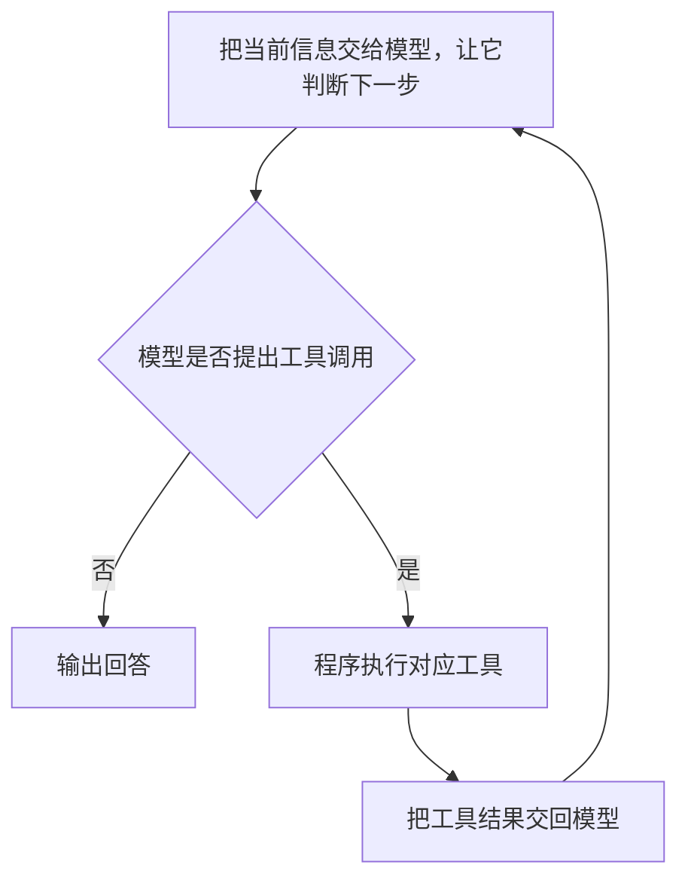

# 04 Pi Agent 介绍与 OpenClaw 的关系

我们在前面一直提到 OpenClaw，也提到了 Pi。那么，Pi 到底是什么？它跟 OpenClaw 是什么关系？

先用几句大白话把它们串起来：

- **`pi-ai` 负责对接 OpenAI、Anthropic 等厂家的模型，让上面的程序能用一套比较统一的方式调用它们。**
- **`pi-agent-core` 负责把任务跑下去：问模型、执行工具、把结果交回模型，再接着处理。**
- **`pi-coding-agent` 在这个基础上加上读文件、改代码、执行命令、管理会话这些能力，做成一个能用的编码助手。**
- **OpenClaw 再把这些能力接到聊天渠道、不同的 Agent、工作区和长期资料上，做成一套个人助手系统。**

这里说的“对接各种模型”，是让程序能选择并调用不同厂家的模型，不是每个任务都要让这些模型轮流回答。

这一章就围绕这条线来讲。先弄清楚各部分干什么，再看它们怎么配合。后面读源码时，我们就能知道：眼前这段代码，到底是在接模型、跑工具，还是在处理 OpenClaw 自己的事情。

## 1. Pi Agent 是什么

可以先把 Pi 理解成：**一套让大模型能够配合工具干活的软件。**

比如你说：“这个项目启动报错了，帮我看看。”

只有模型的时候，它可以根据你给的信息分析原因、给出建议。要让它自己打开项目、读取配置、执行启动命令、修改文件，还得有程序把这些操作接起来。Pi 就提供了这方面的能力。

这里有个分工要记住：

- 模型负责根据当前信息作判断，比如“我需要先读一下配置文件”。
- Pi 的程序负责调用模型、执行读文件工具，再把读到的内容交给模型。

所以，换一个模型，Pi 这套程序还可以继续用。安装 Pi，也不代表把模型权重下载到了本机；模型具体在哪里运行，要看你接的是哪种模型服务。

Pi 本身可以作为 **Coding Agent，也就是编码智能体或编码助手** 来用。你在终端里交代任务，它可以读代码、找内容、执行命令、修改文件，再根据结果继续处理。

不过，Pi 不只提供一个现成的终端程序。它还把里面的主要能力拆成了程序包，让其他应用也能拿去用。

| 怎么用 Pi | 实际上是在做什么 |
| --- | --- |
| 直接用它的终端程序 | 打开 Pi，输入任务，看它回答和执行工具 |
| 在自己的程序里调用它 | 把 Pi 的模型调用、任务执行或会话能力接进自己的应用 |

OpenClaw 用的就是第二种方式。它把 Pi 的组件放进自己的程序里，让 Pi 参与完成任务。

## 2. 为什么要拆成三个主要的包

假设我们也想写一个能帮忙改代码的助手，会碰到哪些事情？

第一件事，**得先把模型接上。** 今天想用 OpenAI 的模型，明天想换 Claude，它们的请求格式、消息格式、返回方式可能不一样。这些差异总得有人处理。

第二件事，**模型说要用工具，程序得真的去执行。** 比如模型说“读取 `package.json`”，程序读完以后，还要把结果交回去。模型看完可能又说“执行启动命令”，于是程序接着执行。这已经不是发一次请求、拿一次回答就结束了。

第三件事，**得把它做成一个能在项目里用的编码助手。** 去哪个目录读文件？有哪些工具？历史对话怎么保存？用户在哪里输入任务？这些都需要安排。

Pi 把这三类事情主要交给三个包：

| 包 | 用大白话说，它负责什么 |
| --- | --- |
| `pi-ai` | 把不同厂家的模型接进来，处理调用上的差异 |
| `pi-agent-core` | 把“问模型—用工具—再问模型”这个过程跑起来 |
| `pi-coding-agent` | 配上编码工具、项目环境和会话能力，做成编码助手 |

这样拆开有什么好处？举几个例子就清楚了。

模型厂家的接口变了，主要去改接模型的部分；想增加一个工具，就按运行层的要求接进来；想换终端界面，也不用把调用模型和执行工具的逻辑重写一遍。

而且，别人可以按需要拿其中一部分来用。只是想统一调用几种模型，就可以先用 `pi-ai`，没必要把整个编码助手都搬进来。

注意，我们这里说的是三个主要的能力包。Pi 仓库里还有终端界面等配套包，不是整个项目只有三个包。

## 3. `pi-ai`：负责把各家的模型接起来

`pi-ai` 可以读作“派 AI”。它干的事情，可以先这么理解：

**上面的程序说清楚要用哪个模型、发哪些消息、提供哪些工具，`pi-ai` 再按照对应厂家的要求把请求发出去，把返回结果整理好。**

为什么需要它？因为不同厂家的模型接口不完全一样。如果每次换模型，都要在业务代码里重新处理请求和返回结果，代码很快就会变得难维护。

`pi-ai` 把这些共用的东西整理到一起：

| 它处理的东西 | 可以怎么理解 |
| --- | --- |
| 模型信息 | 用的是哪个模型、哪家服务、什么接口，支持哪些输入和多大的上下文 |
| 消息格式 | 用户说了什么、模型回了什么、工具返回了什么，里面是文字还是图片 |
| 工具说明 | 告诉模型有哪些工具、各自做什么、需要填什么参数 |
| 发送请求 | 把准备好的材料转换成对应模型服务能接收的格式，再发出去 |
| 接收结果 | 接收模型逐步返回的内容，或者等完整结果，再整理出文字、工具调用、用量等信息 |

比如，上层程序想从 GPT 切到 Claude，可以继续按相近的方式组织调用，底下的接口差异由对应的适配代码处理。当然，模型能力和支持的选项还是会有区别，换了模型也不保证得到一样的回答。

这里先解释一个后面经常遇到的词：**Schema，可以理解成“数据应该怎么填”的格式说明。**

比如，一个读文件工具需要 `path` 参数，Schema 就可以告诉模型：这里要填一个文件路径，而且这个值应该是字符串。

但这份说明只是告诉模型怎么提出请求。模型返回“调用 `read`，参数是某个路径”，文件还没有被读取。真正读文件的程序，需要由后面的运行层来调用。

所以，读 `pi-ai` 的代码时，可以先抓住这个范围：**它主要管一次模型交互，负责把请求送进去，把模型输出接回来。** 至于工具怎么执行、执行完还要不要继续问模型、对话怎么保存，这些事情往上看。

## 4. `pi-agent-core`：让模型和工具配合着把任务跑下去

模型已经接上了，接下来怎么让它干活？

还是拿“修复项目启动报错”来说。模型可能先要求读配置，再要求执行启动命令，然后根据报错修改文件。每做完一步，都需要把新结果交回模型，让它继续判断。

`pi-agent-core` 就负责组织这个过程。名字里的 **Runtime，运行时**，在这里可以理解成“负责把 Agent 跑起来的那部分程序”。里面的 **Agent Loop，Agent 循环**，负责把模型调用和工具执行接在一起。



这张图最关键的地方是：**工具执行完，结果还会回到模型那里。** 模型可以根据新信息继续处理，而不是一开始就把所有步骤猜完。

实际运行还得处理报错、取消等情况，不是说进入循环就一定会成功。

为了把这个过程组织好，运行层需要管几样东西：

| 名称 | 在这里具体干什么 |
| --- | --- |
| Agent 状态 | 记住现在用哪个模型、有哪些规则和工具、已经有哪些消息、是否正在运行 |
| Message，消息 | 保存用户输入、模型输出、工具结果这些交互内容 |
| Tool，工具 | 提供真正能执行的操作，比如读文件、查资料 |
| Agent Loop | 安排模型调用和工具执行，让它们接着往下走 |
| Event，事件 | 告诉外面的程序：文字更新了、工具开始执行了、这次运行结束了 |

消息和事件容易混在一起，我们分开看。

“文件内容是这些”属于交互内容，可以放在消息里；“读文件工具刚刚开始执行”是在报告运行进度，属于事件。界面可以收到事件后显示状态，但收到一个事件，并不代表已经往 WeChat 或 Discord 发了一条消息。

这一层也不限定你必须做编程任务。你给它接文件工具，它就能配合模型处理文件；接业务查询工具，它也可以配合模型查业务数据。

它主要关心的是：工具怎么调用、结果怎么交回来、后面怎么继续。至于具体提供哪些工具，工具内部怎么实现，要由使用它的程序安排。

所以，只有 `pi-agent-core`，还没有一个完整的编码助手。项目工具、终端入口、会话保存这些事情，还要继续往上加。

## 5. `pi-coding-agent`：把这些能力装成一个编码助手

到了 `pi-coding-agent`，我们开始面对一个具体场景：让 Agent 在项目里帮忙写代码、查问题、改文件。

它把前面的运行能力和编码工具、工作目录、项目资料、会话管理、使用入口放在一起。这样，我们既可以直接用这个助手，也可以在其他程序里调用它。

### 5.1 模型说要改文件，总得有工具真的去改

先看 Pi 提供的几个内置工具：

| 工具 | 干什么用 |
| --- | --- |
| `read` | 读文件 |
| `write` | 写文件 |
| `edit` | 对文件里的指定内容做修改 |
| `bash` | 执行 Shell 命令，拿到执行结果 |
| `grep` | 搜索文件里的内容 |
| `find` | 按路径模式找文件 |
| `ls` | 看目录里有哪些东西 |

默认启用的是 `read`、`write`、`edit`、`bash`，其他内置工具可以按需要选用。一个工具在包里有，不代表每次会话都启用了它。

回到刚才的例子：你让助手修复启动报错，它就可能用 `read` 看配置，用 `bash` 执行启动命令，再用 `edit` 修改出问题的地方。

这里两个包的分工就很直观了：**`pi-coding-agent` 提供处理项目的具体工具，`pi-agent-core` 负责在运行中组织这些工具的调用。**

### 5.2 还得告诉它：在哪个项目里干活，参考哪些资料

光有工具还不够。读 `package.json`，到底读哪个项目的？相对路径从哪里算起？项目有没有特别的开发要求？

这就需要工作目录和项目资源。

工作目录告诉程序这次主要在哪个项目里操作，也会影响相对路径和项目资料的查找。项目说明、技能资料和扩展，则可以告诉助手该遵守什么约定，或者给它增加能力。

但不要以为“项目放在那里，模型就已经看过了”。**文件在磁盘上，和文件内容已经发给模型，是两回事。** 有些资料会在准备请求时加入，有些要等模型通过工具读取。

这里顺便把几个常见词说清楚：

| 名称 | 怎么理解 |
| --- | --- |
| Session，会话 | 把一段连续交互组织起来，关联历史、配置和运行状态，还能记录下来以后接着用 |
| Context，上下文 | 这一次请求实际交给模型的规则、历史和其他资料 |
| Compaction，上下文压缩 | 对较早的交互做摘要，保留近期消息，减少以后每次请求要带的历史内容 |
| Extension，扩展 | 用程序代码增加工具、命令，或者调整会话行为 |
| Skill，技能 | 提供某类任务的做法、步骤和参考资料，让 Agent 在需要时使用 |

比如，你已经和助手聊了很久，会话里可以保留很多记录，但这次发给模型的上下文未必包含全部原文。较早的内容可能已经被压缩成摘要，细节也可能因此丢失。

技能和扩展也要分开理解。技能更像一份“这类任务该怎么做”的说明；扩展则可以用代码给程序加功能。

上下文也不是某一个包单独包办的：`pi-ai` 规定发给模型的数据长什么样，`pi-agent-core` 组织交互消息，`pi-coding-agent` 再把项目说明和会话材料接进来。

### 5.3 用户可以直接用，其他程序也可以接着用

Pi 主要有两种我们需要理解的入口：CLI 和 SDK。

**CLI 就是命令行入口，你在终端里直接用；SDK 就是给其他程序调用的接口，你把它接进自己的应用里。**

| 入口 | 谁在使用 | 用户看到的界面由谁负责 |
| --- | --- | --- |
| CLI | 用户在终端里直接使用 Pi | Pi 的终端程序 |
| SDK | JavaScript / TypeScript 程序调用 Pi | 接入 Pi 的应用 |

OpenClaw 用的是 SDK 这条路。它可以准备自己的模型、工具和会话材料，让 Pi 执行，再接收过程通知和结果。

也就是说，OpenClaw 调用 Pi 时，不需要先打开一个 Pi 的终端窗口。

Pi 还有打印、JSON 输出、RPC 等接入方式。这里先知道入口不止一种就够了，具体怎么用，后面的源码章节再讲。

## 6. 这几个包到底怎么连起来

### 6.1 分了三层，不代表只能一层一层调用

前面为了方便理解，把它们说成三个层次。但读源码时你会发现：`pi-coding-agent` 不光用 `pi-agent-core`，也会直接用 `pi-ai`。

这很正常。编码助手需要选择模型、处理消息，直接使用 `pi-ai` 里现成的定义就可以，没有必要什么都绕运行层转一遍。


图里的箭头表示“谁使用谁”：

- `pi-coding-agent` 使用 `pi-agent-core`，也直接使用 `pi-ai`。
- 它做终端界面时，还会使用独立的 `pi-tui`。
- `pi-ai` 则通过 API 连接模型服务。

我们关心的是各自管什么事情。例如，接模型的代码，不需要反过来知道编码助手怎样保存会话、终端上怎样画界面。

还有一点：依赖图不是执行步骤图。箭头指向 `pi-ai`，不代表数据只往那边走；请求发出去，结果当然还会返回。

### 6.2 每一层拿到什么，又交回来什么

可以把它们之间的配合看成“准备材料，交给下一部分处理，再接回结果”。

| 包 | 主要拿到什么 | 交回来什么 |
| --- | --- | --- |
| `pi-ai` | 模型信息、这次要发的规则和消息、工具说明、调用选项 | 模型逐步输出的事件，以及完整的助手消息 |
| `pi-agent-core` | 模型和运行配置、交互消息、能真正执行的工具 | 更新后的状态和消息，以及模型、工具运行过程中的事件 |
| `pi-coding-agent` | 工作目录、模型和凭据、项目资源、工具、会话配置 | 可以使用的会话对象，以及执行通知、消息和结果 |

这张表是帮助理解各层需要什么，不是让你调用函数时照着逐项填写。

这里最容易混淆的是“工具”：**给模型看的工具说明，和程序拿来执行的工具实现，不是同一份东西。** 下一节会拿具体类型来讲。

### 6.3 `pi-tui`：负责终端上怎么显示、怎么输入

`pi-tui` 主要管终端界面，比如显示 Markdown、编辑文字、接收按键、刷新画面。

在终端模式下，大致是这样配合的：

```text
Pi 会话发出事件，比如文字更新、工具开始执行
    ↓
pi-coding-agent 的界面逻辑决定显示什么
    ↓
使用 pi-tui 的组件，把内容画到终端上
```

用户按键或输入文字时，输入组件把内容交给界面逻辑，后者再决定是提交任务，还是做某个界面操作。

所以，`pi-tui` 不负责 Agent Loop，也不需要自己判断一次工具调用该怎么处理。它提供的是终端显示和输入能力。

如果通过 SDK 把 Pi 接进其他应用，应用可以自己做界面，不必使用 Pi 的终端界面。因此，不能把 `pi-tui` 理解成模型调用一定要经过的“第四层”。

### 6.4 用哪些能力，和从哪里调用，是两件事

“我用哪些包”和“我从哪个入口使用”，要分开看。

| 选择哪些能力 | 已经有了什么 | 自己还要做什么 |
| --- | --- | --- |
| 只用 `pi-ai` | 统一的模型调用方式 | 自己处理输出；需要连续用工具时，也要自己组织过程 |
| 用 `pi-ai` 和 `pi-agent-core` | 模型调用，加上模型与工具的连续交互 | 准备具体工具、使用入口和应用需要的会话安排 |
| 用 `pi-coding-agent` 及其下层能力 | 编码工具、项目资源和会话能力 | 按自己的应用配置或替换工具、资源，再选择入口 |

OpenClaw 选择了编码会话层的 SDK，同时也会准备自己的模型、工具和运行材料。

## 7. 看类型时，先问：这份东西是给谁用的

前面讲“哪个包管什么”，现在我们往代码靠近一点，看看不同部分用的数据有什么区别。

`pi-ai` 里有 `Model`、`Message`、`Context`、`Tool` 这些名字，分别表示模型信息、消息、一次请求要用的材料，以及工具说明。

上层可以继续用这些定义。不过，上层要做的事情更多，就得补充更多信息。

拿读文件工具来说：

- 给模型看，要说明工具叫什么、怎么用、路径填在哪里。
- 给运行程序用，要提供真正读文件的函数。
- 放进编码会话，还可能要提供显示方式、提示词说明，以及执行时能访问的会话环境。

理解了这个需求，再看类型就容易多了。


图中列的是主要字段，不是完整源码。我们按“模型怎么看、程序怎么执行、会话怎么接入”的顺序来看。

### 7.1 `Tool`：先告诉模型，这个工具怎么用

`pi-ai` 的 `Tool` 主要有三个字段：

| 字段 | 用大白话说 |
| --- | --- |
| `name` | 工具叫什么，模型调用时用哪个名字 |
| `description` | 这个工具能干什么，什么时候适合用 |
| `parameters` | 参数怎么填，需要符合什么格式 |

比如 `read` 工具，说明里可以写它用于读取文件，参数里有一个 `path`，用来填写文件路径。

模型看到这些，就知道怎么提出“读这个文件”的请求。

但 **`Tool` 没有执行函数**。这份说明发给模型以后，模型不会因此获得访问本机磁盘的能力。它只能提出调用，程序还得去执行。

`pi-ai` 发送请求时，会把这些说明转换成对应模型服务接受的工具格式。

### 7.2 `AgentTool`：除了说明，还要有真正干活的函数

到了运行层，只有工具说明就不够了。模型说要读文件，程序得知道调用哪段代码。

所以，`pi-agent-core` 的 `AgentTool` 继承了 `Tool`，在原来的名称、描述、参数之外，又加了一些东西：

| 字段 | 是否必需 | 干什么用 |
| --- | --- | --- |
| `label` | 必需 | 给界面等显示位置用的名称，可以和模型调用时的名字不同 |
| `execute` | 必需 | 真正执行工具的函数，接收参数并返回结果 |
| `prepareArguments` | 可选 | 正式校验参数前，先做必要的参数处理 |
| `executionMode` | 可选 | 说明这个工具对串行或并行执行有什么要求 |

其中最关键的是 `execute`。有了它，程序才能把“模型要求读文件”变成真正的文件读取操作。

执行接口还可以传递取消信号、进度回调。具体怎么调度、怎么报告进度，后面再展开。

这一层不要求工具一定读文件。`execute` 里面可以查询业务系统，也可以调用其他服务，只要按约定接收参数、交回结果就行。

### 7.3 `ToolDefinition`：放进编码会话，还能补充什么

到了 `pi-coding-agent`，我们还可能有这些需求：

“启用这个工具时，顺便告诉模型几条使用规则。”

“工具运行的时候，界面上别只显示一大段原始数据，换一种展示方式。”

“工具执行时，要能拿到当前工作目录和会话信息。”

这些信息可以放到 `ToolDefinition` 里。它同样有名称、描述、参数、标签和执行能力，还能补充会话层需要的内容：

| 字段或接口 | 怎么理解 |
| --- | --- |
| `promptSnippet`、`promptGuidelines` | 工具启用时，给默认提示词补充简介或使用规则 |
| `renderCall`、`renderResult` | 自定义工具调用和结果在界面里怎么显示 |
| `renderShell` | 选择使用默认显示外框，还是由工具自己绘制外框；这是模式选项，不是渲染函数 |
| 执行接口中的 `ExtensionContext` | 给执行函数提供当前工作目录、模型、会话等相关能力 |

提示词和显示方面的字段是可选的，不是每个工具都要自己画一套界面。这里也可以设置 `prepareArguments` 和 `executionMode`。

`ExtensionContext` 这个名字里也有 Context，但它和发给模型的 `Context` 不是一回事：**前者给工具或扩展程序用，让它访问会话能力；后者描述这次模型请求要带哪些材料。**

### 7.4 别把这三个类型看成一路继承下来

讲到这里，很容易以为源码里是这样写的：`Tool` 被 `AgentTool` 继承，`AgentTool` 又被 `ToolDefinition` 继承。

实际关系要分开看：

| 关系 | 源码里怎么连接 |
| --- | --- |
| `Tool` 和 `AgentTool` | `AgentTool` 直接继承 `Tool` |
| `ToolDefinition` 和 `AgentTool` | `ToolDefinition` 是独立接口，通过包装代码接成运行层需要的 `AgentTool` |

为什么要包一层？因为两边虽然都有 `execute`，需要的执行环境却不完全一样。

运行层调用工具时，会传入调用编号、参数、取消信号、进度回调；编码会话里的工具还需要会话环境。包装代码就负责在中间接一下：运行层调用包装后的函数，它再转去调用原来的工具，并补上会话环境。

```text
ToolDefinition：在编码会话里定义完整工具
       │
       │ 包装一下，做成运行层能调用的接口
       ▼
AgentTool：交给通用运行层使用
       │
       │ 真正执行时，转回原工具，并补上会话环境
       ▼
具体工具执行
```

显示和提示词配置继续由会话层处理，底下的 Agent Loop 不必理解这些东西。

所以，我们说这几个类型的职责越来越丰富，不代表它们全是靠 `extends` 连起来的。**接口写了什么是一回事，程序怎么包装和传递，又是另一回事。**

### 7.5 消息也会增加种类，但用的办法不一样

工具讲完了，再看消息。

`pi-ai` 里的 `Message` 主要包括用户消息、助手消息、工具结果消息。到了运行层，应用还可能想保存自己的记录，所以 `AgentMessage` 允许在这些基础消息之外增加种类。

可以先用下面这两行理解，具体定义再去看源码：

```text
Message      = 用户消息 | 助手消息 | 工具结果消息
AgentMessage = Message | 应用自己补充的消息种类
```

`pi-coding-agent` 就用这个位置加入了用户直接执行 Shell 命令的记录、扩展消息、分支摘要、压缩摘要等内容。

这里的 Shell 记录，是用户直接发起命令留下的记录。模型调用工具以后产生的工具结果，属于前面提到的工具结果消息，两者要分清。

那这些内部记录都能原样发给模型吗？不一定。模型服务只认识自己支持的消息格式。

因此，在请求模型之前，需要把适用的应用记录转换成模型调用层接受的消息，有些记录也会按规则排除。这样，底下的模型适配代码就不用认识编码会话里的每一种记录。

两个 Context 的区别，也可以顺着这个思路看：

| 类型 | 里面主要放什么 |
| --- | --- |
| `pi-ai` 的 `Context` | 模型调用层的 `Message`，以及给模型看的工具说明 `Tool` |
| `pi-agent-core` 的 `AgentContext` | 运行层的 `AgentMessage`，以及程序能执行的 `AgentTool` |

在请求模型时，运行层会做必要的消息整理，并使用工具的说明部分。程序手里有 `execute` 函数，不代表会把函数正文、界面渲染代码一起发给模型。

后面看类型时，就沿着这几个问题找：它是给模型看的，还是给程序执行的？它是内部记录，还是已经整理好、可以发给模型的消息？

## 8. OpenClaw 为什么要用 Pi

现在回来看 OpenClaw，事情就比较清楚了。

OpenClaw 想做的是一个能持续使用的个人助手系统。它当然需要调用模型、执行工具，但还得处理很多外面的事情：用户从哪里发来消息？交给哪个 Agent？使用哪个工作区？历史归到哪个会话？结果发回哪里？

Pi 已经提供了模型调用、Agent 运行和编码会话这些能力。OpenClaw 可以直接接着用，再把自己的助手系统搭起来。

这样做，主要解决三件事：

- **底下执行任务的能力可以复用。** 调模型、用工具、把结果交回模型，不必全部从头实现。
- **OpenClaw 可以自己安排任务。** 用哪个 Agent、哪个模型、哪个工作区、哪些工具，仍然可以由 OpenClaw 准备。
- **执行结果可以接到自己的入口。** 用户从聊天渠道或 Web 客户端发来任务，OpenClaw 就把结果送回对应的地方。

这里说“接入 Pi”，具体是把 Pi 的组件嵌到 OpenClaw 程序里。Pi 会话在 OpenClaw 内部运行，模型服务则通过模型接口连接。

所以，不需要用户先打开 Pi 的终端程序，也不要求把 Pi 单独部署成一个外部服务。

Pi 的 SDK 也不只是“塞进去一句话，拿回来一句话”。OpenClaw 可以通过它参与模型、工具和会话材料的组织，接收执行过程中的通知，再继续做自己的处理。

## 9. OpenClaw 和 Pi，各自管到哪里

先抓住一句话：**Pi 提供把 Agent 跑起来的能力，OpenClaw 把这套能力放进完整的助手系统里。** 但具体到某个功能，不能只说“底下归 Pi，上面归 OpenClaw”，还得看 OpenClaw 实际接了什么。

下面按本课程的 **OpenClaw `2026.4.22`、Pi `0.69.0` 本地源码**来讲，讨论的是前面这条内嵌 Pi 的执行路径。“OpenClaw 自行实现”包括它仓库中的内置插件。

### 9.1 功能对照：谁提供，实际用谁

**✅ 表示这项功能实际采用了这一侧的实现；— 表示这项功能没有采用这一侧的实现。两边都打勾，表示复用 Pi，再由 OpenClaw 补充或适配。**

这里标的是 OpenClaw 实际用了谁，不是 Pi 单独有没有这个功能。比如，Pi 有 `bash`，但 OpenClaw 换成了自己的命令工具，所以“执行命令”这一行只给 OpenClaw 打勾。也不因为某个工具由 Pi 调用，就把这个工具本身算作 Pi 实现。

| 功能 | OpenClaw 自行实现 | 使用 Pi 实现 | 实际用法与区别 |
| --- | :---: | :---: | --- |
| **调用各家模型** | ✅ | ✅ | 复用 `pi-ai`，OpenClaw 补充调用适配；部分请求会使用 OpenClaw 或 Provider 提供的专用传输。 |
| **模型选择、凭据与调用配置** | ✅ | — | 由 OpenClaw 按自己的配置准备，再交给运行组件使用。 |
| **模型与工具循环执行（Agent Loop）** | — | ✅ | 用 `pi-agent-core` 组织“问模型、用工具、交回结果、继续判断”。 |
| **外层排队、超时与重试协调** | ✅ | — | OpenClaw 管整次任务的运行安排，与 Pi 内部的 Agent Loop 分开。 |
| **会话运行、历史记录与接续** | — | ✅ | 使用 Pi 会话和 `SessionManager`；OpenClaw 会在接入时增加记录保护等处理。 |
| **会话归属、会话键与索引管理** | ✅ | — | OpenClaw 判断用户、群聊的消息属于哪段会话，再交给 Pi 运行。 |
| **工作区选择与初始化** | ✅ | — | OpenClaw 为不同 Agent 准备目录和说明文件，Pi 在指定目录里工作。 |
| **系统提示词与启动材料组装** | ✅ | — | 用 OpenClaw 组装的内容覆盖会话系统提示词，不直接采用 Pi 默认的编码助手提示词。 |
| **技能来源管理、筛选与说明整理** | ✅ | — | 由 OpenClaw 决定本次提供哪些技能，兼容 Pi 的技能数据约定；不是直接使用独立 Pi 的默认技能列表。 |
| **读文件、写文件、修改文件** | ✅ | ✅ | 复用 Pi 基础工具，OpenClaw 增加工作区限制、图片处理或沙箱适配。 |
| **执行命令、管理后台进程** | ✅ | — | 移除 Pi 的 `bash`，改用 OpenClaw 的 `exec`、`process`。 |
| **工具筛选、权限策略与沙箱安排** | ✅ | — | OpenClaw 决定开放哪些能力，并通过具体工具和运行环境落实限制。 |
| **上下文整理与历史压缩** | ✅ | ✅ | OpenClaw 加入整理和保护策略；`legacy` 路径复用 Pi 的 `compact()`，其他上下文引擎可能接管。 |
| **长期记忆的组织、索引与检索** | ✅ | — | 由 OpenClaw 侧的记忆插件等提供，如 `memory_search`、`memory_get`。 |
| **多 Agent 配置、协作与消息路由** | ✅ | — | OpenClaw 决定有哪些助手、任务交给谁；选定后的底层执行另用 Pi。 |
| **WeChat、Discord 等渠道接入** | ✅ | — | OpenClaw 接收平台消息，处理账号、消息格式和回复目标。 |
| **基础运行事件与模型输出通知** | — | ✅ | Pi 发出文字更新、工具执行、运行结束等事件，供 OpenClaw 订阅处理。 |
| **客户端界面、输出整理与回复发送** | ✅ | — | 使用 OpenClaw 的界面和渠道发送流程，不使用 Pi 的终端界面。 |
| **定时任务与心跳调度** | ✅ | — | OpenClaw 决定什么时候触发任务，需要 Agent 处理时再进入执行路径。 |

会话这一类容易混淆的功能，表里拆成了两行：**“会话怎么跑、历史怎么记”使用 Pi，“这是谁的会话、该接到哪里”由 OpenClaw 实现。** 这样就能看出，同一个大功能下面也可能有不同分工。

### 9.2 两边都有时，拿四个例子看清楚

**第一个，会话：两边同时用。**

用户在某个群里发消息，OpenClaw 先根据路由和会话规则，确定它属于哪段会话，再找到对应记录。Pi 的会话组件负责使用这些记录继续运行、保存交互。一个管“这是谁的会话”，一个管“这段会话怎么跑和怎么记”。

**第二个，命令执行：换工具，保留运行循环。**

独立使用 Pi 时，可以通过它的 `bash` 工具执行命令。放进 OpenClaw 后，这个工具会被移除，换成 OpenClaw 自己的命令执行工具。模型发出工具调用后，还是由 Pi 的 Agent Loop 组织执行，但真正执行命令的代码走 OpenClaw 的实现。

```text
模型提出命令工具调用
    ↓
Pi 的运行层组织调用
    ↓
OpenClaw 的 exec 工具处理实际命令执行
    ↓
工具结果回到 Pi，再交给模型继续判断
```

**第三个，提示词和技能：OpenClaw 准备内容，交给 Pi 使用。**

Pi 自己能生成编码助手提示词，也能发现技能。不过，在 OpenClaw 中，助手身份、工作区说明、技能筛选等都得符合 OpenClaw 的配置。因此，OpenClaw 会组装自己的提示词并覆盖到 Pi 会话中，同时准备本次可用的技能说明。模型需要技能正文时，再调用读取工具。

这也解释了为什么“同一个模型，直接用 Pi”和“在 OpenClaw 中使用”可能表现不同：交给模型的规则、资料和工具集合可以不同。

**第四个，历史压缩：既有底层能力，也有外层策略。**

Pi 有把较早交互压缩成摘要的能力。OpenClaw 会在外面加上自己的配置、保护逻辑和上下文管理。在 `legacy` 路径中，最后仍会调用 Pi 会话的压缩能力；换了上下文引擎，就要看该引擎的实现，不能一概说压缩完全由哪一边负责。

另外，**会话历史、压缩摘要、长期记忆，是三件相关但不同的事。** 历史记录帮助接着聊，压缩摘要帮助控制本次请求的长度，长期记忆检索则帮助从持续保存的资料里找回相关信息。磁盘上有资料，也不代表它已经全部进入这次模型请求。

### 9.3 想对照源码，可以从这些位置看

- [Pi 会话接入](../OpenClaw-2026.4.22/src/agents/pi-embedded-runner/run/attempt.ts)：看 `SessionManager.open()`、`createAgentSession()`，以及工具注册和系统提示词覆盖。
- [模型调用方式选择](../OpenClaw-2026.4.22/src/agents/pi-embedded-runner/stream-resolution.ts)：看什么时候继续用 Pi 的调用函数，什么时候换成其他传输实现。
- [工具组装](../OpenClaw-2026.4.22/src/agents/pi-tools.ts)：看怎样复用文件工具、移除 `bash`，再加入命令工具和 OpenClaw 的其他工具。
- [技能整理](../OpenClaw-2026.4.22/src/agents/skills/workspace.ts)：看 OpenClaw 怎样加载、筛选和组织自己的技能材料。
- [上下文引擎](../OpenClaw-2026.4.22/src/context-engine/legacy.ts)与[内嵌会话压缩](../OpenClaw-2026.4.22/src/agents/pi-embedded-runner/compact.ts)：看外层上下文管理怎样接到 Pi 的压缩能力。
- [长期记忆工具](../OpenClaw-2026.4.22/extensions/memory-core/src/tools.ts)：看 `memory_search`、`memory_get` 在 OpenClaw 侧怎样提供。

## 10. 用户发来一句话，里面大致怎么跑

我们把前面的内容串起来。假设用户从一个聊天入口发来：“帮我看看项目为什么启动失败。”

对于这样一条需要 Agent 处理的消息，可以先按下面这个过程理解：

```text
用户发来消息
   ↓
OpenClaw 接收消息，整理它来自哪个入口、哪个用户
   ↓
选定 Agent，找到对应的 Session
   ↓
准备工作区、模型、规则、上下文材料和可用工具
   ↓
创建或使用 OpenClaw 内部的 Pi 会话
   ↓
Pi 组织执行：调用模型、执行工具、把结果交回模型
   ↓
执行过程中的通知和结果交给 OpenClaw
   ↓
OpenClaw 整理回复，通过对应入口发给用户
```

里面可能发生这样一段往返：模型要求读配置，Pi 组织工具执行；工具返回配置内容，模型再判断下一步；需要执行命令，就继续调用对应工具。

这张图只是帮助我们看清主要步骤，省略了排队、并发、报错和渠道发送等细节。也不是每来一条消息，都要把所有对象重新创建一遍。

通知和输出还可以边运行边交给 OpenClaw，不一定要等任务全部结束。

这里有两个地方，要稍微停一下想清楚：

1. **模型说“调用工具”，工具还没执行。** 要等运行程序调用具体工具实现，才会真的读文件、启动进程或访问其他服务。
2. **Pi 已经产生输出，用户也未必已经收到。** 还需要 OpenClaw 整理内容，再通过对应渠道发出去。

这两个步骤分清楚，后面排查“工具为什么没跑”“回复为什么没发出来”时，就知道该去哪里看了。

## 11. 把整张图放在一起看

```text
用户
 │
 ▼
WeChat / Discord 等渠道，CLI / Web 等客户端
 │
 ▼
OpenClaw：把个人助手系统组织起来
 ├── 接收消息，选择 Agent，安排路由
 ├── 管理 Session、Workspace，准备启动材料
 ├── 组织 Memory、Skills、Tools 和执行限制
 └── 协调运行，把回复送回用户
          │
          │ 通过 SDK 嵌入：交入任务和材料，接回通知与结果
          ▼
         Pi
          ├── pi-coding-agent：编码工具、项目资源、会话、CLI / SDK
          │          ↓
          ├── pi-agent-core：组织模型判断、工具执行和后续交互
          │          ↓
          └── pi-ai：对接各家的模型，整理请求和输出
                     │
                     ▼
                模型服务商
```

这张图是为了把分工摆清楚。Pi 的执行在 OpenClaw 内部，上下画开不代表它们一定是两个独立服务。包之间具体的直接依赖，看第 6 节；工具和消息的类型关系，看第 7 节。

我们再用开头的话把它们连一遍：`pi-ai` 负责把模型接上，`pi-agent-core` 负责让模型和工具配合着把任务跑下去，`pi-coding-agent` 再把它们组织成可以使用的编码助手。OpenClaw 在这些能力之上，处理用户、渠道、不同的 Agent、工作环境和长期使用需要的功能。

后面读源码，先问自己一句：**这段代码现在是在接模型、跑任务、管理编码会话，还是在处理 OpenClaw 的助手系统？** 位置找到了，再看具体函数就容易多了。

**补充说明：最新版 OpenClaw 已不再把 Pi 作为独立依赖，而是把相关运行能力整合进了自身（见[官方重构说明](https://github.com/openclaw/openclaw/pull/85341)）；为了便于教学，本课程仍使用基于 Pi 的 OpenClaw `2026.4.22` 版本，带大家理解 Pi 的工作原理，以及它与 OpenClaw 的配合方式。**
