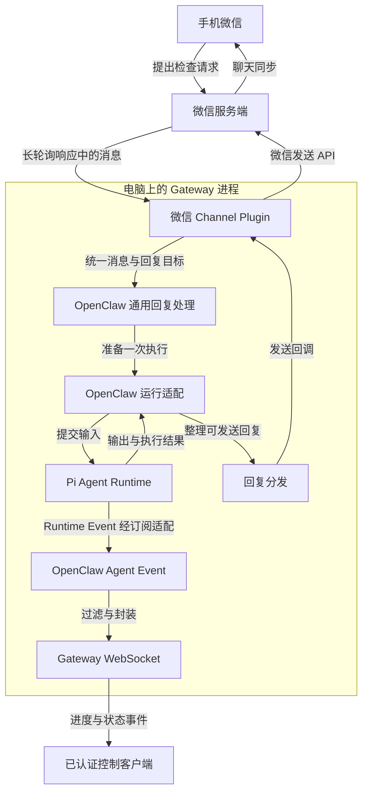
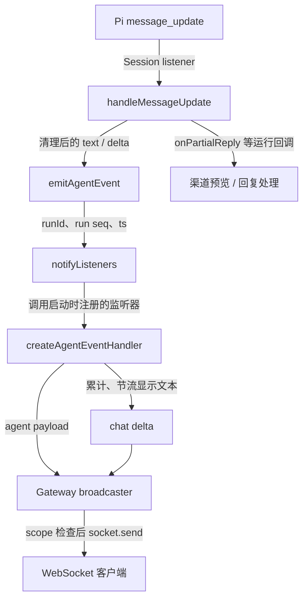
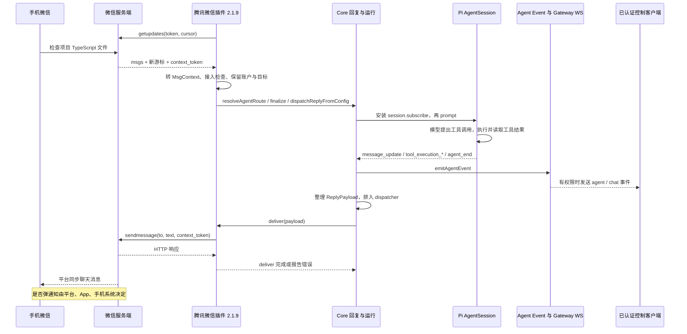
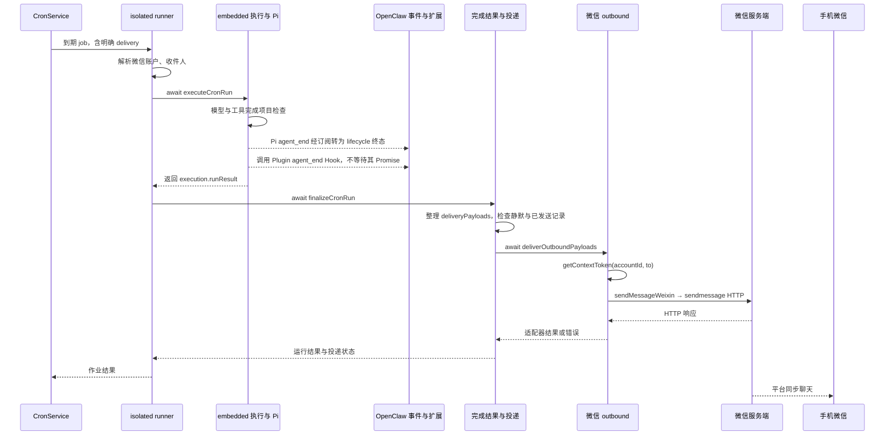
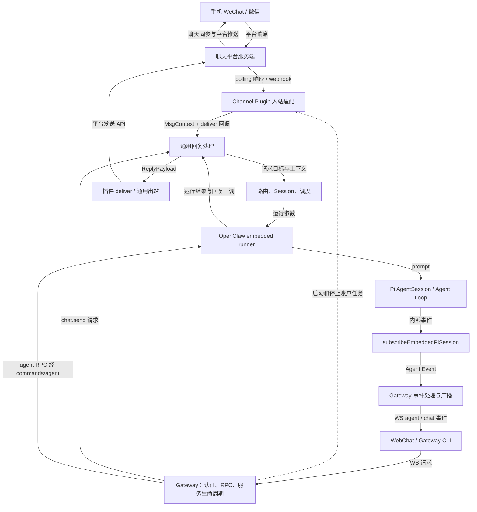

# 16 OpenClaw Gateway 架构、多渠道接入与消息事件通信

本章基于 OpenClaw v2026.4.22 源码进行分析；微信部分使用腾讯微信插件 2.1.9。

## 1. 一条微信请求，怎样到达电脑并带回结果

### 1.1 从手机上的一句话开始

用户在手机微信中输入：

> 帮我检查一下电脑上项目目录中的 TypeScript 文件。

电脑上已经运行 OpenClaw，并完成微信账户接入。消息到达后，Agent 读取项目说明、选择适用的检查工具，结合工具返回的信息生成结果。稍后，手机微信里出现“发现两处类型错误，分别是……”。

这段交互包含两项工作。第一项是让任务真正执行：把用户文字送到 Pi Agent Runtime，让模型和工具推进检查。第二项是把人和这次执行联系起来：从哪个微信账户接收、谁有权提出任务、进度给谁看、结果发到哪里。本章深入分析第二项工作，并追到它与 Pi 的交接处。

下图展示请求的正常处理路径。方框表示职责模块，箭头表示消息、结果或事件的交接；插件、回复处理与运行适配等模块运行在 Gateway 进程中。



图中有两条向外的路径。**回复路径**把“发现两处类型错误”送回微信；**观察路径**让电脑上的控制界面显示“正在生成文本”“正在调用工具”“本次运行结束”。两条路径都来自同一次执行，各自有明确的接收方和处理函数。

微信渠道使用平台协议在 Gateway 进程中接收并派发消息，直接进入通用回复处理。WebSocket 在旁边承担控制客户端的通信。本例即使没有打开控制界面，微信请求仍然可以执行并得到回复。

### 1.2 为什么电脑上要有一个长期运行的 Gateway

单独运行 Pi 时，可以由终端程序创建 AgentSession，然后调用 `session.prompt()`。但手机上的消息不会主动调用电脑内存中的这个方法。电脑首先要有一个持续存活的进程，维持平台连接或轮询、接受控制客户端连接，并保存正在运行的账户和任务状态。

Gateway 就是 OpenClaw 中承担这一组织工作的长期服务。它监听自己的 HTTP/WebSocket 入口，完成客户端认证和 RPC 分派，管理渠道账户任务，启动定时调度与相关服务，并把 Agent 执行进度提供给有权限的控制客户端。

长期运行描述的是服务进程的生命周期。大部分时间，进程可能只在等待网络 I/O、定时器或队列中的工作。真正需要处理任务时，OpenClaw 才准备一次 Agent 运行并进入 Pi。

**它到底负责干什么？可以按下面这几件事来记。**

| Gateway 管的事 | 放到检查项目这个例子里 |
| --- | --- |
| **让后台一直运行** | 启动渠道账户任务和 HTTP/WebSocket 服务；不打开控制网页，已接入的微信渠道仍可以接消息 |
| **给控制客户端把关** | 网页或 CLI 连进来时检查身份，发起操作时检查角色和权限范围 |
| **接操作、找处理代码** | 收到查看历史、提交任务、取消运行等请求，根据 method 进入对应处理函数 |
| **组织执行、通知状态** | 通过通用回复与运行适配层发起任务，把进度和完成状态交给相应的客户端；平台回复由渠道发送路径处理 |
| **管理配套服务** | 管理渠道账户的启动和状态，启动 Cron、Heartbeat 等后台服务 |

**权限控制是其中一部分，不过要把三种权限分开看：**

- **控制客户端的权限。** 一个网页或 CLI 能否连接 Gateway，要看认证；连接成功后能否调用某个接口，还要看角色和获准的 scopes。例如只有 `operator.read` 的 operator 客户端可以通过 `chat.history` 的接口权限检查，但不能通过要求 `operator.write` 的 `chat.send` 检查。后续处理函数仍会检查具体参数和会话条件。
- **聊天用户的接入权限。** 微信、WeChat 用户是否被允许触发助手，要看渠道的配对、允许名单、群规则等。平台用户不必先建立 Gateway WebSocket 连接；这些检查由相应渠道接入代码完成。
- **助手执行工具的权限。** 用户获准发任务以后，模型能使用哪些工具、能访问哪些文件、某条命令是否需要审批，还要看工具策略、沙箱和执行层限制。Gateway 提供相关管理与审批接口，执行代码再按规则落实。

比如“允许这个用户检查项目”只表示这条请求可以继续进入相应处理流程，并不自动放开所有文件和命令。**入口负责判断请求能不能进，接口权限负责判断操作能不能调，执行层再限制任务实际能做什么。**

源码对应：[连接认证](../OpenClaw-2026.4.22/src/gateway/auth.ts)、[接口权限与分发](../OpenClaw-2026.4.22/src/gateway/server-methods.ts)、[各接口所需权限](../OpenClaw-2026.4.22/src/gateway/method-scopes.ts)、[工具策略过滤](../OpenClaw-2026.4.22/src/agents/tool-policy-pipeline.ts)。

### 1.3 微信渠道与控制客户端使用不同入口

**控制客户端**直接理解 Gateway 协议。例如浏览器中的控制界面、使用 Gateway 客户端的 CLI，以及具有相应角色的设备客户端，可以建立 WebSocket 连接，发送 `chat.send`、`agent` 等请求，接收响应与事件。

**聊天渠道**理解的是平台协议。WeChat 用户发给 Bot 的消息先到 WeChat 服务端，再由 WeChat 插件通过 polling 或 webhook 接收。腾讯微信插件也先与微信的服务端交换数据，再调用 OpenClaw 提供的运行时接口。

一条 WeChat 或微信消息由渠道回调直接进入通用回复处理。“Gateway 收到微信请求”在这里具体指 Gateway 管理的微信账户任务收到消息；WebChat 的 `chat.send` 则是另一条 RPC 入口。

CLI 命令要按实际用途区分。`openclaw gateway run` 启动服务；另一些 CLI 命令才连接服务发送 RPC；本地执行类命令还可能采用不同路径。应当依据具体命令判断进程与连接的关系。

### 1.4 谁负责执行，谁负责把结果送回微信

Pi 负责模型与工具相互推进的执行过程。OpenClaw 的 embedded runner 准备会话、模型、工具和回调，将输入交给 Pi，并把 Pi 的输出纳入 OpenClaw 的运行管理。Gateway 再把这个过程放进一个可被多个入口使用的服务环境。

| 层次 | 本章相关职责 | 在检查任务中的产物 |
| --- | --- | --- |
| Gateway | 服务启动、客户端认证、RPC、事件对外发送、渠道与调度服务管理 | 可用的服务入口与受管理的账户任务 |
| Channel Plugin | 平台连接、账户、平台消息转换、接入规则、平台发送 | 统一输入、平台目标及实际发送请求 |
| 通用回复与 embedded runner | 准备执行、处理回调、整理回复、保留投递上下文 | 运行参数、回调与 ReplyPayload |
| Pi Runtime | 模型流、工具调用、消息状态和内部事件 | assistant 消息、工具结果与 Runtime Event |

模型返回的文本在 Pi 中是一条 assistant 消息。OpenClaw 还需要平台账户、聊天目标和发送回调，才能把它送到提出检查请求的微信用户。

### 1.5 沿着这条请求阅读源码

| 请求走到哪里 | 需要解决的问题 | 正文 |
| --- | --- | --- |
| 平台与电脑之间 | 不同协议怎样共用 Channel 接口，账户怎样启动 | 2—3 |
| 微信/WeChat 插件内部 | 消息怎样转换，发送者怎样被允许接入 | 4—5 |
| Agent 正在执行 | Pi 事件怎样变为控制客户端收到的 WS 帧 | 6—7 |
| 模型已经生成答案 | dispatcher 怎样等待并完成平台发送 | 8 |
| 没有原始入站消息 | 怎样主动发送，任务完成后怎样通知微信 | 9、11 |
| 把各段连起来 | 回看微信检查任务的完整时序 | 10 |

主线经过路由、Session 和调度时，只说明接口输入输出。第 17 章再分析 Binding、Session Key 与并发队列，第 18 章讨论 Workspace、Bootstrap 与长期记忆。

## 2. 两种聊天平台，怎样接到同一个 Gateway

微信和 WeChat 的插件分别维护平台通信，并向执行层提供统一的消息上下文和回复回调。因此，同一个 Gateway 可以同时接收两个平台的请求。

### 2.1 平台格式不同，执行层需要共同接口

WeChat 的原始消息有 `chat.id`、`from.id`、`message_id`；微信插件接收的消息则有 `from_user_id`、`item_list`、`context_token`。如果 Agent 执行层直接处理这些字段，每接入一个平台，都要改一遍执行逻辑。

Channel Plugin 把差异收在平台边界：向外使用平台协议，向内提供账户、消息上下文、回复回调和出站适配器。Core 通过这些接口处理通用任务，不需要知道 WeChat 的每一种 Update 或微信的每一种媒体类型。

“内置渠道”指随 OpenClaw 仓库分发的 bundled plugin，例如 WeChat；腾讯微信插件则独立发布。两者都需要遵守宿主接口，但发布版本、依赖、账户存储和网络协议可以不同。插件存在于磁盘、插件已注册、账户已登录、账户任务已连接，是四个需要分别判断的状态。

### 2.2 消息怎样跨过网络：长轮询、Webhook 与 WebSocket

| 方式 | 谁主动建立请求或连接 | 没有新消息时 | 本章可核实的用途 |
| --- | --- | --- | --- |
| HTTP Long Polling | 电脑向平台请求更新 | 服务端暂时挂起 HTTP 请求，超时后客户端再发下一次 | WeChat polling；腾讯微信 2.1.9 |
| Webhook | 平台向部署者登记的 URL 发 HTTP 请求 | 不需要为等待消息保持一条请求 | WeChat webhook；自动化外部触发也使用 HTTP，但入口不同 |
| WebSocket | 控制客户端连接 Gateway，完成 Upgrade 与应用层握手 | 保持连接，双方可独立发送帧 | WebChat、Gateway 控制客户端、相应设备连接 |

**Long Polling 的“长”指一次 HTTP 请求会等待。** 电脑发出“从这个游标之后给我新消息”的请求，平台有消息就返回，没有就等到超时。电脑收到响应后再请求下一批。这仍是一系列 HTTP 请求，不是 WebSocket。一般也不需要为了取消息给电脑开放公网入站端口。

WeChat 普通 polling 的 `createWeChatRunnerOptions` 将 fetch timeout 设为 30 秒。账户启动后进入 `WeChatPollingSession.runUntilAbort`，清理已有 webhook，再通过 grammY runner 的 `run(bot, options)` 持续获取更新。

**Webhook 改变的是消息抵达电脑的方向。** WeChat 先保存插件调用 `setWebhook(publicUrl, ...)` 登记的地址；用户发消息后，WeChat 向这个地址 POST Update。插件在本地监听，反向代理或其他网络配置负责让 publicUrl 能到达它。

WeChat 的 `startWeChatWebhook` 默认在本地监听 `127.0.0.1:8787`，路径为 `/WeChat-webhook`。它创建插件自己的 HTTP server，检查请求与 secret header，将解析后的 body 交给 grammY handler，并向 WeChat 登记 webhook。

webhook secret 用于判断 HTTP 请求是否来自认可的投递者，Bot token 用于平台账户认证，DM allowlist 则决定哪些平台用户可以触发 Agent。

**WebSocket 是 Gateway 控制协议的连接。** 浏览器建立这条连接后可发送请求，也可在没有新请求时收到执行事件。它并不会自动接收微信用户消息；微信插件仍要实现微信协议。第 7 节会追到 WebSocket 帧的实际发送位置。

每个 Channel 依据平台能力实现所需的通信方式，具体分支由插件和配置共同决定。

### 2.3 先确定使用哪个平台账户

下面是配置结构示例，token 均为占位符：

```json5
{
  channels: {
    WeChat: {
      enabled: true,
      dmPolicy: "pairing",
      accounts: {
        default: { botToken: "<BOT_TOKEN_A>" },
        lab: { botToken: "<BOT_TOKEN_B>" }
      }
    }
  }
}
```

`WeChat` 是渠道 ID；`default`、`lab` 是本地账户 ID；Bot token 才是平台认证凭据。这几个值分别用于渠道选择、账户选择和平台认证。接到消息的账户实例知道自己使用哪个 token，因此可以把 `AccountId` 放进消息上下文，无须从正文里辨认。

`resolveWeChatAccount` 的实际签名为：

```ts
export function resolveWeChatAccount(params: {
  cfg: OpenClawConfig;
  accountId?: string | null;
}): ResolvedWeChatAccount
```

它产出 `accountId/enabled/name/token/tokenSource/config`。渠道总开关与账户开关共同影响启用状态。

账户配置一般覆盖渠道默认值；多账户的群设置则有专门的合并逻辑，需要核对当前账户的 `groups`。账户启动时还会检查重复 token 的归属，防止同一个 Bot token 被当作两个独立账户启动。

于是，多渠道和多账户分别对应两层枚举：先选择已注册的 Channel，再枚举该 Channel 的账户。Gateway 给每个账户保存任务、取消信号和状态；插件决定怎样解析与连接这个账户。

### 2.4 插件怎样注册，再把账户交给平台监控

WeChat 插件通过以下两个字段声明运行入口，其余元数据省略：

```ts
plugin: {
  specifier: "./channel-plugin-api.js",
  exportName: "WeChatPlugin",
},
```

```ts
runtime: {
  specifier: "./runtime-setter-api.js",
  exportName: "setWeChatRuntime",
},
```

这些描述交给 `defineBundledChannelEntry`。普通注册路径先向插件注入宿主 runtime，再载入 `WeChatPlugin`，调用 `api.registerChannel({ plugin: channelPlugin })`。

这个过程把“渠道具有什么能力”登记到宿主。随后才进入账户启动与取消息阶段。CLI 只请求插件元数据时，还有 `cli-metadata` 分支提前返回，避免为查询元数据启动平台运行逻辑。

`gateway.startAccount` 负责启动账户，其中调用监控模块的代码如下：

```ts
return resolveWeChatMonitor()({
  token,
  accountId: account.accountId,
  config: ctx.cfg,
  runtime: ctx.runtime,
  channelRuntime: ctx.channelRuntime,
  abortSignal: ctx.abortSignal,
  useWebhook: Boolean(account.config.webhookUrl),
  webhookUrl: account.config.webhookUrl,
  webhookSecret: account.config.webhookSecret,
  webhookPath: account.config.webhookPath,
  webhookHost: account.config.webhookHost,
  webhookPort: account.config.webhookPort,
  webhookCertPath: account.config.webhookCertPath,
  setStatus,
});
```

`useWebhook` 由账户配置中的 `webhookUrl` 决定：配置该地址时使用 webhook，否则使用 polling。

### 2.5 Gateway 怎样管理每个 startAccount 任务

插件被加载时会注册能力；账户启动时才进入具体平台的长期通信。

一个 Channel Plugin 提供渠道 ID、账户解析与枚举、入站启动及出站能力。Gateway 根据插件清单和启用状态选择要加载的插件，并建立运行时注册表。

Gateway 调用 `createChannelManager` 创建账户管理器。管理器的 `startChannelInternal` 取得插件，调用其账户枚举与解析接口，再为每个有效账户建立任务。关键调用如下：

```ts
const task = Promise.resolve().then(() =>
  startAccount({
    cfg,
    accountId: id,
    account,
    runtime: channelRuntimeEnvs[channelId],
    abortSignal: abort.signal,
    log,
    getStatus: () => getRuntime(channelId, id),
    setStatus: (next) => setRuntime(channelId, id, next),
    ...(channelRuntimeForTask ? { channelRuntime: channelRuntimeForTask } : {}),
  }),
);
```

这里的 `startAccount` 来自当前渠道插件。

- `cfg` 是配置，`account` 是插件解析出的账户对象，`accountId` 是这个账户在 OpenClaw 中的标识。
- `abortSignal` 把停止请求传给长期任务；插件需要在自己的网络循环中响应它。
- `getStatus/setStatus` 让插件报告连接与活动情况。
- `channelRuntime` 是注入给插件的通用运行能力，例如路由、回复与消息处理接口。

调用返回的 Promise 往往持续到平台监听退出。管理器记录这个 Promise，并不要求启动总流程一直等待账户退出。由此可以同时维护 WeChat 的多个 Bot 账户、微信的多个账户及其他渠道。

还应区分 `running` 与 `connected`。管理器可以先把账户标记为正在运行，再调用插件；真正的平台连接状态由插件更新。账户是否已与平台连通，要结合插件随后报告的状态判断。

回到微信检查任务：平台协议由微信插件负责，接收请求的是其中一个已登录账户。Gateway 保存该账户任务及取消信号；通用回复层随后使用同一账户标识保留回复去向。WeChat 可以同时有自己的 Bot 任务，它们共享的是宿主提供的接口，而不是同一条平台连接。

## 3. Gateway 怎样启动这些组件

Gateway 启动时需要准备控制入口、平台账户任务和 Agent 运行接口。开头的微信请求能够到达电脑，前提是服务已经完成这些准备，并启动对应账户的消息接收任务。

### 3.1 从 CLI 到长期服务实例

启动主链如下：

```text
runGatewayCommand
  → runGatewayLoop
      → 获取 Gateway 进程锁，安装信号处理
      → 调用传入的 start
          → startGatewayServer（动态加载实际实现）
              → startGatewayServer（组装并启动 Gateway）
```

实际服务入口的签名是：

```ts
export async function startGatewayServer(
  port = 18789,
  opts: GatewayServerOptions = {},
): Promise<GatewayServer> {
```

这段只摘录函数头。

`port` 决定监听端口，`opts` 接收 CLI 提供的 bind、auth 等选项。返回的 `GatewayServer` 是服务控制对象，其中的关闭能力交给外层运行循环。启动 Promise 的完成表示初始化到了可返回服务对象的阶段；长期服务靠监听器、连接和后台任务继续存活。

外层 `runGatewayLoop` 获取进程锁，避免多个实例无意竞争同一 Gateway；它处理 SIGTERM、SIGINT 和重启信号。关闭与重启经过服务的 `close`，而不是直接丢弃进程内的账户任务。

### 3.2 配置怎样决定本次启动的组件

`startGatewayServer` 先调用 `loadGatewayStartupConfigSnapshot`；后者通过 `readConfigFileSnapshot` 读取并检查配置。默认文件是用户状态目录下的 `openclaw.json`，通常为 `~/.openclaw/openclaw.json`；环境变量可以改变状态目录或配置路径。

配置会影响服务入口、插件、账户任务和后台服务的初始化：

| 配置内容 | 在服务中的作用 |
| --- | --- |
| `gateway` 下的监听、认证、TLS、Control UI 配置 | 决定入口怎样暴露、客户端怎样认证 |
| `plugins` 与插件清单 | 决定插件是否启用、哪些能力需要加载 |
| `channels` 及账户配置 | 决定启动哪些渠道和哪些账户 |
| Agent、Session 相关配置 | 为后续请求提供目标与运行上下文 |
| Cron、Hook 等配置 | 决定后台触发和外部触发服务 |

`prepareGatewayStartupConfig`、`prepareGatewayPluginBootstrap` 和 `resolveGatewayRuntimeConfig` 分别处理启动配置准备、插件启动计划和运行参数。最终监听参数由 CLI 显式选项和配置共同决定，检查实际监听方式时需要同时考虑两者。

### 3.3 先安装处理器，再开放 HTTP 与 WebSocket 监听

Gateway 先建立自己的控制入口，再由插件按照平台协议建立各自的通信。

`createGatewayRuntimeState` 创建 WebSocketServer：

```ts
const wss = new WebSocketServer({
  noServer: true,
  maxPayload: MAX_PREAUTH_PAYLOAD_BYTES,
});
```

`noServer: true` 表示由既有 HTTP server 的 Upgrade 流程接入 WebSocket，而不是让它独立监听另一个端口。接着创建 HTTP server，并安装 `attachGatewayUpgradeHandler`。HTTP 普通请求与 WebSocket 升级请求因而可以共用 Gateway 的监听入口。

开始接受连接之前，Gateway 先调用 `attachGatewayWsHandlers`，接好认证、请求分派、客户端集合和广播函数，然后执行监听：

```ts
await startListening();
startupTrace.mark("http.bound");
```

先安装处理器、再执行 listen，可以避免客户端在 WebSocket Upgrade 或认证处理尚未就绪时接入。

完成 HTTP/WS 绑定后，`startGatewayPostAttachRuntime` 启动其余服务；其中包括渠道、内部 hooks 和插件服务。

初始化完成后，Gateway 的控制入口可以接收连接，平台账户也有各自的长期任务。微信消息抵达时，将由已经运行的插件监控器接收；它随后调用的回复接口在启动阶段已经由宿主准备好。

### 3.4 进阶：停止、恢复与配置变化

运行期间，可以分别观察三类生命周期：

1. **Gateway 进程**：持有监听器和全局服务，直到收到停止或重启请求。
2. **渠道账户任务**：执行 polling、运行平台客户端或维护 webhook listener；失败可以触发账户级恢复。
3. **控制客户端连接**：各自建立、认证、收发帧和断开；某个浏览器关闭不等于停止整个 Gateway。

账户管理器在长期任务退出后检查是否需要自动重启，使用可中止的等待，并限制重试次数；手动停止会阻止这类恢复继续发生。平台内部也可以有自己的重连或 backoff，与账户管理器的恢复分别运行。

Gateway 关闭时，组织渠道停止、Cron/Heartbeat 停止、shutdown 通知、事件取消订阅、客户端连接关闭与 HTTP/WS 清理。客户端断开则从客户端集合移除，并清理该连接的 Session 事件订阅。

Gateway 的配置重载机制会根据变化重新组织相关渠道任务；插件也可能在登录后更新账户状态。读取新配置、应用配置变化和重新建立平台连接各有自己的调用过程，完成前一步不表示后一步已经完成。

## 4. 微信接入：从长轮询到一条可处理的消息

开头的检查请求到达微信服务端后，电脑通过已登录账户取得更新，将平台字段转换为统一上下文，并保存回复所需的收件人与 context token。

### 4.1 为什么要把微信插件版本单独固定

本章使用 `@tencent-weixin/openclaw-weixin@2.1.9`。其 `openclaw.install.minHostVersion` 为 `>=2026.3.22`，运行时的 `assertHostCompatibility` 也按最低日期版本检查。

OpenClaw 4.22 达到这一版本门槛，实际运行还取决于宿主导出、插件装载形式、依赖和运行环境。版本声明与源码接口核对提供了兼容性依据；完整收发仍需通过安装、登录和消息验证确认。

Core 提供插件使用的 `channel.reply.dispatchReplyFromConfig`、`createReplyDispatcherWithTyping`、`withReplyDispatcher` 等运行接口。第 4.7 节将沿安装、登录、入站与出站分别验证这些接口是否在实际环境中工作。

较新的腾讯插件提高了最低宿主版本，并改变了运行时接入方式。下文分析限定于 2.1.9；后续版本的工具进度消息、连接通知和错误处理另有实现。

### 4.2 从扫码登录到账户任务

微信插件的注册入口执行三个动作：检查宿主版本、保存宿主 runtime、调用 `api.registerChannel({ plugin: weixinPlugin })`。这个 `weixinPlugin` 的 ID 是 `openclaw-weixin`，配置和发送时使用同一个标识。

扫码登录由插件完成。登录确认响应中有 `bot_token`、`ilink_bot_id`、`baseurl`、`ilink_user_id` 等信息；插件据此保存账户凭据与用户关联。账户 token 保存在插件管理的账户文件中；模型凭据由另外的配置负责。

Gateway 调用 `weixinPlugin.gateway.startAccount` 后，插件先恢复该账户保存的 context tokens，检查账户是否已配置，再返回 `monitorWeixinProvider(...)` 的长期运行 Promise。传入的参数包括 accountId、baseUrl、token、宿主 config、abortSignal 与 setStatus。

### 4.3 手机发出的消息怎样到达电脑

2.1.9 的接收主链是：

```text
微信 App → 微信服务端
  → 插件此前发出的 getupdates 请求收到响应
  → monitorWeixinProvider
  → processOneMessage
  → weixinMessageToMsgContext
  → 宿主接入授权、路由与通用回复接口
```

`monitorWeixinProvider` 在未取消时循环调用 `getUpdates`；读取服务端建议的下次超时，处理错误，保存新的 `get_updates_buf`，再依次 `await processOneMessage`。

下面按请求构造代码给出协议示例，凭据使用占位符：

```http
POST /ilink/bot/getupdates
Content-Type: application/json
AuthorizationType: ilink_bot_token
Authorization: Bearer <账户 token>
```

```json
{
  "get_updates_buf": "<上次响应返回的同步游标，首次为空>",
  "base_info": { "channel_version": "2.1.9" }
}
```

请求还会带插件构造的应用标识、客户端版本与 `X-WECHAT-UIN` 等头。默认 API 基址为 `https://ilinkai.weixin.qq.com`，账户登录响应可提供实际基址。

响应中 `msgs` 是新消息数组，`get_updates_buf` 是下一次轮询要传回的游标。消息中可有用户 ID、创建时间、文本/图片/语音/文件/视频项目及 `context_token`。这个游标与 OpenClaw Session Key 无关：前者用于平台更新同步，后者用于本地会话组织。

长轮询超时可以是正常情况。该版 `getUpdates` 对请求超时产生的 AbortError 返回空消息响应，让外层继续请求；其他错误进入重试或暂停逻辑。2.1.9 的请求函数创建自己的超时 AbortController，账户的外部 abortSignal 则由外层任务处理，并未直接传入单次 HTTP 请求。

### 4.4 微信消息怎样变为 MsgContext

`weixinMessageToMsgContext(msg, accountId, opts)` 把文本项目整理成 `Body`，把发送者 ID 用作当前私聊回复目标，并附上本地账户与平台来源。

下面是依照该函数构造的字段示例，省略其余可选字段：

```ts
// 教学示例：ID、时间、正文均为假设值。
{
  Body: "帮我检查项目目录里的 TypeScript 文件有没有错误。",
  From: "<user-id>@im.wechat",
  To: "<user-id>@im.wechat",
  AccountId: "<已登录的微信账户 ID>",
  OriginatingChannel: "openclaw-weixin",
  OriginatingTo: "<user-id>@im.wechat",
  MessageSid: "<插件本次生成的消息标识>",
  Timestamp: 1770000000000,
  Provider: "openclaw-weixin",
  ChatType: "direct",
  context_token: "<平台随消息返回的不透明令牌>"
}
```

这里的 `To` 来自发送者 ID，表示插件回复时使用的用户目标。这一版适配器按 `ChatType: "direct"` 工作，接入授权传入 `isGroup: false`，对应的是私聊处理；WeChat 的群聊与 topic 机制在后文另行分析。

媒体先由插件下载、解密，再借助宿主媒体保存接口形成可访问的本地路径。上下文通过 `MediaPath` 与 `MediaType` 交给后续处理，因此需要特殊解密或认证的 CDN URL 已被转换为本地可读取的媒体。

### 4.5 context_token 为什么必须继续跟踪

`context_token` 是微信平台交给插件、供后续发送回传的不透明上下文材料。Session Key 负责本地会话关联，账户 token 负责平台认证，context token 则随消息进入插件并参与后续发送；三者各自保留。

插件在入站处理后按 `accountId + userId` 保存这个值，并写入账户对应的文件；重启账户时恢复。普通回复直接使用本条消息携带的 token；主动通知则查询该账户与用户对应的缓存，因此需要核对登录状态及平台是否仍接受这份上下文。该版缺 token 时会警告后尝试发送，成功与否由实际平台请求决定。

### 4.6 该版微信的接入检查与 Core 如何衔接

`processOneMessage` 在构造上下文后调用宿主的 `resolveSenderCommandAuthorizationWithRuntime`，传入固定的 `dmPolicy: "pairing"`。它读取框架允许名单；旧安装的回退来源是账户保存的登录用户 ID。随后调用 `resolveDirectDmAuthorizationOutcome`，不允许时直接返回。

这段代码按允许名单和账户关联判断发送者，未获许可时直接结束本次处理；自动发出配对挑战是后面 WeChat 案例的另一种平台行为。`pairing` 是传给共享授权接口的策略值；平台插件还要实现自己的账户与许可流程。

合法消息再调用宿主 `resolveAgentRoute`，传入 channel、accountId、direct peer，取回 `agentId/sessionKey`，把后者放入 `ctx.SessionKey`，调用 `finalizeInboundContext` 并记录入站 Session 信息。之后创建带 `deliver` 回调的 dispatcher，通过 `withReplyDispatcher` 调用 `dispatchReplyFromConfig`。

本章只把路由看成一个明确接口：

```text
输入：渠道 + 账户 + 私聊对象 + 配置
输出：agentId + sessionKey 等路由结果
下一步：统一回复处理使用这个上下文启动运行
```

微信插件自己的这段处理显式设置 `disableBlockStreaming: true`。本例按整理后的回复发送到微信；WeChat 的预览与编辑方式在第 8 节单独说明。

### 4.7 最小接入验证：沿一条微信消息观察各个边界

以下为实验步骤，“应观察到”表示验证目标。执行前用 `openclaw --version` 确认 CLI 为 4.22，并完成 Gateway 与模型的基础配置。

**第一步，固定安装版本，并确认插件已启用。**

```bash
openclaw --version
openclaw plugins install @tencent-weixin/openclaw-weixin@2.1.9 --pin
```

该版 CLI 支持 npm spec 与 `--pin`；安装持久化会登记并启用插件。若是此前已安装但禁用的插件，再执行 `openclaw plugins enable openclaw-weixin`。这里使用 manifest ID 作为 enable 参数。

安装命令固定使用 `@2.1.9`，与本章分析的插件版本一致。安装后继续验证加载、登录和收发。

**第二步，通过插件的二维码登录，并找到真实账户 ID。**

```bash
openclaw channels login --channel openclaw-weixin --verbose
openclaw channels list --json --no-usage
```

CLI 选择已注册插件并调用 `auth.login`；插件显示二维码，等待手机确认，再保存 token、baseUrl 和 userId。登录响应里的 `ilink_bot_id` 会经 `normalizeAccountId` 转成用于本地账户文件的标识。随后 `registerWeixinAccountId` 更新账户索引。

第二条命令的 JSON 中应检查 `chat["openclaw-weixin"]`。下面只展示返回对象中的相关部分，ID 是占位符：

```json
{
  "chat": {
    "openclaw-weixin": ["<实际枚举出的账户 ID>"]
  }
}
```

`channels list` 的账户数组来自插件的 `listAccountIds`；`--no-usage` 跳过无关的模型用量查询。记录这里枚举出的真实 ID，后面发送与 Cron 的 `accountId` 使用它。登录时的临时选择和最终由平台返回的账户标识应以实际保存结果为准。

**第三步，让 Gateway 加载插件并启动账户任务。**

用于课堂观察时，可在没有同端口 Gateway 的终端里前台运行：

```bash
OPENCLAW_LOG_LEVEL=DEBUG openclaw gateway run --verbose
```

如果原先已有受服务管理的 Gateway，应让它通过 `openclaw gateway restart` 重新加载，而不是另开第二个相同端口实例。登录后的 CLI 也会尝试协调本地运行中的渠道任务；前台启动与服务重启是根据部署状态选择的两条操作路径。

`OPENCLAW_LOG_LEVEL=DEBUG` 是该历史插件 logger 读取的环境变量，让下面的 API 与分发调试标记可见；`--verbose` 则开启 Gateway 的详细输出。插件启动时会给出自己的日志路径。下表的 DEBUG 标记以前述前台启动方式为例；使用后台服务时，需要为该服务配置相同环境变量后重启。日志级别未开启时，相应 DEBUG 标记可以不可见。

**第四步，分别检查 Gateway 和微信账户。**

在另一终端执行：

```bash
openclaw gateway status --json --require-rpc
openclaw channels status --json --probe --timeout 30000
```

先看 Gateway 的 `rpc.ok`；前台运行时，系统服务的 `service.loaded` 与 RPC 可达性可以不同。渠道状态则看 `channelAccounts["openclaw-weixin"]` 中对应账户的 enabled、configured、running、lastError 与活动时间。

本版 `channels status` 返回全部渠道，没有 `--channel` 选项。若输出含 `gatewayReachable:false` 和 `configOnly:true`，读到的是配置回退信息。微信 2.1.9 的 `buildAccountSnapshot` 会合并 runtime 状态，但没有 `probeAccount`；因此 `--probe` 在这里不会额外发起一次微信网络探测。实际通信继续由下面两步确认。

**第五步，在微信中发送第一条消息，观察 Update 与上下文。**

可以先发送“请只回复：连接验证成功”，把平台连通性与项目检查所需的工具环境分开观察。随后再发送本章的 TypeScript 检查请求。

```bash
openclaw channels logs --channel openclaw-weixin --lines 200 --json
```

日志 JSON 中先确认 `channel` 确实是 `openclaw-weixin`。该过滤值若未被当前插件注册表识别，会回退为 all。命令读的是 Gateway 配置的日志文件；微信插件按自己的 logger 路径写入，因此自定义日志目录时应以账户启动输出的 `weixin logs: ...` 路径补充检查。

**第六步和第七步，沿同一账户核对进入执行与回复出站。**

下表列的是源码中的日志标记及其观察意义，实际行还会附时间、账户等信息：

| 观察到的标记 | 已经走到的代码位置 | 接下来观察什么 |
| --- | --- | --- |
| `getUpdates response:` / `inbound message:` | monitor 取得并遍历平台响应 | 消息是否通过接入检查 |
| `inbound: from=... to=... bodyLen=...` | processOneMessage 已形成 finalized context | 是否进入回复分发 |
| `dispatchReplyFromConfig: starting` | 插件调用 Core 回复处理 | 执行是否得到结果或错误 |
| `outbound: sending text message` | deliver 选择文本发送分支 | 是否调用 sendmessage |
| `POST .../ilink/bot/sendmessage` | apiPostFetch 构造实际 HTTP 请求 | HTTP 状态与返回内容 |
| `sendMessage status=...` / `outbound: text sent OK` | 旧版发送函数返回 | 微信会话是否出现预期回复 |

验证结果应分别记录账户建立、Update 接收、Agent 执行、发送 API 返回和微信显示回复这五个状态。某一步失败时，从该步骤的账户状态、错误与调用点继续排查；前面成功的步骤仍然构成有效证据。发送 API 返回与微信显示回复之间的版本限制见第 8 节。

## 5. 用 WeChat 对照消息转换与接入检查

微信插件已把检查请求整理为 Body、AccountId、To 等字段。WeChat 的平台格式不同，但也要回答同样的问题：哪个账户收到、谁发来、回复到哪里、是否允许执行。以下用 WeChat 插件对照统一上下文的构造过程。

### 5.1 先找到真正接收消息的回调

polling 与 webhook 最终都把 Update 交给同一类 grammY bot。WeChat 插件安装 `bot.on("message", async ctx => ...)`。

回调从平台对象取得：

| OpenClaw 需要知道的事实 | WeChat 原始来源 |
| --- | --- |
| 当前本地账户 | 创建 bot 和安装 handler 时传入的 accountId |
| 聊天目标 | `msg.chat.id` |
| 私聊还是群聊 | `msg.chat.type` |
| 发送者 | `msg.from.id`、`msg.from.username` |
| 话题线程 | `msg.message_thread_id` |
| 消息 ID 与时间 | `msg.message_id`、`msg.date` |
| 文本与媒体 | text/caption 及平台媒体字段 |

群里某个人发消息时，`from.id` 是发送者，`chat.id` 是群。群回复应使用聊天目标；若改用 sender ID，就可能变成私聊。

接收主线如下，省略不同媒体种类、相册合并与命令分支：

```text
bot.on("message")
  → handleInboundMessageLike
  → processInboundMessage
  → resolveMedia / inboundDebouncer.enqueue
  → debouncer.onFlush
  → createWeChatMessageProcessor 返回的 processMessage
  → buildWeChatMessageContext
  → buildWeChatInboundContextPayload
  → dispatchWeChatMessage
```

这里的 debouncer 是一个实际异步交接。消息先进入缓冲，flush 时再交给 processor；底层接收回调先完成入缓冲操作，后面的 Agent 与回复工作在 flush 路径继续。

### 5.2 文本与媒体怎样组成统一上下文

WeChat 的 `file_id` 首先用于向平台定位媒体。`resolveMedia` 调用 `ctx.getFile()` 获取平台文件信息，再通过有大小与超时限制的媒体下载、保存流程形成 `path/contentType`。

`buildWeChatInboundContextPayload` 将平台数据整理为统一上下文，关键字段如下：

```ts
RawBody: rawBody,
CommandBody: commandBody,
From: isGroup ? buildWeChatGroupFrom(chatId, resolvedThreadId) : `WeChat:${chatId}`,
To: `WeChat:${chatId}`,
SessionKey: route.sessionKey,
AccountId: route.accountId,
ChatType: isGroup ? "group" : "direct",
ConversationLabel: conversationLabel,
GroupSubject: isGroup ? (msg.chat.title ?? undefined) : undefined,
GroupSystemPrompt: isGroup || (!isGroup && groupConfig) ? groupSystemPrompt : undefined,
SenderName: senderName,
SenderId: senderId || undefined,
SenderUsername: senderUsername || undefined,
Provider: "WeChat",
Surface: "WeChat",
```

每一组字段都为后续某项操作提供信息：

- `RawBody/CommandBody` 保留原始文本或命令处理用文本；`Body` 可包含会话 envelope，`BodyForAgent` 表示交给 Agent 的正文。它们不必完全相等。
- `SenderId` 支撑授权与发送者描述；`From/ChatType` 描述会话来源。
- `To/OriginatingTo`、`OriginatingChannel` 与 `AccountId` 保留回复去向。
- `SessionKey` 标识这条消息进入哪个本地会话；其生成算法留到下一章。
- `MessageSid` 对应入站消息 ID；`MessageThreadId` 与 reply-to 字段保留群话题和引用关系。
- `Timestamp` 将 WeChat 的秒级时间乘以 1000；媒体字段保存本地路径与类型。

例如，一条合法私聊可整理为下面的教学对象：

```ts
{
  Body: "<包含 WeChat 来源信息的文本>",
  BodyForAgent: "检查 TypeScript 文件。",
  RawBody: "检查 TypeScript 文件。",
  CommandBody: "检查 TypeScript 文件。",
  From: "WeChat:123456789",
  To: "WeChat:123456789",
  SessionKey: "<路由返回值>",
  AccountId: "lab",
  ChatType: "direct",
  SenderId: "123456789",
  Provider: "WeChat",
  Surface: "WeChat",
  MessageSid: "501",
  Timestamp: 1770000000000,
  OriginatingChannel: "WeChat",
  OriginatingTo: "WeChat:123456789"
}
```

`recordInboundSession` 还保存与当前会话相关的元数据和允许更新的 last route，包含 channel、to、accountId、threadId。后续“回复到原处”或“使用最后目标”据此取得渠道、账户和聊天目标。

### 5.3 谁能触发 Agent：DM Policy、Allowlist 与 Pairing

发送者识别回答“谁发来的”，接入授权回答“这个人能否使用机器人”。路由回答“交给哪个 Agent”，Session Key 回答“属于哪个本地会话”。这四种职责有关联，但不是同一个判断。

这些判断的执行顺序取决于具体入口。例如 `buildWeChatMessageContext` 可以先解析会话路由，再检查许可；此时 route 只是候选执行目标，消息仍须通过接入检查才能启动 Agent。

DM 接入检查由 `enforceWeChatDmAccess` 执行。其开头几条分支是：

```ts
if (isGroup) {
  return true;
}
if (dmPolicy === "disabled") {
  return false;
}
if (dmPolicy === "open") {
  return true;
}
```

第一条将群消息留给专门的群接入检查。对于受限私聊，函数规范化发送者，再检查有效允许名单。在 pairing 策略下，配对存储中的许可可以参与 DM 允许名单；但 dmPolicy 显式设为 allowlist 时，只使用配置允许名单，不合并配对存储。

如果策略为 `pairing` 且发送者尚未允许，插件创建或更新配对申请，通过 `bot.api.sendMessage` 发配对说明，然后返回 false。这条说明是接入层发送的，不是 Agent 的模型回答；用户原任务没有因此开始执行。

带媒体的 DM 可以在下载前执行接入检查，从而避免未授权消息触发媒体下载。普通文本则在消息上下文处理阶段核对许可。

### 5.4 群聊收到消息，为什么可能不回答

群消息要分别检查群/topic 是否启用、群策略、允许的聊天目标或发送者，以及是否需要 @mention。相关入口为 `shouldSkipGroupMessage`。

mention 判断结合是否真正提及 Bot、是否回复 Bot、是否为已授权命令等条件。要求 mention 而未满足时，消息可能先被记录为群历史，供下一次触发时参考，但当前不会启动 Agent。

DM 配对许可也不会自动变成所有群的发送许可；该版群 allowlist 与 DM pairing store 有明确分离。多账户群消息还可能要求显式 Binding 才允许选定目标 Agent。本章只说明这类路由约束存在，不展开其匹配规则。

### 5.5 合法消息怎样进入 Pi

WeChat 的 `dispatchWeChatMessage` 把上下文和发送回调一起交给宿主：

```text
dispatchReplyWithBufferedBlockDispatcher({ctx, cfg, dispatcherOptions, replyOptions})
  → dispatchInboundMessageWithBufferedDispatcher
      → 创建 dispatcher
      → dispatchInboundMessage
          → finalizeInboundContext
          → withReplyDispatcher
          → dispatchReplyFromConfig
```

`dispatcherOptions.deliver` 决定“有了回复 Payload 后怎样发回这个渠道”；`replyOptions` 提供 partial reply 等运行回调。二者都以函数参数形式传入，各自承担回复投递与运行通知。

继续向执行入口追踪：

```text
dispatchReplyFromConfig
  → getReplyFromConfig
  → runPreparedReply
  → runReplyAgent
  → runAgentTurnWithFallback
  → runEmbeddedPiAgent
  → 嵌入式 attempt 执行
  → activeSession.prompt(effectivePrompt, ...)
```

在选中 Pi 后端的分支中，`runEmbeddedPiAgent` 调用 `runEmbeddedAttemptWithBackend`，后者经 harness 选择进入 Pi attempt。图中省略了会话准备、调度和模型回退的内部过程；其他后端配置可能走不同的 attempt。最终，`activeSession.prompt` 接收整理后的文本和可选图片，启动前面 Pi 章节分析过的模型—工具循环。

回到开头的任务，经过这一段后，通用回复层已经拿到正文、目标 Agent 与会话、原账户及回复目标。Pi 将处理的是整理后的任务输入；以后回答要回哪个平台，则由外层保存的上下文继续负责。

### 5.6 进阶：恢复时为什么不能只保存最大的 Update ID

假设 WeChat 更新 101 正在处理，102 已经先完成。如果此时把持久化 offset 推进到 102，重启后从 103 开始，101 的未完成工作就失去了重取机会。

WeChat 插件因此同时跟踪 pending、failed、completed 与近期去重键，在较早待处理或失败更新的约束下推进安全 watermark。重复的活动/近期 key 可以跳过；offset 保存则通过另外的异步步骤完成。这里的恢复单位是平台 Update，回复投递的完成状态仍由第 8 节的发送链判断。

恢复代码中 `getUpdates({offset:lastUpdateId+1, limit:1, timeout:0})` 用于确认已有 offset；正常长轮询仍采用第 2 节所述的等待参数。微信 2.1.9 使用平台游标，并在逐条处理前保存新游标；其 `MessageSid` 也由插件生成。研究恢复保证时应分别沿两种实现检查，保留它们各自的状态边界。

## 6. Gateway WebSocket：连接、请求、响应和事件

### 6.1 为什么请求响应之外还需要事件

用户提交一次检查请求后，Agent 可能执行几十秒，期间生成文本、调用工具、等待工具结果。若客户端只等待一个最终 HTTP 响应，就难以持续显示这些变化。Gateway WebSocket 用一条持久连接同时承载请求响应与异步事件。

请求和事件分别承担不同的交接。一个客户端可以先发请求，随后收到多个进度事件；有权限的另一个控制客户端也可能观察到这些事件。请求用 `id` 配对响应，执行用 `runId` 配对进度，两者各有作用。

### 6.2 三类帧如何表示

Gateway 协议定义了请求、响应和事件三类帧，下面用教学数据展示其结构：

```json
{
  "type": "req",
  "id": "request-1",
  "method": "chat.send",
  "params": {
    "sessionKey": "agent:main:main",
    "message": "检查 TypeScript 文件。",
    "idempotencyKey": "example-request-unique-key"
  }
}
```

```json
{
  "type": "res",
  "id": "request-1",
  "ok": true,
  "payload": {
    "runId": "<本次请求对应的客户端 Run ID>",
    "status": "started"
  }
}
```

```json
{
  "type": "event",
  "event": "agent",
  "payload": {
    "runId": "<Run ID>",
    "seq": 3,
    "stream": "assistant",
    "ts": 1770000000000,
    "sessionKey": "agent:main:main",
    "data": {
      "text": "正在检查项目。",
      "delta": "项目。"
    }
  },
  "seq": 12
}
```

第一条是调用方法；第二条确认请求进入 started 状态；第三条是之后独立抵达的执行更新。`chat.send` 构造 started 回执，然后异步推进回复处理，不能把回执当作完整答案。

三个顶层类型分别是 `req/res/event`。成功握手里的 `hello-ok` 是 response 的 payload，不是第四种顶层帧。响应失败时，`ok: false` 配合 `error`；错误出现在 RPC 层、Agent 层还是平台发送层，需要结合所在位置判断。

### 6.3 连接建立后为什么还要 connect

网络建立只是第一步。服务端先发 `connect.challenge` 事件，payload 包含 nonce 和时间；客户端的第一个请求必须是 `connect`。当前协议号是 3。

`connect` 的参数有以下几组：

| 参数 | 解决的问题 |
| --- | --- |
| `minProtocol/maxProtocol` | 双方能否使用兼容的协议版本 |
| `client.id/version/platform/mode` | 连接的客户端是什么 |
| `role/scopes` | 申请什么角色和操作范围 |
| `auth` | token、password 或适用的设备凭据 |
| `device` | 设备 ID、公钥、签名、签名时间和挑战 nonce |
| `caps` | 客户端支持哪些可选能力，如工具事件 |

下面展示参数的组织方式，设备签名等认证数据以占位符表示：

```ts
{
  type: "req",
  id: "connect-1",
  method: "connect",
  params: {
    minProtocol: 3,
    maxProtocol: 3,
    client: { id: "cli", version: "<客户端版本>", platform: "<系统>", mode: "cli" },
    role: "operator",
    scopes: ["operator.read", "operator.write"],
    auth: { token: "<按部署配置提供的认证材料>" },
    device: {
      id: "<设备 ID>",
      publicKey: "<公钥>",
      signature: "<按协议签名>",
      signedAt: 1770000000000,
      nonce: "<服务端 challenge 的 nonce>"
    }
  }
}
```

服务端检查协议、role、Origin、认证、设备签名与配对、scope 等条件。客户端填写的 `operator.admin` 只是权限申请，实际获准范围由服务端决定；缺少设备信息的连接还要满足专门约束。

认证成功后，服务端把 `helloOk` 放进同 id 的 response：

```ts
await sendFrame({ type: "res", id: frame.id, ok: true, payload: helloOk });
```

payload 中包含协议号、服务端版本与连接 ID、可用 methods/events、状态 snapshot、获准的 auth 信息与连接策略。

后续请求经过 `handleGatewayRequest`，再由 `authorizeGatewayMethod` 检查角色与方法所需 scope，才进入对应 handler。方法调用许可与事件读取许可分开检查。

### 6.4 客户端怎样接收事件，怎样关联一次 Run

Gateway 客户端按帧类型分派收到的数据：

```text
收到 socket message
  → JSON.parse
  → 若为 event：校验、处理 challenge、检查序号、调用 opts.onEvent
  → 若为 res：按 id 找 pending 请求，完成或拒绝对应 Promise
```

接收普通 agent/chat 更新的基本过程是：建立并认证连接，在客户端提供事件回调。特定 Session 事件与工具事件则增加相应的订阅或接收者登记。第 7 节将用同一个 `run-001` 展示回调实际收到的数据。

客户端区分执行更新主要依靠：

- `payload.runId`：本次运行标识；Gateway 可能把内部运行 ID 映射为提交请求时的客户端 Run ID。
- `payload.sessionKey`：所属会话，在有资格暴露该信息时附带。
- `payload.stream`：assistant、tool、lifecycle 等内容类别。
- `payload.seq`：Agent Event 在某个 Run 内的顺序。
- 外层 `seq`：该 WebSocket 客户端收到的广播序列，定向事件可以不带它。

最后两种序号不能互换。一个客户端可能同时收到多个 Run 的事件；外层序号用于观察它自己的网络事件连续性，内层序号用于观察单次运行的事件顺序。

### 6.5 进阶：断线、慢客户端与状态恢复

服务端广播会检查连接的发送缓冲。如果指定 `dropIfSlow`，可丢弃慢客户端的本次帧；否则可能以 slow consumer 原因关闭连接。增量事件流因而可能丢帧，历史与状态恢复需要另行查询。

`GatewayClient` 的 close 处理会结束未完成请求，并依据情况重连；认证失败可以暂停重连，其他情况采用退避，最大间隔到 30 秒。

重连会重新握手。`onGap` 只报告序号缺口，界面需要通过历史或状态查询恢复显示；连接恢复本身不包含旧事件重放。

## 7. 一段助手文本，怎样从 Pi 事件变成 WebSocket 帧

### 7.1 固定一次运行，观察同一段数据

继续看项目检查任务。假设工具已经返回检查结果，助手正在生成“正在检查项目……发现两处类型错误。”。我们观察其中一次文本更新：此前累计文本是“正在检查项目……”，这次追加“发现两处类型错误。”。OpenClaw 为本次运行指定的标识是 `run-001`。

以下使用按真实类型构造的教学数据，约定：本次使用普通可见文本，没有媒体、phase 标记或静默输出；内部 Run ID 无须对外改名；对应 Session Key 为 `agent:main:main`。

| 所在层次 | 这一层掌握什么 | 下一层还要补什么 |
| --- | --- | --- |
| Pi `message_update` | 助手消息快照，以及这次文本增量 | OpenClaw 的 Run 标识与观测序号 |
| OpenClaw Agent Event | runId、Run 内序号、文本与变化 | Gateway 网络帧和接收权限 |
| Gateway `agent` event | 可经 WebSocket 发送的运行观测 | 客户端依据 runId 更新对应任务 |
| Gateway `chat` event | 同一次更新投影出的聊天显示内容 | 客户端更新对应聊天正文 |

### 7.2 第一阶段：Pi message_update 已经带有累计消息

OpenClaw 在此版本依赖 Pi `0.69.0`。以下示例组合了 Pi 的 `AssistantMessage`、流事件和 `AgentEvent`：

```ts
// 教学构造；符合 Pi 0.69.0 的类型，未执行。
import type { AssistantMessage } from "@mariozechner/pi-ai";
import type { AgentEvent } from "@mariozechner/pi-agent-core";

const partial: AssistantMessage = {
  role: "assistant",
  content: [{ type: "text", text: "正在检查项目……发现两处类型错误。" }],
  api: "openai-completions",
  provider: "openai",
  model: "gpt-5.4",
  usage: {
    input: 0, output: 0, cacheRead: 0, cacheWrite: 0, totalTokens: 0,
    cost: { input: 0, output: 0, cacheRead: 0, cacheWrite: 0, total: 0 },
  },
  stopReason: "stop",
  timestamp: 1770000000000,
};

const event: AgentEvent = {
  type: "message_update",
  message: { ...partial },
  assistantMessageEvent: {
    type: "text_delta",
    contentIndex: 0,
    delta: "发现两处类型错误。",
    partial,
  },
};
```

`message` 提供当前助手消息，`assistantMessageEvent` 说明“这一刻发生了哪种流更新”。其中 `partial.content[0].text` 已经含有完整累计文本；`delta` 才是这次增量。`contentIndex:0` 指 content 数组中的第一个块，不是 token 位置或会话中的消息序号。

Agent loop 接到 provider 的 partial 后更新当前消息，再发出这种 `message_update`。顶层 `message` 是浅拷贝，与 `partial` 可以共享嵌套内容；两个字段分别表示当前消息和本次流更新。

示例的 usage 零值代表流尚未取得最终统计。`stopReason:"stop"` 也可以是流式消息初始化值；是否生成结束由随后实际发生的 done、message_end 和运行事件来判断。

Pi 的这个对象里没有 `run-001`。该标识由外层 OpenClaw 的运行参数提供，下一阶段才放入 Agent Event。

### 7.3 这条事件如何进入 OpenClaw 安装的 Session 监听器

OpenClaw 通过 `subscribeEmbeddedPiSession` 订阅 Pi Session 事件：

```ts
export function subscribeEmbeddedPiSession(params: SubscribeEmbeddedPiSessionParams) {
```

这里只摘录函数头。参数提供 Session、runId、可见文本策略以及 partial/block reply、运行观测等回调。函数建立一次订阅所需的累计状态，例如 assistantTexts、工具元数据、文本缓冲、块缓冲和 reasoning 状态。

函数随后注册 Pi 监听器：

```ts
const sessionUnsubscribe = params.session.subscribe(createEmbeddedPiSessionEventHandler(ctx));
```

Pi attempt 在执行 prompt 前安装监听，清理时调用返回的 unsubscribe。OpenClaw 的运行适配层先接收 Pi 事件，再把需要暴露的信息传给 Gateway；WebSocket 客户端使用外层的事件接口。

Pi Session 的 `subscribe` 把 listener 放进数组，并返回专门移除这个 listener 的函数。其实现如下：

```ts
subscribe(listener: AgentSessionEventListener): () => void {
  this._eventListeners.push(listener);

  // Return unsubscribe function for this specific listener
  return () => {
    const index = this._eventListeners.indexOf(listener);
    if (index !== -1) {
      this._eventListeners.splice(index, 1);
    }
  };
}
```

事件进入 Session 的分发阶段时，执行 `AgentSession._emit`：

```ts
private _emit(event: AgentSessionEvent): void {
  for (const l of this._eventListeners) {
    l(event);
  }
}
```

于是，刚才由 `subscribeEmbeddedPiSession` 安装的函数在这里收到同一条事件。这个调用没有 await。更前面的 Agent 虽然会 await 自己的 listener，但 Session 的 `_handleAgentEvent` 返回 void，只把后续处理接到 `_agentEventQueue`。这两个交接点解释了实际顺序：

```text
Agent 更新 streamingMessage，调用并等待自己的 listener
  → Session._handleAgentEvent 把事件入内部队列，然后返回
  → 队列轮到该事件，处理扩展事件
  → Session._emit 调用所有 Session listener
  → OpenClaw handler 接收 message_update，组织自己的处理链
```

`createEmbeddedPiSessionEventHandler` 建立分派函数，按 Pi 事件 type 进入相应 handler：

| Pi 事件组 | 这里处理的事情 |
| --- | --- |
| `message_start/update/end` | 开始/累计/收尾消息，处理可见文本、控制标记与媒体 |
| `tool_execution_start/update/end` | 维护工具状态，形成工具观测与适用的工具输出 |
| `agent_start/end` | 形成运行生命周期观测，终结时处理缓冲与错误 |
| `compaction_start/end` | 维护相关状态及通知；本章不重讲压缩算法 |

处理器只适配相关事件，默认分支直接返回。

处理器还用 `pendingEventChain` 组织异步 handler。特别地，`tool_execution_end` 的处理带 `detach: true`，让其异步尾处理不阻塞后续事件。事件进入处理器后，后续执行是否等待它，取决于该 handler 的 Promise 怎样接入 `pendingEventChain`；`detach` 分支允许异步尾处理与后续事件继续推进。

### 7.4 第二阶段：从消息快照提取可见文本，再带上 runId

现在把第 7.2 节的 `event` 交给 `handleMessageUpdate`。OpenClaw 在 `handleMessageUpdate` 中检查角色、可见性和更新类型，累计文本，并去除不应展示的内容。

对于本例，清理后的文本仍是“正在检查项目……发现两处类型错误。”。handler 保存着此前的可见文本“正在检查项目……”，因此新文本以前值为前缀，可以从末尾截出增量“发现两处类型错误。”。这个增量依据清理后的显示内容计算，保证客户端看到的 delta 与 text 对应。

`handleMessageUpdate` 通过下面两行判断是否需要替换文本：

```ts
replace = Boolean(previousCleaned && !cleanedText.startsWith(previousCleaned));
deltaText = replace ? "" : cleanedText.slice(previousCleaned.length);
```

如果旧快照是“预计通过。”，新快照是“检查失败。”，二者没有前缀关系，条件分支会使用 `replace:true` 和空 delta。这是解释该分支的局部构造例子；本次 `run-001` 采用普通追加分支。

接着构造的发送实参可以表示为下面的教学对象：

```ts
{
  runId: "run-001",
  stream: "assistant",
  data: {
    text: "正在检查项目……发现两处类型错误。",
    delta: "发现两处类型错误。"
  }
}
```

这里暂时没有 seq、ts 和 sessionKey，它们由 `emitAgentEvent` 补充。`buildAssistantStreamData` 还可带 `replace/mediaUrls/phase`；本例未设置的字段为 undefined，JSON 序列化时会省略。

随后，`handleMessageUpdate` 构造数据并发出通知：

```ts
const data = buildAssistantStreamData({
  text: cleanedText,
  delta: deltaText,
  replace,
  mediaUrls,
  phase: assistantPhase,
});
emitAgentEvent({
  runId: ctx.params.runId,
  stream: "assistant",
  data,
});
void ctx.params.onAgentEvent?.({
  stream: "assistant",
  data,
});
```

这段代码依次构造显示数据、通知进程内监听器，并调用本次运行的局部回调。

第一，构造适合 OpenClaw 使用的 data。`text` 是处理后的当前文本，`delta` 是适用的增量；发生替换时使用 `replace` 指明应更新已有内容。mediaUrls 和 phase 也属于这次适配结果。

第二，通过 `emitAgentEvent` 发到进程内的 Agent Event 监听集合。

第三，直接调用本次运行参数上的 `onAgentEvent` 回调，而且明确使用 `void`。它与全局 `onAgentEvent(listener)` 注册函数名字相近，但调用契约不同：一个是传入参数的局部回调，一个是进程级订阅入口。相关条件满足时，handler 还会调用 `onPartialReply`，供渠道预览使用。

这条真实传播链可以完整写到网络边界：

```text
Pi Session 的 message_update
  → createEmbeddedPiSessionEventHandler
  → handleMessageUpdate
  → emitAgentEvent({stream:"assistant", ...})
  → notifyListeners
  → Gateway 启动时注册的 createAgentEventHandler 返回函数
  → broadcast("agent", agentPayload)
  → createGatewayBroadcaster 的过滤与序列化
  → c.socket.send(frame)
```

这条链中的“通知下一层”有两种实现：直接调用函数，以及调用此前登记的 listener。下面的图把这两类交接放在同一条文本路径上。



图中最后一支是另一组回调，不经过 WebSocket。它解释了为什么手机平台可能显示流式预览，同时浏览器也在显示运行进度；两者并不是客户端之间转发消息。

### 7.5 emitAgentEvent 补充运行元数据，再通知进程内监听器

Agent Event 的负载类型为：

```ts
export type AgentEventPayload = {
  runId: string;
  seq: number;
  stream: AgentEventStream;
  ts: number;
  data: Record<string, unknown>;
  sessionKey?: string;
};
```

`emitAgentEvent` 先按 runId 增加序号，再读取运行上下文，补充可见的 sessionKey 与发送时间，最后通知监听器。关键实现如下：

```ts
const eventSessionKey =
  typeof event.sessionKey === "string" && event.sessionKey.trim() ? event.sessionKey : undefined;
const sessionKey = isControlUiVisible ? (eventSessionKey ?? context?.sessionKey) : undefined;
const enriched: AgentEventPayload = {
  ...event,
  sessionKey,
  seq: nextSeq,
  ts: Date.now(),
};
notifyListeners(state.listeners, enriched);
```

假设 `run-001` 此前已经有 22 条 Agent Event，运行上下文登记的会话是 `agent:main:main`，且允许控制界面观察。补充后的数据如下：

```json
{
  "runId": "run-001",
  "seq": 23,
  "stream": "assistant",
  "ts": 1770000000020,
  "sessionKey": "agent:main:main",
  "data": {
    "text": "正在检查项目……发现两处类型错误。",
    "delta": "发现两处类型错误。"
  }
}
```

| 字段 | 本例值从哪里来 | 后续使用或变化 |
| --- | --- | --- |
| runId | 订阅参数中的 OpenClaw Run 标识 | Gateway 在存在 chatLink 时可映射成客户端 Run ID |
| seq | emitAgentEvent 按 runId 的计数器递增 | 用于观察同一次 Run 内的事件顺序 |
| stream | handler 选择 assistant | Gateway 据此选择文本、工具或生命周期处理 |
| ts | emitAgentEvent 调用 Date.now() | 表示这次宿主事件的时间，不是 Pi 消息创建时间 |
| data | handler 整理出的 text、delta 等 | Gateway 进一步生成运行展示或聊天展示 |
| sessionKey | 事件显式值或已登记运行上下文 | 受控制界面可见性规则影响；Gateway 可按 chatLink 等上下文补充解析 |

在本例中，运行标识把文本与一次检查联系起来，会话标识把这次检查与对话联系起来。平台 accountId、微信收件人和 context token 则继续保存在发送侧上下文。

监听集合通过共享的注册函数维护：

```ts
export function registerListener<T>(
  listeners: Set<(event: T) => void>,
  listener: (event: T) => void,
): () => void {
  listeners.add(listener);
  return () => listeners.delete(listener);
}
```

`onAgentEvent` 封装这个注册过程，并返回移除函数。通知时 `notifyListeners` 遍历 Set，同步调用 `listener(event)`，捕获同步异常；它既不收集返回值，也不等待异步 listener 的 Promise。

因此，`emitAgentEvent` 返回只说明本次同步通知过程结束。若监听器内部启动异步发送或其他任务，那些工作的完成必须由各自的 Promise、队列或回调判断。

### 7.6 Gateway 注册自己的 listener，并在退出时清理订阅

Gateway 在启动时执行 `startGatewayEventSubscriptions`。它将 Gateway 处理器注册为进程内监听器：

```ts
const agentUnsub = onAgentEvent(
  createAgentEventHandler({
    broadcast: params.broadcast,
    broadcastToConnIds: params.broadcastToConnIds,
    nodeSendToSession: params.nodeSendToSession,
    agentRunSeq: params.agentRunSeq,
    chatRunState: params.chatRunState,
    resolveSessionKeyForRun: params.resolveSessionKeyForRun,
    clearAgentRunContext: params.clearAgentRunContext,
    toolEventRecipients: params.toolEventRecipients,
    sessionEventSubscribers: params.sessionEventSubscribers,
    isChatSendRunActive: (runId) => params.chatAbortControllers.has(runId),
  }),
);
```

这段通过闭包把广播函数、Run 状态、工具接收者和 Session 订阅集合交给监听器。以后每次 Agent Event 到来，处理器都能使用同一份 Gateway 运行状态。

清理分成三层：

| 生命周期结束 | 需要清理什么 |
| --- | --- |
| 一次 Pi attempt 结束 | 取消 Session 监听，处理订阅内部待决状态 |
| 一个 WS 客户端断开 | 从 clients 删除，清理该 connId 的 Session 订阅等状态 |
| Gateway 关闭 | 调用 `agentUnsub`，关闭连接与后台服务 |

`subscribeEmbeddedPiSession` 返回的 unsubscribe 有幂等保护，先标记已取消，再处理 compaction 等待与底层 `sessionUnsubscribe`。Gateway 关闭时取消全局订阅。

### 7.7 第三阶段：检查接收权限，包装为 WebSocket agent 帧

Gateway 的 listener 收到上面的 Agent Event 后，`createAgentEventHandler` 整理对外 runId/sessionKey，再调用广播器。`createGatewayBroadcaster` 遍历已经认证的连接，逐个检查它是否可以接收这一类事件。

广播器为 agent、chat、session.tool 等设置读取 scope。具有 operator.write 或 operator.admin 的连接可以满足相应读取要求；普通 node 角色不会因此被动得到聊天广播。未知事件默认不发送；`plugin.*` 命名空间有另外的规则。

广播循环先检查接收范围：

```ts
if (!hasEventScope(c, event)) {
  continue;
}
```

检查通过后，才进行序列化与发送：

```ts
const eventSeq = isTargeted ? undefined : nextSeq;
if (!isTargeted) {
  clientSeq.set(c, nextSeq);
}
const frame = JSON.stringify({
  type: "event",
  event,
  payload,
  seq: eventSeq,
  stateVersion: opts?.stateVersion,
});
c.socket.send(frame);
```

假设该客户端有 `operator.read`，此前已分配的广播序号为 11，且发送缓冲未触发丢弃。真正送给 `socket.send` 的字符串可解析为下面的合法 JSON 教学帧：

```json
{
  "type": "event",
  "event": "agent",
  "seq": 12,
  "payload": {
    "runId": "run-001",
    "seq": 23,
    "stream": "assistant",
    "ts": 1770000000020,
    "sessionKey": "agent:main:main",
    "data": {
      "text": "正在检查项目……发现两处类型错误。",
      "delta": "发现两处类型错误。"
    }
  }
}
```

`type:"event"` 先告诉协议解析器：这是服务端推送，应交给事件回调。接着 `event:"agent"` 告诉应用：payload 遵循 Agent 运行观测的结构。payload 内的 `stream:"assistant"` 再细分这次观测为助手文本；同一 event 名下还可以有 tool 和 lifecycle。

外层 seq 为 12，表示这个客户端广播序列的位置；内层 seq 为 23，表示 `run-001` 的第 23 条 Agent Event。客户端先按 runId 找到正在显示的检查任务，再处理 stream/data。一个页面同时观察多个 Run 时，两层序号仍各自有明确用途。

本例沿用内部 Run ID。存在 chatLink 时，Gateway 可以取其中的 clientRunId 作为对外标识，以便关联提交请求的客户端；两个 ID 对应同一次执行。

Gateway scope 授权的是控制客户端的观察范围，Channel 接入规则授权的是平台发送者能否提出任务。具有读取权限的 operator 可以观察其被授权范围内的运行；sessionKey 为这些数据提供会话关联，并不自行承担平台用户的访问隔离。

### 7.8 同一更新为什么还会产生 chat 事件

`agent` 事件保留运行流类别，适合展示执行轨迹和工具状态。`chat` 事件则围绕一条聊天内容组织：`runId/sessionKey/seq/state/message`。

`emitChatDelta` 累计当前文本，处理显示控制内容，并使用约 150 毫秒的节流。其 `message.content` 中的文本通常是当前累计可见内容；state 中的 delta 表示一次显示更新，接收方应按这一数据含义更新正文。

仍使用同一个 `run-001`。假设这次更新未被 150 毫秒节流、静默或中止分支拦截，Gateway 随后还会发出：

```json
{
  "type": "event",
  "event": "chat",
  "seq": 13,
  "payload": {
    "runId": "run-001",
    "sessionKey": "agent:main:main",
    "seq": 23,
    "state": "delta",
    "message": {
      "role": "assistant",
      "content": [
        { "type": "text", "text": "正在检查项目……发现两处类型错误。" }
      ],
      "timestamp": 1770000000022
    }
  }
}
```

两份 payload 都带 seq 23，因为来自同一条 Agent Event；外层先后是 12、13，因为它们是两次网络广播。

`agent` 保留 stream/data，适合执行轨迹；`chat` 改成 state/message，适合聊天正文。chat 的时间放在 `message.timestamp` 中，示例没有给它添加 Agent Event 的 ts 或 stream。`message` 是 Gateway 为界面构造的展示对象，保留 role 与 content 即可。

对照阅读这两份数据，浏览器可以同时更新“run-001 的助手文本事件”和“该 Run 对应的聊天气泡”。微信插件不会接收这两个浏览器帧再转发；它继续通过第 8 节的回复回调处理可发送内容。

运行终结时，`emitChatFinal`处理最后残留的更新，再发送 final 或 error。没有可显示正文或需要静默时，final 可以不带 message。客户端根据终态结束“运行中”的显示，即使本次没有正文。

运行回退还会影响观察终态：Gateway 对 lifecycle error 引起的聊天终态收尾有一段重试宽限，后续新事件可以取消待定错误终态；底层 agent 的 lifecycle/error 观测在此之前已经广播，不会全部等到宽限结束才发送。因此，内部尝试报错后，外层请求仍可能通过回退继续执行。

### 7.9 在文本主线旁理解 tool 与 lifecycle

`assistant` 表示经过 OpenClaw 处理的助手输出变化。Gateway 可直接包装为 `event:"agent"`，也可以把它转换为更适合聊天界面的 `event:"chat"`。

`tool` 表示工具执行观测，主要 phase 为 start、update、result。它可以包含工具名、调用标识、参数或结果相关数据；结果的可见程度还受 verbose 与过滤条件影响。

`lifecycle` 表示运行阶段。`handleAgentStart` 发出 `phase:"start"`；终结 handler 根据结果发出 `phase:"end"` 或 `"error"`，附开始/结束时间及适用的错误信息。

不同事件有不同的接收范围。工具事件会查 `toolEventRecipients`，向登记的 connIds 发送；它还可以生成 `session.tool` 给 Session 订阅客户端。普通 assistant/lifecycle 等走相应广播分支。客户端是否要求工具事件，与手机渠道是否启用 verbose 工具输出，也是两套条件。

### 7.10 完成事件与结果投递在何处交接

收到 Pi `agent_end` 后，OpenClaw 先完成输出收尾，再形成自己的生命周期终态。`handleAgentEnd` 会冲刷 block/media 缓冲，处理可返回 Promise 的 `onBlockReplyFlush`，再等待适用的 `onBeforeLifecycleTerminal`，最后发 lifecycle 终态。刷新失败时也会尝试发终态，再传播错误。

输出收尾等待哪些工作，由本次运行注入的回调决定。控制界面通过事件更新终态，普通渠道通过 dispatcher 投递回复；Cron 则在执行结果返回后使用预先保存的投递计划。第 8 节分析普通回复的发送链，第 11 节分析 Cron 从结果返回到微信通知的交接。

### 7.11 进阶：Internal Hook 与 Plugin Hook 的扩展契约

Internal Hook 的数据包含 `type/action/sessionKey/context/timestamp/messages`。例如 `gateway:startup`、`message:received` 描述宿主的扩展时机。`registerInternalHook` 保存 handler；`triggerInternalHook` 查找 type 与 type:action 两组处理器，按顺序 await，异常记录后继续。

Plugin Hook 则通过 `api.on(hookName, handler, ...)` 注册 typed hook。通知型 hook 在 `runVoidHook` 中并行执行；修改型 hook 在 `runModifyingHook` 中按优先级顺序处理并合并或短路结果。

这里“内部 await handler”还不意味着最外层调用者也在等待。如果调用点写成 `void trigger...` 或只挂 `.catch`，外层执行仍可继续。例如 Plugin Hook 也有一个名为 `agent_end` 的扩展点，由 Pi attempt 传入 messages、success、error、durationMs 和运行上下文；这个调用点没有 await。

所以三个名字相近的东西应分别读：

- Pi `agent_end`：运行库报告执行结束。
- Agent Event 的 `lifecycle/end`：OpenClaw 对执行状态的观测表达。
- Plugin Hook 的 `agent_end`：给插件执行扩展逻辑的回调时机。

Hook 可以参与行为修改，例如发送前改写或取消内容；WS event 是对客户端发送的观察数据。某些调用点会把 Hook 返回或追加的内容交给回复管线，handler 也可显式调用发送能力。例如重置命令触发内部 Hook 后，会检查 `hookEvent.messages` 并交给 `routeReply`。是否发送以及何时完成，仍须追踪具体调用点与平台 I/O。

同一段检查结果先由 Pi 消息快照转成 Agent Event，再包装为 WebSocket 的 agent/chat 帧。发送给微信还要经过另一条回复路径。

## 8. 一条 ReplyPayload 怎样变成手机上的回复

### 8.1 模型已经生成答案，手机为什么还要等一步

假设本次 TypeScript 检查已经得到工具结果，模型生成了“发现两处类型错误”。对于发送侧，最简单的内容可以先写成：

```ts
// 教学数据：这里只表示待发送内容。
const payload = { text: "发现两处类型错误" };
```

这个对象还需要回答两个问题：由谁发送，发送到哪里。微信入站处理保留了当前账户、收件人和 context token；dispatcher 则持有插件传入的 `deliver` 回调。把 Payload 交给这条发送链，平台才会得到 HTTP 请求。

Pi 执行结束后，OpenClaw 得到的是包含输出、运行信息及相关记录的执行结果。通用回复层还要判断：哪些文本已经流式发送，哪些媒体由 message 工具发过，是否存在静默标记，引用目标怎样映射，以及当前渠道能呈现什么内容。

`runReplyAgent` 调用 `buildReplyPayloads`，进行可渲染内容过滤、静默处理、媒体整理及已发送内容去重。过滤后可以得到空 Payload 集合，例如内容已经发送或本次要求静默。

最终内容使用 `ReplyPayload`，其相关字段如下，其他可选字段省略：

```ts
// ReplyPayload 的字段节选
{
  text?: string;
  mediaUrl?: string;
  mediaUrls?: string[];
  replyToId?: string;
  replyToTag?: boolean;
  replyToCurrent?: boolean;
  audioAsVoice?: boolean;
  isError?: boolean;
  isReasoning?: boolean;
  isCompactionNotice?: boolean;
  channelData?: Record<string, unknown>;
}
```

Payload 回答“要发送什么”。channel、accountId、to、threadId 通常保存在外层上下文或发送闭包中，投递时再与 Payload 结合。

工具原始结果也不会无条件变成用户可见消息。它可能先给模型继续推理；只有适用的工具输出回调、显式 message 工具调用或最终回复整理，才会进入平台发送路径。

### 8.2 sendFinalReply 返回 true，到底说明什么

`dispatchReplyFromConfig` 得到 replyResult 后，把它统一为数组；跳过不应作为最终普通回复发送的 reasoning 内容，再逐项调用 `sendFinalPayload`。该函数处理 TTS、媒体等规范化，并选择原渠道 dispatcher 或跨源路由。

原渠道路径会调用 `dispatcher.sendFinalReply(normalizedPayload)`。其内部进入 `enqueue`，先检查内容是否仍可发送；不可发送则返回 false，否则增加 pending 计数，把发送回调接到 `sendChain`，随后立即返回 true。

`enqueue` 的发送链与计数清理如下：

```ts
    sendChain = sendChain
      .then(async () => {
        // Add human-like delay between block replies for natural rhythm.
        if (shouldDelay) {
          const delayMs = getHumanDelay(options.humanDelay);
          if (delayMs > 0) {
            await sleep(delayMs);
          }
        }
        // Safe: deliver is called inside an async .then() callback, so even a synchronous
        // throw becomes a rejection that flows through .catch()/.finally(), ensuring cleanup.
        await options.deliver(normalized, { kind });
      })
      .catch((err) => {
        failedCounts[kind] += 1;
        options.onError?.(err, { kind });
      })
      .finally(() => {
        pending -= 1;
        // Clear reservation if:
        // 1. pending is now 1 (just the reservation left)
        // 2. markComplete has been called
        // 3. No more replies will be enqueued
        if (pending === 1 && completeCalled) {
          pending -= 1; // Clear the reservation
        }
        if (pending === 0) {
          // Unregister from global tracking when idle.
          unregister();
          options.onIdle?.();
        }
      });
    return true;
```

`sendChain` 最初是一条 Promise；每次 enqueue 都把新的发送接在它后面，再用新 Promise 更新这个变量。假设第一块还在等待平台响应，第二块的 `.then` 回调就等第一块的发送链结束后再执行。这样，同一个 dispatcher 可以保持它安排的回复顺序。

对本例的 final Payload，`shouldDelay` 为 false。对于 block，它在入队时判断：第一个 block 不增加延迟，后续 block 增加配置的延迟；实际等待发生在轮到该 block 的发送回调执行时。真正的发送动作发生在 `await options.deliver(normalized, { kind })`：`options.deliver` 是渠道之前交来的回调，`normalized` 是整理后的 `{text:"发现两处类型错误"}`，kind 标明这是 final。

若回调成功，链继续到 finally；若抛错或返回拒绝的 Promise，catch 增加该 kind 的失败次数并调用 onError，再进入计数清理。queuedCounts、failedCounts 和 pending 因而分别回答“安排了多少”“失败了多少”“还有多少工作未释放”。

可以把同一次调用按时间写出来：

| 时刻 | 程序正在做什么 | 调用者拿到什么 |
| --- | --- | --- |
| T0 | normalize 成功，增加计数，将发送接到 sendChain | `sendFinalReply` 同步返回 true |
| T1 | 前面的发送链结束，当前 then 回调开始 | 调用插件 deliver |
| T2 | deliver 等待平台请求完成或失败 | Promise 仍可能未决 |
| T3 | catch/finally 处理结果，更新计数与 idle | 当前发送链结算 |

`true` 表示“已安排发送”；平台请求发生在后续 Promise 回调中。调用者通过 `waitForIdle` 等待发送链：

```ts
sendToolResult: (payload) => enqueue("tool", payload),
sendBlockReply: (payload) => enqueue("block", payload),
sendFinalReply: (payload) => enqueue("final", payload),
waitForIdle: () => sendChain,
```

外层通过 `withReplyDispatcher` 等待运行和发送链：

```ts
export async function withReplyDispatcher<T>(params: {
  dispatcher: ReplyDispatcher;
  run: () => Promise<T>;
  onSettled?: () => void | Promise<void>;
}): Promise<T> {
  try {
    return await params.run();
  } finally {
    // Ensure dispatcher reservations are always released on every exit path.
    params.dispatcher.markComplete();
    try {
      await params.dispatcher.waitForIdle();
    } finally {
      await params.onSettled?.();
    }
  }
}
```

它先等待运行主过程，然后在 finally 中标记生产回复的阶段已经结束，释放相应 reservation，再等待当前 sendChain。即使 run 抛错，这段收尾仍会执行。发送失败由前面 catch 中的计数和 onError 保存，外层调用者可以据此区分运行结果与投递结果。第 8.6 节把各完成信号集中列成表。

### 8.3 回到微信：deliver 回调怎样发出 sendmessage

微信普通回复的完整发送链建立在 2.1.9 的真实代码上：

```text
宿主 dispatcher 调用 deliver(payload)
  → processOneMessage 中创建的 deliver 回调
  → StreamingMarkdownFilter + 媒体分支
  → applyWeixinMessageSendingHook
  → sendMessageWeixin({to, text, opts})
  → buildSendMessageReq / buildTextMessageReq
  → sendMessage
  → apiPostFetch
  → fetch(..., {method:"POST", ...})
  → 微信服务端 /ilink/bot/sendmessage
```

这一回调中的 `to` 来自当前 `ctx.To`，账户 token 与 baseUrl 来自正在处理消息的账户，contextToken 来自入站消息。这些值把本次 Payload 与原微信会话联系起来，模型只需要生成检查结论。

根据请求构造，文本消息会形成下面这样的结构；字段值是教学占位符：

```json
{
  "msg": {
    "from_user_id": "",
    "to_user_id": "<user-id>@im.wechat",
    "client_id": "<插件生成的请求标识>",
    "message_type": 2,
    "message_state": 2,
    "item_list": [
      { "type": 1, "text_item": { "text": "检查完成，发现两处类型错误。" } }
    ],
    "context_token": "<入站取得或缓存的令牌>"
  },
  "base_info": { "channel_version": "2.1.9" }
}
```

`message_type:2` 表示 BOT，`message_state:2` 表示 FINISH，文本项目的 type 为 1。媒体先由插件读取、处理并上传，再以平台可用的媒体引用写入消息；电脑上的本地路径只用于发送端读取文件。

通用主动发送则进入插件 `outbound.sendText`，按账户和收件人读取缓存 context token，再调用 `sendWeixinOutbound → sendMessageWeixin`。媒体走对应 `sendMedia`。这同样解释了为什么定时通知应显式保留 accountId，而不依赖一个模糊的“当前微信”。

还要看该历史版本的返回值边界。2.1.9 的 `apiPostFetch` 检查 HTTP `res.ok`，但 `sendMessage` 没有进一步解析响应 JSON 的业务返回码；`sendMessageWeixin` 返回的 `messageId` 是它自己生成的 clientId。因此本章只把它视为这版插件认定的发送完成，不能提升为严格的平台业务成功或手机送达回执。这一返回值约定限定于该版微信适配器。

### 8.4 WeChat 对照：普通回复保留当前 bot 与聊天目标

普通 WeChat 入站处理时已经拿到 bot、chatId、accountId、thread 和原消息 ID。插件把 bot、chatId、accountId、thread 等放进 `deliveryBaseOptions`，原消息 ID 则参与单独的引用与预览处理；使用这些上下文的 `deliver` 回调被交给通用 dispatcher。

在需要新发消息的纯文本分支中，实际发送链是：

```text
dispatcher.sendFinalReply / sendBlockReply / sendToolResult
  → reply-dispatcher 的 sendChain
  → options.deliver(payload, {kind})
  → deliverLaneText（处理文本 lane 与已有预览）
  → 需要新发消息时调用 sendPayload
  → deliverReplies
  → deliverTextReply
  → sendChunkedWeChatReplyText
  → sendWeChatText
  → bot.api.sendMessage(chatId, htmlText, ...)
```

已有预览可以通过编辑、定稿或保留来完成本次呈现，不一定再新发一条消息。媒体则进入 `deliverMediaReply`，根据类型调用 `bot.api.sendPhoto`、`sendDocument` 等 API。grammY 在这些 API 调用处向 WeChat 服务端发出真正网络请求。这是平台 I/O 边界，已经不只是进程内通知。

发送前还可调用 `message_sending` Plugin Hook；它可以修改文本或取消发送。成功或失败后产生 message-sent 相关通知。这些 Hook 分别参与发送前处理和发送后通知。

调用返回后拿到的是 WeChat 平台消息结果，例如 `message_id`。WeChat 服务端随后同步聊天，App 与手机系统按通知设置呈现消息。第 8.6 节将这一平台边界与前面的发送链放在同一张表中。

### 8.5 没有当前入站回调时，怎样使用通用 Channel 出站

当请求需要回到另一个 originating channel，或没有当前入站 bot 回调时，发送方必须明确传入或解析目的地：

```text
channel + accountId + to + 可选 threadId / replyToId
```

`routeReply` 处理路由回复，并调用 `deliverOutboundPayloads`。后者的关键链是：

```text
deliverOutboundPayloads
  → deliverOutboundPayloadsCore
  → createChannelHandler
  → loadChannelOutboundAdapter(channel)
  → createPluginHandler
  → 插件 outbound.sendPayload / sendText / sendMedia
```

Core 根据 channel 查找已注册的出站适配器；找不到时返回渠道出站未配置的错误。

以 WeChat 为例，通用出站进入 `WeChatPlugin.outbound`。`sendText/sendMedia` 分支经 `sendWeChatOutbound`；承载平台扩展内容等的 `sendPayload` 分支经 `sendWeChatPayloadMessages`。两者都使用解析出的 `sendMessageWeChat`，根据账户与目标取得 API 上下文，最终调用 `api.sendMessage`。

WeChat 的普通回复路径携带当前入站的 bot 与 chat；主动发送路径则根据目标上下文解析账户和 API client。两者最终都到达 WeChat API。两条路径的区别解决了“没有用户刚发消息时还能怎样发送”的问题。

### 8.6 流式输出、分块、静默与错误应当分开判断

**运行未结束，平台可以已有可见内容。** WeChat 的 `onPartialReply` 会更新 draft lane；`createWeChatDraftStream` 支持平台 draft 与发送后编辑两类传输及回退；当前普通 DM 答案预览的调用点显式选择 message 模式，再持续编辑这条消息。它有节流与回退，不是为每个 token 发一条新消息。微信 2.1.9 的普通回复路径关闭 block streaming，不能照此类推。

**一条答案可以变成多个平台消息。** 一种原因是运行期间产生多个 block reply；另一种是最终文本超过渠道长度或格式限制。通用出站使用渠道 chunker 与 text limit，逐块 await 发送。WeChat 普通回复也先分段再转成平台 HTML，必要时回退纯文本。多个消息块不代表多个 Run。

**没有最终正文可以是正常结果。** `NO_REPLY`、已由工具发送的内容、不可渲染的空 Payload、发送前 Hook 取消，都可能使最后不再发送文本。Core 按具体 surface 的静默策略判断。WeChat 另有错误与空输出的 fallback 分支，根据触发条件选择相应处理。

**执行失败与投递失败是两种错误。** 例如工具检查成功、模型正确总结，但 WeChat API 因目标不可达而报错，失败发生在 delivery；模型超时则发生在运行过程。上层可能把投递失败反映为整个作业失败，但诊断时仍要保留错误来源。

下面集中对照各个完成信号。它们分别提供一段工作的证据，排查时沿表继续观察下一段即可：

| 已观察到的信号 | 这一段已经完成什么 | 下一段还要观察什么 |
| --- | --- | --- |
| Pi `agent_end` | Pi 报告一次执行结束 | Payload 的整理与平台发送 |
| lifecycle end / chat final | OpenClaw/Gateway 已处理相应终态 | 对应 Channel 的投递结果 |
| `sendFinalReply === true` | Payload 排入发送链 | deliver 回调开始与结算 |
| dispatcher idle | 当前发送链已处理完 | failedCounts/onError 与平台返回 |
| 平台适配器返回成功 | 达到该适配器定义的完成边界 | 手机会话显示；通知栏由平台、App 与系统负责 |

普通回复的账户和收件人来自当前入站上下文。没有这份上下文的主动任务，需要从任务配置或工具参数中取得投递目标。

## 9. 主动发送需要哪些额外信息

### 9.1 三种触发方式如何共用通信能力

普通请求已经带有原渠道上下文；主动任务必须另行获得目标。

| 场景 | 谁触发执行 | 回复目标从哪里来 | 谁真正发送 |
| --- | --- | --- | --- |
| 用户发消息 | Channel 入站 handler | 当前消息的账户、chat、thread、来源字段 | 插件 deliver 或适用的路由回复 |
| 电脑主动通知 | Cron、程序逻辑或 Agent 的 message 工具调用 | delivery 配置或工具参数及运行上下文 | 通用出站与 Channel adapter |
| 外部服务触发 | Gateway HTTP hook handler | hook payload/mapping 与后续 delivery 设置 | 任务执行后的投递路径 |

主动任务需要分别确定触发条件、执行内容和投递目标。以下分析 message 工具、Cron 与 HTTP hook 的调用路径；第 11 节用 Cron 完成一次检查后的微信通知。

### 9.2 message 工具为什么不必等到 Agent 最后结束

`message` 工具让运行中的 Agent 显式执行发送动作。它也遵循工具调用机制，但工具内部做的是外部消息 I/O。

调用链为：

```text
createMessageTool 的 execute
  → runMessageActionForTool（默认 runMessageAction）
  → runMessageAction
  → handleSendAction
  → executeSendAction
  → sendMessage
  → deliverOutboundPayloads
  → Channel outbound → 平台 API
```

工具参数和上下文提供 action、channel、target、accountId 等信息；权限、参数与目的地解析在相应层处理。外部发送由工具调用出站接口完成；`emitAgentEvent` 负责运行观测。

因为这是工具执行中的动作，Agent 完全可以先发一条“已检查完数据，继续生成图表”的消息，再继续运行。之后最终回复整理会结合已发送文本、媒体和目标做去重，尽量避免又把相同内容发回同一聊天。

### 9.3 Cron 的定时器、Agent 与 delivery 各做什么

Cron 定时器回答“什么时候执行”；任务 payload 回答“执行什么”；Agent/工具检查外部状态并生成结果；delivery 回答“结果送到哪里”。

检查实验状态时，定时器在到期后启动任务；Agent 通过工具读取约定的文件或查询接口，再根据返回内容判断实验是否完成。

本章选择 isolated agentTurn 路径。真实调用链是：

```text
onTimer
  → executeJobCoreWithTimeout
  → executeJobCore
  → executeDetachedCronJob
  → state.deps.runIsolatedAgentJob
      → Gateway 注入的运行回调
          → runCronIsolatedAgentTurn
              → prepareCronRunContext
              → executeCronRun
              → finalizeCronRun
              → dispatchCronDelivery
```

Gateway 为常规 Cron 任务使用 `cron:${job.id}` 作为入口会话标识，并传入 cron lane，再准备本次任务的运行上下文。通知目标由任务配置提供；Session 的组织与调度规则将在下一章分析。

执行层调用 `runEmbeddedPiAgent`，带 `trigger:"cron"`、prompt、session 信息及目标 channel/account/to/thread。这些参数使工具执行和后续通知知道本次任务的来源与潜在去向。

### 9.4 announce、none、webhook 三种 delivery

Cron delivery 的相关类型如下，省略失败通知扩展字段：

```ts
// 源码类型节选
type CronDeliveryMode = "none" | "announce" | "webhook";

type CronDelivery = {
  mode: CronDeliveryMode;
  channel?: CronMessageChannel;
  to?: string;
  threadId?: string | number;
  accountId?: string;
  bestEffort?: boolean;
};
```

**announce** 表示 runner 按目标处理并发送结果。runner 最终调用 Channel outbound，将结果送到指定平台。

`dispatchCronDelivery`先检查是否请求投递、是否仅为无需发送的心跳输出、message 工具是否已经发给匹配目标。结构化内容和 thread 分支可以直接投递，普通文本经 `finalizeTextDelivery` 整理后也进入实际发送。

最后调用 `deliverOutboundPayloads`，传入 channel、to、accountId、threadId 与 payloads。此处以 `skipQueue: true` 跳过通用出站队列；普通文本的完成投递分支另有临时重试，结构化内容或 thread 分支采用不同调用选项。各分支的队列与重试行为应分别判断。

**none** 表示不由 runner 自动投递最终结果。它并不禁止 Agent 使用 message 工具。当前工具策略只有 webhook 模式会禁用 message 工具。因此判断一项任务会不会外发内容，不能只看 `mode:"none"` 一个字段。

**webhook** 是把完成事件 POST 到配置的 URL。它由 Gateway 的 Cron 事件回调处理：finished 事件具有可用目标与 summary 时，异步调用 `postCronWebhook`。该函数使用受检查的 HTTP 请求发送 JSON。这里的 webhook 向任务配置的 URL 投递结果，网络方向与外部服务触发 Gateway 的入站 hook 相反。

### 9.5 运行结果与投递结果分别记录

Cron 将执行状态和投递信息分别记录。直接投递分支按以下条件判断：

```ts
delivered = deliveryResults.length > 0 && !hadPartialFailure;
```

它要求有发送结果且没有部分失败。如果内容被静默抑制、找不到目标、某个 Payload 发送失败，结果不同。配置 bestEffort 时，可以记录投递错误而保留业务执行结果；未启用时，投递失败可能影响作业最终状态，但仍应注明错误来自投递层。

另外，`deliveryAttempted` 有流程记账含义，某些静默或去重分支也会处理它；不能孤立地把这个字段当作已发出网络请求的证据。

微信主动通知还需要具体 accountId、收件人 ID 与适用的 context token。Cron 应保存 accountId 和 to，分别确定发送账户与收件人。

### 9.6 进阶：GitHub 等外部服务通过 Webhook 触发任务

外部 Webhook 的网络方向与 Cron webhook delivery 相反：外部服务向 Gateway 的 HTTP 入口发请求。

Gateway 的 HTTP hook 处理要求 POST，并核对配置的 hook token；token 从 Authorization Bearer 或 `X-OpenClaw-Token` 等受支持请求头取出，而不是 query 参数。之后根据路径和 payload 分派。

`/hooks/agent` 的关键链是：

```text
外部 POST /hooks/agent
  → HTTP handler 规范化 payload
      检查允许的 Agent、Session 相关策略与幂等信息
  → dispatchAgentHook
  → 构造临时 isolated CronJob
      deliver=true 映射 announce，否则 none
  → 异步 runCronIsolatedAgentTurn
  → 立即向 HTTP 调用方返回 {ok:true, runId}
```

这里的 HTTP 200 表示接受并安排执行，不是检查结果。hook 回执中的 runId 也不应未经核对就假定与后续每个内部 attempt 的运行 ID 完全相同。

GitHub webhook body 需要由接入方转换，或经 `/hooks/<name>` 对应的 mapping 整理为 OpenClaw 的任务输入。转换后的内容仍保留外部来源标记，并按外部输入处理。

若任务完成后需要通知手机，还要指定或解析 delivery 的渠道和目标。仅让 GitHub 成功 POST 一个事件，并不会自动产生微信通知。

`/hooks/wake` 更轻：它向目标主会话加入系统事件；mode 为 now 时请求一次 heartbeat，否则等下次 heartbeat。它没有在 HTTP handler 内同步跑完 Agent。

### 9.7 进阶：手机作为 Node 的另一种连接方式

手机安装专用客户端并以 node 角色连接 Gateway 时，走的是第 6 节的 WebSocket 协议、设备认证和能力声明。手机由此作为受管理设备参与特定能力调用，连接由专用客户端建立。

普通微信用户只使用微信 App，平台服务端与微信插件交换消息。Gateway 看见的是插件整理后的渠道上下文；它不因此取得手机操作系统权限，也不会把该微信用户自动注册为 node。

同样，Webhook、Internal Hook、Plugin Hook 和 WebSocket 只是名字接近：

- Webhook 是跨网络的 HTTP 请求约定。
- Internal/Plugin Hook 是进程中的扩展回调。
- WebSocket 是持久的双向传输连接。
- Agent Event 是某类执行信息。

明确所在边界后，才能判断它是触发任务、观察任务，还是投递结果。

## 10. 回到开头：把微信检查请求完整走一遍

### 10.1 请求条件与执行结果

用户在微信发送：

> 帮我检查一下电脑上项目目录中的 TypeScript 文件。

下面按源码推演一次成功处理的主线。假设微信插件已按兼容环境装载，账户完成登录，发送者被允许接入；Agent 能访问目标项目，且所需工具在既定权限范围内可用。项目目录的选择与工具授权必须已经明确，微信消息本身不会自动给予任意文件或命令执行权限。

模型可能先读取项目说明和 package.json，再选择项目已有的 TypeScript 检查命令。回复以工具实际返回为依据；环境缺少依赖或检查无法执行时，应报告相应原因。

### 10.2 把每一步的输入、输出和状态串起来

| 阶段 | 关键输入 | 实际处理与状态变化 | 交给下一步的东西 |
| --- | --- | --- | --- |
| 1. 手机提交 | 用户文字、当前微信聊天 | 微信 App 将消息交给平台 | 平台待同步消息 |
| 2. 电脑取更新 | 账户 token、上次游标 | 插件 `getUpdates` 长轮询返回；monitor 更新同步游标 | `WeixinMessage[]` |
| 3. 平台适配 | from_user_id、item_list、create_time_ms、context_token | `processOneMessage` 处理文本/媒体，`weixinMessageToMsgContext` 构造上下文 | Body、To、AccountId、来源、时间、媒体路径 |
| 4. 接入许可 | 用户 ID、配对允许名单、账户关联 | 共享授权接口判断；未允许则结束本次正常处理 | 已允许的 MsgContext |
| 5. 路由交接 | channel、accountId、direct peer | `resolveAgentRoute` 返回目标；写入 SessionKey，记录入站元数据 | Agent 与会话上下文 |
| 6. 通用回复 | finalized context、deliver 回调 | `withReplyDispatcher → dispatchReplyFromConfig` | 执行参数与回复回调 |
| 7. 进入执行 | prompt、模型、工具、会话 | embedded runner 安装订阅后调用 `activeSession.prompt` | Pi 模型—工具执行过程 |
| 8. 观察执行 | Pi 文本、工具、运行事件 | `subscribeEmbeddedPiSession` 适配为 Agent Event；Gateway 处理并向获准控制连接发送 | 浏览器可见的 agent/chat 事件 |
| 9. 整理结果 | 工具真实结果、assistant 输出、已发送记录 | `buildReplyPayloads` 过滤/整理，dispatcher 安排 deliver | 可发送 ReplyPayload |
| 10. 微信发送 | text、原 To、当前账户、context_token | 微信 deliver 回调构造 sendmessage 请求并执行 HTTP POST | 插件定义的发送结果 |
| 11. 手机显示 | 平台接受并同步的聊天内容 | 微信服务端与 App 完成后续同步 | 聊天窗口出现回复 |
| 12. 系统通知 | 平台推送、App 与系统设置 | 手机系统按通知权限和状态显示提示 | 可能出现通知栏提示 |

第 8 步是旁路观察，第 10 步微信发送由回复管线推进。没有浏览器连接时，合法微信请求仍可执行并通过插件回复。

### 10.3 完整时序图

图中“Core 回复/运行”概括通用回复与 embedded runner，并非源码中的同名类。平台到手机的同步是外部系统职责。



时序图省略了订阅处理器内部的缓冲刷新、错误回退和重复内容过滤。实际 lifecycle 终态可能等待输出刷新，工具或其他支持流式发送的渠道也可能更早投递；具体时序由各分支的调用与等待关系决定。

### 10.4 对一条回复做最后一次数据核对

假设检查工具确实返回两处类型错误，模型据此写出诊断。这里的假设结果只用于说明数据转换：

```text
工具结果：
  两处错误及各自文件位置
    ↓
assistant：
  “发现两处类型错误，分别是……”
    ↓
ReplyPayload：
  { text: "发现两处类型错误，分别是……" }
    ↓
微信插件：
  to = 原 MsgContext.To
  account = 原处理账户
  contextToken = 入站消息取得的值
    ↓
POST /ilink/bot/sendmessage：
  msg.item_list[0].text_item.text = 诊断文本
```

这一轮有两个清楚的结果：控制客户端通过运行事件更新执行状态，微信平台通过 sendmessage 收到待同步的诊断文本。发送链与平台返回的验证边界见第 8.6 节的状态表。

普通回复能够回到原微信，是因为账户、收件人和 context token 一直随处理上下文保留下来。如果改成电脑在指定时间独立启动检查，就需要为任务预先保存同样的目标信息。

## 11. 完整案例：任务完成后，怎样自动把结果发到微信

### 11.1 先明确“完成”与“通知”分别需要什么

现在改一下触发方式：用户不在微信里实时等待，而是让电脑在指定时间执行一次项目检查，完成后向微信发送：

> 任务已完成，检查结果如下：发现两处类型错误……

普通微信回复已有当前入站上下文；这次后台任务需要预先保存发送账户和收件人。本例使用 4.22 已有的 **isolated Cron 任务 + announce**：Cron 启动检查，runner 等待执行结果，再调用 Channel 出站。第 9 节的调度链仍然适用，这里重点跟踪“完成之后的结果怎样成为通知”。

这条路径适用于创建时已经保存投递配置的任务。已有 Run 若未保存通知目标，需要由原调用方或专门的 Hook/Event 扩展补齐发送内容、目标和出站调用；`agent_end` 只提供执行完成的观察信号。

### 11.2 阶段 A：谁知道执行已经完成

同一次任务可能出现下面四种“完成”信息：

| 观察点 | 谁产生、何时产生 | 提供的信息 | 本例如何使用 |
| --- | --- | --- | --- |
| Pi `agent_end` | Pi 运行库结束其执行过程时 | Runtime 事件及相关消息 | OpenClaw 订阅器处理输出收尾 |
| OpenClaw `lifecycle/end` 或 error | `handleAgentEnd` 完成适用的刷新与终结处理后 | runId、结束阶段、时间等观测数据 | 供进程监听器与控制客户端观察 |
| Plugin Hook `agent_end` | embedded attempt 的收尾扩展点 | messages、success、error、durationMs 和运行上下文 | 可供插件扩展；该调用点不等待其 Promise |
| Cron 执行 Promise 返回 | runner 等到 `executeCronRun` 结算 | runResult、payloads、运行时间等 | 进入 `finalizeCronRun`，推进自动投递 |

`handleAgentEnd` 发出 OpenClaw 的生命周期终态，关键代码如下：

```ts
emitAgentEvent({
  runId: ctx.params.runId,
  stream: "lifecycle",
  data: {
    phase: "end",
    ...(livenessState ? { livenessState } : {}),
    ...(replayInvalid ? { replayInvalid } : {}),
    endedAt: Date.now(),
  },
});
```

这份负载告诉观察者执行状态。它没有在这里构造“任务已完成……”的微信 Payload，也没有指定微信账户和收件人；发送职责由调用执行的上层流程继续承担。

Plugin Hook 同名但用途不同。Pi attempt 调用 `hookRunner.runAgentEnd(...).catch(...)`，没有 await。若自定义插件在 Hook 中增加发送动作，该异步动作有自己的成功与错误处理；原运行的完成状态不会代替它的投递结果。

本例使用第四条路径。`runCronIsolatedAgentTurn` 等待执行结果，再处理投递，关键控制流如下；与本节无关的配置、工具和取消参数以注释省略：

```ts
const execution = await executeCronRun({
  // 省略 cfg、agentId、会话、工具与取消等已有运行参数。
  job: params.job,
  resolvedDelivery: {
    channel: prepared.context.resolvedDelivery.channel,
    to: prepared.context.resolvedDelivery.to,
    accountId: prepared.context.resolvedDelivery.accountId,
    threadId: prepared.context.resolvedDelivery.threadId,
  },
  // 其余实参见原函数。
});
if (isAborted()) {
  return prepared.context.withRunSession({ status: "error", error: abortReason() });
}
return await finalizeCronRun({
  prepared: prepared.context,
  execution,
  abortReason,
  isAborted,
});
```

第一个 await 等待执行结果，第二个 await 等待结果整理与后续投递。执行层内部等待 `runEmbeddedPiAgent`，再返回 `runResult`。所以本案例的自动通知由这条返回值链推进；生命周期事件在旁边报告进度。

### 11.3 阶段 B：把结果与明确的微信目标组合起来

先配置一份明确的 delivery。下面是任务中的投递字段，不是完整 CronJob：

```json
{
  "mode": "announce",
  "channel": "openclaw-weixin",
  "accountId": "<第4.7节枚举出的实际账户 ID>",
  "to": "<目标用户>@im.wechat"
}
```

`channel` 选择插件，`accountId` 选择本地哪套微信凭据，`to` 选择用户。Session 上下文可以提供默认来源，但本例显式保存目标，使一次独立任务也有确定的投递去向。

目标解析发生在执行准备阶段。`prepareCronRunContext` 调用 `resolveCronDeliveryContext`，后者将 channel/to/accountId/threadId 交给 `resolveDeliveryTarget`。结果既传入执行上下文，也留给完成后的投递使用。

执行结束后，`finalizeCronRun` 从返回值取得 Payload；函数开头如下：

```ts
async function finalizeCronRun(params: {
  prepared: PreparedCronRunContext;
  execution: CronExecutionResult;
  abortReason: () => string;
  isAborted: () => boolean;
}): Promise<RunCronAgentTurnResult> {
  const { prepared, execution } = params;
  const finalRunResult = execution.runResult;
  const payloads = finalRunResult.payloads ?? [];
```

假设本次工具确实完成了检查，最终内容可以是：

```ts
// 教学数据；实际文字应来自本次工具结果与助手回复。
execution.runResult.payloads = [
  { text: "任务已完成，检查结果如下：发现两处类型错误，分别是……" }
];
```

接着 `resolveCronPayloadOutcome` 选择和规范化可发送内容。它考虑已有 Payload、最终可见文本、错误与渠道输出策略；有结构化或媒体内容时保留适用结构，文本回退时才构造 `{text: ...}`。结果选择如下：

```ts
const synthesizedText = normalizeOptionalString(outputText) ?? normalizeOptionalString(summary);
const resolvedDeliveryPayloads = shouldUseFinalAssistantVisibleText
  ? [{ text: normalizedFinalAssistantVisibleText }]
  : selectedDeliveryPayloads.length > 0
    ? selectedDeliveryPayloads
    : synthesizedText
      ? [{ text: synthesizedText }]
      : [];
```

对本例，`deliveryPayloads` 可以继续保留上面的通知文本。这里无需再启动一次模型来“把事件变成通知”；已经生成的结果与预先解析的目标结合后，直接进入发送流程。

`finalizeCronRun` 等待 `dispatchCronDelivery`。其中最重要的输入关系是：

| 实参 | 来源 | 为什么需要 |
| --- | --- | --- |
| resolvedDelivery | 执行前的目标解析 | 使用哪个微信账户、发给谁 |
| deliveryPayloads | 执行后的结果整理 | 具体通知文字或媒体 |
| deliveryRequested | announce 投递计划 | runner 是否承担最终投递 |
| skipMessagingToolDelivery | 本次工具发送记录与目标匹配 | 已经发过的内容避免再自动投递 |

本例选择由 runner 发送最终结果；若任务已经用 message 工具向同一目标发送，去重分支可能接管。静默、取消和不可投递内容也有各自分支，它们沿用第 9 节介绍的结果处理。

### 11.4 阶段 C：从 Core 出站到微信 HTTP API

通过投递条件后，普通文本进入 `deliverViaDirectAndCleanup`。其出站调用如下：

```ts
const runDelivery = async () =>
  await deliverOutboundPayloads({
    cfg: params.cfgWithAgentDefaults,
    channel: delivery.channel,
    to: delivery.to,
    accountId: delivery.accountId,
    threadId: delivery.threadId,
    payloads: payloadsForDelivery,
    session: deliverySession,
    identity,
    bestEffort: params.deliveryBestEffort,
    deps: createOutboundSendDeps(params.deps),
    abortSignal: params.abortSignal,
    onError,
    skipQueue: true,
  });
```

参数已经把两组数据会合：`payloadsForDelivery` 是结果，`delivery` 中的 channel/accountId/to 是目的地。通用出站加载 `openclaw-weixin` 的适配器，再调用其文本发送能力。

微信插件的 `outbound.sendText` 实现如下：

```ts
sendText: async (ctx) => {
  const accountId = ctx.accountId || resolveOutboundAccountId(ctx.cfg, ctx.to);
  const result = await sendWeixinOutbound({
    cfg: ctx.cfg,
    to: ctx.to,
    text: ctx.text,
    accountId,
    contextToken: getContextToken(accountId!, ctx.to),
  });
  return result;
},
```

此时没有一条刚刚到达的微信消息给它现成 token，所以它调用 `getContextToken(accountId, to)`，查找第 4 节解释过的账户/用户缓存。显式 accountId 可以直接选定发送账户；缺省分支才尝试插件自己的账户解析。

从任务完成到平台 I/O 的完整调用链如下：

```text
runCronIsolatedAgentTurn 等待 executeCronRun
  → finalizeCronRun
  → resolveCronPayloadOutcome
  → dispatchCronDelivery
  → finalizeTextDelivery / deliverViaDirectAndCleanup
  → deliverOutboundPayloads
  → createChannelHandler → loadChannelOutboundAdapter
  → 微信插件 outbound.sendText
  → getContextToken(accountId, to)
  → sendWeixinOutbound
  → sendMessageWeixin
  → sendMessage → apiPostFetch → fetch
  → POST /ilink/bot/sendmessage
  → 微信服务端同步聊天 → 手机微信
```

最后的 HTTP 请求结构与第 8.3 节相同，区别在于目标来自 Cron delivery 而非当前入站闭包。平台接受与手机显示仍按第 8.6 节的观察边界验证，尤其要保留该旧插件只检查 HTTP 状态的限制。

### 11.5 完成信号、结果返回与通知发送的时序

图中两条从执行层离开的路径分别承担观测与结果处理。没有画一条 `agent_end → 微信发送` 的直接箭头，因为实际投递由 runner 的结果处理调用。



图中以成功、有可投递文本的分支为主。Hook 的异步工作可能与后续结果处理重叠；图中的位置表示扩展调用点，不表示它已经执行完毕。若本次产生静默结果、被取消或目标不可用，delivery 会按相应分支返回，不执行图中的正常发送步骤。

### 11.6 最小配置与验证：安排一次检查，完成后通知微信

先用第 4.7 节建立账户并完成一次普通回复验证，再把真实账户 ID 与用户 ID 填入下面命令。命令中的账户、用户和任务内容需按实验环境填写：

```bash
openclaw cron add \
  --name "项目检查完成后通知微信" \
  --at "2m" \
  --session isolated \
  --message "检查 /path/to/project 中的 TypeScript 文件，依据项目说明选择检查方式。把实际结果作为最终回复，以‘任务已完成，检查结果如下：’开头；若检查未能执行，明确说明原因。最终回复由任务投递，不调用 message 工具。" \
  --announce \
  --channel openclaw-weixin \
  --account "<实际微信账户 ID>" \
  --to "<目标用户>@im.wechat" \
  --keep-after-run \
  --json
```

`--at "2m"` 安排两分钟后执行一次，不表示任务会在两分钟内完成。`--keep-after-run` 便于保留作业供观察。最终文本的措辞来自任务要求，内容必须依据真实工具结果；若工具或依赖环境不满足，回复应保留实际失败原因。

本版 `parseAt` 会解析相对时长，本文采用与 duration 解析器明确匹配的 `2m` 写法。

记录创建响应中的 job ID 后，可查看其运行历史：

```bash
openclaw cron runs --id "<job-id>" --limit 5
```

若需要手动触发已保存作业，命令是 `openclaw cron run "<job-id>"`。它默认强制安排一次执行；在本版 Gateway 中可以返回已入队，随后才真正运行，因此观察应继续到 runs 历史、delivery 信息与微信会话。不要把手动触发和等待到期都当作同一次验证，以免额外触发检查。

完成事件提供状态观察；自动通知需要由调用方组织内容、目标和发送动作。 普通回复由已有 dispatcher 承担发送；本例由配置了 announce 的 Cron runner 在结果返回后承担发送。给其他来源的 Run 增加通知，则需在那个来源的调用方或明确编写的扩展里接入真实出站接口。

### 11.7 进阶：把一次检查改成等待实验完成

若实验程序提供状态文件，例如 `{state:"running"}` 或 `{state:"completed", resultFile:"..."}`，可以把任务改成周期检查。这个 JSON 是实验程序约定的数据格式。Cron 只决定检查时间，Agent/工具读取并判断状态；未完成时可按任务约定生成静默结果，完成时才输出通知内容。

周期任务还要处理重复通知。下一次检查可能再次读到 completed，因此需要业务上的已通知记录、停止条件或受控取消。先写已通知状态再发送，失败时可能漏通知；先发送再写状态，重试时可能重复。严格的单次通知保证应由明确的业务状态协议处理。

如果实验服务能在完成时主动 POST，也可以采用第 9.6 节的入站 Webhook，让外部服务提供触发时机。无论何种触发方式，任务的结果处理仍须取得目标并执行 Channel 投递。

## 12. 通信链路汇总

下图汇总微信请求与主动通知经过的模块。方框表示职责范围，箭头表示数据交接；具体函数调用和等待关系见正文。



普通微信回复沿入站上下文保存账户、收件人和 context token；主动通知从任务配置取得这些信息。两条路径都由 Channel 插件完成平台投递，控制客户端则通过 Agent Event 和 WebSocket 观察执行状态。

第 17 章将继续分析入站上下文中的 channel、accountId、peer 如何决定目标 Agent 与 Session，以及多个请求怎样共享执行额度。

上一讲：[15 多智能体系统原理](15_多智能体系统原理完整讲义.md)
