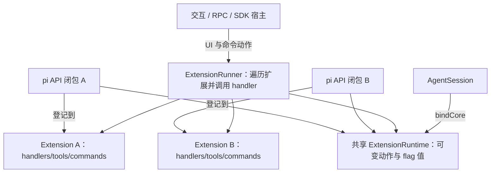

# x. Pi 技能与扩展源码解析：Skill 加载与 Extension 运行机制

**选读材料，不计入主线编号。对应主线：[10 Bootstrap、Skill 与 Extension 加载原理](10_Bootstrap、Skill与Extension加载原理完整讲义.md)。**

## 从“怎样检查代码”到“谁来拦住修改”

给 Agent 一个问题：“检查这个函数有没有边界错误。”它已经有 read、bash、edit 等工具，可以读文件、提出修改。不过，我们可能还希望它每次都按同一套方法检查：先列出输入范围，再找空值、边界与异常路径，最后给出最小修改建议。

这套方法可以写进一份文件：

```markdown
---
name: code-review
description: 检查函数的输入边界、异常路径和状态变化，给出最小修改建议。
---

# 代码检查步骤

1. 先读取相关函数和直接调用方。
2. 列出正常输入、空输入与边界输入。
3. 按执行顺序说明状态怎样变化。
4. 给出问题所在行和最小修改方案。
5. 用户只要求检查时，先报告问题，不修改文件。

需要检查清单时，读取 references/checklist.md。
```

将它放在 `.pi/skills/code-review/SKILL.md`，就得到一个 Skill。它向模型提供一种完成任务的方法。

接着提出另一个要求：“检查模式开启时，凡是模型调用 edit 或 write，都在执行前阻止。”这件事需要程序在工具真正执行的位置做判断。写进 Markdown 的要求仍需模型遵循；Extension 则可以注册 `tool_call` 回调，由 Pi 调用这段代码并采用它的返回值。

```ts
// Extension 中的一段注册代码；完整示例见第 12 节。
pi.on("tool_call", async (event) => {
  if (event.toolName === "edit" || event.toolName === "write") {
    return { block: true, reason: "检查模式下暂不修改文件。" };
  }
});
```

两者解决的问题由此分开：Skill 把任务知识交给模型，Extension 把程序逻辑接入 Pi 的运行过程。它们还可以配合：Skill 说明检查步骤，Extension 提供工具、切换检查模式、保存状态，并在执行前处理工具调用。

| 需要解决的问题 | 对应机制 | 实际进入哪里 |
| --- | --- | --- |
| 给模型一套检查方法 | Skill 的名称、描述和正文 | 系统提示词清单，以及后续 user 或 toolResult 消息 |
| 将一段短提示按参数展开 | Prompt Template | 本次用户输入 |
| 为项目提供长期规则 | AGENTS.md 等项目上下文文件 | 系统提示词 |
| 给模型一个可调用函数 | ToolDefinition 注册并包装为 AgentTool | 活跃工具数组与模型工具 schema |
| 在运行节点执行代码、改写输入或处理返回值 | Extension | 注册表、ExtensionRunner 与宿主绑定 |
| 一起分发上述资源 | Pi package | 包解析得到的 extensions/skills/prompts/themes 路径 |

Skill 本身没有一个 `execute()` 入口。Extension 也不必提供工具：只注册命令、事件或界面组件，同样是一个扩展。本章所说的 Extension 属于 `pi-coding-agent` 应用层；底层 `pi-agent-core` 的 Agent 通过回调和 AgentTool 与它连接。

下面的例子使用假设目录 `/work/review-demo`。源码链接打开文件，行号用于 IDE“转到行”；摘录省略注释和空行。公开 API 示例仅做静态核对，未运行或编译。

## 章节索引

| 章节与跳转 |
| --- |
| [1. Skill 加载后，内存里保存的是什么](#x-skills-01) |
| [2. Skill 从哪些目录进入加载器](#x-skills-02) |
| [3. Skill 正文怎样进入模型上下文](#x-skills-03) |
| [4. Extension 文件什么时候开始执行](#x-skills-04) |
| [5. 从工厂中的 pi，到会话中的 ExtensionRunner](#x-skills-05) |
| [6. Extension 工具怎样成为模型可调用的工具](#x-skills-06) |
| [7. 命令、快捷键与启动参数怎样触发扩展](#x-skills-07) |
| [8. 扩展事件：谁发出，谁等待，谁采用返回值](#x-skills-08) |
| [9. 工具拦截与用户 Bash：返回值怎样改变执行](#x-skills-09) |
| [10. 扩展怎样读写会话、发送消息与扩充模型](#x-skills-10) |
| [11. UI 能力由宿主提供：同一个 ctx，三种运行方式](#x-skills-11) |
| [12. 扩展状态怎样随会话和分支恢复](#x-skills-12) |
| [13. Extension 提供 Skill：动态资源与包分发](#x-skills-13) |
| [14. 重载、会话替换与扩展清理](#x-skills-14) |
| [15. 用公开 SDK 观察加载、绑定和命令执行](#x-skills-15) |
| [16. IDE 源码阅读导航](#x-skills-16) |

<a id="x-skills-01"></a>

## 1. Skill 加载后，内存里保存的是什么

### 1.1 SKILL.md 的头部与正文分别用于哪一步

将前面的文件放入以下目录：

```text
/work/review-demo/.pi/skills/
└── code-review/
    ├── SKILL.md
    ├── references/
    │   └── checklist.md
    └── scripts/
        └── check-example.py
```

`SKILL.md` 的 YAML 头部用于发现和选择 Skill，正文说明任务步骤，其他文件由正文引用。加载 Skill 时不会递归执行 scripts，也不会把 references 全部拼进模型上下文；正文要求使用某个脚本时，仍需通过可用工具发起相应操作。

先看加载结果的类型，位置在 [skills.ts:69](../pi-master/packages/coding-agent/src/core/skills.ts#L69)：

源码摘录：[skills.ts:69](../pi-master/packages/coding-agent/src/core/skills.ts#L69)，第 69—90 行。

```ts
export interface SkillFrontmatter {
  name?: string;
  description?: string;
  "disable-model-invocation"?: boolean;
  [key: string]: unknown;
}
export interface Skill {
  name: string;
  description: string;
  filePath: string;
  baseDir: string;
  sourceInfo: SourceInfo;
  disableModelInvocation: boolean;
}
export interface LoadSkillsResult {
  skills: Skill[];
  diagnostics: ResourceDiagnostic[];
}
```

`Skill` 没有保存正文的字段。它记录六项信息：name 用来查找，description 用来让模型判断适用任务，filePath 定位文件，baseDir 解释相对资源路径，sourceInfo 标识来源，disableModelInvocation 控制是否进入模型可见清单。

因此“已经加载 Skill”首先意味着内存中有这样一条元信息，而不是正文已经发送给模型：

```text
skills[0]
  name                   = "code-review"
  description            = "检查函数的输入边界、异常路径和状态变化，给出最小修改建议。"
  filePath               = "/work/review-demo/.pi/skills/code-review/SKILL.md"
  baseDir                = "/work/review-demo/.pi/skills/code-review"
  disableModelInvocation = false
  sourceInfo             = 此文件的来源信息
```

### 1.2 从文件内容到 Skill 对象

路径发现之后，`loadSkillFromFile()` 才负责读取和检查。调用方需要的结果是 `{skill, diagnostics}`：可用的 Skill 与诊断分开返回。

源码摘录：[skills.ts:288](../pi-master/packages/coding-agent/src/core/skills.ts#L288)，第 288—337 行。

```ts
function loadSkillFromFile(
  filePath: string,
  source: string,
): { skill: Skill | null; diagnostics: ResourceDiagnostic[] } {
  const diagnostics: ResourceDiagnostic[] = [];
  try {
    const rawContent = readFileSync(filePath, "utf-8");
    const { frontmatter } = parseFrontmatter<SkillFrontmatter>(rawContent);
    const skillDir = dirname(filePath);
    const parentDirName = basename(skillDir);
    const descErrors = validateDescription(frontmatter.description);
    for (const error of descErrors) {
      diagnostics.push({ type: "warning", message: error, path: filePath });
    }
    const name = frontmatter.name || parentDirName;
    const nameErrors = validateName(name, parentDirName);
    for (const error of nameErrors) {
      diagnostics.push({ type: "warning", message: error, path: filePath });
    }
    if (!frontmatter.description || frontmatter.description.trim() === "") {
      return { skill: null, diagnostics };
    }
    return {
      skill: {
        name,
        description: frontmatter.description,
        filePath,
        baseDir: skillDir,
        sourceInfo: createSkillSourceInfo(filePath, skillDir, source),
        disableModelInvocation: frontmatter["disable-model-invocation"] === true,
      },
      diagnostics,
    };
  } catch (error) {
    const message = error instanceof Error ? error.message : "failed to parse skill file";
    diagnostics.push({ type: "warning", message, path: filePath });
    return { skill: null, diagnostics };
  }
}
```

按前面的文件代入：

1. `rawContent` 是包含 YAML 头部的完整文本。`parseFrontmatter()` 分出 frontmatter 与 body，这里只取前者。
2. `skillDir=dirname(filePath)`，`parentDirName="code-review"`。未写 name 或 name 为假值时，使用目录名。
3. description 和 name 分别经过检查。检查结果先加入 diagnostics，不立即中断加载。
4. description 缺失或 trim 后为空，返回 skill=null。可用的描述存在时，才构造 Skill 对象。
5. `disable-model-invocation` 只有严格等于布尔值 true 才生效。字符串 `"true"` 与布尔值 true 不同。
6. 读取或解析抛错时，catch 把错误转成 warning，并返回 skill=null。

YAML 分割见 [frontmatter.ts:10](../pi-master/packages/coding-agent/src/utils/frontmatter.ts#L10)：先统一换行，检查文件开头的 `---`，再寻找结束分隔符。缺少完整头部时 frontmatter 为空；`parse()` 得到的结果通过类型断言返回，并没有额外做完整 schema 校验。因此头部的值仍应按声明写成字符串或布尔值。

name 的规则在 [skills.ts:96](../pi-master/packages/coding-agent/src/core/skills.ts#L96)：最多 64 字符，只用小写字母、数字和连字符，不能首尾为连字符，也不能出现连续连字符，并检查名称与父目录名是否一致。description 最多 1024 字符。

这些检查的处理强度不同：

| 文件情况 | 诊断 | 是否产生 Skill |
| --- | --- | --- |
| name 省略，目录名合法，description 有效 | 正常 | 是，名称取目录名 |
| name 与目录名不同、名称过长或字符不合规则 | warning | 通常仍加载 |
| description 超长 | warning | 仍加载 |
| description 缺失或空白 | warning | 否 |
| YAML 解析失败、读文件失败，或错误类型导致后续处理抛错 | warning | 否 |

这也解释了为什么资源诊断里出现 warning 后，命令列表中仍可能找到该 Skill。

### 1.3 自定义 frontmatter 字段会发生什么

`SkillFrontmatter` 允许额外键，但读取器只消费上面几个字段。将 `allowed-tools`、`model`、`context` 或其他系统的专用字段写进去，并不会在这条加载链中自动创建工具白名单、切换模型或启动独立 Agent。

正文同样是一段交给模型的文本。它可以要求读取附属文件、使用已有工具、遵守输出格式，却不会通过 Skill 加载器注册一个新的 TypeScript 回调。要改变运行程序的行为，需要后面的 Extension 机制。

<a id="x-skills-02"></a>

## 2. Skill 从哪些目录进入加载器

### 2.1 默认应用入口先解析资源来源

正常启动时，CLI 经 `createAgentSessionServices()` 创建 `DefaultResourceLoader` 并等待 reload；SDK 的 `createAgentSession()` 在没有外部 loader 时也会创建并加载一个。外部传入的 loader 则由调用方准备，见 [sdk.ts:194](../pi-master/packages/coding-agent/src/core/sdk.ts#L194) 附近与 [agent-session-services.ts:131](../pi-master/packages/coding-agent/src/core/agent-session-services.ts#L131)。

这条资源链先确定路径，再解析文件：


`PackageManager.resolve()` 在 [package-manager.ts:846](../pi-master/packages/coding-agent/src/core/package-manager.ts#L846) 依次处理配置包、项目与用户资源设置、自动发现目录，最后整理 `ResolvedPaths`。每一项不仅有 path，还有 enabled 与 metadata。ResourceLoader 先保存来源信息，再过滤 enabled=false 的项。

默认位置不只有 `.pi/skills`：

| 来源 | 扫描位置或路径基准 |
| --- | --- |
| Pi 项目 Skill | `cwd/.pi/skills` |
| Pi 用户 Skill | `agentDir/skills`；默认 agentDir 位于用户的 `.pi/agent` |
| 兼容的项目 Skill 目录 | 从 cwd 向父目录查找 `.agents/skills`，到最近 Git 仓库根停止；没有 Git 根时走到文件系统根 |
| 兼容的用户 Skill 目录 | 用户主目录下 `.agents/skills` |
| 项目 settings 中 skills | 相对项目 `.pi` 目录解析 |
| 用户 settings 中 skills | 相对 agentDir 解析 |
| `--skill` / loader.additionalSkillPaths | 显式路径，按 cwd 处理相对位置 |
| package 的 skills | 包根目录及其资源声明 |
| Extension 的 resources_discover | 扩展返回资源路径，随后由 loader 合并 |

祖先目录的停止条件直接体现在下面的循环里：

源码摘录：[package-manager.ts:413](../pi-master/packages/coding-agent/src/core/package-manager.ts#L413)，第 413—432 行。

```ts
function collectAncestorAgentsSkillDirs(startDir: string): string[] {
  const skillDirs: string[] = [];
  const resolvedStartDir = resolve(startDir);
  const gitRepoRoot = findGitRepoRoot(resolvedStartDir);
  let dir = resolvedStartDir;
  while (true) {
    skillDirs.push(join(dir, ".agents", "skills"));
    if (gitRepoRoot && dir === gitRepoRoot) {
      break;
    }
    const parent = dirname(dir);
    if (parent === dir) {
      break;
    }
    dir = parent;
  }
  return skillDirs;
}
```

如果 cwd 是 `/work/repo/packages/app`，最近 Git 根在 `/work/repo`，结果按由近到远排列：

```text
/work/repo/packages/app/.agents/skills
/work/repo/packages/.agents/skills
/work/repo/.agents/skills
```

项目 `.pi/skills` 只取 cwd 下这一处；向祖先扩展的是这里的 `.agents/skills`。同一路径还会在后续去重，避免用户 `.agents/skills` 同时被当成项目祖先重复加入。

### 2.2 哪些文件算一个 Skill

上游 `collectSkillEntries()` 见 [package-manager.ts:321](../pi-master/packages/coding-agent/src/core/package-manager.ts#L321)，下游 `loadSkillsFromDirInternal()` 见 [skills.ts:182](../pi-master/packages/coding-agent/src/core/skills.ts#L182)。两者都先检查一个目录中是否有未被忽略的 `SKILL.md`。找到后把该目录视为一个 Skill，立即返回；附属目录不会继续作为独立 Skill 扫描。

下游读取器在找到 SKILL.md 后的执行部分如下：

源码摘录：[skills.ts:219](../pi-master/packages/coding-agent/src/core/skills.ts#L219)，第 219—230 行。

```ts
  const relPath = toPosixPath(relative(root, fullPath));
  if (!isFile || ig.ignores(relPath)) {
    continue;
  }
  const result = loadSkillFromFile(fullPath, source);
  if (result.skill) {
    skills.push(result.skill);
  }
  diagnostics.push(...result.diagnostics);
  return { skills, diagnostics };
}
```

即使 `loadSkillFromFile()` 最后因描述缺失返回 skill=null，目录扫描仍在这里 return。因此“修好同目录另一个 Markdown 文件”不能替代修复这个 SKILL.md。

没有 SKILL.md 时，才继续遍历目录。递归会跳过隐藏项、node_modules，以及忽略规则命中的项；符号链接先 stat 判断真实类型，断链跳过。扫描器没有完整的循环目录访问集合，目录链接应避免构成环。

两种自动发现模式还存在区别：Pi 的 `skills` 根目录允许直接放 `.md` 文件，`.agents/skills` 模式只识别递归找到的 SKILL.md。Pi 根目录中的普通 Markdown 一旦被当成 Skill，也必须有有效 description；它的默认名称来自父目录，而不是文件名。

```text
.pi/skills/
├── quick.md                   根目录 Markdown 可以参与扫描
├── code-review/
│   ├── SKILL.md                识别为一个 Skill，至此停止向内扫描
│   └── references/detail.md    附属材料，不再作为独立 Skill
└── group/
    ├── notes.md               非扫描根的普通 Markdown 不算 Skill
    └── debug/
        └── SKILL.md           递归找到的独立 Skill
```

忽略文件包括 `.gitignore`、`.ignore` 和 `.fdignore`，见 [skills.ts:16](../pi-master/packages/coding-agent/src/core/skills.ts#L16)。`addIgnoreRules()` 第 47 行把各层规则转换为相对扫描根的规则，交给 ignore matcher。规则的用途是决定是否发现文件；模型后来通过 read 主动读取文件时，走的是 read 工具自己的逻辑。

目录不存在时返回空结果；目录遍历异常被捕获。显式提供的缺失路径则由 loadSkills 加入 `skill path does not exist` warning。目录扫描失败、单文件解析失败与正常空目录，最终都可能没有 Skill，但诊断来源不同。

### 2.3 同名与同文件：两次去重解决不同问题

ResourceLoader 得到路径后调用 loadSkills。`skillMap` 按 name 选唯一 Skill，`realPathSet` 识别不同路径是否指向同一个文件：

源码摘录：[skills.ts:428](../pi-master/packages/coding-agent/src/core/skills.ts#L428)，第 428—463 行。

```ts
function addSkills(result: LoadSkillsResult) {
  // 先把这批加载的诊断合并进来
  allDiagnostics.push(...result.diagnostics);
  // 逐个处理这批加载到的技能
  for (const skill of result.skills) {
    // 解析符号链接得到"真实路径"，用于判断两个不同路径是否指向同一文件
    let realPath: string;
    try {
      // realpathSync 解析符号链接(以及 ..、. 等)，返回规范化后的真实路径
      realPath = realpathSync(skill.filePath);
    } catch {
      // 解析失败(如文件刚被删)就用原路径兜底，不去重也不报错
      realPath = skill.filePath;
    }
    // 真实路径已登记 → 说明这个文件之前通过别的路径(如符号链接)加载过，静默跳过
    if (realPathSet.has(realPath)) {
      continue;
    }
    // 按技能名查登记表
    const existing = skillMap.get(skill.name);
    if (existing) {
      // 重名：保留先加载的(existing 不动)，给后来的这个记一条 collision 诊断，
      // 诊断里写明 胜者/败者 的路径，方便用户排查
      collisionDiagnostics.push({
        type: "collision",
        message: `name "${skill.name}" collision`,
        path: skill.filePath,
        collision: {
          resourceType: "skill",
          name: skill.name,
          winnerPath: existing.filePath, // 胜者：先加载的那个
          loserPath: skill.filePath, // 败者：当前这个(被丢弃)
        },
      });
    } else {
      // 没有重名：登记技能，并把真实路径也登记进集合供后续去重
      skillMap.set(skill.name, skill);
      realPathSet.add(realPath);
    }
  }
}
```

例如候选顺序为：

```text
① /work/review-demo/.pi/skills/code-review/SKILL.md  name=code-review
② /home/student/.pi/agent/skills/code-review/SKILL.md  name=code-review
③ /work/shared/review-link/SKILL.md  realpath 指向①
```

处理①后，skillMap 保存 code-review，realPathSet 保存①的真实路径。②是另一个文件但同名，产生 collision，winnerPath 指①、loserPath 指②，保留①。③先命中 realPathSet，静默跳过，不再产生同名诊断。

“谁先出现”由调用链决定。正常 ResourceLoader 使用 PackageManager 整理后的顺序：

源码摘录：[package-manager.ts:164](../pi-master/packages/coding-agent/src/core/package-manager.ts#L164)，第 164—168 行。

```ts
function resourcePrecedenceRank(m: PathMetadata): number {
  if (m.origin === "package") return 4;
  const scopeBase = m.scope === "project" ? 0 : 2;
  return scopeBase + (m.source === "local" ? 0 : 1);
}
```

对应优先级是项目显式资源、项目自动发现、用户显式资源、用户自动发现、包资源。显式 `-e` 来源中解析出的资源还会由 loader 放在普通来源之前，additionalSkillPaths 再参与合并。相同等级沿已有顺序处理；扫描器没有统一按 Skill 名排序。

独立调用 `loadSkills({includeDefaults:true,...})` 则走另一条较简单的入口：先 agentDir/skills，再 cwd/.pi/skills，最后 skillPaths，见 [skills.ts:466](../pi-master/packages/coding-agent/src/core/skills.ts#L466)。它不负责 PackageManager 的祖先 `.agents` 扫描。ResourceLoader 传的是 `includeDefaults:false`，因为默认来源已经由上游解析过。

所以，用这个独立函数测试“项目和用户同名谁胜出”时，必须先看 includeDefaults；两条入口不能共用一张脱离调用方的优先级表。

### 2.4 禁用开关、显式路径与 override

ResourceLoader 中选 Skill 路径的条件是：

源码摘录：[resource-loader.ts:442](../pi-master/packages/coding-agent/src/core/resource-loader.ts#L442)，第 442—448 行。

```ts
const skillPaths = this.noSkills
  ? this.mergePaths(cliEnabledSkills, this.additionalSkillPaths)
  : this.mergePaths([...cliEnabledSkills, ...enabledSkills], this.additionalSkillPaths);
this.lastSkillPaths = skillPaths;
this.updateSkillsFromPaths(skillPaths, metadataByPath);
```

noSkills=true 时仍保留 `cliEnabledSkills` 和 `additionalSkillPaths`，只是去掉通常加载的 enabledSkills。`--no-skills --skill ./one-skill` 可以表达“只加载显式指定的 Skill”。同样，扩展的 resources_discover 之后仍可以提供 Skill 路径。

接下来才真正读取文件并调用可选 override：

源码摘录：[resource-loader.ts:515](../pi-master/packages/coding-agent/src/core/resource-loader.ts#L515)，第 515—536 行。

```ts
private updateSkillsFromPaths(skillPaths: string[], metadataByPath?: Map<string, PathMetadata>): void {
  let skillsResult: { skills: Skill[]; diagnostics: ResourceDiagnostic[] };
  if (this.noSkills && skillPaths.length === 0) {
    skillsResult = { skills: [], diagnostics: [] };
  } else {
    skillsResult = loadSkills({
      cwd: this.cwd,
      agentDir: this.agentDir,
      skillPaths,
      includeDefaults: false,
    });
  }
  const resolvedSkills = this.skillsOverride ? this.skillsOverride(skillsResult) : skillsResult;
  this.skills = resolvedSkills.skills.map((skill) => ({
    ...skill,
    sourceInfo:
      this.findSourceInfoForPath(skill.filePath, this.extensionSkillSourceInfos, metadataByPath) ??
      skill.sourceInfo ??
      this.getDefaultSourceInfoForPath(skill.filePath),
  }));
  this.skillDiagnostics = resolvedSkills.diagnostics;
}
```

`skillsOverride` 接收基础 skills/diagnostics，返回最终集合；即使基础集合为空，它仍会执行。最终每条 Skill 再补来源信息，loader 用新数组替换 `this.skills`，diagnostics 则单独保存。

设置中的过滤符号由 [package-manager.ts:673](../pi-master/packages/coding-agent/src/core/package-manager.ts#L673) 处理：`!` 排除匹配项，`+` 强制包含精确路径，`-` 强制排除精确路径，执行顺序决定最终 enabled。包过滤还有普通包含模式，见第 700 行。它们改变的是资源候选集合，和 Skill 的 `disable-model-invocation` 是不同层次的控制。

<a id="x-skills-03"></a>

## 3. Skill 正文怎样进入模型上下文

### 3.1 系统提示词只先提供清单

加载出 Skill[] 后，`AgentSession._rebuildSystemPrompt()` 把它交给 buildSystemPrompt。提示词构造器在活跃工具有 read 时附加 Skill 清单，见 [system-prompt.ts:74](../pi-master/packages/coding-agent/src/core/system-prompt.ts#L74) 和第 169 行。

系统提示词的整体组装可直接查看 [buildSystemPrompt](../pi-master/packages/coding-agent/src/core/system-prompt.ts#L31)。Skill 在这一步提供的是可供选择的目录：先让模型知道有哪些任务知识，再按需读取正文。

源码摘录：[skills.ts:349](../pi-master/packages/coding-agent/src/core/skills.ts#L349)，第 349—376 行。

```ts
export function formatSkillsForPrompt(skills: Skill[]): string {
  const visibleSkills = skills.filter((s) => !s.disableModelInvocation);
  if (visibleSkills.length === 0) {
    return "";
  }
  const lines = [
    "\n\nThe following skills provide specialized instructions for specific tasks.",
    "Use the read tool to load a skill's file when the task matches its description.",
    "When a skill file references a relative path, resolve it against the skill directory (parent of SKILL.md / dirname of the path) and use that absolute path in tool commands.",
    "",
    "<available_skills>",
  ];
  for (const skill of visibleSkills) {
    lines.push("  <skill>");
    lines.push(`    <name>${escapeXml(skill.name)}</name>`);
    lines.push(`    <description>${escapeXml(skill.description)}</description>`);
    lines.push(`    <location>${escapeXml(skill.filePath)}</location>`);
    lines.push("  </skill>");
  }
  lines.push("</available_skills>");
  return lines.join("\n");
}
```

`visibleSkills` 过滤 disableModelInvocation=true 的 Skill；随后分别对 name、description、filePath 做 XML 转义，生成 `<available_skills>`。函数没有读取正文，返回的是一段字符串，随后并入 Agent 的 systemPrompt。

本例的模型可见部分近似如下：

```xml
<available_skills>
  <skill>
    <name>code-review</name>
    <description>检查函数的输入边界、异常路径和状态变化，给出最小修改建议。</description>
    <location>/work/review-demo/.pi/skills/code-review/SKILL.md</location>
  </skill>
</available_skills>
```

这里没有一个 TypeScript 函数按 description 自动匹配任务并执行 Skill。提示词告诉模型：任务符合描述时，调用 read 读取对应文件。选择发生在模型生成工具调用的过程中。

### 3.2 模型调用 read：正文成为工具结果

假设用户输入“检查 parser.ts 的空输入处理”。模型选中 code-review，生成 read 的 ToolCall，然后沿第 07 章的工具执行链读取 SKILL.md：

```text
用户消息 U
→ 助手消息 A1，包含 read({path:".../code-review/SKILL.md"})
→ read 工具返回文件内容 R1
→ R1 成为 ToolResultMessage
→ 下一次模型请求包含 U、A1、R1
→ 模型按正文决定是否继续读 references/checklist.md 或检查 parser.ts
```

这条路径使用普通 read 工具，因此输出长度限制、图片处理、错误和取消都遵循 read 的实现。它读取的是文件内容，Skill 加载器不会在此替 read 自动去掉 YAML 头部。附属文件也只在后续工具调用时读取。

Skill 的脚本同理：模型看到使用说明后可以调用 bash 执行脚本；能否执行、执行目录和参数由实际工具调用决定。`SKILL.md` 的存在不会自动启动脚本，也不会自动安装脚本依赖。

### 3.3 用户显式调用：正文展开为本次 user 输入

用户输入 `/skill:code-review 只看 parser.ts` 时，处理方式不同。Session.prompt 先尝试扩展命令，再运行 input 钩子，随后展开 Skill，最后展开 Prompt Template，见 [agent-session.ts:968](../pi-master/packages/coding-agent/src/core/agent-session.ts#L968)。具体展开函数是：

源码摘录：[agent-session.ts:1174](../pi-master/packages/coding-agent/src/core/agent-session.ts#L1174)，第 1174—1198 行。

```ts
private _expandSkillCommand(text: string): string {
  if (!text.startsWith("/skill:")) return text;
  const spaceIndex = text.indexOf(" ");
  const skillName = spaceIndex === -1 ? text.slice(7) : text.slice(7, spaceIndex);
  const args = spaceIndex === -1 ? "" : text.slice(spaceIndex + 1).trim();
  const skill = this.resourceLoader.getSkills().skills.find((s) => s.name === skillName);
  if (!skill) return text;
  try {
    const content = readFileSync(skill.filePath, "utf-8");
    const body = stripFrontmatter(content).trim();
    const skillBlock = `<skill name="${skill.name}" location="${skill.filePath}">\nReferences are relative to ${skill.baseDir}.\n\n${body}\n</skill>`;
    return args ? `${skillBlock}\n\n${args}` : skillBlock;
  } catch (err) {
    this._extensionRunner.emitError({
      extensionPath: skill.filePath,
      event: "skill_expansion",
      error: err instanceof Error ? err.message : String(err),
    });
    return text;
  }
}
```

`skillName="code-review"` 用来查已加载的 Skill；`args="只看 parser.ts"`；函数重新同步读取文件，stripFrontmatter 取正文，组合后返回字符串：

```text
<skill name="code-review" location="/work/review-demo/.pi/skills/code-review/SKILL.md">
References are relative to /work/review-demo/.pi/skills/code-review.

# 代码检查步骤

1. 先读取相关函数和直接调用方。
……其余正文……
</skill>

只看 parser.ts
```

这次没有为读取 Skill 发出模型 ToolCall；正文直接并入即将创建的 user 消息。文件名不存在或读取失败时，函数返回原输入；失败还会发 `skill_expansion` 错误通知。参数原样接在 Skill 块之后，不使用 `$1` 之类的模板替换。

两个时点也要分开：加载时保存 description/path，显式调用时重新读正文。修改正文后，下次显式展开可读到新文本；修改 name、description 或添加新 Skill，需要重载资源才会更新内存清单。

### 3.4 三个开关控制不同阶段

| 控制项 | 改变什么 | 仍可发生什么 |
| --- | --- | --- |
| noSkills / `--no-skills` | 排除通常来源的 Skill 路径 | 显式路径、override、扩展资源仍可提供 Skill |
| `disable-model-invocation: true` | 从模型可见清单过滤该 Skill | 已加载的 Skill 仍可显式 `/skill:名称` 展开 |
| settings.enableSkillCommands=false | 交互界面不建立 Skill 命令补全项 | Session 的 `_expandSkillCommand()` 没有读取此设置，手动输入仍按核心规则处理 |

命令补全的建立点在 [interactive-mode.ts:454](../pi-master/packages/coding-agent/src/modes/interactive/interactive-mode.ts#L454)。循环遍历所有已加载 Skill，生成 `skill:${skill.name}`，并没有再过滤 disableModelInvocation。

Session.prompt 的 expandPromptTemplates=false 会同时跳过扩展命令尝试、Skill 与模板展开；input handler 仍有自己的处理位置。扩展的 sendUserMessage 使用这一模式，见第 10 节。普通 Skill 命令则沿正常 prompt 路径运行，可能被 input handler transform 或 handled。

如果没有活跃 read 工具，buildSystemPrompt 不附加 Skill 清单；显式 Skill 展开是会话层读文件，仍是另一条入口。以上控制均不构成文件访问权限系统。

<a id="x-skills-04"></a>

## 4. Extension 文件什么时候开始执行

### 4.1 Extension 是一个接收 ExtensionAPI 的工厂

一个最小扩展可以只登记通知：

```ts
import type { ExtensionAPI } from "@mariozechner/pi-coding-agent";

export default function (pi: ExtensionAPI) {
  pi.on("session_start", (_event, ctx) => {
    ctx.ui.notify("代码检查扩展已就绪", "info");
  });
}
```

保存为 `.pi/extensions/review.ts` 后，加载器先执行模块，再调用 default 导出的工厂。工厂接收 pi；session_start 的回调以后才接收 event 和 ctx。

三段代码分别发生在不同时间：

```text
模块顶层的 import 和语句     加载模块时执行
default 工厂的函数体        await factory(pi) 时执行
pi.on 登记的 handler        对应事件发生时执行
```

这使扩展可以在工厂闭包中保存状态，让几个工具、命令和事件 handler 共享它。工厂可以是 async，加载器会等待返回的 Promise。

### 4.2 默认发现、显式扩展与包入口

默认扩展目录为 cwd/.pi/extensions 与 agentDir/extensions。PackageManager 的 `collectAutoExtensionEntries()` 在 [package-manager.ts:548](../pi-master/packages/coding-agent/src/core/package-manager.ts#L548) 先检查目录自身是否声明入口；没有才看该目录中的 `.ts/.js` 文件和直接子目录的入口。

目录入口的选择顺序是 package.json 的 `pi.extensions`、index.ts、index.js。存在可用的 manifest 入口就采用该列表；不沿任意层级递归寻找所有 TypeScript 文件。

```text
.pi/extensions/
├── review.ts                 独立入口
├── report/
│   ├── index.ts              report 的入口
│   └── helpers.ts            被 index.ts import，不自动作为另一个扩展
└── bundle/
    ├── package.json          pi.extensions 指定入口列表
    └── src/entry.ts
```

同一个自动扩展根若本身提供 index.ts 或可用 manifest 入口，会优先使用该根入口，而不是再把其中所有文件各加载一遍。项目与用户目录、settings、显式 `-e`、包资源的组合仍由前面的 ResourceLoader 完成。

源码摘录：[resource-loader.ts:417](../pi-master/packages/coding-agent/src/core/resource-loader.ts#L417)，第 417—425 行。

```ts
const extensionPaths = this.noExtensions
  ? cliEnabledExtensions
  : this.mergePaths(cliEnabledExtensions, enabledExtensions);
const extensionsResult = await loadExtensions(extensionPaths, this.cwd, this.eventBus);
const inlineExtensions = await this.loadExtensionFactories(extensionsResult.runtime);
extensionsResult.extensions.push(...inlineExtensions.extensions);
extensionsResult.errors.push(...inlineExtensions.errors);
```

noExtensions=true 只排除通常来源，显式 `-e` 仍可加载。extensionFactories 是 SDK 提供的内存工厂，也在文件加载后执行；它们不依赖扫描出的文件路径。

包可以只含 Skill，也可以同时含扩展和其他资源。`-e` 经 resolveExtensionSources 解析一个包来源时，得到的可能不只有 extensions，还包括该包声明的 skills/prompts/themes。

### 4.3 模块加载与工厂执行是两次等待

源码摘录：[loader.ts:348](../pi-master/packages/coding-agent/src/core/extensions/loader.ts#L348)，第 348—363 行。

```ts
async function loadExtensionModule(extensionPath: string) {
  const jiti = createJiti(import.meta.url, {
    moduleCache: false,
    ...(isBunBinary ? { virtualModules: VIRTUAL_MODULES, tryNative: false } : { alias: getAliases() }),
  });
  const module = await jiti.import(extensionPath, { default: true });
  const factory = module as ExtensionFactory;
  return typeof factory !== "function" ? undefined : factory;
}
```

Jiti 负责加载 TypeScript/JavaScript 模块。moduleCache=false 支持重载时重新读取模块；普通环境设置 package alias，打包成 Bun 二进制时用内置虚拟模块，相关绑定在同文件第 67 行附近。它帮助扩展取得宿主使用的 Pi、TypeBox、TUI 等模块。

`jiti.import(...,{default:true})` 得到默认导出，必须是函数。随后文件加载函数创建登记容器并调用它：

源码摘录：[loader.ts:390](../pi-master/packages/coding-agent/src/core/extensions/loader.ts#L390)，第 390—427 行。

```ts
async function loadExtension(
  extensionPath: string,
  cwd: string,
  eventBus: EventBus,
  runtime: ExtensionRuntime,
): Promise<{ extension: Extension | null; error: string | null }> {
  const resolvedPath = resolvePath(extensionPath, cwd);
  try {
    const factory = await loadExtensionModule(resolvedPath);
    if (!factory) {
      return { extension: null, error: `Extension does not export a valid factory function: ${extensionPath}` };
    }
    const extension = createExtension(extensionPath, resolvedPath);
    const api = createExtensionAPI(extension, runtime, cwd, eventBus);
    await factory(api);
    return { extension, error: null };
  } catch (err) {
    const message = err instanceof Error ? err.message : String(err);
    return { extension: null, error: `Failed to load extension: ${message}` };
  }
}
```

对 `.pi/extensions/review.ts`：resolvedPath 先确定实际文件；模块加载成功后，createExtension 返回空 Map；createExtensionAPI 返回 pi；factory 调用 pi.on 将 handler 放进 Map。`await factory(api)` 完成，才返回可用 Extension。

扩展是当前 Pi 进程加载的代码，可以 import 文件系统模块、创建计时器或启动其他工作。这里没有为扩展建立独立进程或文件权限沙箱。是否采用某份扩展代码，和是否让模型看到 Skill 文本，是两种不同的执行关系。

### 4.4 一份文件失败以后，其他文件怎样继续

源码摘录：[loader.ts:452](../pi-master/packages/coding-agent/src/core/extensions/loader.ts#L452)，第 452—476 行。

```ts
export async function loadExtensions(paths: string[], cwd: string, eventBus?: EventBus): Promise<LoadExtensionsResult> {
  const extensions: Extension[] = [];
  const errors: Array<{ path: string; error: string }> = [];
  const resolvedEventBus = eventBus ?? createEventBus();
  const runtime = createExtensionRuntime();
  for (const extPath of paths) {
    const { extension, error } = await loadExtension(extPath, cwd, resolvedEventBus, runtime);
    if (error) {
      errors.push({ path: extPath, error });
      continue;
    }
    if (extension) {
      extensions.push(extension);
    }
  }
  return {
    extensions,
    errors,
    runtime,
  };
}
```

paths 按顺序加载，前一个工厂完成后才开始下一个。失败文件返回的 error 被加入 errors，循环继续；成功扩展加入 extensions。所有成功工厂共用一个 runtime 和一个 eventBus。

工厂若在登记了一些工具后抛错，这个 Extension 不会进入成功数组；但此前已经发生的模块副作用、外部文件写入或对共享 runtime 的修改没有统一回滚。例如先登记 provider 再抛错，暂存 provider 仍可能已进入共享 pendingProviderRegistrations。

内存入口 `loadExtensionFromFactory()` 第 434 行跳过文件导入，直接创建容器并 await factory；它本身不包同样的 catch。ResourceLoader 的工厂加载循环再收集对应 errors，给每个工厂使用 `<inline:...>` 来源标识。

公开便利函数 `discoverAndLoadExtensions()` 第 590 行则自行扫描项目、用户目录和 configuredPaths，再调用 loadExtensions。正常 DefaultResourceLoader 使用的是上面 PackageManager 解析后的路径链；它不会再调用这份便利扫描器重复发现。

<a id="x-skills-05"></a>

## 5. 从工厂中的 pi，到会话中的 ExtensionRunner

### 5.1 每个扩展一组 Map，所有扩展共用运行入口

`createExtension()` 创建的对象保存登记结果：

源码摘录：[loader.ts:369](../pi-master/packages/coding-agent/src/core/extensions/loader.ts#L369)，第 369—387 行。

```ts
function createExtension(extensionPath: string, resolvedPath: string): Extension {
  const source =
    extensionPath.startsWith("<") && extensionPath.endsWith(">")
      ? extensionPath.slice(1, -1).split(":")[0] || "temporary"
      : "local";
  const baseDir = extensionPath.startsWith("<") ? undefined : path.dirname(resolvedPath);
  return {
    path: extensionPath,
    resolvedPath,
    sourceInfo: createSyntheticSourceInfo(extensionPath, { source, baseDir }),
    handlers: new Map(),
    tools: new Map(),
    messageRenderers: new Map(),
    commands: new Map(),
    flags: new Map(),
    shortcuts: new Map(),
  };
}
```

例如一个扩展注册两条事件、一个工具和一个命令后，内存结构可以写成：

```text
extension.path = ".../review.ts"
extension.handlers = Map {
  "session_start" → [restore],
  "tool_call"     → [guard]
}
extension.tools    = Map { "review_checklist" → {definition, sourceInfo} }
extension.commands = Map { "review-mode" → command }
extension.flags    = Map { "review-only" → flag }
```

这些 Map 属于某一份 Extension。另一方面，`loadExtensions()` 创建的 ExtensionRuntime 由这批工厂共用，保存可变操作入口、flagValues、pendingProviderRegistrations 和失效状态。它与[选读《Pi 会话系统源码解析》第 11 节](x.Pi会话系统源码解析：AgentSession与SessionTree.md#x-session-11)负责更换整个会话的 **AgentSessionRuntime** 是两个不同对象。



Pi API 的注册操作直接修改 Extension：

源码摘录：[loader.ts:200](../pi-master/packages/coding-agent/src/core/extensions/loader.ts#L200)，第 200—224 行。

```ts
on(event: string, handler: HandlerFn): void {
  runtime.assertActive();
  const list = extension.handlers.get(event) ?? [];
  list.push(handler);
  extension.handlers.set(event, list);
},
registerTool(tool: ToolDefinition): void {
  runtime.assertActive();
  extension.tools.set(tool.name, {
    definition: tool,
    sourceInfo: extension.sourceInfo,
  });
  runtime.refreshTools();
},
registerCommand(name: string, options: Omit<RegisteredCommand, "name" | "sourceInfo">): void {
  runtime.assertActive();
  extension.commands.set(name, {
    name,
    sourceInfo: extension.sourceInfo,
    ...options,
  });
},
```

`on()` 取得某个事件的数组，push 后存回，所以一个扩展能为同一事件注册多个 handler，顺序就是注册顺序。`registerTool()` 按工具名 set，一个扩展重复注册同名工具时后者替换前者；随后调用 runtime.refreshTools。加载阶段该函数暂为空操作，绑定会话后会真正刷新工具表。

`registerCommand()` 把 name、来源与 handler 等选项放入 commands Map。登记完成并未调用 handler；它要等用户输入命令才执行。

### 5.2 为什么工厂里能 registerTool，却不能立即 sendMessage

工厂运行时，AgentSession 可能尚未创建。此时运行入口的初始状态是：

源码摘录：[loader.ts:136](../pi-master/packages/coding-agent/src/core/extensions/loader.ts#L136)，第 136—182 行。

```ts
export function createExtensionRuntime(): ExtensionRuntime {
  const notInitialized = () => {
    throw new Error("Extension runtime not initialized. Action methods cannot be called during extension loading.");
  };
  const state: { staleMessage?: string } = {};
  const assertActive = () => {
    if (state.staleMessage) {
      throw new Error(state.staleMessage);
    }
  };
  const runtime: ExtensionRuntime = {
    sendMessage: notInitialized,
    sendUserMessage: notInitialized,
    appendEntry: notInitialized,
    setSessionName: notInitialized,
    getSessionName: notInitialized,
    setLabel: notInitialized,
    getActiveTools: notInitialized,
    getAllTools: notInitialized,
    setActiveTools: notInitialized,
    refreshTools: () => {},
    getCommands: notInitialized,
    setModel: () => Promise.reject(new Error("Extension runtime not initialized")),
    getThinkingLevel: notInitialized,
    setThinkingLevel: notInitialized,
    flagValues: new Map(),
    pendingProviderRegistrations: [],
    assertActive,
    invalidate: (message) => {
      state.staleMessage ??=
        message ??
        "This extension instance is stale after session replacement or reload. Use the provided replacement-session context instead.";
    },
    registerProvider: (name, config, extensionPath = "<unknown>") => {
      runtime.pendingProviderRegistrations.push({ name, config, extensionPath });
    },
    unregisterProvider: (name) => {
      runtime.pendingProviderRegistrations = runtime.pendingProviderRegistrations.filter((r) => r.name !== name);
    },
  };
  return runtime;
}
```

sendMessage、appendEntry、setActiveTools 等指向 notInitialized。直接调用会抛“运行环境尚未初始化”；setModel 返回拒绝的 Promise。refreshTools 此时为空函数，provider 则先保存到 pendingProviderRegistrations。

这让工厂可以完成声明，但把依赖会话的工作留到 session_start、命令或其他运行事件中。`pi.exec()` 是一个区别：它直接调用进程执行工具，并使用加载时 cwd 作为默认目录，因此并不依赖 bindCore 才可执行。模块自身 import 的 Node 能力也不受这些占位函数控制。

pi.sendMessage 等方法不是在工厂创建时复制目标函数，而是稍后调用 `runtime.sendMessage(...)`。因此只要 runtime 中的字段被换成真实实现，已经交给扩展的 pi 对象就能沿同一个引用调用会话。

### 5.3 核心绑定、宿主绑定与 session_start 的先后

AgentSession 构造中的 `_buildRuntime()` 先拿 loader.getExtensions()，再 new ExtensionRunner，把扩展数组、共享 runtime、cwd、Manager、ModelRegistry 交进去。随后 `_bindExtensionCore()` 把真正的会话动作写入 runtime，刷新工具与系统提示词，位置见 [agent-session.ts:2414](../pi-master/packages/coding-agent/src/core/agent-session.ts#L2414)。

Runner.bindCore 的前半段保存动作与查询函数，后半段处理 Provider 注册（见第 10.3 节）：

源码摘录：[runner.ts:266](../pi-master/packages/coding-agent/src/core/extensions/runner.ts#L266)，第 266—299 行。

```ts
bindCore(
  actions: ExtensionActions,
  contextActions: ExtensionContextActions,
  providerActions?: {
    registerProvider?: (name: string, config: ProviderConfig) => void;
    unregisterProvider?: (name: string) => void;
  },
): void {
  this.runtime.sendMessage = actions.sendMessage;
  this.runtime.sendUserMessage = actions.sendUserMessage;
  this.runtime.appendEntry = actions.appendEntry;
  this.runtime.setSessionName = actions.setSessionName;
  this.runtime.getSessionName = actions.getSessionName;
  this.runtime.setLabel = actions.setLabel;
  this.runtime.getActiveTools = actions.getActiveTools;
  this.runtime.getAllTools = actions.getAllTools;
  this.runtime.setActiveTools = actions.setActiveTools;
  this.runtime.refreshTools = actions.refreshTools;
  this.runtime.getCommands = actions.getCommands;
  this.runtime.setModel = actions.setModel;
  this.runtime.getThinkingLevel = actions.getThinkingLevel;
  this.runtime.setThinkingLevel = actions.setThinkingLevel;
  this.getModel = contextActions.getModel;
  this.isIdleFn = contextActions.isIdle;
  this.getSignalFn = contextActions.getSignal;
  this.abortFn = contextActions.abort;
  this.hasPendingMessagesFn = contextActions.hasPendingMessages;
  this.shutdownHandler = contextActions.shutdown;
  this.getContextUsageFn = contextActions.getContextUsage;
  this.compactFn = contextActions.compact;
  this.getSystemPromptFn = contextActions.getSystemPrompt;
```

actions 面向 pi：发送消息、添加记录、模型与工具操作。contextActions 面向 handler 的 ctx：读取模型、判断空闲、取得 signal、取消、压缩等。它们都保存函数，真正状态由对应会话提供。

UI、命令上下文和错误显示还由宿主绑定：

源码摘录：[agent-session.ts:2088](../pi-master/packages/coding-agent/src/core/agent-session.ts#L2088)，第 2088—2105 行。

```ts
async bindExtensions(bindings: ExtensionBindings): Promise<void> {
  if (bindings.uiContext !== undefined) {
    this._extensionUIContext = bindings.uiContext;
  }
  if (bindings.commandContextActions !== undefined) {
    this._extensionCommandContextActions = bindings.commandContextActions;
  }
  if (bindings.shutdownHandler !== undefined) {
    this._extensionShutdownHandler = bindings.shutdownHandler;
  }
  if (bindings.onError !== undefined) {
    this._extensionErrorListener = bindings.onError;
  }
  this._applyExtensionBindings(this._extensionRunner);
  await this._extensionRunner.emit(this._sessionStartEvent);
  await this.extendResourcesFromExtensions(this._sessionStartEvent.reason === "reload" ? "reload" : "startup");
}
```

`_applyExtensionBindings()` 把 UI 与 commandContextActions 交给 runner，并替换错误订阅。接着 await session_start，最后 await 扩展资源发现。这意味着 session_start 可以使用已绑定的核心动作和宿主能力；它返回以后，resources_discover 提供的 Skill 才会继续合并。

一次正常创建可以分成以下状态：

| 时点 | 已可做的事 | 尚未完成的事 |
| --- | --- | --- |
| 文件工厂执行 | registerTool/on/registerCommand/registerFlag；暂存 provider | 核心动作尚未接上 Session |
| `_bindExtensionCore()` 完成 | pi 的核心动作、ctx 查询已连接 | 是否有 UI、会话命令能力由宿主决定 |
| 宿主绑定完成 | runner 可取得 UI 与 commandContextActions | session_start handler 可能还在 await |
| bindExtensions 返回 | session_start 与本次资源发现已完成 | handler 自行启动但未返回的后台任务可能仍在运行 |

纯 SDK 的 `createAgentSession()` 返回后不会自动调用 bindExtensions。需要扩展启动事件的应用，要像第 15 节的示例那样显式绑定并等待。

### 5.4 ctx 保存的是当前会话访问方式

普通 handler 签名是 `(event, ctx)`。Runner 每次分发时通过 createContext 构造对象；ui、hasUI、cwd、sessionManager、modelRegistry、model、signal 使用 getter，方法则转调保存的 contextActions，见 [runner.ts:574](../pi-master/packages/coding-agent/src/core/extensions/runner.ts#L574)。

ctx.model 的 getter 每次调用 getModel；ctx.signal 取得 Agent 当前运行的 signal。ctx.sessionManager 的类型是 ReadonlySessionManager，但 getter 返回的是原 Manager；只读约束在类型层，不会深复制历史对象。

命令使用 ExtensionCommandContext，在普通 ctx 上增加 waitForIdle、newSession、fork、navigateTree、switchSession、reload：

源码摘录：[runner.ts:637](../pi-master/packages/coding-agent/src/core/extensions/runner.ts#L637)，第 637—670 行。

```ts
createCommandContext(): ExtensionCommandContext {
  const context = Object.defineProperties(
    {},
    Object.getOwnPropertyDescriptors(this.createContext()),
  ) as ExtensionCommandContext;
  context.waitForIdle = () => {
    this.assertActive();
    return this.waitForIdleFn();
  };
  context.newSession = (options) => {
    this.assertActive();
    return this.newSessionHandler(options);
  };
  context.fork = (entryId, options) => {
    this.assertActive();
    return this.forkHandler(entryId, options);
  };
  context.navigateTree = (targetId, options) => {
    this.assertActive();
    return this.navigateTreeHandler(targetId, options);
  };
  context.switchSession = (sessionPath, options) => {
    this.assertActive();
    return this.switchSessionHandler(sessionPath, options);
  };
  context.reload = () => {
    this.assertActive();
    return this.reloadHandler();
  };
  return context;
}
```

Object.getOwnPropertyDescriptors 保留 getter，而不是把 model 等值在创建时读成固定快照。新增方法返回宿主动作的 Promise。普通事件与工具 ctx 没有这些会话替换入口；命令 ctx 的操作才由宿主连到 AgentSessionRuntime。

newSession、fork、switchSession 的 options 可以带 withSession。Runtime 先完成新对象创建与宿主 rebind，再 await withSession(newContext)，见 [agent-session-runtime.ts:152](../pi-master/packages/coding-agent/src/core/agent-session-runtime.ts#L152)。需要在替换后发送消息时，把工作放进该回调，使用参数中的新 ctx；原命令闭包里的 pi 仍指向旧共享 runtime。navigateTree 则在现有会话里改变路径，返回 cancelled；reload 返回 Promise<void>，等待范围见第 14 节。

`bindCommandContext()` 未传动作时会安装空实现，部分方法返回 `{cancelled:false}`，见第 333—349 行。因而 SDK 中“有这个方法的类型”与“应用已接上真正替换流程”是两回事；[选读《Pi 会话系统源码解析》第 13.2 节](x.Pi会话系统源码解析：AgentSession与SessionTree.md#x-session-host)的 Runtime 宿主示例展示了完整绑定。

<a id="x-skills-06"></a>

## 6. Extension 工具怎样成为模型可调用的工具

### 6.1 注册定义以后还要经过工具表

扩展提供 ToolDefinition，主要字段为 name、label、description、parameters、execute。可选 prepareArguments 在校验前准备参数，executionMode 参与工具执行方式选择；promptSnippet/promptGuidelines 用于文字提示，renderCall/renderResult/renderShell 用于界面。

完整类型见 [types.ts:422](../pi-master/packages/coding-agent/src/core/extensions/types.ts#L422)。execute 的五个参数依次为 toolCallId、params、signal、onUpdate、ctx，返回 `Promise<AgentToolResult<TDetails>>`。onUpdate 是中间结果通知，最终结果仍来自 Promise。

公开辅助函数 `defineTool()` 位于同文件第 479 行，只通过类型断言返回传入的同一对象，方便保留参数、details 和渲染状态的类型关系；它不会注册工具。定义仍需交给 pi.registerTool 或 SDK 的 customTools。

从注册到执行，数据要经过以下位置：

```text
pi.registerTool(definition)
→ extension.tools[name]
→ runner.getAllRegisteredTools()
→ AgentSession._refreshToolRegistry()
→ ToolDefinition 包装成 AgentTool
→ agent.state.tools
→ 模型提出 toolCall
→ Agent Loop 查工具、准备并校验参数、运行钩子、调用 execute
```

前四步创建可用能力，后面的 toolCall 才触发业务代码。

包装层保留了模型与执行需要的字段，并在真正调用 execute 时补 ctx：

源码摘录：[tool-definition-wrapper.ts:6](../pi-master/packages/coding-agent/src/core/tools/tool-definition-wrapper.ts#L6)，第 6—20 行。

```ts
export function wrapToolDefinition<TDetails = unknown>(
  definition: ToolDefinition<any, TDetails>,
  ctxFactory?: () => ExtensionContext,
): AgentTool<any, TDetails> {
  return {
    name: definition.name,
    label: definition.label,
    description: definition.description,
    parameters: definition.parameters,
    prepareArguments: definition.prepareArguments,
    executionMode: definition.executionMode,
    execute: (toolCallId, params, signal, onUpdate) =>
      definition.execute(toolCallId, params, signal, onUpdate, ctxFactory?.() as ExtensionContext),
  };
}
```

这个函数返回的 execute 直接返回 definition.execute 的 Promise。ctxFactory 在每次工具执行时调用；扩展接到的第五个参数由当时 runner.createContext() 构造。

### 6.2 三个工具集合分别保存什么

[agent-session.ts:2297](../pi-master/packages/coding-agent/src/core/agent-session.ts#L2297) 的 `_refreshToolRegistry()` 先收集内置定义，再收扩展和 SDK customTools，形成 `_toolDefinitions`；包装后形成 `_toolRegistry`；最后选活跃名称写入 Agent。

| 集合 | 内容 | 用途 |
| --- | --- | --- |
| 每个 extension.tools | 该扩展注册的定义与来源 | 保留注册结果 |
| Session._toolDefinitions | 本次合并后的定义表 | 查询 schema、提示片段与界面 renderer |
| Session._toolRegistry | 可执行 AgentTool | 按名称选择工具 |
| Agent.state.tools | 本轮可见的活跃工具数组 | 请求 schema 与循环实际查找 |

没有 promptSnippet 的工具仍可进入 registry 和活跃列表，只是在文字工具说明中没有对应短句。模型可调用性由工具集合决定，不由这段提示文字决定。

注册后的动态变化也有调用路径：runtime.refreshTools 在 bindCore 后指向 `_refreshToolRegistry()`。扩展在 session_start 或命令里再次 registerTool，会触发表重建；新工具通常加入活跃集合。SDK 传入的允许名称集合仍会过滤它，显式 setActiveTools 则按已注册名称选择。一次 Agent run 已建立 tools 快照，更新后的集合在下一次新 run 读取，见[选读《Pi 会话系统源码解析》第 9 节](x.Pi会话系统源码解析：AgentSession与SessionTree.md#x-session-09)的配置变化分析。

### 6.3 冲突规则为何要分层看

Runner 合并扩展工具时保留先出现者：

源码摘录：[runner.ts:376](../pi-master/packages/coding-agent/src/core/extensions/runner.ts#L376)，第 376—386 行。

```ts
getAllRegisteredTools(): RegisteredTool[] {
  const toolsByName = new Map<string, RegisteredTool>();
  for (const ext of this.extensions) {
    for (const tool of ext.tools.values()) {
      if (!toolsByName.has(tool.definition.name)) {
        toolsByName.set(tool.definition.name, tool);
      }
    }
  }
  return Array.from(toolsByName.values());
}
```

随后 Session 以“内置 → 扩展 → SDK customTools”的顺序 set Map，后加入的同名定义覆盖前面。因此：

```text
同一个扩展两次 registerTool("read")        后一次定义保留
两个扩展都 registerTool("read")            扩展数组中先出现者保留
保留下来的扩展 read 与内置 read 同名        扩展定义覆盖内置
SDK customTools 又提供 read                 SDK 定义覆盖前者
```

ResourceLoader.detectExtensionConflicts 会为跨扩展工具名和 flag 名冲突添加 errors，但不从 extensions 数组删除任何扩展。工具最终选哪一个，仍由上述合并代码决定。

### 6.4 一份最小工具扩展

下面的工具返回固定检查维度，把“注册、调用、结果”放在同一份代码中：

```ts
import { Type } from "@sinclair/typebox";
import type { ExtensionAPI } from "@mariozechner/pi-coding-agent";

export default function (pi: ExtensionAPI) {
  pi.registerTool({
    name: "review_checklist",
    label: "代码检查清单",
    description: "取得指定检查主题的检查项目。",
    promptSnippet: "取得输入边界与异常处理检查清单",
    parameters: Type.Object({
      focus: Type.String({ description: "本次检查主题" }),
    }),
    async execute(_toolCallId, params, _signal, _onUpdate, ctx) {
      const items = ["空输入", "边界值", "异常后状态"];
      return {
        content: [{
          type: "text",
          text: `${params.focus}：${items.join("、")}`,
        }],
        details: { cwd: ctx.cwd, items },
      };
    },
  });
}
```

工厂执行后只有一条定义。假设模型以后提出 `review_checklist({focus:"parser.ts"})`，Agent 校验 focus 为字符串，execute 返回 text 与 details；content 经工具结果进入模型消息，details 可供扩展和界面继续使用。工具参数、流式更新、并发与错误转换的完整执行器见 [第 07 章](07_Pi工具系统源码解析：定义、接入、执行与自定义工具.md)。

<a id="x-skills-07"></a>

## 7. 命令、快捷键与启动参数怎样触发扩展

<a id="x-skills-command"></a>

### 7.1 `/review-mode on` 直接调用命令 handler

registerCommand 创建用户命令，不向模型增加一个工具 schema。用户提交文字后，AgentSession.prompt 在 input 事件和 Skill 展开之前尝试命令：

源码摘录：[agent-session.ts:1140](../pi-master/packages/coding-agent/src/core/agent-session.ts#L1140)，第 1140—1164 行。

```ts
private async _tryExecuteExtensionCommand(text: string): Promise<boolean> {
  const spaceIndex = text.indexOf(" ");
  const commandName = spaceIndex === -1 ? text.slice(1) : text.slice(1, spaceIndex);
  const args = spaceIndex === -1 ? "" : text.slice(spaceIndex + 1);
  const command = this._extensionRunner.getCommand(commandName);
  if (!command) return false;
  const ctx = this._extensionRunner.createCommandContext();
  try {
    await command.handler(args, ctx);
    return true;
  } catch (err) {
    this._extensionRunner.emitError({
      extensionPath: `command:${commandName}`,
      event: "command",
      error: err instanceof Error ? err.message : String(err),
    });
    return true;
  }
}
```

对 `/review-mode on`，commandName 是 review-mode，args 是 on。getCommand 按 invocationName 查找，找到后创建命令 ctx，await handler。返回 true 使 prompt 提前结束；这条命令本身没有成为一次普通 user→assistant 对话，除非 handler 主动发送消息。

handler 抛错时会通知扩展错误，通常仍返回 true，避免把失败的命令原文再次交给模型。输入以第一个空格切分，args 不做统一参数解析，命令自身决定怎样处理。

交互宿主会先识别 `/new`、`/tree` 等内置命令，再进入 Session.prompt；补全构造也过滤与内置名称冲突的扩展命令，见 [interactive-mode.ts:443](../pi-master/packages/coding-agent/src/modes/interactive/interactive-mode.ts#L443)。直接 SDK 调用 Session.prompt 的入口没有先经过这段 UI 分流。

### 7.2 两个扩展注册同名命令，不采用工具的冲突规则

命令的解析先统计原 name 的出现次数，再分配调用名：

源码摘录：[runner.ts:513](../pi-master/packages/coding-agent/src/core/extensions/runner.ts#L513)，第 513—547 行。

```ts
private resolveRegisteredCommands(): ResolvedCommand[] {
  const commands: RegisteredCommand[] = [];
  const counts = new Map<string, number>();
  for (const ext of this.extensions) {
    for (const command of ext.commands.values()) {
      commands.push(command);
      counts.set(command.name, (counts.get(command.name) ?? 0) + 1);
    }
  }
  const seen = new Map<string, number>();
  const takenInvocationNames = new Set<string>();
  return commands.map((command) => {
    const occurrence = (seen.get(command.name) ?? 0) + 1;
    seen.set(command.name, occurrence);
    let invocationName = (counts.get(command.name) ?? 0) > 1 ? `${command.name}:${occurrence}` : command.name;
    if (takenInvocationNames.has(invocationName)) {
      let suffix = occurrence;
      do {
        suffix++;
        invocationName = `${command.name}:${suffix}`;
      } while (takenInvocationNames.has(invocationName));
    }
    takenInvocationNames.add(invocationName);
    return {
      ...command,
      invocationName,
    };
  });
}
```

若 A、B 两个扩展都注册 inspect，结果是 inspect:1 和 inspect:2。原始 name 仍为 inspect，UI 展示和调用使用 invocationName。若产生的调用名又撞到已经分配的名称，循环增加 suffix，直到唯一。

这份列表每次从注册表计算，所以增加同名命令后，原来 `/inspect` 的调用名可能变为带序号的名字。`pi.getCommands()` 汇总扩展命令、Prompt Template 和 Skill 命令信息，方便构造菜单；它不执行这些命令。

### 7.3 自定义 flag：声明早于用户值应用

扩展可以注册：

```ts
pi.registerFlag("review-only", {
  description: "启动时默认进入检查模式",
  type: "boolean",
  default: false,
});
```

工厂把声明放入 extension.flags，并在共享 flagValues 尚无该名称时写入 default。`pi.getFlag(name)` 先检查本扩展是否声明了这个 flag，再取共享 Map 的值。

CLI 的 parseArgs 在 [args.ts:159](../pi-master/packages/coding-agent/src/cli/args.ts#L159) 先把未知 `--xxx` 保存到 unknownFlags，支持 `--name=value` 与后接字符串。扩展加载完成后，services 再按已登记类型应用这些值：

源码摘录：[agent-session-services.ts:87](../pi-master/packages/coding-agent/src/core/agent-session-services.ts#L87)，第 87—112 行。

```ts
const registeredFlags = new Map<string, { type: "boolean" | "string" }>();
for (const extension of extensionsResult.extensions) {
  for (const [name, flag] of extension.flags) {
    registeredFlags.set(name, { type: flag.type });
  }
}
const unknownFlags: string[] = [];
for (const [name, value] of extensionFlagValues) {
  const flag = registeredFlags.get(name);
  if (!flag) {
    unknownFlags.push(name);
    continue;
  }
  if (flag.type === "boolean") {
    extensionsResult.runtime.flagValues.set(name, true);
    continue;
  }
  if (typeof value === "string") {
    extensionsResult.runtime.flagValues.set(name, value);
    continue;
  }
  diagnostics.push({
    type: "error",
    message: `Extension flag "--${name}" requires a value`,
  });
```

boolean flag 只要出现就写 true；`--review-only=false` 在此处也不会解析成布尔 false。string flag 需要字符串值，缺值产生 diagnostics。未知 flag 在后续代码中报告错误。

因此，工厂中的 getFlag 主要看到默认值；需要用户命令行值的初始化，应放到 session_start。reload 时旧 flagValues 也是在新工厂执行后恢复，依然适用这一时序。

重复 flag 名会有诊断。Runner.getFlags 保留首个声明，而 services 构造 registeredFlags 时按 Map.set 保留后遇到的类型；共享 flagValues 又只有一个同名值。扩展应使用不同的 flag 名称，避免多个声明争用同一状态。

### 7.4 快捷键由编辑器触发

registerShortcut 保存 key、handler 和来源，handler 接收普通 ExtensionContext。Runner.getShortcuts 按有效键位配置检查内置冲突：禁止覆盖的内置键会跳过，可覆盖的内置键允许扩展替换；扩展之间同键时后者保留，并给诊断，见 [runner.ts:419](../pi-master/packages/coding-agent/src/core/extensions/runner.ts#L419)。

宿主把合并结果装到编辑器：

源码摘录：[interactive-mode.ts:1606](../pi-master/packages/coding-agent/src/modes/interactive/interactive-mode.ts#L1606)，第 1606—1618 行。

```ts
this.defaultEditor.onExtensionShortcut = (data: string) => {
  for (const [shortcutStr, shortcut] of shortcuts) {
    if (matchesKey(data, shortcutStr as KeyId)) {
      Promise.resolve(shortcut.handler(createContext())).catch((err) => {
        this.showError(`Shortcut handler error: ${err instanceof Error ? err.message : String(err)}`);
      });
      return true;
    }
  }
  return false;
};
```

键命中时调用 handler，登记 Promise 的 catch，然后立即返回 true，表示按键已处理。编辑器不会在这里等待 handler 全部完成。这个快捷键 ctx 由交互宿主现场构造，部分字段是当时值；它与 runner 为普通事件构造的 getter ctx 也有差别。

对比三种触发：工具由模型 ToolCall 触发，命令由用户文字触发，快捷键由终端按键触发。它们可以调用同一段业务函数，但入口、ctx 和等待方式不同。

<a id="x-skills-08"></a>

## 8. 扩展事件：谁发出，谁等待，谁采用返回值

### 8.1 `pi.on` 的另一端在哪里

注册 `pi.on("input", handler)` 后，只有某个调用方取出 input handlers 并调用它们，handler 才会运行。事件名相同并不表示都经过同一个 emit，也不表示返回值都有同样的作用。

Pi 的扩展事件有几类来源：

| 事件组 | 发起位置与时间 | handler 的结果交给谁 |
| --- | --- | --- |
| input | Session.prompt，Skill/模板展开之前 | prompt 采用 transform，或在 handled 时返回 |
| before_agent_start | 本次输入组装之后、Agent.prompt 之前 | Session 添加 custom 消息并选择本轮 systemPrompt |
| context | Agent 请求前的 transformContext 回调 | Agent 使用返回数组准备这次模型上下文 |
| before_provider_request | Provider 调用的 onPayload 回调，经 SDK 转发 | 返回 payload 交回请求构造方 |
| after_provider_response | SDK 的 onResponse 回调 | 等待通知，返回值不用于改写响应 |
| agent_start / agent_end；turn_start / turn_end | Agent 事件进入 AgentSession 队列后转发 | 等 handler 完成，返回值不改变循环 |
| message_start / message_update / message_end | 消息开始、增量更新与完成时，经会话队列转发 | 通知消息变化；记录在会话侧继续追加 |
| tool_execution_start / tool_execution_update / tool_execution_end | 工具执行状态与中间结果，经会话队列转发 | 通知执行进度；返回值不替代工具结果 |
| tool_call / tool_result | Agent 的 beforeToolCall / afterToolCall | 循环采用 block 或结果字段替换 |
| session_before_* / session_* | 导航、压缩、会话替换、启动与退出入口 | 前置结果控制取消或摘要，后置事件通知结果 |
| resources_discover | bindExtensions 或 reload 的启动通知之后 | 返回路径交给 ResourceLoader |
| model_select | Session 模型选择成功后 | 通知模型变化 |
| user_bash | 交互宿主处理用户 `!`/`!!` 命令 | 返回执行 operations 或直接结果 |

声明可以在 [types.ts:1068](../pi-master/packages/coding-agent/src/core/extensions/types.ts#L1068) 连续查到。下面分别看各类结果怎样传递，而不是只记事件名称。

### 8.2 普通生命周期按扩展顺序和注册顺序等待

通用 emit 的完整主干如下：

源码摘录：[runner.ts:682](../pi-master/packages/coding-agent/src/core/extensions/runner.ts#L682)，第 682—714 行。

```ts
async emit<TEvent extends RunnerEmitEvent>(event: TEvent): Promise<RunnerEmitResult<TEvent>> {
  const ctx = this.createContext();
  let result: SessionBeforeEventResult | undefined;
  for (const ext of this.extensions) {
    const handlers = ext.handlers.get(event.type);
    if (!handlers || handlers.length === 0) continue;
    for (const handler of handlers) {
      try {
        const handlerResult = await handler(event, ctx);
        if (this.isSessionBeforeEvent(event) && handlerResult) {
          result = handlerResult as SessionBeforeEventResult;
          if (result.cancel) {
            return result as RunnerEmitResult<TEvent>;
          }
        }
      } catch (err) {
        const message = err instanceof Error ? err.message : String(err);
        const stack = err instanceof Error ? err.stack : undefined;
        this.emitError({
          extensionPath: ext.path,
          event: event.type,
          error: message,
          stack,
        });
      }
    }
  }
  return result as RunnerEmitResult<TEvent>;
}
```

最外层遍历 extensions，内层遍历该扩展对应的 handler 数组。每次 await handler，因此 A 扩展的第二个 handler 要等第一个完成，B 扩展要等 A 的这一组完成。

普通 session_start、agent_end、message_end 等事件没有可应用的业务返回值。handler 返回 `{messages:...}` 不会因此替换消息。四个 session_before_* 事件则进入返回值分支，见第 8.6 节。

异常被捕获后调用 emitError，错误信息包含 extensionPath、event、error 和 stack；通常继续后面的 handler。emitError 自己同步调用错误 listener，不等待其后台 Promise；若错误 listener 再同步抛错，仍可能使当前 emit 向外拒绝。

这条等待链还要放回 Agent 事件入口：

```text
Agent.processEvents 更新 Agent.state
→ 调用 Session 的 Agent listener
→ listener 把任务接到 _agentEventQueue，返回 void
→ Agent 可以继续

会话队列轮到这项任务
→ await runner.emit(扩展生命周期事件)
→ 调用普通 session.subscribe listener，不等待其 Promise
→ message_end 分支追加 SessionManager 记录
```

因此扩展 message_end handler 通常先于该条记录追加执行；它可直接读 event.message，但此时 Manager 中可能还没有对应 Entry。Agent 的 idle、扩展 handler 完成、普通宿主后台渲染结束也各有不同时间点。事件链的底层细节见 [选读《Pi 消息与事件》第 6—7 节](x.Pi消息系统与事件系统源码解析：数据、通知与异步交接.md#x-messages-06)，会话记录衔接见 [选读《Pi 会话系统源码解析》第 4 节](x.Pi会话系统源码解析：AgentSession与SessionTree.md#x-session-04)。

agent_start 会重置会话层 turnIndex，turn_start 带当前索引和开始时间，turn_end 等扩展处理后再加一。message_update 携带流式变化，tool_execution_update 携带中间结果；这些都是通知，和工具拦截事件分别生成。

<a id="x-skills-input"></a>

### 8.3 input：前一个结果成为后一个输入

输入钩子的执行器单独维护 currentText 与 currentImages：

源码摘录：[runner.ts:1006](../pi-master/packages/coding-agent/src/core/extensions/runner.ts#L1006)，第 1006—1034 行。

```ts
async emitInput(text: string, images: ImageContent[] | undefined, source: InputSource): Promise<InputEventResult> {
  const ctx = this.createContext();
  let currentText = text;
  let currentImages = images;
  for (const ext of this.extensions) {
    for (const handler of ext.handlers.get("input") ?? []) {
      try {
        const event: InputEvent = { type: "input", text: currentText, images: currentImages, source };
        const result = (await handler(event, ctx)) as InputEventResult | undefined;
        if (result?.action === "handled") return result;
        if (result?.action === "transform") {
          currentText = result.text;
          currentImages = result.images ?? currentImages;
        }
      } catch (err) {
        this.emitError({
          extensionPath: ext.path,
          event: "input",
          error: err instanceof Error ? err.message : String(err),
          stack: err instanceof Error ? err.stack : undefined,
        });
      }
    }
  }
  return currentText !== text || currentImages !== images
    ? { action: "transform", text: currentText, images: currentImages }
    : { action: "continue" };
}
```

假设初始 text 为 `检查 parser.ts`，images 为 `[I1]`：

| handler | 返回值 | 下一项接收的状态 |
| --- | --- | --- |
| A | `{action:"transform",text:"检查 parser.ts 的空输入"}` | 文本替换，图片仍为 `[I1]` |
| B | `{action:"transform",text:"只检查空输入",images:[]}` | 文本再次替换，图片清空 |
| C | `{action:"continue"}` | 保留 B 的结果 |

如果 B 返回 handled，C 不再执行，Session.prompt 也不继续展开 Skill 或启动 Agent。没有返回值与 continue 都表示继续；最终只有 text 或 images 引用变化才返回 transform，否则返回 continue。

source 标识 interactive、rpc 或 extension。扩展发送用户消息也会进入 input，因此 handler 若再调用 sendUserMessage，应该检查来源或自身处理条件，避免不断处理自己生成的输入。

### 8.4 before_agent_start：消息累加，系统提示词逐次替换

Runner 从基础 systemPrompt 开始，建立 messages=[]。每个 handler 接收相同 prompt/images，以及到当前为止的 systemPrompt 和构建选项；ctx.getSystemPrompt 也读取这份正在累积的值，见 [runner.ts:889](../pi-master/packages/coding-agent/src/core/extensions/runner.ts#L889)。

处理返回值的关键部分是：

源码摘录：[runner.ts:920](../pi-master/packages/coding-agent/src/core/extensions/runner.ts#L920)，第 920—931 行。

```ts
const handlerResult = await handler(event, ctx);
if (handlerResult) {
  const result = handlerResult as BeforeAgentStartEventResult;
  if (result.message) {
    messages.push(result.message);
  }
  if (result.systemPrompt !== undefined) {
    currentSystemPrompt = result.systemPrompt;
    systemPromptModified = true;
  }
}
```

A 返回一条检查规则消息，B 返回另一条消息，两条按顺序加入数组。A 改 systemPrompt 后，B 看到 A 的值，可以继续加工；systemPrompt 使用 `!== undefined` 判断，空字符串也会被 runner 当作修改结果。

随后 Session.prompt 消费合并结果：消息被包装为带 timestamp 的 CustomMessage，加在本次 user 与 pendingNextTurn 消息之后；systemPrompt 在会话侧使用 truthy 判断，空字符串最终回退基础提示词。下次 prompt 又从 `_baseSystemPrompt` 开始，不会自动把这次改写累积为永久基础值。

```text
本次局部 messages
  [user(U), pendingNextTurn(C0), beforeStart(C1), beforeStart(C2)]

Agent.prompt 接收这些新消息
  → 与旧历史组成当前上下文
  → 消息事件回传
  → C1/C2 记录为 custom_message
```

### 8.5 context 与 Provider 钩子作用在不同数据层

context 从历史候选消息的深复制开始：

源码摘录：[runner.ts:822](../pi-master/packages/coding-agent/src/core/extensions/runner.ts#L822)，第 822—852 行。

```ts
async emitContext(messages: AgentMessage[]): Promise<AgentMessage[]> {
  const ctx = this.createContext();
  let currentMessages = structuredClone(messages);
  for (const ext of this.extensions) {
    const handlers = ext.handlers.get("context");
    if (!handlers || handlers.length === 0) continue;
    for (const handler of handlers) {
      try {
        const event: ContextEvent = { type: "context", messages: currentMessages };
        const handlerResult = await handler(event, ctx);
        if (handlerResult && (handlerResult as ContextEventResult).messages) {
          currentMessages = (handlerResult as ContextEventResult).messages!;
        }
      } catch (err) {
        const message = err instanceof Error ? err.message : String(err);
        const stack = err instanceof Error ? err.stack : undefined;
        this.emitError({
          extensionPath: ext.path,
          event: "context",
          error: message,
          stack,
        });
      }
    }
  }
  return currentMessages;
}
```

handler 返回 `{messages}` 时替换 currentMessages，后一个 handler 收到前一个结果；异常经 emitError 通知，循环结束后返回最终数组。空数组是 truthy，可以作为有效结果。handler 直接修改 event.messages 也会影响这份克隆，但正常不会因此修改 Agent 原历史或 Manager 记录。

SDK 的交接很短：

源码摘录：[sdk.ts:350](../pi-master/packages/coding-agent/src/core/sdk.ts#L350)，第 350—354 行。

```ts
transformContext: async (messages) => {
  const runner = extensionRunnerRef.current;
  if (!runner) return messages;
  return runner.emitContext(messages);
},
```

Agent 把返回数组继续交给 convertToLlm。压缩记录、分支摘要和 custom 消息转换成标准模型消息后，Provider 才构造请求 payload。

before_provider_request 收到的已是这个 Provider 的 payload，类型为 unknown。它不像 context 那样先 structuredClone，而是从原 payload 引用开始；每个 handler 返回非 undefined 的值就替换 currentPayload，null 也会被采用。实现见 [runner.ts:854](../pi-master/packages/coding-agent/src/core/extensions/runner.ts#L854)。因此该钩子需要了解对应 Provider 的协议，而不能把 payload 当作统一的 AgentMessage[]。

after_provider_response 经 SDK 传入 status 与 headers，见 [sdk.ts:338](../pi-master/packages/coding-agent/src/core/sdk.ts#L338)。它是响应元信息通知，不提供修改完整流式回答的返回契约。模型正文、工具调用和停止原因仍由 Provider 流处理产生。

### 8.6 会话前置事件：最后结果整体替换，cancel 提前结束

通用 emit 仅对以下四个事件累计业务结果：

| 事件 | event 中的重要输入 | 可返回的控制结果 |
| --- | --- | --- |
| session_before_switch | reason=new/resume、目标路径 | cancel |
| session_before_fork | entryId、position=before/at | cancel；类型另声明 skipConversationRestore |
| session_before_compact | preparation、branchEntries、customInstructions、摘要 signal | cancel 或 compaction |
| session_before_tree | preparation 中的目标、旧 leaf、共同祖先、摘要材料与选项，及摘要 signal | cancel、summary、customInstructions、replaceInstructions、label |

每个 truthy handlerResult 整体替换 result；cancel=true 立即返回。若 A 返回 `{summary:{summary:"旧路线结论"}}`，B 只返回 `{label:"保留"}`，最终结果只剩 B 的对象，不会自动拼成“摘要加标签”。

调用方再解释结果：Runtime 消费切换和 fork 的 cancel；Session.compact 可以使用扩展提供的完整 CompactionResult；navigateTree 只在调用者要求 summarize 时采用扩展摘要，并按目标类型计算挂接位置。类型中的 skipConversationRestore 在这里的 Runtime.fork 调用链没有对应消费代码；它不会自动改变恢复行为。

后置事件 session_compact、session_tree、session_start 传递已发生的结果。session_start.reason 为 startup/reload/new/resume/fork；session_shutdown.reason 为 quit/reload/new/resume/fork。收到 shutdown 表示清理通知开始，并不等同于全部任务都已停止。树恢复与对象替换的详细状态见[选读《Pi 会话系统源码解析》第 8、11 节](x.Pi会话系统源码解析：AgentSession与SessionTree.md#x-session-08)。

<a id="x-skills-09"></a>

## 9. 工具拦截与用户 Bash：返回值怎样改变执行

### 9.1 tool_call 阻止的是已经准备好的这一次调用

AgentSession 构造时安装 beforeToolCall。它在存在 tool_call handlers 时先等待会话事件队列，再发出包含 toolName、toolCallId、input 的事件，见 [agent-session.ts:382](../pi-master/packages/coding-agent/src/core/agent-session.ts#L382)。input 是参数准备与校验后的结果。

Runner 对这一类 handler 的处理不同于普通通知：

源码摘录：[runner.ts:768](../pi-master/packages/coding-agent/src/core/extensions/runner.ts#L768)，第 768—789 行。

```ts
async emitToolCall(event: ToolCallEvent): Promise<ToolCallEventResult | undefined> {
  const ctx = this.createContext();
  let result: ToolCallEventResult | undefined;
  for (const ext of this.extensions) {
    const handlers = ext.handlers.get("tool_call");
    if (!handlers || handlers.length === 0) continue;
    for (const handler of handlers) {
      const handlerResult = await handler(event, ctx);
      if (handlerResult) {
        result = handlerResult as ToolCallEventResult;
        if (result.block) {
          return result;
        }
      }
    }
  }
  return result;
}
```

返回 block=true 时立即停止后续 handler。这里没有包裹 handler 的 catch；抛出的异常向工具执行准备层传播。Agent Loop 的准备阶段把阻止或准备错误转换成即时错误工具结果，实际 execute 不会被调用，位置见 [agent-loop.ts:625](../pi-master/packages/agent/src/agent-loop.ts#L625)。

```text
模型提出 edit(path="parser.ts", ...)
→ 找到 edit，准备并校验参数
→ beforeToolCall 等会话事件队列
→ review 扩展返回 {block:true,reason:"检查模式下暂不修改文件。"}
→ 循环产生 isError=true 的工具结果
→ 后续模型请求读到阻止原因
```

这与 Skill 正文中的“不要修改”不同：Skill 文本影响模型决定，tool_call 返回值参与执行器的条件分支。这里的示例只处理 edit/write 这两个名字，bash、其他写入工具、用户 `!` 命令和扩展自己的文件操作有各自入口。

需要读取某类工具的参数时，可以用 `isToolCallEventType("bash", event)` 收窄 event.input 的类型。实现位于 [types.ts:923](../pi-master/packages/coding-agent/src/core/extensions/types.ts#L923)，运行时只比较 toolName，类型重载负责向 TypeScript 说明对应输入形状；自定义工具也可提供名称与输入泛型。它没有重新验证参数，校验已在工具准备阶段完成。tool_result 的 isBashToolResult、isReadToolResult 等辅助函数同样按工具名收窄结果类型，位于第 881—900 行。

### 9.2 tool_result：字段逐项合并，后一个 handler 看到前一个结果

工具执行完成后，afterToolCall 将 content、details 和 isError 交给 emitToolResult。Runner 先浅复制 event，然后在同一份 currentEvent 上累积：

源码摘录：[runner.ts:717](../pi-master/packages/coding-agent/src/core/extensions/runner.ts#L717)，第 717—765 行。

```ts
async emitToolResult(event: ToolResultEvent): Promise<ToolResultEventResult | undefined> {
  const ctx = this.createContext();
  const currentEvent: ToolResultEvent = { ...event };
  let modified = false;
  for (const ext of this.extensions) {
    const handlers = ext.handlers.get("tool_result");
    if (!handlers || handlers.length === 0) continue;
    for (const handler of handlers) {
      try {
        const handlerResult = (await handler(currentEvent, ctx)) as ToolResultEventResult | undefined;
        if (!handlerResult) continue;
        if (handlerResult.content !== undefined) {
          currentEvent.content = handlerResult.content;
          modified = true;
        }
        if (handlerResult.details !== undefined) {
          currentEvent.details = handlerResult.details;
          modified = true;
        }
        if (handlerResult.isError !== undefined) {
          currentEvent.isError = handlerResult.isError;
          modified = true;
        }
      } catch (err) {
        const message = err instanceof Error ? err.message : String(err);
        const stack = err instanceof Error ? err.stack : undefined;
        this.emitError({
          extensionPath: ext.path,
          event: "tool_result",
          error: message,
          stack,
        });
      }
    }
  }
  if (!modified) {
    return undefined;
  }
  return {
    content: currentEvent.content,
    details: currentEvent.details,
    isError: currentEvent.isError,
  };
}
```

每次字段替换都会将 modified 置为 true。没有字段被改时返回 undefined，有修改则返回完整的 content/details/isError 三项；handler 抛出的异常经 emitError 通知。

假设原始结果为：

```text
content = [text("找到 3 个问题")]
details = {count:3}
isError = false
```

A 返回 `{content:[text("找到边界问题")]}` 后，B 已看到新的 content。B 再返回 `{details:{count:1},isError:true}`，最终三项分别来自 A、B、B。这里按 `!== undefined` 更新，所以 `content:[]` 可以清空文本，`isError:false` 可以把先前错误标记改回 false；省略字段则保留当前值。

这个结果回到 Agent Loop 后，才包装成 ToolResultMessage 并进入消息事件与记录链。因此 tool_result 是修改最终工具结果的入口；tool_execution_end 是描述工具已完成的通知，普通 message_end 的返回值也不替代这个钩子。

### 9.3 user_bash 与 pi.exec 各有入口

用户在交互界面输入 `!命令` 或 `!!命令`，由 `handleBashCommand()` 先发 user_bash，见 [interactive-mode.ts:5037](../pi-master/packages/coding-agent/src/modes/interactive/interactive-mode.ts#L5037)。事件包含 command、cwd、excludeFromContext。

emitUserBash 按顺序调用 handler，遇到第一个 truthy 返回值就停止。返回 result 时，宿主直接显示这份 BashResult 并调用 recordBashResult；返回 operations 时，由后续 Bash 执行使用替换操作。没有结果时继续默认执行。若同时提供 result 和 operations，宿主先处理 result。

这些执行结果记录为 bashExecution，与模型工具调用对应的 toolResult 不同。流式期间还可能先放入 pendingBashMessages，下一次非流式 prompt 才加入历史，见[选读《Pi 会话系统源码解析》第 12.2 节](x.Pi会话系统源码解析：AgentSession与SessionTree.md#x-session-bash)。

`pi.exec(command,args,options)` 则直接运行进程执行器，默认 cwd 来自扩展加载环境，也可由 options.cwd 覆盖。它返回 ExecResult，不自动成为模型工具调用，不自动追加会话消息，也不经过 UI 的 user_bash 入口。扩展需要自己决定怎样使用或展示结果。

执行器见 [exec.ts:34](../pi-master/packages/coding-agent/src/core/exec.ts#L34)：spawn 使用 shell=false，command 与 args 分开传入；stdout、stderr 分别累积。options.signal 和以毫秒计的 timeout 进入终止处理，先标记 killed 并发送 SIGTERM，再设置 5 秒后的条件检查。返回 Promise 仍等待 waitForChildProcess，收尾时移除 abort listener、清除主 timeout，返回 stdout/stderr/code/killed；等待器失败的分支返回 code=1。killed 表示走过终止请求路径，进程何时结束由等待器确定。

`pi.exec` 不会自动取 ctx.signal。需要随当前 Agent 运行取消时，由扩展显式传 `{signal:ctx.signal}`；工具 execute 中也可以传入它接到的 signal。对于文件读取、网络请求和其他后台任务，取消同样要由扩展把信号交给具体异步操作。

<a id="x-skills-10"></a>

## 10. 扩展怎样读写会话、发送消息与扩充模型

### 10.1 查询、动作与完成通知分开提供

核心绑定把 ExtensionAPI 的方法接到真实会话。runner.bindCore 的 actions 参数中，消息与记录使用以下三个回调，其余动作省略：

源码摘录：[agent-session.ts:2216](../pi-master/packages/coding-agent/src/core/agent-session.ts#L2216)，第 2216—2236 行。

```ts
sendMessage: (message, options) => {
  this.sendCustomMessage(message, options).catch((err) => {
    runner.emitError({
      extensionPath: "<runtime>",
      event: "send_message",
      error: err instanceof Error ? err.message : String(err),
    });
  });
},
sendUserMessage: (content, options) => {
  this.sendUserMessage(content, options).catch((err) => {
    runner.emitError({
      extensionPath: "<runtime>",
      event: "send_user_message",
      error: err instanceof Error ? err.message : String(err),
    });
  });
},
appendEntry: (customType, data) => {
  this.sessionManager.appendCustomEntry(customType, data);
},
```

这段接下来还绑定名称、标签、工具、模型和思考等级。sendMessage/sendUserMessage 启动会话方法并登记 catch，却没有 return 那个 Promise；所以 `await pi.sendMessage(...)` 等到的仍是 void，而不是模型整轮结束。

| 入口 | 会话动作 | 完成边界 |
| --- | --- | --- |
| pi.sendMessage | sendCustomMessage | 扩展 API 返回 void；发送异常交错误通知 |
| pi.sendUserMessage | 把文字/图片交给 Session.prompt，source=extension，关闭命令与模板展开 | 返回 void；input handler 仍可运行 |
| pi.appendEntry | appendCustomEntry | 同步追加记录，写盘仍受 Manager 条件控制 |
| pi.setSessionName / setLabel | appendSessionInfo / appendLabelChange | 元信息记录可移动 leaf，不增加聊天正文 |
| pi.getSessionName | SessionManager.getSessionName | 同步取得保存的会话名称，未设置时为 undefined |
| pi.getActiveTools / getAllTools | 活跃名称与定义信息查询 | 同步结果，不执行工具 |
| pi.setActiveTools | 选择工具并重建系统提示词 | 下一次读取工具快照时采用 |
| pi.setModel | 检查配置凭据，await Session.setModel | Promise<boolean>；false 表示配置凭据检查未通过 |
| pi.getThinkingLevel / setThinkingLevel | 查询或设置实际有效思考等级 | setter 可能记录等级变化 |
| ctx.abort | 调用 Session.abort | 普通 ctx 声明并包装为 void，不透传等待 Promise |
| ctx.compact | 启动 Session.compact | 返回 void，经 onComplete/onError 接收结果 |
| ctx.shutdown | 调用宿主关闭回调 | 请求宿主处理退出 |
| ctx.getContextUsage / getSystemPrompt | 当前用量估计和系统提示词 | 查询结果；压缩后用量也可能暂时未知 |

ctx.isIdle 读取 `!session.isStreaming`；ctx.hasPendingMessages 读取会话显示文字队列计数。摘要、独立 Bash、会话事件队列和定时续跑并不都体现在这两个布尔值中。

### 10.2 自定义消息和自定义记录保存不同内容

假设扩展要保存检查模式 enabled=true：

```ts
pi.appendEntry("review-mode", { enabled: true });
```

它产生 `type:"custom"` 的 SessionEntry，data 用于扩展恢复状态。buildSessionContext 不把 custom 记录转成模型消息。

若要把规则交给模型，则使用：

```ts
pi.sendMessage({
  customType: "review-rule",
  content: "本次先报告问题和修改建议。",
  display: false,
}, { deliverAs: "nextTurn" });
```

它产生的是 CustomMessage，消费后保存为 custom_message。display=false 控制显示；这条消息仍可进入模型上下文。

sendMessage 的参数决定何时进入历史：

- nextTurn：先放进 `_pendingNextTurnMessages`，下一次 Session.prompt 取出。
- 正在流式运行：按 steer/followUp 进入 Agent 队列，被消费后才产生消息事件。
- 空闲且 triggerTurn=true：直接启动 Agent.prompt。
- 空闲且不触发 turn：直接加入 Agent 消息和 Manager 记录，再发普通消息通知。

会话替换的 withSession 接收 ReplacedSessionContext，它另外提供返回 Promise 的 sendMessage/sendUserMessage。那是新上下文的发送包装，不是这里返回 void 的 pi API；等待范围仍由具体会话入口决定。

### 10.3 Provider 注册：先准备模型目录，再用于模型选择

`pi.registerProvider(name,config)` 可以补充或覆盖 provider 的请求配置、模型列表、OAuth 或 streamSimple。ProviderConfig 在 [types.ts:1301](../pi-master/packages/coding-agent/src/core/extensions/types.ts#L1301) 定义，常见字段是 baseUrl、api、apiKey、headers、models、oauth 和 streamSimple。

加载期间尚无可用模型注册表动作，声明先进入 pendingProviderRegistrations。CLI 的 services 在 loader.reload 后、SDK 选择模型前处理它：

源码摘录：[agent-session-services.ts:145](../pi-master/packages/coding-agent/src/core/agent-session-services.ts#L145)，第 145—161 行。

```ts
await resourceLoader.reload();
const diagnostics: AgentSessionRuntimeDiagnostic[] = [];
const extensionsResult = resourceLoader.getExtensions();
for (const { name, config, extensionPath } of extensionsResult.runtime.pendingProviderRegistrations) {
  try {
    modelRegistry.registerProvider(name, config);
  } catch (error) {
    const message = error instanceof Error ? error.message : String(error);
    diagnostics.push({
      type: "error",
      message: `Extension "${extensionPath}" error: ${message}`,
    });
  }
}
extensionsResult.runtime.pendingProviderRegistrations = [];
diagnostics.push(...applyExtensionFlagValues(resourceLoader, options.extensionFlagValues));
```

每项注册失败加入 diagnostics，随后清空 pending 数组。直接调用 createAgentSession 时，没有 services 的这一步提前应用；剩余声明到 Runner.bindCore 才处理，时间晚于 SDK 的初始模型选择。需要让扩展模型参与初始选择时，应使用 services 的创建链，或事先准备 ModelRegistry。绑定之后，runtime.registerProvider/unregisterProvider 改为即时动作。

模型注册表的入口先验证，再应用，再保存配置，见 [model-registry.ts:737](../pi-master/packages/coding-agent/src/core/model-registry.ts#L737)。自定义 streamSimple 需要 api；定义模型列表时要求 baseUrl，以及 apiKey 或 oauth；每个模型还要能确定 api。

应用配置时，OAuth 接入 OAuth 注册表，streamSimple 接入 pi-ai 的 API provider 注册表；配置有 models 时替换该 provider 的模型条目。没有 models 的配置可以用于已有 provider 的请求配置覆盖。unregisterProvider 删除扩展登记项并 refresh 模型注册表。

绑定后的会话动作还调用 `_refreshCurrentModelFromRegistry()`，让当前选中的同 provider/id 模型引用采用新定义。它不是一次新的用户模型选择，不因此追加 model_change 或发 model_select。注册 provider 也不等于立刻向服务端发请求；真正请求仍由 Agent Loop 发起。

### 10.4 私有事件总线 `pi.events`

除了内置生命周期事件，扩展还可以通过共享 eventBus 通信。它的接口只有 emit 和 on，on 返回退订函数：

源码摘录：[event-bus.ts:15](../pi-master/packages/coding-agent/src/core/event-bus.ts#L15)，第 15—36 行。

```ts
export function createEventBus(): EventBusController {
  const emitter = new EventEmitter();
  return {
    emit: (channel, data) => {
      emitter.emit(channel, data);
    },
    on: (channel, handler) => {
      const safeHandler = async (data: unknown) => {
        try {
          await handler(data);
        } catch (err) {
          console.error(`Event handler error (${channel}):`, err);
        }
      };
      emitter.on(channel, safeHandler);
      return () => emitter.off(channel, safeHandler);
    },
    clear: () => {
      emitter.removeAllListeners();
    },
  };
}
```

EventEmitter.emit 同步触发包装函数，包装函数内部 await handler 并捕获异常，但 emit 自身不等待它的 Promise。因而下面的顺序不表示任务已结束：

```ts
pi.events.emit("review:refresh", { file: "parser.ts" });
// emit 已完成通知；接收者的异步读取可能仍在进行。
```

需要请求/响应时，应由扩展协议携带 ID，并另行约定完成事件或 Promise。事件总线不自动持久化，消息也不会自动成为 Agent 历史。

ResourceLoader 把同一个 eventBus 留给 reload 后的新工厂，因此工厂注册总线监听时应保存退订函数，并在 shutdown 清理：

```ts
const off = pi.events.on("review:refresh", async (_data) => {
  // 更新扩展自己的状态。
});
pi.on("session_shutdown", () => off());
```

计时器、文件 watcher、外部连接也由创建它们的扩展负责清理。工厂完成只代表登记与初始化 Promise 完成，不会自动接管这些资源的生命周期。

<a id="x-skills-11"></a>

## 11. UI 能力由宿主提供：同一个 ctx，三种运行方式

### 11.1 `hasUI` 从哪来

ExtensionRunner 刚创建时使用 noOpUIContext：select/input/editor 返回 undefined，confirm 返回 false，notify/setStatus 等为空操作，setTheme 返回失败。`hasUI()` 判断当前对象是否仍是这个默认对象，见 [runner.ts:188](../pi-master/packages/coding-agent/src/core/extensions/runner.ts#L188) 与第 365 行。

交互宿主通过 bindExtensions 传入真实 UI 对象；print 宿主可以保留默认空实现；RPC 宿主则提供把调用转换成协议消息的对象。因此 hasUI=true 表示已经绑定宿主 UI，不表示一定有本地终端，也不表示全部组件 API 都能在该宿主中呈现。

### 11.2 一个选择框的 Promise 怎样结束

扩展调用：

```ts
const choice = await ctx.ui.select("选择检查方式", ["只报告", "允许修改"]);
```

交互宿主把它转到 showExtensionSelector：

源码摘录：[interactive-mode.ts:1935](../pi-master/packages/coding-agent/src/modes/interactive/interactive-mode.ts#L1935)，第 1935—1973 行。

```ts
private showExtensionSelector(
  title: string,
  options: string[],
  opts?: ExtensionUIDialogOptions,
): Promise<string | undefined> {
  return new Promise((resolve) => {
    if (opts?.signal?.aborted) {
      resolve(undefined);
      return;
    }
    const onAbort = () => {
      this.hideExtensionSelector();
      resolve(undefined);
    };
    opts?.signal?.addEventListener("abort", onAbort, { once: true });
    this.extensionSelector = new ExtensionSelectorComponent(
      title,
      options,
      (option) => {
        opts?.signal?.removeEventListener("abort", onAbort);
        this.hideExtensionSelector();
        resolve(option);
      },
      () => {
        opts?.signal?.removeEventListener("abort", onAbort);
        this.hideExtensionSelector();
        resolve(undefined);
      },
      { tui: this.ui, timeout: opts?.timeout },
    );
    this.editorContainer.clear();
    this.editorContainer.addChild(this.extensionSelector);
    this.ui.setFocus(this.extensionSelector);
    this.ui.requestRender();
  });
}
```

这个 Promise 的 resolver 保存在选择器回调中。宿主先换掉编辑器区域、聚焦选择器并请求重画；这些操作完成时，Promise 仍在等待用户选择。

选择条目后，移除 abort listener、隐藏并 dispose 选择器、恢复编辑器、resolve(option)。取消或信号到来则返回 undefined；已经 aborted 的信号直接返回。timeout 交给选择器组件处理。confirm 复用同一个选择器，返回值等于 `"Yes"` 才得到 true，取消也变成 false。

由此可以区分三件事：调用已接受，组件已经显示，用户已经选择。只有最后一步会让上面的 await 继续。

### 11.3 自定义组件、编辑器与显示状态

[interactive-mode.ts:1869](../pi-master/packages/coding-agent/src/modes/interactive/interactive-mode.ts#L1869) 把 ExtensionUIContext 的方法逐个接到界面实现：

| 能力 | 主要行为与返回值 |
| --- | --- |
| select / confirm / input / editor | 返回用户选择或输入的 Promise；取消得到 undefined 或 false |
| notify | 显示通知，返回 void |
| setStatus | 按 key 更新 footer 状态；undefined 删除 |
| setWorkingMessage / setWorkingIndicator / setHiddenThinkingLabel | 更新工作提示、动画或隐藏思考的显示文本 |
| setWidget | 按 key 放置文本行或组件工厂；支持编辑器上下位置；替换和清理涉及组件 dispose |
| setFooter / setHeader | 使用组件工厂替换对应显示区域，传 undefined 恢复 |
| setTitle | 改终端标题 |
| custom | 创建组件或 overlay；等待组件调用 done(result) |
| pasteToEditor / setEditorText / getEditorText | 前者按粘贴输入交给编辑器，后两者设置或读取文字；不自动提交 prompt |
| setEditorComponent | 替换编辑器组件，保留宿主所需输入接线 |
| addAutocompleteProvider | 保存补全包装工厂，重新建立组合补全器 |
| theme / getAllThemes / getTheme / setTheme | 查询或切换主题；setTheme 返回 success/error |
| getToolsExpanded / setToolsExpanded | 查询或改变工具输出的展开显示 |
| onTerminalInput | 登记终端输入处理，返回解除监听函数 |

custom 的生命周期在 [interactive-mode.ts:2184](../pi-master/packages/coding-agent/src/modes/interactive/interactive-mode.ts#L2184)：先保存编辑器文本，调用并等待 factory 产生组件；普通模式替换编辑器，overlay 模式由 TUI 显示覆盖层。factory 取得的 done 是宿主 close 函数；close 只处理一次，隐藏覆盖层或恢复编辑器，resolve 结果，再尝试 dispose 组件。factory Promise 失败时恢复相应界面并拒绝返回的 Promise。

`onTerminalInput` 处理终端原始输入，和第 8.3 节处理整段 prompt 的 input 事件不同。[tui.ts:521](../pi-master/packages/tui/src/tui.ts#L521) 按登记顺序同步调用 listener：返回 `{consume:true}` 立即结束这次输入；返回 `{data:"..."}` 就把新字符串交给下一个 listener，最后再交编辑器。处理器不返回 Promise，解除函数则从集合移除这项监听。

addAutocompleteProvider 保存的是一个包装函数：接收已有 AutocompleteProvider，返回扩展后的 provider。宿主重建补全器时重新应用这些包装；setEditorText 只改草稿，setToolsExpanded 只改显示，均不等于提交对话。

这些 API 操作的是显示和输入区域，不会自动添加 SessionEntry。要保存状态仍需 appendEntry，要让模型看到内容仍需消息入口。

工具的 renderCall/renderResult 从工具定义表取得。交互组件在参数增量、执行状态或结果变化时调用 updateDisplay，见 [tool-execution.ts:228](../pi-master/packages/coding-agent/src/modes/interactive/components/tool-execution.ts#L228)：renderCall 收到 args，renderResult 收到 content/details，以及 expanded/isPartial；两者还收到 theme 和 ToolRenderContext。

ToolRenderContext 的构造在同文件第 115 行。state 是这个工具显示组件保留的同一份 rendererState，lastComponent 分别保存上次调用或结果组件，便于复用；argsComplete、executionStarted、isError 表示显示时的状态。invalidate 会使组件失效并请求重画。renderShell=default 使用宿主的外框，self 使用独立容器交给工具控制显示；渲染抛错时转为默认显示。覆盖内置工具但未提供某个 renderer 时，还可回退到内置定义的对应 renderer，见第 81—112 行。

`registerMessageRenderer(customType,renderer)` 则为 CustomMessage 注册显示方式。它按 customType 查 renderer，扩展之间同名时第一个被查到的 renderer 生效，见 [runner.ts:503](../pi-master/packages/coding-agent/src/core/extensions/runner.ts#L503)。renderer 收到 message、含 expanded 的 options 和 theme；返回 Component 时采用它，返回 undefined 或抛错时显示默认文本，见 [custom-message.ts:50](../pi-master/packages/coding-agent/src/modes/interactive/components/custom-message.ts#L50)。渲染不执行模型工具，也不改变消息送入模型时的转换规则。

### 11.4 RPC：等待客户端按 ID 回答

RPC 不能直接把 TypeScript 组件发送到另一进程。对 select/confirm/input，它建立请求 ID 和 pendingExtensionRequests：

源码摘录：[rpc-mode.ts:84](../pi-master/packages/coding-agent/src/modes/rpc/rpc-mode.ts#L84)，第 84—124 行。

```ts
function createDialogPromise<T>(
  opts: ExtensionUIDialogOptions | undefined,
  defaultValue: T,
  request: Record<string, unknown>,
  parseResponse: (response: RpcExtensionUIResponse) => T,
): Promise<T> {
  if (opts?.signal?.aborted) return Promise.resolve(defaultValue);
  const id = crypto.randomUUID();
  return new Promise((resolve, reject) => {
    let timeoutId: ReturnType<typeof setTimeout> | undefined;
    const cleanup = () => {
      if (timeoutId) clearTimeout(timeoutId);
      opts?.signal?.removeEventListener("abort", onAbort);
      pendingExtensionRequests.delete(id);
    };
    const onAbort = () => {
      cleanup();
      resolve(defaultValue);
    };
    opts?.signal?.addEventListener("abort", onAbort, { once: true });
    if (opts?.timeout) {
      timeoutId = setTimeout(() => {
        cleanup();
        resolve(defaultValue);
      }, opts.timeout);
    }
    pendingExtensionRequests.set(id, {
      resolve: (response: RpcExtensionUIResponse) => {
        cleanup();
        resolve(parseResponse(response));
      },
      reject,
    });
    output({ type: "extension_ui_request", id, ...request } as RpcExtensionUIRequest);
  });
}
```

生成 ID 后保存 resolve/reject，输出 `extension_ui_request`。客户端返回 `extension_ui_response`，RPC 主循环按 ID 找等待项：

源码摘录：[rpc-mode.ts:695](../pi-master/packages/coding-agent/src/modes/rpc/rpc-mode.ts#L695)，第 695—708 行。

```ts
if (
  typeof parsed === "object" &&
  parsed !== null &&
  "type" in parsed &&
  parsed.type === "extension_ui_response"
) {
  const response = parsed as RpcExtensionUIResponse;
  const pending = pendingExtensionRequests.get(response.id);
  if (pending) {
    pendingExtensionRequests.delete(response.id);
    pending.resolve(response);
  }
  return;
}
```

匹配后删除等待项并 resolve。包装 resolver 还会清 timeout 和 abort listener，再把客户端响应转成选择值；取消或超时返回默认值。不存在的响应 ID 不唤醒其他请求。

RPC 的 notify、状态与部分编辑器操作发单向协议消息。widget 仅能发送可序列化的文本行；组件工厂、custom、header/footer、自定义编辑器与终端输入等没有等价的远程组件实现。getEditorText 返回空串，不能据此读取客户端当前草稿。具体适配见同文件第 129—292 行。

扩展若必须使用终端组件，应在适合的交互宿主中运行；只需要询问一个选项时，用 select/confirm/input 更容易跨宿主复用。

<a id="x-skills-12"></a>

## 12. 扩展状态怎样随会话和分支恢复

### 12.1 闭包变量只属于这次工厂执行

假设扩展在工厂中写 `let enabled=false`。工具和命令 handler 共享这个变量，能在当前进程内维持检查模式。但 reload 会重新运行工厂，切换会话通常也会创建新扩展实例；闭包本身没有写进 JSONL。

把状态写为 custom Entry 后，恢复仍由扩展自己完成。关键选择是读 getEntries 还是 getBranch：前者得到所有分支，后者得到当前选中的父链。希望模式随树导航改变，就应扫描当前 branch。

下面这份扩展将 flag、命令、事件、状态保存和工具拦截接在一起。

### 12.2 完整示例：可恢复的检查模式

示例文件可以命名为 `.pi/extensions/review-mode.ts`：

```ts
import type {
  ExtensionAPI,
  ExtensionContext,
} from "@mariozechner/pi-coding-agent";

const STATE_TYPE = "review-mode-state";

function isModeData(data: unknown): data is { enabled: boolean } {
  return typeof data === "object" && data !== null &&
    "enabled" in data && typeof data.enabled === "boolean";
}

export default function (pi: ExtensionAPI) {
  let enabled = false;

  pi.registerFlag("review-only", {
    description: "没有历史状态时，默认开启检查模式",
    type: "boolean",
    default: false,
  });

  function showState(ctx: ExtensionContext) {
    ctx.ui.setStatus("review-mode", enabled ? "检查模式" : undefined);
  }

  function restore(ctx: ExtensionContext) {
    enabled = pi.getFlag("review-only") === true;
    for (const entry of ctx.sessionManager.getBranch()) {
      if (entry.type === "custom" && entry.customType === STATE_TYPE &&
          isModeData(entry.data)) {
        enabled = entry.data.enabled;
      }
    }
    showState(ctx);
  }

  pi.on("session_start", (_event, ctx) => restore(ctx));
  pi.on("session_tree", (_event, ctx) => restore(ctx));

  pi.registerCommand("review-mode", {
    description: "开启或关闭检查模式：on / off",
    handler: async (args, ctx) => {
      const value = args.trim();
      if (value !== "on" && value !== "off") {
        ctx.ui.notify("用法：/review-mode on 或 /review-mode off", "warning");
        return;
      }
      await ctx.waitForIdle();
      enabled = value === "on";
      pi.appendEntry(STATE_TYPE, { enabled });
      showState(ctx);
    },
  });

  pi.on("before_agent_start", () => {
    if (!enabled) return;
    return {
      message: {
        customType: "review-mode-rule",
        content: "本轮处于检查模式：先报告问题和修改建议。",
        display: false,
      },
    };
  });

  pi.on("tool_call", async (event) => {
    if (enabled && (event.toolName === "edit" || event.toolName === "write")) {
      return { block: true, reason: "检查模式阻止本次 edit/write；可用 /review-mode off 关闭。" };
    }
  });

  pi.on("session_shutdown", (_event, ctx) => {
    ctx.ui.setStatus("review-mode", undefined);
  });
}
```

按执行次序看它的状态：

1. 工厂建立 enabled、登记 flag、两个恢复事件、命令、提示词钩子和工具钩子。
2. services 应用 CLI flag；宿主绑定后发 session_start，restore 才读取最终 flag 值，并从当前 branch 覆盖历史状态。
3. `/review-mode on` 被命令分支接管。waitForIdle 等宿主提供的空闲 Promise，然后同步追加 custom Entry。它没有请求模型。
4. 普通问题进入 prompt 时，before_agent_start 为本轮追加一条规则消息；工具执行前，tool_call 再按 enabled 判断 edit/write。
5. 导航成功后发 session_tree，restore 根据新的 branch 重新计算 enabled。新建、打开、fork 后则由新实例的 session_start 恢复。

waitForIdle 的实际范围来自宿主绑定，并不自动等所有会话事件、摘要和外部任务；本例在上一轮操作完成后切换模式。它拦的是这条工具事件链中的 edit/write，其他写入入口按前面说明分别处理。

### 12.3 将恢复结果放回一棵小树

假设 P 是已有对话末端，C1/C2 为状态记录，U/A 为后续消息：

```text
P ┬→ C1(custom, enabled=true) → U1 → A1
  └→ C2(custom, enabled=false) → U2 → A2  ← 当前 leaf
```

leaf=A2 时，getBranch() 只经过 C2，restore 得到 false；导航到 A1 后只经过 C1，得到 true。若错误地扫描 getEntries()，最后追加的 C2 会影响另一条分支，即使它不在当前父链上。

这两条 custom 记录都不进入模型 messages。before_agent_start 加入的 review-mode-rule 是另一种 custom_message，它会进入消息转换，display=false 只隐藏显示。

appendEntry 还受首次写入条件影响：新会话只有 header、配置和 custom 状态，没有 assistant 时，Manager 可以只更新内存而不生成 JSONL。模式已经在进程内生效，与状态已持久化是不同时间点。[选读《Pi 会话系统源码解析》第 5.4 节](x.Pi会话系统源码解析：AgentSession与SessionTree.md#x-session-persist)的 `_persist()` 分析同样适用于扩展记录。

压缩以后，custom Entry 仍在原树上，getBranch 仍可读到它；活动模型消息中的压缩摘要不会替扩展恢复任意闭包。用这种状态记录保存标志或检查进度，能够把“给模型看的内容”和“给程序恢复的状态”分开。

<a id="x-skills-13"></a>

## 13. Extension 提供 Skill：动态资源与包分发

### 13.1 resources_discover 返回的是路径

同一个检查扩展可以把配套 Skill 一起交给 loader：

```ts
import { fileURLToPath } from "node:url";
import type { ExtensionAPI } from "@mariozechner/pi-coding-agent";

export default function (pi: ExtensionAPI) {
  pi.on("resources_discover", () => ({
    skillPaths: [fileURLToPath(new URL("../skills/code-review/SKILL.md", import.meta.url))],
  }));
}
```

这里假设扩展在包的 `extensions/` 下，Skill 在同级的 `skills/code-review/` 下。用 import.meta.url 构造绝对路径，让位置随包移动，不依赖用户启动 Pi 的目录。

Runner 对各扩展的返回值做累加，为每个路径附上 extensionPath，见 [runner.ts:956](../pi-master/packages/coding-agent/src/core/extensions/runner.ts#L956)。它不会用后一个扩展的列表替换前一个。

AgentSession 随后接收三类路径：

源码摘录：[agent-session.ts:2108](../pi-master/packages/coding-agent/src/core/agent-session.ts#L2108)，第 2108—2131 行。

```ts
private async extendResourcesFromExtensions(reason: "startup" | "reload"): Promise<void> {
  if (!this._extensionRunner.hasHandlers("resources_discover")) {
    return;
  }
  const { skillPaths, promptPaths, themePaths } = await this._extensionRunner.emitResourcesDiscover(
    this._cwd,
    reason,
  );
  if (skillPaths.length === 0 && promptPaths.length === 0 && themePaths.length === 0) {
    return;
  }
  const extensionPaths: ResourceExtensionPaths = {
    skillPaths: this.buildExtensionResourcePaths(skillPaths),
    promptPaths: this.buildExtensionResourcePaths(promptPaths),
    themePaths: this.buildExtensionResourcePaths(themePaths),
  };
  this._resourceLoader.extendResources(extensionPaths);
  this._baseSystemPrompt = this._rebuildSystemPrompt(this.getActiveToolNames());
  this.agent.state.systemPrompt = this._baseSystemPrompt;
}
```

buildExtensionResourcePaths 补充来源 metadata；loader.extendResources 合并对应类别并重新读取；最后 `_rebuildSystemPrompt()` 让新增 Skill 清单进入基础提示词和 Agent 当前 systemPrompt。

resources_discover 返回值只有 skillPaths、promptPaths、themePaths，没有 extensionPaths。它不能在这条回调中再递归加载一批扩展。想动态增加工具，可以 registerTool；想改变下一次扩展集合，则改变资源配置并 reload。

### 13.2 合并顺序、路径基准与 getters

loader 的 Skill 分支是：

源码摘录：[resource-loader.ts:316](../pi-master/packages/coding-agent/src/core/resource-loader.ts#L316)，第 316—322 行。

```ts
if (skillPaths.length > 0) {
  this.lastSkillPaths = this.mergePaths(
    this.lastSkillPaths,
    skillPaths.map((entry) => entry.path),
  );
  this.updateSkillsFromPaths(this.lastSkillPaths);
}
```

lastSkillPaths 在前，新路径在后；mergePaths 按规范化后的绝对路径去重，保留第一次出现，再让 loadSkills 做真实文件去重和名称去重。因此动态追加一个同名 Skill，通常不会覆盖前面已经胜出的名字。

buildExtensionResourcePaths 中的 metadata.baseDir 用于来源描述；实际相对路径解析由 [resource-loader.ts:707](../pi-master/packages/coding-agent/src/core/resource-loader.ts#L707) 的 resolveResourcePath 处理，基准是 loader.cwd。扩展返回 `./skills` 不会仅因为 metadata 带扩展目录就自动相对扩展文件解析。这是前面示例使用绝对路径的原因。

getSkills() 返回新的外层 `{skills,diagnostics}`，但内部数组是 loader 当前保存的引用，见第 270 行；getExtensions() 直接返回 extensionsResult。reload 会替换这些结果，外部缓存的旧数组不会自动成为新数组。

这个引用关系还影响多会话用法。若把同一份已加载 loader 同时交给两个 AgentSession，两者取得的是同一批 Extension 和共享 runtime，工厂闭包也没有复制；后一次 bindCore 会改写 runtime 中的动作目标。需要两份独立的扩展状态时，应分别创建资源加载器、执行工厂，而不是只创建两份 Session。

### 13.3 一个包怎样同时装下 Skill 和 Extension

示例目录如下：

```text
review-package/
├── package.json
├── extensions/
│   └── review-mode.ts
└── skills/
    └── code-review/
        ├── SKILL.md
        └── references/checklist.md
```

package.json 的资源声明可以写为：

```json
{
  "name": "review-package",
  "version": "1.0.0",
  "pi": {
    "extensions": ["./extensions/review-mode.ts"],
    "skills": ["./skills"]
  }
}
```

`collectPackageResources()` 在 [package-manager.ts:1905](../pi-master/packages/coding-agent/src/core/package-manager.ts#L1905) 优先采用调用方的包过滤配置；没有过滤对象时读取 pi manifest；没有 manifest 才回退到 extensions/skills/prompts/themes 约定目录。manifest 的路径以包根为基准。

如果包已经通过 manifest 暴露 Skill，就不需要再用 resources_discover 重复声明同一文件。两种方式分别适合固定资源与运行时决定的资源；最终仍通过前面的路径和名称去重。

来源既可以是本地路径，也可以是配置中的 npm 或 Git 包。`resolvePackageSources()` 第 1187 行检查安装位置：缺少远端来源时，非 offline 模式可以调用安装逻辑；有 onMissing 时先消费 skip/error/安装选择。npm 固定版本还检查已安装版本；临时且未固定版本的 Git 来源在非 offline 模式下可刷新。随后只把包根中的资源交给加载链。

所以 loader.reload 的 Promise 不总只是读取几个 Markdown 文件，也可能包含包解析或准备。本文的使用示例使用本地路径，不执行这些安装流程。

<a id="x-skills-14"></a>

## 14. 重载、会话替换与扩展清理

### 14.1 修改 Skill 与修改 Extension 分别何时生效

| 修改 | 已有对象会怎样 | 更新入口 |
| --- | --- | --- |
| Skill 正文 | 元信息对象仍在；下一次显式展开重新读文件 | 再次 `/skill:名称` 可取得新正文；模型 read 同理 |
| Skill 名称、描述或新增文件 | 内存清单仍是旧结果 | reload / 重新加载资源 |
| Extension 文件 | 已登记 handler 闭包仍是旧函数 | 重新加载模块并执行工厂 |
| 动态 registerTool | 当前 Extension Map 改变，并触发刷新 | 核心绑定后即时刷新工具表 |
| 闭包 enabled 等状态 | 属于旧工厂实例 | 新工厂初始化，再从会话记录恢复 |
| UI 状态与总线监听 | 属于宿主或外部资源 | 宿主重绑及扩展 shutdown 清理 |

加载本身没有为 Skill/Extension 文件安装统一的自动监听器。交互 `/reload` 和会话 API 提供显式重载入口。

### 14.2 Session.reload 保留历史，重新创建扩展环境

源码摘录：[agent-session.ts:2444](../pi-master/packages/coding-agent/src/core/agent-session.ts#L2444)，第 2444—2465 行。

```ts
async reload(): Promise<void> {
  const previousFlagValues = this._extensionRunner.getFlagValues();
  await emitSessionShutdownEvent(this._extensionRunner, { type: "session_shutdown", reason: "reload" });
  await this.settingsManager.reload();
  resetApiProviders();
  await this._resourceLoader.reload();
  this._buildRuntime({
    activeToolNames: this.getActiveToolNames(),
    flagValues: previousFlagValues,
    includeAllExtensionTools: true,
  });
  const hasBindings =
    this._extensionUIContext ||
    this._extensionCommandContextActions ||
    this._extensionShutdownHandler ||
    this._extensionErrorListener;
  if (hasBindings) {
    await this._extensionRunner.emit({ type: "session_start", reason: "reload" });
    await this.extendResourcesFromExtensions("reload");
  }
}
```

按这段代码代入检查扩展：先复制 flagValues，等待旧扩展 session_shutdown；再重载设置、重置 API providers、等待 ResourceLoader.reload。文件工厂重新执行，得到新 Extension 对象和新共享 runtime，闭包 enabled 重新初始化。

`_buildRuntime()` 把旧 flagValues 写入新 runtime，创建新 runner、绑定核心动作、更新 SDK 的 runnerRef、刷新工具与基础提示词。getActiveToolNames 保留原来的活跃名称，但 includeAllExtensionTools=true 还会纳入允许范围内的新扩展工具。

存在 UI、命令动作、退出或错误 binding 时，末尾才发 session_start(reason=reload)，随后重新发现动态资源。检查扩展在这个启动事件中恢复 flag 与当前 branch 的状态。单独 `resourceLoader.reload()` 只更新资源结果，不会替应用重建 AgentSession 的 runner 和工具表；应用需要完整重载时使用 Session.reload。

Agent、Session、SessionManager 和历史在这条路径中保留；transport、模型等创建时配置也不会因为资源重载就全部重新赋值。

### 14.3 旧引用怎样失效，哪些清理需要扩展负责

会话替换时，Runtime 先 await session_shutdown，再调用 Session.dispose，然后工厂创建新 Session，最后宿主重绑。dispose 的核心动作是：

源码摘录：[agent-session.ts:744](../pi-master/packages/coding-agent/src/core/agent-session.ts#L744)，第 744—750 行。

```ts
dispose(): void {
  this._extensionRunner.invalidate(
    "This extension instance is stale after session replacement or reload. Use the provided replacement-session context instead.",
  );
  this._disconnectFromAgent();
  this._eventListeners = [];
}
```

runner.invalidate 标记 runner 和共享 runtime stale。旧 pi 的注册、发送等包装调用 runtime.assertActive，旧 ctx 的 getter/动作调用 runner.assertActive，之后会抛失效错误。外部若保留旧 Session 或旧 context，引用不会自动改指新实例，应使用 Runtime 新 session 或 withSession 提供的新上下文。

Session.reload 的实现没有调用这条 invalidate 路径。它换了 runnerRef 和资源结果，但外部持有的旧 context 仍绑定旧 runner，旧 pi 的共享 runtime 也没有因此被标为 stale。重载后继续工作应使用新 handler 得到的 ctx；旧引用可能仍能调用旧绑定，却已经脱离新扩展集合。

dispose 也不代替任意扩展清理外部计时器、监听器或连接。实践上把资源创建与解除成对放置：

```ts
const timer = setInterval(() => {
  // 扩展自己的定期工作。
}, 1000);

pi.on("session_shutdown", () => {
  clearInterval(timer);
});
```

如果资源只应在绑定后启动，可以在 session_start 创建，并在 shutdown 中检查是否存在后清理。私有 eventBus 的 on 也应使用返回的 off 解除，否则同一个 loader reload 后仍可能触发旧回调。

交互宿主重新绑定时会 resetExtensionUI：移除终端输入监听、恢复 header/footer、清理 widget/status、重建补全器和编辑器、解除旧快捷键，见 [interactive-mode.ts:1705](../pi-master/packages/coding-agent/src/modes/interactive/interactive-mode.ts#L1705)。这些属于宿主清理；扩展在外部模块中创建的资源仍需自己处理。

### 14.4 失败点决定已更新到哪一步

重载与替换没有统一回滚。用一次 reload 的时间线看，状态不是同时更新的：

```text
旧 shutdown 完成
  → 扩展可能已经关掉 watcher
资源 reload 完成
  → 新工厂已经执行，loader 结果已替换
_buildRuntime 完成
  → 新 runner、工具和系统提示词已安装
新 session_start / resources_discover 完成
  → 扩展状态恢复、动态资源合并完成
```

资源加载通常把单份扩展的失败放入 errors，其他扩展仍可加载；更外层的设置、包解析、override 或工厂绑定若拒绝，则可能在中途停止。已完成的 shutdown 或资源更新不会自动撤销。

Runtime 替换还会改变 `_session` 和 `_services`：新工厂失败时旧 Session 可能已 dispose；rebind 失败时 Runtime 可能已指向新 Session。具体对象位置见[选读《Pi 会话系统源码解析》第 11 节](x.Pi会话系统源码解析：AgentSession与SessionTree.md#x-session-11)。

这些入口也没有统一等待所有会话事件、工具外部任务和定时续跑。对扩展来说，持久状态写入 Manager，临时资源在 shutdown 清理，替换后从新 ctx 重建访问关系，三件事需要分别完成。

<a id="x-skills-15"></a>

## 15. 用公开 SDK 观察加载、绑定和命令执行

下面的程序只加载本地 Skill，并建立一个只会写 custom 记录的内存扩展。它不调用普通模型对话，也不执行 Skill 的脚本。准备好第 1 节的 SKILL.md 后，可在对应 Pi 开发环境中自行运行；这里给出的是经过接口核对的示例。

公开导出见 [index.ts:51](../pi-master/packages/coding-agent/src/index.ts#L51)、第 161 行与第 222 行。

```ts
import assert from "node:assert/strict";
import { join } from "node:path";
import {
  AuthStorage,
  createAgentSession,
  DefaultResourceLoader,
  loadSkills,
  SessionManager,
  SettingsManager,
  type ExtensionFactory,
} from "@mariozechner/pi-coding-agent";

export async function inspectResources(cwd: string, skillDirectory: string) {
  const agentDir = join(cwd, ".pi-course-agent");
  const parsed = loadSkills({
    cwd,
    agentDir,
    skillPaths: [skillDirectory],
    includeDefaults: false,
  });
  console.log("Skill 元信息", parsed.skills);
  console.log("Skill 诊断", parsed.diagnostics);
  assert.ok(parsed.skills.some(skill => skill.name === "code-review"));

  const calls: string[] = [];
  const factory: ExtensionFactory = (pi) => {
    calls.push("factory");
    pi.on("session_start", () => {
      calls.push("session_start");
    });
    pi.registerCommand("mark", {
      description: "写入一条应用状态记录",
      handler: async (args) => {
        calls.push(`command:${args}`);
        pi.appendEntry("demo-mark", { text: args });
      },
    });
  };

  const settings = SettingsManager.inMemory();
  const loader = new DefaultResourceLoader({
    cwd,
    agentDir,
    settingsManager: settings,
    noExtensions: true,
    noSkills: true,
    noPromptTemplates: true,
    noThemes: true,
    noContextFiles: true,
    systemPrompt: "用于观察资源加载与扩展绑定。",
    appendSystemPrompt: [],
    additionalSkillPaths: [skillDirectory],
    extensionFactories: [factory],
  });

  await loader.reload();
  assert.deepEqual(calls, ["factory"]);
  assert.equal(loader.getExtensions().extensions.length, 1);
  assert.ok(loader.getExtensions().extensions[0].commands.has("mark"));
  assert.ok(loader.getSkills().skills.some(skill => skill.name === "code-review"));

  const manager = SessionManager.inMemory(cwd);
  const { session } = await createAgentSession({
    cwd,
    agentDir,
    authStorage: AuthStorage.inMemory(),
    settingsManager: settings,
    resourceLoader: loader,
    sessionManager: manager,
  });

  try {
    // 外部 loader 已准备好；SDK 不再次执行它的 reload。
    assert.deepEqual(calls, ["factory"]);
    await session.bindExtensions({});
    assert.deepEqual(calls, ["factory", "session_start"]);

    // 命令分支提前返回，不进入模型凭据预检和 Agent.prompt。
    await session.prompt("/mark first");
    assert.deepEqual(calls, ["factory", "session_start", "command:first"]);
    const mark = manager.getEntries().find(entry =>
      entry.type === "custom" && entry.customType === "demo-mark");
    assert.ok(mark?.type === "custom");
    assert.deepEqual(mark.data, { text: "first" });
    assert.equal(manager.buildSessionContext().messages.length, 0);
    assert.equal(manager.getSessionFile(), undefined);
  } finally {
    try {
      await session.extensionRunner.emit({ type: "session_shutdown", reason: "quit" });
    } finally {
      session.dispose();
    }
  }
}
```

可以在三个位置设断点：

- loader.reload 返回时：工厂已执行，commands 中已有 mark，session_start 尚未发生。
- bindExtensions 返回时：核心动作已经绑定，session_start 已处理；内存 Manager 仍只有初始化记录。
- `/mark first` 返回时：Manager 多了一条 custom Entry，模型消息数组仍为空。

noSkills=true 与 additionalSkillPaths 同时出现，是第 2.4 节显式路径规则的直接例子；noExtensions=true 与 extensionFactories 同时出现，则验证内存工厂仍参与加载。最后的 shutdown 通知与 dispose 分开调用，分别对应扩展清理和会话监听/失效处理。

如果将 custom 记录换成 sendMessage，观察结果会不同：它可能进入模型历史或待发队列，而 pi 入口本身仍返回 void。若要再测试 Skill 展开后的普通模型调用，应另行准备有效模型与凭据，沿第 3 节和[选读《Pi 会话系统源码解析》第 3 节](x.Pi会话系统源码解析：AgentSession与SessionTree.md#x-session-03)的 prompt 链观察。

<a id="x-skills-16"></a>

## 16. IDE 源码阅读导航

### 路线 A：从 SKILL.md 到下一次模型输入

| 步骤 | 打开位置 | 观察与返回位置 |
| --- | --- | --- |
| A1 资源创建 | [agent-session-services.ts:131](../pi-master/packages/coding-agent/src/core/agent-session-services.ts#L131)，看 139—142 | 跳 DefaultResourceLoader.reload；SDK 直接入口另看 sdk.ts 185—189。确认是谁等待 loader，再继续 A2 |
| A2 来源解析 | [resource-loader.ts:343](../pi-master/packages/coding-agent/src/core/resource-loader.ts#L343)，看两次 packageManager 调用 | 跳 [package-manager.ts:846](../pi-master/packages/coding-agent/src/core/package-manager.ts#L846)，看配置包、local entries、自动发现；包下载实现暂不展开，拿路径结果回 loader 349 |
| A3 默认目录与排序 | PackageManager 2100—2205、2289—2315 | 祖先目录跳 410；扫描规则跳 318；排序跳 161。确认路径来源和顺序后回 loader 419 |
| A4 文件解析与去重 | loader 487 → [skills.ts:418](../pi-master/packages/coding-agent/src/core/skills.ts#L418) | 先看 includeDefaults=false，再跟 addSkills 415；单文件跳 281，YAML 跳 frontmatter.ts 28；回 313 构造 Skill，再回 loader 499 |
| A5 提示词清单 | [agent-session.ts:916](../pi-master/packages/coding-agent/src/core/agent-session.ts#L916) → [system-prompt.ts:169](../pi-master/packages/coding-agent/src/core/system-prompt.ts#L169) | 跳 skills.ts 339，确认 visibleSkills 与 XML 字符串；返回 buildSystemPrompt，再回 Session 赋 systemPrompt；普通工具清单的其他拼接可暂止 |
| A6 模型读正文 | 模型产生 read ToolCall，沿 [tools/read.ts](../pi-master/packages/coding-agent/src/core/tools/read.ts) | 执行器走第 07 章路线；返回 ToolResultMessage，再到 Agent Loop 的下一次请求。Skill 加载器不在这次 read 返回链中 |
| A7 显式命令读正文 | Session.prompt 949—981 → `_expandSkillCommand` 1128 | 看 skillName/args/body；读完 frontmatter.ts 39 后回 1141 组字符串；返回 prompt 981，再到 1034 组 user、1090 交 Agent |
| A8 命令补全 | [interactive-mode.ts:454](../pi-master/packages/coding-agent/src/modes/interactive/interactive-mode.ts#L454) | 看 enableSkillCommands 控制列表；回 Session 1128 比较手动输入的展开条件。补全组件绘制到此即可 |

### 路线 B：从扩展文件到一次工具拦截

| 步骤 | 打开位置 | 观察与返回位置 |
| --- | --- | --- |
| B1 确定扩展入口 | loader 395—402；PackageManager 515、549 | 观察显式路径、默认路径、目录入口；回 loadExtensions |
| B2 导入与执行工厂 | [extensions/loader.ts:434](../pi-master/packages/coding-agent/src/core/extensions/loader.ts#L434) → 378 → 341 | 区分 import Promise 和 factory Promise；Jiti 内部到模块返回处停止，回 394 创建登记容器 |
| B3 注册 Map | 同文件 358、189—218 | on 向数组 push，registerTool 向 Map set；跟 runtime 到 135，确认此时动作尚未绑定；回 396 等工厂结束 |
| B4 核心绑定 | [agent-session.ts:2421](../pi-master/packages/coding-agent/src/core/agent-session.ts#L2421) → `_bindExtensionCore` 2126 | 跳 [runner.ts:266](../pi-master/packages/coding-agent/src/core/extensions/runner.ts#L266)，看 runtime 字段替换；返回 Session 2366 应用宿主绑定，再到 2372 刷新工具 |
| B5 工具成为 AgentTool | Session 2233 → runner.getAllRegisteredTools 369 → [wrapper.ts:27](../pi-master/packages/coding-agent/src/core/extensions/wrapper.ts#L27) | 跳 tool-definition-wrapper.ts 5，看补第五个 ctx；回 Session 2293 合表，2321 选活跃工具 |
| B6 执行前拦截 | Agent Loop 616 → Session `_installAgentToolHooks` 372 | 379 等会话队列，382 发 tool_call；跳 runner 757，找到 block 提前 return；回 Agent Loop 626 附近生成即时错误结果 |
| B7 执行后改写 | Session 396 → runner 707 | 看 currentEvent 和三个字段的逐项更新；回 Session 416，再回循环包装 ToolResultMessage。工具业务内部转第 07 章 |
| B8 消息事件与记录 | Session `_handleAgentEvent` 447 → `_processAgentEvent` 494 | 对照 await 扩展、普通 listener、记录追加的顺序；回 prompt 的 await，区分它与剩余会话队列 |

### 路线 C：命令、UI、持久状态和重载

| 步骤 | 打开位置 | 观察与返回位置 |
| --- | --- | --- |
| C1 命令注册与命名 | extension loader 211 → runner 505—551 | 统计原 name、生成 invocationName；回 [agent-session.ts:1140](../pi-master/packages/coding-agent/src/core/agent-session.ts#L1140) 看 args 与 handler await |
| C2 ctx 与宿主动作 | runner 566、636 → Session.bindExtensions 2030 | 保留 getters；命令动作跳 interactive-mode.ts 1431 的绑定，真正会话替换转[选读《Pi 会话系统源码解析》第 11 节](x.Pi会话系统源码解析：AgentSession与SessionTree.md#x-session-11)；返回 handler 的 await |
| C3 UI Promise | UI 1869 → 1935 → 1978 | 看 resolver 在选择回调中完成，恢复编辑器后返回扩展；RPC 则跳 rpc-mode.ts 84 和 695，用 ID 连接请求/响应 |
| C4 保存状态 | Session 核心绑定 2172 → SessionManager.appendCustomEntry | 持久化细节沿[选读《Pi 会话系统源码解析》第 5 节](x.Pi会话系统源码解析：AgentSession与SessionTree.md#x-session-05)；回扩展 restore，选择 getBranch 或 getEntries；到 session_tree 再观察状态重算 |
| C5 Skill 动态资源 | Session 2049 → runner 941 → loader 282 | 返回路径先附来源，再 mergePaths 661、loadSkills；回 Session 2070 重建提示词；附属文件读取仍回路线 A |
| C6 重载 | Session 2378 → ResourceLoader.reload 322 | 保存 flags，等待 shutdown，新工厂与结果替换；回 Session 2384 建 runner，再到 2396 新 start/资源发现 |
| C7 替换与失效 | [agent-session-runtime.ts:136](../pi-master/packages/coding-agent/src/core/agent-session-runtime.ts#L136) → Session.dispose 725 → runner.invalidate 461 | 确认旧 context/共享 runtime 的 stale 标志；工厂创建、apply、rebind 沿[选读《Pi 会话系统源码解析》第 11 节](x.Pi会话系统源码解析：AgentSession与SessionTree.md#x-session-11)，返回 Runtime 154/157 |

### 关键数据与入口速查

| 数据或入口 | 写入位置 | 主要读取者 |
| --- | --- | --- |
| Skill 元信息 | skills.ts 281 | formatSkillsForPrompt；Session._expandSkillCommand |
| skillMap / realPathSet | skills.ts 410—446 | loadSkills 的去重循环 |
| lastSkillPaths / this.skills | resource-loader.ts 423、500；extendResources 297 | 后续资源合并、getSkills |
| extensionsResult | resource-loader.ts 399—417 | Session._buildRuntime |
| Extension 的 handlers/tools/commands/flags/shortcuts/messageRenderers | extensions/loader.ts 187—245 | ExtensionRunner、工具表和宿主 |
| runtime.flagValues / pendingProviderRegistrations | extensions/loader.ts 161—172 | services 146/158，Runner.bindCore 297 |
| runtime 可变动作 | Runner.bindCore 270—294 | 已交给扩展的 pi API 闭包 |
| currentText/currentImages | runner.ts 992—1016 | input 链和 Session.prompt |
| currentSystemPrompt/messages | runner.ts 881—935 | before_agent_start 合并结果 |
| currentMessages/currentPayload | runner.ts 811 / 843 | context 与请求 payload 处理链 |
| currentEvent | runner.ts 709 | tool_result 各 handler 与 Agent afterToolCall |
| `_extensionRunnerRef.current` | Session 2363 | SDK 的 context/onPayload/onResponse 回调 |
| UI pendingExtensionRequests | rpc-mode.ts 73 | 请求创建、响应 ID 匹配、超时和取消 |
| 扩展自己的持久状态 | pi.appendEntry → Manager | session_start/session_tree 中的恢复函数 |
| eventBus 监听及 off | event-bus.ts 18—27 | 扩展协作与 shutdown 清理 |
| 错误 listener 与 stale 标志 | runner.ts 461—481 | 旧 API/ctx 的 assertActive、宿主错误显示 |

Skill 的读取机制在 Skill/ResourceLoader 中，Extension 的登记与分发机制在 loader/runner 中，真正的运行和界面动作则由 AgentSession 与宿主提供。读到一个方法名时，沿它保存的函数引用找到调用方，就能确定这次操作改的是资源、消息、记录还是界面。

源码包版本为 Pi `0.69.0`，仓库 HEAD 为 `85a9ce30241adf7ef62e7f4ad8bbfe2580a387e0`；行号以实际工作树文件为准。图表和示例数据用于说明执行过程，示例程序未运行或编译。

对应主线：[10 Bootstrap、Skill 与 Extension 加载原理](10_Bootstrap、Skill与Extension加载原理完整讲义.md)
