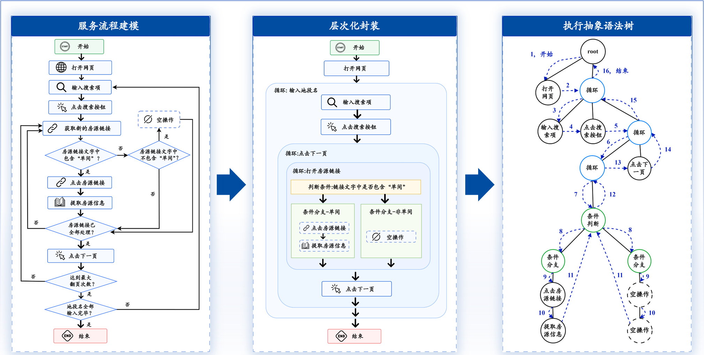

# 房源采集：Flowchart 教学模型与手算说明

配合 [第 15 篇：怎样存](../15.Flowchart基本原理.md)、[第 16 篇：怎样执行](../16.Flowchart递归执行原理.md) 与 [第 18～19 篇：数据结构、编号和渲染](../18.流程图核心数据结构.md)。第16篇标题下方提供了房源页面截图，也可打开[配套房源教学页](房源采集-教学页.html)切换地区和翻页。

第 19 篇另有[渲染机制演示页](渲染机制-演示.html)：可切换空图、顺序、循环、两层循环与判断，查看逐次 append 的结果，并点击方块、箭头核对定位信息。它直接复用仓库 CSS 和提取的原始渲染函数；页面中的事件日志为教学实现。[生成渲染演示.py](生成渲染演示.py) 可重新提取源码，加 `--screenshots` 可用本机 Chrome/Edge 重建讲义中的八张截图。

演示页下方还会实时显示本步 #0 的完整 HTML，可从第 0 次切到每次追加后的状态。脚本加 `--html-snapshots` 可以重新导出[HTML 快照数据](渲染机制-HTML快照.json)，讲义已把顺序、循环、两层循环和判断示例的每次追加结果逐一列出。

[稳定下标 HTML 演示](稳定下标-HTML演示.html) 展示另一种编号方案：id、parentId 直接使用 nodeList 下标。左侧显示五节点图，右侧显示实际 DOM；点击方块或箭头可查看直接定位 nodeList 的结果。它用于比较方案，项目渲染源码未修改。

第 [22 讲](../22.循环采集子元素与Vue参数栏.md) 配有[循环子元素 Vue 演示](循环子元素-Vue演示.html)：在两张房源卡片、循环/提取图和真实 Vue 参数栏之间对照，查看切换字段和修改参数时的变量。它使用[消息案例](循环子元素-消息案例.json)，由[生成脚本](生成循环子元素演示.py)提取源码与[宿主模板](循环子元素-演示模板.html)生成；试运行消息只记录到本地。生成脚本加 --screenshots 可重建四张截图及[状态快照](循环子元素-状态快照.json)，并验证 Vue 绑定与相对 XPath 取值。

[教学模型 JSON](房源采集-教学模型.json) 包含 graph、两地区的示意页面数据与预期记录。它是源码阅读材料，**不是完整可直接导入运行的任务**。示例域名、页面与 XPath 均为教学假设。

## 1. 统一输入

| 地区 | 页轮次 | 房源 |
| --- | --- | --- |
| 海淀 | 1 | A：海淀 单间 2500元；B：海淀 整租 6500元 |
| 海淀 | 2 | C：海淀 单间 2800元 |
| 朝阳 | 1 | D：朝阳 整租 7000元 |
| 朝阳 | 2 | E：朝阳 单间 3000元 |

地区循环：`loopType=3`，`textList="海淀\n朝阳"`。

页面循环：`loopType=0`，`exitCount=2`，循环体为 `[6,12]`。

房源循环：`loopType=1`，本轮传当前链接元素。

判断：`sequence=[8,9]`；8 检查当前循环元素文字包含“单间”，9 是末尾的无条件空分支。

正常推演假定两轮页面都能找到下一页按钮，点击、详情提取和返回列表都成功。页面循环体末尾的点击每轮执行一次，因此每地区是两次点击；`exitCount` 不等于“只翻一次后停在第二页”。最后一页按钮不存在时，当前源码还有补执行循环体的路径，不能直接套用下面次数。

## 2. 结构

~~~text
0 root [1,2]
├─ 1 打开网页
└─ 2 地区循环 [3,4,5]
   ├─ 3 输入地区
   ├─ 4 点击搜索
   └─ 5 页面循环 [6,12]
      ├─ 6 房源循环 [7]
      │  └─ 7 判断 [8,9]
      │     ├─ 8 单间分支 [10,11]
      │     │  ├─ 10 点击房源
      │     │  └─ 11 提取信息
      │     └─ 9 兜底分支 []
      └─ 12 点击下一页
~~~

这里全部数字是数组下标 index。

上方文本树中的数字是教学模型的数组下标。原图蓝色 1–16 表示执行阶段，二者分别对照，不修改原图的编号。

## 3. 实际 refresh 的编号结果

| index | 当前 id | parentId | position |
| --- | --- | --- | --- |
| 0 | 0 | 0 | 无 |
| 1 | 1 | 0 | 0 |
| 2 | 2 | 0 | 1 |
| 3 | 3 | 2 | 0 |
| 4 | 4 | 2 | 1 |
| 5 | 5 | 2 | 2 |
| 6 | 6 | 5 | 0 |
| 7 | 8 | 6 | 0 |
| 8 | 9 | 8 | 0 |
| 9 | 10 | 8 | 1 |
| 10 | 11 | 9 | 0 |
| 11 | 12 | 9 | 1 |
| 12 | 7 | 5 | 1 |

~~~js
actionSequence = [0,1,2,3,4,5,6,12,7,8,9,10,11];
~~~

该表按仓库 `FlowChart.js` 中的实际 `refresh()` 核对；验证时只替代 DOM 输出和事件绑定，不改 BFS 代码。

## 4. 正常执行的手算记录

~~~text
0,1,2,
  3,4,5,
    6,7,8,10,11,7,9,12,
    6,7,8,10,11,12,
  3,4,5,
    6,7,9,12,
    6,7,8,10,11,12
~~~

逐项展开解释见第 16 篇。这份记录表达正常语义，未连接 Selenium，也不覆盖生产代码的异常、脚本退出、标签页恢复与暂停行为。

| 节点 index | 进入次数 |
| --- | --- |
| 0、1、2 | 各 1 |
| 3、4、5 | 各 2 |
| 6、12 | 各 4 |
| 7 | 5 |
| 8、10、11 | 各 3 |
| 9 | 2 |

预期采集 A、C、E。

## 5. 用改一行来检查理解

这些都是相互独立的练习，先恢复原始模型再做下一题：

- `5.sequence=[12,6]`：先翻页，再处理房源。
- `7.sequence=[9,8]`：兜底先满足，全部房源都不采。
- `8.parameters.class=1`：改成检查整个页面，可能把整租误当单间。
- `8.sequence=[11,10]`：先提取列表页，再点击详情。
- `6.sequence=[7,11]` 且 `8.sequence=[10]`：提取成了判断后的公共操作，非单间也会执行。
- 从 `2.sequence` 删除下标 4，但保留 `nodeList[4]`：搜索操作断开，数组长度不变。
- 只设 `nodeList[4].id=-1` 却不删除父引用：下次 refresh 会重新给它编号。

观察结构变化，比背字段名称更容易判断任务会怎样执行。
